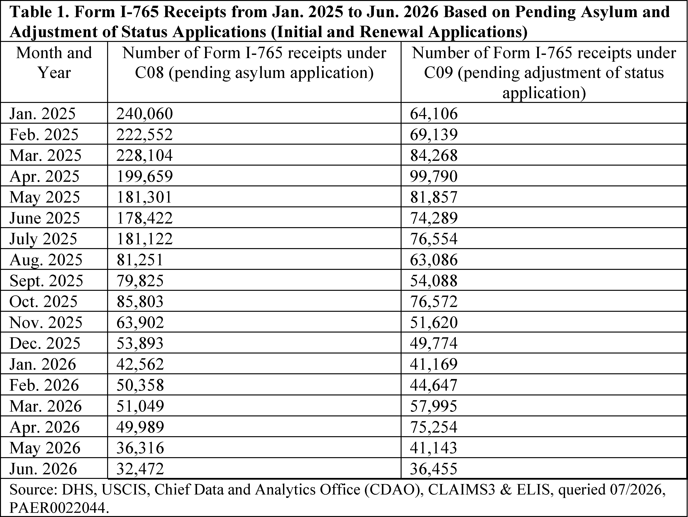
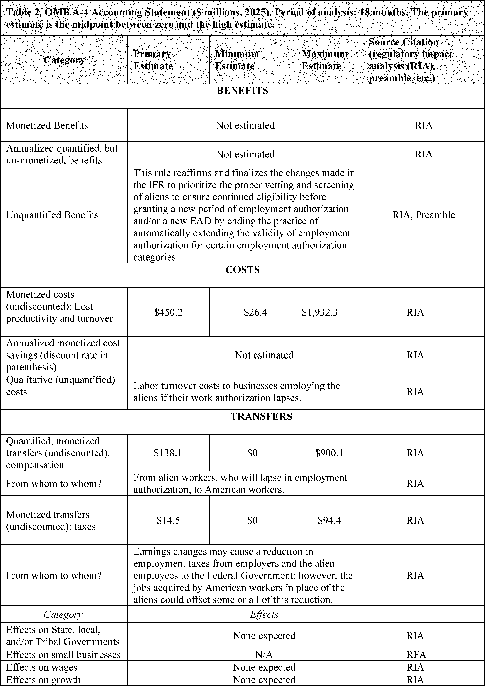

# Daily Digest — 2026-10-14

| | |
|---|---|
| **Digest date** | 2026-10-14 |
| **Data date range** | 2026-10-14 to 2026-10-14 |
| **Generated at** | 2026-10-15T04:02:29Z (UTC) |
| **Pipeline version** | 7ae7f779 |
| **Inference** | model layers ran — cli/haiku, opus |
| **Source watermarks** | CREC: 2026-10-14T10:06:37Z · BILLS: 2026-10-14T06:46:12Z · FR: 2026-10-14T06:27:49Z · USCOURTS: 2026-10-14T22:48:22Z · PLAW: 2026-10-10T13:32:40Z |

[Full observed listing for this day](day/2026-10-14.html) — the items our collectors observed for this publication day, mechanical rules applied, frozen at end of day; releases their publishers date on other days are counted there, not listed. This digest is the canonical record.

All items below cite the govinfo package (and granule, where applicable) they
summarize. Selection is mechanical; each item states the rule that included
it. See the Coverage Statement at the end for a full accounting of what was
published, what was summarized, and what was excluded and why.

---

## Contents

- [Day in Review](#day-in-review)
- [1. Congressional Floor Activity](#1-congressional-floor-activity)
- [2. Legislation](#2-legislation)
- [3. Federal Register](#3-federal-register)
- [4. Enacted Laws](#4-enacted-laws)
- [5. Judicial Activity](#5-judicial-activity)
- [6. Agency Announcements](#6-agency-announcements)
- [7. Recorded Votes](#7-recorded-votes)
- [8. Bill Actions](#8-bill-actions)
- [9. Presidential Actions](#9-presidential-actions)
- [Terms Used Today](#terms-used-today)
- [Coverage Statement](#coverage-statement)
- [Methodology](#methodology)

---

## Day in Review

On the congressional side, the digest carries 28 House and 4 Senate Congressional Record items, along with 6 Daily Digest entries and 41 Extensions of Remarks. It also carries 34 bills introduced in the House and 3 in the Senate, plus one House bill reported with amendment: the Cybersecurity for Small Businesses Act of 2026, which directs the Small Business Administration to provide cybersecurity resources to small businesses. None of the item summaries describe recorded votes.

The Federal Register items include 10 rules, 11 proposed rules, one presidential document and 104 notices. A Presidential Memorandum dated October 7, 2026 established a Committee of Inquiry to investigate allegations of false statements by Federal Reserve Governor Lisa D. Cook. DHS finalized the removal of automatic extensions for certain employment authorization documents and issued an interim final rule shortening the refugee termination response period from 30 to 10 days. EPA extended the 2025 greenhouse gas reporting deadline to March 10, 2027. The NRC published both a rule and a proposed rule renewing the AP1000 design certification.

The digest carries 42 appellate, 862 district court and 6 bankruptcy opinions. The Third Circuit affirmed that 18 U.S.C. § 922(g)(1) violates the Second Amendment as applied to Edward Williams, and separately upheld another felon-in-possession conviction. The Ninth Circuit affirmed a § 922(g)(3) conviction. The First Circuit affirmed dismissal of a habeas petition challenging an expedited removal order. The Tenth Circuit affirmed the denial of qualified immunity to an officer in a fatal shooting case.

*Composed from the summarized items below and the day's mechanical
counts; all specifics are cited in their sections.*

---

## 1. Congressional Floor Activity

Source: Congressional Record (CREC), issue observed 2026-10-14, covering proceedings of 2026-10-13. Published by govinfo 2026-10-14T10:06:37Z; observed by our collector 2026-10-14T10:21:53Z. Total issue size: 79 granule(s).

### 1.1 Senate

No Senate floor items met the selection thresholds. 4 floor granule(s) are accounted for in the Coverage Statement.

### 1.2 House of Representatives

No House floor items met the selection thresholds. 28 floor granule(s) are accounted for in the Coverage Statement.

### 1.3 Recorded Votes

No recorded votes were published in this issue of the Congressional Record.

---

## 2. Legislation

Source: Congressional Bills (BILLS), text versions published 2026-10-14 to 2026-10-14.

### 2.1 Counts by Stage

| Stage (bill text version) | Count |
|---|---|
| Introduced (ih/is) | 37 |
| Reported (rh/rs) | 1 |
| Engrossed (eh/es) | 0 |
| Enrolled (enr) | 0 |
| Other versions | 0 |
| **Total bill texts published** | **38** |

### 2.2 Bills Listed by Mechanical Rule

Tags: legislative · model keys: cybersecurity · information resources · small business

*In plain terms: One bill requires the Small Business Administration to develop and disseminate cybersecurity information and resources for small businesses.*

Bills below are listed because they matched at least one listing rule; the
matching rule is stated per item. All other bill texts are counted above and
accounted for in the Coverage Statement.

- **H. R. 10238 (rh) — 119 HR 10238 RH: Cybersecurity for Small Businesses Act of 2026** — The Cybersecurity for Small Businesses Act of 2026, introduced in September 2026 and reported with amendment in October 2026, requires the Small Business Administration Administrator to develop and disseminate cybersecurity information and resources to small businesses in consultation with the Cybersecurity and Infrastructure Security Agency and National Institute of Standards and Technology. The bill mandates the SBA provide information to small businesses seeking federal contracts regarding the Cybersecurity Maturity Model Certification program and directs the Administrator to consult annually on best practices for disseminating cybersecurity information. The Administrator must submit annual reports to Congress describing the number and details of small businesses that contacted the agency regarding cybersecurity matters.
  - *In plain terms:* The SBA must develop cybersecurity resources for small businesses, provide Cybersecurity Maturity Model Certification program information to federal contract seekers, consult annually with CISA and NIST, and submit annual reports to Congress.
  - Included because: BILLS-SEL-01 — reached stage: reported/enrolled/calendar (document dated 2026-10-13)
  - Source: [BILLS-119hr10238rh](https://www.govinfo.gov/app/details/BILLS-119hr10238rh)

---

## 3. Federal Register

Source: Federal Register (FR), issue of 2026-10-14.

### 3.1 Counts by Document Type

| Document type | Count |
|---|---|
| Rules | 10 |
| Proposed rules | 11 |
| Notices | 104 |
| Presidential documents | 1 |
| **Total FR documents** | **126** |

### 3.2 Rules Published

Tags: department of commerce · department of homeland security · executive · model keys: aircraft safety · airspace boundaries · employment authorization

*In plain terms: Ten rules end automatic employment authorization extensions, expedite refugee termination, update FAA airspace boundaries and aircraft safety requirements, and extend EPA reporting deadlines.*

#### DEPARTMENT OF HEALTH AND HUMAN SERVICES

- **Food Additives Permitted in Feed and Drinking Water of Animals; Chromium Propionate** (2026-20979; 21 CFR Part 573) — The Food and Drug Administration (FDA, we, or the Agency) is amending the regulations for food additives permitted in feed and drinking water of animals to provide for the safe use of chromium propionate as a source of chromium in food for laying hens and breeder chickens. This action is in response to a food additive petition filed by Kemin Industries, Inc. Action: Final Amendment; Order. Dates: This amendment is effective October 14, 2026. See section V, Objections and Hearing Requests, for further information on the filing of objections. Either electronic or written objections and requests for a hearing on the final amendment must be submitted by November 13, 2026.
  - *In plain terms:* The FDA is permitting chromium propionate to be used as a source of chromium in feed for laying hens and breeder chickens.
  - Included because: FR-SEL-01 — document type: final rule (all listed)
  - Source: [FR-2026-10-14 / 2026-20979](https://www.govinfo.gov/app/details/FR-2026-10-14/2026-20979)

#### DEPARTMENT OF HOMELAND SECURITY

- **Removal of Automatic Extensions for Certain Employment Authorization Documents** (2026-20955; 8 CFR Part 274a) — On October 30, 2025, DHS published an interim final rule (IFR) that amended DHS regulations to end the practice of automatically extending the validity of employment authorization documents (Forms I-766 or EADs) for aliens who have timely filed an application to renew their EAD in certain employment authorization categories. This final rule responds to comments received on the IFR and reaffirms and finalizes the provisions of the IFR. Ending the automatic extension of EADs enhances benefit integrity and prioritizes the proper vetting and screening of aliens before granting a new period of employment authorization and/or a new EAD. Action: Final rule. Dates: This final rule is effective on October 14, 2026.
  - *In plain terms:* DHS is finalizing a rule ending the automatic extension of work permits for people who timely file renewal applications.
  - Included because: FR-SEL-01 — document type: final rule (all listed)
  - Source: [FR-2026-10-14 / 2026-20955](https://www.govinfo.gov/app/details/FR-2026-10-14/2026-20955)
  -  *Source graphic 1 of 9 from 2026-20955.*
  -  *Source graphic 2 of 9 from 2026-20955.*
  - *Graphics not rendered here: 7 of 9 — see the [source PDF](https://www.govinfo.gov/content/pkg/FR-2026-10-14/pdf/FR-2026-10-14.pdf).*
- **Removing 30-Day Refugee Termination Notice** (2026-20956; 8 CFR Part 207) — This interim final rule (IFR) amends Department of Homeland Security (DHS) regulations to expedite termination of refugee status when DHS determines an alien was not a refugee within the meaning of section 101(a)(42) of the Immigration and Nationality Act at the time of admission to the United States. The response period to a Notice of Intent to Terminate (NOIT) is reduced from thirty to ten days. These changes aim to restore integrity to the immigration system, mitigate risks to national security and public safety, and prevent fraud and exploitation. Action: Interim final rule. Dates: This IFR is effective on October 14, 2026. Written comments and related materials must be submitted on or before November 13, 2026. The electronic Federal Docket Management System will accept comments prior to midnight Eastern Time at the end of that day.
  - *In plain terms:* DHS is shortening the response period for refugee status termination notices from thirty to ten days.
  - Included because: FR-SEL-01 — document type: final rule (all listed)
  - Source: [FR-2026-10-14 / 2026-20956](https://www.govinfo.gov/app/details/FR-2026-10-14/2026-20956)
- **Imposition and Collection of Civil Penalties for Certain Immigration-Related Violations** (2026-21024; 8 CFR Part 281; 8 CFR Parts 1003 and 1280) — On June 27, 2025, the Departments issued an interim final rule (“IFR”) to streamline assessment of civil penalties under the Immigration and Nationality Act (“INA”) for aliens who fail to depart during a voluntary departure period, willfully fail or refuse to depart after a final removal order and certain other proscribed activities, or are apprehended while improperly entering or attempting to enter the United States. This final rule addresses comments and finalizes the IFR with one change: it permits acceptance of a late-filed appeal based on documented mail delivery delays that ICE finds were beyond the alien's control. Action: Final rule. Dates: The effective date of this final rule is October 14, 2026.
  - *In plain terms:* The Departments are finalizing streamlined civil penalty procedures for immigration violations, now allowing late appeals when documented mail delays were beyond the person's control.
  - Included because: FR-SEL-01 — document type: final rule (all listed)
  - Source: [FR-2026-10-14 / 2026-21024](https://www.govinfo.gov/app/details/FR-2026-10-14/2026-21024)

#### DEPARTMENT OF TRANSPORTATION

- **Amendment of Boundaries for Restricted Areas R-5301, R-5302B, and R-5302C; NC** (2026-20974; 14 CFR Part 73) — This action amends geographic coordinates for boundary points listed in the airspace descriptions for restricted areas R-5301, R-5302B, and R-5302C to correct minor discrepancies that resulted in gaps and overlaps between the areas. This action does not expand any external boundaries or change any altitudes, times of designation, or activities conducted within the restricted areas. Action: Final rule. Dates: Effective date 0901 UTC, December 24, 2026.
  - *In plain terms:* The FAA corrects geographic boundaries for three restricted airspace areas to eliminate gaps and overlaps that resulted from coordinate errors.
  - Included because: FR-SEL-01 — document type: final rule (all listed)
  - Source: [FR-2026-10-14 / 2026-20974](https://www.govinfo.gov/app/details/FR-2026-10-14/2026-20974)
- **Amendment of Domestic Very High Frequency Omnidirectional Range (VOR) Federal Airways V-16, V-35, V-37, V-53, V-133, V-136, V-143, V-259, V-310, V-364, V-409, V-415, V-454, and V-605; Eastern United States** (2026-20987; 14 CFR Part 71) — This action amends domestic Very High Frequency Omnidirectional Range (VOR) Federal Airways V-16, V-35, V-37, V-53, V-133, V-136, V-143, V-259, V-310, V-364, V-409, V-415, V-454, and V-605. The FAA is taking this action due to the decommissioning of the Charlotte, NC (CLT), VOR/Distance Measuring Equipment (VOR/DME); Foothills, SC (ODF), VOR/DME; Holston Mountain, TN (HMV), VOR/Tactical Air Navigation (VORTAC); and the relocation of the Spartanburg, SC (SPA), VORTAC. Action: Final rule. Dates: Effective date 0901 UTC, December 24, 2026. The Director of the Federal Register approves this incorporation by reference action under 1 CFR part 51, subject to the annual revision of FAA Order JO 7400.11 and publication of conforming amendments.
  - *In plain terms:* The FAA is updating fourteen federal airways to reflect the decommissioning of certain radio navigation stations and the relocation of one station.
  - Included because: FR-SEL-01 — document type: final rule (all listed)
  - Source: [FR-2026-10-14 / 2026-20987](https://www.govinfo.gov/app/details/FR-2026-10-14/2026-20987)
- **Airworthiness Directives; Bombardier, Inc., Airplanes** (2026-21010; 14 CFR Part 39) — The FAA is adopting a new airworthiness directive (AD) for certain Bombardier, Inc., Model BD-700-2A12 airplanes. This AD was prompted by reports of low clearance in the right wing between the fuel line flexible coupling and the harness support bracket clip-nut, between the fuel line flexible coupling and hydraulic system, and between the hydraulic system and fuel vent tube. This AD requires rectifying the low clearance condition between the fuel line flexible coupling and the harness support bracket clip-nut, rectifying the low clearance condition between the fuel line flexible coupling and the hydraulic system, and doing an inspection for adequate clearance between the hydraulic system and the fuel vent tube and applicable on-conditions actions. The FAA is issuing this AD to address the unsafe condition on these products. Action: Final rule. Dates: This AD is effective November 18, 2026. The Director of the Federal Register approved the incorporation by reference of a certain publication listed in this AD as of November 18, 2026.
  - *In plain terms:* The FAA is requiring Bombardier aircraft owners to fix tight clearances between fuel lines and related systems to prevent potential damage.
  - Included because: FR-SEL-01 — document type: final rule (all listed)
  - Source: [FR-2026-10-14 / 2026-21010](https://www.govinfo.gov/app/details/FR-2026-10-14/2026-21010)

#### ENVIRONMENTAL PROTECTION AGENCY

- **Extending the Reporting Deadline Under the Greenhouse Gas Reporting Rule for Reporting Year 2025 to March 10, 2027** (2026-20982; 40 CFR Part 98) — The Environmental Protection Agency (EPA) is taking interim final action to extend the reporting deadline under the Greenhouse Gas Reporting Rule for reporting year 2025 data from October 30, 2026, to March 10, 2027. This final action only changes the reporting deadline for annual greenhouse gas reports for reporting year 2025 and makes no other changes to the rule. The EPA is requesting comments on all aspects of this interim final rule. Action: Interim final rule; request for comment. Dates: This interim final rule is effective on October 14, 2026. Comments on this rule must be received on or by November 30, 2026. Public Hearing. If anyone contacts the EPA requesting a public hearing on or before October 19, 2026, the Agency will hold a virtual public hearing. See SUPPLEMENTARY INFORMATION section for information on requesting and registering for a public hearing.
  - *In plain terms:* The EPA is extending the deadline for reporting 2025 greenhouse gas emissions data from October 30, 2026 to March 10, 2027.
  - Included because: FR-SEL-01 — document type: final rule (all listed)
  - Source: [FR-2026-10-14 / 2026-20982](https://www.govinfo.gov/app/details/FR-2026-10-14/2026-20982)

#### NUCLEAR REGULATORY COMMISSION

- **AP1000 Design Certification Renewal** (2026-21030; 10 CFR Part 52) — The U.S. Nuclear Regulatory Commission (NRC) is amending its regulations to renew the AP1000 design certification and incorporate Revision 20 of the AP1000 design control document. The purpose of this rulemaking action is to update the AP1000 design to be consistent with changes made to the design during the licensing, construction, and operation of Vogtle Electric Generating Plant, Units 3 and 4. This rulemaking incorporates AP1000 design control document Revision 20, which includes updates made to the AP1000 design to represent a current, construction-validated design. The NRC is also issuing an environmental assessment supporting this rule. Action: Direct final rule and issuance of environmental assessment. Dates: The final rule is effective December 28, 2026, unless significant adverse comments are received by November 13, 2026. If the direct final rule is withdrawn as a result of such comments, timely notice of the withdrawal will be published in the Federal Register . (For more on NRC's consideration of comments received, see SUPPLEMENTARY INFORMATION .) The incorporation by reference of certain publications listed in this regulation is approved by the Director of the Office of the Federal Register as of December 28, 2026.
  - *In plain terms:* The Nuclear Regulatory Commission is renewing the AP1000 nuclear reactor design certification and updating it to reflect changes made during construction of Vogtle Units 3 and 4.
  - Included because: FR-SEL-01 — document type: final rule (all listed)
  - Source: [FR-2026-10-14 / 2026-21030](https://www.govinfo.gov/app/details/FR-2026-10-14/2026-21030)

#### PENSION BENEFIT GUARANTY CORPORATION

- **Allocation of Assets in Single-Employer Plans; Interest Assumptions for Valuing Benefits** (2026-21019; 29 CFR Part 4044) — This final rule amends the Pension Benefit Guaranty Corporation's regulation on Allocation of Assets in Single-Employer Plans to prescribe the spreads component of the interest assumption under the asset allocation regulation for plans with valuation dates of October 31, 2026-January 30, 2027. These interest assumptions are used for valuing benefits under terminating single-employer plans and for other purposes. Action: Final rule. Dates: Effective October 31, 2026.
  - *In plain terms:* The Pension Benefit Guaranty Corporation is setting interest rate assumptions for valuing benefits in pension plans with valuation dates between October 31, 2026 and January 30, 2027.
  - Included because: FR-SEL-01 — document type: final rule (all listed)
  - Source: [FR-2026-10-14 / 2026-21019](https://www.govinfo.gov/app/details/FR-2026-10-14/2026-21019)

### 3.3 Proposed Rules Published

Tags: department of commerce · department of homeland security · executive · model keys: airworthiness directives · controlled substances · immigration

*In plain terms: Eleven proposals include FAA airworthiness directives for Leonardo and Piaggio helicopters, DEA scheduling of controlled substances, and changes affecting immigration, environmental compliance, postal reporting, and nuclear design.*

#### DEPARTMENT OF HEALTH AND HUMAN SERVICES

- **Further Reducing Bureaucracy and Burden From the Administration for Native Americans** (2026-21004; 45 CFR Part 1336) — The Department of Health and Human Services, Administration for Children and Families proposes to further amend the Native American Programs Act regulations to streamline the part. Action: Notice of proposed rulemaking. Dates: In order to be considered, written comments on this proposed rule must be received on or before November 13, 2026.
  - *In plain terms:* The Department of Health and Human Services proposes streamlining regulations under the Native American Programs Act.
  - Included because: FR-SEL-02 — document type: proposed rule (all listed)
  - Source: [FR-2026-10-14 / 2026-21004](https://www.govinfo.gov/app/details/FR-2026-10-14/2026-21004)

#### DEPARTMENT OF HOMELAND SECURITY

- **Removing Deference to Prior USCIS Determinations of Eligibility** (2026-20941; 8 CFR Part 214) — The U.S. Department of Homeland Security (DHS), U.S. Citizenship and Immigration Services (USCIS), proposes to remove 8 CFR 214.1(c)(5), which generally provides that USCIS gives deference to a prior approval involving the same facts when adjudicating a request to extend a petition for an alien's employment or stay. This change would better align DHS regulations with the statute, which places the burden of proving eligibility for all immigration benefits on the petitioner, applicant, or beneficiary; strengthen adjudicatory review; and support agency priorities to improve the integrity of the immigration system and better protect the interests of U.S. workers. Action: Notice of proposed rulemaking. Dates: Written comments on the notice of proposed rulemaking (NPRM) must be submitted on or before November 13, 2026. The electronic Federal Docket Management System will accept comments before midnight Eastern time at the end of that day.
  - *In plain terms:* USCIS proposes eliminating the rule that defaults to trusting prior approvals on similar cases, instead requiring applicants to prove eligibility each time.
  - Included because: FR-SEL-02 — document type: proposed rule (all listed)
  - Source: [FR-2026-10-14 / 2026-20941](https://www.govinfo.gov/app/details/FR-2026-10-14/2026-20941)

#### DEPARTMENT OF JUSTICE

- **Schedules of Controlled Substances: Temporary Placement of MGM-15 and MGM-16 in Schedule I** (2026-20942; 21 CFR Part 1308) — The Drug Enforcement Administration (DEA) is issuing this notice of intent to publish a temporary order to schedule two 7-hydroxymitragynine-related substances (MGM-15 and MGM-16), including their isomers, esters, ethers, salts, and salts of isomers, esters, and ethers, whenever the existence of such isomers, esters, ethers, and salts is possible, in schedule I of the Controlled Substances Act (CSA). On August 26, 2026, DEA published a temporary order placing mitragynine pseudoindoxyl, MGM-15, and MGM-16 in schedule I of the CSA. Today, DEA is providing notice of its intent to publish a new temporary order for MGM-15 and MGM-16 that will maintain the temporary placement of these substances in schedule I of the CSA without change. Separately in this Federal Register , DEA is publishing a notice of intent relating to mitragynine pseudoindoxyl, in response to a letter sent by the Department of Health and Human Services (HHS) dated October 6, 2026. HHS's letter related only to mitragynine pseudoindoxyl. Therefore, DEA is publishing this notice of intent only for the technical and procedural purpose of distinguishing MGM-15 and MGM-16 from mitragynine pseudoindoxyl. [official summary truncated; see source] Action: Proposed amendment; notice of intent. Dates: October 14, 2026.
  - *In plain terms:* The DEA is announcing its intention to maintain two compounds related to 7-hydroxymitragynine (MGM-15 and MGM-16) as Schedule I controlled substances.
  - Included because: FR-SEL-02 — document type: proposed rule (all listed)
  - Source: [FR-2026-10-14 / 2026-20942](https://www.govinfo.gov/app/details/FR-2026-10-14/2026-20942)
- **Schedules of Controlled Substances: Temporary Placement of 7- Hydroxymitragynine and Mitragynine Pseudoindoxyl Above a Specified Threshold in Schedule I** (2026-20943; 21 CFR Part 1308) — The Administrator of the Drug Enforcement Administration (DEA) is issuing this notice of intent to publish a temporary order to schedule 7-hydroxymitragynine and mitragynine pseudoindoxyl (including their isomers, esters, ethers, salts, and salts of isomers, esters, and ethers, whenever the existence of such isomers, esters, ethers, and salts is possible) when either substance alone, or their combined amount if both are present, is above a specified threshold, in schedule I of the Controlled Substances Act (CSA). Based on a different threshold provided by the Department of Health and Human Services (HHS) in July of 2025, DEA published a notice of intent to temporarily schedule 7-hydroxymitragynine above that lower threshold on July 7, 2026. Additionally, DEA published a temporary order placing mitragynine pseudoindoxyl without a threshold in schedule I of the CSA on August 26, 2026. On October 8, 2026, HHS sent a letter recommending that DEA place of the CSA 7-hydroxymitragynine and mitragynine pseudoindoxyl in schedule I when either substance alone, or their combined amount if both are present, is above a new specified threshold. [official summary truncated; see source] Action: Proposed amendment; notice of intent. Dates: October 14, 2026.
  - *In plain terms:* The DEA proposes placing 7-hydroxymitragynine and mitragynine pseudoindoxyl in Schedule I when present above a specified threshold, based on an October 8, 2026 recommendation from the Department of Health and Human Services.
  - Included because: FR-SEL-02 — document type: proposed rule (all listed)
  - Source: [FR-2026-10-14 / 2026-20943](https://www.govinfo.gov/app/details/FR-2026-10-14/2026-20943)

#### DEPARTMENT OF TRANSPORTATION

- **Airworthiness Directives; Leonardo S.p.A. Helicopters** (2026-20930; 14 CFR Part 39) — The FAA proposes to supersede Airworthiness Directive (AD) 2024-18-01, which applies to Leonardo S.p.A. Model A119 and AW119 MKII helicopters. AD 2024-18-01 requires repetitive inspections of certain collective stick torque tube assemblies for deficiencies and corrective action, as applicable. Since the FAA issued AD 2024-18-01, an improved collective stick torque tube assembly was designed, and replacement instructions were issued. This proposed AD would require repetitive inspections of certain collective stick torque tube assemblies and, depending on the results of the inspection, replacement of affected parts. This proposed AD would also require modification of the helicopter through replacement of an affected part with a serviceable part, which would constitute terminating action for the repetitive inspections. This proposed AD would also prohibit installation of an affected part on any helicopter. The FAA is proposing this airworthiness directive (AD) to address the unsafe condition on these products. Action: Notice of proposed rulemaking (NPRM). Dates: The FAA must receive comments on this proposed AD by November 30, 2026.
  - *In plain terms:* The FAA proposes replacing a prior safety order for Leonardo helicopters by requiring inspections of collective stick torque tube assemblies and replacement of defective parts, with permanent modification as an option.
  - Included because: FR-SEL-02 — document type: proposed rule (all listed)
  - Source: [FR-2026-10-14 / 2026-20930](https://www.govinfo.gov/app/details/FR-2026-10-14/2026-20930)
- **Airworthiness Directives; Baykar Piaggio Aerospace S.p.A. (Type Certificate Previously Held by Piaggio Aviation S.p.A.) Airplanes** (2026-21008; 14 CFR Part 39) — The FAA proposes to adopt a new airworthiness directive (AD) for certain Baykar Piaggio Aerospace S.p.A. (Piaggio) Model P-180 airplanes. This proposed AD was prompted by a report of corrosion and cracks found around the head of attaching fasteners on main wing lower skin external reinforcement doublers. This proposed AD would require repetitive high frequency eddy current (HFEC) inspections of the lower skin reinforcement and, depending on findings, corrective action. The FAA is proposing this AD to address the unsafe condition on these products. Action: Notice of proposed rulemaking (NPRM). Dates: The FAA must receive comments on this NPRM by November 30, 2026.
  - *In plain terms:* The FAA proposes requiring repeated inspections and corrective maintenance for corrosion and cracks found on Piaggio P-180 airplane wing skins.
  - Included because: FR-SEL-02 — document type: proposed rule (all listed)
  - Source: [FR-2026-10-14 / 2026-21008](https://www.govinfo.gov/app/details/FR-2026-10-14/2026-21008)
- **Airworthiness Directives; The Boeing Company Airplanes** (2026-21009; 14 CFR Part 39) — The FAA is withdrawing a notice of proposed rulemaking (NPRM) that proposed to adopt a new airworthiness directive (AD) that would have applied to certain The Boeing Company Model 787-8, 787-9, and 787-10 airplanes. The NPRM was prompted by reports that very high frequency (VHF) radio frequencies transfer between the active and standby windows of the tuning control panel (TCP) without flightcrew input. The uncommanded frequency changes could result in missed communications between the flightcrew and Air Traffic Control. The NPRM would have required updating the TCP operational software (OPS) and performing a software configuration check. Since issuance of the NPRM, the FAA has determined that the TCP OPS version specified in the NPRM does not correct the unsafe condition. Accordingly, the NPRM is withdrawn. Action: Proposed rule; withdrawal. Dates: As of October 14, 2026, the proposed rule, which was published in the Federal Register on February 26, 2025 (90 FR 10703), is withdrawn.
  - *In plain terms:* The FAA is withdrawing a proposed safety order for Boeing 787 aircraft because the recommended software update does not fix the radio frequency problem.
  - Included because: FR-SEL-02 — document type: proposed rule (all listed)
  - Source: [FR-2026-10-14 / 2026-21009](https://www.govinfo.gov/app/details/FR-2026-10-14/2026-21009)
- **Airworthiness Directives; Leonardo S.p.a. Helicopters** (2026-21012; 14 CFR Part 39) — The FAA proposes to supersede Airworthiness Directive (AD) 2024-05-06, which applies to all Leonardo S.p.a Model AW169 helicopters. AD 2024-05-06 requires revising the airworthiness limitations section (ALS) of the existing helicopter maintenance manual (MM) or instructions for continued airworthiness (ICA) and the existing approved maintenance or inspection program for the helicopter. Since the FAA issued AD 2024-05-06, it was determined that incorrect material was referenced to revise the ALS. This proposed AD would require revising the ALS of the existing MM or ICA and the existing approved maintenance or inspection program. The FAA is proposing this AD to address the unsafe condition on these products. Action: Notice of proposed rulemaking (NPRM). Dates: The FAA must receive comments on this proposed AD by November 30, 2026.
  - *In plain terms:* The FAA proposes replacing a prior safety order for Leonardo AW169 helicopters with a corrected version that specifies proper maintenance materials.
  - Included because: FR-SEL-02 — document type: proposed rule (all listed)
  - Source: [FR-2026-10-14 / 2026-21012](https://www.govinfo.gov/app/details/FR-2026-10-14/2026-21012)

#### ENVIRONMENTAL PROTECTION AGENCY

- **Trichloroethylene (TCE); Regulation Under the Toxic Substances Control Act (TSCA); Compliance Date Extensions** (2026-20964; 40 CFR Part 751) — The Environmental Protection Agency (EPA or Agency) is proposing to extend certain compliance dates applicable to certain entities subject to the regulation of trichloroethylene (TCE) under the Toxic Substances Control Act (TSCA) until December 31, 2027, including for certain chemical processors in meeting the prohibition compliance deadline for the processing of TCE, industrial and commercial use of TCE as a processing aid, and associated wastewater disposal; and for refrigerant manufacturers in meeting the compliance deadline for phasing down TCE feedstock in the production of HFC-134a. This proposed compliance extension would allow for necessary and reasonable transition periods for regulated entities under TSCA section 6(d). Action: Proposed rule. Dates: Comments must be received on or before November 13, 2026.
  - *In plain terms:* The EPA proposes extending until December 31, 2027 the deadline for certain companies to comply with restrictions on trichloroethylene processing and use.
  - Included because: FR-SEL-02 — document type: proposed rule (all listed)
  - Source: [FR-2026-10-14 / 2026-20964](https://www.govinfo.gov/app/details/FR-2026-10-14/2026-20964)

#### NUCLEAR REGULATORY COMMISSION

- **AP1000 Design Certification Renewal** (2026-21031; 10 CFR Part 52) — The U.S. Nuclear Regulatory Commission (NRC) is proposing to amend its regulations to renew the AP1000 design certification and incorporate Revision 20 of the AP1000 design control document. The purpose of this rulemaking action is to update the AP1000 design to be consistent with changes made to the design during the licensing, construction, and operation of Vogtle Electric Generating Plant, Units 3 and 4. This rulemaking incorporates AP1000 design control document Revision 20, which includes updates made to the AP1000 design to represent a current, construction-validated design. The NRC also proposes to issue an environmental assessment supporting this rule. Action: Proposed rule and environmental assessment. Dates: Submit comments by November 13, 2026.
  - *In plain terms:* The Nuclear Regulatory Commission is proposing to renew the AP1000 nuclear reactor design certification and update it to reflect changes made during Vogtle Units 3 and 4 construction.
  - Included because: FR-SEL-02 — document type: proposed rule (all listed)
  - Source: [FR-2026-10-14 / 2026-21031](https://www.govinfo.gov/app/details/FR-2026-10-14/2026-21031)

#### POSTAL REGULATORY COMMISSION

- **Periodic Reporting** (2026-21000; 39 CFR Part 3050) — The Commission is acknowledging a recent Postal Service filing requesting the Commission initiate a rulemaking proceeding to consider changes to analytical principles relating to periodic reports. This document informs the public of the filing, invites public comment, and takes other administrative steps. Action: Notice of proposed rulemaking. Dates: Comments are due: November 19, 2026.
  - *In plain terms:* The Postal Regulatory Commission is requesting public comment on a proposal to change the analytical principles used for periodic reports.
  - Included because: FR-SEL-02 — document type: proposed rule (all listed)
  - Source: [FR-2026-10-14 / 2026-21000](https://www.govinfo.gov/app/details/FR-2026-10-14/2026-21000)

### 3.4 Notices and Presidential Documents

Tags: department of commerce · department of homeland security · executive · model keys: false statements · federal reserve · investigation

*In plain terms: One presidential memorandum established a committee to investigate allegations that Federal Reserve Governor Lisa Cook made false statements regarding mortgage instruments.*

Notices are summarized only when they match a listing rule; all are counted
in 3.1 and in the Coverage Statement. Presidential documents in the FR are
always listed.

- **Establishment of a Committee of Inquiry To Investigate Allegations of False Statements by Lisa DeNell Cook** (2026-21061) — A Presidential Memorandum dated October 7, 2026 established a Committee of Inquiry to investigate allegations that Federal Reserve Governor Lisa D. Cook made false statements relating to mortgage instruments. The committee, composed of the Assistant to the President for Economic Policy, the Chairman of the Equal Employment Opportunity Commission, and the Director of the Office of Government Ethics, shall hold a hearing on November 5, 2026 at the White House and submit findings to the President with a recommendation regarding cause for removal.
  - *In plain terms:* A Presidential Memorandum from October 7, 2026 established a committee to investigate allegations that Federal Reserve Governor Lisa Cook made false statements about mortgage instruments, with a hearing scheduled for November 5, 2026.
  - Included because: FR-SEL-03 — presidential document (all listed)
  - Source: [FR-2026-10-14 / 2026-21061](https://www.govinfo.gov/app/details/FR-2026-10-14/2026-21061)
  - Corroborated across time: the same document was first published by the White House on [2026-10-09](https://www.whitehouse.gov/presidential-actions/2026/10/establishment-of-a-committee-of-inquiry-to-investigate-allegations-of-false-statements-by-lisa-denell-cook/), days before the Federal Register compiled it. Listed here as the official record of this day — the earlier publication is referenced, not suppressed; both observations are preserved and counted.

---

## 4. Enacted Laws

Source: Public and Private Laws (PLAW) published 2026-10-14.

No laws were published in this range.

---

## 5. Judicial Activity

Source: United States Courts Opinions (USCOURTS): opinions observed 2026-10-14
by our collector; each opinion states its own issue date beside its
listing ([how our clocks work](faq.html#fapds-three-clocks)).

Completeness disclosure (standing): USCOURTS carries opinions from
approximately 140 participating appellate, district, bankruptcy, and
national federal courts. Unlike the Congressional Record and the Federal
Register, which are the complete official record of their branches,
USCOURTS is participation-based and is NOT the complete federal judicial
record. Courts post opinions with delay — typically over several days —
so a day's digest carries the opinions that became available that day,
whatever date each was issued.

### 5.1 Appellate and National Court Opinions

Tags: judicial · model keys: criminal convictions · employment discrimination · immigration cases

*In plain terms: Forty-two court decisions include criminal convictions for drug and firearm offenses, immigration cases, employment discrimination lawsuits, and procedurally dismissed appeals.*

Appellate and national court opinions are summarized; district and
bankruptcy opinions are counted in 5.2 and in the Coverage Statement.

#### United States Court of Appeals for the Eighth Circuit

- **United States v. Ryan Thompson** (No. 24-02858; filed 2026-10-13) — The Eighth Circuit issued an opinion and entered judgment in United States v. Ryan Thompson, with notification of post-submission procedures and filing deadlines for petitions for rehearing.
  - *In plain terms:* A federal appeals court issued a decision with deadlines for requesting rehearing.
  - Included because: USCOURTS-SEL-01 — appellate court opinion (all listed) (document dated 2026-10-13)
  - Source: [USCOURTS-ca8-24-02858 / USCOURTS-ca8-24-02858-0](https://www.govinfo.gov/app/details/USCOURTS-ca8-24-02858/USCOURTS-ca8-24-02858-0)
- **Brooklyn Rockett, et al v. Eric Eighmy** (No. 25-01664; filed 2026-10-13) — The Eighth Circuit issued an opinion and entered judgment in Brooklyn Rockett v. Eric Eighmy, with notification of post-submission procedures and filing deadlines for petitions for rehearing.
  - *In plain terms:* A federal appeals court issued a decision with deadlines for requesting rehearing.
  - Included because: USCOURTS-SEL-01 — appellate court opinion (all listed) (document dated 2026-10-13)
  - Source: [USCOURTS-ca8-25-01664 / USCOURTS-ca8-25-01664-0](https://www.govinfo.gov/app/details/USCOURTS-ca8-25-01664/USCOURTS-ca8-25-01664-0)
- **Galewood West Development, Inc. v. City of Nixa, et al** (No. 25-03275; filed 2026-10-13) — The Eighth Circuit issued an opinion and entered judgment in Galewood West Development, Inc. v. City of Nixa, with notification of post-submission procedures and filing deadlines for petitions for rehearing.
  - *In plain terms:* A federal appeals court issued a decision with deadlines for requesting rehearing.
  - Included because: USCOURTS-SEL-01 — appellate court opinion (all listed) (document dated 2026-10-13)
  - Source: [USCOURTS-ca8-25-03275 / USCOURTS-ca8-25-03275-0](https://www.govinfo.gov/app/details/USCOURTS-ca8-25-03275/USCOURTS-ca8-25-03275-0)

#### United States Court of Appeals for the Eleventh Circuit

- **USA v. Terrance Louis** (No. 21-14252; filed 2026-10-13) — Louis appealed his conviction for firearm possession as a felon, challenging a warrantless search of his home during conditional release. The court affirmed the denial of the motion to suppress the search but vacated his sentence because the government failed to prove the three prior convictions required for the mandatory 15-year minimum sentence enhancement under ACCA.
  - *In plain terms:* The court upheld the denial of the search challenge but vacated the sentence because the government failed to prove the three prior convictions required for the 15-year minimum penalty.
  - Included because: USCOURTS-SEL-01 — appellate court opinion (all listed) (document dated 2026-10-13)
  - Source: [USCOURTS-ca11-21-14252 / USCOURTS-ca11-21-14252-0](https://www.govinfo.gov/app/details/USCOURTS-ca11-21-14252/USCOURTS-ca11-21-14252-0)
- **Victoria Bird v. University of Florida Board of Trustees, et al** (No. 22-12061; filed 2026-10-13) — Bird, a clinical assistant professor at University of Florida, filed discrimination and retaliation claims against the university and two doctors after her contract was not renewed. The district court granted summary judgment on most claims before discovery closed, and a jury returned a verdict against her on the retaliation claims that proceeded to trial.
  - *In plain terms:* Most of Bird's claims ended in summary judgment before trial, but a jury found against her on retaliation claims that did proceed to trial.
  - Included because: USCOURTS-SEL-01 — appellate court opinion (all listed) (document dated 2026-10-13)
  - Source: [USCOURTS-ca11-22-12061 / USCOURTS-ca11-22-12061-0](https://www.govinfo.gov/app/details/USCOURTS-ca11-22-12061/USCOURTS-ca11-22-12061-0)
- **USA v. Wiber Tenorio-Rodriguez** (No. 25-13931; filed 2026-10-13) — Tenorio-Rodriguez appealed the district court's denial of a sentence reduction under 18 U.S.C. § 3582(c)(2) based on a retroactive amendment to the Sentencing Guidelines. The court affirmed the denial, finding the district court did not abuse its discretion in weighing the statutory factors that guide sentencing.
  - *In plain terms:* The court upheld the denial of the defendant's request to reduce his sentence based on a sentencing guideline rule change, finding the district court properly weighed the factors.
  - Included because: USCOURTS-SEL-01 — appellate court opinion (all listed) (document dated 2026-10-13)
  - Source: [USCOURTS-ca11-25-13931 / USCOURTS-ca11-25-13931-0](https://www.govinfo.gov/app/details/USCOURTS-ca11-25-13931/USCOURTS-ca11-25-13931-0)
- **USA v. Carlos Gutierrez-Hernandez** (No. 26-10552; filed 2026-10-13) — The Eleventh Circuit affirmed Carlos Gutierrez-Hernandez's 56-month prison sentence for illegal reentry after prior deportation in case No. 26-10552. The district court calculated his guideline range as 46 to 57 months based on his base offense level, enhancements for repeat offense and prior burglary conviction, and a three-level reduction for acceptance of responsibility. The appellate court held that the sentence, which falls within the guideline range and well below the statutory maximum, is presumed reasonable.
  - *In plain terms:* A federal appeals court upheld a 56-month prison sentence for a man who illegally returned to the United States after being deported.
  - Included because: USCOURTS-SEL-01 — appellate court opinion (all listed) (document dated 2026-10-13)
  - Source: [USCOURTS-ca11-26-10552 / USCOURTS-ca11-26-10552-0](https://www.govinfo.gov/app/details/USCOURTS-ca11-26-10552/USCOURTS-ca11-26-10552-0)
- **John Cohan v. Jason Calhoun, et al** (No. 26-10943; filed 2026-10-13) — The court dismissed Cohan's appeal for lack of jurisdiction because he filed his notice of appeal one day after the 30-day statutory deadline required by 28 U.S.C. § 2107(a).
  - *In plain terms:* The court dismissed the appeal because the defendant filed it one day after the 30-day deadline.
  - Included because: USCOURTS-SEL-01 — appellate court opinion (all listed) (document dated 2026-10-13)
  - Source: [USCOURTS-ca11-26-10943 / USCOURTS-ca11-26-10943-0](https://www.govinfo.gov/app/details/USCOURTS-ca11-26-10943/USCOURTS-ca11-26-10943-0)
- **Theodore Sabir v. Joy Sabir** (No. 26-11293; filed 2026-10-13) — Sabir appealed the dismissal of his federal lawsuit challenging state court decisions regarding alimony and child support from his divorce. The court affirmed the dismissal under the Rooker-Feldman doctrine, which prevents federal courts from reviewing state court judgments.
  - *In plain terms:* The court upheld dismissal of the lawsuit under the rule preventing federal courts from reviewing state court decisions about alimony and child support.
  - Included because: USCOURTS-SEL-01 — appellate court opinion (all listed) (document dated 2026-10-13)
  - Source: [USCOURTS-ca11-26-11293 / USCOURTS-ca11-26-11293-0](https://www.govinfo.gov/app/details/USCOURTS-ca11-26-11293/USCOURTS-ca11-26-11293-0)
- **Shakeyra Bradley v. Fox 5 Atlanta, et al** (No. 26-12438; filed 2026-10-13) — The court dismissed Bradley's appeal for lack of jurisdiction because she filed her notice of appeal over two months after the 30-day statutory deadline.
  - *In plain terms:* The court dismissed the appeal because she filed it more than two months after the 30-day deadline.
  - Included because: USCOURTS-SEL-01 — appellate court opinion (all listed) (document dated 2026-10-13)
  - Source: [USCOURTS-ca11-26-12438 / USCOURTS-ca11-26-12438-0](https://www.govinfo.gov/app/details/USCOURTS-ca11-26-12438/USCOURTS-ca11-26-12438-0)

#### United States Court of Appeals for the Fifth Circuit

- **Reese v. Wells Fargo** (No. 25-11021; filed 2026-10-13) — The United States Court of Appeals for the Fifth Circuit affirmed the dismissal of a foreclosure-related civil action as barred by res judicata, finding the appellants' claims were based on the same operative facts as a prior judgment and the new defendants had substantive legal relationships with parties to the earlier case.
  - *In plain terms:* The court upheld dismissal because the claims were based on the same facts as a previous case and the new defendants had legal ties to the earlier parties.
  - Included because: USCOURTS-SEL-01 — appellate court opinion (all listed) (document dated 2026-10-13)
  - Source: [USCOURTS-ca5-25-11021 / USCOURTS-ca5-25-11021-0](https://www.govinfo.gov/app/details/USCOURTS-ca5-25-11021/USCOURTS-ca5-25-11021-0)
- **USA v. Torres** (No. 25-11341; filed 2026-10-13) — The United States Court of Appeals for the Fifth Circuit granted a motion to withdraw appellate counsel and dismissed an appeal after counsel determined the appeal presented no nonfrivolous issue for review.
  - *In plain terms:* The court dismissed the appeal after counsel determined there were no valid legal issues worth reviewing.
  - Included because: USCOURTS-SEL-01 — appellate court opinion (all listed) (document dated 2026-10-13)
  - Source: [USCOURTS-ca5-25-11341 / USCOURTS-ca5-25-11341-0](https://www.govinfo.gov/app/details/USCOURTS-ca5-25-11341/USCOURTS-ca5-25-11341-0)
- **USA v. Fletcher** (No. 25-30426; filed 2026-10-13) — The United States Court of Appeals for the Fifth Circuit affirmed a 180-month sentence imposed on Wardell Fletcher for possession of a firearm after a felony conviction, finding his claims of error in the assessment of criminal history points either failed to meet the required standard or were harmless.
  - *In plain terms:* The court upheld the 180-month sentence for firearm possession after a felony conviction, finding any errors in calculating criminal history didn't affect the outcome.
  - Included because: USCOURTS-SEL-01 — appellate court opinion (all listed) (document dated 2026-10-13)
  - Source: [USCOURTS-ca5-25-30426 / USCOURTS-ca5-25-30426-0](https://www.govinfo.gov/app/details/USCOURTS-ca5-25-30426/USCOURTS-ca5-25-30426-0)
- **USA v. York** (No. 25-40573; filed 2026-10-13) — York appealed the denial of compassionate release, arguing that the First Step Act's modification of 18 U.S.C. § 924(c) should qualify as an extraordinary and compelling reason for sentence reduction. The Fifth Circuit affirmed the denial, finding that the Supreme Court's decision in Rutherford v. United States resolved the issue by holding that the First Step Act's nonretroactive change to § 924(c) cannot support compassionate release eligibility.
  - *In plain terms:* The court upheld the denial of compassionate release, as the Supreme Court previously held that the First Step Act's change to sentencing law cannot justify release.
  - Included because: USCOURTS-SEL-01 — appellate court opinion (all listed) (document dated 2026-10-13)
  - Source: [USCOURTS-ca5-25-40573 / USCOURTS-ca5-25-40573-0](https://www.govinfo.gov/app/details/USCOURTS-ca5-25-40573/USCOURTS-ca5-25-40573-0)
- **USA v. Sanchez-Sanchez** (No. 26-10077; filed 2026-10-13) — Sanchez-Sanchez challenged his 57-month drug sentence, arguing the district court improperly deferred to a new prosecutorial policy and failed to consider downward variance to avoid sentence disparities with defendants sentenced under the prior policy. The Fifth Circuit found no procedural or substantive error, holding that the court made an individualized assessment of sentencing factors and Sanchez-Sanchez failed to demonstrate abuse of discretion.
  - *In plain terms:* The court upheld the 57-month drug sentence, finding the judge properly considered sentencing factors and didn't abuse discretion by not reducing it for policy reasons.
  - Included because: USCOURTS-SEL-01 — appellate court opinion (all listed) (document dated 2026-10-13)
  - Source: [USCOURTS-ca5-26-10077 / USCOURTS-ca5-26-10077-0](https://www.govinfo.gov/app/details/USCOURTS-ca5-26-10077/USCOURTS-ca5-26-10077-0)
- **USA v. Monserrate** (No. 26-10163; filed 2026-10-13) — Monserrate appealed the revocation of her supervised release terms and imposition of concurrent imprisonment, arguing the district court exceeded its jurisdiction by considering conduct occurring after her supervised release expired. The Fifth Circuit affirmed, holding that the court retained jurisdiction because it also relied on pre-expiration conduct and a pre-expiration arrest warrant.
  - *In plain terms:* A federal appeals court upheld the revocation of a woman's supervised release and imprisonment imposed after her supervised release ended, finding the court had jurisdiction.
  - Included because: USCOURTS-SEL-01 — appellate court opinion (all listed) (document dated 2026-10-13)
  - Source: [USCOURTS-ca5-26-10163 / USCOURTS-ca5-26-10163-0](https://www.govinfo.gov/app/details/USCOURTS-ca5-26-10163/USCOURTS-ca5-26-10163-0)
- **USA v. Monserrate** (No. 26-10164; filed 2026-10-13) — Monserrate appealed the revocation of her supervised release, arguing that the district court exceeded its jurisdiction by considering conduct that occurred after her supervised release terms had expired. The Fifth Circuit affirmed, holding that the district court's reliance on pre-expiration conduct and a pre-expiration arrest warrant preserved its jurisdiction to revoke supervised release.
  - *In plain terms:* The court upheld the revocation of supervised release, finding the judge had authority to consider conduct and arrests from before the release terms ended.
  - Included because: USCOURTS-SEL-01 — appellate court opinion (all listed) (document dated 2026-10-13)
  - Source: [USCOURTS-ca5-26-10164 / USCOURTS-ca5-26-10164-0](https://www.govinfo.gov/app/details/USCOURTS-ca5-26-10164/USCOURTS-ca5-26-10164-0)
- **Estrada Cristobal v. Blanche** (No. 26-60135; filed 2026-10-13) — Estrada Cristobal sought review of the Board of Immigration Appeals' affirmance of an immigration judge's denial of cancellation of removal, asserting agency abuse of discretion and due process violations. The Fifth Circuit dismissed the petition for lack of jurisdiction regarding the discretionary aspects and denied it regarding due process claims, finding no protected liberty interest in discretionary relief.
  - *In plain terms:* The court dismissed the asylum challenge, finding the immigration board's discretionary decision wasn't reviewable and there was no right to discretionary relief.
  - Included because: USCOURTS-SEL-01 — appellate court opinion (all listed) (document dated 2026-10-13)
  - Source: [USCOURTS-ca5-26-60135 / USCOURTS-ca5-26-60135-0](https://www.govinfo.gov/app/details/USCOURTS-ca5-26-60135/USCOURTS-ca5-26-60135-0)

#### United States Court of Appeals for the First Circuit

- **Alawieh v. Mullin, et al** (No. 25-02238; filed 2026-10-13) — The U.S. Court of Appeals for the First Circuit affirmed the dismissal of a habeas corpus petition filed by Dr. Rasha Alawieh, a Lebanese citizen with an H-1B visa, who challenged a Customs and Border Patrol expedited removal order and H-1B visa revocation. The court determined it lacked jurisdiction to review the expedited removal order and its consequences under statutory bars in the Immigration and Naturalization Act. Alawieh was issued the removal order on March 14, 2025, after CBP officers found images of Hassan Nasrallah and other content on her phone during secondary inspection at Boston Logan Airport.
  - *In plain terms:* A federal appeals court upheld the dismissal of a Lebanese H-1B visa holder's legal challenge to her deportation order and visa revocation, saying it lacked jurisdiction to review the deportation.
  - Included because: USCOURTS-SEL-01 — appellate court opinion (all listed) (document dated 2026-10-13)
  - Source: [USCOURTS-ca1-25-02238 / USCOURTS-ca1-25-02238-0](https://www.govinfo.gov/app/details/USCOURTS-ca1-25-02238/USCOURTS-ca1-25-02238-0)

#### United States Court of Appeals for the Fourth Circuit

- **Jenyfer Fajardo-Rivas v. Todd Blanche** (No. 25-01280; filed 2026-10-13) — The United States Court of Appeals for the Fourth Circuit vacated and remanded a Board of Immigration Appeals decision denying an asylum applicant's motion to reopen proceedings based on new evidence. The court found the BIA failed to adequately weigh evidence that death threats against the applicant were connected to her membership in a statutorily protected group—the family of her husband, who was believed abducted by gang members.
  - *In plain terms:* The court ordered a new review of the asylum denial because the immigration board didn't adequately consider evidence that death threats were connected to her husband's family, a protected group.
  - Included because: USCOURTS-SEL-01 — appellate court opinion (all listed) (document dated 2026-10-13)
  - Source: [USCOURTS-ca4-25-01280 / USCOURTS-ca4-25-01280-0](https://www.govinfo.gov/app/details/USCOURTS-ca4-25-01280/USCOURTS-ca4-25-01280-0)
- **US v. Nazeer Vick** (No. 25-04275; filed 2026-10-13) — The United States Court of Appeals for the Fourth Circuit affirmed the conviction and sentence of Nazeer Vick, who pleaded guilty to bribery of a prison official and conspiracy to distribute a controlled substance. The court rejected Vick's challenge to a six-level sentencing enhancement for assaulting a corrections officer, finding the district court properly determined the assault created a substantial risk of serious bodily injury.
  - *In plain terms:* The court upheld Vick's conviction and sentence for bribing a prison official and drug conspiracy, rejecting his challenge to the added penalty for assaulting a corrections officer.
  - Included because: USCOURTS-SEL-01 — appellate court opinion (all listed) (document dated 2026-10-13)
  - Source: [USCOURTS-ca4-25-04275 / USCOURTS-ca4-25-04275-0](https://www.govinfo.gov/app/details/USCOURTS-ca4-25-04275/USCOURTS-ca4-25-04275-0)
- **Thomas Perkins v. Marcus Smith** (No. 26-02050; filed 2026-10-13) — The United States Court of Appeals for the Fourth Circuit dismissed an appeal for lack of jurisdiction, finding that a magistrate judge's orders in a pending civil action were neither final orders nor appealable interlocutory orders under 28 U.S.C. § 1291 and § 1292.
  - *In plain terms:* The court dismissed the appeal because the magistrate judge's orders were not final enough to be appealable.
  - Included because: USCOURTS-SEL-01 — appellate court opinion (all listed) (document dated 2026-10-13)
  - Source: [USCOURTS-ca4-26-02050 / USCOURTS-ca4-26-02050-0](https://www.govinfo.gov/app/details/USCOURTS-ca4-26-02050/USCOURTS-ca4-26-02050-0)

#### United States Court of Appeals for the Ninth Circuit

- **USA V. YOUNGBLOOD** (No. 24-7629; filed 2026-10-13) — The Ninth Circuit Court of Appeals affirmed Dylan Youngblood's conviction under 18 U.S.C. § 922(g)(3) for possessing a firearm while being an unlawful user of or addicted to a controlled substance. Youngblood challenged the statute as facially unconstitutional under the Second Amendment, but the court held that a prior panel decision establishing the statute's facial constitutionality remained binding even after a recent Supreme Court decision finding the statute unconstitutional as applied to individuals using marijuana at a particular frequency. The court also found that Youngblood waived his as-applied challenge by failing to distinctly argue it.
  - *In plain terms:* The court upheld the conviction for possessing a firearm while addicted to a controlled substance, finding prior precedent still applies despite a recent Supreme Court decision.
  - Included because: USCOURTS-SEL-01 — appellate court opinion (all listed) (document dated 2026-10-13)
  - Source: [USCOURTS-ca9-24-7629 / USCOURTS-ca9-24-7629-0](https://www.govinfo.gov/app/details/USCOURTS-ca9-24-7629/USCOURTS-ca9-24-7629-0)

#### United States Court of Appeals for the Seventh Circuit

- **USA v. Steven Stathas, Jr.** (No. 25-02139; filed 2026-10-13) — Steven Stathas appealed the denial of a Rule 41(g) petition for return of his seized cellphone, arguing the government should not wipe it before returning it. The Court of Appeals affirmed the district court's decision that the government could delete the data because it contained explicit material involving a minor and the victim's identifying information. Stathas' additional arguments regarding illegal seizure and plea withdrawal were either waived or procedurally untimely.
  - *In plain terms:* The court upheld the decision to let the government delete data from the seized cellphone because it contained explicit material involving a minor and victim information.
  - Included because: USCOURTS-SEL-01 — appellate court opinion (all listed) (document dated 2026-10-13)
  - Source: [USCOURTS-ca7-25-02139 / USCOURTS-ca7-25-02139-0](https://www.govinfo.gov/app/details/USCOURTS-ca7-25-02139/USCOURTS-ca7-25-02139-0)
- **USA v. Steven Stathas, Jr.** (No. 25-02523; filed 2026-10-13) — Steven Stathas appealed the denial of a Rule 41(g) petition for return of his seized cellphone, arguing the government should not wipe it before returning it. The Court of Appeals affirmed the district court's decision that the government could delete the data because it contained explicit material involving a minor and the victim's identifying information. Stathas' additional arguments regarding illegal seizure and plea withdrawal were either waived or procedurally untimely.
  - *In plain terms:* The court upheld the decision to let the government delete data from the seized cellphone because it contained explicit material involving a minor and victim information.
  - Included because: USCOURTS-SEL-01 — appellate court opinion (all listed) (document dated 2026-10-13)
  - Source: [USCOURTS-ca7-25-02523 / USCOURTS-ca7-25-02523-0](https://www.govinfo.gov/app/details/USCOURTS-ca7-25-02523/USCOURTS-ca7-25-02523-0)
- **USA v. Eugene Alexander** (No. 25-02616; filed 2026-10-13) — Eugene Alexander was convicted by jury of possessing over 500 grams of cocaine with intent to distribute and sentenced to 180 months' imprisonment. His appointed counsel filed an Anders brief asserting the appeal was frivolous, and the Court of Appeals found no merit to challenge the denial of his motion to suppress evidence, the sufficiency of evidence, or his joint trial with a codefendant. The court affirmed the conviction.
  - *In plain terms:* The court upheld the conviction for possessing cocaine with intent to distribute and the 180-month sentence, finding no valid grounds to review the appeal.
  - Included because: USCOURTS-SEL-01 — appellate court opinion (all listed) (document dated 2026-10-13)
  - Source: [USCOURTS-ca7-25-02616 / USCOURTS-ca7-25-02616-0](https://www.govinfo.gov/app/details/USCOURTS-ca7-25-02616/USCOURTS-ca7-25-02616-0)
- **Tonga Harper v. Commonwealth Edison Company** (No. 26-01040; filed 2026-10-13) — Tonga Harper sued Commonwealth Edison Company for employment discrimination and retaliation, alleging denial of promotions and retaliation after reporting discrimination. The district court dismissed her case under Federal Rule of Civil Procedure 37 after Harper twice failed to appear for court-ordered depositions. The Court of Appeals affirmed the dismissal, finding the district court did not abuse its discretion given Harper's pattern of non-compliance with discovery orders.
  - *In plain terms:* The court upheld dismissal of the employment discrimination case because Harper failed twice to appear for depositions and didn't comply with discovery orders.
  - Included because: USCOURTS-SEL-01 — appellate court opinion (all listed) (document dated 2026-10-13)
  - Source: [USCOURTS-ca7-26-01040 / USCOURTS-ca7-26-01040-0](https://www.govinfo.gov/app/details/USCOURTS-ca7-26-01040/USCOURTS-ca7-26-01040-0)
- **Ezequiel Rivera v. Nestle USA, Inc.** (No. 26-01327; filed 2026-10-13) — Ezequiel Rivera filed motions under Federal Rule of Civil Procedure 60(b) seeking relief from a prior judgment granting summary judgment to his former employer in an employment-discrimination suit. The district court denied both motions, and the Court of Appeals affirmed, finding no abuse of discretion and concluding that the additional evidence Rivera presented would not have affected the prior determination.
  - *In plain terms:* The court upheld denial of relief from the earlier judgment against Rivera in his employment discrimination lawsuit, finding new evidence wouldn't have changed the outcome.
  - Included because: USCOURTS-SEL-01 — appellate court opinion (all listed) (document dated 2026-10-13)
  - Source: [USCOURTS-ca7-26-01327 / USCOURTS-ca7-26-01327-0](https://www.govinfo.gov/app/details/USCOURTS-ca7-26-01327/USCOURTS-ca7-26-01327-0)
- **Ezequiel Rivera v. Nestle USA, Inc.** (No. 26-01750; filed 2026-10-13) — Ezequiel Rivera filed motions under Federal Rule of Civil Procedure 60(b) seeking relief from a prior judgment granting summary judgment to his former employer in an employment-discrimination suit. The district court denied both motions, and the Court of Appeals affirmed, finding no abuse of discretion and concluding that the additional evidence Rivera presented would not have affected the prior determination.
  - *In plain terms:* The court upheld denial of relief from the earlier judgment against Rivera in his employment discrimination lawsuit, finding new evidence wouldn't have changed the outcome.
  - Included because: USCOURTS-SEL-01 — appellate court opinion (all listed) (document dated 2026-10-13)
  - Source: [USCOURTS-ca7-26-01750 / USCOURTS-ca7-26-01750-0](https://www.govinfo.gov/app/details/USCOURTS-ca7-26-01750/USCOURTS-ca7-26-01750-0)

#### United States Court of Appeals for the Sixth Circuit

- **Elizabeth Fox, et al v. City of Jackson, MI, et al** (No. 25-01864; filed 2026-10-13) — Fox was arrested for obstruction after refusing to unlock her home during the execution of an administrative search warrant. After the charge was dismissed, Fox sued claiming a Fourth Amendment violation, but the Sixth Circuit affirmed summary judgment for the defendants on qualified immunity grounds, finding that the unlawfulness of the officer's command was not clearly established as a matter of law.
  - *In plain terms:* The court upheld summary judgment for the city, finding the officer's command to unlock her home wasn't clearly unlawful under the law at that time.
  - Included because: USCOURTS-SEL-01 — appellate court opinion (all listed) (document dated 2026-10-13)
  - Source: [USCOURTS-ca6-25-01864 / USCOURTS-ca6-25-01864-0](https://www.govinfo.gov/app/details/USCOURTS-ca6-25-01864/USCOURTS-ca6-25-01864-0)
- **USA v. Cleve Westbrook, III** (No. 26-01328; filed 2026-10-13) — Westbrook violated the terms of his supervised release through multiple infractions including attempted submission of a false drug test and cocaine use. The district court revoked his supervised release and imposed a 12-month and one-day sentence at the bottom of the advisory range, and the Sixth Circuit affirmed, rejecting Westbrook's claims of procedural and substantive unreasonableness.
  - *In plain terms:* The court upheld revocation of Westbrook's supervised release and the 12-month and one-day sentence imposed for violating terms by cocaine use and submitting false drug tests.
  - Included because: USCOURTS-SEL-01 — appellate court opinion (all listed) (document dated 2026-10-13)
  - Source: [USCOURTS-ca6-26-01328 / USCOURTS-ca6-26-01328-0](https://www.govinfo.gov/app/details/USCOURTS-ca6-26-01328/USCOURTS-ca6-26-01328-0)

#### United States Court of Appeals for the Tenth Circuit

- **United States v. Conill-Perez** (No. 25-06101; filed 2026-10-13) — The U.S. Court of Appeals for the Tenth Circuit reversed in part a 180-month sentence for fentanyl possession with intent to distribute, holding that the district court erred in applying a two-level stash-house enhancement. The court found that Conill-Perez's possession of a hotel room for several hours did not constitute 'maintenance' of the premises as required by the sentencing guidelines, noting the absence of evidence that he entered or exited the room or exercised control over it. The court affirmed the criminal-history assessment and remanded the case for resentencing.
  - *In plain terms:* A federal appeals court reduced a fentanyl conviction sentence, ruling the lower court wrongly added extra time based on the defendant's brief hotel room possession.
  - Included because: USCOURTS-SEL-01 — appellate court opinion (all listed) (document dated 2026-10-13)
  - Source: [USCOURTS-ca10-25-06101 / USCOURTS-ca10-25-06101-0](https://www.govinfo.gov/app/details/USCOURTS-ca10-25-06101/USCOURTS-ca10-25-06101-0)
- **Vision Bank v. Avery, et al** (No. 25-06140; filed 2026-10-13) — The U.S. Court of Appeals for the Tenth Circuit affirmed the denial of qualified immunity to Officer Chance Avery in a Fourth Amendment excessive force case. Officer Avery fired three fatal shots at Christopher Poor approximately 16 seconds after Poor entered a residence holding a baseball bat down by his side and took one step in Avery's direction. The court held that Avery's use of deadly force was objectively unreasonable under Fourth Amendment law as clearly established at the time of the incident.
  - *In plain terms:* A federal appeals court denied immunity to a police officer who fatally shot a man 16 seconds after he entered a house holding a baseball bat, finding the shooting violated the Fourth Amendment.
  - Included because: USCOURTS-SEL-01 — appellate court opinion (all listed) (document dated 2026-10-13)
  - Source: [USCOURTS-ca10-25-06140 / USCOURTS-ca10-25-06140-0](https://www.govinfo.gov/app/details/USCOURTS-ca10-25-06140/USCOURTS-ca10-25-06140-0)
- **Reams v. Landstar Ranger, et al** (No. 26-01386; filed 2026-10-13) — The U.S. Court of Appeals for the Tenth Circuit dismissed the appeal pursuant to a stipulation by the parties, with each side bearing its own appellate costs.
  - *In plain terms:* The appeals court dismissed the case after both sides agreed to drop the appeal, each paying their own costs.
  - Included because: USCOURTS-SEL-01 — appellate court opinion (all listed) (document dated 2026-10-13)
  - Source: [USCOURTS-ca10-26-01386 / USCOURTS-ca10-26-01386-0](https://www.govinfo.gov/app/details/USCOURTS-ca10-26-01386/USCOURTS-ca10-26-01386-0)
- **Horinek v. Spirit Aerosystems** (No. 26-03125; filed 2026-10-13) — The U.S. Court of Appeals for the Tenth Circuit dismissed the appeal pursuant to a stipulated voluntary dismissal by the parties, with each party bearing its own appellate costs.
  - *In plain terms:* The appeals court dismissed the case after both parties voluntarily agreed to drop the appeal, each paying their own costs.
  - Included because: USCOURTS-SEL-01 — appellate court opinion (all listed) (document dated 2026-10-13)
  - Source: [USCOURTS-ca10-26-03125 / USCOURTS-ca10-26-03125-0](https://www.govinfo.gov/app/details/USCOURTS-ca10-26-03125/USCOURTS-ca10-26-03125-0)
- **Bey v. Clark, et al** (No. 26-03196; filed 2026-10-13) — The U.S. Court of Appeals for the Tenth Circuit dismissed the appeal for lack of prosecution.
  - *In plain terms:* The appeals court dismissed the case because the appellant did not pursue the appeal.
  - Included because: USCOURTS-SEL-01 — appellate court opinion (all listed) (document dated 2026-10-13)
  - Source: [USCOURTS-ca10-26-03196 / USCOURTS-ca10-26-03196-0](https://www.govinfo.gov/app/details/USCOURTS-ca10-26-03196/USCOURTS-ca10-26-03196-0)
- **United States v. Modisett** (No. 26-05116; filed 2026-10-13) — The Tenth Circuit Court of Appeals granted appellant William Terrance Modisett's voluntary motion to dismiss his appeal in case No. 26-5116, resulting in dismissal of the appeal.
  - *In plain terms:* The appeals court granted the appellant's request to drop his appeal.
  - Included because: USCOURTS-SEL-01 — appellate court opinion (all listed) (document dated 2026-10-13)
  - Source: [USCOURTS-ca10-26-05116 / USCOURTS-ca10-26-05116-0](https://www.govinfo.gov/app/details/USCOURTS-ca10-26-05116/USCOURTS-ca10-26-05116-0)
- **Barnett v. Miller** (No. 26-07008; filed 2026-10-13) — The Tenth Circuit dismissed petitioner-appellant Christopher J. Barnett's appeal in case No. 26-7008 pursuant to Tenth Circuit Rule 42.1 due to his failure to timely file a combined opening brief and certificate of appealability application. The court denied his motion to dismiss as unnecessary.
  - *In plain terms:* The appeals court dismissed the case because the appellant failed to file required legal documents on time.
  - Included because: USCOURTS-SEL-01 — appellate court opinion (all listed) (document dated 2026-10-13)
  - Source: [USCOURTS-ca10-26-07008 / USCOURTS-ca10-26-07008-0](https://www.govinfo.gov/app/details/USCOURTS-ca10-26-07008/USCOURTS-ca10-26-07008-0)

#### United States Court of Appeals for the Third Circuit

- **Edward Williams v. Attorney General United States of America, et al** (No. 24-01091; filed 2026-10-13) — The Third Circuit affirmed a district court judgment finding that 18 U.S.C. § 922(g)(1), as applied to Edward Williams, violates the Second Amendment. Williams had been convicted of two driving under the influence offenses, the second of which triggered the federal firearms prohibition for those convicted of crimes punishable by more than one year's imprisonment. The court held that regulations restricting firearm possession based on criminal convictions must target individuals who pose a risk of physical violence.
  - *In plain terms:* A federal appeals court ruled that a federal law banning guns for people convicted of crimes punishable by over one year in prison violated the Second Amendment as applied to a man with DUI convictions.
  - Included because: USCOURTS-SEL-01 — appellate court opinion (all listed) (document dated 2026-10-13)
  - Source: [USCOURTS-ca3-24-01091 / USCOURTS-ca3-24-01091-0](https://www.govinfo.gov/app/details/USCOURTS-ca3-24-01091/USCOURTS-ca3-24-01091-0)
- **USA v. James Bost** (No. 24-01719; filed 2026-10-13) — The Third Circuit affirmed James Bost's conviction for felon-in-possession of a firearm in violation of 18 U.S.C. § 922(g)(1) in case No. 24-1719. Bost had been convicted in 2002 of terroristic threats and criminal conspiracy in a carjacking incident and was later found in possession of a stolen pistol. The court held that convictions for crimes demonstrating a prima facie risk of physical violence from firearm misuse support presumptive disarmament under the Second Amendment framework.
  - *In plain terms:* A federal appeals court upheld a conviction for illegal gun possession by a man previously convicted of terroristic threats and criminal conspiracy in a carjacking.
  - Included because: USCOURTS-SEL-01 — appellate court opinion (all listed) (document dated 2026-10-13)
  - Source: [USCOURTS-ca3-24-01719 / USCOURTS-ca3-24-01719-0](https://www.govinfo.gov/app/details/USCOURTS-ca3-24-01719/USCOURTS-ca3-24-01719-0)
- **In re: Abram Degardeyn** (No. 26-01698; filed 2026-10-13) — The Third Circuit denied Abram Oliver Degardeyn's petition for a writ of mandamus seeking to overturn a district court's remand order in case No. 26-1698. Degardeyn had attempted to remove a state criminal proceeding involving misdemeanor stalking charges to federal court under 28 U.S.C. §§ 1443 and 1455. The appellate court held that Degardeyn's direct appeal provides an adequate remedy and that he failed to establish a clear and indisputable right to remove the state proceeding.
  - *In plain terms:* A federal appeals court denied a man's request to overturn a judge's decision keeping his stalking case in state court rather than transferring it to federal court.
  - Included because: USCOURTS-SEL-01 — appellate court opinion (all listed) (document dated 2026-10-13)
  - Source: [USCOURTS-ca3-26-01698 / USCOURTS-ca3-26-01698-0](https://www.govinfo.gov/app/details/USCOURTS-ca3-26-01698/USCOURTS-ca3-26-01698-0)
- **Sherry Scalercio-Isenberg v. TransUnion LLC** (No. 26-01972; filed 2026-10-13) — Scalercio-Isenberg sued TransUnion over alleged improper mortgage payment reporting in violation of state and federal law. The district court granted summary judgment for TransUnion in July 2022, and Scalercio-Isenberg filed multiple motions to vacate and for recusal beginning in September 2025, more than three years later. The Third Circuit affirmed the district court's denial of these motions.
  - *In plain terms:* A federal appeals court upheld dismissal of a lawsuit against TransUnion over mortgage reporting, rejecting motions filed more than three years after the initial judgment.
  - Included because: USCOURTS-SEL-01 — appellate court opinion (all listed) (document dated 2026-10-13)
  - Source: [USCOURTS-ca3-26-01972 / USCOURTS-ca3-26-01972-0](https://www.govinfo.gov/app/details/USCOURTS-ca3-26-01972/USCOURTS-ca3-26-01972-0)

### 5.2 Counts by Court Category

| Court category | Opinions |
|---|---|
| Appellate | 42 |
| District | 862 |
| Bankruptcy | 6 |
| National | 0 |
| **Total opinions extracted** | **910** |

Archive-window disclosure (rule USCOURTS-FETCH-01): 34608 USCOURTS package(s) have been listed in delta syncs but fell outside the 7-day archive window and were not fetched (global running count across all syncs, not limited to this date).

---

## 6. Agency Announcements

Official press releases and statements the agencies themselves date
on 2026-10-14 (sources listed in the source guide). These are the
agencies' own announcements — official advocacy, quoted and
attributed, not findings of this digest. Agency web content can be
edited or removed without notice; captures and hashes are preserved
per the provenance policy.

#### Agricultural Research Service (email)

- **[USDA Agricultural Research Service and Washington State University Open State-of-the-Art Plant Bioscience Research Facility in Pullman, WA](https://www.ars.usda.gov/?utm_medium=email&utm_source=govdelivery)** — dated 2026-10-14 by the agency
  - Included because: AGENCYPR-SEL-01 — official agency release dated this day by the agency (all such releases from active sources are listed; titles only in the pilot)
  - Source: agency email bulletin to this project's subscription, captured and DKIM-verified

#### Bureau of Transportation Statistics (email)

- **[Supply Chain Indicators, October 2026](https://data.bts.gov/Research-and-Statistics/Supply-Chain-and-Freight-Indicators/y5ut-ibwt/about_data)** — dated 2026-10-14 by the agency
  - Included because: AGENCYPR-SEL-01 — official agency release dated this day by the agency (all such releases from active sources are listed; titles only in the pilot)
  - Source: agency email bulletin to this project's subscription, captured and DKIM-verified
- **[The August 2026 Freight Transportation Services Index (TSI) Fell 0.4% from July 2026 and Fell 3.0% from August 2025](https://data.bts.gov/stories/s/TET-indicator-1/9czv-tjte)** — dated 2026-10-14 by the agency
  - Included because: AGENCYPR-SEL-01 — official agency release dated this day by the agency (all such releases from active sources are listed; titles only in the pilot)
  - Source: agency email bulletin to this project's subscription, captured and DKIM-verified
- **Transportation Consumer Price Index – September 2026** — dated 2026-10-14 by the agency
  - Included because: AGENCYPR-SEL-01 — official agency release dated this day by the agency (all such releases from active sources are listed; titles only in the pilot)
  - Source: agency email bulletin to this project's subscription, captured and DKIM-verified (the bulletin named no canonical page)

#### Census Bureau (email)

- **Earthquake Risk May Hit Closer to Home Than You Think** — dated 2026-10-14 by the agency
  - Included because: AGENCYPR-SEL-01 — official agency release dated this day by the agency (all such releases from active sources are listed; titles only in the pilot)
  - Source: agency email bulletin to this project's subscription, captured and DKIM-verified (the bulletin named no canonical page)
- **[💻 Thursday: Understanding 2025 American Community Survey Content Changes](https://www.census.gov/newsroom/press-releases/2026/dates-announced-for-2025-acs-1-year-estimates.html?utm_campaign=20261014acs&utm_medium=email&utm_source=govdelivery)** — dated 2026-10-14 by the agency
  - Included because: AGENCYPR-SEL-01 — official agency release dated this day by the agency (all such releases from active sources are listed; titles only in the pilot)
  - Source: agency email bulletin to this project's subscription, captured and DKIM-verified

#### CFPB Newsroom

- **[CFPB Announces New Initiative to Address OCC-Uncovered Debanking by Large Banks](https://www.consumerfinance.gov/about-us/newsroom/cfpb-announces-new-initiative-to-address-occ-uncovered-debanking-by-large-banks/)** — dated 2026-10-14 by the agency
  - Included because: AGENCYPR-SEL-01 — official agency release dated this day by the agency (all such releases from active sources are listed; titles only in the pilot)

#### CISA Cybersecurity Advisories

- **[CISA Adds Four Known Exploited Vulnerabilities to Catalog](https://www.cisa.gov/news-events/alerts/2026/10/14/cisa-adds-four-known-exploited-vulnerabilities-catalog)** — dated 2026-10-14 by the agency
  - Included because: AGENCYPR-SEL-01 — official agency release dated this day by the agency (all such releases from active sources are listed; titles only in the pilot)

#### Defense News Releases

- **[Hegseth: Autonomous Warfare Command Has Always Been End State](https://www.war.gov/News/News-Stories/Article/Article/4625816/hegseth-autonomous-warfare-command-has-always-been-end-state/)** — dated 2026-10-14 by the agency
  - Included because: AGENCYPR-SEL-01 — official agency release dated this day by the agency (all such releases from active sources are listed; titles only in the pilot)
- **[Lightning Academy Bolsters Army Fast Rope Training](https://www.war.gov/News/News-Stories/Article/Article/4625418/lightning-academy-bolsters-army-fast-rope-training/)** — dated 2026-10-14 by the agency
  - Included because: AGENCYPR-SEL-01 — official agency release dated this day by the agency (all such releases from active sources are listed; titles only in the pilot)

#### DHS News Releases

- **[ICE HSI Arrests Cuban Alien for Illegally Voting in Past Elections in Missouri](https://www.dhs.gov/news/2026/10/14/ice-hsi-arrests-cuban-alien-illegally-voting-past-elections-missouri)** — dated 2026-10-14 by the agency
  - Included because: AGENCYPR-SEL-01 — official agency release dated this day by the agency (all such releases from active sources are listed; titles only in the pilot)
- **[WORST OF THE WORST: ICE Arrests Pedophiles, Sexual Predators, and Domestic Assailants](https://www.dhs.gov/news/2026/10/14/worst-worst-ice-arrests-pedophiles-sexual-predators-and-domestic-assailants)** — dated 2026-10-14 by the agency
  - Included because: AGENCYPR-SEL-01 — official agency release dated this day by the agency (all such releases from active sources are listed; titles only in the pilot)

#### E-Verify (email)

- **Reminder: There's Still Time to Register for FREE October E-Verify & Form I-9 Trainings!** — dated 2026-10-14 by the agency
  - Included because: AGENCYPR-SEL-01 — official agency release dated this day by the agency (all such releases from active sources are listed; titles only in the pilot)
  - Source: agency email bulletin to this project's subscription, captured and DKIM-verified (the bulletin named no canonical page)

#### Energy Press Releases

- **[Energy Department Releases Emissions Value Request Process for 45Z Fuel Production Credit](https://www.energy.gov/articles/energy-department-releases-emissions-value-request-process-45z-fuel-production-credit)** — dated 2026-10-14 by the agency
  - Included because: AGENCYPR-SEL-01 — official agency release dated this day by the agency (all such releases from active sources are listed; titles only in the pilot)

#### EPA News Releases (email)

- **EPA Administrator Zeldin Announces American Farmer First Policy During Three-Day Swing in Iowa and Wisconsin** — dated 2026-10-14 by the agency
  - Included because: AGENCYPR-SEL-01 — official agency release dated this day by the agency (all such releases from active sources are listed; titles only in the pilot)
  - Source: agency email bulletin to this project's subscription, captured and DKIM-verified (the bulletin named no canonical page)

#### FAA Updates (email)

- **FAA Orders & Notices Update Notification** — dated 2026-10-14 by the agency
  - Included because: AGENCYPR-SEL-01 — official agency release dated this day by the agency (all such releases from active sources are listed; titles only in the pilot)
  - Source: agency email bulletin to this project's subscription, captured and DKIM-verified (the bulletin named no canonical page)
- **FAA Orders & Notices Update Notification** — dated 2026-10-14 by the agency
  - Included because: AGENCYPR-SEL-01 — official agency release dated this day by the agency (all such releases from active sources are listed; titles only in the pilot)
  - Source: agency email bulletin to this project's subscription, captured and DKIM-verified (the bulletin named no canonical page)

#### FDA Email Updates (email)

- **[Eden Brothers Recalls Calabrese Broccoli Seeds Due to Possible Salmonella Contamination](https://www.fda.gov/safety/recalls-market-withdrawals-safety-alerts/eden-brothers-recalls-calabrese-broccoli-seeds-due-possible-salmonella-contamination?utm_medium=email&utm_source=govdelivery)** — dated 2026-10-14 by the agency
  - Included because: AGENCYPR-SEL-01 — official agency release dated this day by the agency (all such releases from active sources are listed; titles only in the pilot)
  - Source: agency email bulletin to this project's subscription, captured and DKIM-verified
- **FDA MedWatch - Argatroban Injection by Par Health** — dated 2026-10-14 by the agency
  - Included because: AGENCYPR-SEL-01 — official agency release dated this day by the agency (all such releases from active sources are listed; titles only in the pilot)
  - Source: agency email bulletin to this project's subscription, captured and DKIM-verified (the bulletin named no canonical page)
- **[Gardeners Basics Recalls Waltham 29 Broccoli Sprouting Seeds Due to Possible Salmonella Contamination](https://www.fda.gov/safety/recalls-market-withdrawals-safety-alerts/gardeners-basics-recalls-waltham-29-broccoli-sprouting-seeds-due-possible-salmonella-contamination?utm_medium=email&utm_source=govdelivery)** — dated 2026-10-14 by the agency
  - Included because: AGENCYPR-SEL-01 — official agency release dated this day by the agency (all such releases from active sources are listed; titles only in the pilot)
  - Source: agency email bulletin to this project's subscription, captured and DKIM-verified
- **[Krasnyi Oktyabr Inc. Recalls Starfish Seafood Trio Because of Possible Health Risk](https://www.fda.gov/safety/recalls-market-withdrawals-safety-alerts/krasnyi-oktyabr-inc-recalls-starfish-seafood-trio-because-possible-health-risk?utm_medium=email&utm_source=govdelivery)** — dated 2026-10-14 by the agency
  - Included because: AGENCYPR-SEL-01 — official agency release dated this day by the agency (all such releases from active sources are listed; titles only in the pilot)
  - Source: agency email bulletin to this project's subscription, captured and DKIM-verified
- **[Oliva LLC Issues Allergy Alert on Undeclared Sesame in Baba Ghanouj, Spicy Baba Ghanouj, and Hummus](https://www.fda.gov/safety/recalls-market-withdrawals-safety-alerts/oliva-llc-issues-allergy-alert-undeclared-sesame-baba-ghanouj-spicy-baba-ghanouj-and-hummus?utm_medium=email&utm_source=govdelivery)** — dated 2026-10-14 by the agency
  - Included because: AGENCYPR-SEL-01 — official agency release dated this day by the agency (all such releases from active sources are listed; titles only in the pilot)
  - Source: agency email bulletin to this project's subscription, captured and DKIM-verified
- **[Pan Pepin Inc. Issues Allergy Alert of Para Bien Al Grano Due to Undeclared Sesame](https://www.fda.gov/safety/recalls-market-withdrawals-safety-alerts/pan-pepin-inc-issues-allergy-alert-para-bien-al-grano-due-undeclared-sesame?utm_medium=email&utm_source=govdelivery)** — dated 2026-10-14 by the agency
  - Included because: AGENCYPR-SEL-01 — official agency release dated this day by the agency (all such releases from active sources are listed; titles only in the pilot)
  - Source: agency email bulletin to this project's subscription, captured and DKIM-verified
- **[Pan Pepín Inc. Emite Alerta por Alérgenos en el Producto Parabien al Grano Debido a la Presencia de Sésamo No Declarado](https://www.fda.gov/safety/recalls-market-withdrawals-safety-alerts/pan-pepin-inc-emite-alerta-por-alergenos-en-el-producto-parabien-al-grano-debido-la-presencia-de?utm_medium=email&utm_source=govdelivery)** — dated 2026-10-14 by the agency
  - Included because: AGENCYPR-SEL-01 — official agency release dated this day by the agency (all such releases from active sources are listed; titles only in the pilot)
  - Source: agency email bulletin to this project's subscription, captured and DKIM-verified
- **[Par Health Issues Voluntary Nationwide Recall of Argatroban Injection Due to the Presence of Particulate Matter](https://www.fda.gov/safety/recalls-market-withdrawals-safety-alerts/par-health-issues-voluntary-nationwide-recall-argatroban-injection-due-presence-particulate-matter?utm_medium=email&utm_source=govdelivery)** — dated 2026-10-14 by the agency
  - Included because: AGENCYPR-SEL-01 — official agency release dated this day by the agency (all such releases from active sources are listed; titles only in the pilot)
  - Source: agency email bulletin to this project's subscription, captured and DKIM-verified
- **[Par Health Issues Voluntary Nationwide Recall of Two Lots of Brevital® Sodium 500 mg/vial CIV (Methohexital Sodium for Injection, USP) Due to the Presence of Particulate Matter](https://www.fda.gov/safety/recalls-market-withdrawals-safety-alerts/par-health-issues-voluntary-nationwide-recall-two-lots-brevitalr-sodium-500-mgvial-civ-methohexital?utm_medium=email&utm_source=govdelivery)** — dated 2026-10-14 by the agency
  - Included because: AGENCYPR-SEL-01 — official agency release dated this day by the agency (all such releases from active sources are listed; titles only in the pilot)
  - Source: agency email bulletin to this project's subscription, captured and DKIM-verified
- **Weekly FDA Warning Letters** — dated 2026-10-14 by the agency
  - Included because: AGENCYPR-SEL-01 — official agency release dated this day by the agency (all such releases from active sources are listed; titles only in the pilot)
  - Source: agency email bulletin to this project's subscription, captured and DKIM-verified (the bulletin named no canonical page)

#### FDA Press Announcements

- **[FDA Approves First Treatment for Certain People With BCG-Unresponsive Bladder Cancer](http://www.fda.gov/news-events/press-announcements/fda-approves-first-treatment-certain-people-bcg-unresponsive-bladder-cancer)** — dated 2026-10-14 by the agency
  - Included because: AGENCYPR-SEL-01 — official agency release dated this day by the agency (all such releases from active sources are listed; titles only in the pilot)
  - Corroborated: the same release (same canonical URL) also arrived via the agency's email bulletin to this project's subscription, DKIM-verified — one document received through two ingestion channels; listed once, both captures preserved.
- **[FDA Launches the Rare Disease Framework Initiative to Develop a Holistic, Fit-For-Purpose Framework for Rare Disease Drug Development](http://www.fda.gov/news-events/press-announcements/fda-launches-rare-disease-framework-initiative-develop-holistic-fit-purpose-framework-rare-disease)** — dated 2026-10-14 by the agency
  - Included because: AGENCYPR-SEL-01 — official agency release dated this day by the agency (all such releases from active sources are listed; titles only in the pilot)
  - Corroborated: the same release (same canonical URL) also arrived via the agency's email bulletin to this project's subscription, DKIM-verified — one document received through two ingestion channels; listed once, both captures preserved.

#### Federal Reserve Board Announcements (email)

- **[Speech by Vice Chair for Supervision Bowman on supervisory modernization after Silicon Valley Bank](https://www.federalreserve.gov/newsevents/speech/bowman20261014a.htm)** — dated 2026-10-14 by the agency
  - Included because: AGENCYPR-SEL-01 — official agency release dated this day by the agency (all such releases from active sources are listed; titles only in the pilot)
  - Source: agency email bulletin to this project's subscription, captured and DKIM-verified

#### FMC Press Releases

- **[FMC Proposes Actions to Address Unfavorable Shipping Conditions in Spain](https://www.fmc.gov/articles/fmc-proposes-actions-to-address-unfavorable-shipping-conditions-in-spain/)** — dated 2026-10-14 by the agency
  - Included because: AGENCYPR-SEL-01 — official agency release dated this day by the agency (all such releases from active sources are listed; titles only in the pilot)

#### FSIS Recalls and Public Health Alerts (email)

- **USDA Food Safety and Inspection Service Eligible Foreign Establishments Update** — dated 2026-10-14 by the agency
  - Included because: AGENCYPR-SEL-01 — official agency release dated this day by the agency (all such releases from active sources are listed; titles only in the pilot)
  - Source: agency email bulletin to this project's subscription, captured and DKIM-verified (the bulletin named no canonical page)

#### GAO Reports & Testimonies

- **[Artificial Intelligence: Actions and Opportunities to Implement Responsible Use in DOD](https://www.gao.gov/products/gao-27-107837)** — dated 2026-10-14 by the agency
  - Included because: AGENCYPR-SEL-01 — official agency release dated this day by the agency (all such releases from active sources are listed; titles only in the pilot)
- **[Department of Housing and Urban Development: 2025 Workforce and Spending Changes](https://www.gao.gov/products/gao-26-108442)** — dated 2026-10-14 by the agency
  - Included because: AGENCYPR-SEL-01 — official agency release dated this day by the agency (all such releases from active sources are listed; titles only in the pilot)
- **[Federal Law Enforcement: CBP and ICE Should Improve Body-Worn Camera Program Management](https://www.gao.gov/products/gao-26-108157)** — dated 2026-10-14 by the agency
  - Included because: AGENCYPR-SEL-01 — official agency release dated this day by the agency (all such releases from active sources are listed; titles only in the pilot)

#### ICE Newsroom

- **[ICE Washington, DC arrests criminal illegal alien convicted of possessing child sex abuse material in Virginia](https://www.ice.gov/news/releases/ice-washington-dc-arrests-criminal-illegal-alien-convicted-possessing-child-sex-abuse)** — dated 2026-10-14 by the agency
  - Included because: AGENCYPR-SEL-01 — official agency release dated this day by the agency (all such releases from active sources are listed; titles only in the pilot)

#### IRS Newsroom

- **[IRS provides dyed diesel fuel relief related to excise tax following President Trump’s executive order](https://www.irs.gov/newsroom/irs-provides-dyed-diesel-fuel-relief-related-to-excise-tax-following-president-trumps-executive-order)** — dated 2026-10-14 by the agency
  - Included because: AGENCYPR-SEL-01 — official agency release dated this day by the agency (all such releases from active sources are listed; titles only in the pilot)
- **[Treasury and IRS move to protect health care benefits for eligible Americans](https://www.irs.gov/newsroom/treasury-and-irs-move-to-protect-health-care-benefits-for-eligible-americans)** — dated 2026-10-14 by the agency
  - Included because: AGENCYPR-SEL-01 — official agency release dated this day by the agency (all such releases from active sources are listed; titles only in the pilot)

#### IRS Newswire (email)

- **IR-2026-121:Treasury and IRS Move to Protect Health Care Benefits for Eligible Americans** — dated 2026-10-14 by the agency
  - Included because: AGENCYPR-SEL-01 — official agency release dated this day by the agency (all such releases from active sources are listed; titles only in the pilot)
  - Source: agency email bulletin to this project's subscription, captured and DKIM-verified (the bulletin named no canonical page)
- **IR-2026-122: IRS provides dyed diesel fuel relief related to excise tax following President Trump’s Executive Order** — dated 2026-10-14 by the agency
  - Included because: AGENCYPR-SEL-01 — official agency release dated this day by the agency (all such releases from active sources are listed; titles only in the pilot)
  - Source: agency email bulletin to this project's subscription, captured and DKIM-verified (the bulletin named no canonical page)
- **Tax Tip 2026-74: The deadline to file 2025 taxes is tomorrow** — dated 2026-10-14 by the agency
  - Included because: AGENCYPR-SEL-01 — official agency release dated this day by the agency (all such releases from active sources are listed; titles only in the pilot)
  - Source: agency email bulletin to this project's subscription, captured and DKIM-verified (the bulletin named no canonical page)

#### Justice Department News (email)

- **[Assistant United States Attorney - TERM](https://www.justice.gov/legal-careers/job/assistant-united-states-attorney-term-1)** — dated 2026-10-14 by the agency
  - Included because: AGENCYPR-SEL-01 — official agency release dated this day by the agency (all such releases from active sources are listed; titles only in the pilot)
  - Source: agency email bulletin to this project's subscription, captured and DKIM-verified
- **EOIR Operational Status Update - Oct. 14, 2026** — dated 2026-10-14 by the agency
  - Included because: AGENCYPR-SEL-01 — official agency release dated this day by the agency (all such releases from active sources are listed; titles only in the pilot)
  - Source: agency email bulletin to this project's subscription, captured and DKIM-verified (the bulletin named no canonical page)
- **[Florida Man Sentenced to Prison for Tax Refund Fraud](https://www.justice.gov/opa/pr/florida-man-sentenced-prison-tax-refund-fraud)** — dated 2026-10-14 by the agency
  - Included because: AGENCYPR-SEL-01 — official agency release dated this day by the agency (all such releases from active sources are listed; titles only in the pilot)
  - Source: agency email bulletin to this project's subscription, captured and DKIM-verified
- **[Jouppi v. Alaska](https://www.justice.gov/osg/brief/jouppi-v-alaska)** — dated 2026-10-14 by the agency
  - Included because: AGENCYPR-SEL-01 — official agency release dated this day by the agency (all such releases from active sources are listed; titles only in the pilot)
  - Source: agency email bulletin to this project's subscription, captured and DKIM-verified
- **[Justice Department Announces Significant Charges from National Tax Fraud Enforcement Surge](https://www.justice.gov/opa/video/justice-department-announces-significant-charges-national-tax-fraud-enforcement-surge)** — dated 2026-10-14 by the agency
  - Included because: AGENCYPR-SEL-01 — official agency release dated this day by the agency (all such releases from active sources are listed; titles only in the pilot)
  - Source: agency email bulletin to this project's subscription, captured and DKIM-verified
- **[Maine Tax Preparer Pleads Guilty to Filing False Returns for Clients](https://www.justice.gov/opa/pr/maine-tax-preparer-pleads-guilty-filing-false-returns-clients)** — dated 2026-10-14 by the agency
  - Included because: AGENCYPR-SEL-01 — official agency release dated this day by the agency (all such releases from active sources are listed; titles only in the pilot)
  - Source: agency email bulletin to this project's subscription, captured and DKIM-verified
- **[Medical Spa Business Owner Pleads Guilty to Employment Tax Crimes](https://www.justice.gov/opa/pr/medical-spa-business-owner-pleads-guilty-employment-tax-crimes)** — dated 2026-10-14 by the agency
  - Included because: AGENCYPR-SEL-01 — official agency release dated this day by the agency (all such releases from active sources are listed; titles only in the pilot)
  - Source: agency email bulletin to this project's subscription, captured and DKIM-verified
- **[Minneapolis Father and Son Plead Guilty to $9 Million Fraud Conspiracy](https://www.justice.gov/opa/pr/minneapolis-father-and-son-plead-guilty-9-million-fraud-conspiracy)** — dated 2026-10-14 by the agency
  - Included because: AGENCYPR-SEL-01 — official agency release dated this day by the agency (all such releases from active sources are listed; titles only in the pilot)
  - Source: agency email bulletin to this project's subscription, captured and DKIM-verified
- **[Mizrahi v. United States](https://www.justice.gov/osg/brief/mizrahi-v-united-states)** — dated 2026-10-14 by the agency
  - Included because: AGENCYPR-SEL-01 — official agency release dated this day by the agency (all such releases from active sources are listed; titles only in the pilot)
  - Source: agency email bulletin to this project's subscription, captured and DKIM-verified
- **[New Jersey Brothers Plead Guilty to Stealing More Than $2.6 Million, Collectively, in Tax Refunds](https://www.justice.gov/opa/pr/new-jersey-brothers-plead-guilty-stealing-more-26-million-collectively-tax-refunds)** — dated 2026-10-14 by the agency
  - Included because: AGENCYPR-SEL-01 — official agency release dated this day by the agency (all such releases from active sources are listed; titles only in the pilot)
  - Source: agency email bulletin to this project's subscription, captured and DKIM-verified
- **[Tennessee Woman Pleads Guilty to Preparing False Tax Returns](https://www.justice.gov/opa/pr/tennessee-woman-pleads-guilty-preparing-false-tax-returns)** — dated 2026-10-14 by the agency
  - Included because: AGENCYPR-SEL-01 — official agency release dated this day by the agency (all such releases from active sources are listed; titles only in the pilot)
  - Source: agency email bulletin to this project's subscription, captured and DKIM-verified
- **[Texas Residents Charged with Promoting Illegal Tax Shelter](https://www.justice.gov/opa/pr/texas-residents-charged-promoting-illegal-tax-shelter)** — dated 2026-10-14 by the agency
  - Included because: AGENCYPR-SEL-01 — official agency release dated this day by the agency (all such releases from active sources are listed; titles only in the pilot)
  - Source: agency email bulletin to this project's subscription, captured and DKIM-verified
- **[Texas Tax Preparer Sentenced to Prison as Part of False Tax Return Scheme](https://www.justice.gov/opa/pr/texas-tax-preparer-sentenced-prison-part-false-tax-return-scheme)** — dated 2026-10-14 by the agency
  - Included because: AGENCYPR-SEL-01 — official agency release dated this day by the agency (all such releases from active sources are listed; titles only in the pilot)
  - Source: agency email bulletin to this project's subscription, captured and DKIM-verified
- **[Two Charged in Multimillion-Dollar Tax Refund Fraud Scheme](https://www.justice.gov/opa/pr/two-charged-multimillion-dollar-tax-refund-fraud-scheme)** — dated 2026-10-14 by the agency
  - Included because: AGENCYPR-SEL-01 — official agency release dated this day by the agency (all such releases from active sources are listed; titles only in the pilot)
  - Source: agency email bulletin to this project's subscription, captured and DKIM-verified
- **[United States Attorney’s Office, Eastern District of Louisiana Joins DOJ Fraud Division, IRS, and IRS-CI in National Tax Enforcement Surge Exposing $490M in Tax Fraud](https://www.justice.gov/usao-edla/pr/united-states-attorneys-office-eastern-district-louisiana-joins-doj-fraud-division-irs)** — dated 2026-10-14 by the agency
  - Included because: AGENCYPR-SEL-01 — official agency release dated this day by the agency (all such releases from active sources are listed; titles only in the pilot)
  - Source: agency email bulletin to this project's subscription, captured and DKIM-verified

#### Justice Press Releases

- **[Bosnian National Sentenced for Violating International Sanctions Against North Korea](https://www.justice.gov/opa/pr/bosnian-national-sentenced-violating-international-sanctions-against-north-korea)** — dated 2026-10-14 by the agency
  - Included because: AGENCYPR-SEL-01 — official agency release dated this day by the agency (all such releases from active sources are listed; titles only in the pilot)
  - Corroborated: the same release (same canonical URL) also arrived via the agency's email bulletin to this project's subscription, DKIM-verified — one document received through two ingestion channels; listed once, both captures preserved.
- **[California Man Pleads Guilty to Sex Trafficking a Minor](https://www.justice.gov/opa/pr/california-man-pleads-guilty-sex-trafficking-minor)** — dated 2026-10-14 by the agency
  - Included because: AGENCYPR-SEL-01 — official agency release dated this day by the agency (all such releases from active sources are listed; titles only in the pilot)
  - Corroborated: the same release (same canonical URL) also arrived via the agency's email bulletin to this project's subscription, DKIM-verified — one document received through two ingestion channels; listed once, both captures preserved.
- **[Eastern District of Texas joins DOJ Fraud Division, IRS, and IRS-CI in National Tax Enforcement Surge exposing over $490M in tax fraud](https://www.justice.gov/usao-edtx/pr/eastern-district-texas-joins-doj-fraud-division-irs-and-irs-ci-national-tax)** — dated 2026-10-14 by the agency
  - Included because: AGENCYPR-SEL-01 — official agency release dated this day by the agency (all such releases from active sources are listed; titles only in the pilot)
  - Corroborated: the same release (same canonical URL) also arrived via the agency's email bulletin to this project's subscription, DKIM-verified — one document received through two ingestion channels; listed once, both captures preserved.
- **[Justice Department Opens Investigation of Pennsauken, New Jersey’s Allegedly Unconstitutional Permit Delays](https://www.justice.gov/opa/pr/justice-department-opens-investigation-pennsauken-new-jerseys-allegedly-unconstitutional)** — dated 2026-10-14 by the agency
  - Included because: AGENCYPR-SEL-01 — official agency release dated this day by the agency (all such releases from active sources are listed; titles only in the pilot)
  - Corroborated: the same release (same canonical URL) also arrived via the agency's email bulletin to this project's subscription, DKIM-verified — one document received through two ingestion channels; listed once, both captures preserved.
- **[Kansas Business Owner Sent to Prison for Employment Tax Crimes](https://www.justice.gov/opa/pr/kansas-business-owner-sent-prison-employment-tax-crimes)** — dated 2026-10-14 by the agency
  - Included because: AGENCYPR-SEL-01 — official agency release dated this day by the agency (all such releases from active sources are listed; titles only in the pilot)
  - Corroborated: the same release (same canonical URL) also arrived via the agency's email bulletin to this project's subscription, DKIM-verified — one document received through two ingestion channels; listed once, both captures preserved.
- **[Man Posing as San Francisco 49er Indicted in Wire Fraud Scheme](https://www.justice.gov/usao-or/pr/man-posing-san-francisco-49er-indicted-wire-fraud-scheme)** — dated 2026-10-14 by the agency
  - Included because: AGENCYPR-SEL-01 — official agency release dated this day by the agency (all such releases from active sources are listed; titles only in the pilot)
  - Corroborated: the same release (same canonical URL) also arrived via the agency's email bulletin to this project's subscription, DKIM-verified — one document received through two ingestion channels; listed once, both captures preserved.
- **[Mexican Citizens Charged in a Fraudulent Tax Scheme](https://www.justice.gov/opa/pr/mexican-citizens-charged-fraudulent-tax-scheme)** — dated 2026-10-14 by the agency
  - Included because: AGENCYPR-SEL-01 — official agency release dated this day by the agency (all such releases from active sources are listed; titles only in the pilot)
  - Corroborated: the same release (same canonical URL) also arrived via the agency's email bulletin to this project's subscription, DKIM-verified — one document received through two ingestion channels; listed once, both captures preserved.
- **[Mississippi Man Convicted by Federal Jury of Participating in a Criminal Conspiracy to Distribute Child Sexual Abuse Material](https://www.justice.gov/opa/pr/mississippi-man-convicted-federal-jury-participating-criminal-conspiracy-distribute-child)** — dated 2026-10-14 by the agency
  - Included because: AGENCYPR-SEL-01 — official agency release dated this day by the agency (all such releases from active sources are listed; titles only in the pilot)
  - Corroborated: the same release (same canonical URL) also arrived via the agency's email bulletin to this project's subscription, DKIM-verified — one document received through two ingestion channels; listed once, both captures preserved.
- **[Abita Springs Man Indicted for Attempted Coercion and Enticement of a Minor](https://www.justice.gov/usao-edla/pr/abita-springs-man-indicted-attempted-coercion-and-enticement-minor)** — dated 2026-10-14 by the agency
  - Included because: AGENCYPR-SEL-01 — official agency release dated this day by the agency (all such releases from active sources are listed; titles only in the pilot)
  - Corroborated: the same release (same canonical URL) also arrived via the agency's email bulletin to this project's subscription, DKIM-verified — one document received through two ingestion channels; listed once, both captures preserved.
- **[Alumnus admits to threatening to shoot up McKendree University](https://www.justice.gov/usao-sdil/pr/alumnus-admits-threatening-shoot-mckendree-university)** — dated 2026-10-14 by the agency
  - Included because: AGENCYPR-SEL-01 — official agency release dated this day by the agency (all such releases from active sources are listed; titles only in the pilot)
  - Corroborated: the same release (same canonical URL) also arrived via the agency's email bulletin to this project's subscription, DKIM-verified — one document received through two ingestion channels; listed once, both captures preserved.
- **[Arizona Man Charged with Four Sexual Assaults of a Child](https://www.justice.gov/usao-nm/pr/arizona-man-charged-four-sexual-assaults-child)** — dated 2026-10-14 by the agency
  - Included because: AGENCYPR-SEL-01 — official agency release dated this day by the agency (all such releases from active sources are listed; titles only in the pilot)
  - Corroborated: the same release (same canonical URL) also arrived via the agency's email bulletin to this project's subscription, DKIM-verified — one document received through two ingestion channels; listed once, both captures preserved.
- **[Belton Man Guilty of Production, Transportation, and Possession of Child Pornography and Cyberstalking of a Minor](https://www.justice.gov/usao-wdmo/pr/belton-man-guilty-production-transportation-and-possession-child-pornography-and)** — dated 2026-10-14 by the agency
  - Included because: AGENCYPR-SEL-01 — official agency release dated this day by the agency (all such releases from active sources are listed; titles only in the pilot)
- **[Bosnian National Sentenced for Violating International Sanctions Against North Korea](https://www.justice.gov/usao-nm/pr/bosnian-national-sentenced-violating-international-sanctions-against-north-korea)** — dated 2026-10-14 by the agency
  - Included because: AGENCYPR-SEL-01 — official agency release dated this day by the agency (all such releases from active sources are listed; titles only in the pilot)
- **[Bowie County man sentenced to 25 years in federal prison for sexual exploitation of a child](https://www.justice.gov/usao-edtx/pr/bowie-county-man-sentenced-25-years-federal-prison-sexual-exploitation-child)** — dated 2026-10-14 by the agency
  - Included because: AGENCYPR-SEL-01 — official agency release dated this day by the agency (all such releases from active sources are listed; titles only in the pilot)
- **[Bureau of Prisons Correctional Officer Indicted for Bribery](https://www.justice.gov/usao-edny/pr/bureau-prisons-correctional-officer-indicted-bribery)** — dated 2026-10-14 by the agency
  - Included because: AGENCYPR-SEL-01 — official agency release dated this day by the agency (all such releases from active sources are listed; titles only in the pilot)
- **[Chicago-Area Rap Promoter Sentenced for Role in Nationwide Fraud Conspiracy](https://www.justice.gov/usao-ma/pr/chicago-area-rap-promoter-sentenced-role-nationwide-fraud-conspiracy)** — dated 2026-10-14 by the agency
  - Included because: AGENCYPR-SEL-01 — official agency release dated this day by the agency (all such releases from active sources are listed; titles only in the pilot)
- **[College Park Man Sentenced for Impersonating a Child Online to Entice Young Girls to Send Him Explicit Images and Videos](https://www.justice.gov/usao-ndga/pr/college-park-man-sentenced-impersonating-child-online-entice-young-girls-send-him)** — dated 2026-10-14 by the agency
  - Included because: AGENCYPR-SEL-01 — official agency release dated this day by the agency (all such releases from active sources are listed; titles only in the pilot)
- **[Convictions through Guilty Pleas and Sentencings in Homeland Security Task Force (HSTF) Prosecutions (October 5 through October 9, 2026)](https://www.justice.gov/usao-pr/pr/convictions-through-guilty-pleas-and-sentencings-homeland-security-task-force-hstf-12)** — dated 2026-10-14 by the agency
  - Included because: AGENCYPR-SEL-01 — official agency release dated this day by the agency (all such releases from active sources are listed; titles only in the pilot)
  - Corroborated: the same release (same canonical URL) also arrived via the agency's email bulletin to this project's subscription, DKIM-verified — one document received through two ingestion channels; listed once, both captures preserved.
- **[D.C. Felon Found with Glock Pistol Sentenced to 29 Months in Federal Prison](https://www.justice.gov/usao-dc/pr/dc-felon-found-glock-pistol-sentenced-29-months-federal-prison)** — dated 2026-10-14 by the agency
  - Included because: AGENCYPR-SEL-01 — official agency release dated this day by the agency (all such releases from active sources are listed; titles only in the pilot)
- **[DOJ’s Fraud Division, IRS, and IRS-CI Expose More than $490M in Tax Fraud in National Tax Enforcement Surge](https://www.justice.gov/opa/pr/dojs-fraud-division-irs-and-irs-ci-expose-more-490m-tax-fraud-national-tax-enforcement-surge)** — dated 2026-10-14 by the agency
  - Included because: AGENCYPR-SEL-01 — official agency release dated this day by the agency (all such releases from active sources are listed; titles only in the pilot)
- **[District of Minnesota Joins DOJ’s Fraud Division, IRS, and IRS-CI to Expose More than $490M in Tax Fraud in National Tax Enforcement Surge; Minneapolis Father and Son Plead Guilty to $9 Million Fraud](https://www.justice.gov/usao-mn/pr/district-minnesota-joins-dojs-fraud-division-irs-and-irs-ci-expose-more-490m-tax-fraud)** — dated 2026-10-14 by the agency
  - Included because: AGENCYPR-SEL-01 — official agency release dated this day by the agency (all such releases from active sources are listed; titles only in the pilot)
  - Corroborated: the same release (same canonical URL) also arrived via the agency's email bulletin to this project's subscription, DKIM-verified — one document received through two ingestion channels; listed once, both captures preserved.
- **[Essex County Convicted Felon Sentenced to 124 Months in Prison for his Role in an Armed Carjacking with an Assault Rifle, Along with Firearms and Narcotics Offenses](https://www.justice.gov/usao-nj/pr/essex-county-convicted-felon-sentenced-124-months-prison-his-role-armed-carjacking)** — dated 2026-10-14 by the agency
  - Included because: AGENCYPR-SEL-01 — official agency release dated this day by the agency (all such releases from active sources are listed; titles only in the pilot)
  - Corroborated: the same release (same canonical URL) also arrived via the agency's email bulletin to this project's subscription, DKIM-verified — one document received through two ingestion channels; listed once, both captures preserved.
- **[Former Massachusetts State Official Charged with Snap Fraud](https://www.justice.gov/usao-ma/pr/former-massachusetts-state-official-charged-snap-fraud)** — dated 2026-10-14 by the agency
  - Included because: AGENCYPR-SEL-01 — official agency release dated this day by the agency (all such releases from active sources are listed; titles only in the pilot)
- **[Harrisburg Man Sentenced to Over 15 Years in Prison for Drugs and Firearms Trafficking](https://www.justice.gov/usao-mdpa/pr/harrisburg-man-sentenced-over-15-years-prison-drugs-and-firearms-trafficking)** — dated 2026-10-14 by the agency
  - Included because: AGENCYPR-SEL-01 — official agency release dated this day by the agency (all such releases from active sources are listed; titles only in the pilot)
  - Corroborated: the same release (same canonical URL) also arrived via the agency's email bulletin to this project's subscription, DKIM-verified — one document received through two ingestion channels; listed once, both captures preserved.
- **[Haverstraw Man Sentenced To 16 Years In Prison For Enticing Multiple Minors To Engage In Sexual Activity](https://www.justice.gov/usao-sdny/pr/haverstraw-man-sentenced-16-years-prison-enticing-multiple-minors-engage-sexual)** — dated 2026-10-14 by the agency
  - Included because: AGENCYPR-SEL-01 — official agency release dated this day by the agency (all such releases from active sources are listed; titles only in the pilot)
- **[Illegal Alien Pleads Guilty To Illegal Reentry](https://www.justice.gov/usao-ma/pr/illegal-alien-pleads-guilty-illegal-reentry-0)** — dated 2026-10-14 by the agency
  - Included because: AGENCYPR-SEL-01 — official agency release dated this day by the agency (all such releases from active sources are listed; titles only in the pilot)
  - Corroborated: the same release (same canonical URL) also arrived via the agency's email bulletin to this project's subscription, DKIM-verified — one document received through two ingestion channels; listed once, both captures preserved.
- **[Illegal Alien from Nicaragua Sentenced to Prison for Trafficking Approximately 23 Pounds of Fentanyl in the District of Utah](https://www.justice.gov/usao-ut/pr/illegal-alien-nicaragua-sentenced-prison-trafficking-approximately-23-pounds-fentanyl)** — dated 2026-10-14 by the agency
  - Included because: AGENCYPR-SEL-01 — official agency release dated this day by the agency (all such releases from active sources are listed; titles only in the pilot)
  - Corroborated: the same release (same canonical URL) also arrived via the agency's email bulletin to this project's subscription, DKIM-verified — one document received through two ingestion channels; listed once, both captures preserved.
- **[Jacksonville Woman Sentenced to Federal Prison for Assaulting Officers Conducting Immigration Operation](https://www.justice.gov/usao-mdfl/pr/jacksonville-woman-sentenced-federal-prison-assaulting-officers-conducting-immigration)** — dated 2026-10-14 by the agency
  - Included because: AGENCYPR-SEL-01 — official agency release dated this day by the agency (all such releases from active sources are listed; titles only in the pilot)
- **[Kyle Man Found Guilty at Federal Trial for Assault in Pine Ridge Reservation](https://www.justice.gov/usao-sd/pr/kyle-man-found-guilty-federal-trial-assault-pine-ridge-reservation)** — dated 2026-10-14 by the agency
  - Included because: AGENCYPR-SEL-01 — official agency release dated this day by the agency (all such releases from active sources are listed; titles only in the pilot)
- **[Leader of Brooklyn-Based Ninedee Gang Sentenced to Life in Prison for Racketeering and the Murder of a Former Government Witness](https://www.justice.gov/usao-edny/pr/leader-brooklyn-based-ninedee-gang-sentenced-life-prison-racketeering-and-murder)** — dated 2026-10-14 by the agency
  - Included because: AGENCYPR-SEL-01 — official agency release dated this day by the agency (all such releases from active sources are listed; titles only in the pilot)
  - Corroborated: the same release (same canonical URL) also arrived via the agency's email bulletin to this project's subscription, DKIM-verified — one document received through two ingestion channels; listed once, both captures preserved.
- **[Maryland Man Indicted on Tax Charges in Connection With DOJ National Tax Fraud Enforcement Surge](https://www.justice.gov/usao-md/pr/maryland-man-indicted-tax-charges-connection-doj-national-tax-fraud-enforcement-surge)** — dated 2026-10-14 by the agency
  - Included because: AGENCYPR-SEL-01 — official agency release dated this day by the agency (all such releases from active sources are listed; titles only in the pilot)
  - Corroborated: the same release (same canonical URL) also arrived via the agency's email bulletin to this project's subscription, DKIM-verified — one document received through two ingestion channels; listed once, both captures preserved.
- **[Member of Milledgeville Methamphetamine Trafficking Organization Sentenced](https://www.justice.gov/usao-mdga/pr/member-milledgeville-methamphetamine-trafficking-organization-sentenced)** — dated 2026-10-14 by the agency
  - Included because: AGENCYPR-SEL-01 — official agency release dated this day by the agency (all such releases from active sources are listed; titles only in the pilot)
  - Corroborated: the same release (same canonical URL) also arrived via the agency's email bulletin to this project's subscription, DKIM-verified — one document received through two ingestion channels; listed once, both captures preserved.
- **[Mississippi Man Convicted by Federal Jury of Participating in a Criminal Conspiracy to Exploit Children and to Distribute Child Sexual Abuse Material](https://www.justice.gov/usao-wdpa/pr/mississippi-man-convicted-federal-jury-participating-criminal-conspiracy-exploit)** — dated 2026-10-14 by the agency
  - Included because: AGENCYPR-SEL-01 — official agency release dated this day by the agency (all such releases from active sources are listed; titles only in the pilot)
- **[Multiple defendants receive lengthy terms of imprisonment](https://www.justice.gov/usao-sdga/pr/multiple-defendants-receive-lengthy-terms-imprisonment)** — dated 2026-10-14 by the agency
  - Included because: AGENCYPR-SEL-01 — official agency release dated this day by the agency (all such releases from active sources are listed; titles only in the pilot)
  - Corroborated: the same release (same canonical URL) also arrived via the agency's email bulletin to this project's subscription, DKIM-verified — one document received through two ingestion channels; listed once, both captures preserved.
- **[Muskogee Resident Sentenced For Concealing Person From Arrest](https://www.justice.gov/usao-edok/pr/muskogee-resident-sentenced-concealing-person-arrest)** — dated 2026-10-14 by the agency
  - Included because: AGENCYPR-SEL-01 — official agency release dated this day by the agency (all such releases from active sources are listed; titles only in the pilot)
- **[Muskogee Resident Sentenced For Possessing Firearm With Obliterated Serial Number](https://www.justice.gov/usao-edok/pr/muskogee-resident-sentenced-possessing-firearm-obliterated-serial-number)** — dated 2026-10-14 by the agency
  - Included because: AGENCYPR-SEL-01 — official agency release dated this day by the agency (all such releases from active sources are listed; titles only in the pilot)
  - Corroborated: the same release (same canonical URL) also arrived via the agency's email bulletin to this project's subscription, DKIM-verified — one document received through two ingestion channels; listed once, both captures preserved.
- **[New Haven Man Sentenced to 7 Years in Federal Prison for Trafficking Fentanyl](https://www.justice.gov/usao-ct/pr/new-haven-man-sentenced-7-years-federal-prison-trafficking-fentanyl)** — dated 2026-10-14 by the agency
  - Included because: AGENCYPR-SEL-01 — official agency release dated this day by the agency (all such releases from active sources are listed; titles only in the pilot)
- **[Oakland man pleads guilty to sex trafficking a minor](https://www.justice.gov/usao-edca/pr/oakland-man-pleads-guilty-sex-trafficking-minor)** — dated 2026-10-14 by the agency
  - Included because: AGENCYPR-SEL-01 — official agency release dated this day by the agency (all such releases from active sources are listed; titles only in the pilot)
  - Corroborated: the same release (same canonical URL) also arrived via the agency's email bulletin to this project's subscription, DKIM-verified — one document received through two ingestion channels; listed once, both captures preserved.
- **[Owner And Chief Executive Officer Of Tax Preparation Firm Pleads Guilty To Federal Tax Offenses](https://www.justice.gov/usao-sdny/pr/owner-and-chief-executive-officer-tax-preparation-firm-pleads-guilty-federal-tax)** — dated 2026-10-14 by the agency
  - Included because: AGENCYPR-SEL-01 — official agency release dated this day by the agency (all such releases from active sources are listed; titles only in the pilot)
- **[Philadelphia Man Sentenced to 41 Months in Prison for Straw Purchasing Firearms](https://www.justice.gov/usao-mdpa/pr/philadelphia-man-sentenced-41-months-prison-straw-purchasing-firearms)** — dated 2026-10-14 by the agency
  - Included because: AGENCYPR-SEL-01 — official agency release dated this day by the agency (all such releases from active sources are listed; titles only in the pilot)
  - Corroborated: the same release (same canonical URL) also arrived via the agency's email bulletin to this project's subscription, DKIM-verified — one document received through two ingestion channels; listed once, both captures preserved.
- **[Phoenix Man Sentenced to 10 Years in Prison for $2.2 Million Covid-19 Fraud Scheme and Firearm Offenses](https://www.justice.gov/usao-az/pr/phoenix-man-sentenced-10-years-prison-22-million-covid-19-fraud-scheme-and-firearm)** — dated 2026-10-14 by the agency
  - Included because: AGENCYPR-SEL-01 — official agency release dated this day by the agency (all such releases from active sources are listed; titles only in the pilot)
- **[Plymouth Man Pleads Guilty to Defrauding Small Family-Run Business Out of More Than $1 Million](https://www.justice.gov/usao-mn/pr/plymouth-man-pleads-guilty-defrauding-small-family-run-business-out-more-1-million)** — dated 2026-10-14 by the agency
  - Included because: AGENCYPR-SEL-01 — official agency release dated this day by the agency (all such releases from active sources are listed; titles only in the pilot)
- **[Raynham Man Sentenced to Over 12 Years in Prison for Armed Robbery of Cash Courier](https://www.justice.gov/usao-ma/pr/raynham-man-sentenced-over-12-years-prison-armed-robbery-cash-courier)** — dated 2026-10-14 by the agency
  - Included because: AGENCYPR-SEL-01 — official agency release dated this day by the agency (all such releases from active sources are listed; titles only in the pilot)
  - Corroborated: the same release (same canonical URL) also arrived via the agency's email bulletin to this project's subscription, DKIM-verified — one document received through two ingestion channels; listed once, both captures preserved.
- **[Seattle Man Sentenced to 30 Years in Federal Prison for Child Sexual Exploitation Offenses](https://www.justice.gov/usao-ndfl/pr/seattle-man-sentenced-30-years-federal-prison-child-sexual-exploitation-offenses)** — dated 2026-10-14 by the agency
  - Included because: AGENCYPR-SEL-01 — official agency release dated this day by the agency (all such releases from active sources are listed; titles only in the pilot)
- **[Serial Bank Fraudster Sentenced To Over Sixteen Years In Prison](https://www.justice.gov/usao-sdny/pr/serial-bank-fraudster-sentenced-over-sixteen-years-prison)** — dated 2026-10-14 by the agency
  - Included because: AGENCYPR-SEL-01 — official agency release dated this day by the agency (all such releases from active sources are listed; titles only in the pilot)
- **[Sewickley Woman Sentenced for Bank Fraud Involving Guardianship Agency Funds](https://www.justice.gov/usao-wdpa/pr/sewickley-woman-sentenced-bank-fraud-involving-guardianship-agency-funds)** — dated 2026-10-14 by the agency
  - Included because: AGENCYPR-SEL-01 — official agency release dated this day by the agency (all such releases from active sources are listed; titles only in the pilot)
  - Corroborated: the same release (same canonical URL) also arrived via the agency's email bulletin to this project's subscription, DKIM-verified — one document received through two ingestion channels; listed once, both captures preserved.
- **[Shiprock Woman Charged in Fatal Shooting](https://www.justice.gov/usao-nm/pr/shiprock-woman-charged-fatal-shooting)** — dated 2026-10-14 by the agency
  - Included because: AGENCYPR-SEL-01 — official agency release dated this day by the agency (all such releases from active sources are listed; titles only in the pilot)
  - Corroborated: the same release (same canonical URL) also arrived via the agency's email bulletin to this project's subscription, DKIM-verified — one document received through two ingestion channels; listed once, both captures preserved.
- **[Shreveport Man Sentenced to More Than Six Years in Federal Prison for Unlawfully Possessing Firearm Used in Mass Shooting and Lying to Federal Agents about Firearm](https://www.justice.gov/usao-wdla/pr/shreveport-man-sentenced-more-six-years-federal-prison-unlawfully-possessing-firearm)** — dated 2026-10-14 by the agency
  - Included because: AGENCYPR-SEL-01 — official agency release dated this day by the agency (all such releases from active sources are listed; titles only in the pilot)
- **[Shreveport Man Sentenced to More Than a Decade in Federal Prison for Drug and Firearm Sale to Informant at Liquor Store](https://www.justice.gov/usao-wdla/pr/shreveport-man-sentenced-more-decade-federal-prison-drug-and-firearm-sale-informant)** — dated 2026-10-14 by the agency
  - Included because: AGENCYPR-SEL-01 — official agency release dated this day by the agency (all such releases from active sources are listed; titles only in the pilot)
- **[Sioux Falls Man Sentenced to More Than Two Years in Federal Prison for Failure to Register as a Sex Offender](https://www.justice.gov/usao-sd/pr/sioux-falls-man-sentenced-more-two-years-federal-prison-failure-register-sex-offender)** — dated 2026-10-14 by the agency
  - Included because: AGENCYPR-SEL-01 — official agency release dated this day by the agency (all such releases from active sources are listed; titles only in the pilot)
  - Corroborated: the same release (same canonical URL) also arrived via the agency's email bulletin to this project's subscription, DKIM-verified — one document received through two ingestion channels; listed once, both captures preserved.
- **[Springfield Man Sentenced to Twelve and a Half Years in Prison for Receiving Child Pornography and Producing Obscene Images of Children](https://www.justice.gov/usao-wdmo/pr/springfield-man-sentenced-twelve-and-half-years-prison-receiving-child-pornography-and)** — dated 2026-10-14 by the agency
  - Included because: AGENCYPR-SEL-01 — official agency release dated this day by the agency (all such releases from active sources are listed; titles only in the pilot)
- **[Tallahassee Woman Sentenced to Federal Prison for Drug Distribution](https://www.justice.gov/usao-ndfl/pr/tallahassee-woman-sentenced-federal-prison-drug-distribution)** — dated 2026-10-14 by the agency
  - Included because: AGENCYPR-SEL-01 — official agency release dated this day by the agency (all such releases from active sources are listed; titles only in the pilot)
  - Corroborated: the same release (same canonical URL) also arrived via the agency's email bulletin to this project's subscription, DKIM-verified — one document received through two ingestion channels; listed once, both captures preserved.
- **[Temple Terrace Man Sentenced to Four Years for Interstate Threats to Kill](https://www.justice.gov/usao-mdfl/pr/temple-terrace-man-sentenced-four-years-interstate-threats-kill)** — dated 2026-10-14 by the agency
  - Included because: AGENCYPR-SEL-01 — official agency release dated this day by the agency (all such releases from active sources are listed; titles only in the pilot)
- **[The District of Maine Joins DOJ Fraud Division, IRS, and IRS-CI in National Tax Enforcement Surge Exposing $490M in Tax Fraud](https://www.justice.gov/usao-me/pr/district-maine-joins-doj-fraud-division-irs-and-irs-ci-national-tax-enforcement-surge)** — dated 2026-10-14 by the agency
  - Included because: AGENCYPR-SEL-01 — official agency release dated this day by the agency (all such releases from active sources are listed; titles only in the pilot)
  - Corroborated: the same release (same canonical URL) also arrived via the agency's email bulletin to this project's subscription, DKIM-verified — one document received through two ingestion channels; listed once, both captures preserved.
- **[The United States Attorney’s Office for the Eastern District of Wisconsin Joins DOJ Fraud Division, IRS, and IRS-CI in National Tax Enforcement Surge](https://www.justice.gov/usao-edwi/pr/united-states-attorneys-office-eastern-district-wisconsin-joins-doj-fraud-division-irs)** — dated 2026-10-14 by the agency
  - Included because: AGENCYPR-SEL-01 — official agency release dated this day by the agency (all such releases from active sources are listed; titles only in the pilot)
  - Corroborated: the same release (same canonical URL) also arrived via the agency's email bulletin to this project's subscription, DKIM-verified — one document received through two ingestion channels; listed once, both captures preserved.
- **[Three Mexican Men Charged in $74 Million Tax Refund Scheme](https://www.justice.gov/usao-ndga/pr/three-mexican-men-charged-74-million-tax-refund-scheme)** — dated 2026-10-14 by the agency
  - Included because: AGENCYPR-SEL-01 — official agency release dated this day by the agency (all such releases from active sources are listed; titles only in the pilot)
  - Corroborated: the same release (same canonical URL) also arrived via the agency's email bulletin to this project's subscription, DKIM-verified — one document received through two ingestion channels; listed once, both captures preserved.
- **[Trinitarios Associate Pleads Guilty to Participating in Attempted Murder](https://www.justice.gov/usao-ma/pr/trinitarios-associate-pleads-guilty-participating-attempted-murder)** — dated 2026-10-14 by the agency
  - Included because: AGENCYPR-SEL-01 — official agency release dated this day by the agency (all such releases from active sources are listed; titles only in the pilot)
- **[Two Miami Men Sentenced to Federal Prison for Roles in Fentanyl Trafficking Conspiracy](https://www.justice.gov/usao-sdfl/pr/two-miami-men-sentenced-federal-prison-roles-fentanyl-trafficking-conspiracy)** — dated 2026-10-14 by the agency
  - Included because: AGENCYPR-SEL-01 — official agency release dated this day by the agency (all such releases from active sources are listed; titles only in the pilot)
- **[U.S. Attorney’s Office for the District of Utah Announces Appointment of First Assistant U.S. Attorney](https://www.justice.gov/usao-ut/pr/us-attorneys-office-district-utah-announces-appointment-first-assistant-us-attorney)** — dated 2026-10-14 by the agency
  - Included because: AGENCYPR-SEL-01 — official agency release dated this day by the agency (all such releases from active sources are listed; titles only in the pilot)
  - Corroborated: the same release (same canonical URL) also arrived via the agency's email bulletin to this project's subscription, DKIM-verified — one document received through two ingestion channels; listed once, both captures preserved.
- **[U.S. Attorney’s Office in the Northern District of West Virginia Joins DOJ Fraud Division, IRS, and IRS-CI in National Tax Enforcement Surge Exposing $490 Million in Tax Fraud](https://www.justice.gov/usao-ndwv/pr/us-attorneys-office-northern-district-west-virginia-joins-doj-fraud-division-irs-and)** — dated 2026-10-14 by the agency
  - Included because: AGENCYPR-SEL-01 — official agency release dated this day by the agency (all such releases from active sources are listed; titles only in the pilot)
  - Corroborated: the same release (same canonical URL) also arrived via the agency's email bulletin to this project's subscription, DKIM-verified — one document received through two ingestion channels; listed once, both captures preserved.
- **[U.S. Attorney’s Office – District of Kansas Joins DOJ Fraud Division, IRS, and IRS-CI in National Tax Enforcement Surge Exposing More than $490M in Tax Fraud; Kansas Business Owner Sent to Prison for](https://www.justice.gov/usao-ks/pr/us-attorneys-office-district-kansas-joins-doj-fraud-division-irs-and-irs-ci-national-tax)** — dated 2026-10-14 by the agency
  - Included because: AGENCYPR-SEL-01 — official agency release dated this day by the agency (all such releases from active sources are listed; titles only in the pilot)
  - Corroborated: the same release (same canonical URL) also arrived via the agency's email bulletin to this project's subscription, DKIM-verified — one document received through two ingestion channels; listed once, both captures preserved.
- **[USP Big Sandy Inmate Sentenced for Assaulting Prison Guard](https://www.justice.gov/usao-edky/pr/usp-big-sandy-inmate-sentenced-assaulting-prison-guard)** — dated 2026-10-14 by the agency
  - Included because: AGENCYPR-SEL-01 — official agency release dated this day by the agency (all such releases from active sources are listed; titles only in the pilot)
- **[Weathersfield Convicted Felon Sentenced to 10 Years in Prison for Possessing Firearms in Vermont and Distributing Drugs in New Hampshire](https://www.justice.gov/usao-vt/pr/weathersfield-convicted-felon-sentenced-10-years-prison-possessing-firearms-vermont-and)** — dated 2026-10-14 by the agency
  - Included because: AGENCYPR-SEL-01 — official agency release dated this day by the agency (all such releases from active sources are listed; titles only in the pilot)
  - Corroborated: the same release (same canonical URL) also arrived via the agency's email bulletin to this project's subscription, DKIM-verified — one document received through two ingestion channels; listed once, both captures preserved.
- **[West Monroe-Area Drug Trafficker Sentenced to 13 years in Federal Prison After K-9 Uncovers Methamphetamine Shipment](https://www.justice.gov/usao-wdla/pr/west-monroe-area-drug-trafficker-sentenced-13-years-federal-prison-after-k-9-uncovers)** — dated 2026-10-14 by the agency
  - Included because: AGENCYPR-SEL-01 — official agency release dated this day by the agency (all such releases from active sources are listed; titles only in the pilot)
  - Corroborated: the same release (same canonical URL) also arrived via the agency's email bulletin to this project's subscription, DKIM-verified — one document received through two ingestion channels; listed once, both captures preserved.
- **[West Palm Beach Man Sentenced to Almost 20 Years for Selling Child Sexual Abuse Material](https://www.justice.gov/usao-sdfl/pr/west-palm-beach-man-sentenced-almost-20-years-selling-child-sexual-abuse-material)** — dated 2026-10-14 by the agency
  - Included because: AGENCYPR-SEL-01 — official agency release dated this day by the agency (all such releases from active sources are listed; titles only in the pilot)
  - Corroborated: the same release (same canonical URL) also arrived via the agency's email bulletin to this project's subscription, DKIM-verified — one document received through two ingestion channels; listed once, both captures preserved.
- **[Zachary A. Keller and the U.S. Attorney's Office for the Western District of Louisiana join DOJ Fraud Division, IRS, and IRS-CI in National Tax Enforcement Surge Exposing $490M in Tax Fraud](https://www.justice.gov/usao-wdla/pr/zachary-keller-and-us-attorneys-office-western-district-louisiana-join-doj-fraud)** — dated 2026-10-14 by the agency
  - Included because: AGENCYPR-SEL-01 — official agency release dated this day by the agency (all such releases from active sources are listed; titles only in the pilot)

#### Library of Congress (email)

- **[Library Celebrates 55th Anniversary of 'Willy Wonka and the Chocolate Factory' With Original Cast Members](https://newsroom.loc.gov/news/library-of-congress-celebrates-55th-anniversary-of--willy-wonka-and-the-chocolate-factory--with-orig/s/9fde5f32-2ad8-42c1-a4fa-7c69dbb077fb?loclr=ealn)** — dated 2026-10-14 by the agency
  - Included because: AGENCYPR-SEL-01 — official agency release dated this day by the agency (all such releases from active sources are listed; titles only in the pilot)
  - Source: agency email bulletin to this project's subscription, captured and DKIM-verified

#### Medicare (email)

- **Get ready for Open Enrollment** — dated 2026-10-14 by the agency
  - Included because: AGENCYPR-SEL-01 — official agency release dated this day by the agency (all such releases from active sources are listed; titles only in the pilot)
  - Source: agency email bulletin to this project's subscription, captured and DKIM-verified (the bulletin named no canonical page)

#### NASA News Releases

- **[APOD: 2026 October 14 – Mars and the Beehive Under an Aurora](https://science.nasa.gov/image-article/apod-2026-october-14-mars-and-the-beehive-under-an-aurora/)** — dated 2026-10-14 by the agency
  - Included because: AGENCYPR-SEL-01 — official agency release dated this day by the agency (all such releases from active sources are listed; titles only in the pilot)
- **[Hurricane Simon Lurks Off the Mexican Coast](https://science.nasa.gov/earth/earth-observatory/hurricane-simon-lurks-off-the-mexican-coast/)** — dated 2026-10-14 by the agency
  - Included because: AGENCYPR-SEL-01 — official agency release dated this day by the agency (all such releases from active sources are listed; titles only in the pilot)
- **[NASA Astronauts to Answer Questions from Florida Students](https://www.nasa.gov/learning-resources/nasa-astronauts-to-answer-questions-from-florida-students/)** — dated 2026-10-14 by the agency
  - Included because: AGENCYPR-SEL-01 — official agency release dated this day by the agency (all such releases from active sources are listed; titles only in the pilot)
- **[NASA Develops Batteries to Power Humanity’s Return to Moon](https://www.nasa.gov/centers-and-facilities/langley/nasa-develops-batteries-to-power-humanitys-return-to-moon/)** — dated 2026-10-14 by the agency
  - Included because: AGENCYPR-SEL-01 — official agency release dated this day by the agency (all such releases from active sources are listed; titles only in the pilot)
- **[NASA to Discuss Artemis Acceleration, Status of Upcoming Moon Missions](https://www.nasa.gov/news-release/nasa-to-discuss-artemis-acceleration-status-of-upcoming-moon-missions/)** — dated 2026-10-14 by the agency
  - Included because: AGENCYPR-SEL-01 — official agency release dated this day by the agency (all such releases from active sources are listed; titles only in the pilot)
- **[NASA to Host News Conference Previewing US Spacewalks 100, 101](https://www.nasa.gov/news-release/nasa-to-host-news-conference-previewing-us-spacewalks-100-101/)** — dated 2026-10-14 by the agency
  - Included because: AGENCYPR-SEL-01 — official agency release dated this day by the agency (all such releases from active sources are listed; titles only in the pilot)
- **[NASA’s Chandra Breaks Down ‘Treble Clef’s’ Galaxy Cluster Collision](https://science.nasa.gov/missions/chandra/nasas-chandra-breaks-down-treble-clefs-galaxy-cluster-collision/)** — dated 2026-10-14 by the agency
  - Included because: AGENCYPR-SEL-01 — official agency release dated this day by the agency (all such releases from active sources are listed; titles only in the pilot)
- **[NASA’s Space X CRS-35 Launch Jellyfish](https://www.nasa.gov/image-article/nasas-space-x-crs-35-launch-jellyfish/)** — dated 2026-10-14 by the agency
  - Included because: AGENCYPR-SEL-01 — official agency release dated this day by the agency (all such releases from active sources are listed; titles only in the pilot)

#### National Institute of Food and Agriculture (email)

- **NIFA Update--Oct. 14, 2026** — dated 2026-10-14 by the agency
  - Included because: AGENCYPR-SEL-01 — official agency release dated this day by the agency (all such releases from active sources are listed; titles only in the pilot)
  - Source: agency email bulletin to this project's subscription, captured and DKIM-verified (the bulletin named no canonical page)

#### NCUA Press Releases

- **[NCUA Announces Twelfth Round of Deregulation Proposals](https://ncua.gov/newsroom/press-release/2026/ncua-announces-twelfth-round-deregulation-proposals)** — dated 2026-10-14 by the agency
  - Included because: AGENCYPR-SEL-01 — official agency release dated this day by the agency (all such releases from active sources are listed; titles only in the pilot)

#### NIH News Releases

- **[A blood-pressure drug may activate health-promoting brown fat](https://www.nih.gov/news-events/news-releases/blood-pressure-drug-may-activate-health-promoting-brown-fat)** — dated 2026-10-14 by the agency
  - Included because: AGENCYPR-SEL-01 — official agency release dated this day by the agency (all such releases from active sources are listed; titles only in the pilot)

#### NOAA News Releases

- **[Ocean Facts: What are Kelvin waves?](https://www.noaa.gov/stories/ocean-facts-what-are-kelvin-waves-ext)** — dated 2026-10-14 by the agency
  - Included because: AGENCYPR-SEL-01 — official agency release dated this day by the agency (all such releases from active sources are listed; titles only in the pilot)

#### NSF News

- **[NSF-supported researchers honored with 2026 Nobel Prizes](https://www.nsf.gov/science-matters/nsf-supported-researchers-honored-2026-nobel-prizes)** — dated 2026-10-14 by the agency
  - Included because: AGENCYPR-SEL-01 — official agency release dated this day by the agency (all such releases from active sources are listed; titles only in the pilot)

#### OCC News Releases

- **[Comptroller Gould Discusses Findings of Debanking Report](https://www.occ.gov/news-issuances/news-releases/2026/nr-occ-2026-91.html)** — dated 2026-10-14 by the agency
  - Included because: AGENCYPR-SEL-01 — official agency release dated this day by the agency (all such releases from active sources are listed; titles only in the pilot)
- **[OCC Releases Report on Large Banks’ Debanking Activities](https://www.occ.gov/news-issuances/news-releases/2026/nr-occ-2026-90.html)** — dated 2026-10-14 by the agency
  - Included because: AGENCYPR-SEL-01 — official agency release dated this day by the agency (all such releases from active sources are listed; titles only in the pilot)

#### OFAC Recent Actions

- **[Venezuela-related Designation Removal](https://ofac.treasury.gov/recent-actions/20261014)** — dated 2026-10-14 by the agency
  - Included because: AGENCYPR-SEL-01 — official agency release dated this day by the agency (all such releases from active sources are listed; titles only in the pilot)

#### SEC Press Releases

- **[SEC Small Business Advisory Committee to Discuss IPO Modernization and Regulation Crowdfunding](https://www.sec.gov/newsroom/press-releases/2026-105-sec-small-business-advisory-committee-discuss-ipo-modernization-regulation-crowdfunding)** — dated 2026-10-14 by the agency
  - Included because: AGENCYPR-SEL-01 — official agency release dated this day by the agency (all such releases from active sources are listed; titles only in the pilot)

#### SelectUSA (email)

- **SelectUSA News & Updates - October 14, 2026** — dated 2026-10-14 by the agency
  - Included because: AGENCYPR-SEL-01 — official agency release dated this day by the agency (all such releases from active sources are listed; titles only in the pilot)
  - Source: agency email bulletin to this project's subscription, captured and DKIM-verified (the bulletin named no canonical page)

#### SSA Press Releases (email)

- **[American Samoa | Social Security Administration Closings/Delays](https://govlinks.ssa.gov/CL0/https:%2F%2Fwww.ssa.gov%2Fnumber-card%3Futm_campaign=%26utm_content=%26utm_id=70196824%26utm_medium=govdelemail%26utm_source=usssa%26utm_term=/1/010001a13ac29d74-422c8dcd-93a0-4bad-8a8a-f38607b0c63a-000000/dMxn67uuJK8pCu9NPGiW63OmIhFRgFjIJoDFUyL-hdY=452)** — dated 2026-10-14 by the agency
  - Included because: AGENCYPR-SEL-01 — official agency release dated this day by the agency (all such releases from active sources are listed; titles only in the pilot)
  - Source: agency email bulletin to this project's subscription, captured and DKIM-verified
- **[American Samoa | Social Security Administration Closings/Delays](https://govlinks.ssa.gov/CL0/https:%2F%2Fwww.ssa.gov%2Fnumber-card%3Futm_campaign=%26utm_content=%26utm_id=70196802%26utm_medium=govdelemail%26utm_source=usssa%26utm_term=/1/010001a13abfb55c-c7ea2b9f-571b-48e3-9e8b-5adaa738d0bd-000000/ML0H2-7IafOvlptp6BV0tvBCLkiRZ1yA1T8QCox2ImY=452)** — dated 2026-10-14 by the agency
  - Included because: AGENCYPR-SEL-01 — official agency release dated this day by the agency (all such releases from active sources are listed; titles only in the pilot)
  - Source: agency email bulletin to this project's subscription, captured and DKIM-verified
- **[Connecticut | Social Security Administration Closings/Delays](https://govlinks.ssa.gov/CL0/https:%2F%2Fwww.ssa.gov%2Fnumber-card%3Futm_campaign=%26utm_content=%26utm_id=70200838%26utm_medium=govdelemail%26utm_source=usssa%26utm_term=/1/010001a13c004957-feeb11e5-8a20-4555-a30f-85258b7eb7d7-000000/uFwAiXlEemjUGbJAysUtYusbfOaJQwkLGNJ20Q2USrs=452)** — dated 2026-10-14 by the agency
  - Included because: AGENCYPR-SEL-01 — official agency release dated this day by the agency (all such releases from active sources are listed; titles only in the pilot)
  - Source: agency email bulletin to this project's subscription, captured and DKIM-verified
- **[Connecticut | Social Security Administration Closings/Delays](https://govlinks.ssa.gov/CL0/https:%2F%2Fwww.ssa.gov%2Fnumber-card%3Futm_campaign=%26utm_content=%26utm_id=70201073%26utm_medium=govdelemail%26utm_source=usssa%26utm_term=/1/010001a13c04bab8-0972b224-b15f-45e1-826d-0a4d4e9726f2-000000/HTdjAuQ3ypZVSpoCGH1McAECLcFYGvBTvPWklljyImc=452)** — dated 2026-10-14 by the agency
  - Included because: AGENCYPR-SEL-01 — official agency release dated this day by the agency (all such releases from active sources are listed; titles only in the pilot)
  - Source: agency email bulletin to this project's subscription, captured and DKIM-verified
- **[Florida | Social Security Administration Closings/Delays](https://govlinks.ssa.gov/CL0/https:%2F%2Fwww.ssa.gov%2Fnumber-card%3Futm_campaign=%26utm_content=%26utm_id=70195666%26utm_medium=govdelemail%26utm_source=usssa%26utm_term=/1/010001a13a5a7648-7ce41e69-5447-4a9b-8d67-773b09bb067b-000000/ju4TMCzxH0nXzWlMWqC9jK8gjVHMQJM9DBAZQSIXPaY=452)** — dated 2026-10-14 by the agency
  - Included because: AGENCYPR-SEL-01 — official agency release dated this day by the agency (all such releases from active sources are listed; titles only in the pilot)
  - Source: agency email bulletin to this project's subscription, captured and DKIM-verified
- **[Illinois | Social Security Administration Closings/Delays](https://govlinks.ssa.gov/CL0/https:%2F%2Fwww.ssa.gov%2Fnumber-card%3Futm_campaign=%26utm_content=%26utm_id=70195665%26utm_medium=govdelemail%26utm_source=usssa%26utm_term=/1/010001a13a5a3c4d-6cc6ecfc-934d-4115-b7bb-b43f00e51394-000000/BvQ48AmRJyGWzTgvk-LnqtmQ7u6GNLXez6MXrq7wMXk=452)** — dated 2026-10-14 by the agency
  - Included because: AGENCYPR-SEL-01 — official agency release dated this day by the agency (all such releases from active sources are listed; titles only in the pilot)
  - Source: agency email bulletin to this project's subscription, captured and DKIM-verified
- **[Illinois | Social Security Administration Closings/Delays](https://govlinks.ssa.gov/CL0/https:%2F%2Fwww.ssa.gov%2Fnumber-card%3Futm_campaign=%26utm_content=%26utm_id=70195688%26utm_medium=govdelemail%26utm_source=usssa%26utm_term=/1/010001a13a5db6b0-113c6011-810c-47ae-b4ec-4935e6055fde-000000/dO4TlGVPZRq4xZVjdwAVDzJilGW2_tPLbCkrUthJKEw=452)** — dated 2026-10-14 by the agency
  - Included because: AGENCYPR-SEL-01 — official agency release dated this day by the agency (all such releases from active sources are listed; titles only in the pilot)
  - Source: agency email bulletin to this project's subscription, captured and DKIM-verified
- **[Minnesota | Social Security Administration Closings/Delays](https://govlinks.ssa.gov/CL0/https:%2F%2Fwww.ssa.gov%2Fnumber-card%3Futm_campaign=%26utm_content=%26utm_id=70200890%26utm_medium=govdelemail%26utm_source=usssa%26utm_term=/1/010001a13c04db1a-910d9d7a-f147-4811-ab72-18d5fcdfa58a-000000/KVloRXFFW6MYHltuX73FOzdAiVAyFRmNrjztSHT6Gsk=452)** — dated 2026-10-14 by the agency
  - Included because: AGENCYPR-SEL-01 — official agency release dated this day by the agency (all such releases from active sources are listed; titles only in the pilot)
  - Source: agency email bulletin to this project's subscription, captured and DKIM-verified
- **[Mississippi | Social Security Administration Closings/Delays](https://govlinks.ssa.gov/CL0/https:%2F%2Fwww.ssa.gov%2Fnumber-card%3Futm_campaign=%26utm_content=%26utm_id=70195002%26utm_medium=govdelemail%26utm_source=usssa%26utm_term=/1/010001a139f09f0f-0397345b-73cc-40fe-81e4-ec394bd6a058-000000/TawMK0BNDXAemmXXIqYPQ4w00o2qV-yzG1HR-eHanZM=452)** — dated 2026-10-14 by the agency
  - Included because: AGENCYPR-SEL-01 — official agency release dated this day by the agency (all such releases from active sources are listed; titles only in the pilot)
  - Source: agency email bulletin to this project's subscription, captured and DKIM-verified
- **[Missouri | Social Security Administration Closings/Delays](https://govlinks.ssa.gov/CL0/https:%2F%2Fwww.ssa.gov%2Fnumber-card%3Futm_campaign=%26utm_content=%26utm_id=70194994%26utm_medium=govdelemail%26utm_source=usssa%26utm_term=/1/010001a139ecf4b2-17ccdb66-6116-4c34-ac28-7cdb1110189c-000000/pIX-7VLGcaREPP7L2zvj4Pi5ueM93qZk-4kikFX3CFA=452)** — dated 2026-10-14 by the agency
  - Included because: AGENCYPR-SEL-01 — official agency release dated this day by the agency (all such releases from active sources are listed; titles only in the pilot)
  - Source: agency email bulletin to this project's subscription, captured and DKIM-verified
- **[New York | Social Security Administration Closings/Delays](https://govlinks.ssa.gov/CL0/https:%2F%2Fwww.ssa.gov%2Fnumber-card%3Futm_campaign=%26utm_content=%26utm_id=70196181%26utm_medium=govdelemail%26utm_source=usssa%26utm_term=/1/010001a13a9adbe2-8c7e968a-d545-41b7-9447-3f8588036332-000000/794vKxEWcmY9EsCt6TlLV1b1KoosoIbD6jGhhHeczjs=452)** — dated 2026-10-14 by the agency
  - Included because: AGENCYPR-SEL-01 — official agency release dated this day by the agency (all such releases from active sources are listed; titles only in the pilot)
  - Source: agency email bulletin to this project's subscription, captured and DKIM-verified
- **[New York | Social Security Administration Closings/Delays](https://govlinks.ssa.gov/CL0/https:%2F%2Fwww.ssa.gov%2Fnumber-card%3Futm_campaign=%26utm_content=%26utm_id=70195189%26utm_medium=govdelemail%26utm_source=usssa%26utm_term=/1/010001a139f13260-22c42e62-4153-4ad0-a110-63f9d069a5cf-000000/kFB_MckAMzMzIrv9YhjtusaD9QYfA3HEZxWaRg-c_04=452)** — dated 2026-10-14 by the agency
  - Included because: AGENCYPR-SEL-01 — official agency release dated this day by the agency (all such releases from active sources are listed; titles only in the pilot)
  - Source: agency email bulletin to this project's subscription, captured and DKIM-verified
- **[North Carolina | Social Security Administration Closings/Delays](https://govlinks.ssa.gov/CL0/https:%2F%2Fwww.ssa.gov%2Fnumber-card%3Futm_campaign=%26utm_content=%26utm_id=70198992%26utm_medium=govdelemail%26utm_source=usssa%26utm_term=/1/010001a13b64b7b0-2fedd98b-e4fb-475e-bfc8-4d8aaaf1493b-000000/03tmnVhB5e1UTFtaaa7kd0hSmdlK9lLNjcXqrI8NLDM=452)** — dated 2026-10-14 by the agency
  - Included because: AGENCYPR-SEL-01 — official agency release dated this day by the agency (all such releases from active sources are listed; titles only in the pilot)
  - Source: agency email bulletin to this project's subscription, captured and DKIM-verified
- **[Social Security Announces 3.6 Percent Benefit Increase for 2027](https://govlinks.ssa.gov/CL0/http:%2F%2Fwww.socialsecurity.gov%2Fmyaccount%2F%3Futm_content=blog%26utm_medium=email%26utm_source=govdelivery/1/010001a13aa37b47-7d54e59c-9694-4703-bbb2-75c868e383ef-000000/brjwLuF3phLqtCOJls53MVmypqfi-otOYo1sXyzcH9A=452)** — dated 2026-10-14 by the agency
  - Included because: AGENCYPR-SEL-01 — official agency release dated this day by the agency (all such releases from active sources are listed; titles only in the pilot)
  - Source: agency email bulletin to this project's subscription, captured and DKIM-verified
- **[Social Security Announces 3.6 Percent Benefit Increase for 2027](https://govlinks.ssa.gov/CL0/http:%2F%2Fwww.socialsecurity.gov%2Fmyaccount%2F%3Futm_campaign=%26utm_content=cola%26utm_id=70153667%26utm_medium=govdelemail%26utm_source=usssa%26utm_term=/1/010001a13a9fdce0-602a424e-e643-4d4c-94cb-1085e6abd258-000000/z1Rese7OpfZOk_TNMIr_gDXAamukOT6dItVHfVw1sUY=452)** — dated 2026-10-14 by the agency
  - Included because: AGENCYPR-SEL-01 — official agency release dated this day by the agency (all such releases from active sources are listed; titles only in the pilot)
  - Source: agency email bulletin to this project's subscription, captured and DKIM-verified
- **[Social Security's 2027 Cost-of-Living Adjustment (COLA)](https://govlinks.ssa.gov/CL0/http:%2F%2Fwww.socialsecurity.gov%2Fmyaccount%2F%3Futm_medium=email%26utm_source=govdelivery/1/010001a13abf00a0-edf6e35d-c1f3-4b62-988e-9c755a70efcb-000000/uglZOj1-uL-4GDlJsbxR3t5V5fd1yA0XBTO324d8KX0=452)** — dated 2026-10-14 by the agency
  - Included because: AGENCYPR-SEL-01 — official agency release dated this day by the agency (all such releases from active sources are listed; titles only in the pilot)
  - Source: agency email bulletin to this project's subscription, captured and DKIM-verified
- **[South Carolina | Social Security Administration Closings/Delays](https://govlinks.ssa.gov/CL0/https:%2F%2Fwww.ssa.gov%2Fnumber-card%3Futm_campaign=%26utm_content=%26utm_id=70194997%26utm_medium=govdelemail%26utm_source=usssa%26utm_term=/1/010001a139f0d4d2-4f376adb-5734-4b4d-abf2-441d7bf9b016-000000/Ktz35YequpXQVyYTzXJlbJxpy0h3dJZ4ouS8Firj1N4=452)** — dated 2026-10-14 by the agency
  - Included because: AGENCYPR-SEL-01 — official agency release dated this day by the agency (all such releases from active sources are listed; titles only in the pilot)
  - Source: agency email bulletin to this project's subscription, captured and DKIM-verified
- **[South Carolina | Social Security Administration Closings/Delays](https://govlinks.ssa.gov/CL0/https:%2F%2Fwww.ssa.gov%2Fnumber-card%3Futm_campaign=%26utm_content=%26utm_id=70195703%26utm_medium=govdelemail%26utm_source=usssa%26utm_term=/1/010001a13a623a72-eae4ad00-a323-48e6-b80b-5bec9bcf6d89-000000/_A3t7OXZ3yOrnSoWq8LCFikHEZviHn9ugoXlZBldCao=452)** — dated 2026-10-14 by the agency
  - Included because: AGENCYPR-SEL-01 — official agency release dated this day by the agency (all such releases from active sources are listed; titles only in the pilot)
  - Source: agency email bulletin to this project's subscription, captured and DKIM-verified
- **[South Carolina | Social Security Administration Closings/Delays](https://govlinks.ssa.gov/CL0/https:%2F%2Fwww.ssa.gov%2Fnumber-card%3Futm_campaign=%26utm_content=%26utm_id=70198346%26utm_medium=govdelemail%26utm_source=usssa%26utm_term=/1/010001a13b32ce87-152b2f1c-934d-4f13-9df7-5049b74dc3a8-000000/5fqAj9JwoKNOhkTpXS0JYPWEx89eiR6tDDeLNyXSeJY=452)** — dated 2026-10-14 by the agency
  - Included because: AGENCYPR-SEL-01 — official agency release dated this day by the agency (all such releases from active sources are listed; titles only in the pilot)
  - Source: agency email bulletin to this project's subscription, captured and DKIM-verified
- **[UPDATED LINKS: Social Security Announces 3.6 Percent Benefit Increase for 2027](https://govlinks.ssa.gov/CL0/http:%2F%2Fwww.socialsecurity.gov%2Fmyaccount%2F%3Futm_campaign=%26utm_content=cola%26utm_id=70196250%26utm_medium=govdelemail%26utm_source=usssa%26utm_term=/1/010001a13abda8a0-d903f3ce-8ccc-4d17-a1a0-01a4cd41259b-000000/goT4tlp1WUECmr6gQhwaI4CjyuMXy8kzjmBH-_uAYoc=452)** — dated 2026-10-14 by the agency
  - Included because: AGENCYPR-SEL-01 — official agency release dated this day by the agency (all such releases from active sources are listed; titles only in the pilot)
  - Source: agency email bulletin to this project's subscription, captured and DKIM-verified
- **[Virginia | Social Security Administration Closings/Delays](https://govlinks.ssa.gov/CL0/https:%2F%2Fwww.ssa.gov%2Fnumber-card%3Futm_campaign=%26utm_content=%26utm_id=70196362%26utm_medium=govdelemail%26utm_source=usssa%26utm_term=/1/010001a13a9a7054-c344227c-9c18-4e4b-b218-03c846335357-000000/llNaCfXhx7udjKwGL8Jq69RnpqI1rhnUwFoph-PK7ho=452)** — dated 2026-10-14 by the agency
  - Included because: AGENCYPR-SEL-01 — official agency release dated this day by the agency (all such releases from active sources are listed; titles only in the pilot)
  - Source: agency email bulletin to this project's subscription, captured and DKIM-verified
- **[Virginia | Social Security Administration Closings/Delays](https://govlinks.ssa.gov/CL0/https:%2F%2Fwww.ssa.gov%2Fnumber-card%3Futm_campaign=%26utm_content=%26utm_id=70196385%26utm_medium=govdelemail%26utm_source=usssa%26utm_term=/1/010001a13a9eaffc-f1303379-8da6-4e3f-8aad-050d19bdef79-000000/cGfxVAF9MqQSRDr2LrX_GwtlCwjJKACSyOKgeBocFE4=452)** — dated 2026-10-14 by the agency
  - Included because: AGENCYPR-SEL-01 — official agency release dated this day by the agency (all such releases from active sources are listed; titles only in the pilot)
  - Source: agency email bulletin to this project's subscription, captured and DKIM-verified
- **[Washington, D.C. | Social Security Administration Closings/Delays](https://govlinks.ssa.gov/CL0/https:%2F%2Fwww.ssa.gov%2Fnumber-card%3Futm_campaign=%26utm_content=%26utm_id=70196685%26utm_medium=govdelemail%26utm_source=usssa%26utm_term=/1/010001a13ac35f89-062e1fe5-0c16-452b-aa1f-da00b5c59ece-000000/wQCf-kBrH9yz_kqeYMpnUvJi233uZKZWH9xzCaHSLMY=452)** — dated 2026-10-14 by the agency
  - Included because: AGENCYPR-SEL-01 — official agency release dated this day by the agency (all such releases from active sources are listed; titles only in the pilot)
  - Source: agency email bulletin to this project's subscription, captured and DKIM-verified
- **[Wisconsin | Social Security Administration Closings/Delays](https://govlinks.ssa.gov/CL0/https:%2F%2Fwww.ssa.gov%2Fnumber-card%3Futm_campaign=%26utm_content=%26utm_id=70195191%26utm_medium=govdelemail%26utm_source=usssa%26utm_term=/1/010001a139f182c1-448dd48a-dc02-476e-b4ea-09f83a4f8118-000000/j5R59uZtQJRdKQuu71zEuOUBnrY--FgMjR_PiS-cyUU=452)** — dated 2026-10-14 by the agency
  - Included because: AGENCYPR-SEL-01 — official agency release dated this day by the agency (all such releases from active sources are listed; titles only in the pilot)
  - Source: agency email bulletin to this project's subscription, captured and DKIM-verified
- **[Wisconsin | Social Security Administration Closings/Delays](https://govlinks.ssa.gov/CL0/https:%2F%2Fwww.ssa.gov%2Fnumber-card%3Futm_campaign=%26utm_content=%26utm_id=70198064%26utm_medium=govdelemail%26utm_source=usssa%26utm_term=/1/010001a13b291326-536454e0-1c3e-4db7-97d4-5e2717bd5c18-000000/aNYzRUA3WoqrH8W5aqEvdbR2lHZpixXsTw-lNyjiXnE=452)** — dated 2026-10-14 by the agency
  - Included because: AGENCYPR-SEL-01 — official agency release dated this day by the agency (all such releases from active sources are listed; titles only in the pilot)
  - Source: agency email bulletin to this project's subscription, captured and DKIM-verified
- **[Wisconsin | Social Security Administration Closings/Delays](https://govlinks.ssa.gov/CL0/https:%2F%2Fwww.ssa.gov%2Fnumber-card%3Futm_campaign=%26utm_content=%26utm_id=70196291%26utm_medium=govdelemail%26utm_source=usssa%26utm_term=/1/010001a13ab20e9a-77f1f582-d272-432a-98a8-670e3c9748d9-000000/BnhlwiFEUgHmhMSXoJMmwosL9ZwGXWjdFP1_c3xFF-E=452)** — dated 2026-10-14 by the agency
  - Included because: AGENCYPR-SEL-01 — official agency release dated this day by the agency (all such releases from active sources are listed; titles only in the pilot)
  - Source: agency email bulletin to this project's subscription, captured and DKIM-verified

#### Transportation Press Releases (email)

- **POSTPONED - P3 Showcase: October 27-28, 2026** — dated 2026-10-14 by the agency
  - Included because: AGENCYPR-SEL-01 — official agency release dated this day by the agency (all such releases from active sources are listed; titles only in the pilot)
  - Source: agency email bulletin to this project's subscription, captured and DKIM-verified (the bulletin named no canonical page)

#### Treasury Press Releases (email)

- **OFAC SDN List Update: Venezuela-related Designation Removal** — dated 2026-10-14 by the agency
  - Included because: AGENCYPR-SEL-01 — official agency release dated this day by the agency (all such releases from active sources are listed; titles only in the pilot)
  - Source: agency email bulletin to this project's subscription, captured and DKIM-verified (the bulletin named no canonical page)
- **Statement from U.S. Secretary of the Treasury Scott Bessent for the World Bank Development Committee and IMF International Monetary and Financial Committee** — dated 2026-10-14 by the agency
  - Included because: AGENCYPR-SEL-01 — official agency release dated this day by the agency (all such releases from active sources are listed; titles only in the pilot)
  - Source: agency email bulletin to this project's subscription, captured and DKIM-verified (the bulletin named no canonical page)
- **Treasury and IRS Move to Protect Health Care Benefits for Eligible Americans** — dated 2026-10-14 by the agency
  - Included because: AGENCYPR-SEL-01 — official agency release dated this day by the agency (all such releases from active sources are listed; titles only in the pilot)
  - Source: agency email bulletin to this project's subscription, captured and DKIM-verified (the bulletin named no canonical page)
- **U.S. Department of the Treasury Daily Treasury Bill Rates Update** — dated 2026-10-14 by the agency
  - Included because: AGENCYPR-SEL-01 — official agency release dated this day by the agency (all such releases from active sources are listed; titles only in the pilot)
  - Source: agency email bulletin to this project's subscription, captured and DKIM-verified (the bulletin named no canonical page)
- **U.S. Department of the Treasury Daily Treasury Long-Term Rates Update** — dated 2026-10-14 by the agency
  - Included because: AGENCYPR-SEL-01 — official agency release dated this day by the agency (all such releases from active sources are listed; titles only in the pilot)
  - Source: agency email bulletin to this project's subscription, captured and DKIM-verified (the bulletin named no canonical page)
- **U.S. Department of the Treasury Daily Treasury Real Long-Term Rates Update** — dated 2026-10-14 by the agency
  - Included because: AGENCYPR-SEL-01 — official agency release dated this day by the agency (all such releases from active sources are listed; titles only in the pilot)
  - Source: agency email bulletin to this project's subscription, captured and DKIM-verified (the bulletin named no canonical page)
- **U.S. Department of the Treasury Daily Treasury Real Yield Curve Rates Update** — dated 2026-10-14 by the agency
  - Included because: AGENCYPR-SEL-01 — official agency release dated this day by the agency (all such releases from active sources are listed; titles only in the pilot)
  - Source: agency email bulletin to this project's subscription, captured and DKIM-verified (the bulletin named no canonical page)
- **U.S. Department of the Treasury Daily Treasury Yield Curve Rates Update** — dated 2026-10-14 by the agency
  - Included because: AGENCYPR-SEL-01 — official agency release dated this day by the agency (all such releases from active sources are listed; titles only in the pilot)
  - Source: agency email bulletin to this project's subscription, captured and DKIM-verified (the bulletin named no canonical page)

#### U.S. Attorneys News (email)

- **[Armed fentanyl trafficker pleads guilty](https://www.justice.gov/usao-wdny/pr/armed-fentanyl-trafficker-pleads-guilty)** — dated 2026-10-14 by the agency
  - Included because: AGENCYPR-SEL-01 — official agency release dated this day by the agency (all such releases from active sources are listed; titles only in the pilot)
  - Source: agency email bulletin to this project's subscription, captured and DKIM-verified
- **[Bellingham, Washington, resident indicted for conspiracy to murder people in a foreign country for role in BC school shooting](https://www.justice.gov/usao-wdwa/pr/bellingham-washington-resident-indicted-conspiracy-murder-people-foreign-country-role)** — dated 2026-10-14 by the agency
  - Included because: AGENCYPR-SEL-01 — official agency release dated this day by the agency (all such releases from active sources are listed; titles only in the pilot)
  - Source: agency email bulletin to this project's subscription, captured and DKIM-verified
- **[Camarillo Man Federally Charged with Abusing His Access as Civilian Contractor to Illegally Film U.S. Naval Base Activities and Equipment](https://www.justice.gov/usao-cdca/pr/camarillo-man-federally-charged-abusing-his-access-civilian-contractor-illegally-film)** — dated 2026-10-14 by the agency
  - Included because: AGENCYPR-SEL-01 — official agency release dated this day by the agency (all such releases from active sources are listed; titles only in the pilot)
  - Source: agency email bulletin to this project's subscription, captured and DKIM-verified
- **[Denver Man Sentenced To 30 Months In Federal Prison After Pleading Guilty to Bank Fraud, Money Laundering](https://www.justice.gov/usao-co/pr/denver-man-sentenced-30-months-federal-prison-after-pleading-guilty-bank-fraud-money)** — dated 2026-10-14 by the agency
  - Included because: AGENCYPR-SEL-01 — official agency release dated this day by the agency (all such releases from active sources are listed; titles only in the pilot)
  - Source: agency email bulletin to this project's subscription, captured and DKIM-verified
- **[District of Arizona Joins DOJ Fraud Division, IRS, and IRS-CI in National Tax Enforcement Surge Exposing More Than $490 Million in Tax Fraud](https://www.justice.gov/usao-az/pr/district-arizona-joins-doj-fraud-division-irs-and-irs-ci-national-tax-enforcement-surge)** — dated 2026-10-14 by the agency
  - Included because: AGENCYPR-SEL-01 — official agency release dated this day by the agency (all such releases from active sources are listed; titles only in the pilot)
  - Source: agency email bulletin to this project's subscription, captured and DKIM-verified
- **[Eight Defendants Charged In Newburgh Narcotics Conspiracy](https://www.justice.gov/usao-sdny/pr/eight-defendants-charged-newburgh-narcotics-conspiracy)** — dated 2026-10-14 by the agency
  - Included because: AGENCYPR-SEL-01 — official agency release dated this day by the agency (all such releases from active sources are listed; titles only in the pilot)
  - Source: agency email bulletin to this project's subscription, captured and DKIM-verified
- **[Five defendants sentenced for fraudulent transactions totaling over $800,000](https://www.justice.gov/usao-ks/pr/five-defendants-sentenced-fraudulent-transactions-totaling-over-800000-0)** — dated 2026-10-14 by the agency
  - Included because: AGENCYPR-SEL-01 — official agency release dated this day by the agency (all such releases from active sources are listed; titles only in the pilot)
  - Source: agency email bulletin to this project's subscription, captured and DKIM-verified
- **[Former Postal Employee in Sutter County Indicted for Embezzling Postal Money Orders](https://www.justice.gov/usao-edca/pr/former-postal-employee-sutter-county-indicted-embezzling-postal-money-orders)** — dated 2026-10-14 by the agency
  - Included because: AGENCYPR-SEL-01 — official agency release dated this day by the agency (all such releases from active sources are listed; titles only in the pilot)
  - Source: agency email bulletin to this project's subscription, captured and DKIM-verified
- **[Hartford Man Sentenced to 5 Years in Federal Prison for Cocaine Trafficking Offense](https://www.justice.gov/usao-ct/pr/hartford-man-sentenced-5-years-federal-prison-cocaine-trafficking-offense)** — dated 2026-10-14 by the agency
  - Included because: AGENCYPR-SEL-01 — official agency release dated this day by the agency (all such releases from active sources are listed; titles only in the pilot)
  - Source: agency email bulletin to this project's subscription, captured and DKIM-verified
- **[Illegal Alien Sentenced to Three Years in Prison for Assaulting Immigration Officer](https://www.justice.gov/usao-edwa/pr/illegal-alien-sentenced-three-years-prison-assaulting-immigration-officer)** — dated 2026-10-14 by the agency
  - Included because: AGENCYPR-SEL-01 — official agency release dated this day by the agency (all such releases from active sources are listed; titles only in the pilot)
  - Source: agency email bulletin to this project's subscription, captured and DKIM-verified
- **[Knoxville Man Sentenced To 35 Years For The Sexual Exploitation Of Children And Distribution Of Child Pornography](https://www.justice.gov/usao-edtn/pr/knoxville-man-sentenced-35-years-sexual-exploitation-children-and-distribution-child)** — dated 2026-10-14 by the agency
  - Included because: AGENCYPR-SEL-01 — official agency release dated this day by the agency (all such releases from active sources are listed; titles only in the pilot)
  - Source: agency email bulletin to this project's subscription, captured and DKIM-verified
- **[Las Vegas Man Sentenced to 5 Years in Prison for Tesla Collision Center Arson](https://www.justice.gov/usao-nv/pr/las-vegas-man-sentenced-5-years-prison-tesla-collision-center-arson)** — dated 2026-10-14 by the agency
  - Included because: AGENCYPR-SEL-01 — official agency release dated this day by the agency (all such releases from active sources are listed; titles only in the pilot)
  - Source: agency email bulletin to this project's subscription, captured and DKIM-verified
- **[Las Vegas Woman Sentenced to 14 Years in Prison for the Sex Trafficking of Children](https://www.justice.gov/usao-nv/pr/las-vegas-woman-sentenced-14-years-prison-sex-trafficking-children)** — dated 2026-10-14 by the agency
  - Included because: AGENCYPR-SEL-01 — official agency release dated this day by the agency (all such releases from active sources are listed; titles only in the pilot)
  - Source: agency email bulletin to this project's subscription, captured and DKIM-verified
- **[Lower East Side Gang Member Charged In Connection With 2021 Manhattan Murder Of Sixteen-Year-Old](https://www.justice.gov/usao-sdny/pr/lower-east-side-gang-member-charged-connection-2021-manhattan-murder-sixteen-year-old)** — dated 2026-10-14 by the agency
  - Included because: AGENCYPR-SEL-01 — official agency release dated this day by the agency (all such releases from active sources are listed; titles only in the pilot)
  - Source: agency email bulletin to this project's subscription, captured and DKIM-verified
- **[MEDIA ADVISORY – News Conference](https://www.justice.gov/usao-ndny/pr/media-advisory-news-conference-1)** — dated 2026-10-14 by the agency
  - Included because: AGENCYPR-SEL-01 — official agency release dated this day by the agency (all such releases from active sources are listed; titles only in the pilot)
  - Source: agency email bulletin to this project's subscription, captured and DKIM-verified
- **[Man Arrested and Charged with Possession with Intent to Distribute Over 700 Pounds of Suspected Fentanyl and Methamphetamine](https://www.justice.gov/usao-nv/pr/man-arrested-and-charged-possession-intent-distribute-over-700-pounds-suspected-fentanyl)** — dated 2026-10-14 by the agency
  - Included because: AGENCYPR-SEL-01 — official agency release dated this day by the agency (all such releases from active sources are listed; titles only in the pilot)
  - Source: agency email bulletin to this project's subscription, captured and DKIM-verified
- **[Missoula man sentenced to 15 years in prison for receiving thousands of images and videos of Child Sex Abuse Material](https://www.justice.gov/usao-mt/pr/missoula-man-sentenced-15-years-prison-receiving-thousands-images-and-videos-child-sex)** — dated 2026-10-14 by the agency
  - Included because: AGENCYPR-SEL-01 — official agency release dated this day by the agency (all such releases from active sources are listed; titles only in the pilot)
  - Source: agency email bulletin to this project's subscription, captured and DKIM-verified
- **[Newport News man charged with killing two people during an armed robbery](https://www.justice.gov/usao-edva/pr/newport-news-man-charged-killing-two-people-during-armed-robbery)** — dated 2026-10-14 by the agency
  - Included because: AGENCYPR-SEL-01 — official agency release dated this day by the agency (all such releases from active sources are listed; titles only in the pilot)
  - Source: agency email bulletin to this project's subscription, captured and DKIM-verified
- **[Philadelphia Man Pleads Guilty to Illegally Voting as an Alien in 2024 Election](https://www.justice.gov/usao-edpa/pr/philadelphia-man-pleads-guilty-illegally-voting-alien-2024-election)** — dated 2026-10-14 by the agency
  - Included because: AGENCYPR-SEL-01 — official agency release dated this day by the agency (all such releases from active sources are listed; titles only in the pilot)
  - Source: agency email bulletin to this project's subscription, captured and DKIM-verified
- **[Springfield Man Sentenced for Wire Fraud, Money Laundering in Connection to Embezzlement of Retirement Funds](https://www.justice.gov/usao-wdmo/pr/springfield-man-sentenced-wire-fraud-money-laundering-connection-embezzlement)** — dated 2026-10-14 by the agency
  - Included because: AGENCYPR-SEL-01 — official agency release dated this day by the agency (all such releases from active sources are listed; titles only in the pilot)
  - Source: agency email bulletin to this project's subscription, captured and DKIM-verified
- **[The U.S. Attorney's Office for the Western District of Tennessee joins DOJ Fraud Division, IRS, and IRS-CI in National Tax Enforcement Surge Exposing More Than $490M in Tax Fraud](https://www.justice.gov/usao-wdtn/pr/us-attorneys-office-western-district-tennessee-joins-doj-fraud-division-irs-and-irs-ci)** — dated 2026-10-14 by the agency
  - Included because: AGENCYPR-SEL-01 — official agency release dated this day by the agency (all such releases from active sources are listed; titles only in the pilot)
  - Source: agency email bulletin to this project's subscription, captured and DKIM-verified
- **[Tonawanda restaurant owner pleads guilty to conspiracy to transport aliens](https://www.justice.gov/usao-wdny/pr/tonawanda-restaurant-owner-pleads-guilty-conspiracy-transport-aliens)** — dated 2026-10-14 by the agency
  - Included because: AGENCYPR-SEL-01 — official agency release dated this day by the agency (all such releases from active sources are listed; titles only in the pilot)
  - Source: agency email bulletin to this project's subscription, captured and DKIM-verified
- **[Viva Supermarkets manager found guilty of immigration document fraud, obstruction of 2 federal labor investigations and conspiracy](https://www.justice.gov/usao-edca/pr/viva-supermarkets-manager-found-guilty-immigration-document-fraud-obstruction-2)** — dated 2026-10-14 by the agency
  - Included because: AGENCYPR-SEL-01 — official agency release dated this day by the agency (all such releases from active sources are listed; titles only in the pilot)
  - Source: agency email bulletin to this project's subscription, captured and DKIM-verified
- **[Western District of Oklahoma Joins DOJ Fraud Division, IRS, and IRS-CI in National Tax Enforcement Surge Exposing $490 Million in Tax Fraud](https://www.justice.gov/usao-wdok/pr/western-district-oklahoma-joins-doj-fraud-division-irs-and-irs-ci-national-tax)** — dated 2026-10-14 by the agency
  - Included because: AGENCYPR-SEL-01 — official agency release dated this day by the agency (all such releases from active sources are listed; titles only in the pilot)
  - Source: agency email bulletin to this project's subscription, captured and DKIM-verified

#### USDA News (email)

- **USDA Daily Radio Newsline - 10/14/2026** — dated 2026-10-14 by the agency
  - Included because: AGENCYPR-SEL-01 — official agency release dated this day by the agency (all such releases from active sources are listed; titles only in the pilot)
  - Source: agency email bulletin to this project's subscription, captured and DKIM-verified (the bulletin named no canonical page)
- **USDA Makes Historic $3.3B Loan to Build Electric Generation Facility in Georgia** — dated 2026-10-14 by the agency
  - Included because: AGENCYPR-SEL-01 — official agency release dated this day by the agency (all such releases from active sources are listed; titles only in the pilot)
  - Source: agency email bulletin to this project's subscription, captured and DKIM-verified (the bulletin named no canonical page)

#### USPS Inspector General (email)

- **[Multi‑agency Investigation Uncovers Sprawling Mail Theft Scheme](https://www.uspsoig.gov/investigative-work/case-highlights/multi-agency-investigation-uncovers-sprawling-mail-theft-scheme)** — dated 2026-10-14 by the agency
  - Included because: AGENCYPR-SEL-01 — official agency release dated this day by the agency (all such releases from active sources are listed; titles only in the pilot)
  - Source: agency email bulletin to this project's subscription, captured and DKIM-verified

#### VA News Releases

- **[Deepfake phishing: Don’t be fooled.](https://news.va.gov/149747/deepfake-phishing-dont-be-fooled/)** — dated 2026-10-14 by the agency
  - Included because: AGENCYPR-SEL-01 — official agency release dated this day by the agency (all such releases from active sources are listed; titles only in the pilot)
- **[From Uniform to Unforgettable: Patrick Hernandez finds his next mission leading VA police nationwide](https://news.va.gov/150228/from-uniform-to-unforgettable-patrick-hernandez/)** — dated 2026-10-14 by the agency
  - Included because: AGENCYPR-SEL-01 — official agency release dated this day by the agency (all such releases from active sources are listed; titles only in the pilot)
- **[VA improves health information sharing with community providers](https://news.va.gov/150152/health-information-sharing-community-providers/)** — dated 2026-10-14 by the agency
  - Included because: AGENCYPR-SEL-01 — official agency release dated this day by the agency (all such releases from active sources are listed; titles only in the pilot)
- **[VRCN partners build pathways from homelessness to stability](https://news.va.gov/150271/vrcn-partners-pathways-homelessness-stability/)** — dated 2026-10-14 by the agency
  - Included because: AGENCYPR-SEL-01 — official agency release dated this day by the agency (all such releases from active sources are listed; titles only in the pilot)

#### VA Updates (email)

- **2027 VA disability payment increase** — dated 2026-10-14 by the agency
  - Included because: AGENCYPR-SEL-01 — official agency release dated this day by the agency (all such releases from active sources are listed; titles only in the pilot)
  - Source: agency email bulletin to this project's subscription, captured and DKIM-verified (the bulletin named no canonical page)

#### White House Briefing Room

- **[President Trump Returns to Arizona with a Record of Results: Tax Relief, Jobs, and Border Security](https://www.whitehouse.gov/releases/2026/10/president-trump-returns-to-arizona-with-a-record-of-results-tax-relief-jobs-and-border-security/)** — dated 2026-10-14 by the agency
  - Included because: AGENCYPR-SEL-01 — official agency release dated this day by the agency (all such releases from active sources are listed; titles only in the pilot)
- **[President Trump Visits Montana with a Record of Results for Workers, Families, and Communities](https://www.whitehouse.gov/releases/2026/10/president-trump-visits-montana-with-a-record-of-results-for-workers-families-and-communities/)** — dated 2026-10-14 by the agency
  - Included because: AGENCYPR-SEL-01 — official agency release dated this day by the agency (all such releases from active sources are listed; titles only in the pilot)
- **[Presidential Message on the Birthday of President Dwight D. Eisenhower](https://www.whitehouse.gov/briefings-statements/2026/10/presidential-message-on-the-birthday-of-president-dwight-d-eisenhower-c6b1/)** — dated 2026-10-14 by the agency
  - Included because: AGENCYPR-SEL-01 — official agency release dated this day by the agency (all such releases from active sources are listed; titles only in the pilot)

40 release(s) above arrived through more than one ingestion channel and are each listed once, marked "Corroborated" in place. Every arrival is captured, hashed, and counted in the Coverage Statement — the merge is presentation, not omission.

Also observed this day, not listed above: 19 release(s) the agencies date on other days (feed backfill from newly activated sources). Excluded under AGENCYPR-EX-01; counted in the Coverage Statement; captures preserved.

---

## 7. Recorded Votes

Roll-call votes the chambers themselves record on 2026-10-14, in
vote-number order. Every recorded vote in the window is listed:
selection is by existence, not by importance, and no rule here
prefers one question over another. Tallies and member positions
come from the chamber's own published vote record, captured and
hashed like every other source. This is the chambers' vote record
itself; section 1.3 lists the Congressional Record granules in
which votes were printed.

No recorded votes dated this day were observed.

---

## 8. Bill Actions

What the chambers did with individual measures on 2026-10-14, as the
Library of Congress's own bill-status record states it. Every action
in the ingestion window is listed, in bill-designation order:
selection is by existence, not by importance, and no rule here
prefers one measure over another. Section 2 lists the text of bills
published this day; this section lists what happened to them.

Publication lag: the record dates an action by the day the chamber took it and publishes it the following morning, so this section fills in after the day it describes has ended — the same lag the judicial section carries, and it is restated under Known gaps.

No bill actions dated this day were observed.

---

## 9. Presidential Actions

Source: the Executive Office of the President, as published on
whitehouse.gov and observed 2026-10-14. These are the President's own
instruments — executive orders, proclamations, memoranda — carried
here as the White House published them, days before the Federal
Register compiles them into section 3.

Register (GUIDE §2): titles are the publisher's words and appear verbatim; any prose of ours about them is attributed, exactly as it is for agency releases. This section states what the White House published, never whether it was significant.

No presidential actions dated this day were observed. The White House publishes on its own schedule; an action taken today may appear in a later digest, and one dated earlier is counted under PRESACT-EX-01 rather than listed as today's news.

---

## Terms Used Today

- *direct final rule* — a rule that takes effect automatically unless significant objections arrive
- *engrossed* — the official text of a bill as passed by one chamber
- *enrolled* — the final text of a bill passed by both chambers, sent to the President
- *incorporation by reference* — making an outside document legally part of a rule without reprinting it
- *interim final rule* — a rule that takes effect without waiting for public comment, though comments are still accepted
- *notice of proposed rulemaking* — the formal announcement of a draft regulation
- *proposed rule* — a draft regulation published for public comment before adoption

---

## Coverage Statement

*This section is mandatory and appears in every digest, including days with
no publications. It accounts for every package observed on this digest day
(GUIDE §3, observation-day filing); each package's own date may differ
and is stated where it does. "Excluded" always names the mechanical rule;
there are no unexplained omissions.*

**Sync summary:** BILLS: completed 2026-10-15T04:00:04Z · CREC: completed 2026-10-15T04:00:03Z · FR: completed 2026-10-15T04:00:05Z · PLAW: completed 2026-10-15T04:00:07Z · USCOURTS: completed 2026-10-15T04:00:06Z; last watermarks as listed in the header.

| Collection | Packages observed | Granules/documents | Summarized | Counted only | Excluded by rule |
|---|---|---|---|---|---|
| CREC | 1 | 79 | 0 | 47 | 32 |
| BILLS | 38 | — | 1 | 37 | 0 |
| FR | 1 | 126 | 22 | 104 | 0 |
| USCOURTS | 623 | 910 | 42 | 868 | 0 |
| PLAW | 0 | 0 | 0 | 0 | 0 |
| AGENCYPR | 271 | 271 | 0 | 252 | 19 |
| VOTES | 0 | 0 | 0 | 0 | 0 |
| BILLACTIONS | 0 | 0 | 0 | 0 | 0 |
| PRESACT | 0 | 0 | 0 | 0 | 0 |

**Exclusion rules applied today:**

- CREC-EX-01: floor granule below floor-time threshold — 32 item(s)
- CREC-EX-02: extensions/daily-digest sections (counted) — 47 item(s)
- FR-EX-01: notices counted, not individually summarized — 104 item(s)
- USCOURTS-EX-01: district court opinions counted, not individually summarized — 862 item(s)
- USCOURTS-EX-02: bankruptcy court opinions counted, not individually summarized — 6 item(s)
- AGENCYPR-EX-01: release dated outside this day by the agency (feed backfill / newly activated source) — counted, not listed — 19 item(s)

**Source graphics:** 17 graphic(s) flagged across today's documents: 16 content graphic(s) (equations, forms, maps, annex pages) and 1 boilerplate (signatures/seals, excluded by rule FR-GPH-01). Of the content graphics, 0 were analyzed via vision pass (vision pass not yet implemented) and 2 embedded above; the remainder are viewable in the cited source PDFs.

**Known gaps:** 8 package(s) were not fetched and are not covered above; courts post opinions with delay; opinions filed on this date may appear in later syncs.

*Verification: any item above can be checked against its source in one click
via its govinfo link. Totals in this table are reproducible from the stored
extraction records for 2026-10-14.*

---

## Methodology

Selection rules, summarization prompts, and thresholds are versioned in this
repository and identified by the pipeline version in the header (7ae7f779).
Editorial principles — primary sources only, opinion-agnostic prose, mechanical
party-blind selection, full coverage accounting — are defined in
[GUIDE.md](../GUIDE.md) §2. Ruleset in effect: prompt version 2; plain-language version 2. To reproduce this digest: re-run the
report stage against the extracted records for 2026-10-14; no upstream re-fetch
is required (GUIDE.md §5).

*Inference (GUIDE §6 r15, standing): The pipeline finalizes every
publication day with or without an inference provider. Model layers
are additive. When no inference was available for a day, the digest
states that fact in its own prose and nothing more; the cause is
operational detail recorded in the day's provenance and operations
report, not in the published digest. The Coverage Statement's
arithmetic reconciles regardless. Items are listed with their
citations whether or not they were summarized. A day finalized
without model layers is frozen like any other day; prose is not
backfilled into a frozen digest.*

*Filing note (2026-08-06, standing): digests from 2026-08-06 file
govinfo packages under their day of first observation — FAPD's three
clocks are explained in the [FAQ](faq.html#fapds-three-clocks). The
Federal Register files under its cover date, on which it is legally
published. Digests before 2026-08-06 filed by each document's own
date; the two Congressional Record issues observed 2026-08-04/05
(proceedings of 08-03/08-04) fell between the freeze and this change
and appear in no digest — disclosed here, not backfilled.*

*"In plain terms" lines are model-generated restatements of the stored
summaries, derived only from the summary text shown beside them; items
without one had no usable restatement. ALL-CAPS source headings are
case-normalized for display; original casing is preserved at the source
link. Term definitions above are static, repo-versioned prose.*

License: this digest's compilation and prose are
[CC BY 4.0](https://creativecommons.org/licenses/by/4.0/) (credit
"FAPD — Free Agentic Publication Digester"); quoted official
government text is public domain (17 U.S.C. § 105).
