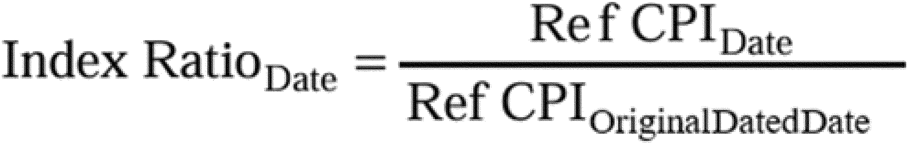

# Daily Digest — 2026-10-15

| | |
|---|---|
| **Digest date** | 2026-10-15 |
| **Data date range** | 2026-10-15 to 2026-10-15 |
| **Generated at** | 2026-10-16T04:06:31Z (UTC) |
| **Pipeline version** | f197ba7c |
| **Inference** | model layers ran — cli/haiku, opus |
| **Source watermarks** | CREC: 2026-10-14T10:06:37Z · BILLS: 2026-10-16T02:24:47Z · FR: 2026-10-15T14:26:47Z · USCOURTS: 2026-10-16T03:59:20Z · PLAW: 2026-10-15T14:29:59Z |

[Full observed listing for this day](day/2026-10-15.html) — the items our collectors observed for this publication day, mechanical rules applied, frozen at end of day; releases their publishers date on other days are counted there, not listed. This digest is the canonical record.

All items below cite the govinfo package (and granule, where applicable) they
summarize. Selection is mechanical; each item states the rule that included
it. See the Coverage Statement at the end for a full accounting of what was
published, what was summarized, and what was excluded and why.

---

## Contents

- [Day in Review](#day-in-review)
- [1. Congressional Floor Activity](#1-congressional-floor-activity)
- [2. Legislation](#2-legislation)
- [3. Federal Register](#3-federal-register)
- [4. Enacted Laws](#4-enacted-laws)
- [5. Judicial Activity](#5-judicial-activity)
- [6. Agency Announcements](#6-agency-announcements)
- [7. Recorded Votes](#7-recorded-votes)
- [8. Bill Actions](#8-bill-actions)
- [9. Presidential Actions](#9-presidential-actions)
- [Terms Used Today](#terms-used-today)
- [Coverage Statement](#coverage-statement)
- [Methodology](#methodology)

---

## Day in Review

The digest carries 13 bills introduced in the House and two in the Senate; no recorded floor votes appear among the items. Two public laws appear. Public Law 119-120, the Billion Dollar Boondoggle Act of 2025, was enacted October 7, 2026, and requires annual agency reports on projects more than five years behind schedule or at least $1 billion over original cost estimates. Public Law 119-36, the Homebuyers Privacy Protection Act, amends the Fair Credit Reporting Act to restrict consumer reports furnished on prescreening requests tied to mortgage transactions.

The digest carries 13 final rules, 10 proposed rules and 55 notices, and no presidential documents. The Federal Maritime Commission proposed a $200,000 per-voyage fee on Spanish vessels and import restrictions on certain Spanish goods. Other proposals address premium tax credits and investment company cross trades. Final rules include the Transportation Department's delay of its airline delay-and-cancellation rule to February 1, 2027, and Federal Labor Relations Authority documents implementing a vacatur.

The digest carries 84 appellate opinions and one national court opinion. The Tenth Circuit, sitting en banc, held that a defendant's Indian status under 18 U.S.C. § 1152 is an affirmative defense, and it upheld a Kansas law on prefilled mail ballot applications. The Ninth Circuit directed an injunction against California's enforcement of a No Vigilantes Act provision against federal officers. The Eleventh Circuit found that industry groups had standing to challenge Florida's HB3. The Court of International Trade upheld a ruling placing a solar charging module within duty orders on Chinese photovoltaic cells.

*Composed from the summarized items below and the day's mechanical
counts; all specifics are cited in their sections.*

---

## 1. Congressional Floor Activity

No Congressional Record issue was observed on this day. The Record for a day's proceedings is typically published by govinfo the following morning; it appears in the digest for the day it is observed ([how our clocks work](faq.html#fapds-three-clocks)).

### 1.1 Senate

No Senate floor items met the selection thresholds. 0 floor granule(s) are accounted for in the Coverage Statement.

### 1.2 House of Representatives

No House floor items met the selection thresholds. 0 floor granule(s) are accounted for in the Coverage Statement.

### 1.3 Recorded Votes

No recorded votes were published in this issue of the Congressional Record.

---

## 2. Legislation

Source: Congressional Bills (BILLS), text versions published 2026-10-15 to 2026-10-15.

### 2.1 Counts by Stage

| Stage (bill text version) | Count |
|---|---|
| Introduced (ih/is) | 15 |
| Reported (rh/rs) | 0 |
| Engrossed (eh/es) | 0 |
| Enrolled (enr) | 0 |
| Other versions | 0 |
| **Total bill texts published** | **15** |

### 2.2 Bills Listed by Mechanical Rule

Bills below are listed because they matched at least one listing rule; the
matching rule is stated per item. All other bill texts are counted above and
accounted for in the Coverage Statement.

No bill texts published in this range matched a listing rule; all 15 are
accounted for in the Coverage Statement.

---

## 3. Federal Register

Source: Federal Register (FR), issue of 2026-10-15.

### 3.1 Counts by Document Type

| Document type | Count |
|---|---|
| Rules | 13 |
| Proposed rules | 10 |
| Notices | 55 |
| Presidential documents | 0 |
| **Total FR documents** | **78** |

### 3.2 Rules Published

Tags: department of commerce · department of transportation · executive · model keys: chemical substances · labor relations · safety zones

*In plain terms: 13 final rules led by EPA significant new use rules and NMFS fisheries actions; the rest include Coast Guard safety zones, FMLA revisions, and instrument procedures.*

#### DEPARTMENT OF COMMERCE

- **Atlantic Highly Migratory Species; Atlantic Bluefin Tuna Fisheries; Angling Category Quota Transfer** (2026-21080; 50 CFR Part 635) — NMFS is transferring 15 metric tons (mt) of Atlantic bluefin tuna (BFT) quota from the Reserve category to the Angling category large school/small medium subquota. This transfer results in an adjusted Angling category large school/small medium subquota of 188.4 mt and an adjusted Reserve category quota of 27 mt. This action is intended to provide further harvest opportunities for Angling category fishermen, based on consideration of the regulatory determination criteria regarding inseason adjustments and applies to HMS Angling and HMS Charter/Headboat permitted vessels when fishing recreationally for BFT. Action: Temporary rule; quota transfer. Dates: The quota transfer is effective October 13, 2026 through December 31, 2026.
  - *In plain terms:* The National Marine Fisheries Service is transferring 15 metric tons of Atlantic bluefin tuna quota to provide harvest opportunities for angling fishermen.
  - Included because: FR-SEL-01 — document type: final rule (all listed)
  - Source: [FR-2026-10-15 / 2026-21080](https://www.govinfo.gov/app/details/FR-2026-10-15/2026-21080)
- **Fisheries of the Exclusive Economic Zone off Alaska; Pacific Ocean Perch in the Central Regulatory Area of the Gulf of Alaska** (2026-21106; 50 CFR Part 679) — NMFS is prohibiting retention of the incidental catch allowance for Pacific Ocean perch in the Central Regulatory Area of the Gulf of Alaska (GOA) except by vessels checked-in to the Central GOA Rockfish Program who are fishing with a rockfish cooperative quota permit. This action is necessary because the 2026 total allowable catch (TAC) apportioned as the incidental catch allowance for Pacific Ocean perch in the Central GOA will soon be or has been reached. Action: Temporary rule; closure. Dates: Effective 1200 hours, Alaska local time (A.l.t.), October 14, 2026, through 2400 hours, A.l.t., December 31, 2026.
  - *In plain terms:* The National Marine Fisheries Service is restricting harvest of incidental Pacific Ocean perch catch in the Gulf of Alaska to Rockfish Program vessels.
  - Included because: FR-SEL-01 — document type: final rule (all listed)
  - Source: [FR-2026-10-15 / 2026-21106](https://www.govinfo.gov/app/details/FR-2026-10-15/2026-21106)

#### DEPARTMENT OF HOMELAND SECURITY

- **Safety Zone; Lake Michigan, Chicago, IL** (2026-21053; 33 CFR Part 165) — The Coast Guard is establishing a temporary safety zone for navigable waters within an area of Lake Michigan in Chicago, IL. The safety zone is needed to protect personnel, vessels, and the marine environment from potential hazards created by the Navy Pier Fireworks and Drone Show. Entry of vessels or persons into this zone is prohibited unless specifically authorized by the Captain of the Port, Sector Lake Michigan or their designated representative. Action: Temporary final rule. Dates: This rule is effective from 9 p.m. through 9:15 p.m. on October 15, 2026.
  - *In plain terms:* The Coast Guard is creating a temporary restricted area on Lake Michigan in Chicago for the Navy Pier Fireworks and Drone Show.
  - Included because: FR-SEL-01 — document type: final rule (all listed)
  - Source: [FR-2026-10-15 / 2026-21053](https://www.govinfo.gov/app/details/FR-2026-10-15/2026-21053)

#### DEPARTMENT OF THE TREASURY

- **Sale and Issue of Marketable Book-Entry Treasury Bills, Notes, and Bonds** (2026-21069; 31 CFR Part 356) — The Department of the Treasury (“Treasury” or “we”) is issuing in final form amendments to the Uniform Offering Circular for the Sale and Issue of Marketable Book-Entry Treasury Bills, Notes, and Bonds (the “UOC” or “auction rules”). These amendments make technical changes to several sections of the UOC to remove outdated references and to be consistent with Treasury's current auction terminology. These amendments also modify the requirements for submitting noncompetitive customer bids, to require submitters to provide all customer bid information prior to the noncompetitive auction close. Action: Final rule. Dates: Effective date: October 15, 2026. Applicability Date: The changes to 31 CFR 356.14 and 356.23 apply to all auctions of Treasury marketable securities beginning with the first Treasury marketable securities auction conducted using Treasury's upgraded auction system, which will be communicated to market participants in advance of the first applicable auction. All other changes apply as of the effective date.
  - *In plain terms:* The Treasury Department is updating its Treasury auction rules to remove outdated references and require complete bid information before auction close.
  - Included because: FR-SEL-01 — document type: final rule (all listed)
  - Source: [FR-2026-10-15 / 2026-21069](https://www.govinfo.gov/app/details/FR-2026-10-15/2026-21069)
  -  *Source graphic 1 of 1 from 2026-21069.*

#### DEPARTMENT OF TRANSPORTATION

- **Cause of Airline Delay and Cancellation Categories Under Section 511(b) of the FAA Reauthorization Act of 2024; Delay of Effective Date** (2026-21058; 14 CFR Part 234) — The U.S. Department of Transportation (Department or DOT) is delaying the effective date of its September 3, 2026 final rule, titled “Cause of Airline Delay and Cancellation Categories under Section 511(b) of the FAA Reauthorization Act of 2024,” until February 1, 2027. Action: Final rule; delay of effective date. Dates: The effective date of the final rule published on September 3, 2026 (91 FR 56588) is delayed until February 1, 2027.
  - *In plain terms:* The Department of Transportation is delaying the effective date of a rule on airline delay and cancellation reporting to February 1, 2027.
  - Included because: FR-SEL-01 — document type: final rule (all listed)
  - Source: [FR-2026-10-15 / 2026-21058](https://www.govinfo.gov/app/details/FR-2026-10-15/2026-21058)
- **Standard Instrument Approach Procedures, and Takeoff Minimums and Obstacle Departure Procedures; Miscellaneous Amendments** (2026-21095; 14 CFR Part 97) — This rule amends, suspends, or removes Standard Instrument Approach Procedures (SIAPs) and associated Takeoff Minimums and Obstacle Departure Procedures for operations at certain airports. These regulatory actions are needed because of the adoption of new or revised criteria, or because of changes occurring in the National Airspace System, such as the commissioning of new navigational facilities, adding new obstacles, or changing air traffic requirements. These changes are designed to provide for the safe and efficient use of the navigable airspace and to promote safe flight operations under instrument flight rules at the affected airports. Action: Final rule. Dates: This rule is effective October 15, 2026. The compliance date for each SIAP, associated Takeoff Minimums, and ODP is specified in the amendatory provisions. The incorporation by reference of certain publications listed in the regulations is approved by the Director of the Federal Register as of October 15, 2026.
  - *In plain terms:* The FAA is updating instrument approach procedures and takeoff minimums for certain airports due to new navigational facilities or air traffic changes.
  - Included because: FR-SEL-01 — document type: final rule (all listed)
  - Source: [FR-2026-10-15 / 2026-21095](https://www.govinfo.gov/app/details/FR-2026-10-15/2026-21095)
- **Standard Instrument Approach Procedures, and Takeoff Minimums and Obstacle Departure Procedures; Miscellaneous Amendments** (2026-21096; 14 CFR Part 97) — This rule establishes, amends, suspends, or removes Standard Instrument Approach Procedures (SIAPS) and associated Takeoff Minimums and Obstacle Departure procedures (ODPs) for operations at certain airports. These regulatory actions are needed because of the adoption of new or revised criteria, or because of changes occurring in the National Airspace System, such as the commissioning of new navigational facilities, adding new obstacles, or changing air traffic requirements. These changes are designed to provide safe and efficient use of the navigable airspace and to promote safe flight operations under instrument flight rules at the affected airports. Action: Final rule. Dates: This rule is effective October 15, 2026. The compliance date for each SIAP, associated Takeoff Minimums, and ODP is specified in the amendatory provisions. The incorporation by reference of certain publications listed in the regulations is approved by the Director of the Federal Register as of October 15, 2026.
  - *In plain terms:* The FAA is establishing, amending, suspending, or removing instrument approach procedures for certain airports due to National Airspace System changes.
  - Included because: FR-SEL-01 — document type: final rule (all listed)
  - Source: [FR-2026-10-15 / 2026-21096](https://www.govinfo.gov/app/details/FR-2026-10-15/2026-21096)

#### ENVIRONMENTAL PROTECTION AGENCY

- **Significant New Use Rules on Certain Chemical Substances (26-1)** (2026-21051; 40 CFR Part 721) — EPA is issuing significant new use rules (SNURs) under the Toxic Substances Control Act (TSCA) for certain chemical substances that were the subject of premanufacture notices (PMNs) and are also subject to an Order issued by EPA pursuant to TSCA. The SNURs require persons to notify EPA at least 90 days before commencing the manufacture (defined by statute to include import) or processing of any of these chemical substances for an activity that is designated as a significant new use in the SNUR. The required notification initiates EPA's evaluation of the conditions of that use for that chemical substance. In addition, the manufacture or processing for the significant new use may not commence until EPA has conducted a review of the required notification; made an appropriate determination regarding that notification; and taken such actions as required by that determination. Action: Final rule. Dates: This rule is effective on December 14, 2026. For purposes of judicial review, this rule shall be promulgated at 1 p.m. (EST) on October 29, 2026.
  - *In plain terms:* The EPA requires companies to notify the agency at least 90 days before manufacturing or processing certain chemicals for new uses and wait for approval.
  - Included because: FR-SEL-01 — document type: final rule (all listed)
  - Source: [FR-2026-10-15 / 2026-21051](https://www.govinfo.gov/app/details/FR-2026-10-15/2026-21051)
- **Significant New Use Rules on Certain Chemical Substances (24-5.5e); Correction** (2026-21052; 40 CFR Part 721) — EPA is making a correction to a final rule that appeared in the Federal Register on August 26, 2026. The final rule established significant new use rules (SNURs) under the Toxic Substances Control Act (TSCA) for chemical substances that were the subject of premanufacture notices (PMNs) and Orders issued by EPA pursuant to TSCA. Subsequent to the publication, the Agency identified an error in a chemical name. Action: Final rule; correction. Dates: The final rule correction is effective on October 26, 2026.
  - *In plain terms:* The EPA is correcting a chemical name error in an August 26, 2026 rule about significant new uses of chemicals.
  - Included because: FR-SEL-01 — document type: final rule (all listed)
  - Source: [FR-2026-10-15 / 2026-21052](https://www.govinfo.gov/app/details/FR-2026-10-15/2026-21052)

#### FEDERAL LABOR RELATIONS AUTHORITY

- **Amendment to Memorandum Describing the Authority and Assigned Responsibilities of the General Counsel of the Federal Labor Relations Authority** (2026-21077; 5 CFR Chapter XIV) — The Federal Labor Relations Authority (FLRA) publishes this document to implement the vacatur of Section I.C. of the amendment to Appendix B—titled “Memorandum Describing the Authority and Assigned Responsibilities of the General Counsel of the Federal Labor Relations Authority”—published March 24, 2026 (Memo Amendment). The Memo Amendment also changed Section III of Appendix B, but that change was not vacated and is not affected by this final rule. This document reinstates the wording of Section I.C. of Appendix B as it appeared before the Memo Amendment took effect. Action: Final rule. Dates: This final rule is effective on October 15, 2026.
  - *In plain terms:* The Federal Labor Relations Authority is reinstating prior wording for one section of its General Counsel responsibilities from before March 24, 2026.
  - Included because: FR-SEL-01 — document type: final rule (all listed)
  - Source: [FR-2026-10-15 / 2026-21077](https://www.govinfo.gov/app/details/FR-2026-10-15/2026-21077)
- **Meaning of Terms as Used in This Subchapter; Representation Proceedings; National Consultation Rights and Consultation Rights on Government-Wide Rules or Regulations; Miscellaneous and General Requirements** (2026-21078; 5 CFR Parts 2421, 2422, 2426, and 2429) — The Federal Labor Relations Authority (FLRA) publishes this document to implement the vacatur of the interim final rule published March 24, 2026 (Interim Final Rule). Except for certain minor or technical changes that were part of the Interim Final Rule but were not vacated, this document reinstates the wording of the affected regulations as they appeared before the Interim Final Rule took effect. Action: Final rule. Dates: This final rule is effective on October 15, 2026.
  - *In plain terms:* The Federal Labor Relations Authority is reinstating regulations as they were before an interim final rule from March 24, 2026, except for certain technical changes.
  - Included because: FR-SEL-01 — document type: final rule (all listed)
  - Source: [FR-2026-10-15 / 2026-21078](https://www.govinfo.gov/app/details/FR-2026-10-15/2026-21078)

#### OFFICE OF GOVERNMENT ETHICS

- **Post-Employment Conflict of Interest Restrictions; Revision of Departmental Component Designations** (2026-21059; 5 CFR Part 2641) — The U.S. Office of Government Ethics (OGE) is issuing this final rule to update the name of an existing departmental component that was previously designated for purposes of the one-year post-employment conflict of interest restriction for senior employees. Action: Final rule; technical amendment. Dates: Effective October 15, 2026.
  - *In plain terms:* The Office of Government Ethics is updating a departmental component designation for post-employment conflict of interest rules for senior employees.
  - Included because: FR-SEL-01 — document type: final rule (all listed)
  - Source: [FR-2026-10-15 / 2026-21059](https://www.govinfo.gov/app/details/FR-2026-10-15/2026-21059)

#### OFFICE OF PERSONNEL MANAGEMENT

- **Family and Medical Leave Act** (2026-21104; 5 CFR Part 630) — The Office of Personnel Management (OPM) is issuing a direct final rule making technical revisions to OPM's Family and Medical Leave Act (FMLA) regulations to incorporate various statutory amendments. The rule reflects statutory changes making virtually all Federal civilian service and certain honorable active military service qualify for determining FMLA eligibility, making clear that annual and sick leave provided under an authority outside of title 5, United States Code, may be substituted for unpaid FMLA leave, and excluding certain Veterans Health Administration (VHA) employees from title 5 FMLA coverage. Action: Direct final rule. Dates: This rule is effective December 14, 2026, unless significant adverse comments are received by November 16, 2026. If significant adverse comments are received, OPM will withdraw the affected provisions of this rule and issue a notice of proposed rulemaking.
  - *In plain terms:* The Office of Personnel Management is updating FMLA regulations to reflect statutory changes about what service qualifies for leave benefits.
  - Included because: FR-SEL-01 — document type: final rule (all listed)
  - Source: [FR-2026-10-15 / 2026-21104](https://www.govinfo.gov/app/details/FR-2026-10-15/2026-21104)

### 3.3 Proposed Rules Published

Tags: department of commerce · department of transportation · executive · model keys: aviation · credit unions · maritime shipping

*In plain terms: 10 proposed items led by FAA directives for Airbus aircraft and helicopters and $200,000 per-voyage Spanish vessel fees; the rest include SEC, IRS, NCUA rules and Privacy Act notices.*

#### DEPARTMENT OF JUSTICE

- **Privacy Act of 1974; Implementation** (2026-21060; 28 CFR Part 16) — In the Notice section of today's Federal Register , the Office of Justice Programs (OJP), a component within the United States Department of Justice (DOJ or Department), has published a notice of a new system of records, Bureau of Justice Statistics (BJS) Statistical Data, JUSTICE/OJP-017, for the statistical data collections that BJS conducts under 34 U.S.C. 10132. In this notice of proposed rulemaking, the OJP proposes to exempt this system of records from certain provisions of the Privacy Act in order to comply with the confidentiality provisions of 34 U.S.C. 10231 and 34 U.S.C. 30303 and the requirement of 34 U.S.C. 10134 that the data are to be used solely for statistical or research purposes. Additionally, data are to be used for authorized purposes under the Prison Rape Elimination Act of 2003 (PREA; 44 U.S.C. 3563) and the Death in Custody Reporting Act of 2013 (DCRA; Pub. L. 113-242). Consistent with the data use requirements set forth in 34 U.S.C. 10134, no adverse determinations are made from these records as to any identifiable individual. [official summary truncated; see source] Action: Notice of proposed rulemaking. Dates: Comments must be received by November 16, 2026.
  - *In plain terms:* The Office of Justice Programs is proposing to exempt a statistics data system from certain Privacy Act requirements to comply with confidentiality laws.
  - Included because: FR-SEL-02 — document type: proposed rule (all listed)
  - Source: [FR-2026-10-15 / 2026-21060](https://www.govinfo.gov/app/details/FR-2026-10-15/2026-21060)
- **Privacy Act of 1974; Implementation** (2026-21063; 28 CFR Part 16) — In the Notice section of today's Federal Register , the Executive Office for Immigration Review (EOIR), a component within the United States Department of Justice (DOJ or Department), has published a notice of a new system of records titled “Fraud and Abuse Prevention Program Records” and numbered JUSTICE/EOIR-006. This system of records is exempt from U.S.C. 552a(c)(3) and (d) pursuant to 5 U.S.C. 552a (k)(2). EOIR proposes to exempt this system of records from certain provisions of the Privacy Act in order to protect law enforcement sensitive materials maintained in the system. For the reasons provided below, the Department proposes to amend its Privacy Act regulations by exempting records in this system from certain provisions of the Privacy Act. Public comment is invited. Action: Notice of proposed rulemaking. Dates: Comments must be received by November 16, 2026.
  - *In plain terms:* The Executive Office for Immigration Review is proposing to exempt a fraud and abuse prevention records system from certain Privacy Act requirements to protect law enforcement materials.
  - Included because: FR-SEL-02 — document type: proposed rule (all listed)
  - Source: [FR-2026-10-15 / 2026-21063](https://www.govinfo.gov/app/details/FR-2026-10-15/2026-21063)

#### DEPARTMENT OF THE TREASURY

- **Premium Tax Credit** (2026-21056; 26 CFR Part 1) — This document contains proposed regulations that would amend regulations regarding an individual taxpayer's eligibility for a premium tax credit (PTC), the computation of a PTC, and an individual's tax liability due to excess advance payments of the PTC. The proposed regulations would affect taxpayers who enroll themselves or a family member in individual health insurance coverage through a Health Insurance Exchange and may be allowed a PTC for this coverage. This document also provides a notice of a public hearing on these proposed regulations. Action: Notice of proposed rulemaking and notice of public hearing. Dates: Electronic or written comments must be received by November 30, 2026. A telephonic public hearing on this proposed regulation has been scheduled for December 8, 2026, at 10 a.m. ET. Requests to speak and outlines of topics to be discussed at the public hearing must be received by November 30, 2026. If no outlines are received by November 30, 2026, the public hearing will be cancelled. Requests to attend the public hearing must be received by 5 p.m. ET on December 4, 2026.
  - *In plain terms:* The proposed regulations change rules about tax credits and excess payments for individuals buying health insurance through a Health Insurance Exchange.
  - Included because: FR-SEL-02 — document type: proposed rule (all listed)
  - Source: [FR-2026-10-15 / 2026-21056](https://www.govinfo.gov/app/details/FR-2026-10-15/2026-21056)

#### DEPARTMENT OF TRANSPORTATION

- **Airworthiness Directives; Airbus SAS Airplanes** (2026-21047; 14 CFR Part 39) — The FAA proposes to adopt a new airworthiness directive (AD) for all Airbus SAS Model A318 series airplanes; Model A319 series airplanes; Model A320 series airplanes; and Model A321 series airplanes. This proposed AD was prompted by reports of door evacuation slide systems failing to inflate during emergency evacuations, due to the fracture and separation of the connector on the inflation hose assembly. This proposed AD would require the replacement of each affected slide with a serviceable slide. This proposed AD would also prohibit the installation of affected parts. The FAA is proposing this AD to address the unsafe condition on these products. Action: Notice of proposed rulemaking (NPRM). Dates: The FAA must receive comments on this proposed AD by November 30, 2026.
  - *In plain terms:* The FAA proposes requiring Airbus A318, A319, A320, and A321 airplanes to replace evacuation slides that fail due to connector fractures.
  - Included because: FR-SEL-02 — document type: proposed rule (all listed)
  - Source: [FR-2026-10-15 / 2026-21047](https://www.govinfo.gov/app/details/FR-2026-10-15/2026-21047)
- **Airworthiness Directives; Airbus Helicopters Deutschland GmbH (AHD) Helicopters** (2026-21123; 14 CFR Part 39) — The FAA proposes to adopt a new airworthiness directive (AD) for all Airbus Helicopters Deutschland GmbH (AHD) Model MBB-BK 117 D-2 helicopters. This proposed AD was prompted by certification test results of a certain common cargo hook beam (CCHB) on the affected helicopters, which revealed that the installed CCHB could result in fuel leakage following a survivable accident. This proposed AD would require modification of the CCHB and fuel system and installation of structural reinforcement. This proposed AD would also prohibit installing a certain CCHB on any helicopter. The FAA is proposing this AD to address the unsafe condition on these products. Action: Notice of proposed rulemaking (NPRM). Dates: The FAA must receive comments on this NPRM by November 30, 2026.
  - *In plain terms:* The FAA proposes requiring Airbus Model MBB-BK 117 D-2 helicopters to modify their cargo hook beam and fuel system to prevent fuel leakage.
  - Included because: FR-SEL-02 — document type: proposed rule (all listed)
  - Source: [FR-2026-10-15 / 2026-21123](https://www.govinfo.gov/app/details/FR-2026-10-15/2026-21123)

#### FEDERAL MARITIME COMMISSION

- **Investigation Into Conditions Affecting Shipping in the Foreign Trade and Denial of Entry of Vessels Into Spanish Ports and Proposed Remedies To Meet or Adjust the Unfavorable Conditions** (2026-21067; 46 CFR Part 551) — The Federal Maritime Commission (Commission) proposes to adjust or meet unfavorable shipping conditions created by the Government of Spain. The Commission proposes a per-voyage fee on all Spanish vessels of $200,000 and restrictions on the import of certain Spanish goods into the United States. The Commission also proposes using additional statutory authority to impose these remedies because the Government of Spain has unduly impaired the access of U.S. flag vessels to trade between foreign ports. The Commission herein offers an opportunity for a public hearing. The Commission invites public comment on all aspects of this proposed rule. Action: Notice of proposed rulemaking. Dates: Comments and related material must be received by the Commission on or before December 14, 2026.
  - *In plain terms:* The Federal Maritime Commission proposes a $200,000 fee on Spanish vessels and import restrictions to address shipping conditions created by Spain's government.
  - Included because: FR-SEL-02 — document type: proposed rule (all listed)
  - Source: [FR-2026-10-15 / 2026-21067](https://www.govinfo.gov/app/details/FR-2026-10-15/2026-21067)

#### NATIONAL CREDIT UNION ADMINISTRATION

- **Corporate Credit Unions; Fidelity Bond and Insurance Coverage for Federally Insured Credit Unions** (2026-21087; 12 CFR Parts 704 and 713) — The NCUA Board (Board) seeks comment on proposed amendments to its regulations governing fidelity bond and insurance coverage for federally insured credit unions (FICUs). The proposed rule would eliminate certain prescriptive procedural mandates and simplify requirements for coverage amounts and deductibles. The intended effect is greater flexibility for FICUs, simplified compliance, and reduced administrative costs without compromising safety and soundness. Action: Proposed rule. Dates: Comments must be received on or before December 14, 2026.
  - *In plain terms:* The NCUA is proposing to simplify fidelity bond and insurance coverage requirements for federally insured credit unions to reduce administrative costs.
  - Included because: FR-SEL-02 — document type: proposed rule (all listed)
  - Source: [FR-2026-10-15 / 2026-21087](https://www.govinfo.gov/app/details/FR-2026-10-15/2026-21087)
- **Powers of Federal Credit Unions** (2026-21088; 12 CFR Part 721) — The NCUA Board (Board) is proposing to amend the NCUA's regulations regarding incidental powers to clarify that federal credit unions (FCUs) are not required to seek an advisory opinion from the NCUA's Office of General Counsel before petitioning the Board to engage in an activity that does not fall within an FCU's preapproved incidental powers. Action: Proposed rule. Dates: Comments must be received by December 14, 2026.
  - *In plain terms:* The NCUA is proposing that federal credit unions don't need an advisory opinion before petitioning to engage in activities outside their preapproved powers.
  - Included because: FR-SEL-02 — document type: proposed rule (all listed)
  - Source: [FR-2026-10-15 / 2026-21088](https://www.govinfo.gov/app/details/FR-2026-10-15/2026-21088)
- **Central Liquidity Facility** (2026-21089; 12 CFR Part 725) — The NCUA Board (Board) is proposing to adopt as final the revisions to the Central Liquidity Facility (CLF) rule made under two interim final rules (IFRs) published in the Federal Register on April 29, 2020, and March 24, 2021. The proposal would adopt the amendments made by these IFRs and, where appropriate, would remove provisions from the NCUA's regulations that have lapsed under the terms of the IFRs. The proposal would also remove or modify certain filing requirements and criteria the Board uses to approve CLF members. Finally, the proposal would amend the timing requirements related to pay adjustments to the capital stock subscription, clarify various regulatory provisions, and make necessary conforming edits. Action: Proposed rule. Dates: Comments must be received by December 14, 2026.
  - *In plain terms:* The NCUA is proposing to finalize changes to the Central Liquidity Facility rules from 2020 and 2021, removing lapsed provisions and clarifying requirements.
  - Included because: FR-SEL-02 — document type: proposed rule (all listed)
  - Source: [FR-2026-10-15 / 2026-21089](https://www.govinfo.gov/app/details/FR-2026-10-15/2026-21089)

#### SECURITIES AND EXCHANGE COMMISSION

- **Investment Company Cross Trading** (2026-21037; 17 CFR Parts 270 and 274) — The Securities and Exchange Commission (the “Commission”) is proposing to amend the rule under the Investment Company Act of 1940 (the “Investment Company Act”) that permits securities transactions between a registered investment company and certain affiliates (referred to as “cross trades”), subject to conditions. The proposed amendments are designed to expand the scope of securities that are eligible for cross trading, modernize the rule's conditions, and enhance investor protection. The Commission also proposes to require aggregated reporting of trading activity and cross trades in Form N-PORT and Form N-MFP. Action: Proposed rule. Dates: This proposal was published in the Federal Register on October 15, 2026. Comments should be received on or before December 14, 2026.
  - *In plain terms:* The SEC proposes expanding rules for investment company securities trading with affiliates and requiring detailed trading activity reports.
  - Included because: FR-SEL-02 — document type: proposed rule (all listed)
  - Source: [FR-2026-10-15 / 2026-21037](https://www.govinfo.gov/app/details/FR-2026-10-15/2026-21037)

### 3.4 Notices and Presidential Documents

Notices are summarized only when they match a listing rule; all are counted
in 3.1 and in the Coverage Statement. Presidential documents in the FR are
always listed.

No notices or presidential documents matched a listing rule.

---

## 4. Enacted Laws

Tags: legislative · model keys: consumer protection · credit reporting · federal projects

*In plain terms: 2 laws enacted: Billion Dollar Boondoggle Act requiring annual reports on over-budget federal projects, and Homebuyers Privacy Protection Act restricting consumer report use in mortgage lending.*

Source: Public and Private Laws (PLAW) published 2026-10-15.

- **Public Law 119–120 — Public Law 119–120: To require an annual report of taxpayer-funded projects that are over budget and behind schedule.** — Public Law 119-120, titled the "Billion Dollar Boondoggle Act of 2025" and enacted on October 7, 2026, requires the Director of the Office of Management and Budget to establish guidance for federal agencies to submit annual reports on taxpayer-funded projects that are more than 5 years behind schedule or exceed their original cost estimate by $1 billion or more. The Director must compile agency submissions into an annual report to Congress and post it on the OMB website, including project descriptions, locations, contractors, scope changes, current timelines and costs, and explanations for delays or cost increases. The guidance must be issued within one year of the law's enactment. Approved: 2026-10-07.
  - *In plain terms:* A law enacted October 7, 2026 requires annual reports on federal projects more than 5 years behind schedule or $1 billion over budget, compiled by OMB and sent to Congress.
  - Included because: PLAW-SEL-01 — enacted into law (all public and private laws are listed) (document dated 2026-10-07)
  - Source: [PLAW-119publ120](https://www.govinfo.gov/app/details/PLAW-119publ120)
- **Public Law 119–36 — Public Law 119–36: To amend the Fair Credit Reporting Act to prevent consumer reporting agencies from furnishing consumer reports under certain circumstances, and for other purposes.** — Public Law 119-36, the Homebuyers Privacy Protection Act, amends the Fair Credit Reporting Act to restrict consumer reporting agencies from furnishing consumer reports in certain circumstances related to residential mortgage lending. The law prohibits furnishing such reports based on a prescreening request connected to a mortgage loan transaction unless the requesting entity either holds documented consumer authorization, has originated or services the consumer's mortgage, or is a depository institution with a current account for that consumer. The law also requires the Comptroller General to study the value of trigger leads received by text message and report findings to Congress within 12 months of enactment. Approved: 2025-09-05.
  - *In plain terms:* A law bars credit reporting agencies from furnishing reports for mortgages unless the company has consumer authorization, originated or services the mortgage, or is a bank with an account, and requires studying text message leads.
  - Included because: PLAW-SEL-01 — enacted into law (all public and private laws are listed) (document dated 2025-09-05)
  - Source: [PLAW-119publ36](https://www.govinfo.gov/app/details/PLAW-119publ36)

---

## 5. Judicial Activity

Source: United States Courts Opinions (USCOURTS): opinions observed 2026-10-15
by our collector; each opinion states its own issue date beside its
listing ([how our clocks work](faq.html#fapds-three-clocks)).

Completeness disclosure (standing): USCOURTS carries opinions from
approximately 140 participating appellate, district, bankruptcy, and
national federal courts. Unlike the Congressional Record and the Federal
Register, which are the complete official record of their branches,
USCOURTS is participation-based and is NOT the complete federal judicial
record. Courts post opinions with delay — typically over several days —
so a day's digest carries the opinions that became available that day,
whatever date each was issued.

### 5.1 Appellate and National Court Opinions

Tags: judicial · model keys: medical malpractice · securities fraud · sexual abuse

*In plain terms: 85 judicial decisions led by Seventh Circuit Bomb Squad gang members' RICO convictions; the rest span patent disputes, immigration matters, and civil rights cases.*

Appellate and national court opinions are summarized; district and
bankruptcy opinions are counted in 5.2 and in the Coverage Statement.

#### United States Court of Appeals for the Eleventh Circuit

- **USA v. Friell Johnson** (No. 21-14144; filed 2026-10-14) — The Eleventh Circuit vacated Friell Johnson's sentence for firearm possession as a felon because the district court incorrectly calculated his base offense level by classifying his prior attempted manslaughter conviction as a crime of violence under the sentencing guidelines. Attempted manslaughter does not qualify as an enumerated crime of violence under the guideline definition. The court rejected Johnson's facial challenge to the firearm possession statute under the Second Amendment.
  - *In plain terms:* The court overturned a felon firearm possession sentence because the district court wrongly classified a prior attempted manslaughter conviction as a crime of violence for sentencing purposes.
  - Included because: USCOURTS-SEL-01 — appellate court opinion (all listed) (document dated 2026-10-14)
  - Source: [USCOURTS-ca11-21-14144 / USCOURTS-ca11-21-14144-0](https://www.govinfo.gov/app/details/USCOURTS-ca11-21-14144/USCOURTS-ca11-21-14144-0)
- **Carlos Figueroa-Gibson v. Warden** (No. 24-10658; filed 2026-10-14) — Carlos Figueroa-Gibson, a federal prisoner convicted of attempted child sex trafficking, filed a habeas petition challenging the First Step Act's bar on earning early-release credits for prisoners with certain convictions, claiming violations of due process and equal protection rights. The Eleventh Circuit affirmed dismissal of the petition, holding that Figueroa had no constitutionally protected liberty interest in credits he was never eligible to earn and that the statute's classification system did not violate equal protection. The court found his procedural due process claim failed because the Act conditions credit eligibility on the nature of the conviction.
  - *In plain terms:* The court upheld dismissal of a habeas petition from a federal prisoner challenging restrictions in the First Step Act on early-release credits for certain offenses.
  - Included because: USCOURTS-SEL-01 — appellate court opinion (all listed) (document dated 2026-10-14)
  - Source: [USCOURTS-ca11-24-10658 / USCOURTS-ca11-24-10658-0](https://www.govinfo.gov/app/details/USCOURTS-ca11-24-10658/USCOURTS-ca11-24-10658-0)
- **Christopher Bonner v. Timothy Ward, et al** (No. 24-13016; filed 2026-10-14) — Christopher Mathis died in a segregation unit at Georgia State Prison after an attack by another inmate. His son brought a section 1983 suit under the Eighth Amendment against prison officials, claiming violations based on conditions of confinement, inadequate staffing, and failure to protect from other prisoners. The Eleventh Circuit affirmed dismissal of the complaint, finding Mathis did not plausibly allege unconstitutional conditions and that no causal connection existed between prior threats and the fatal attack.
  - *In plain terms:* The court upheld dismissal of a lawsuit alleging prison officials failed to protect an inmate from fatal attack in a segregation unit.
  - Included because: USCOURTS-SEL-01 — appellate court opinion (all listed) (document dated 2026-10-14)
  - Source: [USCOURTS-ca11-24-13016 / USCOURTS-ca11-24-13016-0](https://www.govinfo.gov/app/details/USCOURTS-ca11-24-13016/USCOURTS-ca11-24-13016-0)
- **Ebony Kelley v. Allegiant Air, LLC.** (No. 24-13815; filed 2026-10-14) — Ebony Kelley, a Black employee of Allegiant Air, sued for race discrimination and retaliation under 42 U.S.C. section 1981 after being terminated for dishonesty during an investigation into a workplace incident. The Eleventh Circuit affirmed summary judgment for Allegiant, finding Kelley failed to establish a valid similarly-situated comparator for her discrimination claim and failed to present evidence that Allegiant's stated reason for termination was pretextual.
  - *In plain terms:* The court upheld summary judgment for an airline in a race discrimination and retaliation lawsuit by a former Black employee terminated for dishonesty.
  - Included because: USCOURTS-SEL-01 — appellate court opinion (all listed) (document dated 2026-10-14)
  - Source: [USCOURTS-ca11-24-13815 / USCOURTS-ca11-24-13815-0](https://www.govinfo.gov/app/details/USCOURTS-ca11-24-13815/USCOURTS-ca11-24-13815-0)
- **Computer & Communications Industry Association, et al v. Attorney General, State of Florida** (No. 25-11881; filed 2026-10-14) — The Computer & Communications Industry Association and NetChoice challenged Florida's HB3, which restricts social media platforms using certain features—including infinite scrolling, push notifications, and auto-play—from allowing minors under 14 to create accounts and requiring parental consent for ages 14-15. The Eleventh Circuit held that the industry organizations had standing to pursue their First Amendment challenge, that Younger abstention did not apply, and that the statute as applied likely constitutes a content-neutral speech regulation satisfying intermediate scrutiny. The court rejected the facial challenge to the law.
  - *In plain terms:* The court held that Florida's law restricting social media platforms' features for minors under 14 satisfies constitutional scrutiny for speech regulation.
  - Included because: USCOURTS-SEL-01 — appellate court opinion (all listed) (document dated 2026-10-14)
  - Source: [USCOURTS-ca11-25-11881 / USCOURTS-ca11-25-11881-0](https://www.govinfo.gov/app/details/USCOURTS-ca11-25-11881/USCOURTS-ca11-25-11881-0)
- **Attorney General, State of Florida, Department of v. SNAP** (No. 25-12814; filed 2026-10-14) — Florida's Attorney General sued Snap Inc. in state court for violating HB3 by contracting with minors under age 14. Snap removed the case to federal court claiming federal officer removal jurisdiction based on advertising services provided to federal agencies and also asserting diversity jurisdiction. The Eleventh Circuit held the district court lacked subject matter jurisdiction over the removal and remanded the case to state court, finding Snap's relationships with federal agencies insufficient to establish federal officer removal status.
  - *In plain terms:* The court ruled a federal court lacked subject matter jurisdiction over a case where Snap was sued under Florida's social media law for minors.
  - Included because: USCOURTS-SEL-01 — appellate court opinion (all listed) (document dated 2026-10-14)
  - Source: [USCOURTS-ca11-25-12814 / USCOURTS-ca11-25-12814-0](https://www.govinfo.gov/app/details/USCOURTS-ca11-25-12814/USCOURTS-ca11-25-12814-0)
- **Kathleen Watrel v. W. Cooper, et al** (No. 26-10430; filed 2026-10-14) — Kathleen Watrel appealed the dismissal of her complaint against judges and others and her denied motion for the district judge to recuse himself. The Eleventh Circuit affirmed, holding that the state court judges were entitled to judicial immunity because her allegations related to their official judicial actions, and that Watrel failed to meet the standards for recusal under federal law.
  - *In plain terms:* The court upheld dismissal of a complaint against state judges and denied a recusal motion, finding the judges protected by judicial immunity.
  - Included because: USCOURTS-SEL-01 — appellate court opinion (all listed) (document dated 2026-10-14)
  - Source: [USCOURTS-ca11-26-10430 / USCOURTS-ca11-26-10430-0](https://www.govinfo.gov/app/details/USCOURTS-ca11-26-10430/USCOURTS-ca11-26-10430-0)
- **USA v. Agustin Osorio-Lopez** (No. 26-10523; filed 2026-10-14) — Agustin Osorio-Lopez appealed his criminal convictions in a direct appeal. After independent review of the record, the Eleventh Circuit found no arguable issues of merit and affirmed his convictions and sentences.
  - *In plain terms:* The court affirmed a defendant's criminal convictions and sentences after finding no valid grounds for appellate review.
  - Included because: USCOURTS-SEL-01 — appellate court opinion (all listed) (document dated 2026-10-14)
  - Source: [USCOURTS-ca11-26-10523 / USCOURTS-ca11-26-10523-0](https://www.govinfo.gov/app/details/USCOURTS-ca11-26-10523/USCOURTS-ca11-26-10523-0)
- **USA v. Marino Nava** (No. 26-10689; filed 2026-10-14) — Marino Nava appealed his 21-month sentence for illegal reentry after deportation, arguing it was substantively unreasonable. The Eleventh Circuit affirmed, finding the district court properly considered the required sentencing factors and imposed a reasonable sentence.
  - *In plain terms:* The court affirmed a 21-month sentence for illegal reentry after deportation as substantively reasonable.
  - Included because: USCOURTS-SEL-01 — appellate court opinion (all listed) (document dated 2026-10-14)
  - Source: [USCOURTS-ca11-26-10689 / USCOURTS-ca11-26-10689-0](https://www.govinfo.gov/app/details/USCOURTS-ca11-26-10689/USCOURTS-ca11-26-10689-0)

#### United States Court of Appeals for the Federal Circuit

- **Syngenta Crop Protection AG v. UPL Ltd.** (No. 25-01018; filed 2026-10-14) — The U.S. Court of Appeals for the Federal Circuit affirmed the Patent Trial and Appeal Board's determination that U.S. Patent No. 11,445,727, which covers fungicidal combinations owned by UPL Ltd., is unpatentable on multiple grounds including anticipation by prior art references and obviousness. The court also rejected Syngenta Crop Protection AG's cross-appeal seeking sanctions related to alleged false experimental results in the patent.
  - *In plain terms:* A court upheld the rejection of a fungicide patent, finding it was not new or obvious and rejecting a request for sanctions.
  - Included because: USCOURTS-SEL-01 — appellate court opinion (all listed) (document dated 2026-10-14)
  - Source: [USCOURTS-ca13-25-01018 / USCOURTS-ca13-25-01018-0](https://www.govinfo.gov/app/details/USCOURTS-ca13-25-01018/USCOURTS-ca13-25-01018-0)
- **UPL Ltd. v. Syngenta Crop Protection AG** (No. 25-01019; filed 2026-10-14) — The U.S. Court of Appeals for the Federal Circuit affirmed the Patent Trial and Appeal Board's determination that U.S. Patent No. 11,445,727, which covers fungicidal combinations, is unpatentable on multiple grounds including anticipation and obviousness. The court also rejected a cross-appeal seeking sanctions related to alleged false experimental results.
  - *In plain terms:* A court upheld the rejection of a fungicide patent for not being new or obvious and rejected a request for sanctions.
  - Included because: USCOURTS-SEL-01 — appellate court opinion (all listed) (document dated 2026-10-14)
  - Source: [USCOURTS-ca13-25-01019 / USCOURTS-ca13-25-01019-0](https://www.govinfo.gov/app/details/USCOURTS-ca13-25-01019/USCOURTS-ca13-25-01019-0)
- **Piranha Media Distribution LLC v. Hulu, LLC** (No. 25-01038; filed 2026-10-14) — The U.S. Court of Appeals for the Federal Circuit affirmed the dismissal of Piranha Media Distribution LLC's patent infringement suit against Hulu, LLC. The court determined that the patents claiming methods and systems for integrating advertisements into digital media are directed to patent-ineligible abstract ideas under 35 U.S.C. § 101 and do not contain an inventive concept.
  - *In plain terms:* A court upheld the dismissal of a patent suit over ad-insertion technology, finding the patents covered abstract ideas without inventive concepts.
  - Included because: USCOURTS-SEL-01 — appellate court opinion (all listed) (document dated 2026-10-14)
  - Source: [USCOURTS-ca13-25-01038 / USCOURTS-ca13-25-01038-0](https://www.govinfo.gov/app/details/USCOURTS-ca13-25-01038/USCOURTS-ca13-25-01038-0)

#### United States Court of Appeals for the Fifth Circuit

- **USA v. Sifuentes** (No. 25-51057; filed 2026-10-14) — The Fifth Circuit dismissed an appeal after determining no nonfrivolous issues existed for appellate review and granted counsel's motion to withdraw.
  - *In plain terms:* The court dismissed an appeal after determining no valid issues existed for appellate review.
  - Included because: USCOURTS-SEL-01 — appellate court opinion (all listed) (document dated 2026-10-14)
  - Source: [USCOURTS-ca5-25-51057 / USCOURTS-ca5-25-51057-0](https://www.govinfo.gov/app/details/USCOURTS-ca5-25-51057/USCOURTS-ca5-25-51057-0)
- **USA v. Harris** (No. 26-30089; filed 2026-10-14) — The Fifth Circuit affirmed Harris's conviction for drug possession with intent to distribute, finding his challenges to the suppression motion denial and Franks hearing motion denial were inadequately briefed or meritless, and rejecting his argument regarding the guidelines range calculation.
  - *In plain terms:* The court affirmed a drug possession conviction after finding the defendant's appeal arguments were inadequately presented or without merit.
  - Included because: USCOURTS-SEL-01 — appellate court opinion (all listed) (document dated 2026-10-14)
  - Source: [USCOURTS-ca5-26-30089 / USCOURTS-ca5-26-30089-0](https://www.govinfo.gov/app/details/USCOURTS-ca5-26-30089/USCOURTS-ca5-26-30089-0)
- **USA v. Crosby** (No. 26-30100; filed 2026-10-14) — The Fifth Circuit affirmed Crosby's 60-month sentence for felon in possession of a firearm, finding the district court adequately explained its reasons for the upward variance and did not abuse its discretion in balancing the sentencing factors.
  - *In plain terms:* The court affirmed a 60-month sentence for felon in possession of a firearm.
  - Included because: USCOURTS-SEL-01 — appellate court opinion (all listed) (document dated 2026-10-14)
  - Source: [USCOURTS-ca5-26-30100 / USCOURTS-ca5-26-30100-0](https://www.govinfo.gov/app/details/USCOURTS-ca5-26-30100/USCOURTS-ca5-26-30100-0)
- **USA v. Armijo-Mercado** (No. 26-40149; filed 2026-10-14) — The Fifth Circuit affirmed Armijo-Mercado's 18-month sentence for illegal reentry after prior deportation, rejecting his arguments that his criminal history category was overstated and that he should receive credit for time served in state custody.
  - *In plain terms:* The court affirmed an 18-month sentence for illegal reentry after prior deportation.
  - Included because: USCOURTS-SEL-01 — appellate court opinion (all listed) (document dated 2026-10-14)
  - Source: [USCOURTS-ca5-26-40149 / USCOURTS-ca5-26-40149-0](https://www.govinfo.gov/app/details/USCOURTS-ca5-26-40149/USCOURTS-ca5-26-40149-0)
- **Ortega v. Stern Rock** (No. 26-50171; filed 2026-10-14) — The Fifth Circuit vacated a district court dismissal for lack of personal jurisdiction in a Telephone Consumer Protection Act case, holding that the district court erred by failing to accept the plaintiff's allegations regarding his Texas residence and receipt of phone calls in Texas as true when evaluating whether he made a prima facie showing of specific personal jurisdiction. The court remanded for the district court to determine the jurisdictional question in the first instance.
  - *In plain terms:* A court reversed a dismissal for lack of jurisdiction in a phone call lawsuit, ruling the lower court should have accepted the plaintiff's claims about his Texas residence.
  - Included because: USCOURTS-SEL-01 — appellate court opinion (all listed) (document dated 2026-10-14)
  - Source: [USCOURTS-ca5-26-50171 / USCOURTS-ca5-26-50171-0](https://www.govinfo.gov/app/details/USCOURTS-ca5-26-50171/USCOURTS-ca5-26-50171-0)

#### United States Court of Appeals for the Fourth Circuit

- **Bing Chen v. Commodore Management Company, Inc.** (No. 24-01643; filed 2026-10-14) — Bing and Jie Chen appealed a dismissal of their Fair Housing Act claims against their landlords. The Fourth Circuit dismissed the appeal and remanded because the district court's order failed to address their familial discrimination claim, rendering it non-final and depriving the appellate court of jurisdiction.
  - *In plain terms:* The court dismissed an appeal because the district court's order failed to address the familial discrimination claim in the Fair Housing Act case.
  - Included because: USCOURTS-SEL-01 — appellate court opinion (all listed) (document dated 2026-10-14)
  - Source: [USCOURTS-ca4-24-01643 / USCOURTS-ca4-24-01643-0](https://www.govinfo.gov/app/details/USCOURTS-ca4-24-01643/USCOURTS-ca4-24-01643-0)
- **Elshan Bayramov v. Jolene Wee** (No. 25-02110; filed 2026-10-14) — Elshan Bayramov appealed the district court's affirmance of a bankruptcy court's denial of his motion to establish solvency. The Fourth Circuit affirmed, finding no reversible error.
  - *In plain terms:* The court affirmed the bankruptcy court's denial of a motion to establish solvency.
  - Included because: USCOURTS-SEL-01 — appellate court opinion (all listed) (document dated 2026-10-14)
  - Source: [USCOURTS-ca4-25-02110 / USCOURTS-ca4-25-02110-0](https://www.govinfo.gov/app/details/USCOURTS-ca4-25-02110/USCOURTS-ca4-25-02110-0)
- **US v. Rodney Johnson** (No. 25-04206; filed 2026-10-14) — Rodney Johnson appealed his 188-month sentence for possession and distribution of controlled substances, challenging the offense level determination and firearm enhancement. The Fourth Circuit affirmed, finding no reversible error.
  - *In plain terms:* The court affirmed a 188-month sentence for drug possession and distribution.
  - Included because: USCOURTS-SEL-01 — appellate court opinion (all listed) (document dated 2026-10-14)
  - Source: [USCOURTS-ca4-25-04206 / USCOURTS-ca4-25-04206-0](https://www.govinfo.gov/app/details/USCOURTS-ca4-25-04206/USCOURTS-ca4-25-04206-0)

#### United States Court of Appeals for the Ninth Circuit

- **USA V. STATE OF CALIFORNIA, ET AL.** (No. 26-926; filed 2026-10-14) — The United States Court of Appeals for the Ninth Circuit reversed the district court's denial of a preliminary injunction and instructed the district court to enter an injunction against California's enforcement of Section 10 of the No Vigilantes Act against federal agencies and officers. The court found the United States likely to succeed on its Supremacy Clause claim that the provision directly regulates federal governmental operations without congressional authorization, thus violating intergovernmental immunity.
  - *In plain terms:* The court ordered California to stop enforcing a provision of the No Vigilantes Act against federal agencies and officers because the provision violates the Constitution by directly regulating federal operations without congressional approval.
  - Included because: USCOURTS-SEL-01 — appellate court opinion (all listed) (document dated 2026-10-14)
  - Source: [USCOURTS-ca9-26-926 / USCOURTS-ca9-26-926-0](https://www.govinfo.gov/app/details/USCOURTS-ca9-26-926/USCOURTS-ca9-26-926-0)

#### United States Court of Appeals for the Seventh Circuit

- **USA v. Kentrevion Watkins** (No. 20-02048; filed 2024-07-08) — The Seventh Circuit reviewed consolidated appeals from 13 members of the Bomb Squad street gang convicted of RICO conspiracy and related weapons and drug offenses for criminal activity in the Peoria area from 2013 to 2018. The defendants challenged their convictions primarily on the ground that the district judge violated Batson v. Kentucky during jury selection, and the court ordered a limited remand for supplemental findings on this issue while affirming the convictions on all other grounds.
  - *In plain terms:* A court reviewed convictions of 13 gang members for racketeering and weapons and drug crimes from 2013 to 2018, ordering a hearing on jury selection procedures.
  - Included because: USCOURTS-SEL-01 — appellate court opinion (all listed) (document dated 2026-10-14)
  - Source: [USCOURTS-ca7-20-02048 / USCOURTS-ca7-20-02048-0](https://www.govinfo.gov/app/details/USCOURTS-ca7-20-02048/USCOURTS-ca7-20-02048-0)
- **USA v. Kentrevion Watkins** (No. 20-02048; filed 2026-10-14) — On remand from a prior appeal, the Seventh Circuit reviewed the district court's reexamination of whether the government's use of peremptory challenges violated Batson v. Kentucky. The district court revisited its three-step Batson analysis and concluded that the government had not utilized its peremptory challenges in a racially discriminatory manner, and the appellate court affirmed this determination.
  - *In plain terms:* On remand, the court affirmed that the government did not use jury dismissals in a racially discriminatory way.
  - Included because: USCOURTS-SEL-01 — appellate court opinion (all listed) (document dated 2026-10-14)
  - Source: [USCOURTS-ca7-20-02048 / USCOURTS-ca7-20-02048-1](https://www.govinfo.gov/app/details/USCOURTS-ca7-20-02048/USCOURTS-ca7-20-02048-1)
- **USA v. Eugene Haywood** (No. 20-02049; filed 2024-07-08) — The Seventh Circuit reviewed consolidated appeals from 13 members of the Bomb Squad street gang convicted of RICO conspiracy and related weapons and drug offenses for criminal activity in the Peoria area from 2013 to 2018. The defendants challenged their convictions primarily on the ground that the district judge violated Batson v. Kentucky during jury selection, and the court ordered a limited remand for supplemental findings on this issue while affirming the convictions on all other grounds.
  - *In plain terms:* A court reviewed convictions of 13 gang members for racketeering and weapons and drug crimes from 2013 to 2018, ordering a hearing on jury selection procedures.
  - Included because: USCOURTS-SEL-01 — appellate court opinion (all listed) (document dated 2026-10-14)
  - Source: [USCOURTS-ca7-20-02049 / USCOURTS-ca7-20-02049-0](https://www.govinfo.gov/app/details/USCOURTS-ca7-20-02049/USCOURTS-ca7-20-02049-0)
- **USA v. Eugene Haywood** (No. 20-02049; filed 2026-10-14) — On remand from a prior appeal, the Seventh Circuit reviewed the district court's reexamination of whether the government's use of peremptory challenges violated Batson v. Kentucky. The district court revisited its three-step Batson analysis and concluded that the government had not utilized its peremptory challenges in a racially discriminatory manner, and the appellate court affirmed this determination.
  - *In plain terms:* On remand, the court affirmed that the government did not use jury dismissals in a racially discriminatory way.
  - Included because: USCOURTS-SEL-01 — appellate court opinion (all listed) (document dated 2026-10-14)
  - Source: [USCOURTS-ca7-20-02049 / USCOURTS-ca7-20-02049-1](https://www.govinfo.gov/app/details/USCOURTS-ca7-20-02049/USCOURTS-ca7-20-02049-1)
- **USA v. Torieuanno White** (No. 20-02086; filed 2024-07-08) — The Seventh Circuit reviewed consolidated appeals from 13 members of the Bomb Squad street gang convicted of RICO conspiracy and related weapons and drug offenses for criminal activity in the Peoria area from 2013 to 2018. The defendants challenged their convictions primarily on the ground that the district judge violated Batson v. Kentucky during jury selection, and the court ordered a limited remand for supplemental findings on this issue while affirming the convictions on all other grounds.
  - *In plain terms:* A court reviewed convictions of 13 gang members for racketeering and weapons and drug crimes from 2013 to 2018, ordering a hearing on jury selection procedures.
  - Included because: USCOURTS-SEL-01 — appellate court opinion (all listed) (document dated 2026-10-14)
  - Source: [USCOURTS-ca7-20-02086 / USCOURTS-ca7-20-02086-0](https://www.govinfo.gov/app/details/USCOURTS-ca7-20-02086/USCOURTS-ca7-20-02086-0)
- **USA v. Torieuanno White** (No. 20-02086; filed 2026-10-14) — Upon remand, the Seventh Circuit reviewed the district court's application of Batson v. Kentucky, which establishes a three-step test for examining whether prosecutors improperly used peremptory challenges based on race. The court affirmed the district court's finding that the government did not engage in racial discrimination in striking prospective jurors.
  - *In plain terms:* On remand, the court affirmed that the government did not discriminate based on race in its jury dismissals.
  - Included because: USCOURTS-SEL-01 — appellate court opinion (all listed) (document dated 2026-10-14)
  - Source: [USCOURTS-ca7-20-02086 / USCOURTS-ca7-20-02086-1](https://www.govinfo.gov/app/details/USCOURTS-ca7-20-02086/USCOURTS-ca7-20-02086-1)
- **USA v. Ezra Johnson** (No. 20-02088; filed 2024-07-08) — The Seventh Circuit Court of Appeals addressed appeals from thirteen gang members convicted of RICO conspiracy and other crimes, holding that the district court misapplied Batson v. Kentucky protections against race-based jury selection and ordering a limited remand for supplemental findings on that issue, while affirming the convictions on other grounds.
  - *In plain terms:* The court affirmed gang members' RICO conspiracy convictions but remanded to review whether jury selection violated protections against race discrimination.
  - Included because: USCOURTS-SEL-01 — appellate court opinion (all listed) (document dated 2026-10-14)
  - Source: [USCOURTS-ca7-20-02088 / USCOURTS-ca7-20-02088-0](https://www.govinfo.gov/app/details/USCOURTS-ca7-20-02088/USCOURTS-ca7-20-02088-0)
- **USA v. Ezra Johnson** (No. 20-02088; filed 2026-10-14) — On remand, the Seventh Circuit reviewed the district court's renewed Batson analysis and affirmed the finding that the government's race-neutral explanations for striking two prospective jurors were credible and that the defendants failed to establish purposeful discrimination in jury selection.
  - *In plain terms:* On remand, the court affirmed that the government's race-neutral explanations for striking jurors were credible.
  - Included because: USCOURTS-SEL-01 — appellate court opinion (all listed) (document dated 2026-10-14)
  - Source: [USCOURTS-ca7-20-02088 / USCOURTS-ca7-20-02088-1](https://www.govinfo.gov/app/details/USCOURTS-ca7-20-02088/USCOURTS-ca7-20-02088-1)
- **USA v. Lance Washington** (No. 20-02100; filed 2024-07-08) — Fourteen members of the Bomb Squad street gang were convicted of RICO conspiracy and related offenses including murder, attempted murder, gun violence, drug trafficking, and robbery committed in the Peoria area from 2013 through 2018. The Seventh Circuit affirmed the convictions on most grounds and remanded for supplemental findings regarding jury selection procedures under Batson v. Kentucky.
  - *In plain terms:* A court upheld the convictions of 14 gang members for racketeering and related crimes from 2013 to 2018, ordering a hearing on jury selection procedures.
  - Included because: USCOURTS-SEL-01 — appellate court opinion (all listed) (document dated 2026-10-14)
  - Source: [USCOURTS-ca7-20-02100 / USCOURTS-ca7-20-02100-0](https://www.govinfo.gov/app/details/USCOURTS-ca7-20-02100/USCOURTS-ca7-20-02100-0)
- **USA v. Lance Washington** (No. 20-02100; filed 2026-10-14) — Upon remand, the district court reapplied the three-step Batson v. Kentucky test to evaluate jury selection in the defendants' RICO trial. The Seventh Circuit affirmed the district court's determination that the government did not use peremptory challenges to strike prospective jurors based on race.
  - *In plain terms:* On remand, the court affirmed that the government did not use jury dismissals based on race.
  - Included because: USCOURTS-SEL-01 — appellate court opinion (all listed) (document dated 2026-10-14)
  - Source: [USCOURTS-ca7-20-02100 / USCOURTS-ca7-20-02100-1](https://www.govinfo.gov/app/details/USCOURTS-ca7-20-02100/USCOURTS-ca7-20-02100-1)
- **USA v. Raevaughn Rogers** (No. 20-02115; filed 2024-07-08) — Fourteen members of the Bomb Squad street gang were convicted of RICO conspiracy and related offenses including murder, attempted murder, gun violence, drug trafficking, and robbery from 2013 to 2018 in the Peoria area. The Seventh Circuit affirmed the convictions generally and remanded for supplemental findings regarding jury selection procedures under Batson v. Kentucky.
  - *In plain terms:* A court upheld the convictions of 14 gang members for racketeering and related crimes from 2013 to 2018, ordering a hearing on jury selection procedures.
  - Included because: USCOURTS-SEL-01 — appellate court opinion (all listed) (document dated 2026-10-14)
  - Source: [USCOURTS-ca7-20-02115 / USCOURTS-ca7-20-02115-0](https://www.govinfo.gov/app/details/USCOURTS-ca7-20-02115/USCOURTS-ca7-20-02115-0)
- **USA v. Raevaughn Rogers** (No. 20-02115; filed 2026-10-14) — Upon remand, the Seventh Circuit reviewed the district court's application of the three-step Batson v. Kentucky test to jury selection in the defendants' trial. The court affirmed the district court's findings that the government did not use peremptory challenges to strike prospective jurors on the basis of race.
  - *In plain terms:* On remand, the court affirmed that the government did not use jury dismissals based on race.
  - Included because: USCOURTS-SEL-01 — appellate court opinion (all listed) (document dated 2026-10-14)
  - Source: [USCOURTS-ca7-20-02115 / USCOURTS-ca7-20-02115-1](https://www.govinfo.gov/app/details/USCOURTS-ca7-20-02115/USCOURTS-ca7-20-02115-1)
- **USA v. Jahlin Wilson** (No. 20-02116; filed 2024-07-08) — Fourteen members of the Bomb Squad street gang were convicted of RICO conspiracy and related offenses involving murder, attempted murder, gun violence, drug trafficking, and robbery in the Peoria area between 2013 and 2018. The Seventh Circuit affirmed the convictions and remanded for supplemental findings regarding jury selection procedures under Batson v. Kentucky.
  - *In plain terms:* A court upheld the convictions of 14 gang members for racketeering and related crimes from 2013 to 2018, ordering a hearing on jury selection procedures.
  - Included because: USCOURTS-SEL-01 — appellate court opinion (all listed) (document dated 2026-10-14)
  - Source: [USCOURTS-ca7-20-02116 / USCOURTS-ca7-20-02116-0](https://www.govinfo.gov/app/details/USCOURTS-ca7-20-02116/USCOURTS-ca7-20-02116-0)
- **USA v. Jahlin Wilson** (No. 20-02116; filed 2026-10-14) — The Seventh Circuit affirmed the district court's jury selection findings on remand in United States v. Kentrevion Watkins, et al. The court found no clear error in the district court's application of the Batson test and its conclusion that race-neutral reasons existed for striking two prospective jurors.
  - *In plain terms:* The court affirmed the lower court found no error in the government's use of nonracial reasons for striking two prospective jurors.
  - Included because: USCOURTS-SEL-01 — appellate court opinion (all listed) (document dated 2026-10-14)
  - Source: [USCOURTS-ca7-20-02116 / USCOURTS-ca7-20-02116-1](https://www.govinfo.gov/app/details/USCOURTS-ca7-20-02116/USCOURTS-ca7-20-02116-1)
- **USA v. Lloyd Dotson** (No. 20-02117; filed 2024-07-08) — The Seventh Circuit Court of Appeals addressed appeals from thirteen gang members convicted of RICO conspiracy and other crimes, holding that the district court misapplied Batson v. Kentucky protections against race-based jury selection and ordering a limited remand for supplemental findings on that issue, while affirming the convictions on other grounds.
  - *In plain terms:* The court affirmed gang members' RICO conspiracy convictions but remanded to review whether jury selection violated protections against race discrimination.
  - Included because: USCOURTS-SEL-01 — appellate court opinion (all listed) (document dated 2026-10-14)
  - Source: [USCOURTS-ca7-20-02117 / USCOURTS-ca7-20-02117-0](https://www.govinfo.gov/app/details/USCOURTS-ca7-20-02117/USCOURTS-ca7-20-02117-0)
- **USA v. Lloyd Dotson** (No. 20-02117; filed 2026-10-14) — On remand, the Seventh Circuit reviewed the district court's renewed Batson analysis and affirmed the finding that the government's race-neutral explanations for striking two prospective jurors were credible and that the defendants failed to establish purposeful discrimination in jury selection.
  - *In plain terms:* On remand, the court affirmed that the government's race-neutral explanations for striking jurors were credible.
  - Included because: USCOURTS-SEL-01 — appellate court opinion (all listed) (document dated 2026-10-14)
  - Source: [USCOURTS-ca7-20-02117 / USCOURTS-ca7-20-02117-1](https://www.govinfo.gov/app/details/USCOURTS-ca7-20-02117/USCOURTS-ca7-20-02117-1)
- **USA v. Kenwan Crowe** (No. 20-02133; filed 2024-07-08) — The Seventh Circuit affirmed convictions of thirteen Bomb Squad gang members on RICO conspiracy charges and related federal offenses including drug trafficking and firearm crimes. The court ordered limited remand for the district court to make supplemental findings on jury selection issues.
  - *In plain terms:* A court upheld the convictions of 13 gang members for racketeering and related crimes, ordering a hearing on jury selection procedures.
  - Included because: USCOURTS-SEL-01 — appellate court opinion (all listed) (document dated 2026-10-14)
  - Source: [USCOURTS-ca7-20-02133 / USCOURTS-ca7-20-02133-0](https://www.govinfo.gov/app/details/USCOURTS-ca7-20-02133/USCOURTS-ca7-20-02133-0)
- **USA v. Kenwan Crowe** (No. 20-02133; filed 2026-10-14) — The Seventh Circuit affirmed the district court's jury selection findings on remand in United States v. Kentrevion Watkins, et al. The court found no clear error in the district court's application of the Batson test and its conclusion that race-neutral reasons existed for striking two prospective jurors.
  - *In plain terms:* The court affirmed the lower court found no error in the government's use of nonracial reasons for striking two prospective jurors.
  - Included because: USCOURTS-SEL-01 — appellate court opinion (all listed) (document dated 2026-10-14)
  - Source: [USCOURTS-ca7-20-02133 / USCOURTS-ca7-20-02133-1](https://www.govinfo.gov/app/details/USCOURTS-ca7-20-02133/USCOURTS-ca7-20-02133-1)
- **USA v. Mytrez Flora** (No. 20-02208; filed 2024-07-08) — The Seventh Circuit affirmed convictions of thirteen Bomb Squad gang members on RICO conspiracy charges and related federal offenses including drug trafficking and firearm crimes. The court ordered limited remand for the district court to make supplemental findings on jury selection issues.
  - *In plain terms:* A court upheld the convictions of 13 gang members for racketeering and related crimes, ordering a hearing on jury selection procedures.
  - Included because: USCOURTS-SEL-01 — appellate court opinion (all listed) (document dated 2026-10-14)
  - Source: [USCOURTS-ca7-20-02208 / USCOURTS-ca7-20-02208-0](https://www.govinfo.gov/app/details/USCOURTS-ca7-20-02208/USCOURTS-ca7-20-02208-0)
- **USA v. Mytrez Flora** (No. 20-02208; filed 2026-10-14) — The Seventh Circuit affirmed the district court's jury selection findings on remand in United States v. Kentrevion Watkins, et al. The court found no clear error in the district court's application of the Batson test and its conclusion that race-neutral reasons existed for striking two prospective jurors.
  - *In plain terms:* The court affirmed the lower court found no error in the government's use of nonracial reasons for striking two prospective jurors.
  - Included because: USCOURTS-SEL-01 — appellate court opinion (all listed) (document dated 2026-10-14)
  - Source: [USCOURTS-ca7-20-02208 / USCOURTS-ca7-20-02208-1](https://www.govinfo.gov/app/details/USCOURTS-ca7-20-02208/USCOURTS-ca7-20-02208-1)
- **USA v. Sherman Williams** (No. 20-02229; filed 2024-07-08) — The Seventh Circuit affirmed convictions of thirteen Bomb Squad gang members on RICO conspiracy charges and related federal offenses including drug trafficking and firearm crimes. The court ordered limited remand for the district court to make supplemental findings on jury selection issues.
  - *In plain terms:* A court upheld the convictions of 13 gang members for racketeering and related crimes, ordering a hearing on jury selection procedures.
  - Included because: USCOURTS-SEL-01 — appellate court opinion (all listed) (document dated 2026-10-14)
  - Source: [USCOURTS-ca7-20-02229 / USCOURTS-ca7-20-02229-0](https://www.govinfo.gov/app/details/USCOURTS-ca7-20-02229/USCOURTS-ca7-20-02229-0)
- **USA v. Sherman Williams** (No. 20-02229; filed 2026-10-14) — The Seventh Circuit Court of Appeals reviewed whether the district court correctly applied Batson v. Kentucky in evaluating the government's use of peremptory strikes against prospective jurors. The court affirmed the district court's determination that the government provided credible race-neutral reasons for striking a Black male prospective juror and a Hispanic female prospective juror.
  - *In plain terms:* The court affirmed the government provided legitimate reasons unrelated to race for dismissing a Black male and Hispanic female prospective juror.
  - Included because: USCOURTS-SEL-01 — appellate court opinion (all listed) (document dated 2026-10-14)
  - Source: [USCOURTS-ca7-20-02229 / USCOURTS-ca7-20-02229-1](https://www.govinfo.gov/app/details/USCOURTS-ca7-20-02229/USCOURTS-ca7-20-02229-1)
- **Estate of Ceaser Stinson, et al v. Joel Streicher** (No. 22-03043; filed 2026-10-14) — The Seventh Circuit Court of Appeals reversed a district court's denial of qualified immunity to a sheriff's deputy whose distracted driving caused a fatal auto accident, holding that the evidence did not support a finding of deliberate indifference to impending harm required for a substantive due process violation and that it was not clearly established that an officer's distracted driving constitutes such a violation.
  - *In plain terms:* The court reversed denial of qualified immunity to a sheriff's deputy whose distracted driving caused a fatal accident.
  - Included because: USCOURTS-SEL-01 — appellate court opinion (all listed) (document dated 2026-10-14)
  - Source: [USCOURTS-ca7-22-03043 / USCOURTS-ca7-22-03043-0](https://www.govinfo.gov/app/details/USCOURTS-ca7-22-03043/USCOURTS-ca7-22-03043-0)
- **USA v. May Kong** (No. 25-02447; filed 2026-10-14) — May Kong pleaded guilty to possessing a firearm as a felon in violation of 18 U.S.C. § 922(g)(1) and was sentenced to 90 months imprisonment plus three years supervised release. The Seventh Circuit granted appointed counsel's motion to withdraw and dismissed the appeal as frivolous, finding no viable grounds for appellate challenge.
  - *In plain terms:* The court dismissed an appeal as frivolous for a felon firearm possession conviction where the defendant pleaded guilty.
  - Included because: USCOURTS-SEL-01 — appellate court opinion (all listed) (document dated 2026-10-14)
  - Source: [USCOURTS-ca7-25-02447 / USCOURTS-ca7-25-02447-0](https://www.govinfo.gov/app/details/USCOURTS-ca7-25-02447/USCOURTS-ca7-25-02447-0)
- **USA v. Isiah Keller** (No. 25-02709; filed 2026-10-14) — Isiah Keller pleaded guilty to conspiracy to make false statements to acquire firearms and making false statements in connection with purchasing firearms that were then illegally resold across state lines. The Seventh Circuit affirmed the district court's application of a three-level sentencing enhancement for Keller's managerial role in the firearms trafficking scheme.
  - *In plain terms:* Keller pleaded guilty to conspiracy and false statements to acquire firearms illegally and resell them across state lines, and the court upheld a three-level sentencing enhancement for his leadership role.
  - Included because: USCOURTS-SEL-01 — appellate court opinion (all listed) (document dated 2026-10-14)
  - Source: [USCOURTS-ca7-25-02709 / USCOURTS-ca7-25-02709-0](https://www.govinfo.gov/app/details/USCOURTS-ca7-25-02709/USCOURTS-ca7-25-02709-0)
- **Anshious Aron-Storey v. Samuel Byrd** (No. 25-02724; filed 2026-10-14) — An Indiana prisoner sued a prison physician under 42 U.S.C. § 1983, claiming deliberate indifference to his medical needs in violation of the Eighth Amendment. The Seventh Circuit affirmed dismissal of the suit, holding that the prisoner failed to exhaust administrative remedies by not complying with the required prison grievance and appeal procedures.
  - *In plain terms:* A prisoner's lawsuit claiming a physician ignored his medical needs was dismissed because he did not complete the prison's required grievance complaint procedures.
  - Included because: USCOURTS-SEL-01 — appellate court opinion (all listed) (document dated 2026-10-14)
  - Source: [USCOURTS-ca7-25-02724 / USCOURTS-ca7-25-02724-0](https://www.govinfo.gov/app/details/USCOURTS-ca7-25-02724/USCOURTS-ca7-25-02724-0)
- **Carroll Zu-Bolton v. Rockford School District No. 205** (No. 25-03087; filed 2026-10-14) — A former school district employee filed suit alleging employment discrimination based on age and disability, which the district court dismissed for failure to state a claim. The Seventh Circuit affirmed the dismissal and the denial of a late motion for reconsideration that introduced a new race discrimination allegation.
  - *In plain terms:* A school district employee's age and disability discrimination lawsuit was dismissed, and the court rejected a late attempt to add a race discrimination claim.
  - Included because: USCOURTS-SEL-01 — appellate court opinion (all listed) (document dated 2026-10-14)
  - Source: [USCOURTS-ca7-25-03087 / USCOURTS-ca7-25-03087-0](https://www.govinfo.gov/app/details/USCOURTS-ca7-25-03087/USCOURTS-ca7-25-03087-0)
- **USA v. Edwin Marrero** (No. 25-03142; filed 2026-10-14) — Edwin Marrero violated conditions of his supervised release following completion of a 324-month prison sentence for robbery and firearms offenses. The district court terminated his supervision and the Seventh Circuit dismissed his appeal as moot, finding no continuing case or controversy after the termination.
  - *In plain terms:* The court terminated Marrero's supervised release, making his appeal moot because no active case remained to be decided.
  - Included because: USCOURTS-SEL-01 — appellate court opinion (all listed) (document dated 2026-10-14)
  - Source: [USCOURTS-ca7-25-03142 / USCOURTS-ca7-25-03142-0](https://www.govinfo.gov/app/details/USCOURTS-ca7-25-03142/USCOURTS-ca7-25-03142-0)
- **USA v. Jerald Hoskins** (No. 25-03291; filed 2026-10-14) — Jerald Hoskins, a convicted felon, pleaded guilty to possessing a firearm in violation of 18 U.S.C. § 922(g)(1) and challenged the statute's constitutionality under the Second Amendment. The Seventh Circuit affirmed his conviction, noting that his facial and as-applied challenges were foreclosed by prior circuit precedent.
  - *In plain terms:* A convicted felon pleaded guilty to illegally possessing a firearm and challenged the law's constitutionality, but the court upheld his conviction based on established legal precedent.
  - Included because: USCOURTS-SEL-01 — appellate court opinion (all listed) (document dated 2026-10-14)
  - Source: [USCOURTS-ca7-25-03291 / USCOURTS-ca7-25-03291-0](https://www.govinfo.gov/app/details/USCOURTS-ca7-25-03291/USCOURTS-ca7-25-03291-0)
- **USA v. Ryan Miller** (No. 25-03339; filed 2026-10-14) — The United States Court of Appeals for the Seventh Circuit affirmed an order requiring the Bureau of Prisons to apply $1,200 from Ryan Miller's inmate trust account toward his outstanding restitution obligation under 18 U.S.C. § 3664(n). Miller challenged the order on grounds the remaining balance was unsupported by the record, but the court found this argument waived because Miller did not raise it in the district court.
  - *In plain terms:* The Bureau of Prisons must apply $1,200 from Miller's inmate account toward his restitution debt; his appeal was rejected because he did not raise the issue in trial court.
  - Included because: USCOURTS-SEL-01 — appellate court opinion (all listed) (document dated 2026-10-14)
  - Source: [USCOURTS-ca7-25-03339 / USCOURTS-ca7-25-03339-0](https://www.govinfo.gov/app/details/USCOURTS-ca7-25-03339/USCOURTS-ca7-25-03339-0)
- **Eric Mapes v. CVS Health, Inc., et al** (No. 26-01033; filed 2026-10-14) — The United States Court of Appeals for the Seventh Circuit affirmed the dismissal of Eric Mapes's complaint against CVS Health, Inc., and Aetna Inc., finding that Mapes failed to plausibly allege he was denied service on the basis of his disability and that the defendants are not state actors. The court also affirmed denial of Mapes's request for electronic filing privileges.
  - *In plain terms:* Mapes's disability discrimination lawsuit against CVS and Aetna was dismissed because he did not adequately allege being denied service based on disability, and his request for electronic filing was denied.
  - Included because: USCOURTS-SEL-01 — appellate court opinion (all listed) (document dated 2026-10-14)
  - Source: [USCOURTS-ca7-26-01033 / USCOURTS-ca7-26-01033-0](https://www.govinfo.gov/app/details/USCOURTS-ca7-26-01033/USCOURTS-ca7-26-01033-0)
- **Devin Brown v. Helene White, et al** (No. 26-01161; filed 2026-10-14) — The United States Court of Appeals for the Seventh Circuit affirmed the dismissal of Devin Brown's complaint alleging that Wisconsin prison officers violated his Eighth Amendment rights by inadequately responding to his heart attack. The court found no plausible inference of deliberate indifference where officers immediately secured the area and called for emergency medical help.
  - *In plain terms:* Brown's lawsuit claiming prison officers violated his constitutional rights by inadequately responding to his heart attack was dismissed because they immediately secured the area and called for emergency help.
  - Included because: USCOURTS-SEL-01 — appellate court opinion (all listed) (document dated 2026-10-14)
  - Source: [USCOURTS-ca7-26-01161 / USCOURTS-ca7-26-01161-0](https://www.govinfo.gov/app/details/USCOURTS-ca7-26-01161/USCOURTS-ca7-26-01161-0)
- **Brett Kimberlin v. USA** (No. 26-02158; filed 2026-10-14) — The Seventh Circuit Court of Appeals affirmed the district court's denial of Brett Kimberlin's petition for a writ of coram nobis. The court held that the writ of coram nobis has been abolished and that collateral relief from federal convictions must be pursued through 28 U.S.C. §2255, which is unavailable to Kimberlin because he is no longer in custody.
  - *In plain terms:* A court upheld the denial of Kimberlin's request for relief, ruling the writ he sought no longer exists and the alternative method requires him to remain in custody.
  - Included because: USCOURTS-SEL-01 — appellate court opinion (all listed) (document dated 2026-10-14)
  - Source: [USCOURTS-ca7-26-02158 / USCOURTS-ca7-26-02158-0](https://www.govinfo.gov/app/details/USCOURTS-ca7-26-02158/USCOURTS-ca7-26-02158-0)

#### United States Court of Appeals for the Sixth Circuit

- **USA v. Lamell Parker** (No. 25-01886; filed 2026-10-14) — The Sixth Circuit affirmed the dismissal of Parker's motion challenging 18 U.S.C. § 922(g)(1) as violating the Second Amendment, finding that Parker's offense conduct and criminal history demonstrate he is a dangerous person within the statute's scope.
  - *In plain terms:* The court affirmed dismissal of a Second Amendment challenge to the felon firearm possession statute.
  - Included because: USCOURTS-SEL-01 — appellate court opinion (all listed) (document dated 2026-10-14)
  - Source: [USCOURTS-ca6-25-01886 / USCOURTS-ca6-25-01886-0](https://www.govinfo.gov/app/details/USCOURTS-ca6-25-01886/USCOURTS-ca6-25-01886-0)
- **Joon Yoo v. Grupo MContigo S.L.** (No. 26-01255; filed 2026-10-14) — The Sixth Circuit affirmed dismissal of Yoo's breach of contract claim arising from a website business purchase, finding that Yoo waived claims related to the website's traffic and revenue performance by not terminating the purchase agreement during the inspection period.
  - *In plain terms:* The court affirmed dismissal of a breach of contract claim from a website business purchase.
  - Included because: USCOURTS-SEL-01 — appellate court opinion (all listed) (document dated 2026-10-14)
  - Source: [USCOURTS-ca6-26-01255 / USCOURTS-ca6-26-01255-0](https://www.govinfo.gov/app/details/USCOURTS-ca6-26-01255/USCOURTS-ca6-26-01255-0)
- **Ruslan Guryanov v. Todd Blanche** (No. 26-03065; filed 2026-10-14) — The Sixth Circuit Court of Appeals upheld an immigration court's determination that a noncitizen became inadmissible by marking a checkbox for United States citizenship on a firearms transaction form when attempting to purchase a gun. The court affirmed the order of removal after finding the noncitizen's sole argument on appeal was unexhausted and, on the merits, rejected his argument that the statute requires proof of deliberate deceptiveness.
  - *In plain terms:* The court upheld removal of a noncitizen who became inadmissible by falsely marking United States citizenship on a firearm purchase form.
  - Included because: USCOURTS-SEL-01 — appellate court opinion (all listed) (document dated 2026-10-14)
  - Source: [USCOURTS-ca6-26-03065 / USCOURTS-ca6-26-03065-0](https://www.govinfo.gov/app/details/USCOURTS-ca6-26-03065/USCOURTS-ca6-26-03065-0)

#### United States Court of Appeals for the Tenth Circuit

- **USSEC v. Reven Holdings, et al** (No. 24-01235; filed 2026-10-14) — The Tenth Circuit affirmed the district court's preliminary injunction and asset freeze against Reven Holdings and three principals for alleged securities fraud. The appellants argued the district court erred in granting relief without a hearing and that the SEC failed to satisfy the legal standards for preliminary relief. The court rejected these arguments and upheld the orders.
  - *In plain terms:* A court upheld a temporary order freezing assets and preventing business activities against Reven Holdings and three people pending a securities fraud case.
  - Included because: USCOURTS-SEL-01 — appellate court opinion (all listed) (document dated 2026-10-14)
  - Source: [USCOURTS-ca10-24-01235 / USCOURTS-ca10-24-01235-0](https://www.govinfo.gov/app/details/USCOURTS-ca10-24-01235/USCOURTS-ca10-24-01235-0)
- **USSEC v. Reven Holdings, et al** (No. 24-01309; filed 2026-10-14) — The Tenth Circuit affirmed the district court's preliminary injunction and asset freeze against Reven Holdings and three principals for alleged securities fraud. The appellants argued the district court erred in granting relief without a hearing and that the SEC failed to satisfy the legal standards for preliminary relief. The court rejected these arguments and upheld the orders.
  - *In plain terms:* A court upheld a temporary order freezing assets and preventing business activities against Reven Holdings and three people pending a securities fraud case.
  - Included because: USCOURTS-SEL-01 — appellate court opinion (all listed) (document dated 2026-10-14)
  - Source: [USCOURTS-ca10-24-01309 / USCOURTS-ca10-24-01309-0](https://www.govinfo.gov/app/details/USCOURTS-ca10-24-01309/USCOURTS-ca10-24-01309-0)
- **United States v. Ruiz** (No. 24-02128; filed 2026-01-12) — The Tenth Circuit vacated Joel Ruiz's conviction for sexual abuse of a minor under twelve years old in Indian country. The court held the government failed to produce sufficient evidence to prove Ruiz's non-Indian status beyond a reasonable doubt. Proof of non-Indian status is an essential element of the offense under 18 U.S.C. § 1152.
  - *In plain terms:* A court overturned a conviction for child sexual abuse because the government did not prove the defendant was not Native American, which the law requires.
  - Included because: USCOURTS-SEL-01 — appellate court opinion (all listed) (document dated 2026-10-14)
  - Source: [USCOURTS-ca10-24-02128 / USCOURTS-ca10-24-02128-0](https://www.govinfo.gov/app/details/USCOURTS-ca10-24-02128/USCOURTS-ca10-24-02128-0)
- **United States v. Ruiz** (No. 24-02128; filed 2026-01-28) — The Tenth Circuit vacated Joel Ruiz's conviction for sexual abuse of a minor under twelve years old in Indian country. The court held the government failed to produce sufficient evidence to prove Ruiz's non-Indian status beyond a reasonable doubt. Proof of non-Indian status is an essential element of the offense under 18 U.S.C. § 1152.
  - *In plain terms:* A court overturned a conviction for child sexual abuse because the government did not prove the defendant was not Native American, which the law requires.
  - Included because: USCOURTS-SEL-01 — appellate court opinion (all listed) (document dated 2026-10-14)
  - Source: [USCOURTS-ca10-24-02128 / USCOURTS-ca10-24-02128-1](https://www.govinfo.gov/app/details/USCOURTS-ca10-24-02128/USCOURTS-ca10-24-02128-1)
- **United States v. Ruiz** (No. 24-02128; filed 2026-10-14) — The Tenth Circuit en banc overturned prior precedent and held that in prosecutions under 18 U.S.C. § 1152 where the victim is Indian, the defendant's Indian status is an affirmative defense that the defendant must prove by a preponderance of evidence, rather than an element the government must prove beyond a reasonable doubt. The court vacated panel opinions in two cases and remanded for further proceedings consistent with this ruling.
  - *In plain terms:* A court changed its rule: in cases where a Native American is the victim, the defendant must prove they are Native American rather than the government proving they are not.
  - Included because: USCOURTS-SEL-01 — appellate court opinion (all listed) (document dated 2026-10-14)
  - Source: [USCOURTS-ca10-24-02128 / USCOURTS-ca10-24-02128-2](https://www.govinfo.gov/app/details/USCOURTS-ca10-24-02128/USCOURTS-ca10-24-02128-2)
- **United States v. Hebert** (No. 24-07030; filed 2025-11-18) — The Tenth Circuit vacated Dennis Hebert's conviction for aggravated sexual abuse in Indian country. The court held the government failed to produce sufficient evidence to prove Hebert's non-Indian status beyond a reasonable doubt. Proof of non-Indian status is an essential element of the offense under 18 U.S.C. § 1152.
  - *In plain terms:* A court overturned a conviction for sexual abuse because the government did not prove the defendant was not Native American, which the law requires.
  - Included because: USCOURTS-SEL-01 — appellate court opinion (all listed) (document dated 2026-10-14)
  - Source: [USCOURTS-ca10-24-07030 / USCOURTS-ca10-24-07030-0](https://www.govinfo.gov/app/details/USCOURTS-ca10-24-07030/USCOURTS-ca10-24-07030-0)
- **United States v. Hebert** (No. 24-07030; filed 2026-10-14) — The Tenth Circuit held en banc that in a prosecution under 18 U.S.C. § 1152 where the victim is an Indian, the defendant's Indian status constitutes an affirmative defense that the defendant must prove by a preponderance of the evidence. The court overturned its prior decision in United States v. Prentiss II, which had required the government to prove the defendant's non-Indian status as an essential element of the offense. The cases were remanded for further proceedings, including possible retrials.
  - *In plain terms:* A court changed its rule: when a Native American is the victim, the defendant must prove they are Native American rather than the government proving they are not.
  - Included because: USCOURTS-SEL-01 — appellate court opinion (all listed) (document dated 2026-10-14)
  - Source: [USCOURTS-ca10-24-07030 / USCOURTS-ca10-24-07030-1](https://www.govinfo.gov/app/details/USCOURTS-ca10-24-07030/USCOURTS-ca10-24-07030-1)
- **Lewis, et al v. United States** (No. 25-01036; filed 2026-10-14) — Kate Lewis sought damages for negligent misdiagnosis of breast cancer at a federally funded clinic in 2017, which allegedly delayed her treatment and worsened her prognosis. The Tenth Circuit reversed summary judgment for the United States, finding that one of the statutory exceptions to Colorado's three-year statute of repose for medical malpractice claims applied to her case. The matter was remanded for further proceedings.
  - *In plain terms:* A court allowed a woman to pursue her claim that a federally funded clinic's misdiagnosis of breast cancer in 2017 delayed treatment and worsened her condition.
  - Included because: USCOURTS-SEL-01 — appellate court opinion (all listed) (document dated 2026-10-14)
  - Source: [USCOURTS-ca10-25-01036 / USCOURTS-ca10-25-01036-0](https://www.govinfo.gov/app/details/USCOURTS-ca10-25-01036/USCOURTS-ca10-25-01036-0)
- **United States v. Cota-Higuera** (No. 25-02083; filed 2026-10-14) — Hector Abraham Cota-Higuera, a federal inmate serving a 15-year sentence, sought to vacate his sentence under 28 U.S.C. § 2255, arguing his trial counsel failed to consult with him about filing an appeal. The Tenth Circuit affirmed the district court's denial of the motion, finding that counsel consulted with Cota-Higuera about his appeal rights and Cota-Higuera did not provide express instructions to pursue an appeal.
  - *In plain terms:* A court upheld the denial of a prisoner's claim that his lawyer failed to discuss appealing his 15-year sentence.
  - Included because: USCOURTS-SEL-01 — appellate court opinion (all listed) (document dated 2026-10-14)
  - Source: [USCOURTS-ca10-25-02083 / USCOURTS-ca10-25-02083-0](https://www.govinfo.gov/app/details/USCOURTS-ca10-25-02083/USCOURTS-ca10-25-02083-0)
- **United States v. Griego** (No. 25-02085; filed 2026-10-14) — Dennis Griego sought a certificate of appealability to challenge the denial of his motion to vacate an Armed Career Criminal Act sentence under 28 U.S.C. § 2255. The Tenth Circuit denied the certificate, concluding that Griego failed to demonstrate a substantial showing of the denial of a constitutional right and that the Supreme Court's decision in Erlinger v. United States announced a new rule that was not apparent to reasonable jurists when his conviction became final in 2018.
  - *In plain terms:* A court denied a prisoner's request to appeal a sentence increase under the Armed Career Criminal Act.
  - Included because: USCOURTS-SEL-01 — appellate court opinion (all listed) (document dated 2026-10-14)
  - Source: [USCOURTS-ca10-25-02085 / USCOURTS-ca10-25-02085-0](https://www.govinfo.gov/app/details/USCOURTS-ca10-25-02085/USCOURTS-ca10-25-02085-0)
- **VoteAmerica, et al v. Schwab, et al** (No. 25-03138; filed 2026-10-14) — VoteAmerica and Voter Participation Center challenged a Kansas law prohibiting private parties from partially prefilling mail ballot applications before sending them to registered voters, claiming it violated the First Amendment. The Tenth Circuit reversed the district court's injunction and upheld the law, finding that Kansas enacted it without an improper purpose and that the law satisfied intermediate scrutiny based on Kansas's legitimate interests in reducing voter confusion and administrative burdens on election officials.
  - *In plain terms:* A court upheld a Kansas law banning the practice of partially filling out mail ballot applications before sending them to voters.
  - Included because: USCOURTS-SEL-01 — appellate court opinion (all listed) (document dated 2026-10-14)
  - Source: [USCOURTS-ca10-25-03138 / USCOURTS-ca10-25-03138-0](https://www.govinfo.gov/app/details/USCOURTS-ca10-25-03138/USCOURTS-ca10-25-03138-0)
- **Johnson v. Tramm** (No. 25-08028; filed 2026-10-14) — Christopher Johnson sued Claire Tramm for conversion of rental income after she managed his Wyoming rental property under a written agreement that the district court found void under Wyoming law. The Tenth Circuit affirmed judgment in Johnson's favor for $77,053.28, which reflected the district court's calculations that Tramm owed Johnson unremitted rents while Johnson owed Tramm compensation under a theory of promissory estoppel.
  - *In plain terms:* A court awarded a man $77,053.28 after his property manager failed to send him rental income under a void management agreement.
  - Included because: USCOURTS-SEL-01 — appellate court opinion (all listed) (document dated 2026-10-14)
  - Source: [USCOURTS-ca10-25-08028 / USCOURTS-ca10-25-08028-0](https://www.govinfo.gov/app/details/USCOURTS-ca10-25-08028/USCOURTS-ca10-25-08028-0)
- **Gonzales v. United States** (No. 26-02078; filed 2026-10-14) — The Tenth Circuit denied Mary Gonzales's certificate of appealability in her § 2255 motion seeking relief based on ineffective assistance of counsel. Gonzales, convicted of drug and firearm offenses and sentenced to 195 months, raised four issues regarding her attorney's performance, including alleged Brady violations related to a deputy's credibility, failure to obtain dash-camera footage, trial strategy regarding a map, and chain-of-custody challenges. The court determined that no reasonable jurist could disagree with the district court's finding that Gonzales failed to demonstrate either deficient performance or prejudicial effect from her counsel's representation.
  - *In plain terms:* A court denied a prisoner's request to appeal claims of inadequate legal representation in her drug and firearm case.
  - Included because: USCOURTS-SEL-01 — appellate court opinion (all listed) (document dated 2026-10-14)
  - Source: [USCOURTS-ca10-26-02078 / USCOURTS-ca10-26-02078-0](https://www.govinfo.gov/app/details/USCOURTS-ca10-26-02078/USCOURTS-ca10-26-02078-0)
- **Watson v. Carr, et al** (No. 26-03039; filed 2026-10-14) — The Tenth Circuit reversed the district court's dismissal of claims against Georgia Attorney General Chris Carr in a civil rights action brought by pro se plaintiff Carl Watson. Although Watson's pleadings lacked clarity and discussed matters unrelated to service, the court found that Watson had actually provided the correct mailing address for Carr in compliance with the magistrate judge's order. The case was remanded to the district court for further proceedings.
  - *In plain terms:* A court allowed a lawsuit against Georgia's attorney general to proceed after finding the plaintiff had properly served him with court documents.
  - Included because: USCOURTS-SEL-01 — appellate court opinion (all listed) (document dated 2026-10-14)
  - Source: [USCOURTS-ca10-26-03039 / USCOURTS-ca10-26-03039-0](https://www.govinfo.gov/app/details/USCOURTS-ca10-26-03039/USCOURTS-ca10-26-03039-0)
- **Valencia Garcia, et al v. Blanche** (No. 26-09514; filed 2026-10-14) — The Tenth Circuit denied a petition for review of the Board of Immigration Appeals' dismissal of an appeal by Colombian nationals Daves Ernesto Valencia Garcia and his derivative beneficiaries. Although Petitioners filed a timely notice of appeal, the BIA rejected the initial filing due to a defect in the proof of service signature, and subsequent attempts to refile were made without the required request for acceptance of late filing. The court found no abuse of discretion in the BIA's summary dismissal based on the appeal's untimely status.
  - *In plain terms:* A court upheld the dismissal of Colombian nationals' immigration appeal after procedural defects prevented proper refiling.
  - Included because: USCOURTS-SEL-01 — appellate court opinion (all listed) (document dated 2026-10-14)
  - Source: [USCOURTS-ca10-26-09514 / USCOURTS-ca10-26-09514-0](https://www.govinfo.gov/app/details/USCOURTS-ca10-26-09514/USCOURTS-ca10-26-09514-0)
- **Nkurunziza v. Blanche** (No. 26-09571; filed 2026-10-14) — The Tenth Circuit issued an order dismissing Thierry Nkurunziza's petition for review. The dismissal was made pursuant to Tenth Circuit Rules 3.3(B) and 42.1 for lack of prosecution.
  - *In plain terms:* The court dismissed an immigration petition because the person did not pursue it.
  - Included because: USCOURTS-SEL-01 — appellate court opinion (all listed) (document dated 2026-10-14)
  - Source: [USCOURTS-ca10-26-09571 / USCOURTS-ca10-26-09571-0](https://www.govinfo.gov/app/details/USCOURTS-ca10-26-09571/USCOURTS-ca10-26-09571-0)
- **Banegas Lobo v. Blanche** (No. 26-09576; filed 2026-10-14) — The Tenth Circuit issued an order dismissing Pablo Cesar Banegas Lobo's petition for review. The dismissal was made pursuant to Tenth Circuit Rule 42.1 for lack of prosecution.
  - *In plain terms:* The court dismissed an immigration petition because the person did not pursue it.
  - Included because: USCOURTS-SEL-01 — appellate court opinion (all listed) (document dated 2026-10-14)
  - Source: [USCOURTS-ca10-26-09576 / USCOURTS-ca10-26-09576-0](https://www.govinfo.gov/app/details/USCOURTS-ca10-26-09576/USCOURTS-ca10-26-09576-0)
- **Martinez v. Blanche** (No. 26-09579; filed 2026-10-14) — The Tenth Circuit issued an order dismissing Olivia Ramirez Martinez's petition for review. The dismissal was made pursuant to Tenth Circuit Rule 42.1 for lack of prosecution.
  - *In plain terms:* The court dismissed an immigration petition because the person did not pursue it.
  - Included because: USCOURTS-SEL-01 — appellate court opinion (all listed) (document dated 2026-10-14)
  - Source: [USCOURTS-ca10-26-09579 / USCOURTS-ca10-26-09579-0](https://www.govinfo.gov/app/details/USCOURTS-ca10-26-09579/USCOURTS-ca10-26-09579-0)
- **Loayes-Aguilar v. Blanche** (No. 26-09598; filed 2026-10-14) — The U.S. Court of Appeals for the Tenth Circuit dismissed a petition for review brought by Brayan Estuardo Loayes-Aguilar against Todd Blanche, United States Attorney General, for failure to prosecute. The petitioner did not file an entry of appearance, docketing statement, or pay the filing fee as required.
  - *In plain terms:* The court dismissed an immigration petition because the person failed to file required documents and pay the filing fee.
  - Included because: USCOURTS-SEL-01 — appellate court opinion (all listed) (document dated 2026-10-14)
  - Source: [USCOURTS-ca10-26-09598 / USCOURTS-ca10-26-09598-0](https://www.govinfo.gov/app/details/USCOURTS-ca10-26-09598/USCOURTS-ca10-26-09598-0)
- **Delmoral Pineda v. United States Citizenship and Immigration Services, et al** (No. 26-09624; filed 2026-10-14) — The U.S. Court of Appeals for the Tenth Circuit granted German Delmoral Pineda's motion to voluntarily dismiss his petition for review against the U.S. Citizenship and Immigration Services and other respondents. Costs were allocated in accordance with the parties' agreement or each party bears its own costs.
  - *In plain terms:* A person withdrew his immigration petition with the court's permission, and costs were handled per the parties' agreement.
  - Included because: USCOURTS-SEL-01 — appellate court opinion (all listed) (document dated 2026-10-14)
  - Source: [USCOURTS-ca10-26-09624 / USCOURTS-ca10-26-09624-0](https://www.govinfo.gov/app/details/USCOURTS-ca10-26-09624/USCOURTS-ca10-26-09624-0)

#### United States Court of Appeals for the Third Circuit

- **USA v. Darnell Jackson** (No. 24-03313; filed 2026-10-14) — The U.S. Court of Appeals for the Third Circuit affirmed Darnell Jackson's convictions for possession of ammunition as a felon and use of a facility of interstate commerce in the commission of murder-for-hire. Jackson had commissioned an FBI informant to kill Ernest Moss in exchange for $5,000 and was arrested with a loaded weapon when attempting to pay for the murder.
  - *In plain terms:* A court upheld convictions against a felon who hired someone to commit murder and was found with a loaded weapon.
  - Included because: USCOURTS-SEL-01 — appellate court opinion (all listed) (document dated 2026-10-14)
  - Source: [USCOURTS-ca3-24-03313 / USCOURTS-ca3-24-03313-0](https://www.govinfo.gov/app/details/USCOURTS-ca3-24-03313/USCOURTS-ca3-24-03313-0)
- **Sofiqul Islam v. Attorney General United States of America** (No. 25-01101; filed 2026-10-14) — The Third Circuit affirmed that Sofiqul Islam's conviction for sexual abuse under New York law constitutes an aggravated felony under the Immigration and Nationality Act, rejecting his argument that a recent Supreme Court decision altered prior precedent. The court also upheld denial of his Convention Against Torture relief claim.
  - *In plain terms:* A court upheld the finding that a sexual abuse conviction is an aggravated felony for immigration purposes and denied torture relief.
  - Included because: USCOURTS-SEL-01 — appellate court opinion (all listed) (document dated 2026-10-14)
  - Source: [USCOURTS-ca3-25-01101 / USCOURTS-ca3-25-01101-0](https://www.govinfo.gov/app/details/USCOURTS-ca3-25-01101/USCOURTS-ca3-25-01101-0)
- **Lisa Debar v. FirstEnergy Corp, et al** (No. 25-02006; filed 2026-10-14) — The Third Circuit affirmed the dismissal of a wrongful death negligence claim brought by the mother of a worker killed while demolishing a power plant, holding that the property owner did not owe a duty to independent contractor employees and that the demolition risks were open and obvious to those performing the work.
  - *In plain terms:* A court upheld the dismissal of a wrongful death lawsuit, ruling the property owner owed no duty to independent contractors and the demolition risks were obvious.
  - Included because: USCOURTS-SEL-01 — appellate court opinion (all listed) (document dated 2026-10-14)
  - Source: [USCOURTS-ca3-25-02006 / USCOURTS-ca3-25-02006-0](https://www.govinfo.gov/app/details/USCOURTS-ca3-25-02006/USCOURTS-ca3-25-02006-0)
- **Delaware Riverkeeper Network, et al v. Pennsylvania Environmental Hearing Board, et al** (No. 25-02134; filed 2026-10-14) — The Third Circuit affirmed the Pennsylvania Environmental Hearing Board's decision upholding water quality permits issued by the state Department of Environmental Protection for a natural gas pipeline expansion project in Pennsylvania.
  - *In plain terms:* A court upheld water quality permits for a natural gas pipeline expansion project in Pennsylvania.
  - Included because: USCOURTS-SEL-01 — appellate court opinion (all listed) (document dated 2026-10-14)
  - Source: [USCOURTS-ca3-25-02134 / USCOURTS-ca3-25-02134-0](https://www.govinfo.gov/app/details/USCOURTS-ca3-25-02134/USCOURTS-ca3-25-02134-0)
- **Sylvester Tuohy, et al v. IRS** (No. 25-02356; filed 2026-10-14) — The Tax Court dismissed a petition from taxpayers seeking review of their 2022 tax liability calculation for lack of jurisdiction because the taxpayers had not filed the required notice documents needed to invoke the Tax Court's authority, and the Third Circuit affirmed this decision.
  - *In plain terms:* A court dismissed a tax case because the taxpayers had not filed the required paperwork to start the case.
  - Included because: USCOURTS-SEL-01 — appellate court opinion (all listed) (document dated 2026-10-14)
  - Source: [USCOURTS-ca3-25-02356 / USCOURTS-ca3-25-02356-0](https://www.govinfo.gov/app/details/USCOURTS-ca3-25-02356/USCOURTS-ca3-25-02356-0)
- **Abhijit Bagal v. Rutgers University, et al** (No. 25-03007; filed 2026-10-14) — The Third Circuit affirmed the District Court's dismissal for lack of standing of a complaint alleging discrimination against Hindus based on a university task force report recommending adding caste as a protected category, noting that the university never adopted the recommendation and the plaintiff suffered no injury.
  - *In plain terms:* A court dismissed a discrimination case, ruling the plaintiff had no right to sue because the university never adopted the caste protection recommendation.
  - Included because: USCOURTS-SEL-01 — appellate court opinion (all listed) (document dated 2026-10-14)
  - Source: [USCOURTS-ca3-25-03007 / USCOURTS-ca3-25-03007-0](https://www.govinfo.gov/app/details/USCOURTS-ca3-25-03007/USCOURTS-ca3-25-03007-0)
- **Michael Robinson v. Sample News Group LLC, et al** (No. 26-01124; filed 2026-10-14) — The Third Circuit affirmed dismissal of a complaint alleging that a newspaper and its employees had defamed the plaintiff through photo placement and editorial coverage, holding that the plaintiff had not adequately pleaded the claims and that private media defendants could not be sued under a federal civil rights statute requiring state action.
  - *In plain terms:* A court upheld dismissal of a defamation lawsuit, ruling the claims were not properly pleaded and private media defendants cannot be sued under that statute.
  - Included because: USCOURTS-SEL-01 — appellate court opinion (all listed) (document dated 2026-10-14)
  - Source: [USCOURTS-ca3-26-01124 / USCOURTS-ca3-26-01124-0](https://www.govinfo.gov/app/details/USCOURTS-ca3-26-01124/USCOURTS-ca3-26-01124-0)

#### United States Court of International Trade

- **GameChange Solar Corp. v. United States** (No. 1:24-cv-00174; filed 2026-10-13) — The Court of International Trade denied GameChange Solar Corp.'s challenge to an International Trade Administration determination that the company's off-grid solar charging module is within the scope of antidumping and countervailing duty orders on crystalline silicon photovoltaic cells from China. The court found that the charging module, which contains crystalline silicon photovoltaic cells and is described by GameChange as a module, falls within the scope language covering modules of such cells assembled into other products. The court rejected GameChange's arguments that the product qualified for a consumer good exclusion or an off-grid photovoltaic panel exclusion.
  - *In plain terms:* A court rejected a company's challenge to trade duties on its solar charging module, finding it falls under rules covering solar cell imports from China.
  - Included because: USCOURTS-SEL-02 — national court opinion (all listed) (document dated 2026-10-13)
  - Source: [USCOURTS-cit-1_24-cv-00174 / USCOURTS-cit-1_24-cv-00174-0](https://www.govinfo.gov/app/details/USCOURTS-cit-1_24-cv-00174/USCOURTS-cit-1_24-cv-00174-0)

### 5.2 Counts by Court Category

| Court category | Opinions |
|---|---|
| Appellate | 84 |
| District | 1267 |
| Bankruptcy | 13 |
| National | 1 |
| **Total opinions extracted** | **1365** |

Archive-window disclosure (rule USCOURTS-FETCH-01): 34789 USCOURTS package(s) have been listed in delta syncs but fell outside the 7-day archive window and were not fetched (global running count across all syncs, not limited to this date).

---

## 6. Agency Announcements

Official press releases and statements the agencies themselves date
on 2026-10-15 (sources listed in the source guide). These are the
agencies' own announcements — official advocacy, quoted and
attributed, not findings of this digest. Agency web content can be
edited or removed without notice; captures and hashes are preserved
per the provenance policy.

#### Animal and Plant Health Inspection Service (email)

- **APHIS Seeks Public Comment on a Proposal To Allow Interstate Movement of Fresh Wasabi Leaves and Rhizomes for Consumption From Hawaii to the Continental United States** — dated 2026-10-15 by the agency
  - Included because: AGENCYPR-SEL-01 — official agency release dated this day by the agency (all such releases from active sources are listed; titles only in the pilot)
  - Source: agency email bulletin to this project's subscription, captured and DKIM-verified (the bulletin named no canonical page)

#### Bureau of Justice Statistics (email)

- **[BJS Releases New Reports on Sexual Victimization in Local Jails and Prisons, 2023–24](https://bjs.ojp.gov/user/login?destination=%2Flibrary%2Fpublications%2Fcharacteristics-sexual-victimization-local-jails-reported-inmates-2023-24-stat-tables&utm_medium=email&utm_source=govdelivery)** — dated 2026-10-15 by the agency
  - Included because: AGENCYPR-SEL-01 — official agency release dated this day by the agency (all such releases from active sources are listed; titles only in the pilot)
  - Source: agency email bulletin to this project's subscription, captured and DKIM-verified
- **[BJS Releases New Reports on Sexual Victimization in Local Jails and Prisons, 2023–24](https://bjs.ojp.gov/library/publications/characteristics-sexual-victimization-local-jails-reported-inmates-2023-24-stat-tables?utm_medium=email&utm_source=govdelivery)** — dated 2026-10-15 by the agency
  - Included because: AGENCYPR-SEL-01 — official agency release dated this day by the agency (all such releases from active sources are listed; titles only in the pilot)
  - Source: agency email bulletin to this project's subscription, captured and DKIM-verified

#### Bureau of Transportation Statistics (email)

- **Transportation Producer Price Index – September 2026** — dated 2026-10-15 by the agency
  - Included because: AGENCYPR-SEL-01 — official agency release dated this day by the agency (all such releases from active sources are listed; titles only in the pilot)
  - Source: agency email bulletin to this project's subscription, captured and DKIM-verified (the bulletin named no canonical page)
- **U.S. Cargo and Passenger Airlines Gained 933 Jobs in August 2026** — dated 2026-10-15 by the agency
  - Included because: AGENCYPR-SEL-01 — official agency release dated this day by the agency (all such releases from active sources are listed; titles only in the pilot)
  - Source: agency email bulletin to this project's subscription, captured and DKIM-verified (the bulletin named no canonical page)

#### Census Bureau (email)

- **Census Bureau to Release 2025 ACS 1-Year Estimates, Host Prerelease Webinar** — dated 2026-10-15 by the agency
  - Included because: AGENCYPR-SEL-01 — official agency release dated this day by the agency (all such releases from active sources are listed; titles only in the pilot)
  - Source: agency email bulletin to this project's subscription, captured and DKIM-verified (the bulletin named no canonical page)
- **New Blog: Changes to the Health Insurance Question in the 2025 ACS** — dated 2026-10-15 by the agency
  - Included because: AGENCYPR-SEL-01 — official agency release dated this day by the agency (all such releases from active sources are listed; titles only in the pilot)
  - Source: agency email bulletin to this project's subscription, captured and DKIM-verified (the bulletin named no canonical page)

#### CISA Cybersecurity Advisories

- **[CISA Adds One Known Exploited Vulnerability to Catalog](https://www.cisa.gov/news-events/alerts/2026/10/15/cisa-adds-one-known-exploited-vulnerability-catalog)** — dated 2026-10-15 by the agency
  - Included because: AGENCYPR-SEL-01 — official agency release dated this day by the agency (all such releases from active sources are listed; titles only in the pilot)
- **[CISA Malcolm](https://www.cisa.gov/news-events/ics-advisories/icsa-26-280-01)** — dated 2026-10-15 by the agency
  - Included because: AGENCYPR-SEL-01 — official agency release dated this day by the agency (all such releases from active sources are listed; titles only in the pilot)
- **[Eclipse Foundation Eclipse Milo](https://www.cisa.gov/news-events/ics-advisories/icsa-26-288-01)** — dated 2026-10-15 by the agency
  - Included because: AGENCYPR-SEL-01 — official agency release dated this day by the agency (all such releases from active sources are listed; titles only in the pilot)
- **[Guangzhou Juan IoT Technology EseeCloud](https://www.cisa.gov/news-events/ics-advisories/icsa-26-288-02)** — dated 2026-10-15 by the agency
  - Included because: AGENCYPR-SEL-01 — official agency release dated this day by the agency (all such releases from active sources are listed; titles only in the pilot)
- **[J4Care dcm4che](https://www.cisa.gov/news-events/ics-medical-advisories/icsma-26-288-02)** — dated 2026-10-15 by the agency
  - Included because: AGENCYPR-SEL-01 — official agency release dated this day by the agency (all such releases from active sources are listed; titles only in the pilot)
- **[Thermo Fisher Torrent Suite Software](https://www.cisa.gov/news-events/ics-medical-advisories/icsma-26-288-01)** — dated 2026-10-15 by the agency
  - Included because: AGENCYPR-SEL-01 — official agency release dated this day by the agency (all such releases from active sources are listed; titles only in the pilot)

#### CMS Newsroom (email)

- **In This Edition: Rural Health | CLIA | Prostate Cancer Screening** — dated 2026-10-15 by the agency
  - Included because: AGENCYPR-SEL-01 — official agency release dated this day by the agency (all such releases from active sources are listed; titles only in the pilot)
  - Source: agency email bulletin to this project's subscription, captured and DKIM-verified (the bulletin named no canonical page)

#### CPSC Recalls and News (email)

- **RECALLED: 3M Laminators, bedside sleepers, children’s purses and more . . .** — dated 2026-10-15 by the agency
  - Included because: AGENCYPR-SEL-01 — official agency release dated this day by the agency (all such releases from active sources are listed; titles only in the pilot)
  - Source: agency email bulletin to this project's subscription, captured and DKIM-verified (the bulletin named no canonical page)

#### Defense News Releases

- **[Hegseth Welcomes U.K. Counterpart to Pentagon](https://www.war.gov/News/News-Stories/Article/Article/4626344/hegseth-welcomes-uk-counterpart-to-pentagon/)** — dated 2026-10-15 by the agency
  - Included because: AGENCYPR-SEL-01 — official agency release dated this day by the agency (all such releases from active sources are listed; titles only in the pilot)
- **[Joint Interagency Task Force 401 Marks One Year of Accelerating Counter-UAS Capabilities](https://www.war.gov/News/News-Stories/Article/Article/4626931/joint-interagency-task-force-401-marks-one-year-of-accelerating-counter-uas-cap/)** — dated 2026-10-15 by the agency
  - Included because: AGENCYPR-SEL-01 — official agency release dated this day by the agency (all such releases from active sources are listed; titles only in the pilot)
- **[Navy Demonstrates Successful Drone Ship Landing Without GPS](https://www.war.gov/News/News-Stories/Article/Article/4626366/navy-demonstrates-successful-drone-ship-landing-without-gps/)** — dated 2026-10-15 by the agency
  - Included because: AGENCYPR-SEL-01 — official agency release dated this day by the agency (all such releases from active sources are listed; titles only in the pilot)
- **[New York National Guard Battalion Mobilizes for Southern Border Mission](https://www.war.gov/News/News-Stories/Article/Article/4626254/new-york-national-guard-battalion-mobilizes-for-southern-border-mission/)** — dated 2026-10-15 by the agency
  - Included because: AGENCYPR-SEL-01 — official agency release dated this day by the agency (all such releases from active sources are listed; titles only in the pilot)

#### DHS News Releases

- **[HSI Arrests Naturalized Citizen for Illegally Voting in New Jersey Prior to Naturalization](https://www.dhs.gov/news/2026/10/15/hsi-arrests-naturalized-citizen-illegally-voting-new-jersey-prior-naturalization)** — dated 2026-10-15 by the agency
  - Included because: AGENCYPR-SEL-01 — official agency release dated this day by the agency (all such releases from active sources are listed; titles only in the pilot)
- **[HSI Investigation Leads to Arrest of Sex Offender Illegal Alien Released by Oregon Sanctuary Politicians](https://www.dhs.gov/news/2026/10/15/hsi-investigation-leads-arrest-sex-offender-illegal-alien-released-oregon-sanctuary)** — dated 2026-10-15 by the agency
  - Included because: AGENCYPR-SEL-01 — official agency release dated this day by the agency (all such releases from active sources are listed; titles only in the pilot)
- **[ICE Arrests Five-Time Deported Felon During Traffic Stop in California](https://www.dhs.gov/news/2026/10/15/ice-arrests-five-time-deported-felon-during-traffic-stop-california)** — dated 2026-10-15 by the agency
  - Included because: AGENCYPR-SEL-01 — official agency release dated this day by the agency (all such releases from active sources are listed; titles only in the pilot)
- **[WORST OF THE WORST: ICE Arrests Killers, Pedophiles, and Violent Assailants](https://www.dhs.gov/news/2026/10/15/worst-worst-ice-arrests-killers-pedophiles-and-violent-assailants)** — dated 2026-10-15 by the agency
  - Included because: AGENCYPR-SEL-01 — official agency release dated this day by the agency (all such releases from active sources are listed; titles only in the pilot)

#### DOE Office of Indian Energy (email)

- **Energy Department Invests Over $11 Million to Strengthen America’s Energy Workforce** — dated 2026-10-15 by the agency
  - Included because: AGENCYPR-SEL-01 — official agency release dated this day by the agency (all such releases from active sources are listed; titles only in the pilot)
  - Source: agency email bulletin to this project's subscription, captured and DKIM-verified (the bulletin named no canonical page)

#### EPA News Releases (email)

- **EPA Spotlights a Leaner, Stronger Agency Delivering More for Taxpayers** — dated 2026-10-15 by the agency
  - Included because: AGENCYPR-SEL-01 — official agency release dated this day by the agency (all such releases from active sources are listed; titles only in the pilot)
  - Source: agency email bulletin to this project's subscription, captured and DKIM-verified (the bulletin named no canonical page)
- **[Trump EPA Celebrates Children’s Health Month with 100 Actions to Protect the Nation’s Most Precious Resource](https://www.epa.gov/children/childrens-health-month)** — dated 2026-10-15 by the agency
  - Included because: AGENCYPR-SEL-01 — official agency release dated this day by the agency (all such releases from active sources are listed; titles only in the pilot)
  - Source: agency email bulletin to this project's subscription, captured and DKIM-verified

#### FAA Updates (email)

- **FAA Orders & Notices Update Notification** — dated 2026-10-15 by the agency
  - Included because: AGENCYPR-SEL-01 — official agency release dated this day by the agency (all such releases from active sources are listed; titles only in the pilot)
  - Source: agency email bulletin to this project's subscription, captured and DKIM-verified (the bulletin named no canonical page)
- **FAA Orders & Notices Update Notification** — dated 2026-10-15 by the agency
  - Included because: AGENCYPR-SEL-01 — official agency release dated this day by the agency (all such releases from active sources are listed; titles only in the pilot)
  - Source: agency email bulletin to this project's subscription, captured and DKIM-verified (the bulletin named no canonical page)
- **FAA Orders & Notices Update Notification** — dated 2026-10-15 by the agency
  - Included because: AGENCYPR-SEL-01 — official agency release dated this day by the agency (all such releases from active sources are listed; titles only in the pilot)
  - Source: agency email bulletin to this project's subscription, captured and DKIM-verified (the bulletin named no canonical page)

#### FEC Press Releases

- **[October reporting reminder (2026)](https://www.fec.gov/updates/october-reporting-reminder-2026/)** — dated 2026-10-15 by the agency
  - Included because: AGENCYPR-SEL-01 — official agency release dated this day by the agency (all such releases from active sources are listed; titles only in the pilot)

#### FEMA Press Releases

- **[Most Homeowners Insurance Does Not Cover Flood Damage](https://www.fema.gov/press-release/20261015/most-homeowners-insurance-does-not-cover-flood-damage)** — dated 2026-10-15 by the agency
  - Included because: AGENCYPR-SEL-01 — official agency release dated this day by the agency (all such releases from active sources are listed; titles only in the pilot)
- **[Preliminary Flood Maps for Dewey County, Oklahoma Ready for Public View](https://www.fema.gov/press-release/20261015/preliminary-flood-maps-dewey-county-oklahoma-ready-public-view)** — dated 2026-10-15 by the agency
  - Included because: AGENCYPR-SEL-01 — official agency release dated this day by the agency (all such releases from active sources are listed; titles only in the pilot)

#### FinCEN Updates (email)

- **[FinCEN Updates: Operation Economic Outcast Targets Iranian Regime’s Abuse of Religious Charity Networks](https://www.fincen.gov/system/files/2026-10/FinCEN-Alert-Iranian-Charity-Network-Abuse.pdf)** — dated 2026-10-15 by the agency
  - Included because: AGENCYPR-SEL-01 — official agency release dated this day by the agency (all such releases from active sources are listed; titles only in the pilot)
  - Source: agency email bulletin to this project's subscription, captured and DKIM-verified

#### FSIS Recalls and Public Health Alerts (email)

- **USDA Food Safety and Inspection Service Eligible Foreign Establishments Update** — dated 2026-10-15 by the agency
  - Included because: AGENCYPR-SEL-01 — official agency release dated this day by the agency (all such releases from active sources are listed; titles only in the pilot)
  - Source: agency email bulletin to this project's subscription, captured and DKIM-verified (the bulletin named no canonical page)

#### FTC Press Releases

- **[FTC Sends More than $9.8 Million to Consumers Harmed by Walmart’s Failure to Stop Scammers that Used its Wire Transfer Services to Take Millions from Customers](https://www.ftc.gov/news-events/news/press-releases/2026/10/ftc-sends-more-98-million-consumers-harmed-walmarts-failure-stop-scammers-used-its-wire-transfer)** — dated 2026-10-15 by the agency
  - Included because: AGENCYPR-SEL-01 — official agency release dated this day by the agency (all such releases from active sources are listed; titles only in the pilot)
- **[FTC Sues Ticket Broker Over Unlawful Tactics Used to Buy Millions of Tickets to Popular Live Events](https://www.ftc.gov/news-events/news/press-releases/2026/10/ftc-sues-ticket-broker-over-unlawful-tactics-used-buy-millions-tickets-popular-live-events)** — dated 2026-10-15 by the agency
  - Included because: AGENCYPR-SEL-01 — official agency release dated this day by the agency (all such releases from active sources are listed; titles only in the pilot)

#### ICE Newsroom

- **[Bahamian charged with illegally voting in 2024 election](https://www.ice.gov/news/releases/bahamian-charged-illegally-voting-2024-election)** — dated 2026-10-15 by the agency
  - Included because: AGENCYPR-SEL-01 — official agency release dated this day by the agency (all such releases from active sources are listed; titles only in the pilot)
- **[ICE turns over criminal illegal alien charged in newlyweds’ deaths to Oregon state officials for prosecution after county ignored detainer](https://www.ice.gov/news/releases/ice-turns-over-criminal-illegal-alien-charged-newlyweds-deaths-oregon-state-officials)** — dated 2026-10-15 by the agency
  - Included because: AGENCYPR-SEL-01 — official agency release dated this day by the agency (all such releases from active sources are listed; titles only in the pilot)

#### IRS Newswire (email)

- **e-News for Tax Professionals 2026-41** — dated 2026-10-15 by the agency
  - Included because: AGENCYPR-SEL-01 — official agency release dated this day by the agency (all such releases from active sources are listed; titles only in the pilot)
  - Source: agency email bulletin to this project's subscription, captured and DKIM-verified (the bulletin named no canonical page)

#### Justice Department News (email)

- **[DOJ OIG Releases an Inspection of the BOP’s Federal Correctional Institution Berlin](https://oig.justice.gov/reports/inspection-federal-bureau-prisons-federal-correctional-institution-berlin)** — dated 2026-10-15 by the agency
  - Included because: AGENCYPR-SEL-01 — official agency release dated this day by the agency (all such releases from active sources are listed; titles only in the pilot)
  - Source: agency email bulletin to this project's subscription, captured and DKIM-verified
- **EOIR Operational Status Update - Oct. 15, 2026** — dated 2026-10-15 by the agency
  - Included because: AGENCYPR-SEL-01 — official agency release dated this day by the agency (all such releases from active sources are listed; titles only in the pilot)
  - Source: agency email bulletin to this project's subscription, captured and DKIM-verified (the bulletin named no canonical page)
- **[Justice Department Sues State of California over Voter List](https://www.justice.gov/opa/pr/justice-department-sues-state-california-over-voter-list)** — dated 2026-10-15 by the agency
  - Included because: AGENCYPR-SEL-01 — official agency release dated this day by the agency (all such releases from active sources are listed; titles only in the pilot)
  - Source: agency email bulletin to this project's subscription, captured and DKIM-verified
- **[National Fraud Enforcement Division and the Department of Health and Human Services Announce Self-Disclosure Protocol for Criminal Health Care Fraud](https://www.justice.gov/opa/pr/national-fraud-enforcement-division-and-department-health-and-human-services-announce-self)** — dated 2026-10-15 by the agency
  - Included because: AGENCYPR-SEL-01 — official agency release dated this day by the agency (all such releases from active sources are listed; titles only in the pilot)
  - Source: agency email bulletin to this project's subscription, captured and DKIM-verified
- **[Trial Attorney (Bankruptcy)](https://www.justice.gov/legal-careers/job/trial-attorney-bankruptcy-22)** — dated 2026-10-15 by the agency
  - Included because: AGENCYPR-SEL-01 — official agency release dated this day by the agency (all such releases from active sources are listed; titles only in the pilot)
  - Source: agency email bulletin to this project's subscription, captured and DKIM-verified
- **[University of South Florida College Republicans v. Lutnick](https://www.justice.gov/osg/brief/university-south-florida-college-republicans-v-lutnick)** — dated 2026-10-15 by the agency
  - Included because: AGENCYPR-SEL-01 — official agency release dated this day by the agency (all such releases from active sources are listed; titles only in the pilot)
  - Source: agency email bulletin to this project's subscription, captured and DKIM-verified
- **Updates from OVW** — dated 2026-10-15 by the agency
  - Included because: AGENCYPR-SEL-01 — official agency release dated this day by the agency (all such releases from active sources are listed; titles only in the pilot)
  - Source: agency email bulletin to this project's subscription, captured and DKIM-verified (the bulletin named no canonical page)

#### Justice Press Releases

- **[Indian national pleads guilty in elderly fraud scheme while in prison](https://www.justice.gov/usao-sdtx/pr/indian-national-pleads-guilty-elderly-fraud-scheme-while-prison)** — dated 2026-10-15 by the agency
  - Included because: AGENCYPR-SEL-01 — official agency release dated this day by the agency (all such releases from active sources are listed; titles only in the pilot)
  - Corroborated: the same release (same canonical URL) also arrived via the agency's email bulletin to this project's subscription, DKIM-verified — one document received through two ingestion channels; listed once, both captures preserved.
- **[Justice Department Files Complaints Against the Cities of St. Paul and Portland Challenging Mask Ban and Identification Requirements for Federal Officers](https://www.justice.gov/opa/pr/justice-department-files-complaints-against-cities-st-paul-and-portland-challenging-mask-ban)** — dated 2026-10-15 by the agency
  - Included because: AGENCYPR-SEL-01 — official agency release dated this day by the agency (all such releases from active sources are listed; titles only in the pilot)
  - Corroborated: the same release (same canonical URL) also arrived via the agency's email bulletin to this project's subscription, DKIM-verified — one document received through two ingestion channels; listed once, both captures preserved.
- **[Staffing Business Owner and Son Indicted for Employment Tax and Wire Fraud Schemes](https://www.justice.gov/opa/pr/staffing-business-owner-and-son-indicted-employment-tax-and-wire-fraud-schemes)** — dated 2026-10-15 by the agency
  - Included because: AGENCYPR-SEL-01 — official agency release dated this day by the agency (all such releases from active sources are listed; titles only in the pilot)
  - Corroborated: the same release (same canonical URL) also arrived via the agency's email bulletin to this project's subscription, DKIM-verified — one document received through two ingestion channels; listed once, both captures preserved.
- **[Brevard County Man Sentenced to 20 Years in Federal Prison for Distributing Methamphetamine](https://www.justice.gov/usao-mdfl/pr/brevard-county-man-sentenced-20-years-federal-prison-distributing-methamphetamine)** — dated 2026-10-15 by the agency
  - Included because: AGENCYPR-SEL-01 — official agency release dated this day by the agency (all such releases from active sources are listed; titles only in the pilot)
- **[CVS Agrees to Pay $315M for Illegally Filling Unlawful Opioid Prescriptions and for Submitting False Claims to the Federal Government](https://www.justice.gov/usao-hi/pr/cvs-agrees-pay-315m-illegally-filling-unlawful-opioid-prescriptions-and-submitting-false)** — dated 2026-10-15 by the agency
  - Included because: AGENCYPR-SEL-01 — official agency release dated this day by the agency (all such releases from active sources are listed; titles only in the pilot)
- **[California Man Sentenced to Federal Prison for Sexual Exploitation of a Minor](https://www.justice.gov/usao-wdtx/pr/california-man-sentenced-federal-prison-sexual-exploitation-minor)** — dated 2026-10-15 by the agency
  - Included because: AGENCYPR-SEL-01 — official agency release dated this day by the agency (all such releases from active sources are listed; titles only in the pilot)
  - Corroborated: the same release (same canonical URL) also arrived via the agency's email bulletin to this project's subscription, DKIM-verified — one document received through two ingestion channels; listed once, both captures preserved.
- **[Concord Man Pleads Guilty to Production of Child Sex Abuse Material](https://www.justice.gov/usao-nh/pr/concord-man-pleads-guilty-production-child-sex-abuse-material)** — dated 2026-10-15 by the agency
  - Included because: AGENCYPR-SEL-01 — official agency release dated this day by the agency (all such releases from active sources are listed; titles only in the pilot)
  - Corroborated: the same release (same canonical URL) also arrived via the agency's email bulletin to this project's subscription, DKIM-verified — one document received through two ingestion channels; listed once, both captures preserved.
- **[Convicted Felon Sentenced in Case Involving a Loaded Pistol, Cocaine, and Two Young Children in Car](https://www.justice.gov/usao-dc/pr/convicted-felon-sentenced-case-involving-loaded-pistol-cocaine-and-two-young-children)** — dated 2026-10-15 by the agency
  - Included because: AGENCYPR-SEL-01 — official agency release dated this day by the agency (all such releases from active sources are listed; titles only in the pilot)
  - Corroborated: the same release (same canonical URL) also arrived via the agency's email bulletin to this project's subscription, DKIM-verified — one document received through two ingestion channels; listed once, both captures preserved.
- **[Convicted Murderer Sentenced for Drug Trafficking Crimes in HSTF Investigation](https://www.justice.gov/usao-md/pr/convicted-murderer-sentenced-drug-trafficking-crimes-hstf-investigation)** — dated 2026-10-15 by the agency
  - Included because: AGENCYPR-SEL-01 — official agency release dated this day by the agency (all such releases from active sources are listed; titles only in the pilot)
  - Corroborated: the same release (same canonical URL) also arrived via the agency's email bulletin to this project's subscription, DKIM-verified — one document received through two ingestion channels; listed once, both captures preserved.
- **[DOJ, ATF, Law Enforcement Partners Conclude Operation Show Me Justice](https://www.justice.gov/opa/pr/doj-atf-law-enforcement-partners-conclude-operation-show-me-justice)** — dated 2026-10-15 by the agency
  - Included because: AGENCYPR-SEL-01 — official agency release dated this day by the agency (all such releases from active sources are listed; titles only in the pilot)
- **[Danville Man Sentenced to 19 years for Enticement of Multiple Minors, Extortive Threats](https://www.justice.gov/usao-wdva/pr/danville-man-sentenced-19-years-enticement-multiple-minors-extortive-threats)** — dated 2026-10-15 by the agency
  - Included because: AGENCYPR-SEL-01 — official agency release dated this day by the agency (all such releases from active sources are listed; titles only in the pilot)
- **[Dayton man sentenced to 22 years in prison for dealing drugs while on federal supervised release](https://www.justice.gov/usao-sdoh/pr/dayton-man-sentenced-22-years-prison-dealing-drugs-while-federal-supervised-release)** — dated 2026-10-15 by the agency
  - Included because: AGENCYPR-SEL-01 — official agency release dated this day by the agency (all such releases from active sources are listed; titles only in the pilot)
  - Corroborated: the same release (same canonical URL) also arrived via the agency's email bulletin to this project's subscription, DKIM-verified — one document received through two ingestion channels; listed once, both captures preserved.
- **[Deputy Assistant Attorney General Stephanie A. Greco Delivers Remarks at the 2026 Antitrust Tech Summit](https://www.justice.gov/opa/speech/deputy-assistant-attorney-general-stephanie-greco-delivers-remarks-2026-antitrust-tech)** — dated 2026-10-15 by the agency
  - Included because: AGENCYPR-SEL-01 — official agency release dated this day by the agency (all such releases from active sources are listed; titles only in the pilot)
- **[District Man Sentenced to Federal Prison for Possessing Stolen, Loaded Firearm While on Supervision for Multiple Prior Offenses](https://www.justice.gov/usao-dc/pr/district-man-sentenced-federal-prison-possessing-stolen-loaded-firearm-while-supervision)** — dated 2026-10-15 by the agency
  - Included because: AGENCYPR-SEL-01 — official agency release dated this day by the agency (all such releases from active sources are listed; titles only in the pilot)
- **[Drug Dealer Selling Methamphetamine Near Playground Sentenced to Federal Prison](https://www.justice.gov/usao-ndwv/pr/drug-dealer-selling-methamphetamine-near-playground-sentenced-federal-prison)** — dated 2026-10-15 by the agency
  - Included because: AGENCYPR-SEL-01 — official agency release dated this day by the agency (all such releases from active sources are listed; titles only in the pilot)
- **[Duo Admits Cool Valley Murder](https://www.justice.gov/usao-edmo/pr/duo-admits-cool-valley-murder)** — dated 2026-10-15 by the agency
  - Included because: AGENCYPR-SEL-01 — official agency release dated this day by the agency (all such releases from active sources are listed; titles only in the pilot)
- **[EDNC Unveils Ten Federal Indictments Alleging Noncitizens Voted in the 2024 Election](https://www.justice.gov/usao-ednc/pr/ednc-unveils-ten-federal-indictments-alleging-noncitizens-voted-2024-election)** — dated 2026-10-15 by the agency
  - Included because: AGENCYPR-SEL-01 — official agency release dated this day by the agency (all such releases from active sources are listed; titles only in the pilot)
  - Corroborated: the same release (same canonical URL) also arrived via the agency's email bulletin to this project's subscription, DKIM-verified — one document received through two ingestion channels; listed once, both captures preserved.
- **[Elkins Woman Admits to More Than $400,000 in COVID Fraud](https://www.justice.gov/usao-ndwv/pr/elkins-woman-admits-more-400000-covid-fraud)** — dated 2026-10-15 by the agency
  - Included because: AGENCYPR-SEL-01 — official agency release dated this day by the agency (all such releases from active sources are listed; titles only in the pilot)
  - Corroborated: the same release (same canonical URL) also arrived via the agency's email bulletin to this project's subscription, DKIM-verified — one document received through two ingestion channels; listed once, both captures preserved.
- **[Essex County Man Sentenced to 50 Years for Online Enticement of Minors and Child Pornography Crimes](https://www.justice.gov/usao-nj/pr/essex-county-man-sentenced-50-years-online-enticement-minors-and-child-pornography)** — dated 2026-10-15 by the agency
  - Included because: AGENCYPR-SEL-01 — official agency release dated this day by the agency (all such releases from active sources are listed; titles only in the pilot)
  - Corroborated: the same release (same canonical URL) also arrived via the agency's email bulletin to this project's subscription, DKIM-verified — one document received through two ingestion channels; listed once, both captures preserved.
- **[Federal Jury Finds Clarion County Man Guilty on 30 Counts of Money Laundering and Wire and Mail Fraud](https://www.justice.gov/usao-wdpa/pr/federal-jury-finds-clarion-county-man-guilty-30-counts-money-laundering-and-wire-and)** — dated 2026-10-15 by the agency
  - Included because: AGENCYPR-SEL-01 — official agency release dated this day by the agency (all such releases from active sources are listed; titles only in the pilot)
- **[Florida Man Pleads Guilty to Illegal Opioid Distribution Conspiracy](https://www.justice.gov/opa/pr/florida-man-pleads-guilty-illegal-opioid-distribution-conspiracy)** — dated 2026-10-15 by the agency
  - Included because: AGENCYPR-SEL-01 — official agency release dated this day by the agency (all such releases from active sources are listed; titles only in the pilot)
- **[Former CEO of O.C.-Based Private Equity Fund Sentenced to Nearly 3 Years in Federal Prison for Running $63 Million Promissory Note Scam](https://www.justice.gov/usao-cdca/pr/former-ceo-oc-based-private-equity-fund-sentenced-nearly-3-years-federal-prison)** — dated 2026-10-15 by the agency
  - Included because: AGENCYPR-SEL-01 — official agency release dated this day by the agency (all such releases from active sources are listed; titles only in the pilot)
  - Corroborated: the same release (same canonical URL) also arrived via the agency's email bulletin to this project's subscription, DKIM-verified — one document received through two ingestion channels; listed once, both captures preserved.
- **[Former Gymnastics Coach Sentenced to 90 Years in Federal Prison for Production of Child Sexual Abuse Material](https://www.justice.gov/usao-sdms/pr/former-gymnastics-coach-sentenced-90-years-federal-prison-production-child-sexual)** — dated 2026-10-15 by the agency
  - Included because: AGENCYPR-SEL-01 — official agency release dated this day by the agency (all such releases from active sources are listed; titles only in the pilot)
- **[Founder And Former Ceo Of 777 Partners Pleads Guilty To $500 Million Fraud Scheme](https://www.justice.gov/usao-sdny/pr/founder-and-former-ceo-777-partners-pleads-guilty-500-million-fraud-scheme)** — dated 2026-10-15 by the agency
  - Included because: AGENCYPR-SEL-01 — official agency release dated this day by the agency (all such releases from active sources are listed; titles only in the pilot)
  - Corroborated: the same release (same canonical URL) also arrived via the agency's email bulletin to this project's subscription, DKIM-verified — one document received through two ingestion channels; listed once, both captures preserved.
- **[Great Falls pair sentenced to over 5 years in prison for trafficking fentanyl](https://www.justice.gov/usao-mt/pr/great-falls-pair-sentenced-over-5-years-prison-trafficking-fentanyl)** — dated 2026-10-15 by the agency
  - Included because: AGENCYPR-SEL-01 — official agency release dated this day by the agency (all such releases from active sources are listed; titles only in the pilot)
  - Corroborated: the same release (same canonical URL) also arrived via the agency's email bulletin to this project's subscription, DKIM-verified — one document received through two ingestion channels; listed once, both captures preserved.
- **[High-Stakes Sports Gambler Pleads Guilty in Connection With CBA/NCAA Bribery and Game-Fixing Scheme, NBA Betting and Money Laundering Conspiracy](https://www.justice.gov/usao-edpa/pr/high-stakes-sports-gambler-pleads-guilty-connection-cbancaa-bribery-and-game-fixing)** — dated 2026-10-15 by the agency
  - Included because: AGENCYPR-SEL-01 — official agency release dated this day by the agency (all such releases from active sources are listed; titles only in the pilot)
  - Corroborated: the same release (same canonical URL) also arrived via the agency's email bulletin to this project's subscription, DKIM-verified — one document received through two ingestion channels; listed once, both captures preserved.
- **[Homeland Security Task Force Investigation Leads to Federal Prison for Illegal Possession of a Machinegun](https://www.justice.gov/usao-ndfl/pr/homeland-security-task-force-investigation-leads-federal-prison-illegal-possession)** — dated 2026-10-15 by the agency
  - Included because: AGENCYPR-SEL-01 — official agency release dated this day by the agency (all such releases from active sources are listed; titles only in the pilot)
- **[Illegal Alien Pleads Guilty in Del Rio to Possessing Child Pornography, Faces Up To 20 Years in Federal Prison](https://www.justice.gov/usao-wdtx/pr/illegal-alien-pleads-guilty-del-rio-possessing-child-pornography-faces-20-years)** — dated 2026-10-15 by the agency
  - Included because: AGENCYPR-SEL-01 — official agency release dated this day by the agency (all such releases from active sources are listed; titles only in the pilot)
- **[Illegal Alien from Mexico Sentenced for International Conspiracy to Smuggle Aliens from Canada into United States](https://www.justice.gov/opa/pr/illegal-alien-mexico-sentenced-international-conspiracy-smuggle-aliens-canada-united-states)** — dated 2026-10-15 by the agency
  - Included because: AGENCYPR-SEL-01 — official agency release dated this day by the agency (all such releases from active sources are listed; titles only in the pilot)
- **[Jacksonville Man Sentenced to Over 12 Years for Distributing Child Sexual Abuse Material Using Social Media Apps](https://www.justice.gov/usao-mdfl/pr/jacksonville-man-sentenced-over-12-years-distributing-child-sexual-abuse-material)** — dated 2026-10-15 by the agency
  - Included because: AGENCYPR-SEL-01 — official agency release dated this day by the agency (all such releases from active sources are listed; titles only in the pilot)
  - Corroborated: the same release (same canonical URL) also arrived via the agency's email bulletin to this project's subscription, DKIM-verified — one document received through two ingestion channels; listed once, both captures preserved.
- **[Justice Department Files Complaint Against California Ticket Broker for Using Unlawful Tactics to Purchase Millions of Tickets to Popular Live Events](https://www.justice.gov/opa/pr/justice-department-files-complaint-against-california-ticket-broker-using-unlawful-tactics)** — dated 2026-10-15 by the agency
  - Included because: AGENCYPR-SEL-01 — official agency release dated this day by the agency (all such releases from active sources are listed; titles only in the pilot)
- **[Justice Department, Law Enforcement Partners Announce Results of 8-Week Law Enforcement Surge Focused on Violent Crime Reduction](https://www.justice.gov/opa/video/justice-department-law-enforcement-partners-announce-results-8-week-law-enforcement-surge)** — dated 2026-10-15 by the agency
  - Included because: AGENCYPR-SEL-01 — official agency release dated this day by the agency (all such releases from active sources are listed; titles only in the pilot)
- **[Lee’s Summit Man Pleads Guilty to Defrauding Millions of Dollars from Investors Through Ponzi Scheme](https://www.justice.gov/usao-wdmo/pr/lees-summit-man-pleads-guilty-defrauding-millions-dollars-investors-through-ponzi)** — dated 2026-10-15 by the agency
  - Included because: AGENCYPR-SEL-01 — official agency release dated this day by the agency (all such releases from active sources are listed; titles only in the pilot)
- **[MEDIA ADVISORY – News Conference](https://www.justice.gov/usao-ndny/pr/media-advisory-news-conference-2)** — dated 2026-10-15 by the agency
  - Included because: AGENCYPR-SEL-01 — official agency release dated this day by the agency (all such releases from active sources are listed; titles only in the pilot)
  - Corroborated: the same release (same canonical URL) also arrived via the agency's email bulletin to this project's subscription, DKIM-verified — one document received through two ingestion channels; listed once, both captures preserved.
- **[Maine Man Sentenced Eight Years in Prison for Conspiring to Distribute Fentanyl and Methamphetamine](https://www.justice.gov/usao-nh/pr/maine-man-sentenced-eight-years-prison-conspiring-distribute-fentanyl-and)** — dated 2026-10-15 by the agency
  - Included because: AGENCYPR-SEL-01 — official agency release dated this day by the agency (all such releases from active sources are listed; titles only in the pilot)
- **[Man Admits to Creating False U.S. Passports and Mailing Them to New Jersey](https://www.justice.gov/usao-nj/pr/man-admits-creating-false-us-passports-and-mailing-them-new-jersey)** — dated 2026-10-15 by the agency
  - Included because: AGENCYPR-SEL-01 — official agency release dated this day by the agency (all such releases from active sources are listed; titles only in the pilot)
- **[Massachusetts Man Charged with Perry County Bank Robbery](https://www.justice.gov/usao-mdpa/pr/massachusetts-man-charged-perry-county-bank-robbery)** — dated 2026-10-15 by the agency
  - Included because: AGENCYPR-SEL-01 — official agency release dated this day by the agency (all such releases from active sources are listed; titles only in the pilot)
  - Corroborated: the same release (same canonical URL) also arrived via the agency's email bulletin to this project's subscription, DKIM-verified — one document received through two ingestion channels; listed once, both captures preserved.
- **[Massachusetts Man Sentenced to More Than 10 Years in Prison for Attempting to Sex Traffic a Minor at a Manchester Hotel](https://www.justice.gov/usao-nh/pr/massachusetts-man-sentenced-more-10-years-prison-attempting-sex-traffic-minor-manchester)** — dated 2026-10-15 by the agency
  - Included because: AGENCYPR-SEL-01 — official agency release dated this day by the agency (all such releases from active sources are listed; titles only in the pilot)
- **[Mexican illegal alien with prior cocaine trafficking convictions pleads guilty to illegally reentering United States](https://www.justice.gov/usao-sdoh/pr/mexican-illegal-alien-prior-cocaine-trafficking-convictions-pleads-guilty-illegally)** — dated 2026-10-15 by the agency
  - Included because: AGENCYPR-SEL-01 — official agency release dated this day by the agency (all such releases from active sources are listed; titles only in the pilot)
- **[Miami Art Dealer Sentenced to Nearly Four Years in Federal Prison for Selling Forged Andy Warhol Artwork](https://www.justice.gov/usao-sdfl/pr/miami-art-dealer-sentenced-nearly-four-years-federal-prison-selling-forged-andy-warhol)** — dated 2026-10-15 by the agency
  - Included because: AGENCYPR-SEL-01 — official agency release dated this day by the agency (all such releases from active sources are listed; titles only in the pilot)
  - Corroborated: the same release (same canonical URL) also arrived via the agency's email bulletin to this project's subscription, DKIM-verified — one document received through two ingestion channels; listed once, both captures preserved.
- **[Miami Man Pleads Guilty to Conspiracy to Distribute Opioid Pills](https://www.justice.gov/usao-sdfl/pr/miami-man-pleads-guilty-conspiracy-distribute-opioid-pills)** — dated 2026-10-15 by the agency
  - Included because: AGENCYPR-SEL-01 — official agency release dated this day by the agency (all such releases from active sources are listed; titles only in the pilot)
- **[Middle District of Florida Joins DOJ Fraud Division, IRS, IRS-CI, and the FBI in National Tax Enforcement Surge Exposing More than $490M in Tax Fraud](https://www.justice.gov/usao-mdfl/pr/middle-district-florida-joins-doj-fraud-division-irs-irs-ci-and-fbi-national-tax)** — dated 2026-10-15 by the agency
  - Included because: AGENCYPR-SEL-01 — official agency release dated this day by the agency (all such releases from active sources are listed; titles only in the pilot)
- **[Multiple defendants indicted for immigration violations](https://www.justice.gov/usao-sdga/pr/multiple-defendants-indicted-immigration-violations-1)** — dated 2026-10-15 by the agency
  - Included because: AGENCYPR-SEL-01 — official agency release dated this day by the agency (all such releases from active sources are listed; titles only in the pilot)
  - Corroborated: the same release (same canonical URL) also arrived via the agency's email bulletin to this project's subscription, DKIM-verified — one document received through two ingestion channels; listed once, both captures preserved.
- **[Naugatuck Man Charged with Making Online Threats](https://www.justice.gov/usao-ct/pr/naugatuck-man-charged-making-online-threats)** — dated 2026-10-15 by the agency
  - Included because: AGENCYPR-SEL-01 — official agency release dated this day by the agency (all such releases from active sources are listed; titles only in the pilot)
- **[Needville trucker sentenced for transporting 10 illegal aliens in hazardous conditions](https://www.justice.gov/usao-sdtx/pr/needville-trucker-sentenced-transporting-10-illegal-aliens-hazardous-conditions)** — dated 2026-10-15 by the agency
  - Included because: AGENCYPR-SEL-01 — official agency release dated this day by the agency (all such releases from active sources are listed; titles only in the pilot)
- **[New Castle Man Charged with Illegally Possessing Firearms as a Felon](https://www.justice.gov/usao-de/pr/new-castle-man-charged-illegally-possessing-firearms-felon)** — dated 2026-10-15 by the agency
  - Included because: AGENCYPR-SEL-01 — official agency release dated this day by the agency (all such releases from active sources are listed; titles only in the pilot)
  - Corroborated: the same release (same canonical URL) also arrived via the agency's email bulletin to this project's subscription, DKIM-verified — one document received through two ingestion channels; listed once, both captures preserved.
- **[Orangeburg Man Sentenced to 5 Years in Federal Prison for Burning Puppy Alive in S.C.’s First PACT Act Prosecution](https://www.justice.gov/usao-sc/pr/orangeburg-man-sentenced-5-years-federal-prison-burning-puppy-alive-scs-first-pact-act)** — dated 2026-10-15 by the agency
  - Included because: AGENCYPR-SEL-01 — official agency release dated this day by the agency (all such releases from active sources are listed; titles only in the pilot)
  - Corroborated: the same release (same canonical URL) also arrived via the agency's email bulletin to this project's subscription, DKIM-verified — one document received through two ingestion channels; listed once, both captures preserved.
- **[Owner of Health Care Software Company Sentenced to 19 Years in Prison for $1B Medicare Fraud](https://www.justice.gov/opa/pr/owner-health-care-software-company-sentenced-19-years-prison-1b-medicare-fraud)** — dated 2026-10-15 by the agency
  - Included because: AGENCYPR-SEL-01 — official agency release dated this day by the agency (all such releases from active sources are listed; titles only in the pilot)
- **[Puerto Rican Man Sentenced for Trafficking 65 Kilograms of Cocaine During Boat Chase West of Savanah Island](https://www.justice.gov/usao-vi/pr/puerto-rican-man-sentenced-trafficking-65-kilograms-cocaine-during-boat-chase-west)** — dated 2026-10-15 by the agency
  - Included because: AGENCYPR-SEL-01 — official agency release dated this day by the agency (all such releases from active sources are listed; titles only in the pilot)
- **[Reading Man Charged with Bank Robbery and Attempted Bank Robbery](https://www.justice.gov/usao-mdpa/pr/reading-man-charged-bank-robbery-and-attempted-bank-robbery)** — dated 2026-10-15 by the agency
  - Included because: AGENCYPR-SEL-01 — official agency release dated this day by the agency (all such releases from active sources are listed; titles only in the pilot)
- **[Russian National Arrested and Extradited to New York on Charges of Evading Sanctions on Russia](https://www.justice.gov/usao-ndny/pr/russian-national-arrested-and-extradited-new-york-charges-evading-sanctions-russia)** — dated 2026-10-15 by the agency
  - Included because: AGENCYPR-SEL-01 — official agency release dated this day by the agency (all such releases from active sources are listed; titles only in the pilot)
- **[Russian National Arrested and Extradited to New York on Charges of Evading Sanctions on Russia](https://www.justice.gov/opa/pr/russian-national-arrested-and-extradited-new-york-charges-evading-sanctions-russia)** — dated 2026-10-15 by the agency
  - Included because: AGENCYPR-SEL-01 — official agency release dated this day by the agency (all such releases from active sources are listed; titles only in the pilot)
  - Corroborated: the same release (same canonical URL) also arrived via the agency's email bulletin to this project's subscription, DKIM-verified — one document received through two ingestion channels; listed once, both captures preserved.
- **[Salina man pleads guilty to Production of Child Pornography Crimes](https://www.justice.gov/usao-ks/pr/salina-man-pleads-guilty-production-child-pornography-crimes)** — dated 2026-10-15 by the agency
  - Included because: AGENCYPR-SEL-01 — official agency release dated this day by the agency (all such releases from active sources are listed; titles only in the pilot)
- **[San Antonio Felon Sentenced to Over 16 Years for Dealing Fentanyl in Schertz](https://www.justice.gov/usao-wdtx/pr/san-antonio-felon-sentenced-over-16-years-dealing-fentanyl-schertz)** — dated 2026-10-15 by the agency
  - Included because: AGENCYPR-SEL-01 — official agency release dated this day by the agency (all such releases from active sources are listed; titles only in the pilot)
  - Corroborated: the same release (same canonical URL) also arrived via the agency's email bulletin to this project's subscription, DKIM-verified — one document received through two ingestion channels; listed once, both captures preserved.
- **[San Diego Man Pleads Guilty to Tax Evasion](https://www.justice.gov/opa/pr/san-diego-man-pleads-guilty-tax-evasion)** — dated 2026-10-15 by the agency
  - Included because: AGENCYPR-SEL-01 — official agency release dated this day by the agency (all such releases from active sources are listed; titles only in the pilot)
- **[Serbian national sentenced to 17 years in federal prison as part of Homeland Security Task Force investigation into international cocaine trafficking conspiracy](https://www.justice.gov/usao-edtx/pr/serbian-national-sentenced-17-years-federal-prison-part-homeland-security-task-force)** — dated 2026-10-15 by the agency
  - Included because: AGENCYPR-SEL-01 — official agency release dated this day by the agency (all such releases from active sources are listed; titles only in the pilot)
- **[South L.A. Man Arraigned on Federal Charges that He Sex Trafficked Minors on Figueroa Corridor and Attempted to Kidnap Woman at Phone Store](https://www.justice.gov/usao-cdca/pr/south-la-man-arraigned-federal-charges-he-sex-trafficked-minors-figueroa-corridor-0)** — dated 2026-10-15 by the agency
  - Included because: AGENCYPR-SEL-01 — official agency release dated this day by the agency (all such releases from active sources are listed; titles only in the pilot)
  - Corroborated: the same release (same canonical URL) also arrived via the agency's email bulletin to this project's subscription, DKIM-verified — one document received through two ingestion channels; listed once, both captures preserved.
- **[Southern District of Georgia indictments include robbery, arson, drug distribution, and firearms-related charges](https://www.justice.gov/usao-sdga/pr/southern-district-georgia-indictments-include-robbery-arson-drug-distribution-and)** — dated 2026-10-15 by the agency
  - Included because: AGENCYPR-SEL-01 — official agency release dated this day by the agency (all such releases from active sources are listed; titles only in the pilot)
  - Corroborated: the same release (same canonical URL) also arrived via the agency's email bulletin to this project's subscription, DKIM-verified — one document received through two ingestion channels; listed once, both captures preserved.
- **[Springfield Man Sentenced to 48 Months for Being a Felon in Possession of a Firearm](https://www.justice.gov/usao-wdmo/pr/springfield-man-sentenced-48-months-being-felon-possession-firearm)** — dated 2026-10-15 by the agency
  - Included because: AGENCYPR-SEL-01 — official agency release dated this day by the agency (all such releases from active sources are listed; titles only in the pilot)
- **[Texas Man Charged for Attempted Sexual Exploitation of Nine-Year-Old Child via Social Media Platform](https://www.justice.gov/usao-wdla/pr/texas-man-charged-attempted-sexual-exploitation-nine-year-old-child-social-media)** — dated 2026-10-15 by the agency
  - Included because: AGENCYPR-SEL-01 — official agency release dated this day by the agency (all such releases from active sources are listed; titles only in the pilot)
- **[The U.S. Attorney's Office for the Western District of Michigan Joins DOJ's Fraud Division, IRS, and IRS-CI in National Tax Enforcement Surge Exposing $490 Million in Tax Fraud](https://www.justice.gov/usao-wdmi/pr/WDMI_2026_Tax_Surge_PR)** — dated 2026-10-15 by the agency
  - Included because: AGENCYPR-SEL-01 — official agency release dated this day by the agency (all such releases from active sources are listed; titles only in the pilot)
  - Corroborated: the same release (same canonical URL) also arrived via the agency's email bulletin to this project's subscription, DKIM-verified — one document received through two ingestion channels; listed once, both captures preserved.
- **[U.S. ATTORNEY’S OFFICE FOR THE DISTRICT OF MAINE OBSERVES DOMESTIC VIOLENCE AWARENESS MONTH](https://www.justice.gov/usao-me/pr/us-attorneys-office-district-maine-observes-domestic-violence-awareness-month)** — dated 2026-10-15 by the agency
  - Included because: AGENCYPR-SEL-01 — official agency release dated this day by the agency (all such releases from active sources are listed; titles only in the pilot)
- **[U.S. Attorney’s Office Announces Several Illegal Re-Entry Prosecutions](https://www.justice.gov/usao-md/pr/us-attorneys-office-announces-several-illegal-re-entry-prosecutions)** — dated 2026-10-15 by the agency
  - Included because: AGENCYPR-SEL-01 — official agency release dated this day by the agency (all such releases from active sources are listed; titles only in the pilot)
- **[U.S. Attorney’s Office for Northern Ohio Joins DOJ Fraud Division and IRS Partners in National Tax Enforcement Surge Exposing Millions in Tax Fraud](https://www.justice.gov/usao-ndoh/pr/us-attorneys-office-northern-ohio-joins-doj-fraud-division-and-irs-partners-national)** — dated 2026-10-15 by the agency
  - Included because: AGENCYPR-SEL-01 — official agency release dated this day by the agency (all such releases from active sources are listed; titles only in the pilot)
- **[U.S. Attorney’s Office for the Southern District of Indiana Joins DOJ Fraud Division, IRS, and IRS-CI in National Tax Enforcement Surge Exposing $490M in Tax Fraud](https://www.justice.gov/usao-sdin/pr/us-attorneys-office-southern-district-indiana-joins-doj-fraud-division-irs-and-irs-ci)** — dated 2026-10-15 by the agency
  - Included because: AGENCYPR-SEL-01 — official agency release dated this day by the agency (all such releases from active sources are listed; titles only in the pilot)
  - Corroborated: the same release (same canonical URL) also arrived via the agency's email bulletin to this project's subscription, DKIM-verified — one document received through two ingestion channels; listed once, both captures preserved.
- **[U.S. Department of Justice Initiatives Operation Take Back America and Project Safe Neighborhood Results in England Man Being Sentenced to 14 Years in Federal Prison for Trafficking Methamphetamine an](https://www.justice.gov/usao-edar/pr/us-department-justice-initiatives-operation-take-back-america-and-project-safe)** — dated 2026-10-15 by the agency
  - Included because: AGENCYPR-SEL-01 — official agency release dated this day by the agency (all such releases from active sources are listed; titles only in the pilot)
  - Corroborated: the same release (same canonical URL) also arrived via the agency's email bulletin to this project's subscription, DKIM-verified — one document received through two ingestion channels; listed once, both captures preserved.
- **[United States Attorney’s Office for the Southern District of Alabama Joins DOJ Fraud Division, IRS, and IRS-CI in National Tax Enforcement Surge Exposing over $490 Million in Tax Fraud](https://www.justice.gov/usao-sdal/pr/united-states-attorneys-office-southern-district-alabama-joins-doj-fraud-division-irs)** — dated 2026-10-15 by the agency
  - Included because: AGENCYPR-SEL-01 — official agency release dated this day by the agency (all such releases from active sources are listed; titles only in the pilot)
- **[United States Sues California After Determining More Than 20,000 Likely Noncitizens Are Registered to Vote in the Golden State](https://www.justice.gov/usao-cdca/pr/united-states-sues-california-after-determining-more-20000-likely-noncitizens-are)** — dated 2026-10-15 by the agency
  - Included because: AGENCYPR-SEL-01 — official agency release dated this day by the agency (all such releases from active sources are listed; titles only in the pilot)

#### Labor News Releases

- **[Unemployment Insurance Weekly Claims Report](http://www.dol.gov/node/186182)** — dated 2026-10-15 by the agency
  - Included because: AGENCYPR-SEL-01 — official agency release dated this day by the agency (all such releases from active sources are listed; titles only in the pilot)

#### Library of Congress (email)

- **[Sor Juana, the 17th Century Nun Who Became a Mexican (and Feminist) Icon](https://blogs.loc.gov/loc/2026/10/sor-juana-the-17th-century-nun-who-became-a-mexican-and-feminist-icon/?loclr=ealocb)** — dated 2026-10-15 by the agency
  - Included because: AGENCYPR-SEL-01 — official agency release dated this day by the agency (all such releases from active sources are listed; titles only in the pilot)
  - Source: agency email bulletin to this project's subscription, captured and DKIM-verified

#### Medicare (email)

- **Medicare Open Enrollment starts today!** — dated 2026-10-15 by the agency
  - Included because: AGENCYPR-SEL-01 — official agency release dated this day by the agency (all such releases from active sources are listed; titles only in the pilot)
  - Source: agency email bulletin to this project's subscription, captured and DKIM-verified (the bulletin named no canonical page)

#### NASA News Releases

- **[APOD: 2026 October 15 – The Milky Way over Manhattan](https://science.nasa.gov/image-article/apod-2026-october-15-the-milky-way-over-manhattan/)** — dated 2026-10-15 by the agency
  - Included because: AGENCYPR-SEL-01 — official agency release dated this day by the agency (all such releases from active sources are listed; titles only in the pilot)
- **[Chandra Finds Possible Origin of ‘Treble Clef’ Waves](https://www.nasa.gov/image-article/chandra-finds-possible-origin-of-treble-clef-waves/)** — dated 2026-10-15 by the agency
  - Included because: AGENCYPR-SEL-01 — official agency release dated this day by the agency (all such releases from active sources are listed; titles only in the pilot)
- **[Fires Arrive in the Amazon Rainforest](https://science.nasa.gov/earth/earth-observatory/fires-arrive-in-the-amazon-rainforest/)** — dated 2026-10-15 by the agency
  - Included because: AGENCYPR-SEL-01 — official agency release dated this day by the agency (all such releases from active sources are listed; titles only in the pilot)
- **[NASA Awards Enable Research, Technology to Build Future Workforce](https://www.nasa.gov/learning-resources/nasa-awards-enable-research-technology-to-build-future-workforce/)** — dated 2026-10-15 by the agency
  - Included because: AGENCYPR-SEL-01 — official agency release dated this day by the agency (all such releases from active sources are listed; titles only in the pilot)
- **[NASA Satellites Observe Historic 2026 El Niño](https://science.nasa.gov/earth/nasa-satellites-observe-historic-2026-el-nino/)** — dated 2026-10-15 by the agency
  - Included because: AGENCYPR-SEL-01 — official agency release dated this day by the agency (all such releases from active sources are listed; titles only in the pilot)
- **[NASA Welcomes All Ages, Experience Levels for Space Apps Challenge](https://science.nasa.gov/universe/nasa-welcomes-all-ages-experience-levels-for-space-apps-challenge/)** — dated 2026-10-15 by the agency
  - Included because: AGENCYPR-SEL-01 — official agency release dated this day by the agency (all such releases from active sources are listed; titles only in the pilot)
- **[NASA to Conduct Low-Altitude Flights Over Texas Farmland](https://www.nasa.gov/general/nasa-to-conduct-low-altitude-flights-over-texas-farmland/)** — dated 2026-10-15 by the agency
  - Included because: AGENCYPR-SEL-01 — official agency release dated this day by the agency (all such releases from active sources are listed; titles only in the pilot)
- **[NASA to Help Unlock Mysteries of Mars’ Moons in Upcoming Mission](https://science.nasa.gov/directorates/smd/planetary-science-division/nasa-to-help-unlock-mysteries-of-mars-moons-in-upcoming-mission/)** — dated 2026-10-15 by the agency
  - Included because: AGENCYPR-SEL-01 — official agency release dated this day by the agency (all such releases from active sources are listed; titles only in the pilot)
- **[Power Up: Roll Out Solar Arrays Boost Space Station Power Supply](https://www.nasa.gov/missions/station/iss-research/power-up-roll-out-solar-arrays-boost-space-station-power-supply/)** — dated 2026-10-15 by the agency
  - Included because: AGENCYPR-SEL-01 — official agency release dated this day by the agency (all such releases from active sources are listed; titles only in the pilot)
- **[Rigorous Analysis Confirms NASA’s Artemis II Heat Shield Performance](https://www.nasa.gov/missions/artemis/artemis-2/rigorous-analysis-confirms-nasas-artemis-ii-heat-shield-performance/)** — dated 2026-10-15 by the agency
  - Included because: AGENCYPR-SEL-01 — official agency release dated this day by the agency (all such releases from active sources are listed; titles only in the pilot)

#### NCUA Press Releases

- **[Grant Funds Available to Low-Income Credit Unions Affected by Hurricanes](https://ncua.gov/newsroom/press-release/2026/grant-funds-available-low-income-credit-unions-affected-hurricanes)** — dated 2026-10-15 by the agency
  - Included because: AGENCYPR-SEL-01 — official agency release dated this day by the agency (all such releases from active sources are listed; titles only in the pilot)

#### OFAC Recent Actions

- **[Iran-related Designations; Cuba Designation; Issuance of New and Amended General Licenses and Frequently Asked Questions](https://ofac.treasury.gov/recent-actions/20261015)** — dated 2026-10-15 by the agency
  - Included because: AGENCYPR-SEL-01 — official agency release dated this day by the agency (all such releases from active sources are listed; titles only in the pilot)

#### Office of Justice Programs (email)

- **[Funding Opportunities - October 15, 2026](https://www.justice.gov/ovw/open-solicitations?utm_campaign=fundingnewsandresources&utm_medium=email&utm_source=govdelivery)** — dated 2026-10-15 by the agency
  - Included because: AGENCYPR-SEL-01 — official agency release dated this day by the agency (all such releases from active sources are listed; titles only in the pilot)
  - Source: agency email bulletin to this project's subscription, captured and DKIM-verified

#### SSA Press Releases (email)

- **[Florida | Social Security Administration Closings/Delays](https://govlinks.ssa.gov/CL0/https:%2F%2Fwww.ssa.gov%2Fnumber-card%3Futm_campaign=%26utm_content=%26utm_id=70204716%26utm_medium=govdelemail%26utm_source=usssa%26utm_term=/1/010001a13f170dc9-ee52235d-8489-4eb8-a4bf-5f97a4e9947b-000000/Zq9PeLWs_rsQtbTTg3nRNBwHhELv2_EFkDDyXkutFuc=452)** — dated 2026-10-15 by the agency
  - Included because: AGENCYPR-SEL-01 — official agency release dated this day by the agency (all such releases from active sources are listed; titles only in the pilot)
  - Source: agency email bulletin to this project's subscription, captured and DKIM-verified
- **[Massachusetts | Social Security Administration Closings/Delays](https://govlinks.ssa.gov/CL0/https:%2F%2Fwww.ssa.gov%2Fnumber-card%3Futm_campaign=%26utm_content=%26utm_id=70206573%26utm_medium=govdelemail%26utm_source=usssa%26utm_term=/1/010001a14004f364-eb107a83-6105-48c5-8cd0-3452495fa4e7-000000/JYuMxb2jCnhMsxZ-QZ0jPN3ErvcVNZ7uZ7TKv545qTs=452)** — dated 2026-10-15 by the agency
  - Included because: AGENCYPR-SEL-01 — official agency release dated this day by the agency (all such releases from active sources are listed; titles only in the pilot)
  - Source: agency email bulletin to this project's subscription, captured and DKIM-verified
- **[Massachusetts | Social Security Administration Closings/Delays](https://govlinks.ssa.gov/CL0/https:%2F%2Fwww.ssa.gov%2Fnumber-card%3Futm_campaign=%26utm_content=%26utm_id=70206540%26utm_medium=govdelemail%26utm_source=usssa%26utm_term=/1/010001a140017d13-f981cf4b-7fc8-403e-b1e3-cd648bdbf246-000000/kdbpYzgGj7ZFt8eZcNL5fZOH6dkFuaSl7pGTU9Uyq4M=452)** — dated 2026-10-15 by the agency
  - Included because: AGENCYPR-SEL-01 — official agency release dated this day by the agency (all such releases from active sources are listed; titles only in the pilot)
  - Source: agency email bulletin to this project's subscription, captured and DKIM-verified
- **[Minnesota | Social Security Administration Closings/Delays](https://govlinks.ssa.gov/CL0/https:%2F%2Fwww.ssa.gov%2Fnumber-card%3Futm_campaign=%26utm_content=%26utm_id=70206543%26utm_medium=govdelemail%26utm_source=usssa%26utm_term=/1/010001a1400161d3-fdf0af90-be55-4c20-a1b2-f64c149a7599-000000/n4VOPYfsVbU-Q9q9o6nMBE8UXdHakVpQCixeiX7U40s=452)** — dated 2026-10-15 by the agency
  - Included because: AGENCYPR-SEL-01 — official agency release dated this day by the agency (all such releases from active sources are listed; titles only in the pilot)
  - Source: agency email bulletin to this project's subscription, captured and DKIM-verified
- **[North Carolina | Social Security Administration Closings/Delays](https://govlinks.ssa.gov/CL0/https:%2F%2Fwww.ssa.gov%2Fnumber-card%3Futm_campaign=%26utm_content=%26utm_id=70204503%26utm_medium=govdelemail%26utm_source=usssa%26utm_term=/1/010001a13f13867a-e33c0556-a068-4bd6-922b-3a7a0e7c1cae-000000/FnVsb72fWQ3HmIMPLHow9kiEV0tvsrC9nSeEmfiyW74=452)** — dated 2026-10-15 by the agency
  - Included because: AGENCYPR-SEL-01 — official agency release dated this day by the agency (all such releases from active sources are listed; titles only in the pilot)
  - Source: agency email bulletin to this project's subscription, captured and DKIM-verified
- **[North Carolina | Social Security Administration Closings/Delays](https://govlinks.ssa.gov/CL0/https:%2F%2Fwww.ssa.gov%2Fnumber-card%3Futm_campaign=%26utm_content=%26utm_id=70205028%26utm_medium=govdelemail%26utm_source=usssa%26utm_term=/1/010001a13f80ec84-a57ccc8f-5c26-4b26-ba09-e4d82eacc1ad-000000/UH3md4M5GMA4NEc7CfTqrLTo9PqAiOvYN-tjhC8fA0E=452)** — dated 2026-10-15 by the agency
  - Included because: AGENCYPR-SEL-01 — official agency release dated this day by the agency (all such releases from active sources are listed; titles only in the pilot)
  - Source: agency email bulletin to this project's subscription, captured and DKIM-verified
- **[Social Security Benefits and the Importance of Accurate School Attendance Reporting](https://govlinks.ssa.gov/CL0/http:%2F%2Fwww.socialsecurity.gov%2Fmyaccount%2F%3Futm_content=blog%26utm_medium=email%26utm_source=govdelivery/1/010001a140c33e62-fc45606d-2910-4a23-99b6-d78f3f08c4e8-000000/lEBRZrfFuVVYPMCH5Grejdu0pwLGOTqvUfdjnfUo1lc=452)** — dated 2026-10-15 by the agency
  - Included because: AGENCYPR-SEL-01 — official agency release dated this day by the agency (all such releases from active sources are listed; titles only in the pilot)
  - Source: agency email bulletin to this project's subscription, captured and DKIM-verified
- **[Washington, D.C. | Social Security Administration Closings/Delays](https://govlinks.ssa.gov/CL0/https:%2F%2Fwww.ssa.gov%2Fnumber-card%3Futm_campaign=%26utm_content=%26utm_id=70204505%26utm_medium=govdelemail%26utm_source=usssa%26utm_term=/1/010001a13f13d6c1-cba16406-60af-48f8-9680-d9a9b14f6a21-000000/HOJzKAp4k8jzoMf4E7bNFW-MmrT8zVwNLIskRBLJu_A=452)** — dated 2026-10-15 by the agency
  - Included because: AGENCYPR-SEL-01 — official agency release dated this day by the agency (all such releases from active sources are listed; titles only in the pilot)
  - Source: agency email bulletin to this project's subscription, captured and DKIM-verified
- **[Wisconsin | Social Security Administration Closings/Delays](https://govlinks.ssa.gov/CL0/https:%2F%2Fwww.ssa.gov%2Fnumber-card%3Futm_campaign=%26utm_content=%26utm_id=70204504%26utm_medium=govdelemail%26utm_source=usssa%26utm_term=/1/010001a13f137e64-05599396-c08b-4fba-84ae-89fbb4bc0d67-000000/oRLuh-MmhbHWdb0I_KyLM_YPVw9th_pn43Lm5Ibf_wU=452)** — dated 2026-10-15 by the agency
  - Included because: AGENCYPR-SEL-01 — official agency release dated this day by the agency (all such releases from active sources are listed; titles only in the pilot)
  - Source: agency email bulletin to this project's subscription, captured and DKIM-verified

#### Transportation Press Releases (email)

- **REGISTER TODAY: Veteran-owned Small Business Summit, Washington, DC, November 19, 2026** — dated 2026-10-15 by the agency
  - Included because: AGENCYPR-SEL-01 — official agency release dated this day by the agency (all such releases from active sources are listed; titles only in the pilot)
  - Source: agency email bulletin to this project's subscription, captured and DKIM-verified (the bulletin named no canonical page)

#### Treasury Press Releases (email)

- **[OFAC SDN List Update: Iran-related Designations; Cuba Designation; Issuance of New and Amended General Licenses and Frequently Asked Questions](https://ofac.treasury.gov/media/937236/download?inline)** — dated 2026-10-15 by the agency
  - Included because: AGENCYPR-SEL-01 — official agency release dated this day by the agency (all such releases from active sources are listed; titles only in the pilot)
  - Source: agency email bulletin to this project's subscription, captured and DKIM-verified
- **Operation Economic Outcast Targets Iranian Regime’s Abuse of Religious Charity Networks** — dated 2026-10-15 by the agency
  - Included because: AGENCYPR-SEL-01 — official agency release dated this day by the agency (all such releases from active sources are listed; titles only in the pilot)
  - Source: agency email bulletin to this project's subscription, captured and DKIM-verified (the bulletin named no canonical page)
- **Operation Economic Outcast Targets Iran’s International Financial Networks and Shadow Banking Architecture** — dated 2026-10-15 by the agency
  - Included because: AGENCYPR-SEL-01 — official agency release dated this day by the agency (all such releases from active sources are listed; titles only in the pilot)
  - Source: agency email bulletin to this project's subscription, captured and DKIM-verified (the bulletin named no canonical page)
- **U.S. Department of the Treasury Daily Treasury Bill Rates Update** — dated 2026-10-15 by the agency
  - Included because: AGENCYPR-SEL-01 — official agency release dated this day by the agency (all such releases from active sources are listed; titles only in the pilot)
  - Source: agency email bulletin to this project's subscription, captured and DKIM-verified (the bulletin named no canonical page)
- **U.S. Department of the Treasury Daily Treasury Long-Term Rates Update** — dated 2026-10-15 by the agency
  - Included because: AGENCYPR-SEL-01 — official agency release dated this day by the agency (all such releases from active sources are listed; titles only in the pilot)
  - Source: agency email bulletin to this project's subscription, captured and DKIM-verified (the bulletin named no canonical page)
- **U.S. Department of the Treasury Daily Treasury Real Long-Term Rates Update** — dated 2026-10-15 by the agency
  - Included because: AGENCYPR-SEL-01 — official agency release dated this day by the agency (all such releases from active sources are listed; titles only in the pilot)
  - Source: agency email bulletin to this project's subscription, captured and DKIM-verified (the bulletin named no canonical page)
- **U.S. Department of the Treasury Daily Treasury Real Yield Curve Rates Update** — dated 2026-10-15 by the agency
  - Included because: AGENCYPR-SEL-01 — official agency release dated this day by the agency (all such releases from active sources are listed; titles only in the pilot)
  - Source: agency email bulletin to this project's subscription, captured and DKIM-verified (the bulletin named no canonical page)
- **U.S. Department of the Treasury Daily Treasury Yield Curve Rates Update** — dated 2026-10-15 by the agency
  - Included because: AGENCYPR-SEL-01 — official agency release dated this day by the agency (all such releases from active sources are listed; titles only in the pilot)
  - Source: agency email bulletin to this project's subscription, captured and DKIM-verified (the bulletin named no canonical page)

#### U.S. Attorneys News (email)

- **[2 Mexican men jailed for illegally reentering U.S.](https://www.justice.gov/usao-mt/pr/2-mexican-men-jailed-illegally-reentering-us)** — dated 2026-10-15 by the agency
  - Included because: AGENCYPR-SEL-01 — official agency release dated this day by the agency (all such releases from active sources are listed; titles only in the pilot)
  - Source: agency email bulletin to this project's subscription, captured and DKIM-verified
- **[Boston Man Pleads Guilty to Trafficking Firearms](https://www.justice.gov/usao-ma/pr/boston-man-pleads-guilty-trafficking-firearms)** — dated 2026-10-15 by the agency
  - Included because: AGENCYPR-SEL-01 — official agency release dated this day by the agency (all such releases from active sources are listed; titles only in the pilot)
  - Source: agency email bulletin to this project's subscription, captured and DKIM-verified
- **[Bucks County Man Charged With Threatening to Assault and Murder a Member of the United States Congress](https://www.justice.gov/usao-edpa/pr/bucks-county-man-charged-threatening-assault-and-murder-member-united-states-congress)** — dated 2026-10-15 by the agency
  - Included because: AGENCYPR-SEL-01 — official agency release dated this day by the agency (all such releases from active sources are listed; titles only in the pilot)
  - Source: agency email bulletin to this project's subscription, captured and DKIM-verified
- **[Charlotte Man Pleads Guilty to Health Care Fraud for Stealing Hundreds of Thousands from the North Carolina Medicaid Program](https://www.justice.gov/usao-wdnc/pr/charlotte-man-pleads-guilty-health-care-fraud-stealing-hundreds-thousands-north)** — dated 2026-10-15 by the agency
  - Included because: AGENCYPR-SEL-01 — official agency release dated this day by the agency (all such releases from active sources are listed; titles only in the pilot)
  - Source: agency email bulletin to this project's subscription, captured and DKIM-verified
- **[Disgraced Former FBI Agent Sentenced in Second Federal Prosecution](https://www.justice.gov/usao-edmi/pr/disgraced-former-fbi-agent-sentenced-second-federal-prosecution)** — dated 2026-10-15 by the agency
  - Included because: AGENCYPR-SEL-01 — official agency release dated this day by the agency (all such releases from active sources are listed; titles only in the pilot)
  - Source: agency email bulletin to this project's subscription, captured and DKIM-verified
- **[Federal Prosecutors Uncover Over $1.5 Million in Tax Fraud as Additional Cases Move Forward](https://www.justice.gov/usao-or/pr/federal-prosecutors-uncover-over-25-million-tax-fraud-additional-cases-move-forward)** — dated 2026-10-15 by the agency
  - Included because: AGENCYPR-SEL-01 — official agency release dated this day by the agency (all such releases from active sources are listed; titles only in the pilot)
  - Source: agency email bulletin to this project's subscription, captured and DKIM-verified
- **[Five Federally Charged Following Multiagency Investigation into Drug Trafficking Operation Run from Mexican Prison Following Homeland Security Task Force Investigation](https://www.justice.gov/usao-nm/pr/five-federally-charged-following-multiagency-investigation-drug-trafficking-operation)** — dated 2026-10-15 by the agency
  - Included because: AGENCYPR-SEL-01 — official agency release dated this day by the agency (all such releases from active sources are listed; titles only in the pilot)
  - Source: agency email bulletin to this project's subscription, captured and DKIM-verified
- **[Former Postal Employee Sentenced to 20 Months in Prison for Fraud in Connection with Unemployment Insurance Benefits](https://www.justice.gov/usao-edmi/pr/former-postal-employee-sentenced-20-months-prison-fraud-connection-unemployment)** — dated 2026-10-15 by the agency
  - Included because: AGENCYPR-SEL-01 — official agency release dated this day by the agency (all such releases from active sources are listed; titles only in the pilot)
  - Source: agency email bulletin to this project's subscription, captured and DKIM-verified
- **[Gastonia Drug Traffickers Sentenced to Prison](https://www.justice.gov/usao-wdnc/pr/gastonia-drug-traffickers-sentenced-prison)** — dated 2026-10-15 by the agency
  - Included because: AGENCYPR-SEL-01 — official agency release dated this day by the agency (all such releases from active sources are listed; titles only in the pilot)
  - Source: agency email bulletin to this project's subscription, captured and DKIM-verified
- **[Hickory County Treasurer, Coach Charged with Distributing Child Sexual Abuse Material](https://www.justice.gov/usao-wdmo/pr/hickory-county-treasurer-coach-charged-distributing-child-sexual-abuse-material)** — dated 2026-10-15 by the agency
  - Included because: AGENCYPR-SEL-01 — official agency release dated this day by the agency (all such releases from active sources are listed; titles only in the pilot)
  - Source: agency email bulletin to this project's subscription, captured and DKIM-verified
- **[Houston felon convicted of trafficking methamphetamine and possessing firearm](https://www.justice.gov/usao-sdtx/pr/houston-felon-convicted-trafficking-methamphetamine-and-possessing-firearm)** — dated 2026-10-15 by the agency
  - Included because: AGENCYPR-SEL-01 — official agency release dated this day by the agency (all such releases from active sources are listed; titles only in the pilot)
  - Source: agency email bulletin to this project's subscription, captured and DKIM-verified
- **[Hyattsville Man Sentenced to 84 Months in Prison for Role in an Armed Carjacking Conspiracy Spanning Multiple Jurisdictions](https://www.justice.gov/usao-dc/pr/hyattsville-man-sentenced-84-months-prison-role-armed-carjacking-conspiracy-spanning)** — dated 2026-10-15 by the agency
  - Included because: AGENCYPR-SEL-01 — official agency release dated this day by the agency (all such releases from active sources are listed; titles only in the pilot)
  - Source: agency email bulletin to this project's subscription, captured and DKIM-verified
- **[Illegal Alien Charged with Knowingly Transferring a False Identification Document](https://www.justice.gov/usao-ma/pr/illegal-alien-charged-knowingly-transferring-false-identification-document)** — dated 2026-10-15 by the agency
  - Included because: AGENCYPR-SEL-01 — official agency release dated this day by the agency (all such releases from active sources are listed; titles only in the pilot)
  - Source: agency email bulletin to this project's subscription, captured and DKIM-verified
- **[Illegal Alien Pleads Guilty To Unlawful Reentry](https://www.justice.gov/usao-edok/pr/illegal-alien-pleads-guilty-unlawful-reentry-38)** — dated 2026-10-15 by the agency
  - Included because: AGENCYPR-SEL-01 — official agency release dated this day by the agency (all such releases from active sources are listed; titles only in the pilot)
  - Source: agency email bulletin to this project's subscription, captured and DKIM-verified
- **[Illegal Alien Pleads Guilty to Possessing Assault Rifle and Kilograms of Fentanyl](https://www.justice.gov/usao-ma/pr/illegal-alien-pleads-guilty-possessing-assault-rifle-and-kilograms-fentanyl)** — dated 2026-10-15 by the agency
  - Included because: AGENCYPR-SEL-01 — official agency release dated this day by the agency (all such releases from active sources are listed; titles only in the pilot)
  - Source: agency email bulletin to this project's subscription, captured and DKIM-verified
- **[Lincoln Man Sentenced to More Than 15 Years for Possession with Intent to Distribute Methamphetamine and Fentanyl](https://www.justice.gov/usao-ne/pr/lincoln-man-sentenced-more-15-years-possession-intent-distribute-methamphetamine-and)** — dated 2026-10-15 by the agency
  - Included because: AGENCYPR-SEL-01 — official agency release dated this day by the agency (all such releases from active sources are listed; titles only in the pilot)
  - Source: agency email bulletin to this project's subscription, captured and DKIM-verified
- **[Lummi Nation member, who is registered sex offender, indicted for rape of incapacitated victim](https://www.justice.gov/usao-wdwa/pr/lummi-nation-member-who-registered-sex-offender-indicted-rape-incapacitated-victim)** — dated 2026-10-15 by the agency
  - Included because: AGENCYPR-SEL-01 — official agency release dated this day by the agency (all such releases from active sources are listed; titles only in the pilot)
  - Source: agency email bulletin to this project's subscription, captured and DKIM-verified
- **[Lynn Man Charged for Role in Fraudulent CDL Scheme](https://www.justice.gov/usao-ma/pr/lynn-man-charged-role-fraudulent-cdl-scheme)** — dated 2026-10-15 by the agency
  - Included because: AGENCYPR-SEL-01 — official agency release dated this day by the agency (all such releases from active sources are listed; titles only in the pilot)
  - Source: agency email bulletin to this project's subscription, captured and DKIM-verified
- **[Maryland Father and Son Indicted on Dog Fighting, Breeding, and Transportation Charges After Law Enforcement Seizes 44 Dogs](https://www.justice.gov/usao-md/pr/maryland-father-and-son-indicted-dog-fighting-breeding-and-transportation-charges-after)** — dated 2026-10-15 by the agency
  - Included because: AGENCYPR-SEL-01 — official agency release dated this day by the agency (all such releases from active sources are listed; titles only in the pilot)
  - Source: agency email bulletin to this project's subscription, captured and DKIM-verified
- **[Missoula woman sentenced to 10 years in prison on meth trafficking, firearm charges](https://www.justice.gov/usao-mt/pr/missoula-woman-sentenced-10-years-prison-meth-trafficking-firearm-charges)** — dated 2026-10-15 by the agency
  - Included because: AGENCYPR-SEL-01 — official agency release dated this day by the agency (all such releases from active sources are listed; titles only in the pilot)
  - Source: agency email bulletin to this project's subscription, captured and DKIM-verified
- **[Newport News man sentenced to over 38 years in prison for armed bank robberies](https://www.justice.gov/usao-edva/pr/newport-news-man-sentenced-over-38-years-prison-armed-bank-robberies)** — dated 2026-10-15 by the agency
  - Included because: AGENCYPR-SEL-01 — official agency release dated this day by the agency (all such releases from active sources are listed; titles only in the pilot)
  - Source: agency email bulletin to this project's subscription, captured and DKIM-verified
- **[Niagara Falls man going to prison for more than 16 years for distributing fentanyl that led to a death](https://www.justice.gov/usao-wdny/pr/niagara-falls-man-going-prison-more-16-years-distributing-fentanyl-led-death)** — dated 2026-10-15 by the agency
  - Included because: AGENCYPR-SEL-01 — official agency release dated this day by the agency (all such releases from active sources are listed; titles only in the pilot)
  - Source: agency email bulletin to this project's subscription, captured and DKIM-verified
- **[Omaha Man Sentenced to 25 Years for Distribution of Child Pornography](https://www.justice.gov/usao-ne/pr/omaha-man-sentenced-25-years-distribution-child-pornography)** — dated 2026-10-15 by the agency
  - Included because: AGENCYPR-SEL-01 — official agency release dated this day by the agency (all such releases from active sources are listed; titles only in the pilot)
  - Source: agency email bulletin to this project's subscription, captured and DKIM-verified
- **[Oviedo Man Sentenced to 25 Years in Federal Prison for Attempting to Coerce and Entice a Minor to Engage in Sexual Activity](https://www.justice.gov/usao-mdfl/pr/oviedo-man-sentenced-25-years-federal-prison-attempting-coerce-and-entice-minor-engage)** — dated 2026-10-15 by the agency
  - Included because: AGENCYPR-SEL-01 — official agency release dated this day by the agency (all such releases from active sources are listed; titles only in the pilot)
  - Source: agency email bulletin to this project's subscription, captured and DKIM-verified
- **[Owner of Santee Trucking Company Pleads Guilty to $2 Million Credit Card Fraud and Identity Theft Scheme](https://www.justice.gov/usao-sdca/pr/owner-santee-trucking-company-pleads-guilty-2-million-credit-card-fraud-and-identity)** — dated 2026-10-15 by the agency
  - Included because: AGENCYPR-SEL-01 — official agency release dated this day by the agency (all such releases from active sources are listed; titles only in the pilot)
  - Source: agency email bulletin to this project's subscription, captured and DKIM-verified
- **[Owner of Tacoma grocery store, who fled when indicted for food stamp fraud, returned from India to face charges](https://www.justice.gov/usao-wdwa/pr/owner-tacoma-grocery-store-who-fled-when-indicted-food-stamp-fraud-returned-india-face)** — dated 2026-10-15 by the agency
  - Included because: AGENCYPR-SEL-01 — official agency release dated this day by the agency (all such releases from active sources are listed; titles only in the pilot)
  - Source: agency email bulletin to this project's subscription, captured and DKIM-verified
- **[Panama City Man Sentenced to Ten Years in Federal Prison for Attempting to Entice a Minor to Engage in Sexual Activity](https://www.justice.gov/usao-ndfl/pr/panama-city-man-sentenced-ten-years-federal-prison-attempting-entice-minor-engage)** — dated 2026-10-15 by the agency
  - Included because: AGENCYPR-SEL-01 — official agency release dated this day by the agency (all such releases from active sources are listed; titles only in the pilot)
  - Source: agency email bulletin to this project's subscription, captured and DKIM-verified
- **[Park Hill Resident Pleads Guilty To Child Neglect In Indian Country](https://www.justice.gov/usao-edok/pr/park-hill-resident-pleads-guilty-child-neglect-indian-country)** — dated 2026-10-15 by the agency
  - Included because: AGENCYPR-SEL-01 — official agency release dated this day by the agency (all such releases from active sources are listed; titles only in the pilot)
  - Source: agency email bulletin to this project's subscription, captured and DKIM-verified
- **[Retired Boca Raton Attorney Pleads Guilty to Attempting to Obtain Child Sexual Abuse Material](https://www.justice.gov/usao-sdfl/pr/retired-boca-raton-attorney-pleads-guilty-attempting-obtain-child-sexual-abuse)** — dated 2026-10-15 by the agency
  - Included because: AGENCYPR-SEL-01 — official agency release dated this day by the agency (all such releases from active sources are listed; titles only in the pilot)
  - Source: agency email bulletin to this project's subscription, captured and DKIM-verified
- **[Statesville Man Pleads Guilty to Federal Dog Fighting Charges](https://www.justice.gov/usao-wdnc/pr/statesville-man-pleads-guilty-federal-dog-fighting-charges)** — dated 2026-10-15 by the agency
  - Included because: AGENCYPR-SEL-01 — official agency release dated this day by the agency (all such releases from active sources are listed; titles only in the pilot)
  - Source: agency email bulletin to this project's subscription, captured and DKIM-verified
- **[The Eastern District of Michigan Joins DOJ Fraud Division, IRS, and IRS-CI in National Tax Enforcement Surge Exposing Two Defendants Involved in Tax Fraud](https://www.justice.gov/usao-edmi/pr/eastern-district-michigan-joins-doj-fraud-division-irs-and-irs-ci-national-tax)** — dated 2026-10-15 by the agency
  - Included because: AGENCYPR-SEL-01 — official agency release dated this day by the agency (all such releases from active sources are listed; titles only in the pilot)
  - Source: agency email bulletin to this project's subscription, captured and DKIM-verified
- **[Two New York Men Indicted For Fentanyl Distribution Conspiracy That Involved The On-Campus Rape And Death Of One College Student And Near-Death Of Another](https://www.justice.gov/usao-sdny/pr/two-new-york-men-indicted-fentanyl-distribution-conspiracy-involved-campus-rape-and)** — dated 2026-10-15 by the agency
  - Included because: AGENCYPR-SEL-01 — official agency release dated this day by the agency (all such releases from active sources are listed; titles only in the pilot)
  - Source: agency email bulletin to this project's subscription, captured and DKIM-verified
- **[U.S. Attorney Joins Pledge to Fight Fraud](https://www.justice.gov/usao-wdwi/pr/us-attorney-joins-pledge-fight-fraud)** — dated 2026-10-15 by the agency
  - Included because: AGENCYPR-SEL-01 — official agency release dated this day by the agency (all such releases from active sources are listed; titles only in the pilot)
  - Source: agency email bulletin to this project's subscription, captured and DKIM-verified
- **[U.S. Attorney's Office Announces $28 Million Grant to Arizona DPS for Victim Assistance](https://www.justice.gov/usao-az/pr/us-attorneys-office-announces-28-million-grant-arizona-dps-victim-assistance)** — dated 2026-10-15 by the agency
  - Included because: AGENCYPR-SEL-01 — official agency release dated this day by the agency (all such releases from active sources are listed; titles only in the pilot)
  - Source: agency email bulletin to this project's subscription, captured and DKIM-verified
- **[Williamson County man sentenced to prison for distributing child sexual abuse material](https://www.justice.gov/usao-sdil/pr/williamson-county-man-sentenced-prison-distributing-child-sexual-abuse-material)** — dated 2026-10-15 by the agency
  - Included because: AGENCYPR-SEL-01 — official agency release dated this day by the agency (all such releases from active sources are listed; titles only in the pilot)
  - Source: agency email bulletin to this project's subscription, captured and DKIM-verified

#### U.S. Courts News

- **[Cybersecurity Incident Disrupting Bankruptcy Court Operations](http://www.uscourts.gov/data-news/judiciary-news/2026/10/15/cybersecurity-incident-disrupting-bankruptcy-court-operations)** — dated 2026-10-15 by the agency
  - Included because: AGENCYPR-SEL-01 — official agency release dated this day by the agency (all such releases from active sources are listed; titles only in the pilot)

#### USCIS Newsroom

- **[Liberian Child Rapist Convicted of Naturalization Fraud, Denaturalized, and Judicially Ordered Removed from the U.S.](https://www.uscis.gov/newsroom/news-releases/liberian-child-rapist-convicted-of-naturalization-fraud-denaturalized-and-judicially-ordered-removed)** — dated 2026-10-15 by the agency
  - Included because: AGENCYPR-SEL-01 — official agency release dated this day by the agency (all such releases from active sources are listed; titles only in the pilot)

#### USDA News (email)

- **MEDIA ADVISORY: Secretary Rollins Visits Giesenschlag Farms in Caldwell, Texas** — dated 2026-10-15 by the agency
  - Included because: AGENCYPR-SEL-01 — official agency release dated this day by the agency (all such releases from active sources are listed; titles only in the pilot)
  - Source: agency email bulletin to this project's subscription, captured and DKIM-verified (the bulletin named no canonical page)
- **USDA Daily Radio Newsline - 10/15/2026** — dated 2026-10-15 by the agency
  - Included because: AGENCYPR-SEL-01 — official agency release dated this day by the agency (all such releases from active sources are listed; titles only in the pilot)
  - Source: agency email bulletin to this project's subscription, captured and DKIM-verified (the bulletin named no canonical page)

#### USPS Inspector General (email)

- **[Criminal Investigator - Southern Area Field Office (External)](https://www.uspsoig.gov/work-for-us/criminal-investigator-southern-area-field-office-external)** — dated 2026-10-15 by the agency
  - Included because: AGENCYPR-SEL-01 — official agency release dated this day by the agency (all such releases from active sources are listed; titles only in the pilot)
  - Source: agency email bulletin to this project's subscription, captured and DKIM-verified
- **[Criminal Investigator - Southern Area Field Office (Internal)](https://www.uspsoig.gov/work-for-us/criminal-investigator-southern-area-field-office-internal)** — dated 2026-10-15 by the agency
  - Included because: AGENCYPR-SEL-01 — official agency release dated this day by the agency (all such releases from active sources are listed; titles only in the pilot)
  - Source: agency email bulletin to this project's subscription, captured and DKIM-verified
- **[New OIG Audit Released on USPS’s Mail Theft Mitigation in Seattle](https://www.uspsoig.gov/reports/audit-reports/mail-theft-mitigation-and-response-seattle-wa)** — dated 2026-10-15 by the agency
  - Included because: AGENCYPR-SEL-01 — official agency release dated this day by the agency (all such releases from active sources are listed; titles only in the pilot)
  - Source: agency email bulletin to this project's subscription, captured and DKIM-verified

#### VA News Releases

- **[From uniform to unforgettable: Marine Corps Veteran Martin Martinez](https://news.va.gov/150257/from-uniform-to-unforgettable-marine-corps-veteran-martin-martinez/)** — dated 2026-10-15 by the agency
  - Included because: AGENCYPR-SEL-01 — official agency release dated this day by the agency (all such releases from active sources are listed; titles only in the pilot)
- **[John Wasson’s tribute to the caregivers who never gave up on him](https://news.va.gov/150302/john-wassons-tribute-caregivers-never-gave-up/)** — dated 2026-10-15 by the agency
  - Included because: AGENCYPR-SEL-01 — official agency release dated this day by the agency (all such releases from active sources are listed; titles only in the pilot)
- **[Turn your military experience into a civilian-ready resume](https://news.va.gov/150284/turn-military-experience-civilian-ready-resume/)** — dated 2026-10-15 by the agency
  - Included because: AGENCYPR-SEL-01 — official agency release dated this day by the agency (all such releases from active sources are listed; titles only in the pilot)
- **[Veterans Day National Committee selects Regional Sites for 2026](https://news.va.gov/150268/veterans-day-selects-regional-sites-2026/)** — dated 2026-10-15 by the agency
  - Included because: AGENCYPR-SEL-01 — official agency release dated this day by the agency (all such releases from active sources are listed; titles only in the pilot)

#### White House Briefing Room

- **[Bombshell Report Exposes True Cost of Radical Democrats’ Mass Amnesty – Open Borders Agenda](https://www.whitehouse.gov/releases/2026/10/bombshell-report-exposes-true-cost-of-radical-democrats-mass-amnesty-open-borders-agenda/)** — dated 2026-10-15 by the agency
  - Included because: AGENCYPR-SEL-01 — official agency release dated this day by the agency (all such releases from active sources are listed; titles only in the pilot)
- **[Congressional Bills S. 240, S. 283, and S. 2403 Signed into Law](https://www.whitehouse.gov/briefings-statements/2026/10/congressional-bills-s-240-s-283-and-s-2403-signed-into-law/)** — dated 2026-10-15 by the agency
  - Included because: AGENCYPR-SEL-01 — official agency release dated this day by the agency (all such releases from active sources are listed; titles only in the pilot)
- **[ICYMI: “Largest-ever federal anti-transnational crime operation nets 1,296 Tren de Aragua arrests nationwide”](https://www.whitehouse.gov/releases/2026/10/icymi-largest-ever-federal-anti-transnational-crime-operation-nets-1296-tren-de-aragua-arrests-nationwide/)** — dated 2026-10-15 by the agency
  - Included because: AGENCYPR-SEL-01 — official agency release dated this day by the agency (all such releases from active sources are listed; titles only in the pilot)
- **[It’s Not a “Socialist Revolution.” It’s Misery, Starvation, and Death.](https://www.whitehouse.gov/releases/2026/10/its-not-a-socialist-revolution-its-misery-starvation-and-death/)** — dated 2026-10-15 by the agency
  - Included because: AGENCYPR-SEL-01 — official agency release dated this day by the agency (all such releases from active sources are listed; titles only in the pilot)

29 release(s) above arrived through more than one ingestion channel and are each listed once, marked "Corroborated" in place. Every arrival is captured, hashed, and counted in the Coverage Statement — the merge is presentation, not omission.

Also observed this day, not listed above: 10 release(s) the agencies date on other days (feed backfill from newly activated sources). Excluded under AGENCYPR-EX-01; counted in the Coverage Statement; captures preserved.

---

## 7. Recorded Votes

Roll-call votes the chambers themselves record on 2026-10-15, in
vote-number order. Every recorded vote in the window is listed:
selection is by existence, not by importance, and no rule here
prefers one question over another. Tallies and member positions
come from the chamber's own published vote record, captured and
hashed like every other source. This is the chambers' vote record
itself; section 1.3 lists the Congressional Record granules in
which votes were printed.

No recorded votes dated this day were observed.

---

## 8. Bill Actions

What the chambers did with individual measures on 2026-10-15, as the
Library of Congress's own bill-status record states it. Every action
in the ingestion window is listed, in bill-designation order:
selection is by existence, not by importance, and no rule here
prefers one measure over another. Section 2 lists the text of bills
published this day; this section lists what happened to them.

Publication lag: the record dates an action by the day the chamber took it and publishes it the following morning, so this section fills in after the day it describes has ended — the same lag the judicial section carries, and it is restated under Known gaps.

No bill actions dated this day were observed.

---

## 9. Presidential Actions

Source: the Executive Office of the President, as published on
whitehouse.gov and observed 2026-10-15. These are the President's own
instruments — executive orders, proclamations, memoranda — carried
here as the White House published them, days before the Federal
Register compiles them into section 3.

Register (GUIDE §2): titles are the publisher's words and appear verbatim; any prose of ours about them is attributed, exactly as it is for agency releases. This section states what the White House published, never whether it was significant.

No presidential actions dated this day were observed. The White House publishes on its own schedule; an action taken today may appear in a later digest, and one dated earlier is counted under PRESACT-EX-01 rather than listed as today's news.

---

## Terms Used Today

- *direct final rule* — a rule that takes effect automatically unless significant objections arrive
- *engrossed* — the official text of a bill as passed by one chamber
- *enrolled* — the final text of a bill passed by both chambers, sent to the President
- *incorporation by reference* — making an outside document legally part of a rule without reprinting it
- *interim final rule* — a rule that takes effect without waiting for public comment, though comments are still accepted
- *notice of proposed rulemaking* — the formal announcement of a draft regulation
- *proposed rule* — a draft regulation published for public comment before adoption
- *safety zone* — a temporary area of water that vessels may not enter without permission

---

## Coverage Statement

*This section is mandatory and appears in every digest, including days with
no publications. It accounts for every package observed on this digest day
(GUIDE §3, observation-day filing); each package's own date may differ
and is stated where it does. "Excluded" always names the mechanical rule;
there are no unexplained omissions.*

**Sync summary:** BILLS: completed 2026-10-16T04:00:08Z · CREC: completed 2026-10-16T04:00:07Z · FR: completed 2026-10-16T04:00:09Z · PLAW: completed 2026-10-16T04:01:10Z · USCOURTS: completed 2026-10-16T04:00:11Z; last watermarks as listed in the header.

| Collection | Packages observed | Granules/documents | Summarized | Counted only | Excluded by rule |
|---|---|---|---|---|---|
| CREC | 0 | 0 | 0 | 0 | 0 |
| BILLS | 15 | — | 0 | 15 | 0 |
| FR | 1 | 78 | 23 | 55 | 0 |
| USCOURTS | 989 | 1365 | 85 | 1280 | 0 |
| PLAW | 2 | 2 | 2 | 0 | 0 |
| AGENCYPR | 237 | 237 | 0 | 227 | 10 |
| VOTES | 0 | 0 | 0 | 0 | 0 |
| BILLACTIONS | 0 | 0 | 0 | 0 | 0 |
| PRESACT | 0 | 0 | 0 | 0 | 0 |

**Exclusion rules applied today:**

- FR-EX-01: notices counted, not individually summarized — 55 item(s)
- USCOURTS-EX-01: district court opinions counted, not individually summarized — 1267 item(s)
- USCOURTS-EX-02: bankruptcy court opinions counted, not individually summarized — 13 item(s)
- AGENCYPR-EX-01: release dated outside this day by the agency (feed backfill / newly activated source) — counted, not listed — 10 item(s)

**Source graphics:** 29 graphic(s) flagged across today's documents: 29 content graphic(s) (equations, forms, maps, annex pages) and 0 boilerplate (signatures/seals, excluded by rule FR-GPH-01). Of the content graphics, 0 were analyzed via vision pass (vision pass not yet implemented) and 1 embedded above; the remainder are viewable in the cited source PDFs.

**Known gaps:** 81 package(s) were not fetched and are not covered above; courts post opinions with delay; opinions filed on this date may appear in later syncs.

*Verification: any item above can be checked against its source in one click
via its govinfo link. Totals in this table are reproducible from the stored
extraction records for 2026-10-15.*

---

## Methodology

Selection rules, summarization prompts, and thresholds are versioned in this
repository and identified by the pipeline version in the header (f197ba7c).
Editorial principles — primary sources only, opinion-agnostic prose, mechanical
party-blind selection, full coverage accounting — are defined in
[GUIDE.md](../GUIDE.md) §2. Ruleset in effect: prompt version 2; plain-language version 2. To reproduce this digest: re-run the
report stage against the extracted records for 2026-10-15; no upstream re-fetch
is required (GUIDE.md §5).

*Inference (GUIDE §6 r15, standing): The pipeline finalizes every
publication day with or without an inference provider. Model layers
are additive. When no inference was available for a day, the digest
states that fact in its own prose and nothing more; the cause is
operational detail recorded in the day's provenance and operations
report, not in the published digest. The Coverage Statement's
arithmetic reconciles regardless. Items are listed with their
citations whether or not they were summarized. A day finalized
without model layers is frozen like any other day; prose is not
backfilled into a frozen digest.*

*Filing note (2026-08-06, standing): digests from 2026-08-06 file
govinfo packages under their day of first observation — FAPD's three
clocks are explained in the [FAQ](faq.html#fapds-three-clocks). The
Federal Register files under its cover date, on which it is legally
published. Digests before 2026-08-06 filed by each document's own
date; the two Congressional Record issues observed 2026-08-04/05
(proceedings of 08-03/08-04) fell between the freeze and this change
and appear in no digest — disclosed here, not backfilled.*

*"In plain terms" lines are model-generated restatements of the stored
summaries, derived only from the summary text shown beside them; items
without one had no usable restatement. ALL-CAPS source headings are
case-normalized for display; original casing is preserved at the source
link. Term definitions above are static, repo-versioned prose.*

License: this digest's compilation and prose are
[CC BY 4.0](https://creativecommons.org/licenses/by/4.0/) (credit
"FAPD — Free Agentic Publication Digester"); quoted official
government text is public domain (17 U.S.C. § 105).
