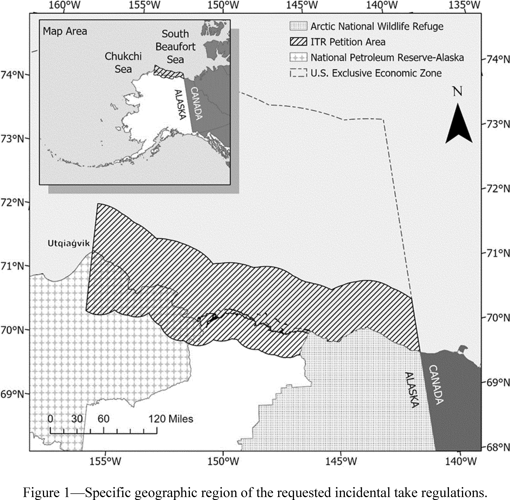
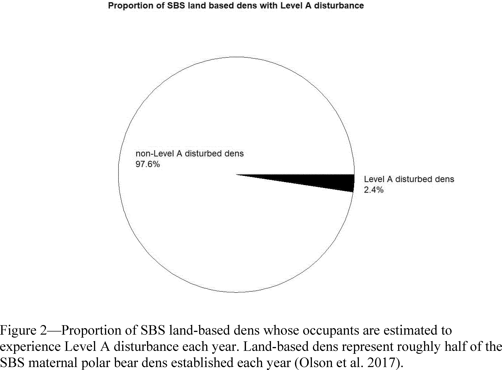

# Daily Digest — 2026-10-19

| | |
|---|---|
| **Digest date** | 2026-10-19 |
| **Data date range** | 2026-10-19 to 2026-10-19 |
| **Generated at** | 2026-10-20T04:05:28Z (UTC) |
| **Pipeline version** | 445ef8fe |
| **Inference** | model layers ran — cli/haiku, opus |
| **Source watermarks** | CREC: 2026-10-16T10:08:13Z · BILLS: 2026-10-19T16:11:52Z · FR: 2026-10-19T21:30:25Z · USCOURTS: 2026-10-19T22:37:48Z · PLAW: 2026-10-19T17:22:23Z |

[Full observed listing for this day](day/2026-10-19.html) — the items our collectors observed for this publication day, mechanical rules applied, frozen at end of day; releases their publishers date on other days are counted there, not listed. This digest is the canonical record.

All items below cite the govinfo package (and granule, where applicable) they
summarize. Selection is mechanical; each item states the rule that included
it. See the Coverage Statement at the end for a full accounting of what was
published, what was summarized, and what was excluded and why.

---

## Contents

- [Day in Review](#day-in-review)
- [1. Congressional Floor Activity](#1-congressional-floor-activity)
- [2. Legislation](#2-legislation)
- [3. Federal Register](#3-federal-register)
- [4. Enacted Laws](#4-enacted-laws)
- [5. Judicial Activity](#5-judicial-activity)
- [6. Agency Announcements](#6-agency-announcements)
- [7. Recorded Votes](#7-recorded-votes)
- [8. Bill Actions](#8-bill-actions)
- [9. Presidential Actions](#9-presidential-actions)
- [Terms Used Today](#terms-used-today)
- [Coverage Statement](#coverage-statement)
- [Methodology](#methodology)

---

## Day in Review

On the legislative side, the digest carries no recorded floor votes from either chamber. It carries 13 bills introduced in the House and one public law: Public Law 119-119, enacted October 7, 2026, which amends the Social Security Act to require the Social Security Administration to give individuals whose Social Security numbers were misused, or whose cards were lost in transmission, a single point of contact through case resolution.

The digest carries one executive order, appearing twice, which establishes a Women's Health Division within the National Institutes of Health and a White House Women's Health Task Force. Three presidential notices continue national emergencies with respect to narcotics traffickers centered in Colombia, Sudan, and the Democratic Republic of the Congo. The Federal Register entries include 23 rules, 13 proposed rules, and 107 notices. The Office of Personnel Management eliminated the time-in-grade restriction on General Schedule advancement and amended its administrative leave regulations. The IRS finalized rules allowing direct tax payment by credit or debit card. The Commodity Futures Trading Commission adopted an interim final rule excluding casino-style gambling products from the "swap" definition and separately proposed including event contracts in it. The FAA issued and proposed multiple airworthiness directives, and EPA proposed approving Arizona air quality plan revisions for West Pinal County.

*Composed from the summarized items below and the day's mechanical
counts; all specifics are cited in their sections.*

---

## 1. Congressional Floor Activity

No Congressional Record issue was observed on this day. The Record for a day's proceedings is typically published by govinfo the following morning; it appears in the digest for the day it is observed ([how our clocks work](faq.html#fapds-three-clocks)).

### 1.1 Senate

No Senate floor items met the selection thresholds. 0 floor granule(s) are accounted for in the Coverage Statement.

### 1.2 House of Representatives

No House floor items met the selection thresholds. 0 floor granule(s) are accounted for in the Coverage Statement.

### 1.3 Recorded Votes

No recorded votes were published in this issue of the Congressional Record.

---

## 2. Legislation

Source: Congressional Bills (BILLS), text versions published 2026-10-19 to 2026-10-19.

### 2.1 Counts by Stage

| Stage (bill text version) | Count |
|---|---|
| Introduced (ih/is) | 13 |
| Reported (rh/rs) | 0 |
| Engrossed (eh/es) | 0 |
| Enrolled (enr) | 0 |
| Other versions | 0 |
| **Total bill texts published** | **13** |

### 2.2 Bills Listed by Mechanical Rule

Bills below are listed because they matched at least one listing rule; the
matching rule is stated per item. All other bill texts are counted above and
accounted for in the Coverage Statement.

No bill texts published in this range matched a listing rule; all 13 are
accounted for in the Coverage Statement.

---

## 3. Federal Register

Source: Federal Register (FR), issue of 2026-10-19.

### 3.1 Counts by Document Type

| Document type | Count |
|---|---|
| Rules | 23 |
| Proposed rules | 13 |
| Notices | 107 |
| Presidential documents | 3 |
| **Total FR documents** | **146** |

### 3.2 Rules Published

Tags: department of commerce · department of transportation · executive · model keys: airworthiness directives · tax regulations · wildlife regulations

*In plain terms: 23 final rules led by 7 airworthiness directives and 3 OPM personnel updates; the rest cover tax payments, Postal Service standards, marine wildlife, and other operations.*

#### COMMODITY FUTURES TRADING COMMISSION

- **Further Definition of “Swap” To Exclude Casino-Style Gambling Products** (2026-21376; 17 CFR Part 1) — The Commodity Futures Trading Commission (“Commission” or “CFTC”) is adopting an interim final rule (“Interim Final Rule”) to codify its longstanding position that casino-style gambling products, including wagers placed on sportsbooks and casino games, are excluded from the “swap” definition. Action: Interim final rule; request for comments. Dates: Effective Date: This interim final rule is effective October 19, 2026. Request for comment: Comments must be received by November 18, 2026.
  - *In plain terms:* The Commodity Futures Trading Commission issues a rule effective immediately while accepting public comments, stating that sports betting and casino games are not considered financial swaps.
  - Included because: FR-SEL-01 — document type: final rule (all listed)
  - Source: [FR-2026-10-19 / 2026-21376](https://www.govinfo.gov/app/details/FR-2026-10-19/2026-21376)

#### CONSUMER PRODUCT SAFETY COMMISSION

- **Interpretation of “Flammable Liquid Fuels” With Respect to Fuel Additives** (2026-21348; 16 CFR Part 1461) — The Consumer Product Safety Commission (CPSC) is issuing an interpretive rule that interprets the phrase “flammable liquid fuels” as used in the Portable Fuel Container Safety Act of 2020 (PFCSA). Consistent with the plain language of the statute, the Commission interprets this phrase not to include fuel additives that are intended to be added to flammable liquid fuels for the sole purpose of improving engine performance, cleaning engine components, extending engine life, stabilizing fuel, preventing weather effects from fuel, or some similar purpose unrelated to creating heat or power. Action: Final rule; interpretation. Dates: The rule is effective on October 19, 2026.
  - *In plain terms:* The Consumer Product Safety Commission clarifies that fuel additives for improving engine performance or stability are not considered flammable liquid fuels under portable fuel container safety law.
  - Included because: FR-SEL-01 — document type: final rule (all listed)
  - Source: [FR-2026-10-19 / 2026-21348](https://www.govinfo.gov/app/details/FR-2026-10-19/2026-21348)

#### DEPARTMENT OF COMMERCE

- **Streamlining the Regulations Governing Testimony by Employees and the Production of Documents in Legal Proceedings** (2026-21272; 15 CFR Part 15) — By this rule, the Department amends the regulations governing testimony by its current and former employees and the production of its documents in legal proceedings. This rule amends those regulations by removing and/or replacing language that is redundant, that references other authorities, or that provides only unnecessary elaboration. This action is necessary to streamline the Department's regulations and reduce regulatory complexity. This action is intended to promote efficiency and simplicity, and to minimize the risk of confusion and/or distraction, without significantly altering any entitlements, obligations, or processes in connection with testimony by Department employees or the production of Department documents. Action: Final rule. Dates: The rule is effective October 19, 2026.
  - *In plain terms:* Department streamlines regulations governing employee testimony and document production in legal proceedings by removing redundant language.
  - Included because: FR-SEL-01 — document type: final rule (all listed)
  - Source: [FR-2026-10-19 / 2026-21272](https://www.govinfo.gov/app/details/FR-2026-10-19/2026-21272)

#### DEPARTMENT OF HOMELAND SECURITY

- **Special Local Regulation; Ponce Harbor, Ponce, PR** (2026-21302; 33 CFR Part 100) — The Coast Guard is establishing a temporary special local regulation (SLR) for certain waters within the Bahia de Ponce, Ponce, PR. This action is necessary to provide for the safety of life on these navigable waters near Ponce, PR during the Discover the Caribbean Regatta 2026 event to be held October 30, 2026, through November 1, 2026, and November 14, 2026, through November 15, 2026. This regulation prohibits persons and vessels from entering the regulated area unless specifically authorized by the Captain of the Port San Juan or their designated representative. Action: Temporary final rule. Dates: This rule is effective from October 30, 2026, through November 15, 2026. The temporary special local regulations will be enforced on October 30, 2026, through November 1, 2026, and on November 14, 2026, through November 15, 2026, from 9 a.m. until 5 p.m. daily.
  - *In plain terms:* Coast Guard establishes temporary safety regulation for Ponce Harbor during the Discover the Caribbean Regatta from October 30-November 1 and November 14-15, 2026.
  - Included because: FR-SEL-01 — document type: final rule (all listed)
  - Source: [FR-2026-10-19 / 2026-21302](https://www.govinfo.gov/app/details/FR-2026-10-19/2026-21302)

#### DEPARTMENT OF THE INTERIOR

- **Alaska; Wildlife, Harvest, and Access** (2026-21299; 36 CFR Part 13) — The National Park Service (NPS) amends its regulations for hunting, fishing, trapping, and other harvest-related activities in Alaska and the procedures used to restrict public use and access in Alaska park areas, including for subsistence. This rule restores the regulatory framework adopted to implement the Alaska National Interest Lands Conservation Act of 1980 (ANILCA) in 1981 that guided management for more than three decades, with targeted updates to that framework in response to public comments and further agency review. The restored framework recognizes the complementary and distinct roles of the State of Alaska, the Federal Subsistence Management Program, and the NPS in managing public uses and resources in Alaska park areas. The rule removes regulatory changes made in 2015, 2017, and 2024 that departed from that framework. These amendments are consistent with Executive Orders 14153 and 14192 and Secretary of the Interior's Orders 3422 and 3447. Action: Final rule. Dates: This rule is effective November 18, 2026.
  - *In plain terms:* National Park Service restores 1981 regulations for hunting, fishing, and subsistence in Alaska parks with updates, removing 2015-2024 changes.
  - Included because: FR-SEL-01 — document type: final rule (all listed)
  - Source: [FR-2026-10-19 / 2026-21299](https://www.govinfo.gov/app/details/FR-2026-10-19/2026-21299)
- **Outer Continental Shelf Oil and Gas Leasing; Corrections** (2026-21346; 30 CFR Part 560) — The Department of the Interior (DOI), acting through the Bureau of Ocean Energy Management (BOEM), is correcting citations in 30 CFR part 560. DOI issued two rules in 2008 and 2016 where some of the finalized amendments were never incorporated into the CFR. This document corrects 30 CFR part 560 to reflect the finalized amendments. Action: Correcting amendments. Dates: Effective on October 19, 2026.
  - *In plain terms:* The Department of Interior is correcting its oil and gas regulations to include amendments that were finalized in 2008 and 2016 but were never formally added to the rules.
  - Included because: FR-SEL-01 — document type: final rule (all listed)
  - Source: [FR-2026-10-19 / 2026-21346](https://www.govinfo.gov/app/details/FR-2026-10-19/2026-21346)
- **Marine Mammals; Incidental Take of Polar Bears and Pacific Walruses in the Beaufort Sea and North Slope of Alaska** (2026-21371; 50 CFR Part 18) — We, the U.S. Fish and Wildlife Service (FWS), in response to a request under the Marine Mammal Protection Act (MMPA) of 1972 from the Alaska Oil and Gas Association (AOGA), finalize regulations facilitating the authorization of incidental, unintentional take of small numbers of polar bears ( Ursus maritimus ) and Pacific walruses ( Odobenus rosmarus divergens ) during year-round oil and gas industry activities in the Beaufort Sea (Alaska and the Outer Continental Shelf (OCS)) and adjacent northern coast of Alaska. Take may result from oil and gas exploration, development, production, and transportation activities occurring for a period of 5 years. Oil and gas industry operations include similar types of activities covered by the previous 5-year Beaufort Sea incidental take regulations effective from August 6, 2021, through August 5, 2026. We will issue letters of authorization, upon request, for specific activities in accordance with these regulations. Action: Final rule. Dates: This rule is effective October 19, 2026 and remains effective through October 19, 2031.
  - *In plain terms:* The Fish and Wildlife Service allows oil and gas companies to cause unintentional harm to small numbers of polar bears and walruses during operations in Alaska's Beaufort Sea for five years.
  - Included because: FR-SEL-01 — document type: final rule (all listed)
  - Source: [FR-2026-10-19 / 2026-21371](https://www.govinfo.gov/app/details/FR-2026-10-19/2026-21371)
  -  *Source graphic 1 of 4 from 2026-21371.*
  -  *Source graphic 2 of 4 from 2026-21371.*
  - *Graphics not rendered here: 2 of 4 — see the [source PDF](https://www.govinfo.gov/content/pkg/FR-2026-10-19/pdf/FR-2026-10-19.pdf).*

#### DEPARTMENT OF THE TREASURY

- **Regulations Regarding Payment of Tax by Commercially Acceptable Means** (2026-21267; 26 CFR Part 301) — This document contains final regulations regarding the payment of tax by commercially acceptable means. The final regulations reflect changes to the law made by the Taxpayer First Act that would allow the IRS to directly accept payments of tax by credit or debit card, without having to connect taxpayers to third-party payment processors. These final regulations remove restrictions on the payment of any fee by the IRS under any contracts related to payment of taxes by credit, debit, or charge card, and on the IRS imposing any fee or charge on persons paying taxes by credit or debit card. Action: Final rule. Dates: Effective date: These final regulations are effective on October 19, 2026. Applicability date: For date of applicability, see § 301.6311-(g).
  - *In plain terms:* Final regulations allow the IRS to accept tax payments directly via credit or debit card without third-party processors and remove restrictions on related fees.
  - Included because: FR-SEL-01 — document type: final rule (all listed)
  - Source: [FR-2026-10-19 / 2026-21267](https://www.govinfo.gov/app/details/FR-2026-10-19/2026-21267)

#### DEPARTMENT OF TRANSPORTATION

- **Airworthiness Directives; Rolls-Royce Deutschland Ltd & Co KG Engines** (2026-21278; 14 CFR Part 39) — The FAA is superseding Airworthiness Directive (AD) 2009-04-13 for certain Rolls-Royce Deutschland Ltd & Co KG (RRD) Model BR700-715A1-30, BR700-715B1-30, and BR700-715C1-30 engines. AD 2009-04-13 required revising the airworthiness limitations section (ALS) of the operator's existing approved engine maintenance or inspection program, as applicable, to incorporate new or more restrictive tasks and limitations and associated thresholds and intervals for life-limited parts. AD 2009-04-13 also required removing certain low-pressure compressor (LPC) (fan) disc assemblies from service and completing the Life Limited Part Tracking Sheet. Since the FAA issued AD 2009-04-13, the manufacturer has revised the engine time limits manual (TLM) to introduce new or more restrictive tasks and limitations and associated thresholds and intervals for life-limited parts. This AD requires revising the ALS of the existing approved engine maintenance or inspection program, as applicable, to incorporate new or more restrictive tasks and limitations and associated thresholds and intervals for life-limited parts. The FAA is issuing this AD to address the unsafe condition on these products. Action: Final rule. Dates: This AD is effective November 23, 2026. The Director of the Federal Register approved the incorporation by reference of a certain publication listed in this AD as of November 23, 2026.
  - *In plain terms:* FAA replaces an earlier directive for certain Rolls-Royce engines with updated requirements for maintenance program tasks and limits on life-limited parts.
  - Included because: FR-SEL-01 — document type: final rule (all listed)
  - Source: [FR-2026-10-19 / 2026-21278](https://www.govinfo.gov/app/details/FR-2026-10-19/2026-21278)
- **Airworthiness Directives; Pratt & Whitney Division Engines** (2026-21290; 14 CFR Part 39) — The FAA is adopting a new airworthiness directive (AD) for all Pratt & Whitney Division (PW) Model PW4052, PW4056, PW4060, PW4060A, PW4060C, PW4062, PW4062A, PW4152, PW4156, PW4156A, PW4158, PW4460, and PW4462 engines. This AD was prompted by multiple reports of tailpipe fire, loss of thrust control, and engine in-flight shutdown due to undetected deterioration of pressure burner (Pb) sensors. This AD requires replacing Pb sensors. The FAA is issuing this AD to address the unsafe condition on these products. Action: Final rule. Dates: This AD is effective November 23, 2026.
  - *In plain terms:* FAA requires replacing pressure burner sensors in certain Pratt & Whitney engines to address reports of tailpipe fires, thrust control loss, and in-flight shutdowns.
  - Included because: FR-SEL-01 — document type: final rule (all listed)
  - Source: [FR-2026-10-19 / 2026-21290](https://www.govinfo.gov/app/details/FR-2026-10-19/2026-21290)
- **Airworthiness Directives; Airbus SAS Airplanes** (2026-21325; 14 CFR Part 39) — The FAA is adopting a new airworthiness directive (AD) for all Airbus SAS Model A330-243, A330-243F, A330-341, A330-342, A330-343, A330-841, and A330-941 airplanes; and Model A340-211, A340-212, A340-213, A340-311, A340-312, A340-313, A340-541, and A340-642 airplanes. This AD was prompted by reports of leaks on closed fuel low pressure shut-off valves (LPSOVs). This AD requires repetitive leak checks of certain fuel LPSOVs and replacement of an affected part if any discrepancy is detected. This AD also allows the installation of an affected part under certain conditions. The FAA is issuing this AD to address the unsafe condition on these products. Action: Final rule. Dates: This AD is effective November 23, 2026. The Director of the Federal Register approved the incorporation by reference of a certain publication listed in this AD as of November 23, 2026.
  - *In plain terms:* FAA requires repetitive leak checks of certain fuel shut-off valves on Airbus A330 and A340 airplanes and replacement if discrepancies are found.
  - Included because: FR-SEL-01 — document type: final rule (all listed)
  - Source: [FR-2026-10-19 / 2026-21325](https://www.govinfo.gov/app/details/FR-2026-10-19/2026-21325)
- **Airworthiness Directives; The Boeing Company Airplanes** (2026-21326; 14 CFR Part 39) — The FAA is adopting a new airworthiness directive (AD) for certain The Boeing Company Model 787-8, 787-9, and 787-10 airplanes. This AD was prompted by a report indicating that the protection system on the left fan cowl of the right engine does not sufficiently cover the components and systems from possible cross engine debris. This AD requires performing a maintenance records check or inspection of the right engine to determine the part number of the left fan cowl and applicable on-condition actions. The FAA is issuing this AD to address the unsafe condition on these products. Action: Final rule. Dates: This AD is effective November 23, 2026. The Director of the Federal Register approved the incorporation by reference of a certain publication listed in this AD as of November 23, 2026.
  - *In plain terms:* FAA requires maintenance records check or inspection of Boeing 787 right engines to determine fan cowl part number and perform applicable maintenance actions.
  - Included because: FR-SEL-01 — document type: final rule (all listed)
  - Source: [FR-2026-10-19 / 2026-21326](https://www.govinfo.gov/app/details/FR-2026-10-19/2026-21326)
- **Airworthiness Directives; Airbus SAS Airplanes** (2026-21331; 14 CFR Part 39) — The FAA is superseding Airworthiness Directive (AD) 2025-04- 05, which applied to all Airbus SAS Model A330-841 and -941 airplanes. AD 2025-04-05 required a revision of the existing airplane flight manual (AFM) and removal of the previously required limitations; a revision of the existing minimum equipment list (MEL); one-time or repetitive seal integrity tests of each engine bleed air system (EBAS) high pressure valve (HPV); additional maintenance instructions and corrective actions; and repetitive replacement of affected HPV clips; as applicable. AD 2025-04-05 also limited the installation of affected HPV clips. Since the FAA issued AD 2025-04-05, an improved EBAS HPV with unaffected HPV clips was certified, and it was determined that the bleed monitoring computer (BMC) software (SW) must be updated. This AD continues to require the actions in AD 2025-04-05, except for repetitive replacement of affected HPV clips. This AD also requires updating the BMC SW, additional work, and an additional revision of the existing MEL for the engine bleed overpressure valve; as applicable. This AD also prohibits the installation of certain BMC software. [official summary truncated; see source] Action: Final rule. Dates: This AD is effective November 23, 2026. The Director of the Federal Register approved the incorporation by reference of a certain publication listed in this AD as of November 23, 2026.
  - *In plain terms:* FAA updates Airbus A330 engine directive continuing prior requirements but eliminating repetitive HPV clip replacements and requiring bleed monitoring computer software updates.
  - Included because: FR-SEL-01 — document type: final rule (all listed)
  - Source: [FR-2026-10-19 / 2026-21331](https://www.govinfo.gov/app/details/FR-2026-10-19/2026-21331)
- **Airworthiness Directives; The Boeing Company Airplanes** (2026-21332; 14 CFR Part 39) — The FAA is adopting a new airworthiness directive (AD) for certain The Boeing Company Model 737-600, -700, -700C, -800, -900, and -900ER series airplanes. This AD was prompted by a report that some passenger service unit (PSU)-mounted video monitors became detached from the PSU rails during a hard landing. This AD requires replacing PSU-mounted video monitors that do not have secondary retention lanyards. The FAA is issuing this AD to address the unsafe condition on these products. Action: Final rule. Dates: This AD is effective November 23, 2026. The Director of the Federal Register approved the incorporation by reference of certain publications listed in this AD as of November 23, 2026.
  - *In plain terms:* FAA requires replacing passenger service unit video monitors on Boeing 737 aircraft that lack secondary retention lanyards.
  - Included because: FR-SEL-01 — document type: final rule (all listed)
  - Source: [FR-2026-10-19 / 2026-21332](https://www.govinfo.gov/app/details/FR-2026-10-19/2026-21332)
- **Airworthiness Directives; The Boeing Company Airplanes** (2026-21333; 14 CFR Part 39) — The FAA is adopting a new airworthiness directive (AD) for certain The Boeing Company Model 737-600, -700, -700C, -800, -900, and -900ER series airplanes. This AD was prompted by reports from multiple operators of pitch oscillation events due to excessive horizontal stabilizer freeplay. This AD requires measuring the freeplay of the horizontal stabilizer pivot hinges and the jackscrew and applicable on-condition actions. The FAA is issuing this AD to address the unsafe condition on these products. Action: Final rule. Dates: This AD is effective November 23, 2026. The Director of the Federal Register approved the incorporation by reference of a certain publication listed in this AD as of November 23, 2026.
  - *In plain terms:* The FAA requires inspecting and measuring horizontal stabilizer components on certain Boeing 737 airplanes and performing corrective actions if problems are found.
  - Included because: FR-SEL-01 — document type: final rule (all listed)
  - Source: [FR-2026-10-19 / 2026-21333](https://www.govinfo.gov/app/details/FR-2026-10-19/2026-21333)

#### ENVIRONMENTAL PROTECTION AGENCY

- **Approval and Promulgation of Implementation Plans; Arizona; Revisions to the Cleaner Burning Gasoline, Winter Oxygenated Fuel, and Gasoline Set-Aside Programs** (2026-21268; 40 CFR Part 52) — The U.S. Environmental Protection Agency (EPA) is finalizing an approval of a revision to the Arizona State Implementation Plan (SIP) submitted by the Arizona Department of Environmental Quality (ADEQ). This revision includes statutes and regulations amending the Cleaner Burning Gasoline (CBG) program, which is a control measure in the greater Phoenix metropolitan area to reduce emissions of ozone-forming pollutants, carbon monoxide (CO), and particulate matter. Additionally, this revision addresses the Winter Oxygenated Fuel program to control CO emissions in the Tucson area. Finally, this revision repeals the Arizona Gasoline Set‐aside (GSA) Program, applicable to the 1971 carbon monoxide nonattainment area covering Maricopa County and a portion of Pima County. This SIP revision is administrative in nature. This final action updates the existing SIP- approved CBG program with revisions that have been adopted and implemented by the State to clarify requirements, update references, and enhance flexibility of the program and will not impose any additional costs or regulatory burdens. Action: Final rule. Dates: This rule is effective on November 18, 2026.
  - *In plain terms:* EPA approves Arizona's revisions to air quality rules for Phoenix and Tucson areas affecting fuel programs and emissions controls.
  - Included because: FR-SEL-01 — document type: final rule (all listed)
  - Source: [FR-2026-10-19 / 2026-21268](https://www.govinfo.gov/app/details/FR-2026-10-19/2026-21268)

#### FEDERAL COMMUNICATIONS COMMISSION

- **Upper C-Band (3.98-4.2 GHz); Expanding Flexible Use of the 3.7 to 4.2 GHz Band** (2026-21324; 47 CFR Part 27) — In this document, the Federal Communications Commission (Commission) announces that the Office of Management and Budget (OMB) has approved the information collection requirements under OMB Control Number 3060-1272, as adopted in the Commission's Report and Order, Order of Proposed Modification, and Order on Reconsideration, FCC 26-46. Action: Final rule; announcement of effective date. Dates: Amendatory instructions 26 (47 CFR 27.1412(e)) and 35 (47 CFR 27.1419), published at 91 FR 48700, July 31, 2026, are effective on October 19, 2026.
  - *In plain terms:* FCC announces OMB approval of information collection requirements from the Commission's reports on expanding flexible use of the 3.7-4.2 GHz spectrum band.
  - Included because: FR-SEL-01 — document type: final rule (all listed)
  - Source: [FR-2026-10-19 / 2026-21324](https://www.govinfo.gov/app/details/FR-2026-10-19/2026-21324)

#### NUCLEAR REGULATORY COMMISSION

- **Fee Schedules; Fee Recovery for Fiscal Year 2026** (C1-2026-12067; 10 CFR Parts 15, 170, and 171) — This is a correction to the Nuclear Regulatory Commission's fiscal year 2026 fee schedule rule published in June 2026. The correction revises the descriptions and fee amounts for nuclear licenses issued for medical and industrial use of byproduct material, source material, and special nuclear material.
  - *In plain terms:* The Nuclear Regulatory Commission is correcting its fiscal year 2026 fee schedule, revising fee amounts for nuclear licenses used in medical and industrial applications.
  - Included because: FR-SEL-01 — document type: final rule (all listed)
  - Source: [FR-2026-10-19 / C1-2026-12067](https://www.govinfo.gov/app/details/FR-2026-10-19/C1-2026-12067)

#### OFFICE OF PERSONNEL MANAGEMENT

- **Managing Senior Professional Performance** (2026-21316; 5 CFR Parts 351, 430, 451, 534, 537, 630, and 894; 5 CFR Part 1330) — The Office of Personnel Management (OPM) and the Office of Management and Budget (OMB) are issuing a final rule to strengthen the performance appraisal of senior-level (SL) and scientific or professional (ST) employees, collectively referred to as “senior professionals.” This final rule establishes a new subpart dedicated exclusively to senior professional performance appraisal that aligns more closely with Senior Executive Service (SES) performance appraisal regulations. The rule also eliminates senior professional appraisal programs, removes the prohibition of a standardized distribution of performance rating levels, and enhances oversight of the appraisal process. Action: Final rule. Dates: Effective November 18, 2026.
  - *In plain terms:* OPM and OMB issue final rule for senior-level and scientific/professional federal employees strengthening performance appraisal and removing standardized rating distribution prohibitions.
  - Included because: FR-SEL-01 — document type: final rule (all listed)
  - Source: [FR-2026-10-19 / 2026-21316](https://www.govinfo.gov/app/details/FR-2026-10-19/2026-21316)
- **Elimination of Time-in-Grade** (2026-21319; 5 CFR Parts 300, 315, 316, 352, and 410) — The Office of Personnel Management (OPM) is adopting, substantially as proposed, its proposed rule eliminating the Time-in-Grade (TIG) restriction on advancement to competitive service positions in the General Schedule (GS). Under the prior regulations, a candidate generally could not be advanced to a covered position at GS-6 or above without completing 52 weeks in a position no more than one grade lower—or two grades lower for certain positions in two-grade-interval lines of work. This final rule removes that requirement. Employees remain subject to all applicable occupational qualification standards and any additional job-related qualification requirements established by their employing agency. Action: Final rule. Dates: This rule is effective January 19, 2027.
  - *In plain terms:* OPM removes the requirement that federal competitive service employees wait 52 weeks at a lower grade before advancing to GS-6 and above.
  - Included because: FR-SEL-01 — document type: final rule (all listed)
  - Source: [FR-2026-10-19 / 2026-21319](https://www.govinfo.gov/app/details/FR-2026-10-19/2026-21319)
- **Administrative Leave for Workforce Realignment and Other Purposes** (2026-21320; 5 CFR Parts 351, 630, and 715) — The Office of Personnel Management (OPM) is issuing a final rule to amend its regulations governing administrative leave for workforce realignment and other purposes. This final rule more fully addresses the appropriate uses of administrative leave, including use in connection with deferred resignation programs and other workforce realignment initiatives, and for other purposes. The final rule also clarifies when an agency may provide administrative leave during a reduction-in-force notice period and accept or deny an employee's request to withdraw a resignation in the context of a deferred resignation program. Action: Final rule. Dates: This rule is effective November 18, 2026.
  - *In plain terms:* OPM issues final rule clarifying administrative leave uses for workforce realignment and procedures for withdrawing resignations during such programs.
  - Included because: FR-SEL-01 — document type: final rule (all listed)
  - Source: [FR-2026-10-19 / 2026-21320](https://www.govinfo.gov/app/details/FR-2026-10-19/2026-21320)

#### POSTAL SERVICE

- **Customs Requirements and Payment Procedures for Certain Customs Charges** (2026-21310; 39 CFR Part 20) — The Postal Service is revising Mailing Standards of the United States Postal Service, International Mail Manual (IMM®), in various sections, to update mailer responsibilities with respect to customs requirements and to establish procedures for the payment, or reimbursement, of any customs charges that are assessed, including after the purchase of postage. Action: Interim final rule. Dates: Effective: October 19, 2026. Comments must be received by November 18, 2026.
  - *In plain terms:* Postal Service updates international mail standards regarding customs requirements and procedures for handling assessed customs charges.
  - Included because: FR-SEL-01 — document type: final rule (all listed)
  - Source: [FR-2026-10-19 / 2026-21310](https://www.govinfo.gov/app/details/FR-2026-10-19/2026-21310)
- **New Mailing Standards for Live Animals** (2026-21317; 39 CFR Part 111) — The Postal Service is revising Publication 52, Hazardous, Restricted, and Perishable Mail (Pub 52), to improve package integrity and container identification for live animal shipments during processing and handling. Action: Final rule. Dates: Effective: October 19, 2026.
  - *In plain terms:* Postal Service revises standards for live animal shipments to improve package integrity and container identification during processing.
  - Included because: FR-SEL-01 — document type: final rule (all listed)
  - Source: [FR-2026-10-19 / 2026-21317](https://www.govinfo.gov/app/details/FR-2026-10-19/2026-21317)

### 3.3 Proposed Rules Published

Tags: department of commerce · department of transportation · executive · model keys: air quality · airworthiness · television broadcasting

*In plain terms: 13 proposed items including 3 airworthiness directives and 3 Arizona air quality revisions, plus amendments to TV allotments, event contracts, and vehicle regulations.*

#### COMMODITY FUTURES TRADING COMMISSION

- **Further Definition of “Swap”—Inclusions** (2026-21377; 17 CFR Part 1) — Consistent with its jurisdiction over swaps, the Commodity Futures Trading Commission (“Commission” or “CFTC”) is proposing to further define the term “swap” to explicitly include event contracts, including those based on sports-, politics-, cultural-, and weather-related events (the “Proposal”). Action: Notice of proposed rulemaking. Dates: Comments must be received by November 18, 2026.
  - *In plain terms:* The Commodity Futures Trading Commission proposes to expand the definition of financial swaps to include contracts based on sports, politics, cultural, and weather-related events.
  - Included because: FR-SEL-02 — document type: proposed rule (all listed)
  - Source: [FR-2026-10-19 / 2026-21377](https://www.govinfo.gov/app/details/FR-2026-10-19/2026-21377)

#### DEPARTMENT OF HOMELAND SECURITY

- **Safety Zone; FRL Inaugural Invitational eFoil Exhibition Race, Miami Marine Stadium Basin, Miami, FL** (2026-21305; 33 CFR Part 165) — The Coast Guard is proposing to establish a temporary safety zone for certain navigable waters in the Miami Marine Stadium Basin in connection with the FRL Inaugural Invitational eFoil Exhibition Race. The safety zone is needed to protect personnel, vessels, and the marine environment from potential hazards associated with eFoil race operations. This proposed rulemaking would prohibit persons and vessels from being in the safety zone unless specifically authorized by the Captain of the Port, Sector Miami. We invite your comments on this proposed rulemaking. Action: Notice of proposed rulemaking. Dates: Comments and related material must be received by the Coast Guard on or before November 18, 2026.
  - *In plain terms:* Coast Guard proposes temporary safety zone for Miami Marine Stadium Basin waters during the FRL Inaugural Invitational eFoil Exhibition Race.
  - Included because: FR-SEL-02 — document type: proposed rule (all listed)
  - Source: [FR-2026-10-19 / 2026-21305](https://www.govinfo.gov/app/details/FR-2026-10-19/2026-21305)

#### DEPARTMENT OF THE INTERIOR

- **Gates of the Arctic National Park and Preserve; Use of Off-Road Vehicles for Subsistence Purposes by Residents of Anaktuvuk Pass** (2026-21300; 36 CFR Part 13) — The National Park Service (NPS) proposes to amend special regulations for Gates of the Arctic National Park and Preserve (Gates) to establish a process by which the Superintendent can establish reasonable mitigation measures on the use of off-road vehicles (ORVs) for subsistence purposes by local rural residents of Anaktuvuk Pass, but only when such use is causing or likely to cause an adverse impact to public health and safety, resources, historic or scientific values, subsistence uses, or endangered or threatened species. Action: Proposed rule. Dates: Comments must be received by 11:59 p.m. ET on December 18, 2026.
  - *In plain terms:* NPS proposes a process allowing the superintendent to establish mitigation measures for off-road vehicle subsistence use by Anaktuvuk Pass residents when causing adverse impacts.
  - Included because: FR-SEL-02 — document type: proposed rule (all listed)
  - Source: [FR-2026-10-19 / 2026-21300](https://www.govinfo.gov/app/details/FR-2026-10-19/2026-21300)

#### DEPARTMENT OF TRANSPORTATION

- **Airworthiness Directives; Pratt & Whitney RTX Corporation (Type Certificate Previously Held by Pratt & Whitney Division United Technologies Corporation) Engines** (2026-21298; 14 CFR Part 39) — The FAA proposes to supersede Airworthiness Directive (AD) 2026-09-02, which applies to certain Pratt & Whitney RTX Corporation (PW) Model PW4074, PW4074D, PW4077, PW4077D, PW4084D, PW4090, and PW4090-3 engines. AD 2026-09-02 requires repetitive angle ultrasonic scan inspections (AUSIs) of the high-pressure compressor (HPC) 15th-stage disks, front turbine hubs, high-pressure turbine (HPT) 1st-stage air seals, and HPT 2nd-stage hubs for crack indications, and removal from service and replacement if necessary, and for certain serial numbers, removal from service and replacement of the HPT 1st-stage air seal. Since the FAA issued AD 2026-09-02, the FAA was notified that a certain part number was omitted from AD 2026-09-02 and the applicability of the optional terminating action was matched to an unrelated requirement. This proposed AD would require repetitive AUSIs of the HPC 15th-stage disks, front turbine hubs, HPT 1st-stage air seals, and HPT 2nd-stage hubs for crack indications, and removal from service and replacement if necessary, and for certain serial numbers, removal from service and replacement of the HPT 1st-stage air seal. [official summary truncated; see source] Action: Notice of proposed rulemaking (NPRM). Dates: The FAA must receive comments on this proposed AD by December 3, 2026.
  - *In plain terms:* FAA proposes to update an engine directive to correct omitted part numbers and clarify inspection and replacement requirements.
  - Included because: FR-SEL-02 — document type: proposed rule (all listed)
  - Source: [FR-2026-10-19 / 2026-21298](https://www.govinfo.gov/app/details/FR-2026-10-19/2026-21298)
- **Airworthiness Directives; Airbus SAS Airplanes** (2026-21334; 14 CFR Part 39) — The FAA proposes to supersede Airworthiness Directive (AD) 2025-09-07, which applies to certain Airbus SAS Model A330-243, -243F, -841, and -941 airplanes. AD 2025-09-07 requires revising the existing airplane flight manual (AFM) by providing instructions to address dual loss of radio management panel (RMP) data synchronization, and the existing minimum equipment list (MEL) by removing relief for an inoperative RMP 3. Since the FAA issued AD 2025-09-07, a modification that addresses the unsafe condition has been developed. This proposed AD would continue to require the actions specified in AD 2025-09-07 and would require modifying the airplane. This proposed AD also reduces the applicability. This proposed AD would also prohibit the installation of affected parts under certain conditions. The FAA is proposing this AD to address the unsafe condition on these products. Action: Notice of proposed rulemaking (NPRM). Dates: The FAA must receive comments on this proposed AD by December 3, 2026.
  - *In plain terms:* The FAA proposes to update a 2025 safety directive for certain Airbus A330 airplanes by continuing existing actions, requiring airplane modification, and restricting part installations.
  - Included because: FR-SEL-02 — document type: proposed rule (all listed)
  - Source: [FR-2026-10-19 / 2026-21334](https://www.govinfo.gov/app/details/FR-2026-10-19/2026-21334)
- **Airworthiness Directives; Airbus Helicopters** (2026-21387; 14 CFR Part 39) — The FAA proposes to adopt a new airworthiness directive (AD) for all Airbus Helicopters Model AS350B3, AS355F, AS355F1, AS355F2, AS355N, AS355NP, EC130B4, and EC130T2 helicopters. This proposed AD was prompted by a report of the loss of the tightening torque between the upper ball bearing end and a main rotor (MR) servo-control. This proposed AD would require an inspection of the nut tightening torque of the upper ball bearing end of all the MR servo-controls and, depending on the results, corrective actions. The proposed AD would also require reporting the inspection results. The FAA is proposing this AD to address the unsafe condition on these products. Action: Notice of proposed rulemaking (NPRM). Dates: The FAA must receive comments on this NPRM by December 3, 2026.
  - *In plain terms:* The FAA proposes requiring inspections of upper ball bearing nuts in certain Airbus helicopter rotor controls and corrective actions if tightening torque problems are found.
  - Included because: FR-SEL-02 — document type: proposed rule (all listed)
  - Source: [FR-2026-10-19 / 2026-21387](https://www.govinfo.gov/app/details/FR-2026-10-19/2026-21387)

#### ENVIRONMENTAL PROTECTION AGENCY

- **Air Quality Plan; Arizona; Pinal County Air Quality Control District; West Pinal County PM 10 Nonattainment Area; Fugitive Dust Rules** (2026-21287; 40 CFR Part 52) — The U.S. Environmental Protection Agency (EPA) is proposing to approve revisions to the Pinal County Air Quality Control District (PCAQCD or “District”) portion of the Arizona State Implementation Plan (SIP). These revisions concern emissions of particulate matter (PM) that is 10 micrometers or smaller in diameter (PM 10 ) from fugitive dust sources, including open areas/vacant lots, unpaved lots, unpaved roads, paved public roadways, and construction sites. We are proposing to approve local rules to regulate these emission sources under the Clean Air Act (CAA or “Act”). Action: Proposed rule. Dates: Comments must be received on or before November 18, 2026.
  - *In plain terms:* EPA proposes to approve Arizona rules regulating particulate matter emissions from fugitive dust sources including vacant lots, unpaved roads, and construction.
  - Included because: FR-SEL-02 — document type: proposed rule (all listed)
  - Source: [FR-2026-10-19 / 2026-21287](https://www.govinfo.gov/app/details/FR-2026-10-19/2026-21287)
- **Approval and Promulgation of Implementation Plans—Pinal County (Part); West Pinal, AZ PM 10 Nonattainment Area; Moderate Area, Serious Area, and Section 189(d) Plan for Attainment of the 24-Hour PM 10 Standard** (2026-21288; 40 CFR Part 52) — The U.S. Environmental Protection Agency (EPA) is proposing to approve a state implementation plan (SIP) revision submitted by the State of Arizona to meet Clean Air Act (CAA or “Act”) requirements applicable to the Pinal County (Part); West Pinal PM 10 nonattainment area (“West Pinal County PM 10 Nonattainment Area”). The EPA is proposing to find that the submitted SIP revision meets all applicable “Moderate” area, “Serious” area, and CAA section 189(d) requirements for the PM 10 national ambient air quality standards (NAAQS). Additionally, the EPA is proposing to approve the PM 10 motor vehicle emissions budgets included with the SIP revision for transportation conformity purposes. The EPA is also starting the adequacy process for these budgets. Our proposed approval of the SIP revision would establish an attainment date of December 31, 2026, for the area. Action: Proposed rule. Dates: Comments must be received on or before November 18, 2026.
  - *In plain terms:* EPA proposes to approve Arizona's air quality plan revision for a county particulate matter area with an attainment date of December 31, 2026.
  - Included because: FR-SEL-02 — document type: proposed rule (all listed)
  - Source: [FR-2026-10-19 / 2026-21288](https://www.govinfo.gov/app/details/FR-2026-10-19/2026-21288)
- **Air Quality Plan; Arizona; Agricultural Best Management Practices Rules for the West Pinal County PM 10 Nonattainment Area** (2026-21289; 40 CFR Part 52) — The U.S. Environmental Protection Agency (EPA) is proposing to approve a revision to the Arizona Department of Environmental Quality (ADEQ or “State”) portion of the Arizona State Implementation Plan (SIP). This revision concerns emissions of particulate matter (PM) that are 10 micrometers (μm) or smaller in diameter (PM 10 ) from agricultural crop and animal operations in the West Pinal County PM 10 nonattainment area. We are proposing to approve two local rules to regulate these emission sources under the Clean Air Act (CAA or “Act”). Action: Proposed rule. Dates: Comments must be received on or before November 18, 2026.
  - *In plain terms:* EPA proposes to approve Arizona rules regulating particulate matter emissions from agricultural crop and animal operations in a county area.
  - Included because: FR-SEL-02 — document type: proposed rule (all listed)
  - Source: [FR-2026-10-19 / 2026-21289](https://www.govinfo.gov/app/details/FR-2026-10-19/2026-21289)
- **New Source Performance Standards and National Emission Standards for Hazardous Air Pollutants; Delegation of Authority to Northwest Clean Air Agency, Washington State** (2026-21383; 40 CFR Parts 60, 61, and 63) — The Northwest Clean Air Agency (NWCAA), located in Washington State, submitted updated regulations for receiving delegation and approval of its program for the implementation and enforcement of newly issued or revised New Source Performance Standards (NSPS) and National Emission Standards for Hazardous Air Pollutants (NESHAP), as provided for under previously approved delegation mechanisms. The updated regulations incorporate by reference certain NSPS and NESHAP promulgated by the Environmental Protection Agency (EPA) as they existed through October 18, 2023. The EPA is providing notice that it is proposing to update the delegation of certain NSPS and approve the delegation of certain NESHAP to NWCAA. The proposed delegation of authority under this action does not apply to sources located in Indian country. Action: Proposed rule. Dates: Comments must be received on or before November 18, 2026.
  - *In plain terms:* The EPA is proposing to update Washington State's Northwest Clean Air Agency's authority to implement federal air pollution standards, incorporating standards through October 18, 2023.
  - Included because: FR-SEL-02 — document type: proposed rule (all listed)
  - Source: [FR-2026-10-19 / 2026-21383](https://www.govinfo.gov/app/details/FR-2026-10-19/2026-21383)

#### FEDERAL COMMUNICATIONS COMMISSION

- **Television Broadcasting Services Des Moines, Iowa** (2026-21260; 47 CFR Part 73) — This document proposes to amend the Table of TV Allotments (Table) of the Federal Communications Commission's (Commission) rules in response to a petition for rulemaking filed by Iowa Public Broadcasting Board (Licensee), the licensee of noncommercial educational PBS member television station KDIN-TV (KDIN-TV), Des Moines, Iowa (Des Moines). The Licensee holds a construction permit (CP) to construct a facility on UHF channel *34 at Des Moines, and now requests to substitute VHF channel *11 for UHF channel *34 in the Table, with the technical parameters as set forth in KDIN-TV's current license. The Media Bureau previously granted a petition for rulemaking submitted by the Licensee to substitute UHF channel *34 in place of VHF channel *11 at Des Moines. The Licensee states that it is now unable to complete construction of the channel *34 facility within the time specified on the construction permit, and therefore requests amendment of the Table to allow it to continue to operate on VHF channel *11 at its currently licensed technical parameters to provide uninterrupted service to viewers. [official summary truncated; see source] Action: Proposed rule. Dates: Comments must be filed on or before November 18, 2026 and reply comments on or before December 3, 2026.
  - *In plain terms:* Iowa Public Broadcasting's KDIN-TV seeks to switch from UHF channel 34 back to VHF channel 11 in Des Moines because it cannot complete the UHF facility construction in time.
  - Included because: FR-SEL-02 — document type: proposed rule (all listed)
  - Source: [FR-2026-10-19 / 2026-21260](https://www.govinfo.gov/app/details/FR-2026-10-19/2026-21260)
- **Petition for Reconsideration of Action in Rulemaking Proceeding; Correction** (2026-21312; 47 CFR Part 4) — The Federal Communications Commission published a document in the Federal Register concerning a Petition for Reconsideration (Petition) has been filed in the Commission's proceeding by Thomas Goode on behalf of the Alliance for Telecommunications Industry Solutions. That document contained incorrect dates. Action: Proposed rule; correction. Dates: October 19, 2026.
  - *In plain terms:* FCC published notice of petition for reconsideration by Alliance for Telecommunications Industry Solutions, correcting incorrect dates in the original document.
  - Included because: FR-SEL-02 — document type: proposed rule (all listed)
  - Source: [FR-2026-10-19 / 2026-21312](https://www.govinfo.gov/app/details/FR-2026-10-19/2026-21312)

#### FEDERAL COMMUNICTIONS COMMISSION

- **Modernizing the Commission's National Environmental Policy Act Rules** (2026-21347; 47 CFR Part 1) — In this document, the Federal Communications Commission (Commission or FCC) seeks additional comment on the Commission's National Historic Preservation Act (NHPA) framework, to further expedite, simplify, and reduce the costs of environmental review. This includes refreshing the record on the meaning of “undertaking” and the Commission's approach to implementing section 106 of the NHPA. The Commission also seeks comment on whether activities related to the deployment and operation of communications infrastructure are within the scope of “undertaking,” as well as on other practices or actions the Commission could adopt to provide more efficiency and predictability in the section 106 process. Additionally, the Commission seeks comment on whether communications infrastructure deployments are agency actions subject to the Endangered Species Act (ESA). Action: Proposed rule. Dates: Comments are due on or before November 18, 2026; reply comments are due on or before December 3, 2026. Written comments on the Initial Regulatory Flexibility Analysis (IRFA) in this document must have a separate and distinct heading designating them as responses to the IRFA and must be submitted on or before November 18, 2026.
  - *In plain terms:* The FCC is requesting public input on streamlining environmental reviews for communications infrastructure under the National Historic Preservation Act and the Endangered Species Act.
  - Included because: FR-SEL-02 — document type: proposed rule (all listed)
  - Source: [FR-2026-10-19 / 2026-21347](https://www.govinfo.gov/app/details/FR-2026-10-19/2026-21347)

### 3.4 Notices and Presidential Documents

Tags: department of commerce · department of transportation · executive · model keys: narcotics trafficking · national emergencies · sudan

*In plain terms: 3 continued national emergencies covering narcotics trafficking in Colombia, conditions in Sudan and Darfur, and the Democratic Republic of Congo situation.*

Notices are summarized only when they match a listing rule; all are counted
in 3.1 and in the Coverage Statement. Presidential documents in the FR are
always listed.

- **Continuation of the National Emergency With Respect to Significant Narcotics Traffickers Centered in Colombia** (2026-21430) — The President continues for one year the national emergency declared in 1995 with respect to significant narcotics traffickers centered in Colombia. The notice states the threat continues to pose a danger to national security, foreign policy, and the economy of the United States.
  - *In plain terms:* The President continues the national emergency declared in 1995 regarding narcotics traffickers based in Colombia, citing continuing threats to national security and the economy.
  - Included because: FR-SEL-03 — presidential document (all listed)
  - Source: [FR-2026-10-19 / 2026-21430](https://www.govinfo.gov/app/details/FR-2026-10-19/2026-21430)
- **Continuation of the National Emergency With Respect to Sudan** (2026-21431) — The President continues the national emergency declared in 1997 with respect to Sudan, which was expanded in scope through executive orders in 2006 and 2023 to address conditions in Sudan and the Darfur region. The notice states the situation continues to pose a threat to national security and foreign policy of the United States beyond November 3, 2026.
  - *In plain terms:* The President continues the national emergency declared in 1997 regarding Sudan, expanded in 2006 and 2023, through November 3, 2026, citing threats to national security and foreign policy.
  - Included because: FR-SEL-03 — presidential document (all listed)
  - Source: [FR-2026-10-19 / 2026-21431](https://www.govinfo.gov/app/details/FR-2026-10-19/2026-21431)
- **Continuation of the National Emergency With Respect to the Democratic Republic of the Congo** (2026-21432) — The President continues for one year the national emergency declared in 2006 with respect to the Democratic Republic of the Congo, as amended in 2014. The notice states the situation in or in relation to the Democratic Republic of the Congo continues to pose a threat to United States foreign policy.
  - *In plain terms:* The President continues the national emergency declared in 2006 regarding the Democratic Republic of Congo (amended in 2014), citing threats to United States foreign policy.
  - Included because: FR-SEL-03 — presidential document (all listed)
  - Source: [FR-2026-10-19 / 2026-21432](https://www.govinfo.gov/app/details/FR-2026-10-19/2026-21432)

---

## 4. Enacted Laws

Tags: legislative · model keys: account security · procedures · social security

*In plain terms: 1 law enacted October 7 requiring the Social Security Administration to establish procedures for individuals with misused account numbers.*

Source: Public and Private Laws (PLAW) published 2026-10-19.

- **Public Law 119–119 — Public Law 119–119: To amend title VII of the Social Security Act to provide for a single point of contact at the Social Security Administration for individuals who are victims of identity theft.** — Public Law 119-119, enacted October 7, 2026, amends the Social Security Act to require the Social Security Administration to establish procedures providing individuals whose Social Security account numbers have been misused or whose Social Security cards were lost in transmission with a single point of contact throughout case resolution. The single point of contact must consist of specially trained employees who coordinate across units and remain accountable until case resolution. The law takes effect 180 days after enactment. Approved: 2026-10-07.
  - *In plain terms:* A law enacted October 7, 2026 requires the Social Security Administration to assign a trained contact coordinating resolution for misused Social Security numbers or cards lost in transmission, effective 180 days after enactment.
  - Included because: PLAW-SEL-01 — enacted into law (all public and private laws are listed) (document dated 2026-10-07)
  - Source: [PLAW-119publ119](https://www.govinfo.gov/app/details/PLAW-119publ119)

---

## 5. Judicial Activity

Source: United States Courts Opinions (USCOURTS): opinions observed 2026-10-19
by our collector; each opinion states its own issue date beside its
listing ([how our clocks work](faq.html#fapds-three-clocks)).

Completeness disclosure (standing): USCOURTS carries opinions from
approximately 140 participating appellate, district, bankruptcy, and
national federal courts. Unlike the Congressional Record and the Federal
Register, which are the complete official record of their branches,
USCOURTS is participation-based and is NOT the complete federal judicial
record. Courts post opinions with delay — typically over several days —
so a day's digest carries the opinions that became available that day,
whatever date each was issued.

### 5.1 Appellate and National Court Opinions

Appellate and national court opinions are summarized; district and
bankruptcy opinions are counted in 5.2 and in the Coverage Statement.

No appellate or national court opinions matched a listing rule for this
date; all opinions are counted in 5.2 and accounted for in the Coverage
Statement.

### 5.2 Counts by Court Category

| Court category | Opinions |
|---|---|
| Appellate | 0 |
| District | 32 |
| Bankruptcy | 0 |
| National | 0 |
| **Total opinions extracted** | **32** |

Archive-window disclosure (rule USCOURTS-FETCH-01): 35087 USCOURTS package(s) have been listed in delta syncs but fell outside the 7-day archive window and were not fetched (global running count across all syncs, not limited to this date).

---

## 6. Agency Announcements

Official press releases and statements the agencies themselves date
on 2026-10-19 (sources listed in the source guide). These are the
agencies' own announcements — official advocacy, quoted and
attributed, not findings of this digest. Agency web content can be
edited or removed without notice; captures and hashes are preserved
per the provenance policy.

#### Agricultural Marketing Service (email)

- **Reminder: National Organic Standards Board Meeting Starts This Week** — dated 2026-10-19 by the agency
  - Included because: AGENCYPR-SEL-01 — official agency release dated this day by the agency (all such releases from active sources are listed; titles only in the pilot)
  - Source: agency email bulletin to this project's subscription, captured and DKIM-verified (the bulletin named no canonical page)

#### Bureau of Justice Statistics (email)

- **New BJS Reports and Data Updates on Homicide and Crime Known to Law Enforcement** — dated 2026-10-19 by the agency
  - Included because: AGENCYPR-SEL-01 — official agency release dated this day by the agency (all such releases from active sources are listed; titles only in the pilot)
  - Source: agency email bulletin to this project's subscription, captured and DKIM-verified (the bulletin named no canonical page)

#### Bureau of Transportation Statistics (email)

- **Airline Service Quality Performance Data – August 2026** — dated 2026-10-19 by the agency
  - Included because: AGENCYPR-SEL-01 — official agency release dated this day by the agency (all such releases from active sources are listed; titles only in the pilot)
  - Source: agency email bulletin to this project's subscription, captured and DKIM-verified (the bulletin named no canonical page)
- **[County and Congressional District Transportation Profiles Updates](https://www.bts.gov/congressionaldistricts)** — dated 2026-10-19 by the agency
  - Included because: AGENCYPR-SEL-01 — official agency release dated this day by the agency (all such releases from active sources are listed; titles only in the pilot)
  - Source: agency email bulletin to this project's subscription, captured and DKIM-verified

#### Census Bureau (email)

- **📅 This Week: ACS Webinar, Halloween Fun Facts and More** — dated 2026-10-19 by the agency
  - Included because: AGENCYPR-SEL-01 — official agency release dated this day by the agency (all such releases from active sources are listed; titles only in the pilot)
  - Source: agency email bulletin to this project's subscription, captured and DKIM-verified (the bulletin named no canonical page)

#### CFTC Press Releases

- **[CFTC Secures Federal Court Orders Requiring Former Long Island Resident and His Firm to Pay Over $288 Million for Operating a Commodity Pool Ponzi Scheme](https://www.cftc.gov/PressRoom/PressReleases/9311-26)** — dated 2026-10-19 by the agency
  - Included because: AGENCYPR-SEL-01 — official agency release dated this day by the agency (all such releases from active sources are listed; titles only in the pilot)

#### Defense News Releases

- **[Engineering Squadrons Fortify Pacific Airfields, Advance Agile Combat Employment](https://www.war.gov/News/News-Stories/Article/Article/4628908/engineering-squadrons-fortify-pacific-airfields-advance-agile-combat-employment/)** — dated 2026-10-19 by the agency
  - Included because: AGENCYPR-SEL-01 — official agency release dated this day by the agency (all such releases from active sources are listed; titles only in the pilot)
- **[Marine Corps Battalion Redesignates as First Medium Missile Battalion](https://www.war.gov/News/News-Stories/Article/Article/4628693/marine-corps-battalion-redesignates-as-first-medium-missile-battalion/)** — dated 2026-10-19 by the agency
  - Included because: AGENCYPR-SEL-01 — official agency release dated this day by the agency (all such releases from active sources are listed; titles only in the pilot)

#### DHS News Releases

- **[DHS Highlights Worst Illegal Aliens with Criminal Histories in the State of Kansas](https://www.dhs.gov/news/2026/10/19/dhs-highlights-worst-illegal-aliens-criminal-histories-state-kansas)** — dated 2026-10-19 by the agency
  - Included because: AGENCYPR-SEL-01 — official agency release dated this day by the agency (all such releases from active sources are listed; titles only in the pilot)
- **[ICE Arrests More Than 100 Gang Members in Less Than a Week](https://www.dhs.gov/news/2026/10/19/ice-arrests-more-100-gang-members-less-week)** — dated 2026-10-19 by the agency
  - Included because: AGENCYPR-SEL-01 — official agency release dated this day by the agency (all such releases from active sources are listed; titles only in the pilot)
- **[Secretary Mullin and CBP Commissioner Rodney Scott Visit CBP Cargo Processing Facility in Arizona](https://www.dhs.gov/news/2026/10/19/secretary-mullin-and-cbp-commissioner-rodney-scott-visit-cbp-cargo-processing)** — dated 2026-10-19 by the agency
  - Included because: AGENCYPR-SEL-01 — official agency release dated this day by the agency (all such releases from active sources are listed; titles only in the pilot)
- **[WORST OF THE WORST: Over the Weekend, ICE Arrests Murderers, Pedophiles, Rapists, Drug Traffickers, and Other Dangerous Illegal Aliens](https://www.dhs.gov/news/2026/10/19/worst-worst-over-weekend-ice-arrests-murderers-pedophiles-rapists-drug-traffickers)** — dated 2026-10-19 by the agency
  - Included because: AGENCYPR-SEL-01 — official agency release dated this day by the agency (all such releases from active sources are listed; titles only in the pilot)

#### EEOC Newsroom

- **[EEOC Sues BNSF Railway for Disability Discrimination and Retaliation](https://www.eeoc.gov/newsroom/eeoc-sues-bnsf-railway-disability-discrimination-and-retaliation)** — dated 2026-10-19 by the agency
  - Included because: AGENCYPR-SEL-01 — official agency release dated this day by the agency (all such releases from active sources are listed; titles only in the pilot)

#### Energy Press Releases

- **[Energy Department Advances Constitution Pipeline Project with $42 Million in Defense Production Act Funding](https://www.energy.gov/articles/energy-department-advances-constitution-pipeline-project-42-million-defense-production-act)** — dated 2026-10-19 by the agency
  - Included because: AGENCYPR-SEL-01 — official agency release dated this day by the agency (all such releases from active sources are listed; titles only in the pilot)

#### EPA News Releases (email)

- **EPA Releases Updated Air Model to Advance Gold Standard Science and Cooperative Federalism** — dated 2026-10-19 by the agency
  - Included because: AGENCYPR-SEL-01 — official agency release dated this day by the agency (all such releases from active sources are listed; titles only in the pilot)
  - Source: agency email bulletin to this project's subscription, captured and DKIM-verified (the bulletin named no canonical page)

#### FAA Updates (email)

- **FAA Orders & Notices Update Notification** — dated 2026-10-19 by the agency
  - Included because: AGENCYPR-SEL-01 — official agency release dated this day by the agency (all such releases from active sources are listed; titles only in the pilot)
  - Source: agency email bulletin to this project's subscription, captured and DKIM-verified (the bulletin named no canonical page)

#### FDA Email Updates (email)

- **[Family Farmstead Dairy Announces Recall of Raw Mild Cheddar Cheese Due to Potential E. coli O26:H11 and O45:H2 Contamination](https://www.fda.gov/safety/recalls-market-withdrawals-safety-alerts/family-farmstead-dairy-announces-recall-raw-mild-cheddar-cheese-due-potential-e-coli-o26h11-and?utm_medium=email&utm_source=govdelivery)** — dated 2026-10-19 by the agency
  - Included because: AGENCYPR-SEL-01 — official agency release dated this day by the agency (all such releases from active sources are listed; titles only in the pilot)
  - Source: agency email bulletin to this project's subscription, captured and DKIM-verified
- **[Krasnyi Oktyabr Inc. Recalls Starfish Seafood Premium Cold Smoked Norwegian Salmon Sliced (227g/8oz) Because of Possible Health Risk](https://www.fda.gov/safety/recalls-market-withdrawals-safety-alerts/krasnyi-oktyabr-inc-recalls-starfish-seafood-premium-cold-smoked-norwegian-salmon-sliced-227g8oz?utm_medium=email&utm_source=govdelivery)** — dated 2026-10-19 by the agency
  - Included because: AGENCYPR-SEL-01 — official agency release dated this day by the agency (all such releases from active sources are listed; titles only in the pilot)
  - Source: agency email bulletin to this project's subscription, captured and DKIM-verified
- **[Lidl US Recalls Gelatelli Coffee & Vanilla Gelato Due to Possible Health Risk](https://www.fda.gov/safety/recalls-market-withdrawals-safety-alerts/lidl-us-recalls-gelatelli-coffee-vanilla-gelato-due-possible-health-risk?utm_medium=email&utm_source=govdelivery)** — dated 2026-10-19 by the agency
  - Included because: AGENCYPR-SEL-01 — official agency release dated this day by the agency (all such releases from active sources are listed; titles only in the pilot)
  - Source: agency email bulletin to this project's subscription, captured and DKIM-verified

#### FDA Press Announcements

- **[FDA Approves Immunotherapy That May Allow Certain Patients with Rectal Cancer to Avoid Chemotherapy, Radiation and Surgery](http://www.fda.gov/news-events/press-announcements/fda-approves-immunotherapy-may-allow-certain-patients-rectal-cancer-avoid-chemotherapy-radiation-and)** — dated 2026-10-19 by the agency
  - Included because: AGENCYPR-SEL-01 — official agency release dated this day by the agency (all such releases from active sources are listed; titles only in the pilot)
  - Corroborated: the same release (same canonical URL) also arrived via the agency's email bulletin to this project's subscription, DKIM-verified — one document received through two ingestion channels; listed once, both captures preserved.

#### FEC Press Releases

- **[12-Day Pre-General Election Report](https://www.fec.gov/help-candidates-and-committees/dates-and-deadlines/2026-reporting-dates/pre-and-post-general-reports-2026/)** — dated 2026-10-19 by the agency
  - Included because: AGENCYPR-SEL-01 — official agency release dated this day by the agency (all such releases from active sources are listed; titles only in the pilot)
- **[Do I have to file a Pre-General Report?](https://www.fec.gov/updates/do-i-have-to-file-a-pre-general-report-2026/)** — dated 2026-10-19 by the agency
  - Included because: AGENCYPR-SEL-01 — official agency release dated this day by the agency (all such releases from active sources are listed; titles only in the pilot)
- **[Monthly filers](https://www.fec.gov/help-candidates-and-committees/dates-and-deadlines/2026-reporting-dates/2026-monthly-filers/)** — dated 2026-10-19 by the agency
  - Included because: AGENCYPR-SEL-01 — official agency release dated this day by the agency (all such releases from active sources are listed; titles only in the pilot)

#### FEMA Press Releases

- **[FEMA Approves Fire Management Assistance Grant for Norte Fire in Orange County](https://www.fema.gov/press-release/20261019/fema-approves-fire-management-assistance-grant-norte-fire-orange-county)** — dated 2026-10-19 by the agency
  - Included because: AGENCYPR-SEL-01 — official agency release dated this day by the agency (all such releases from active sources are listed; titles only in the pilot)
- **[FEMA Region 9 Encourages Households to Prepare Ahead of El Niño Winter Storms](https://www.fema.gov/press-release/20261019/fema-region-9-encourages-households-prepare-ahead-el-nino-winter-storms)** — dated 2026-10-19 by the agency
  - Included because: AGENCYPR-SEL-01 — official agency release dated this day by the agency (all such releases from active sources are listed; titles only in the pilot)
- **[Two Weeks Left to Apply for FEMA Individual Assistance and Small Business Administration Low Interest Loans](https://www.fema.gov/press-release/20261019/two-weeks-left-apply-fema-individual-assistance-and-small-business)** — dated 2026-10-19 by the agency
  - Included because: AGENCYPR-SEL-01 — official agency release dated this day by the agency (all such releases from active sources are listed; titles only in the pilot)

#### FinCEN Updates (email)

- **[FinCEN Updates: Treasury Press Release: U.S. Treasury Identifies $270 Million in Suspicious Activity Linked to Federal Student Aid Fraud](https://home.treasury.gov/news/press-releases/sb0663/)** — dated 2026-10-19 by the agency
  - Included because: AGENCYPR-SEL-01 — official agency release dated this day by the agency (all such releases from active sources are listed; titles only in the pilot)
  - Source: agency email bulletin to this project's subscription, captured and DKIM-verified

#### FSIS Recalls and Public Health Alerts (email)

- **Meat, Poultry and Egg Product Inspection Directory** — dated 2026-10-19 by the agency
  - Included because: AGENCYPR-SEL-01 — official agency release dated this day by the agency (all such releases from active sources are listed; titles only in the pilot)
  - Source: agency email bulletin to this project's subscription, captured and DKIM-verified (the bulletin named no canonical page)
- **USDA Food Safety and Inspection Service Eligible U.S. Establishments by Country Update** — dated 2026-10-19 by the agency
  - Included because: AGENCYPR-SEL-01 — official agency release dated this day by the agency (all such releases from active sources are listed; titles only in the pilot)
  - Source: agency email bulletin to this project's subscription, captured and DKIM-verified (the bulletin named no canonical page)

#### FTC Press Releases

- **[FTC Issues Annual Report to Congress on Agency’s Actions to Protect Older Adults](https://www.ftc.gov/news-events/news/press-releases/2026/10/ftc-issues-annual-report-congress-agencys-actions-protect-older-adults)** — dated 2026-10-19 by the agency
  - Included because: AGENCYPR-SEL-01 — official agency release dated this day by the agency (all such releases from active sources are listed; titles only in the pilot)
- **[FTC Order Preserves Competition in Digital Advertising Ecosystem as Part of Publicis’s Acquisition of LiveRamp](https://www.ftc.gov/news-events/news/press-releases/2026/10/ftc-order-preserves-competition-digital-advertising-ecosystem-part-publiciss-acquisition-liveramp)** — dated 2026-10-19 by the agency
  - Included because: AGENCYPR-SEL-01 — official agency release dated this day by the agency (all such releases from active sources are listed; titles only in the pilot)
- **[FTC Sues to Block PlayPower’s Acquisition of Rival Playground Manufacturer Burke](https://www.ftc.gov/news-events/news/press-releases/2026/10/ftc-sues-block-playpowers-acquisition-rival-playground-manufacturer-burke)** — dated 2026-10-19 by the agency
  - Included because: AGENCYPR-SEL-01 — official agency release dated this day by the agency (all such releases from active sources are listed; titles only in the pilot)

#### Justice Department News (email)

- **[Assistant United States Attorney (Civil)](https://www.justice.gov/legal-careers/job/assistant-united-states-attorney-civil-241)** — dated 2026-10-19 by the agency
  - Included because: AGENCYPR-SEL-01 — official agency release dated this day by the agency (all such releases from active sources are listed; titles only in the pilot)
  - Source: agency email bulletin to this project's subscription, captured and DKIM-verified
- **[Assistant United States Attorney (Criminal)](https://www.justice.gov/legal-careers/job/assistant-united-states-attorney-criminal-368)** — dated 2026-10-19 by the agency
  - Included because: AGENCYPR-SEL-01 — official agency release dated this day by the agency (all such releases from active sources are listed; titles only in the pilot)
  - Source: agency email bulletin to this project's subscription, captured and DKIM-verified
- **[Assistant United States Attorney (Criminal)](https://www.justice.gov/legal-careers/job/assistant-united-states-attorney-criminal-366)** — dated 2026-10-19 by the agency
  - Included because: AGENCYPR-SEL-01 — official agency release dated this day by the agency (all such releases from active sources are listed; titles only in the pilot)
  - Source: agency email bulletin to this project's subscription, captured and DKIM-verified
- **EOIR BIA Decision - Oct. 19, 2026** — dated 2026-10-19 by the agency
  - Included because: AGENCYPR-SEL-01 — official agency release dated this day by the agency (all such releases from active sources are listed; titles only in the pilot)
  - Source: agency email bulletin to this project's subscription, captured and DKIM-verified (the bulletin named no canonical page)
- **OIG Ongoing Work Update** — dated 2026-10-19 by the agency
  - Included because: AGENCYPR-SEL-01 — official agency release dated this day by the agency (all such releases from active sources are listed; titles only in the pilot)
  - Source: agency email bulletin to this project's subscription, captured and DKIM-verified (the bulletin named no canonical page)
- **[Trial Attorney (Bankruptcy)](https://www.justice.gov/legal-careers/job/trial-attorney-bankruptcy-28)** — dated 2026-10-19 by the agency
  - Included because: AGENCYPR-SEL-01 — official agency release dated this day by the agency (all such releases from active sources are listed; titles only in the pilot)
  - Source: agency email bulletin to this project's subscription, captured and DKIM-verified
- **[Trial Attorney (Bankruptcy)](https://www.justice.gov/legal-careers/job/trial-attorney-bankruptcy-30)** — dated 2026-10-19 by the agency
  - Included because: AGENCYPR-SEL-01 — official agency release dated this day by the agency (all such releases from active sources are listed; titles only in the pilot)
  - Source: agency email bulletin to this project's subscription, captured and DKIM-verified
- **[Trial Attorney (Bankruptcy)](https://www.justice.gov/legal-careers/job/trial-attorney-bankruptcy-26)** — dated 2026-10-19 by the agency
  - Included because: AGENCYPR-SEL-01 — official agency release dated this day by the agency (all such releases from active sources are listed; titles only in the pilot)
  - Source: agency email bulletin to this project's subscription, captured and DKIM-verified
- **[Trial Attorney (Bankruptcy)](https://www.justice.gov/legal-careers/job/trial-attorney-bankruptcy-29)** — dated 2026-10-19 by the agency
  - Included because: AGENCYPR-SEL-01 — official agency release dated this day by the agency (all such releases from active sources are listed; titles only in the pilot)
  - Source: agency email bulletin to this project's subscription, captured and DKIM-verified
- **[VA Home Loan Servicer Village Capital to Pay Over $500,000 for Violating Servicemembers’ Rights](https://www.justice.gov/opa/pr/va-home-loan-servicer-village-capital-pay-over-500000-violating-servicemembers-rights)** — dated 2026-10-19 by the agency
  - Included because: AGENCYPR-SEL-01 — official agency release dated this day by the agency (all such releases from active sources are listed; titles only in the pilot)
  - Source: agency email bulletin to this project's subscription, captured and DKIM-verified
- **[West Virginia Man Sentenced to 30 Years in Prison for Aggravated Sexual Abuse of a Child Abroad](https://www.justice.gov/opa/pr/west-virginia-man-sentenced-30-years-prison-aggravated-sexual-abuse-child-abroad)** — dated 2026-10-19 by the agency
  - Included because: AGENCYPR-SEL-01 — official agency release dated this day by the agency (all such releases from active sources are listed; titles only in the pilot)
  - Source: agency email bulletin to this project's subscription, captured and DKIM-verified

#### Justice Press Releases

- **[AG Blanche, Sen. McCormick Hold Press Conference on Progress Fighting Fentanyl](https://www.justice.gov/opa/video/ag-blanche-sen-mccormick-hold-press-conference-progress-fighting-fentanyl)** — dated 2026-10-19 by the agency
  - Included because: AGENCYPR-SEL-01 — official agency release dated this day by the agency (all such releases from active sources are listed; titles only in the pilot)
  - Corroborated: the same release (same canonical URL) also arrived via the agency's email bulletin to this project's subscription, DKIM-verified — one document received through two ingestion channels; listed once, both captures preserved.
- **[Former Employee of State of Illinois Subcontractor Indicted for Allegedly Fraudulently Obtaining More Than $4.6 Million in Covid-Relief Benefits](https://www.justice.gov/usao-ndil/pr/former-employee-state-illinois-subcontractor-indicted-allegedly-fraudulently-obtaining)** — dated 2026-10-19 by the agency
  - Included because: AGENCYPR-SEL-01 — official agency release dated this day by the agency (all such releases from active sources are listed; titles only in the pilot)
  - Corroborated: the same release (same canonical URL) also arrived via the agency's email bulletin to this project's subscription, DKIM-verified — one document received through two ingestion channels; listed once, both captures preserved.
- **[ISIS-Inspired Terrorist Sentenced for Attacking Guards While Serving Sentence for Separate NYC Terror Plot](https://www.justice.gov/opa/pr/isis-inspired-terrorist-sentenced-attacking-guards-while-serving-sentence-separate-nyc)** — dated 2026-10-19 by the agency
  - Included because: AGENCYPR-SEL-01 — official agency release dated this day by the agency (all such releases from active sources are listed; titles only in the pilot)
  - Corroborated: the same release (same canonical URL) also arrived via the agency's email bulletin to this project's subscription, DKIM-verified — one document received through two ingestion channels; listed once, both captures preserved.
- **[Justice Department Announces Settlement Ending Antisemitism and Race Discrimination at UNC](https://www.justice.gov/opa/pr/justice-department-announces-settlement-ending-antisemitism-and-race-discrimination-unc)** — dated 2026-10-19 by the agency
  - Included because: AGENCYPR-SEL-01 — official agency release dated this day by the agency (all such releases from active sources are listed; titles only in the pilot)
  - Corroborated: the same release (same canonical URL) also arrived via the agency's email bulletin to this project's subscription, DKIM-verified — one document received through two ingestion channels; listed once, both captures preserved.
- **[Justice Department Notifies the District of Columbia of Investigation into Whether Conditions in the D.C. Department of Corrections Correctional Facilities Violate the Constitution](https://www.justice.gov/opa/pr/justice-department-notifies-district-columbia-investigation-whether-conditions-dc-department)** — dated 2026-10-19 by the agency
  - Included because: AGENCYPR-SEL-01 — official agency release dated this day by the agency (all such releases from active sources are listed; titles only in the pilot)
  - Corroborated: the same release (same canonical URL) also arrived via the agency's email bulletin to this project's subscription, DKIM-verified — one document received through two ingestion channels; listed once, both captures preserved.
- **[11 Foreign Nationals Arrested in California on Federal Charges Alleging They Illegally Registered and Voted in U.S. Elections](https://www.justice.gov/usao-cdca/pr/11-foreign-nationals-arrested-california-federal-charges-alleging-they-illegally)** — dated 2026-10-19 by the agency
  - Included because: AGENCYPR-SEL-01 — official agency release dated this day by the agency (all such releases from active sources are listed; titles only in the pilot)
  - Corroborated: the same release (same canonical URL) also arrived via the agency's email bulletin to this project's subscription, DKIM-verified — one document received through two ingestion channels; listed once, both captures preserved.
- **[Activity in the U.S. Attorney's Office Recent Sentencings](https://www.justice.gov/usao-wy/pr/activity-us-attorneys-office-recent-sentencings-4)** — dated 2026-10-19 by the agency
  - Included because: AGENCYPR-SEL-01 — official agency release dated this day by the agency (all such releases from active sources are listed; titles only in the pilot)
- **[Alien Admits to Illegally Voting in Federal Election](https://www.justice.gov/usao-nj/pr/alien-admits-illegally-voting-federal-election-0)** — dated 2026-10-19 by the agency
  - Included because: AGENCYPR-SEL-01 — official agency release dated this day by the agency (all such releases from active sources are listed; titles only in the pilot)
  - Corroborated: the same release (same canonical URL) also arrived via the agency's email bulletin to this project's subscription, DKIM-verified — one document received through two ingestion channels; listed once, both captures preserved.
- **[Arapahoe man gets 5 years in federal prison after Riverton gunfire](https://www.justice.gov/usao-wy/pr/arapahoe-man-gets-5-years-federal-prison-after-riverton-gunfire)** — dated 2026-10-19 by the agency
  - Included because: AGENCYPR-SEL-01 — official agency release dated this day by the agency (all such releases from active sources are listed; titles only in the pilot)
  - Corroborated: the same release (same canonical URL) also arrived via the agency's email bulletin to this project's subscription, DKIM-verified — one document received through two ingestion channels; listed once, both captures preserved.
- **[California Man Admits Scheme to Defraud New Jersey Company of More Than $4.6 Million](https://www.justice.gov/usao-nj/pr/california-man-admits-scheme-defraud-new-jersey-company-more-46-million)** — dated 2026-10-19 by the agency
  - Included because: AGENCYPR-SEL-01 — official agency release dated this day by the agency (all such releases from active sources are listed; titles only in the pilot)
  - Corroborated: the same release (same canonical URL) also arrived via the agency's email bulletin to this project's subscription, DKIM-verified — one document received through two ingestion channels; listed once, both captures preserved.
- **[California Man Receives Prison Sentence in Homeland Security Investigation](https://www.justice.gov/usao-edla/pr/california-man-sentenced-fentanyl-distribution-case)** — dated 2026-10-19 by the agency
  - Included because: AGENCYPR-SEL-01 — official agency release dated this day by the agency (all such releases from active sources are listed; titles only in the pilot)
  - Corroborated: the same release (same canonical URL) also arrived via the agency's email bulletin to this project's subscription, DKIM-verified — one document received through two ingestion channels; listed once, both captures preserved.
- **[Canadian Man Sentenced to 50 Years in Prison for Committing an ISIS-Inspired Assault While in Prison for Plotting Terrorist Attack on New York City](https://www.justice.gov/usao-mdpa/pr/canadian-man-sentenced-50-years-prison-committing-isis-inspired-assault-while-prison)** — dated 2026-10-19 by the agency
  - Included because: AGENCYPR-SEL-01 — official agency release dated this day by the agency (all such releases from active sources are listed; titles only in the pilot)
- **[Castle Rock Man Sentenced to 20 Months in Federal Prison, More Than $5 Million in Restitution](https://www.justice.gov/usao-co/pr/castle-rock-man-sentenced-20-months-federal-prison-more-5-million-restitution)** — dated 2026-10-19 by the agency
  - Included because: AGENCYPR-SEL-01 — official agency release dated this day by the agency (all such releases from active sources are listed; titles only in the pilot)
  - Corroborated: the same release (same canonical URL) also arrived via the agency's email bulletin to this project's subscription, DKIM-verified — one document received through two ingestion channels; listed once, both captures preserved.
- **[Convicted Felon from Maryland Sentenced in D.C. for Illegal Possession of ‘Ghost Gun’](https://www.justice.gov/usao-dc/pr/convicted-felon-maryland-sentenced-dc-illegal-possession-ghost-gun)** — dated 2026-10-19 by the agency
  - Included because: AGENCYPR-SEL-01 — official agency release dated this day by the agency (all such releases from active sources are listed; titles only in the pilot)
- **[Dayton Man Sentenced for Illegally Possessing a Firearm](https://www.justice.gov/usao-me/pr/dayton-man-sentenced-illegally-possessing-firearm)** — dated 2026-10-19 by the agency
  - Included because: AGENCYPR-SEL-01 — official agency release dated this day by the agency (all such releases from active sources are listed; titles only in the pilot)
- **[Final Defendant Sentenced in Fentanyl and Fentanyl Analogue Trafficking Conspiracy](https://www.justice.gov/usao-edky/pr/final-defendant-sentenced-fentanyl-and-fentanyl-analogue-trafficking-conspiracy)** — dated 2026-10-19 by the agency
  - Included because: AGENCYPR-SEL-01 — official agency release dated this day by the agency (all such releases from active sources are listed; titles only in the pilot)
  - Corroborated: the same release (same canonical URL) also arrived via the agency's email bulletin to this project's subscription, DKIM-verified — one document received through two ingestion channels; listed once, both captures preserved.
- **[Former Shelton Resident Sentenced for Computer Intrusion Scheme](https://www.justice.gov/usao-ct/pr/former-shelton-resident-sentenced-computer-intrusion-scheme)** — dated 2026-10-19 by the agency
  - Included because: AGENCYPR-SEL-01 — official agency release dated this day by the agency (all such releases from active sources are listed; titles only in the pilot)
  - Corroborated: the same release (same canonical URL) also arrived via the agency's email bulletin to this project's subscription, DKIM-verified — one document received through two ingestion channels; listed once, both captures preserved.
- **[Four Defendants Sentenced to Years in Prison for Conspiring to Steal and Sell U.S. Treasury Checks Worth Millions](https://www.justice.gov/usao-edpa/pr/four-defendants-sentenced-years-prison-conspiring-steal-and-sell-us-treasury-checks)** — dated 2026-10-19 by the agency
  - Included because: AGENCYPR-SEL-01 — official agency release dated this day by the agency (all such releases from active sources are listed; titles only in the pilot)
- **[Get Out and Stay Out: Denaturalized Liberian Child Rapist Self Deported to Europe on a One-way Flight Out of the United States](https://www.justice.gov/usao-ednc/pr/get-out-and-stay-out-denaturalized-liberian-child-rapist-self-deported-europe-one-way)** — dated 2026-10-19 by the agency
  - Included because: AGENCYPR-SEL-01 — official agency release dated this day by the agency (all such releases from active sources are listed; titles only in the pilot)
- **[Grand jury returns 13-count superseding indictment following Homeland Security Task Force investigation into Sinaloa Cartel‑linked weapons scheme](https://www.justice.gov/usao-ndtx/pr/grand-jury-returns-13-count-superseding-indictment-following-homeland-security-task-0)** — dated 2026-10-19 by the agency
  - Included because: AGENCYPR-SEL-01 — official agency release dated this day by the agency (all such releases from active sources are listed; titles only in the pilot)
  - Corroborated: the same release (same canonical URL) also arrived via the agency's email bulletin to this project's subscription, DKIM-verified — one document received through two ingestion channels; listed once, both captures preserved.
- **[Huntington Man Sentenced to Prison for Fentanyl Crime and Violating Supervised Release](https://www.justice.gov/usao-sdwv/pr/huntington-man-sentenced-prison-fentanyl-crime-and-violating-supervised-release-1)** — dated 2026-10-19 by the agency
  - Included because: AGENCYPR-SEL-01 — official agency release dated this day by the agency (all such releases from active sources are listed; titles only in the pilot)
- **[Illegal Alien Admits to Illegally Voting in Federal Election in New Jersey](https://www.justice.gov/opa/pr/illegal-alien-admits-illegally-voting-federal-election-new-jersey)** — dated 2026-10-19 by the agency
  - Included because: AGENCYPR-SEL-01 — official agency release dated this day by the agency (all such releases from active sources are listed; titles only in the pilot)
- **[Illegal Alien Who Forced Three Cuban Women to Work in Strip Clubs Sentenced to Over 17 Years in Federal Prison](https://www.justice.gov/usao-wdtx/pr/illegal-alien-who-forced-three-cuban-women-work-strip-clubs-sentenced-over-17-years)** — dated 2026-10-19 by the agency
  - Included because: AGENCYPR-SEL-01 — official agency release dated this day by the agency (all such releases from active sources are listed; titles only in the pilot)
  - Corroborated: the same release (same canonical URL) also arrived via the agency's email bulletin to this project's subscription, DKIM-verified — one document received through two ingestion channels; listed once, both captures preserved.
- **[JUSTICE DEPARTMENT AWARDS $2 MILLION IN GRANTS TO LOUISIANA STATE POLICE TO ASSIST WITH DNA BACKLOG AND THE LOUISIANA DEPARTMENT OF PUBLIC SAFETY AND CORRECTIONS FOR RE-ENTRY RESOURCES](https://www.justice.gov/usao-mdla/pr/justice-department-awards-2-million-grants-louisiana-state-police-assist-dna-backlog)** — dated 2026-10-19 by the agency
  - Included because: AGENCYPR-SEL-01 — official agency release dated this day by the agency (all such releases from active sources are listed; titles only in the pilot)
  - Corroborated: the same release (same canonical URL) also arrived via the agency's email bulletin to this project's subscription, DKIM-verified — one document received through two ingestion channels; listed once, both captures preserved.
- **[Justice Department Charges 28 Foreign Nationals in California for Election Crimes](https://www.justice.gov/opa/pr/justice-department-charges-28-foreign-nationals-california-election-crimes)** — dated 2026-10-19 by the agency
  - Included because: AGENCYPR-SEL-01 — official agency release dated this day by the agency (all such releases from active sources are listed; titles only in the pilot)
- **[Kansas man charged by complaint for making Threats Against the President](https://www.justice.gov/usao-ks/pr/kansas-man-charged-complaint-making-threats-against-president)** — dated 2026-10-19 by the agency
  - Included because: AGENCYPR-SEL-01 — official agency release dated this day by the agency (all such releases from active sources are listed; titles only in the pilot)
- **[Maryland Man Facing Federal Indictment for Distribution, Receipt, Possession of Child Sex Abuse Material](https://www.justice.gov/usao-md/pr/maryland-man-facing-federal-indictment-distribution-receipt-possession-child-sex-abuse)** — dated 2026-10-19 by the agency
  - Included because: AGENCYPR-SEL-01 — official agency release dated this day by the agency (all such releases from active sources are listed; titles only in the pilot)
- **[National Fraud Enforcement Division Obtains Guilty Plea of Pensacola Postal Worker for PPP Loan Fraud](https://www.justice.gov/usao-ndfl/pr/national-fraud-enforcement-division-obtains-guilty-plea-pensacola-postal-worker-ppp)** — dated 2026-10-19 by the agency
  - Included because: AGENCYPR-SEL-01 — official agency release dated this day by the agency (all such releases from active sources are listed; titles only in the pilot)
  - Corroborated: the same release (same canonical URL) also arrived via the agency's email bulletin to this project's subscription, DKIM-verified — one document received through two ingestion channels; listed once, both captures preserved.
- **[Negril Agrees to Settle Allegations of Improper Medicaid Billing](https://www.justice.gov/usao-wdva/pr/negril-agrees-settle-allegations-improper-medicaid-billing)** — dated 2026-10-19 by the agency
  - Included because: AGENCYPR-SEL-01 — official agency release dated this day by the agency (all such releases from active sources are listed; titles only in the pilot)
  - Corroborated: the same release (same canonical URL) also arrived via the agency's email bulletin to this project's subscription, DKIM-verified — one document received through two ingestion channels; listed once, both captures preserved.
- **[Nigerian Man Sentenced To Eight Years For Hacking, Fraud, And Identity Theft Schemes](https://www.justice.gov/usao-sdny/pr/nigerian-man-sentenced-eight-years-hacking-fraud-and-identity-theft-schemes)** — dated 2026-10-19 by the agency
  - Included because: AGENCYPR-SEL-01 — official agency release dated this day by the agency (all such releases from active sources are listed; titles only in the pilot)
  - Corroborated: the same release (same canonical URL) also arrived via the agency's email bulletin to this project's subscription, DKIM-verified — one document received through two ingestion channels; listed once, both captures preserved.
- **[North Fort Myers Man Pleads Guilty to Illegally Possessing a Gun and Drug Offenses](https://www.justice.gov/usao-mdfl/pr/north-fort-myers-man-pleads-guilty-illegally-possessing-gun-and-drug-offenses-0)** — dated 2026-10-19 by the agency
  - Included because: AGENCYPR-SEL-01 — official agency release dated this day by the agency (all such releases from active sources are listed; titles only in the pilot)
  - Corroborated: the same release (same canonical URL) also arrived via the agency's email bulletin to this project's subscription, DKIM-verified — one document received through two ingestion channels; listed once, both captures preserved.
- **[Pittsburgh Felon Charged as Armed Career Criminal for Possession of Firearm](https://www.justice.gov/usao-wdpa/pr/pittsburgh-felon-charged-armed-career-criminal-possession-firearm)** — dated 2026-10-19 by the agency
  - Included because: AGENCYPR-SEL-01 — official agency release dated this day by the agency (all such releases from active sources are listed; titles only in the pilot)
  - Corroborated: the same release (same canonical URL) also arrived via the agency's email bulletin to this project's subscription, DKIM-verified — one document received through two ingestion channels; listed once, both captures preserved.
- **[Putnam County Man Sentenced to 30 Years in Prison for Aggravated Sexual Abuse of a Child Abroad](https://www.justice.gov/usao-sdwv/pr/putnam-county-man-sentenced-30-years-prison-aggravated-sexual-abuse-child-abroad)** — dated 2026-10-19 by the agency
  - Included because: AGENCYPR-SEL-01 — official agency release dated this day by the agency (all such releases from active sources are listed; titles only in the pilot)
- **[Rockford Man Sentenced to 14 Months in Federal Prison for Straw Purchasing Firearms](https://www.justice.gov/usao-ndil/pr/rockford-man-sentenced-14-months-federal-prison-straw-purchasing-firearms)** — dated 2026-10-19 by the agency
  - Included because: AGENCYPR-SEL-01 — official agency release dated this day by the agency (all such releases from active sources are listed; titles only in the pilot)
- **[Salvadoran National Sentenced to Federal Prison for Illegal Reentry into the United States](https://www.justice.gov/usao-mdfl/pr/salvadoran-national-sentenced-federal-prison-illegal-reentry-united-states)** — dated 2026-10-19 by the agency
  - Included because: AGENCYPR-SEL-01 — official agency release dated this day by the agency (all such releases from active sources are listed; titles only in the pilot)
- **[Sanford Woman Sentenced for Theft of Government Money](https://www.justice.gov/usao-me/pr/sanford-woman-sentenced-theft-government-money)** — dated 2026-10-19 by the agency
  - Included because: AGENCYPR-SEL-01 — official agency release dated this day by the agency (all such releases from active sources are listed; titles only in the pilot)
  - Corroborated: the same release (same canonical URL) also arrived via the agency's email bulletin to this project's subscription, DKIM-verified — one document received through two ingestion channels; listed once, both captures preserved.
- **[Sharon Resident Pleads Guilty to Drug Trafficking and Firearm Crimes](https://www.justice.gov/usao-wdpa/pr/sharon-resident-pleads-guilty-drug-trafficking-and-firearm-crimes)** — dated 2026-10-19 by the agency
  - Included because: AGENCYPR-SEL-01 — official agency release dated this day by the agency (all such releases from active sources are listed; titles only in the pilot)
- **[Slidell Man Sentenced for Cares Act Fraud](https://www.justice.gov/usao-edla/pr/slidell-man-sentenced-cares-act-fraud)** — dated 2026-10-19 by the agency
  - Included because: AGENCYPR-SEL-01 — official agency release dated this day by the agency (all such releases from active sources are listed; titles only in the pilot)
  - Corroborated: the same release (same canonical URL) also arrived via the agency's email bulletin to this project's subscription, DKIM-verified — one document received through two ingestion channels; listed once, both captures preserved.
- **[Southern District border-enforcement efforts continue with 203 more cases filed](https://www.justice.gov/usao-sdtx/pr/southern-district-border-enforcement-efforts-continue-203-more-cases-filed)** — dated 2026-10-19 by the agency
  - Included because: AGENCYPR-SEL-01 — official agency release dated this day by the agency (all such releases from active sources are listed; titles only in the pilot)
  - Corroborated: the same release (same canonical URL) also arrived via the agency's email bulletin to this project's subscription, DKIM-verified — one document received through two ingestion channels; listed once, both captures preserved.
- **[Texas Man Sentenced to 30 Years in Prison for Sexually Abusing and Exploiting Children](https://www.justice.gov/usao-ndoh/pr/texas-man-sentenced-30-years-prison-sexually-abusing-and-exploiting-children)** — dated 2026-10-19 by the agency
  - Included because: AGENCYPR-SEL-01 — official agency release dated this day by the agency (all such releases from active sources are listed; titles only in the pilot)
  - Corroborated: the same release (same canonical URL) also arrived via the agency's email bulletin to this project's subscription, DKIM-verified — one document received through two ingestion channels; listed once, both captures preserved.
- **[Three Monroe-Area Men Sentenced in Separate Federal Firearms Cases](https://www.justice.gov/usao-wdla/pr/three-monroe-area-men-sentenced-separate-federal-firearms-cases)** — dated 2026-10-19 by the agency
  - Included because: AGENCYPR-SEL-01 — official agency release dated this day by the agency (all such releases from active sources are listed; titles only in the pilot)
  - Corroborated: the same release (same canonical URL) also arrived via the agency's email bulletin to this project's subscription, DKIM-verified — one document received through two ingestion channels; listed once, both captures preserved.
- **[Trinitarios Gang Member Sentenced To Life In Prison For 2021 Murder And Other Crimes](https://www.justice.gov/usao-sdny/pr/trinitarios-gang-member-sentenced-life-prison-2021-murder-and-other-crimes)** — dated 2026-10-19 by the agency
  - Included because: AGENCYPR-SEL-01 — official agency release dated this day by the agency (all such releases from active sources are listed; titles only in the pilot)
- **[Two Brockton Men Sentenced for Staged Credit Union Robbery](https://www.justice.gov/usao-ma/pr/two-brockton-men-sentenced-staged-credit-union-robbery)** — dated 2026-10-19 by the agency
  - Included because: AGENCYPR-SEL-01 — official agency release dated this day by the agency (all such releases from active sources are listed; titles only in the pilot)
  - Corroborated: the same release (same canonical URL) also arrived via the agency's email bulletin to this project's subscription, DKIM-verified — one document received through two ingestion channels; listed once, both captures preserved.
- **[Two Collier County Men Sentenced to 15 Months in Federal Prison for Conspiracy to Commit Wire Fraud and Wire Fraud](https://www.justice.gov/usao-mdfl/pr/two-collier-county-men-sentenced-15-months-federal-prison-conspiracy-commit-wire-fraud)** — dated 2026-10-19 by the agency
  - Included because: AGENCYPR-SEL-01 — official agency release dated this day by the agency (all such releases from active sources are listed; titles only in the pilot)
- **[Two charged in mortgage fraud scheme involving falsified financial documents](https://www.justice.gov/usao-sdtx/pr/two-charged-mortgage-fraud-scheme-involving-falsified-financial-documents)** — dated 2026-10-19 by the agency
  - Included because: AGENCYPR-SEL-01 — official agency release dated this day by the agency (all such releases from active sources are listed; titles only in the pilot)
  - Corroborated: the same release (same canonical URL) also arrived via the agency's email bulletin to this project's subscription, DKIM-verified — one document received through two ingestion channels; listed once, both captures preserved.
- **[U.S. Attorney Aaron Reitz statement on election season and federal election law](https://www.justice.gov/usao-sdtx/pr/us-attorney-aaron-reitz-statement-election-season-and-federal-election-law)** — dated 2026-10-19 by the agency
  - Included because: AGENCYPR-SEL-01 — official agency release dated this day by the agency (all such releases from active sources are listed; titles only in the pilot)
  - Corroborated: the same release (same canonical URL) also arrived via the agency's email bulletin to this project's subscription, DKIM-verified — one document received through two ingestion channels; listed once, both captures preserved.
- **[U.S. Attorney’s Office Observes Domestic Violence Awareness Month; To Host Facebook Live Discussion Centered on Domestic Violence](https://www.justice.gov/usao-wdnc/pr/us-attorneys-office-observes-domestic-violence-awareness-month-host-facebook-live)** — dated 2026-10-19 by the agency
  - Included because: AGENCYPR-SEL-01 — official agency release dated this day by the agency (all such releases from active sources are listed; titles only in the pilot)
  - Corroborated: the same release (same canonical URL) also arrived via the agency's email bulletin to this project's subscription, DKIM-verified — one document received through two ingestion channels; listed once, both captures preserved.
- **[VA Home Loan Servicer Village Capital to Pay Over $500,000 for Violating Servicemembers’ Rights](https://www.justice.gov/usao-nv/pr/va-home-loan-servicer-village-capital-pay-over-500000-violating-servicemembers-rights)** — dated 2026-10-19 by the agency
  - Included because: AGENCYPR-SEL-01 — official agency release dated this day by the agency (all such releases from active sources are listed; titles only in the pilot)
- **[Waterford-area Umpire Detained on Allegations of Child Pornography](https://www.justice.gov/usao-edmi/pr/waterford-area-umpire-detained-allegations-child-pornography)** — dated 2026-10-19 by the agency
  - Included because: AGENCYPR-SEL-01 — official agency release dated this day by the agency (all such releases from active sources are listed; titles only in the pilot)
- **[Western District of Texas U.S. Attorney’s Office Files Nearly 500 Immigration Cases Through First Half of October](https://www.justice.gov/usao-wdtx/pr/western-district-texas-us-attorneys-office-files-nearly-500-immigration-cases-through)** — dated 2026-10-19 by the agency
  - Included because: AGENCYPR-SEL-01 — official agency release dated this day by the agency (all such releases from active sources are listed; titles only in the pilot)
- **[Wolcott Man Pleads Guilty to Charges Stemming from Cryptocurrency Fraud Scheme](https://www.justice.gov/usao-ct/pr/wolcott-man-pleads-guilty-charges-stemming-cryptocurrency-fraud-scheme)** — dated 2026-10-19 by the agency
  - Included because: AGENCYPR-SEL-01 — official agency release dated this day by the agency (all such releases from active sources are listed; titles only in the pilot)
- **[Wyoming County Business Owner Pleads Guilty to Immigration Fraud](https://www.justice.gov/usao-sdwv/pr/wyoming-county-business-owner-pleads-guilty-immigration-fraud)** — dated 2026-10-19 by the agency
  - Included because: AGENCYPR-SEL-01 — official agency release dated this day by the agency (all such releases from active sources are listed; titles only in the pilot)
  - Corroborated: the same release (same canonical URL) also arrived via the agency's email bulletin to this project's subscription, DKIM-verified — one document received through two ingestion channels; listed once, both captures preserved.
- **[Year and Half Federal Sentence Ends New Bern Man’s Deadly Fentanyl Fueling Operation](https://www.justice.gov/usao-ednc/pr/year-and-half-federal-sentence-ends-new-bern-mans-deadly-fentanyl-fueling-operation)** — dated 2026-10-19 by the agency
  - Included because: AGENCYPR-SEL-01 — official agency release dated this day by the agency (all such releases from active sources are listed; titles only in the pilot)

#### Labor News Releases

- **[Consent judgment orders California-based home appliance company to pay $800K to 339 employees denied overtime pay](http://www.dol.gov/newsroom/releases/whd/whd20261019)** — dated 2026-10-19 by the agency
  - Included because: AGENCYPR-SEL-01 — official agency release dated this day by the agency (all such releases from active sources are listed; titles only in the pilot)
- **[US Department of Labor announces field assistance bulletin withdrawing 3 opinion letters on tipped employees](http://www.dol.gov/newsroom/releases/whd/whd20261019-0)** — dated 2026-10-19 by the agency
  - Included because: AGENCYPR-SEL-01 — official agency release dated this day by the agency (all such releases from active sources are listed; titles only in the pilot)
- **[US Department of Labor awards $95.5M in grants to support innovative programs for reskilling, reemploying dislocated workers](http://www.dol.gov/newsroom/releases/eta/eta20261019)** — dated 2026-10-19 by the agency
  - Included because: AGENCYPR-SEL-01 — official agency release dated this day by the agency (all such releases from active sources are listed; titles only in the pilot)
- **[US Department of Labor awards more than $10.5M in grants to support mine safety, health training across the nation](http://www.dol.gov/newsroom/releases/msha/msha20261019)** — dated 2026-10-19 by the agency
  - Included because: AGENCYPR-SEL-01 — official agency release dated this day by the agency (all such releases from active sources are listed; titles only in the pilot)

#### Library of Congress (email)

- **[John J. Audubon’s Breathtaking Book of Birds](https://blogs.loc.gov/loc/2026/10/john-j-audubons-breathtaking-book-of-birds/?loclr=ealocb)** — dated 2026-10-19 by the agency
  - Included because: AGENCYPR-SEL-01 — official agency release dated this day by the agency (all such releases from active sources are listed; titles only in the pilot)
  - Source: agency email bulletin to this project's subscription, captured and DKIM-verified

#### NASA News Releases

- **[APOD: 2026 October 19 – Treble Clef: Unusual X-ray Hot Radio Source](https://science.nasa.gov/image-article/apod-2026-october-19-treble-clef-unusual-x-ray-hot-radio-source/)** — dated 2026-10-19 by the agency
  - Included because: AGENCYPR-SEL-01 — official agency release dated this day by the agency (all such releases from active sources are listed; titles only in the pilot)
- **[Autumn Paints Poland’s Bieszczady Mountains](https://science.nasa.gov/earth/earth-observatory/autumn-paints-polands-bieszczady-mountains/)** — dated 2026-10-19 by the agency
  - Included because: AGENCYPR-SEL-01 — official agency release dated this day by the agency (all such releases from active sources are listed; titles only in the pilot)
- **[Curiosity Blog, Sols 5036-5042: Watching the Clouds Go By](https://science.nasa.gov/blog/curiosity-blog-sols-5036-5042-watching-the-clouds-go-by/)** — dated 2026-10-19 by the agency
  - Included because: AGENCYPR-SEL-01 — official agency release dated this day by the agency (all such releases from active sources are listed; titles only in the pilot)
- **[Experimental Facilities](https://www.nasa.gov/centers-and-facilities/glenn/acoustics-experimental-facilities/)** — dated 2026-10-19 by the agency
  - Included because: AGENCYPR-SEL-01 — official agency release dated this day by the agency (all such releases from active sources are listed; titles only in the pilot)
- **[Instrumentation](https://www.nasa.gov/centers-and-facilities/glenn/acoustics-instrumentation/)** — dated 2026-10-19 by the agency
  - Included because: AGENCYPR-SEL-01 — official agency release dated this day by the agency (all such releases from active sources are listed; titles only in the pilot)
- **[Martian Dawn](https://www.nasa.gov/image-article/martian-dawn/)** — dated 2026-10-19 by the agency
  - Included because: AGENCYPR-SEL-01 — official agency release dated this day by the agency (all such releases from active sources are listed; titles only in the pilot)
- **[NASA Improves Shock, Vibration Analysis](https://www.nasa.gov/centers-and-facilities/kennedy/nasa-improves-shock-vibration-analysis/)** — dated 2026-10-19 by the agency
  - Included because: AGENCYPR-SEL-01 — official agency release dated this day by the agency (all such releases from active sources are listed; titles only in the pilot)
- **[NASA’s Simulated Mars Crew Marks One Year Inside Habitat](https://www.nasa.gov/humans-in-space/nasas-simulated-mars-crew-marks-one-year-inside-habitat/)** — dated 2026-10-19 by the agency
  - Included because: AGENCYPR-SEL-01 — official agency release dated this day by the agency (all such releases from active sources are listed; titles only in the pilot)
- **[Software](https://www.nasa.gov/centers-and-facilities/glenn/acoustics-software/)** — dated 2026-10-19 by the agency
  - Included because: AGENCYPR-SEL-01 — official agency release dated this day by the agency (all such releases from active sources are listed; titles only in the pilot)

#### NHTSA (email)

- **Happening Now | National School Bus Safety Week** — dated 2026-10-19 by the agency
  - Included because: AGENCYPR-SEL-01 — official agency release dated this day by the agency (all such releases from active sources are listed; titles only in the pilot)
  - Source: agency email bulletin to this project's subscription, captured and DKIM-verified (the bulletin named no canonical page)
- **Happening Now | Teen Driver Safety Week** — dated 2026-10-19 by the agency
  - Included because: AGENCYPR-SEL-01 — official agency release dated this day by the agency (all such releases from active sources are listed; titles only in the pilot)
  - Source: agency email bulletin to this project's subscription, captured and DKIM-verified (the bulletin named no canonical page)

#### NLRB News Releases

- **[Meredith Jason Appointed as Deputy Associate General Counsel in the Appellate and Supreme Court Litigation Branch](https://www.nlrb.gov/news-outreach/news-story/meredith-jason-appointed-as-deputy-associate-general-counsel-in-the)** — dated 2026-10-19 by the agency
  - Included because: AGENCYPR-SEL-01 — official agency release dated this day by the agency (all such releases from active sources are listed; titles only in the pilot)

#### NSF News

- **[Critical minerals: The elements of innovation](https://www.nsf.gov/science-matters/critical-minerals-elements-innovation)** — dated 2026-10-19 by the agency
  - Included because: AGENCYPR-SEL-01 — official agency release dated this day by the agency (all such releases from active sources are listed; titles only in the pilot)

#### OFAC Recent Actions

- **[Protecting American Intellectual Property Act of 2022 (PAIPA) Designations; Issuance of Associated General Licenses](https://ofac.treasury.gov/recent-actions/20261019)** — dated 2026-10-19 by the agency
  - Included because: AGENCYPR-SEL-01 — official agency release dated this day by the agency (all such releases from active sources are listed; titles only in the pilot)

#### SEC Press Releases

- **[SEC Announces Roundtable on Machine-Understandable Data in the Age of Super Intelligence](https://www.sec.gov/newsroom/press-releases/2026-106-sec-announces-roundtable-machine-understandable-data-age-super-intelligence)** — dated 2026-10-19 by the agency
  - Included because: AGENCYPR-SEL-01 — official agency release dated this day by the agency (all such releases from active sources are listed; titles only in the pilot)

#### SSA Press Releases (email)

- **[California | Social Security Administration Closings/Delays](https://govlinks.ssa.gov/CL0/https:%2F%2Fwww.ssa.gov%2Fnumber-card%3Futm_campaign=%26utm_content=%26utm_id=70230300%26utm_medium=govdelemail%26utm_source=usssa%26utm_term=/1/010001a153b122fc-71d9f012-91f7-410f-b930-60a6fd4801bc-000000/aBRQi8OB6EDGIkYSQN_6KyWzzspsB8fSuNoSFBILlYs=452)** — dated 2026-10-19 by the agency
  - Included because: AGENCYPR-SEL-01 — official agency release dated this day by the agency (all such releases from active sources are listed; titles only in the pilot)
  - Source: agency email bulletin to this project's subscription, captured and DKIM-verified
- **[Five Resources to Help You Understand Social Security Disability Benefits](https://govlinks.ssa.gov/CL0/http:%2F%2Fwww.socialsecurity.gov%2Fmyaccount%2F%3Futm_content=blog%26utm_medium=email%26utm_source=govdelivery/1/010001a155947398-32ee120a-bcc9-4466-95ea-7084379c7fcc-000000/Q3_roXNuIJA-ckkdNBAUCNOfgkS2yyjLse0KeSJMk0o=452)** — dated 2026-10-19 by the agency
  - Included because: AGENCYPR-SEL-01 — official agency release dated this day by the agency (all such releases from active sources are listed; titles only in the pilot)
  - Source: agency email bulletin to this project's subscription, captured and DKIM-verified
- **[Minnesota | Social Security Administration Closings/Delays](https://govlinks.ssa.gov/CL0/https:%2F%2Fwww.ssa.gov%2Fnumber-card%3Futm_campaign=%26utm_content=%26utm_id=70230104%26utm_medium=govdelemail%26utm_source=usssa%26utm_term=/1/010001a153afab20-a08977b0-c195-4b50-97e6-d30a6897940d-000000/5_Y6g_Fam5gqXzO8eL3N18Rurtsx_BfRQtIjmHgFCdA=452)** — dated 2026-10-19 by the agency
  - Included because: AGENCYPR-SEL-01 — official agency release dated this day by the agency (all such releases from active sources are listed; titles only in the pilot)
  - Source: agency email bulletin to this project's subscription, captured and DKIM-verified
- **[Mississippi | Social Security Administration Closings/Delays](https://govlinks.ssa.gov/CL0/https:%2F%2Fwww.ssa.gov%2Fnumber-card%3Futm_campaign=%26utm_content=%26utm_id=70230085%26utm_medium=govdelemail%26utm_source=usssa%26utm_term=/1/010001a153abf027-7d35c89b-0a10-4756-9a9c-93d8526a8029-000000/E9OBq7baZEphznCSiDbnPkypszJ5gzM47MXy9LVN8dA=452)** — dated 2026-10-19 by the agency
  - Included because: AGENCYPR-SEL-01 — official agency release dated this day by the agency (all such releases from active sources are listed; titles only in the pilot)
  - Source: agency email bulletin to this project's subscription, captured and DKIM-verified
- **[North Carolina | Social Security Administration Closings/Delays](https://govlinks.ssa.gov/CL0/https:%2F%2Fwww.ssa.gov%2Fnumber-card%3Futm_campaign=%26utm_content=%26utm_id=70230484%26utm_medium=govdelemail%26utm_source=usssa%26utm_term=/1/010001a154087bee-65d798e6-70be-4800-ab26-52ccc54d5611-000000/KH5txhw2xeZ_de9mVEwHB2javk32uo7J37pfraZ2zgQ=452)** — dated 2026-10-19 by the agency
  - Included because: AGENCYPR-SEL-01 — official agency release dated this day by the agency (all such releases from active sources are listed; titles only in the pilot)
  - Source: agency email bulletin to this project's subscription, captured and DKIM-verified
- **SSA Program Policy Updates** — dated 2026-10-19 by the agency
  - Included because: AGENCYPR-SEL-01 — official agency release dated this day by the agency (all such releases from active sources are listed; titles only in the pilot)
  - Source: agency email bulletin to this project's subscription, captured and DKIM-verified (the bulletin named no canonical page)
- **SSA Program Policy Updates** — dated 2026-10-19 by the agency
  - Included because: AGENCYPR-SEL-01 — official agency release dated this day by the agency (all such releases from active sources are listed; titles only in the pilot)
  - Source: agency email bulletin to this project's subscription, captured and DKIM-verified (the bulletin named no canonical page)

#### State Travel Advisories

- **[China - Level 2: Exercise Increased Caution](https://travel.state.gov/content/tsg_aem/us/en/home/international-travel/travel-advisories/destination.chn.html)** — dated 2026-10-19 by the agency
  - Included because: AGENCYPR-SEL-01 — official agency release dated this day by the agency (all such releases from active sources are listed; titles only in the pilot)
- **[Kenya - Level 3: Reconsider Travel](https://travel.state.gov/content/tsg_aem/us/en/home/international-travel/travel-advisories/destination.ken.html)** — dated 2026-10-19 by the agency
  - Included because: AGENCYPR-SEL-01 — official agency release dated this day by the agency (all such releases from active sources are listed; titles only in the pilot)

#### Treasury Press Releases (email)

- **[OFAC NS-MBS List Update: Protecting American Intellectual Property Act of 2022 (PAIPA) Designations; Issuance of Associated General Licenses](https://ofac.treasury.gov/media/937256/download?inline)** — dated 2026-10-19 by the agency
  - Included because: AGENCYPR-SEL-01 — official agency release dated this day by the agency (all such releases from active sources are listed; titles only in the pilot)
  - Source: agency email bulletin to this project's subscription, captured and DKIM-verified
- **Office of Tribal and Native Affairs Broadcast - October 19, 2026** — dated 2026-10-19 by the agency
  - Included because: AGENCYPR-SEL-01 — official agency release dated this day by the agency (all such releases from active sources are listed; titles only in the pilot)
  - Source: agency email bulletin to this project's subscription, captured and DKIM-verified (the bulletin named no canonical page)
- **U.S. Department of the Treasury Daily Treasury Bill Rates Update** — dated 2026-10-19 by the agency
  - Included because: AGENCYPR-SEL-01 — official agency release dated this day by the agency (all such releases from active sources are listed; titles only in the pilot)
  - Source: agency email bulletin to this project's subscription, captured and DKIM-verified (the bulletin named no canonical page)
- **U.S. Department of the Treasury Daily Treasury Long-Term Rates Update** — dated 2026-10-19 by the agency
  - Included because: AGENCYPR-SEL-01 — official agency release dated this day by the agency (all such releases from active sources are listed; titles only in the pilot)
  - Source: agency email bulletin to this project's subscription, captured and DKIM-verified (the bulletin named no canonical page)
- **U.S. Department of the Treasury Daily Treasury Real Long-Term Rates Update** — dated 2026-10-19 by the agency
  - Included because: AGENCYPR-SEL-01 — official agency release dated this day by the agency (all such releases from active sources are listed; titles only in the pilot)
  - Source: agency email bulletin to this project's subscription, captured and DKIM-verified (the bulletin named no canonical page)
- **U.S. Department of the Treasury Daily Treasury Real Yield Curve Rates Update** — dated 2026-10-19 by the agency
  - Included because: AGENCYPR-SEL-01 — official agency release dated this day by the agency (all such releases from active sources are listed; titles only in the pilot)
  - Source: agency email bulletin to this project's subscription, captured and DKIM-verified (the bulletin named no canonical page)
- **U.S. Department of the Treasury Daily Treasury Yield Curve Rates Update** — dated 2026-10-19 by the agency
  - Included because: AGENCYPR-SEL-01 — official agency release dated this day by the agency (all such releases from active sources are listed; titles only in the pilot)
  - Source: agency email bulletin to this project's subscription, captured and DKIM-verified (the bulletin named no canonical page)
- **U.S. Treasury Identifies $270 Million in Suspicious Activity Linked to Federal Student Aid Fraud** — dated 2026-10-19 by the agency
  - Included because: AGENCYPR-SEL-01 — official agency release dated this day by the agency (all such releases from active sources are listed; titles only in the pilot)
  - Source: agency email bulletin to this project's subscription, captured and DKIM-verified (the bulletin named no canonical page)

#### U.S. Attorneys News (email)

- **[DMV Co-Conspirators Indicted in Connection with SNAP Fraud Scheme](https://www.justice.gov/usao-md/pr/dmv-co-conspirators-indicted-connection-snap-fraud-scheme)** — dated 2026-10-19 by the agency
  - Included because: AGENCYPR-SEL-01 — official agency release dated this day by the agency (all such releases from active sources are listed; titles only in the pilot)
  - Source: agency email bulletin to this project's subscription, captured and DKIM-verified
- **[Dover Contractor and Owners Pay $295,204 to Settle Postal Service Overbilling Claims](https://www.justice.gov/usao-de/pr/dover-contractor-and-owners-pay-295204-settle-postal-service-overbilling-claims)** — dated 2026-10-19 by the agency
  - Included because: AGENCYPR-SEL-01 — official agency release dated this day by the agency (all such releases from active sources are listed; titles only in the pilot)
  - Source: agency email bulletin to this project's subscription, captured and DKIM-verified
- **[Sarasota Man Indicted for Transmitting Threat to “Hunt” Jewish People](https://www.justice.gov/usao-mdfl/pr/sarasota-man-indicted-transmitting-threat-hunt-jewish-people)** — dated 2026-10-19 by the agency
  - Included because: AGENCYPR-SEL-01 — official agency release dated this day by the agency (all such releases from active sources are listed; titles only in the pilot)
  - Source: agency email bulletin to this project's subscription, captured and DKIM-verified
- **[U.S. Attorney’s Office Announces Election Integrity Plan for 2026 General Election and Early Voting in Georgia](https://www.justice.gov/usao-sdga/pr/us-attorneys-office-announces-election-integrity-plan-2026-general-election-and-early)** — dated 2026-10-19 by the agency
  - Included because: AGENCYPR-SEL-01 — official agency release dated this day by the agency (all such releases from active sources are listed; titles only in the pilot)
  - Source: agency email bulletin to this project's subscription, captured and DKIM-verified

#### USCIS Newsroom

- **[Massachusetts Man Charged for His Role in Marriage and Immigration Document Fraud](https://www.uscis.gov/newsroom/news-releases/massachusetts-man-charged-for-his-role-in-marriage-and-immigration-document-fraud)** — dated 2026-10-19 by the agency
  - Included because: AGENCYPR-SEL-01 — official agency release dated this day by the agency (all such releases from active sources are listed; titles only in the pilot)
- **[Providence Immigration Attorney Pleads Guilty to Wire Fraud and Tax Evasion](https://www.uscis.gov/newsroom/news-releases/providence-immigration-attorney-pleads-guilty-to-wire-fraud-and-tax-evasion)** — dated 2026-10-19 by the agency
  - Included because: AGENCYPR-SEL-01 — official agency release dated this day by the agency (all such releases from active sources are listed; titles only in the pilot)

#### USDA News (email)

- **MEDIA ADVISORY: Secretary Rollins to Host a Press Conference at Reopening of Columbus Stockyards in Columbus, New Mexico** — dated 2026-10-19 by the agency
  - Included because: AGENCYPR-SEL-01 — official agency release dated this day by the agency (all such releases from active sources are listed; titles only in the pilot)
  - Source: agency email bulletin to this project's subscription, captured and DKIM-verified (the bulletin named no canonical page)
- **Trump Administration Announces $8 Billion Harvest Fuel Relief Program** — dated 2026-10-19 by the agency
  - Included because: AGENCYPR-SEL-01 — official agency release dated this day by the agency (all such releases from active sources are listed; titles only in the pilot)
  - Source: agency email bulletin to this project's subscription, captured and DKIM-verified (the bulletin named no canonical page)
- **USDA Daily Radio Newsline - 10/19/2026** — dated 2026-10-19 by the agency
  - Included because: AGENCYPR-SEL-01 — official agency release dated this day by the agency (all such releases from active sources are listed; titles only in the pilot)
  - Source: agency email bulletin to this project's subscription, captured and DKIM-verified (the bulletin named no canonical page)

#### USDA Rural Development (email)

- **NEWS RELEASE - USDA Announces $8 Million Investment to Support Cooperatives and Rural Prosperity Across the Country** — dated 2026-10-19 by the agency
  - Included because: AGENCYPR-SEL-01 — official agency release dated this day by the agency (all such releases from active sources are listed; titles only in the pilot)
  - Source: agency email bulletin to this project's subscription, captured and DKIM-verified (the bulletin named no canonical page)

#### USPS Inspector General (email)

- **[A New White Paper Examines USPS’s Competitive Position in Last-Mile Delivery Market](https://www.uspsoig.gov/reports/white-papers/evolving-last-mile-delivery-united-states)** — dated 2026-10-19 by the agency
  - Included because: AGENCYPR-SEL-01 — official agency release dated this day by the agency (all such releases from active sources are listed; titles only in the pilot)
  - Source: agency email bulletin to this project's subscription, captured and DKIM-verified
- **[New Pushing the Envelope Blog Gives a Look Behind OIG Investigations](https://www.uspsoig.gov/focus-areas/blog-post/life-investigation)** — dated 2026-10-19 by the agency
  - Included because: AGENCYPR-SEL-01 — official agency release dated this day by the agency (all such releases from active sources are listed; titles only in the pilot)
  - Source: agency email bulletin to this project's subscription, captured and DKIM-verified

#### USTR Press Releases

- **[Ambassador Greer Highlights the Success of President Trump’s Trade Program in Fueling America’s Industrial Resurgence While Touring Utah Plants](https://ustr.gov/about/policy-offices/press-office/press-releases/2026/october/ambassador-greer-highlights-success-president-trumps-trade-program-fueling-americas-industrial)** — dated 2026-10-19 by the agency
  - Included because: AGENCYPR-SEL-01 — official agency release dated this day by the agency (all such releases from active sources are listed; titles only in the pilot)
- **[United States Announces Successful Resolution of Rapid Response Labor Mechanism Matter at Alimentos Grole Facility](https://ustr.gov/about/policy-offices/press-office/press-releases/2026/october/united-states-announces-successful-resolution-rapid-response-labor-mechanism-matter-alimentos-grole)** — dated 2026-10-19 by the agency
  - Included because: AGENCYPR-SEL-01 — official agency release dated this day by the agency (all such releases from active sources are listed; titles only in the pilot)

#### VA News Releases

- **[Beyond the headset: How immersive technology is reshaping Veteran care](https://news.va.gov/150373/how-immersive-technology-reshaping-veteran-care/)** — dated 2026-10-19 by the agency
  - Included because: AGENCYPR-SEL-01 — official agency release dated this day by the agency (all such releases from active sources are listed; titles only in the pilot)
- **[Hiring Veterans: Jobs of the week for Oct. 19, 2026](https://news.va.gov/150358/hiring-veterans-jobs-week-oct-19-2026/)** — dated 2026-10-19 by the agency
  - Included because: AGENCYPR-SEL-01 — official agency release dated this day by the agency (all such releases from active sources are listed; titles only in the pilot)
- **[Live Whole Health #339 Is your face giving you away?](https://news.va.gov/150394/live-whole-health-339-is-your-face-giving-you-away/)** — dated 2026-10-19 by the agency
  - Included because: AGENCYPR-SEL-01 — official agency release dated this day by the agency (all such releases from active sources are listed; titles only in the pilot)

#### White House Briefing Room

- **[Fact Sheet: President Donald J. Trump and First Lady Melania Trump Advance Women’s Health to Improve Outcomes in All Phases of Life](https://www.whitehouse.gov/fact-sheets/2026/10/fact-sheet-president-donald-j-trump-and-first-lady-melania-trump-advance-womens-health-to-improve-outcomes-in-all-phases-of-life/)** — dated 2026-10-19 by the agency
  - Included because: AGENCYPR-SEL-01 — official agency release dated this day by the agency (all such releases from active sources are listed; titles only in the pilot)
- **[First Lady Melania Trump Champions New U.S. Women’s Health Initiative](https://www.whitehouse.gov/briefings-statements/2026/10/first-lady-melania-trump-champions-new-u-s-womens-health-initiative/)** — dated 2026-10-19 by the agency
  - Included because: AGENCYPR-SEL-01 — official agency release dated this day by the agency (all such releases from active sources are listed; titles only in the pilot)
- **[President Trump Delivers Historic Wins for Kansas Workers, Families, Farmers, and Rural Communities](https://www.whitehouse.gov/releases/2026/10/president-trump-delivers-historic-wins-for-kansas-workers-families-farmers-and-rural-communities/)** — dated 2026-10-19 by the agency
  - Included because: AGENCYPR-SEL-01 — official agency release dated this day by the agency (all such releases from active sources are listed; titles only in the pilot)
- **[Presidential Message on National Forest Products Week](https://www.whitehouse.gov/briefings-statements/2026/10/presidential-message-on-national-forest-products-week-5753/)** — dated 2026-10-19 by the agency
  - Included because: AGENCYPR-SEL-01 — official agency release dated this day by the agency (all such releases from active sources are listed; titles only in the pilot)

32 release(s) above arrived through more than one ingestion channel and are each listed once, marked "Corroborated" in place. Every arrival is captured, hashed, and counted in the Coverage Statement — the merge is presentation, not omission.

Also observed this day, not listed above: 17 release(s) the agencies date on other days (feed backfill from newly activated sources). Excluded under AGENCYPR-EX-01; counted in the Coverage Statement; captures preserved.

---

## 7. Recorded Votes

Roll-call votes the chambers themselves record on 2026-10-19, in
vote-number order. Every recorded vote in the window is listed:
selection is by existence, not by importance, and no rule here
prefers one question over another. Tallies and member positions
come from the chamber's own published vote record, captured and
hashed like every other source. This is the chambers' vote record
itself; section 1.3 lists the Congressional Record granules in
which votes were printed.

No recorded votes dated this day were observed.

---

## 8. Bill Actions

What the chambers did with individual measures on 2026-10-19, as the
Library of Congress's own bill-status record states it. Every action
in the ingestion window is listed, in bill-designation order:
selection is by existence, not by importance, and no rule here
prefers one measure over another. Section 2 lists the text of bills
published this day; this section lists what happened to them.

Publication lag: the record dates an action by the day the chamber took it and publishes it the following morning, so this section fills in after the day it describes has ended — the same lag the judicial section carries, and it is restated under Known gaps.

No bill actions dated this day were observed.

---

## 9. Presidential Actions

Source: the Executive Office of the President, as published on
whitehouse.gov and observed 2026-10-19. These are the President's own
instruments — executive orders, proclamations, memoranda — carried
here as the White House published them, days before the Federal
Register compiles them into section 3.

Register (GUIDE §2): titles are the publisher's words and appear verbatim; any prose of ours about them is attributed, exactly as it is for agency releases. This section states what the White House published, never whether it was significant.

1 action(s) below arrived through both whitehouse.gov feeds; each is listed once and marked corroborated, with every observation preserved.

### 9.1 Executive Orders

- **[Advancing Women’s Health to Improve Outcomes in All Phases of Life](https://www.whitehouse.gov/presidential-actions/2026/10/advancing-womens-health-to-improve-outcomes-in-all-phases-of-life/)** — The executive order establishes a Women's Health Division within the National Institutes of Health to be created within 90 days and creates a White House Women's Health Task Force co-chaired by the Secretary of Health and Human Services and the Assistant to the President and Chief of Staff. The Women's Health Division will coordinate research on women's health conditions across all life phases and support translation of research into clinical practice, while the Task Force will advance research, implement evidence-based practices, and consult with federal, state, local, and private-sector stakeholders. The order revokes Executive Order 14120 of March 18, 2024, and a Presidential Memorandum of November 13, 2023.
  - *In plain terms:* The order creates a Women's Health Division in the National Institutes of Health within 90 days and a White House task force to coordinate women's health research across life phases and apply findings to practice.
  - Published by the White House 2026-10-19
  - Included because: PRESACT-SEL-01 — executive order published by the White House (all listed)
  - Corroborated: also observed through 1 other White House feed(s)

### 9.2 Proclamations

No proclamations were observed this day.

### 9.3 Presidential Memoranda

No presidential memoranda were observed this day.

### 9.4 Other Presidential Actions

No other presidential actions were observed this day.

### 9.5 Nominations and Appointments

No nominations and appointments were observed this day.

---

## Terms Used Today

- *engrossed* — the official text of a bill as passed by one chamber
- *enrolled* — the final text of a bill passed by both chambers, sent to the President
- *incorporation by reference* — making an outside document legally part of a rule without reprinting it
- *interim final rule* — a rule that takes effect without waiting for public comment, though comments are still accepted
- *notice of proposed rulemaking* — the formal announcement of a draft regulation
- *proposed rule* — a draft regulation published for public comment before adoption
- *safety zone* — a temporary area of water that vessels may not enter without permission
- *state implementation plan* — a state's federally-approved plan for meeting national air quality standards

---

## Coverage Statement

*This section is mandatory and appears in every digest, including days with
no publications. It accounts for every package observed on this digest day
(GUIDE §3, observation-day filing); each package's own date may differ
and is stated where it does. "Excluded" always names the mechanical rule;
there are no unexplained omissions.*

**Sync summary:** BILLS: completed 2026-10-20T04:00:04Z · CREC: completed 2026-10-20T04:00:03Z · FR: completed 2026-10-20T04:00:05Z · PLAW: completed 2026-10-20T04:00:14Z · USCOURTS: completed 2026-10-20T04:00:06Z; last watermarks as listed in the header.

| Collection | Packages observed | Granules/documents | Summarized | Counted only | Excluded by rule |
|---|---|---|---|---|---|
| CREC | 0 | 0 | 0 | 0 | 0 |
| BILLS | 13 | — | 0 | 13 | 0 |
| FR | 1 | 146 | 39 | 107 | 0 |
| USCOURTS | 18 | 32 | 0 | 32 | 0 |
| PLAW | 1 | 1 | 1 | 0 | 0 |
| AGENCYPR | 203 | 203 | 0 | 186 | 17 |
| VOTES | 0 | 0 | 0 | 0 | 0 |
| BILLACTIONS | 0 | 0 | 0 | 0 | 0 |
| PRESACT | 2 | 2 | 2 | 0 | 0 |

**Exclusion rules applied today:**

- FR-EX-01: notices counted, not individually summarized — 107 item(s)
- USCOURTS-EX-01: district court opinions counted, not individually summarized — 32 item(s)
- AGENCYPR-EX-01: release dated outside this day by the agency (feed backfill / newly activated source) — counted, not listed — 17 item(s)

**Source graphics:** 7 graphic(s) flagged across today's documents: 4 content graphic(s) (equations, forms, maps, annex pages) and 3 boilerplate (signatures/seals, excluded by rule FR-GPH-01). Of the content graphics, 0 were analyzed via vision pass (vision pass not yet implemented) and 2 embedded above; the remainder are viewable in the cited source PDFs.

**Known gaps:** courts post opinions with delay; opinions filed on this date may appear in later syncs.

*Verification: any item above can be checked against its source in one click
via its govinfo link. Totals in this table are reproducible from the stored
extraction records for 2026-10-19.*

---

## Methodology

Selection rules, summarization prompts, and thresholds are versioned in this
repository and identified by the pipeline version in the header (445ef8fe).
Editorial principles — primary sources only, opinion-agnostic prose, mechanical
party-blind selection, full coverage accounting — are defined in
[GUIDE.md](../GUIDE.md) §2. Ruleset in effect: prompt version 2; plain-language version 2. To reproduce this digest: re-run the
report stage against the extracted records for 2026-10-19; no upstream re-fetch
is required (GUIDE.md §5).

*Inference (GUIDE §6 r15, standing): The pipeline finalizes every
publication day with or without an inference provider. Model layers
are additive. When no inference was available for a day, the digest
states that fact in its own prose and nothing more; the cause is
operational detail recorded in the day's provenance and operations
report, not in the published digest. The Coverage Statement's
arithmetic reconciles regardless. Items are listed with their
citations whether or not they were summarized. A day finalized
without model layers is frozen like any other day; prose is not
backfilled into a frozen digest.*

*Filing note (2026-08-06, standing): digests from 2026-08-06 file
govinfo packages under their day of first observation — FAPD's three
clocks are explained in the [FAQ](faq.html#fapds-three-clocks). The
Federal Register files under its cover date, on which it is legally
published. Digests before 2026-08-06 filed by each document's own
date; the two Congressional Record issues observed 2026-08-04/05
(proceedings of 08-03/08-04) fell between the freeze and this change
and appear in no digest — disclosed here, not backfilled.*

*"In plain terms" lines are model-generated restatements of the stored
summaries, derived only from the summary text shown beside them; items
without one had no usable restatement. ALL-CAPS source headings are
case-normalized for display; original casing is preserved at the source
link. Term definitions above are static, repo-versioned prose.*

License: this digest's compilation and prose are
[CC BY 4.0](https://creativecommons.org/licenses/by/4.0/) (credit
"FAPD — Free Agentic Publication Digester"); quoted official
government text is public domain (17 U.S.C. § 105).
