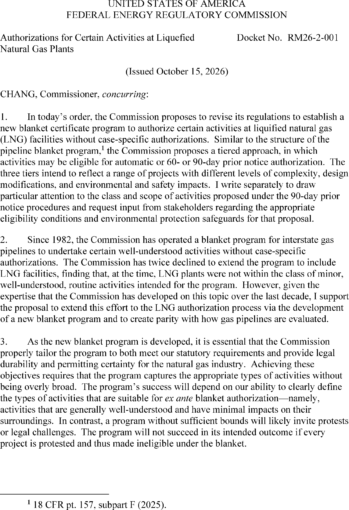
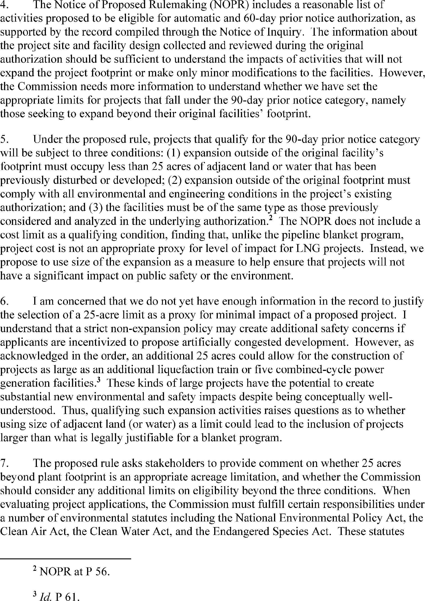
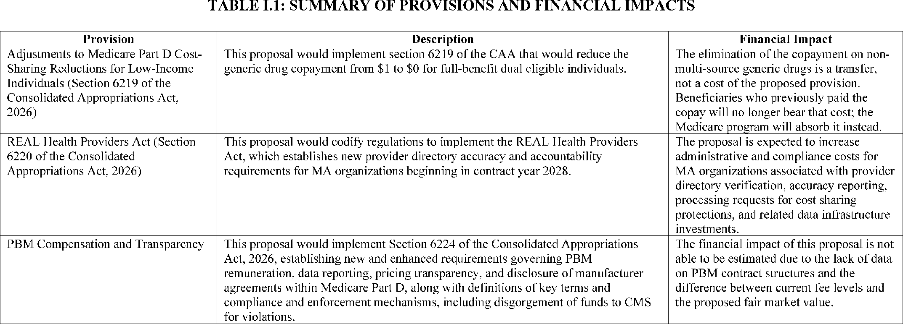
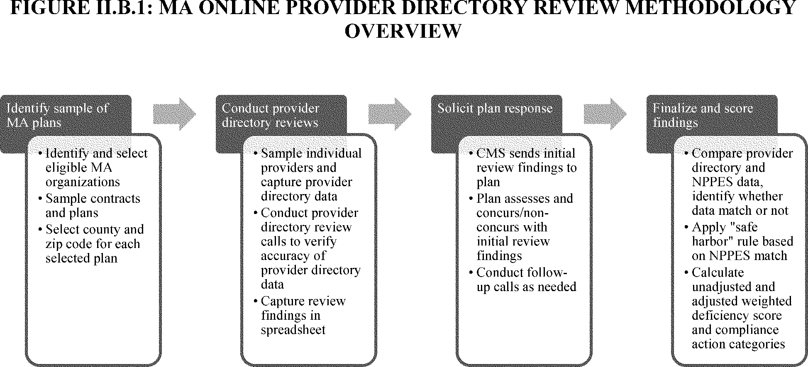

# Daily Digest — 2026-10-20

| | |
|---|---|
| **Digest date** | 2026-10-20 |
| **Data date range** | 2026-10-20 to 2026-10-20 |
| **Generated at** | 2026-10-21T04:05:37Z (UTC) |
| **Pipeline version** | 95340212 |
| **Inference** | model layers ran — cli/haiku, opus |
| **Source watermarks** | CREC: 2026-10-20T09:43:50Z · BILLS: 2026-10-20T09:35:48Z · FR: 2026-10-20T06:47:50Z · USCOURTS: 2026-10-20T22:50:35Z · PLAW: 2026-10-20T13:28:09Z |

[Full observed listing for this day](day/2026-10-20.html) — the items our collectors observed for this publication day, mechanical rules applied, frozen at end of day; releases their publishers date on other days are counted there, not listed. This digest is the canonical record.

All items below cite the govinfo package (and granule, where applicable) they
summarize. Selection is mechanical; each item states the rule that included
it. See the Coverage Statement at the end for a full accounting of what was
published, what was summarized, and what was excluded and why.

---

## Contents

- [Day in Review](#day-in-review)
- [1. Congressional Floor Activity](#1-congressional-floor-activity)
- [2. Legislation](#2-legislation)
- [3. Federal Register](#3-federal-register)
- [4. Enacted Laws](#4-enacted-laws)
- [5. Judicial Activity](#5-judicial-activity)
- [6. Agency Announcements](#6-agency-announcements)
- [7. Recorded Votes](#7-recorded-votes)
- [8. Bill Actions](#8-bill-actions)
- [9. Presidential Actions](#9-presidential-actions)
- [Terms Used Today](#terms-used-today)
- [Coverage Statement](#coverage-statement)
- [Methodology](#methodology)

---

## Day in Review

The digest carries 27 House and 4 Senate Congressional Record items, plus 34 Extensions of Remarks and 6 Daily Digest entries; the summaries describe no recorded votes. House records note receipt of executive communications transmitting final rules from several agencies. The digest also carries 8 House and 3 Senate bill introductions and two public laws. The Illegal Red Snapper and Tuna Enforcement Act calls for a chemical-analysis method for identifying the country of origin of seafood. The Retire through Ownership Act amends ERISA on the valuation of employee stock ownership plan stock.

In the Federal Register, the digest carries 3 final rules, 4 proposed rules, and 75 notices, and no presidential documents. The rules close the General category fishery for Atlantic bluefin tuna, correct FAA airspace designations, and adjust Bureau of Indian Affairs civil penalties for inflation. The proposed rules address Medicare provisions of the Consolidated Appropriations Act, 2026, maturation temperatures for beef imported from regions with foot-and-mouth disease, and FERC procedures for liquefied natural gas plants. One is an SEC correction setting a December 4 comment deadline.

The digest carries 70 appellate opinions and 1 national court opinion, along with 606 district and 9 bankruptcy opinions. The Eleventh Circuit held that legislative privilege does not shield Escambia County School Board members from testifying about library book removals. The Sixth Circuit vacated dismissals of two Michigan tax-foreclosure surplus suits and remanded them on the question of class-action tolling. The Court of Federal Claims dismissed a vaccine injury petition for missed evidentiary deadlines.

*Composed from the summarized items below and the day's mechanical
counts; all specifics are cited in their sections.*

---

## 1. Congressional Floor Activity

Source: Congressional Record (CREC), issue observed 2026-10-20, covering proceedings of 2026-10-19. Published by govinfo 2026-10-20T09:43:50Z; observed by our collector 2026-10-20T10:09:36Z. Total issue size: 71 granule(s).

### 1.1 Senate

No Senate floor items met the selection thresholds. 4 floor granule(s) are accounted for in the Coverage Statement.

### 1.2 House of Representatives

Tags: legislative · model keys: federal agencies · final rules

*In plain terms: The House received final rules from six federal agencies including Departments of Agriculture, Labor, and Homeland Security, the EPA, FCC, and NRC.*

- **Executive Communications, ETC.** — The House received executive communications containing final rules from federal agencies including the Departments of Agriculture, Labor, and Homeland Security, the Environmental Protection Agency, Federal Communications Commission, and Nuclear Regulatory Commission, received in October 2026. Rules address rural energy programs, occupational safety standards, food standardization, air quality plans, broadcast station allotments, materials licensing exemptions, and hazardous materials regulations. The communications also include presidential notifications concerning the continuation of three national emergencies and were referred to appropriate House committees.
  - *In plain terms:* The House received final rules in October 2026 from federal agencies covering rural energy, workplace safety, food standards, air quality, broadcast stations, materials licensing, and hazardous materials, plus notifications about continued national emergencies.
  - Included because: CREC-SEL-01 — floor item ≥ threshold floor time (17,030 characters) (document dated 2026-10-19)
  - Source: [CREC-2026-10-19 / CREC-2026-10-19-pt1-PgH6049-8](https://www.govinfo.gov/app/details/CREC-2026-10-19/CREC-2026-10-19-pt1-PgH6049-8)

### 1.3 Recorded Votes

No recorded votes were published in this issue of the Congressional Record.

---

## 2. Legislation

Source: Congressional Bills (BILLS), text versions published 2026-10-20 to 2026-10-20.

### 2.1 Counts by Stage

| Stage (bill text version) | Count |
|---|---|
| Introduced (ih/is) | 11 |
| Reported (rh/rs) | 0 |
| Engrossed (eh/es) | 0 |
| Enrolled (enr) | 0 |
| Other versions | 0 |
| **Total bill texts published** | **11** |

### 2.2 Bills Listed by Mechanical Rule

Bills below are listed because they matched at least one listing rule; the
matching rule is stated per item. All other bill texts are counted above and
accounted for in the Coverage Statement.

No bill texts published in this range matched a listing rule; all 11 are
accounted for in the Coverage Statement.

---

## 3. Federal Register

Source: Federal Register (FR), issue of 2026-10-20.

### 3.1 Counts by Document Type

| Document type | Count |
|---|---|
| Rules | 3 |
| Proposed rules | 4 |
| Notices | 75 |
| Presidential documents | 0 |
| **Total FR documents** | **82** |

### 3.2 Rules Published

Tags: department of energy · department of health and human services · executive · model keys: airspace · fisheries · penalties

*In plain terms: Three rules include FAA airspace corrections from May-September 2026 and Atlantic bluefin tuna fishery closure through November; the rest adjust BIA civil penalties for inflation.*

#### DEPARTMENT OF COMMERCE

- **Atlantic Highly Migratory Species; Atlantic Bluefin Tuna Fisheries; Closure of the General Category October Through November Fishery for 2026** (2026-21450; 50 CFR Part 635) — NMFS closes the General category fishery for Atlantic bluefin tuna (BFT) for the remainder of the October through November time period. The General category may only retain, possess, or land large medium and giant ( i.e., measuring 73 inches (185 centimeters (cm) curved fork length (CFL) or greater) BFT when the fishery is open. This action also waives the previously scheduled restricted-fishing days (RFDs) for the remainder of the October through November time period. With the RFDs waived during the closure, fishermen aboard General category permitted vessels and HMS Charter/Headboat permitted vessels may tag and release BFT of all sizes, subject to the requirements of the catch-and-release and tag-and-release programs. On December 1, 2026, the fishery will reopen automatically. Action: Temporary rule; closure. Dates: Effective 11:30 p.m., local time, October 17, 2026, through November 30, 2026.
  - *In plain terms:* The General category Atlantic bluefin tuna fishery is closed for the rest of October and November with restricted-fishing days waived, though tag-and-release fishing is allowed; the fishery reopens December 1, 2026.
  - Included because: FR-SEL-01 — document type: final rule (all listed)
  - Source: [FR-2026-10-20 / 2026-21450](https://www.govinfo.gov/app/details/FR-2026-10-20/2026-21450)

#### DEPARTMENT OF THE INTERIOR

- **Civil Penalties Inflation Adjustments; Annual Adjustments** (2026-21474; 25 CFR Parts 140, 141, 211, 213, 225, 226, 227, 243, 249, 273, and 700) — This rule provides for annual adjustments to the level of civil monetary penalties contained in Bureau of Indian Affairs (Bureau) regulations to account for inflation under the Federal Civil Penalties Inflation Adjustment Act Improvements Act of 2015 and Office of Management and Budget (OMB) guidance. Action: Final rule. Dates: This rule is effective on October 20, 2026.
  - *In plain terms:* The Bureau of Indian Affairs is adjusting the amount of civil penalties in its rules to account for inflation.
  - Included because: FR-SEL-01 — document type: final rule (all listed)
  - Source: [FR-2026-10-20 / 2026-21474](https://www.govinfo.gov/app/details/FR-2026-10-20/2026-21474)

#### DEPARTMENT OF TRANSPORTATION

- **Airspace Designations; Incorporation by Reference Amendment of FAA Order JO 7400.11M** (2026-21422; 14 CFR Part 71) — This action administratively corrects identified final rules published by FAA in the Federal Register between May and September 2026 so that certain published airspace designation amendments are transferred to the most-current revision of FAA Order JO 7400.11, which is incorporated by reference. Action: Final rule, administrative correction. Dates: Effective date 0901 UTC October 20, 2026. The Director of the Federal Register approves this incorporation by reference action under 1 CFR part 51, subject to the next annual revision of FAA Order JO 7400.11.
  - *In plain terms:* The FAA is fixing recently published rules by moving airspace designation changes to the current version of its official airspace order.
  - Included because: FR-SEL-01 — document type: final rule (all listed)
  - Source: [FR-2026-10-20 / 2026-21422](https://www.govinfo.gov/app/details/FR-2026-10-20/2026-21422)

### 3.3 Proposed Rules Published

Tags: department of energy · department of health and human services · executive · model keys: energy · food · healthcare

*In plain terms: Four proposed rules address Medicare Part D cost-sharing and healthcare provider requirements, beef import temperature adjustments; the rest cover LNG plant authorizations and SEC interval fund changes.*

#### DEPARTMENT OF AGRICULTURE

- **Minimum Maturation Temperature for Beef and Ovine Meat From Regions Affected With Foot-and-Mouth Disease** (2026-21433; 9 CFR Part 94) — We are proposing to amend the regulations regarding the minimum maturation temperature for fresh (chilled or frozen) boneless beef and ovine meat from certain listed regions or countries affected with foot-and-mouth disease (FMD) from 4 °C to 2 °C. All other existing mitigations for the importation of beef from regions or countries affected with FMD would remain unchanged. This action is needed to align the regulations with the World Organization for Animal Health's standards for FMD minimum maturation temperatures, while continuing to protect the United States against the introduction of FMD. Action: Proposed rule. Dates: We will consider all comments that we receive on or before December 21, 2026.
  - *In plain terms:* The proposal would lower the minimum temperature for beef and sheep meat from foot-and-mouth disease-affected regions from 4°C to 2°C to match international standards while protecting against disease.
  - Included because: FR-SEL-02 — document type: proposed rule (all listed)
  - Source: [FR-2026-10-20 / 2026-21433](https://www.govinfo.gov/app/details/FR-2026-10-20/2026-21433)

#### DEPARTMENT OF ENERGY

- **Authorizations for Certain Activities at Liquefied Natural Gas Plants** (2026-21443; 18 CFR Parts 2, 153, and 375) — The Federal Energy Regulatory Commission proposes to revise its regulations to establish procedures for authorizing activities at liquefied natural gas plants without case-specific authorization orders under sections 3 or 7 of the Natural Gas Act. Action: Notice of proposed rulemaking. Dates: Comments are due December 21, 2026.
  - *In plain terms:* The Federal Energy Regulatory Commission proposes to create procedures that allow certain liquefied natural gas plant activities without needing individual authorization orders.
  - Included because: FR-SEL-02 — document type: proposed rule (all listed)
  - Source: [FR-2026-10-20 / 2026-21443](https://www.govinfo.gov/app/details/FR-2026-10-20/2026-21443)
  -  *Source graphic 1 of 4 from 2026-21443.*
  -  *Source graphic 2 of 4 from 2026-21443.*
  - *Graphics not rendered here: 2 of 4 — see the [source PDF](https://www.govinfo.gov/content/pkg/FR-2026-10-20/pdf/FR-2026-10-20.pdf).*

#### DEPARTMENT OF HEALTH AND HUMAN SERVICES

- **Medicare Program; Implementation of Sections 6219, 6220, and 6224 of the Consolidated Appropriations Act, 2026** (2026-21420; 42 CFR Parts 422 and 423) — This proposed rule would implement section 6219 (Adjustments to Medicare Part D Cost-Sharing Reductions for Low-Income Individuals), section 6220 (Requiring Enhanced and Accurate Lists of (REAL) Health Providers Act), and section 6224 (Modernizing and Ensuring Pharmacy Benefit Manager Accountability) of the Consolidated Appropriations Act, 2026. Action: Proposed rule. Dates: To be assured consideration, comments must be received at one of the addresses provided below, no later than 5 p.m. Eastern Standard Time on December 15, 2026.
  - *In plain terms:* This proposed rule would implement Medicare Part D cost-sharing adjustments for low-income individuals, requirements for accurate health provider lists, and pharmacy benefit manager accountability rules from the 2026 budget law.
  - Included because: FR-SEL-02 — document type: proposed rule (all listed)
  - Source: [FR-2026-10-20 / 2026-21420](https://www.govinfo.gov/app/details/FR-2026-10-20/2026-21420)
  -  *Source graphic 1 of 28 from 2026-21420.*
  -  *Source graphic 2 of 28 from 2026-21420.*
  - *Graphics not rendered here: 26 of 28 — see the [source PDF](https://www.govinfo.gov/content/pkg/FR-2026-10-20/pdf/FR-2026-10-20.pdf).*

#### SECURITIES AND EXCHANGE COMMISSION

- **Interval Fund Modernization; Expansion of Multiple Share Class to Registered Closed-End Management Investment Companies and Business Development Companies** (C1-2026-20360; 17 CFR Parts 239, 249, 270, and 274) — The SEC issued a correction to proposed rules on interval fund modernization and the expansion of multiple share class options for registered closed-end management investment companies and business development companies. The correction updates the dates section, confirming publication on October 5, 2026, and establishing a December 4, 2026 deadline for public comments. Dates: This release was published in the Federal Register on October 5, 2026. Comments should be received on or before December 4, 2026.
  - *In plain terms:* The SEC corrected its proposed rules on interval fund modernization and multiple share class options for closed-end investment companies, with a comment deadline of December 4, 2026.
  - Included because: FR-SEL-02 — document type: proposed rule (all listed)
  - Source: [FR-2026-10-20 / C1-2026-20360](https://www.govinfo.gov/app/details/FR-2026-10-20/C1-2026-20360)

### 3.4 Notices and Presidential Documents

Notices are summarized only when they match a listing rule; all are counted
in 3.1 and in the Coverage Statement. Presidential documents in the FR are
always listed.

No notices or presidential documents matched a listing rule.

---

## 4. Enacted Laws

Tags: legislative · model keys: fisheries · retirement

*In plain terms: Two enacted laws are the Illegal Red Snapper and Tuna Enforcement Act and the Retire through Ownership Act amending ERISA regarding ESOP fiduciary valuations.*

Source: Public and Private Laws (PLAW) published 2026-10-20.

- **Public Law 119–123 — Public Law 119–123: To require the Under Secretary of Commerce for Standards and Technology and the Administrator of National Oceanic and Atmospheric Administration to develop a standard methodology for identifying the country of origin of seafood to support enforcement against illegal, unreported, and unregulated fishing, and for other purposes.** — Public Law 119–123, also known as the “Illegal Red Snapper and Tuna Enforcement Act,” requires the Under Secretary of Commerce for Standards and Technology and the Administrator of the National Oceanic and Atmospheric Administration to develop a standard methodology. This methodology, based on chemical analysis, is for identifying the country of origin of seafood to support enforcement against illegal, unreported, and unregulated fishing and seafood fraud. The law mandates pilot studies on red snapper and tuna and requires a report on the methodology and its operational plan to be submitted to Congress within two years. Approved: 2026-10-15.
  - *In plain terms:* Public Law 119–123 requires specific Commerce and NOAA officials to develop a chemical method for identifying seafood origin to combat illegal fishing and fraud; pilot studies on red snapper and tuna and a report to Congress are due in two years.
  - Included because: PLAW-SEL-01 — enacted into law (all public and private laws are listed) (document dated 2026-10-15)
  - Source: [PLAW-119publ123](https://www.govinfo.gov/app/details/PLAW-119publ123)
- **Public Law 119–124 — Public Law 119–124: To amend the Employee Retirement Income Security Act of 1974 to provide a clear definition of adequate consideration for certain closely held stock, and for other purposes.** — Public Law 119–124, titled the “Retire through Ownership Act,” amends the Employee Retirement Income Security Act of 1974 (ERISA). It specifies that a fiduciary of an employee stock ownership plan may rely in good faith on an independent valuation expert's assessment of adequate consideration for closely held stock, provided the expert uses principles from IRS Revenue Ruling 59–60. The law clarifies that this amendment does not expand the Secretary's regulatory authority or alter fiduciary obligations under section 404 of ERISA. Approved: 2026-10-15.
  - *In plain terms:* Public Law 119–124 amends ERISA, permitting employee stock ownership plan fiduciaries to rely on independent experts' adequate consideration assessments for closely held stock, if based on IRS Revenue Ruling 59–60 principles, without expanding the Secretary's regulatory authority or altering ERISA section 404 obligations.
  - Included because: PLAW-SEL-01 — enacted into law (all public and private laws are listed) (document dated 2026-10-15)
  - Source: [PLAW-119publ124](https://www.govinfo.gov/app/details/PLAW-119publ124)

---

## 5. Judicial Activity

Source: United States Courts Opinions (USCOURTS): opinions observed 2026-10-20
by our collector; each opinion states its own issue date beside its
listing ([how our clocks work](faq.html#fapds-three-clocks)).

Completeness disclosure (standing): USCOURTS carries opinions from
approximately 140 participating appellate, district, bankruptcy, and
national federal courts. Unlike the Congressional Record and the Federal
Register, which are the complete official record of their branches,
USCOURTS is participation-based and is NOT the complete federal judicial
record. Courts post opinions with delay — typically over several days —
so a day's digest carries the opinions that became available that day,
whatever date each was issued.

### 5.1 Appellate and National Court Opinions

Tags: judicial · model keys: civil rights · criminal · immigration

*In plain terms: Seventy-one judicial decisions from multiple federal circuits include immigration case reviews, criminal sentence appeals, and civil rights claims; the rest cover patent disputes and civil appeals.*

Appellate and national court opinions are summarized; district and
bankruptcy opinions are counted in 5.2 and in the Coverage Statement.

#### United States Court of Appeals for the Eighth Circuit

- **United States v. Roberto Orellana** (No. 25-02870; filed 2026-10-19) — The Eighth Circuit Court of Appeals issued an opinion in United States v. Roberto Orellana and entered judgment on October 19, 2026. Parties may file petitions for rehearing or rehearing en banc within 14 days of judgment entry in compliance with Federal Rules of Appellate Procedure.
  - *In plain terms:* The Eighth Circuit Court of Appeals ruled in United States v. Roberto Orellana on October 19, 2026; people involved can ask the court to reconsider within 14 days.
  - Included because: USCOURTS-SEL-01 — appellate court opinion (all listed) (document dated 2026-10-19)
  - Source: [USCOURTS-ca8-25-02870 / USCOURTS-ca8-25-02870-0](https://www.govinfo.gov/app/details/USCOURTS-ca8-25-02870/USCOURTS-ca8-25-02870-0)
- **United States v. Roberto Miranda** (No. 25-02917; filed 2026-10-19) — The Eighth Circuit Court of Appeals issued an opinion in United States v. Roberto Miranda and entered judgment on October 19, 2026. Parties may file petitions for rehearing or rehearing en banc within 14 days of judgment entry in compliance with Federal Rules of Appellate Procedure.
  - *In plain terms:* The Eighth Circuit Court of Appeals ruled in United States v. Roberto Miranda on October 19, 2026; people involved can ask the court to reconsider within 14 days.
  - Included because: USCOURTS-SEL-01 — appellate court opinion (all listed) (document dated 2026-10-19)
  - Source: [USCOURTS-ca8-25-02917 / USCOURTS-ca8-25-02917-0](https://www.govinfo.gov/app/details/USCOURTS-ca8-25-02917/USCOURTS-ca8-25-02917-0)
- **Charlie Foster v. United States** (No. 25-02954; filed 2026-10-19) — The Eighth Circuit Court of Appeals issued an opinion in Charlie Foster v. United States and entered judgment on October 19, 2026. Parties may file petitions for rehearing or rehearing en banc within 45 days of judgment entry in compliance with Federal Rules of Appellate Procedure.
  - *In plain terms:* The Eighth Circuit Court of Appeals ruled in Charlie Foster v. United States on October 19, 2026; people involved can ask the court to reconsider within 45 days.
  - Included because: USCOURTS-SEL-01 — appellate court opinion (all listed) (document dated 2026-10-19)
  - Source: [USCOURTS-ca8-25-02954 / USCOURTS-ca8-25-02954-0](https://www.govinfo.gov/app/details/USCOURTS-ca8-25-02954/USCOURTS-ca8-25-02954-0)
- **United States v. Arryel Waters** (No. 26-01425; filed 2026-10-19) — The Eighth Circuit Court of Appeals issued an opinion in United States v. Arryel Waters and entered judgment on October 19, 2026. Parties may file petitions for rehearing or rehearing en banc within 14 days of judgment entry in compliance with Federal Rules of Appellate Procedure.
  - *In plain terms:* The Eighth Circuit Court of Appeals ruled in United States v. Arryel Waters on October 19, 2026; people involved can ask the court to reconsider within 14 days.
  - Included because: USCOURTS-SEL-01 — appellate court opinion (all listed) (document dated 2026-10-19)
  - Source: [USCOURTS-ca8-26-01425 / USCOURTS-ca8-26-01425-0](https://www.govinfo.gov/app/details/USCOURTS-ca8-26-01425/USCOURTS-ca8-26-01425-0)

#### United States Court of Appeals for the Eleventh Circuit

- **USA v. Elia Pierre** (No. 22-14035; filed 2026-10-19) — Elia Pierre appealed his conviction under the Maritime Drug Law Enforcement Act for conspiracy to possess cocaine aboard a vessel. The court affirmed his conviction and 87-month sentence, finding his constitutional challenges to the statute were foreclosed by prior Eleventh Circuit precedent.
  - *In plain terms:* Elia Pierre's conviction for conspiring to possess cocaine on a ship was upheld along with his 87-month sentence after prior court rulings addressed his constitutional arguments.
  - Included because: USCOURTS-SEL-01 — appellate court opinion (all listed) (document dated 2026-10-19)
  - Source: [USCOURTS-ca11-22-14035 / USCOURTS-ca11-22-14035-0](https://www.govinfo.gov/app/details/USCOURTS-ca11-22-14035/USCOURTS-ca11-22-14035-0)
- **USA v. Corey Myrick** (No. 25-10949; filed 2025-11-19) — The court granted the government's motion to dismiss Corey Myrick's appeal based on a sentence-appeal waiver contained in his plea agreement for possession of a firearm as a convicted felon.
  - *In plain terms:* Corey Myrick's appeal was dismissed because his plea agreement included a waiver preventing him from appealing his sentence for possessing a firearm as a convicted felon.
  - Included because: USCOURTS-SEL-01 — appellate court opinion (all listed) (document dated 2026-10-19)
  - Source: [USCOURTS-ca11-25-10949 / USCOURTS-ca11-25-10949-0](https://www.govinfo.gov/app/details/USCOURTS-ca11-25-10949/USCOURTS-ca11-25-10949-0)
- **USA v. Corey Myrick** (No. 25-10949; filed 2026-10-19) — The court dismissed Corey Myrick's appeal for possession of a firearm as a convicted felon, finding his sentence-appeal waiver enforceable under the standard established in Hunter v. United States and that his alleged sentencing errors did not constitute egregious error sufficient to override the waiver.
  - *In plain terms:* Corey Myrick's appeal for firearm possession was dismissed; his waiver on appealing the sentence was enforceable and his claimed sentencing errors were not severe enough to override it.
  - Included because: USCOURTS-SEL-01 — appellate court opinion (all listed) (document dated 2026-10-19)
  - Source: [USCOURTS-ca11-25-10949 / USCOURTS-ca11-25-10949-1](https://www.govinfo.gov/app/details/USCOURTS-ca11-25-10949/USCOURTS-ca11-25-10949-1)
- **USA v. Corey Myrick** (No. 25-10953; filed 2025-11-19) — The court granted the government's motion to dismiss Corey Myrick's appeal based on a sentence-appeal waiver contained in his plea agreement for possession of a firearm as a convicted felon.
  - *In plain terms:* Corey Myrick's appeal was dismissed because his plea agreement included a waiver preventing him from appealing his sentence for possessing a firearm as a convicted felon.
  - Included because: USCOURTS-SEL-01 — appellate court opinion (all listed) (document dated 2026-10-19)
  - Source: [USCOURTS-ca11-25-10953 / USCOURTS-ca11-25-10953-0](https://www.govinfo.gov/app/details/USCOURTS-ca11-25-10953/USCOURTS-ca11-25-10953-0)
- **USA v. Corey Myrick** (No. 25-10953; filed 2026-10-19) — The court dismissed Corey Myrick's appeal for possession of a firearm as a convicted felon, finding his sentence-appeal waiver enforceable under the standard established in Hunter v. United States and that his alleged sentencing errors did not constitute egregious error sufficient to override the waiver.
  - *In plain terms:* Corey Myrick's appeal for firearm possession was dismissed; his waiver on appealing the sentence was enforceable and his claimed sentencing errors were not severe enough to override it.
  - Included because: USCOURTS-SEL-01 — appellate court opinion (all listed) (document dated 2026-10-19)
  - Source: [USCOURTS-ca11-25-10953 / USCOURTS-ca11-25-10953-1](https://www.govinfo.gov/app/details/USCOURTS-ca11-25-10953/USCOURTS-ca11-25-10953-1)
- **Raymond Greene v. Wesley Pipes, et al** (No. 25-11764; filed 2026-10-19) — Raymond Greene appealed the dismissal of his § 1983 civil rights suit challenging Alabama state court proceedings related to his post-conviction relief efforts. The court vacated and remanded, finding the Rooker-Feldman doctrine did not apply because Greene alleged constitutional violations in the state court procedures themselves, not merely challenging adverse outcomes of those proceedings.
  - *In plain terms:* Raymond Greene's civil rights lawsuit challenging Alabama state court procedures was sent back to lower court because it was not blocked by the Rooker-Feldman rule.
  - Included because: USCOURTS-SEL-01 — appellate court opinion (all listed) (document dated 2026-10-19)
  - Source: [USCOURTS-ca11-25-11764 / USCOURTS-ca11-25-11764-0](https://www.govinfo.gov/app/details/USCOURTS-ca11-25-11764/USCOURTS-ca11-25-11764-0)
- **Gregory Myers v. U.S. Bank National Association, et al** (No. 25-12605; filed 2026-10-19) — The Eleventh Circuit affirmed the district court's dismissal with prejudice of Gregory Myers's complaint alleging breach of a bankruptcy consent order, constructive fraud, and Fair Debt Collection Practices Act violations related to a Florida property foreclosure.
  - *In plain terms:* Gregory Myers's foreclosure-related complaint claiming breach of a bankruptcy agreement, fraud, and debt collection violations was upheld as properly dismissed.
  - Included because: USCOURTS-SEL-01 — appellate court opinion (all listed) (document dated 2026-10-19)
  - Source: [USCOURTS-ca11-25-12605 / USCOURTS-ca11-25-12605-0](https://www.govinfo.gov/app/details/USCOURTS-ca11-25-12605/USCOURTS-ca11-25-12605-0)
- **Gregory Myers v. U.S. Bank National Association, et al** (No. 25-13144; filed 2026-10-19) — The Eleventh Circuit affirmed the district court's dismissal with prejudice of Gregory Myers's complaint and the denial of his post-judgment motion in a consolidated appeal of the same foreclosure-related case.
  - *In plain terms:* Gregory Myers's foreclosure-related complaint and his post-judgment motion were both upheld as properly rejected.
  - Included because: USCOURTS-SEL-01 — appellate court opinion (all listed) (document dated 2026-10-19)
  - Source: [USCOURTS-ca11-25-13144 / USCOURTS-ca11-25-13144-0](https://www.govinfo.gov/app/details/USCOURTS-ca11-25-13144/USCOURTS-ca11-25-13144-0)
- **Pen American Center, Inc., et al v. Kevin Adams, et al** (No. 25-13298; filed 2026-10-19) — The Eleventh Circuit held that legislative privilege does not shield Escambia County School Board members from testifying about their decisions to remove library books, finding that voting on book removal in an administrative review process constitutes administrative rather than legislative action.
  - *In plain terms:* Escambia County School Board members can be required to testify about their book removal decisions because voting in an administrative process is not protected as legislative activity.
  - Included because: USCOURTS-SEL-01 — appellate court opinion (all listed) (document dated 2026-10-19)
  - Source: [USCOURTS-ca11-25-13298 / USCOURTS-ca11-25-13298-0](https://www.govinfo.gov/app/details/USCOURTS-ca11-25-13298/USCOURTS-ca11-25-13298-0)
- **Derrel Thomas v. Kurt Hitzemann, et al** (No. 25-13693; filed 2026-10-19) — The Eleventh Circuit affirmed the denial of Derrel Thomas's disqualification motion and dismissal of his complaint against a judge and prosecutors for alleged Fourteenth Amendment violations in a DUI case, but vacated and remanded his request for injunctive relief for dismissal without prejudice under the Younger abstention doctrine.
  - *In plain terms:* Derrel Thomas's request to remove the judge and his complaint against prosecutors were properly dismissed, but his request to stop the proceedings was sent back for reconsideration.
  - Included because: USCOURTS-SEL-01 — appellate court opinion (all listed) (document dated 2026-10-19)
  - Source: [USCOURTS-ca11-25-13693 / USCOURTS-ca11-25-13693-0](https://www.govinfo.gov/app/details/USCOURTS-ca11-25-13693/USCOURTS-ca11-25-13693-0)
- **Pen American Center, Inc., et al v. Carissa Bergosh, et al** (No. 25-13698; filed 2026-10-19) — The Eleventh Circuit affirmed that legislative privilege does not apply to compel testimony from Escambia County School Board members regarding their votes to remove books in an administrative capacity under the Board's existing policies.
  - *In plain terms:* Escambia County School Board members can be compelled to testify about their votes to remove books, as voting administratively is not protected by legislative privilege.
  - Included because: USCOURTS-SEL-01 — appellate court opinion (all listed) (document dated 2026-10-19)
  - Source: [USCOURTS-ca11-25-13698 / USCOURTS-ca11-25-13698-0](https://www.govinfo.gov/app/details/USCOURTS-ca11-25-13698/USCOURTS-ca11-25-13698-0)
- **Bordeau Metals, LLC, et al v. Jamie McCord** (No. 25-13982; filed 2026-10-19) — The Eleventh Circuit dismissed Jamie McCord's appeal for lack of jurisdiction because his challenge to denial of official immunity in a tortious interference case raised only issues of evidentiary sufficiency rather than legal questions about immunity.
  - *In plain terms:* Jamie McCord's appeal was dismissed for lack of jurisdiction because he challenged whether evidence supported the immunity denial, not the legal immunity rules themselves.
  - Included because: USCOURTS-SEL-01 — appellate court opinion (all listed) (document dated 2026-10-19)
  - Source: [USCOURTS-ca11-25-13982 / USCOURTS-ca11-25-13982-0](https://www.govinfo.gov/app/details/USCOURTS-ca11-25-13982/USCOURTS-ca11-25-13982-0)
- **Johannes De Koning v. Trans Union, LLC** (No. 26-10538; filed 2026-10-19) — Johannes De Koning appealed the dismissal of his Fair Credit Reporting Act complaint against TransUnion, alleging that the company reinserted information into his credit report without timely notification. The court determined De Koning lacked Article III standing because he did not allege the reinserted information was inaccurate, only that he received delayed notice of its reinsertion. The court vacated the dismissal and remanded with instructions to dismiss without prejudice for lack of jurisdiction.
  - *In plain terms:* Johannes De Koning's complaint that TransUnion failed to timely notify him of reinserted credit information was sent back to be dismissed for lack of legal standing.
  - Included because: USCOURTS-SEL-01 — appellate court opinion (all listed) (document dated 2026-10-19)
  - Source: [USCOURTS-ca11-26-10538 / USCOURTS-ca11-26-10538-0](https://www.govinfo.gov/app/details/USCOURTS-ca11-26-10538/USCOURTS-ca11-26-10538-0)

#### United States Court of Appeals for the Federal Circuit

- **Google LLC v. Valtrus Innovations Ltd.** (No. 24-01945; filed 2026-10-19) — Google appealed a Patent Trial and Appeal Board decision that rejected its inter partes review petition challenging the validity of a Valtrus patent covering methods and systems for merging search results from multiple search engines. The Board found that Valtrus inventors conceived of the invention before a key prior art reference was filed, and that the inventors demonstrated reasonable diligence in reducing the invention to practice, thereby rendering that reference inapplicable as prior art. The court affirmed the Board's determination that all claims of the patent remain patentable.
  - *In plain terms:* Google's challenge to a Valtrus patent for merging search results was rejected because the inventors conceived of it before a key reference and worked diligently to develop it.
  - Included because: USCOURTS-SEL-01 — appellate court opinion (all listed) (document dated 2026-10-19)
  - Source: [USCOURTS-ca13-24-01945 / USCOURTS-ca13-24-01945-0](https://www.govinfo.gov/app/details/USCOURTS-ca13-24-01945/USCOURTS-ca13-24-01945-0)

#### United States Court of Appeals for the Fifth Circuit

- **Reyna v. Thompson** (No. 25-11343; filed 2026-10-19) — Reyna sued in federal court under Section 1983, alleging excessive force during an arrest in 2021 and seeking $10 million in damages. The district court dismissed the claims as time-barred under Texas's two-year statute of limitations for personal injury suits, and the Fifth Circuit affirmed.
  - *In plain terms:* The appeals court upheld dismissal of Reyna's 2021 excessive force case as time-barred under Texas's two-year deadline for personal injury suits.
  - Included because: USCOURTS-SEL-01 — appellate court opinion (all listed) (document dated 2026-10-19)
  - Source: [USCOURTS-ca5-25-11343 / USCOURTS-ca5-25-11343-0](https://www.govinfo.gov/app/details/USCOURTS-ca5-25-11343/USCOURTS-ca5-25-11343-0)
- **Causey v. Pate** (No. 25-30550; filed 2026-10-19) — Causey, a federal inmate with multiple convictions including one for firearms possession in furtherance of drug trafficking, challenged the Bureau of Prisons' denial of earned time credits under the First Step Act. The Fifth Circuit affirmed that the BOP properly aggregated Causey's sentences, making him ineligible for credits under FSA provisions.
  - *In plain terms:* The appeals court upheld the Bureau of Prisons' denial of Causey's earned time credits, finding his sentences properly combined to make him ineligible.
  - Included because: USCOURTS-SEL-01 — appellate court opinion (all listed) (document dated 2026-10-19)
  - Source: [USCOURTS-ca5-25-30550 / USCOURTS-ca5-25-30550-0](https://www.govinfo.gov/app/details/USCOURTS-ca5-25-30550/USCOURTS-ca5-25-30550-0)
- **Adorare v. Spillman** (No. 25-50555; filed 2026-10-19) — Adorare sued Spillman Ranch Homes under the Fair Housing Act, alleging failure to accommodate and discrimination based on race, gender, and disability. The district court granted summary judgment for Spillman, and the Fifth Circuit affirmed the judgment and all related procedural rulings.
  - *In plain terms:* The appeals court upheld summary judgment for Spillman Ranch Homes in Adorare's Fair Housing Act case alleging discrimination based on race, gender, and disability.
  - Included because: USCOURTS-SEL-01 — appellate court opinion (all listed) (document dated 2026-10-19)
  - Source: [USCOURTS-ca5-25-50555 / USCOURTS-ca5-25-50555-0](https://www.govinfo.gov/app/details/USCOURTS-ca5-25-50555/USCOURTS-ca5-25-50555-0)
- **Adorare v. Spillman** (No. 25-50992; filed 2026-10-19) — Adorare sued Spillman Ranch Homes under the Fair Housing Act, alleging failure to accommodate and discrimination based on race, gender, and disability. The district court granted summary judgment for Spillman, and the Fifth Circuit affirmed the judgment and all related procedural rulings.
  - *In plain terms:* The appeals court upheld summary judgment for Spillman Ranch Homes in Adorare's Fair Housing Act case alleging discrimination based on race, gender, and disability.
  - Included because: USCOURTS-SEL-01 — appellate court opinion (all listed) (document dated 2026-10-19)
  - Source: [USCOURTS-ca5-25-50992 / USCOURTS-ca5-25-50992-0](https://www.govinfo.gov/app/details/USCOURTS-ca5-25-50992/USCOURTS-ca5-25-50992-0)
- **USA v. Robbins** (No. 25-51049; filed 2026-10-19) — Jacob Joseph Robbins was convicted of conspiracy to transport illegal aliens and illegal alien transportation, receiving a 51-month prison sentence and three years of supervised release. On appeal, he challenged the application of an enhancement for substantial risk of death or serious bodily injury, but the Fifth Circuit affirmed the district court's finding that the enhancement was plausibly supported by the record.
  - *In plain terms:* The appeals court upheld Robbins's 51-month sentence for transporting illegal aliens, including a sentencing addition for substantial risk of serious bodily injury.
  - Included because: USCOURTS-SEL-01 — appellate court opinion (all listed) (document dated 2026-10-19)
  - Source: [USCOURTS-ca5-25-51049 / USCOURTS-ca5-25-51049-0](https://www.govinfo.gov/app/details/USCOURTS-ca5-25-51049/USCOURTS-ca5-25-51049-0)
- **Martinez Rodas v. Blanche** (No. 25-60631; filed 2026-10-19) — Huberto Misael Martinez Rodas, a Mexican national, sought review of the Board of Immigration Appeals' affirmance of the immigration judge's denial of cancellation of removal and asylum protections based on claimed exceptional and extremely unusual hardship to his U.S. citizen children. The Fifth Circuit found he failed to demonstrate the hardship met the required legal standard and denied his petition for review.
  - *In plain terms:* The appeals court denied Martinez Rodas's petition for review, finding he did not show the exceptional and extremely unusual hardship required to cancel removal.
  - Included because: USCOURTS-SEL-01 — appellate court opinion (all listed) (document dated 2026-10-19)
  - Source: [USCOURTS-ca5-25-60631 / USCOURTS-ca5-25-60631-0](https://www.govinfo.gov/app/details/USCOURTS-ca5-25-60631/USCOURTS-ca5-25-60631-0)
- **USA v. Brown** (No. 26-30155; filed 2026-10-19) — Quinterrius D. Brown appealed concurrent 21-month revocation sentences imposed after his supervised release was revoked following convictions for illegal receipt of a firearm and conspiracy to commit wire fraud. The Fifth Circuit affirmed, finding the district court properly based the sentence on Brown's repeated violations and need for deterrence.
  - *In plain terms:* The appeals court upheld Brown's 21-month revocation sentences for breaking supervised release, finding them properly based on his violations and need for deterrence.
  - Included because: USCOURTS-SEL-01 — appellate court opinion (all listed) (document dated 2026-10-19)
  - Source: [USCOURTS-ca5-26-30155 / USCOURTS-ca5-26-30155-0](https://www.govinfo.gov/app/details/USCOURTS-ca5-26-30155/USCOURTS-ca5-26-30155-0)
- **USA v. Brown** (No. 26-30168; filed 2026-10-19) — Quinterrius D. Brown appealed concurrent 21-month revocation sentences imposed after his supervised release was revoked following convictions for illegal receipt of a firearm and conspiracy to commit wire fraud. The Fifth Circuit affirmed, finding the district court properly based the sentence on Brown's repeated violations and need for deterrence.
  - *In plain terms:* The appeals court upheld Brown's 21-month revocation sentences for breaking supervised release, finding them properly based on his violations and need for deterrence.
  - Included because: USCOURTS-SEL-01 — appellate court opinion (all listed) (document dated 2026-10-19)
  - Source: [USCOURTS-ca5-26-30168 / USCOURTS-ca5-26-30168-0](https://www.govinfo.gov/app/details/USCOURTS-ca5-26-30168/USCOURTS-ca5-26-30168-0)
- **USA v. Sanchez-Moreno** (No. 26-50057; filed 2026-10-19) — Esteban Sanchez-Moreno was sentenced to 14 months imprisonment for illegal reentry into the United States plus an additional 10-month consecutive revocation sentence for a prior offense. The Fifth Circuit affirmed his sentences and three-year supervised release term, finding them procedurally and substantively reasonable within applicable guidelines.
  - *In plain terms:* The appeals court upheld Sanchez-Moreno's 14-month sentence for illegal reentry plus a 10-month revocation sentence and three-year supervised release as reasonable.
  - Included because: USCOURTS-SEL-01 — appellate court opinion (all listed) (document dated 2026-10-19)
  - Source: [USCOURTS-ca5-26-50057 / USCOURTS-ca5-26-50057-0](https://www.govinfo.gov/app/details/USCOURTS-ca5-26-50057/USCOURTS-ca5-26-50057-0)
- **USA v. Sanchez-Moreno** (No. 26-50064; filed 2026-10-19) — Esteban Sanchez-Moreno was sentenced to 14 months imprisonment for illegal reentry into the United States plus an additional 10-month consecutive revocation sentence for a prior offense. The Fifth Circuit affirmed his sentences and three-year supervised release term, finding them procedurally and substantively reasonable within applicable guidelines.
  - *In plain terms:* The appeals court upheld Sanchez-Moreno's 14-month sentence for illegal reentry plus a 10-month revocation sentence and three-year supervised release as reasonable.
  - Included because: USCOURTS-SEL-01 — appellate court opinion (all listed) (document dated 2026-10-19)
  - Source: [USCOURTS-ca5-26-50064 / USCOURTS-ca5-26-50064-0](https://www.govinfo.gov/app/details/USCOURTS-ca5-26-50064/USCOURTS-ca5-26-50064-0)
- **USA v. Soto Duarte** (No. 26-50338; filed 2026-10-19) — Eulalio Soto Duarte appealed his conviction for illegal reentry into the United States, challenging the constitutionality of the statutory enhancement provision under 8 U.S.C. § 1326(b). The Fifth Circuit Court of Appeals found Duarte's argument foreclosed by established precedent and affirmed the conviction through summary affirmance.
  - *In plain terms:* The appeals court upheld Duarte's conviction for illegal reentry, finding his constitutional challenge to the sentencing addition foreclosed by established law.
  - Included because: USCOURTS-SEL-01 — appellate court opinion (all listed) (document dated 2026-10-19)
  - Source: [USCOURTS-ca5-26-50338 / USCOURTS-ca5-26-50338-0](https://www.govinfo.gov/app/details/USCOURTS-ca5-26-50338/USCOURTS-ca5-26-50338-0)
- **Webb v. Johnston** (No. 26-50352; filed 2026-10-19) — Keaire Webb sued a police officer and municipality after being arrested during a traffic stop when he refused to sign a citation. The Fifth Circuit affirmed dismissal of his civil rights claims, finding that under the Heck doctrine, he could not challenge the lawfulness of his arrest while his underlying traffic conviction remains valid and uncontested.
  - *In plain terms:* The appeals court upheld dismissal of Webb's civil rights case because he cannot challenge the lawfulness of his arrest while his traffic conviction remains valid.
  - Included because: USCOURTS-SEL-01 — appellate court opinion (all listed) (document dated 2026-10-19)
  - Source: [USCOURTS-ca5-26-50352 / USCOURTS-ca5-26-50352-0](https://www.govinfo.gov/app/details/USCOURTS-ca5-26-50352/USCOURTS-ca5-26-50352-0)

#### United States Court of Appeals for the Fourth Circuit

- **Donte Parrish v. US** (No. 20-01766; filed 2020-10-23) — Donte Parrish sought to appeal dismissal of his Federal Tort Claims Act suit against the United States, but filed his notice of appeal beyond the statutory deadline, claiming he did not receive timely notice of the district court's judgment. The court treated Parrish's untimely notice as a motion under Federal Rule of Appellate Procedure 4(a)(6) to reopen the appeal period and remanded the case to the district court to determine whether the period should be reopened.
  - *In plain terms:* Donte Parrish filed his appeal notice too late, claiming he didn't receive timely notice of judgment; the court sent the case back to decide whether to reopen the appeal period.
  - Included because: USCOURTS-SEL-01 — appellate court opinion (all listed) (document dated 2026-10-19)
  - Source: [USCOURTS-ca4-20-01766 / USCOURTS-ca4-20-01766-0](https://www.govinfo.gov/app/details/USCOURTS-ca4-20-01766/USCOURTS-ca4-20-01766-0)
- **Donte Parrish v. US** (No. 20-01766; filed 2023-07-17) — After the district court reopened the appeal period for fourteen days, Parrish failed to file a notice of appeal within that window. The court dismissed Parrish's appeal for lack of jurisdiction, holding that the statutory appeal deadline is jurisdictional and that Parrish's earlier filing could not simultaneously serve as both the motion that triggered the reopening order and the notice of appeal required to be filed after the order was granted.
  - *In plain terms:* When Parrish failed to file his appeal within the 14-day window reopened for him, the court dismissed his appeal for lack of jurisdiction.
  - Included because: USCOURTS-SEL-01 — appellate court opinion (all listed) (document dated 2026-10-19)
  - Source: [USCOURTS-ca4-20-01766 / USCOURTS-ca4-20-01766-1](https://www.govinfo.gov/app/details/USCOURTS-ca4-20-01766/USCOURTS-ca4-20-01766-1)
- **Donte Parrish v. US** (No. 20-01766; filed 2026-10-19) — Following the Supreme Court's reversal of the Fourth Circuit's jurisdictional ruling, the circuit court reconsidered whether Parrish's tort claims alleging wrongful administrative confinement and related injuries were time-barred or administratively unexhausted. The court concluded that Parrish's claims accrued on January 25, 2017, when the incident report was expunged, making his April or May 2017 complaint timely under the six-month statute of limitations, and found that at least some claims had been administratively exhausted. The court vacated and remanded for the district court to determine whether all claims were exhausted.
  - *In plain terms:* The court found Parrish's wrongful confinement claims accrued January 25, 2017, making his April or May 2017 complaint timely, and sent the case back to determine if all claims were exhausted.
  - Included because: USCOURTS-SEL-01 — appellate court opinion (all listed) (document dated 2026-10-19)
  - Source: [USCOURTS-ca4-20-01766 / USCOURTS-ca4-20-01766-2](https://www.govinfo.gov/app/details/USCOURTS-ca4-20-01766/USCOURTS-ca4-20-01766-2)
- **Mohammad Qaiymah v. Todd Blanche** (No. 24-01099; filed 2026-10-19) — Mohammad Qaiymah, a Jordanian national, petitioned for review of the Board of Immigration Appeals' denial of his applications for asylum, humanitarian asylum, withholding of removal, and protection under the Convention Against Torture. Qaiymah testified that he was sexually assaulted by two men in Jordan and feared persecution upon return, but the Board found that he failed to establish a nexus between the assaults and a cognizable particular social group, and that he did not demonstrate a probability that torture would occur if returned. The court denied Qaiymah's petition for review.
  - *In plain terms:* Mohammad Qaiymah's request to stay in the U.S. based on fear of persecution and torture was denied because he didn't connect his assaults to a protected group.
  - Included because: USCOURTS-SEL-01 — appellate court opinion (all listed) (document dated 2026-10-19)
  - Source: [USCOURTS-ca4-24-01099 / USCOURTS-ca4-24-01099-0](https://www.govinfo.gov/app/details/USCOURTS-ca4-24-01099/USCOURTS-ca4-24-01099-0)
- **US v. Remy St. Felix** (No. 24-04578; filed 2026-10-19) — The Fourth Circuit affirmed Remy Ra St. Felix's conviction on nine counts, including conspiracy to commit kidnapping and robbery, and a sentence of 564 months imprisonment. St. Felix's appeals challenging the sufficiency of evidence, sentencing guideline calculations, and sentence reasonableness were rejected because he had forfeited several arguments by failing to preserve them at trial.
  - *In plain terms:* Remy St. Felix's conviction for conspiracy to commit kidnapping and robbery and 564-month sentence were upheld because he didn't preserve his arguments for appeal.
  - Included because: USCOURTS-SEL-01 — appellate court opinion (all listed) (document dated 2026-10-19)
  - Source: [USCOURTS-ca4-24-04578 / USCOURTS-ca4-24-04578-0](https://www.govinfo.gov/app/details/USCOURTS-ca4-24-04578/USCOURTS-ca4-24-04578-0)
- **Matthew Lepnev v. Joseph Edlow** (No. 25-01463; filed 2026-10-19) — The Fourth Circuit affirmed the district court's order denying Matthew Lepnev's second motion for reconsideration of his case. The underlying action involved a voluntary dismissal entered in August 2023.
  - *In plain terms:* Matthew Lepnev's second request to reconsider his case was properly denied; the original case had been voluntarily dismissed in August 2023.
  - Included because: USCOURTS-SEL-01 — appellate court opinion (all listed) (document dated 2026-10-19)
  - Source: [USCOURTS-ca4-25-01463 / USCOURTS-ca4-25-01463-0](https://www.govinfo.gov/app/details/USCOURTS-ca4-25-01463/USCOURTS-ca4-25-01463-0)
- **Marshall Austin v. Charleston Day School** (No. 25-01858; filed 2026-10-19) — The Fourth Circuit affirmed summary judgment for Charleston Day School in Marshall Austin's retaliation suit under the False Claims Act. The court held that Austin, a board member who investigated alleged misuse of Covid relief funds, could not maintain a retaliation claim because he was not an employee, contractor, or agent of the school as defined by the statute.
  - *In plain terms:* Marshall Austin's retaliation suit against Charleston Day School was properly dismissed because as a board member he wasn't an employee or agent eligible for statutory protection.
  - Included because: USCOURTS-SEL-01 — appellate court opinion (all listed) (document dated 2026-10-19)
  - Source: [USCOURTS-ca4-25-01858 / USCOURTS-ca4-25-01858-0](https://www.govinfo.gov/app/details/USCOURTS-ca4-25-01858/USCOURTS-ca4-25-01858-0)
- **Lourdes Ticona-Flores v. Todd Blanche** (No. 25-02236; filed 2026-10-19) — The Fourth Circuit denied Lourdes Ticona-Flores's petition for review of the Board of Immigration Appeals' affirmance of denials for withholding of removal and Convention Against Torture protection. The court found substantial evidence supported the agency's determination that her proposed particular social groups lacked the requisite particularity and social distinction under asylum law.
  - *In plain terms:* Lourdes Ticona-Flores's request to stay in the U.S. based on torture risk was denied because she didn't establish her social groups were sufficiently particular under asylum law.
  - Included because: USCOURTS-SEL-01 — appellate court opinion (all listed) (document dated 2026-10-19)
  - Source: [USCOURTS-ca4-25-02236 / USCOURTS-ca4-25-02236-0](https://www.govinfo.gov/app/details/USCOURTS-ca4-25-02236/USCOURTS-ca4-25-02236-0)
- **Edgar Marrero v. Todd Blanche** (No. 25-02416; filed 2026-10-19) — The Fourth Circuit denied Edgar Marrero's petition for review of the Board of Immigration Appeals' order affirming denial of asylum, withholding of removal, and Convention Against Torture protection. The court found substantial evidence supported the determination that Marrero had firmly resettled in Peru, making him ineligible for asylum.
  - *In plain terms:* Edgar Marrero's request for asylum and torture protection was denied because he had firmly resettled in Peru, making him ineligible for asylum.
  - Included because: USCOURTS-SEL-01 — appellate court opinion (all listed) (document dated 2026-10-19)
  - Source: [USCOURTS-ca4-25-02416 / USCOURTS-ca4-25-02416-0](https://www.govinfo.gov/app/details/USCOURTS-ca4-25-02416/USCOURTS-ca4-25-02416-0)
- **Willie Williams, Jr. v. Hung Cao** (No. 25-02488; filed 2026-10-19) — The Fourth Circuit affirmed the district court's dismissal of Willie L. Williams, Jr.'s complaints under the Americans with Disabilities Act, Rehabilitation Act, Family and Medical Leave Act, and Federal Tort Claims Act. The district court found it lacked jurisdiction and that the complaint failed to state a claim upon which relief could be granted.
  - *In plain terms:* Willie Williams Jr.'s complaints under disability, rehabilitation, family leave, and tort laws were properly dismissed due to lack of jurisdiction and failure to state valid claims.
  - Included because: USCOURTS-SEL-01 — appellate court opinion (all listed) (document dated 2026-10-19)
  - Source: [USCOURTS-ca4-25-02488 / USCOURTS-ca4-25-02488-0](https://www.govinfo.gov/app/details/USCOURTS-ca4-25-02488/USCOURTS-ca4-25-02488-0)
- **Jhorman Cante-Garzon v. Todd Blanche** (No. 25-02509; filed 2026-10-19) — Jhorman Cante-Garzon, a Colombian citizen, appealed the Board of Immigration Appeals' denial of his asylum, withholding of removal, and Convention Against Torture protection claims. The Fourth Circuit affirmed the agency's determination that he failed to demonstrate past persecution or a well-founded fear of persecution on a protected ground and could safely relocate within Colombia.
  - *In plain terms:* Jhorman Cante-Garzon's request for asylum and torture protection was denied because he didn't show past persecution or well-founded fear based on a protected ground.
  - Included because: USCOURTS-SEL-01 — appellate court opinion (all listed) (document dated 2026-10-19)
  - Source: [USCOURTS-ca4-25-02509 / USCOURTS-ca4-25-02509-0](https://www.govinfo.gov/app/details/USCOURTS-ca4-25-02509/USCOURTS-ca4-25-02509-0)
- **US v. William Slate** (No. 25-04474; filed 2026-10-19) — William Lamont Slate appealed his 24-month prison sentence imposed upon revocation of supervised release, contending the district court improperly based the sentence on his need for mental health and substance abuse treatment. The Fourth Circuit affirmed, finding the court properly based the sentence on the nature of the violations, deterrence, and public protection without using rehabilitation as the basis for imprisonment length.
  - *In plain terms:* Slate appealed his 24-month sentence after losing supervised release, claiming the court wrongly considered his need for treatment, but the appeals court upheld it.
  - Included because: USCOURTS-SEL-01 — appellate court opinion (all listed) (document dated 2026-10-19)
  - Source: [USCOURTS-ca4-25-04474 / USCOURTS-ca4-25-04474-0](https://www.govinfo.gov/app/details/USCOURTS-ca4-25-04474/USCOURTS-ca4-25-04474-0)
- **US v. Andrew Chafin** (No. 25-04521; filed 2026-10-19) — Andrew Chafin appealed a nine-month prison sentence for supervised release violations, arguing the district court impermissibly based the sentence on sanctioning his breach of trust. The Fourth Circuit affirmed, holding that district courts may lawfully impose revocation sentences to sanction a defendant's breach of court-ordered supervision conditions, and that a subsequent Supreme Court decision did not alter this principle.
  - *In plain terms:* Chafin appealed his nine-month sentence for breaking supervised release rules, arguing the court wrongly punished his breach of trust, but the appeals court upheld it.
  - Included because: USCOURTS-SEL-01 — appellate court opinion (all listed) (document dated 2026-10-19)
  - Source: [USCOURTS-ca4-25-04521 / USCOURTS-ca4-25-04521-0](https://www.govinfo.gov/app/details/USCOURTS-ca4-25-04521/USCOURTS-ca4-25-04521-0)
- **Joseph Dunbar, Jr. v. Donnie Stonebreaker** (No. 25-06696; filed 2026-10-19) — Joseph Wadell Dunbar, Jr., a prisoner, appealed the district court's dismissal of his habeas petition as untimely. The Fourth Circuit vacated and remanded, finding the district court erred by failing to conduct required de novo review of Dunbar's timely objections to the magistrate judge's recommendation.
  - *In plain terms:* Prisoner Dunbar appealed dismissal of his petition, and the appeals court ruled the district court wrongly failed to independently review his timely objections.
  - Included because: USCOURTS-SEL-01 — appellate court opinion (all listed) (document dated 2026-10-19)
  - Source: [USCOURTS-ca4-25-06696 / USCOURTS-ca4-25-06696-0](https://www.govinfo.gov/app/details/USCOURTS-ca4-25-06696/USCOURTS-ca4-25-06696-0)
- **US v. Erskine Hartwell** (No. 25-06803; filed 2026-10-19) — Erskine Larue Hartwell appealed the district court's denial of his motion for compassionate release under 18 U.S.C. § 3582(c)(1)(A). The Fourth Circuit affirmed, finding the district court did not abuse its discretion in concluding Hartwell had not demonstrated extraordinary and compelling reasons warranting sentence reduction.
  - *In plain terms:* Hartwell appealed denial of his request for compassionate early release, and the appeals court upheld the decision, finding he lacked extraordinary reasons.
  - Included because: USCOURTS-SEL-01 — appellate court opinion (all listed) (document dated 2026-10-19)
  - Source: [USCOURTS-ca4-25-06803 / USCOURTS-ca4-25-06803-0](https://www.govinfo.gov/app/details/USCOURTS-ca4-25-06803/USCOURTS-ca4-25-06803-0)
- **Cornelius Davis, Jr. v. Magellan Federal** (No. 26-01425; filed 2026-10-19) — The Fourth Circuit Court of Appeals affirmed the district court's dismissal of Cornelius Davis, Jr.'s complaints against Magellan Federal for claim splitting. The court reviewed the records and found no reversible error in the district court's orders. This is an unpublished opinion.
  - *In plain terms:* The appeals court upheld dismissal of Davis's complaints against Magellan Federal for filing related claims separately, finding no error.
  - Included because: USCOURTS-SEL-01 — appellate court opinion (all listed) (document dated 2026-10-19)
  - Source: [USCOURTS-ca4-26-01425 / USCOURTS-ca4-26-01425-0](https://www.govinfo.gov/app/details/USCOURTS-ca4-26-01425/USCOURTS-ca4-26-01425-0)
- **Cornelius Davis, Jr. v. Magellan Federal, Inc.** (No. 26-01426; filed 2026-10-19) — The Fourth Circuit affirmed the district court's dismissal without prejudice of two consolidated cases filed by Cornelius Davis, Jr. against Magellan Federal for claim splitting. The court found no reversible error in the dismissal orders.
  - *In plain terms:* The appeals court upheld the district court's dismissal of Davis's two consolidated cases against Magellan Federal for filing related claims separately.
  - Included because: USCOURTS-SEL-01 — appellate court opinion (all listed) (document dated 2026-10-19)
  - Source: [USCOURTS-ca4-26-01426 / USCOURTS-ca4-26-01426-0](https://www.govinfo.gov/app/details/USCOURTS-ca4-26-01426/USCOURTS-ca4-26-01426-0)
- **Tonya Chapman v. Wells Fargo** (No. 26-01486; filed 2026-10-19) — The Fourth Circuit dismissed Tonya R. Chapman's appeal of a district court order that dismissed her 42 U.S.C. § 1983 civil rights action against Wells Fargo for lack of jurisdiction. Chapman's notice of appeal was filed outside the 180-day deadline from the district court's April 2, 2025 order.
  - *In plain terms:* The appeals court dismissed Chapman's appeal of her civil rights case against Wells Fargo because she filed after the 180-day deadline from April 2, 2025.
  - Included because: USCOURTS-SEL-01 — appellate court opinion (all listed) (document dated 2026-10-19)
  - Source: [USCOURTS-ca4-26-01486 / USCOURTS-ca4-26-01486-0](https://www.govinfo.gov/app/details/USCOURTS-ca4-26-01486/USCOURTS-ca4-26-01486-0)
- **Emad Dides v. Calvert County** (No. 26-01500; filed 2026-10-19) — The Fourth Circuit dismissed Emad Emile Dides's bankruptcy appeal for lack of jurisdiction because his notice of appeal was filed outside the 14-day deadline required by Federal Rules of Bankruptcy Procedure 8002. The bankruptcy court's order was entered September 18, 2024, making the deadline October 2, 2024, but Dides filed his notice on February 10, 2025.
  - *In plain terms:* The appeals court dismissed Dides's bankruptcy appeal because he filed his notice on February 10, 2025, missing the October 2, 2024 deadline.
  - Included because: USCOURTS-SEL-01 — appellate court opinion (all listed) (document dated 2026-10-19)
  - Source: [USCOURTS-ca4-26-01500 / USCOURTS-ca4-26-01500-0](https://www.govinfo.gov/app/details/USCOURTS-ca4-26-01500/USCOURTS-ca4-26-01500-0)
- **Roderick Johnson v. SSA** (No. 26-01557; filed 2026-10-19) — The Fourth Circuit affirmed the district court's dismissal of Roderick Johnson's civil rights action against the Social Security Administration. Johnson forfeited appellate review because his informal brief did not challenge the grounds for dismissal.
  - *In plain terms:* The appeals court upheld dismissal of Johnson's civil rights case against the Social Security Administration because his brief did not challenge the dismissal reasons.
  - Included because: USCOURTS-SEL-01 — appellate court opinion (all listed) (document dated 2026-10-19)
  - Source: [USCOURTS-ca4-26-01557 / USCOURTS-ca4-26-01557-0](https://www.govinfo.gov/app/details/USCOURTS-ca4-26-01557/USCOURTS-ca4-26-01557-0)
- **Sheila Knox v. Consumer Portfolio Services** (No. 26-01639; filed 2026-10-19) — The Fourth Circuit affirmed the district court's April 22, 2026 order granting summary judgment in favor of Consumer Portfolio Services in Sheila Knox's civil action. The court found no reversible error in the district court's ruling.
  - *In plain terms:* The appeals court upheld the district court's April 22, 2026 order favoring Consumer Portfolio Services in Knox's civil case, finding no error.
  - Included because: USCOURTS-SEL-01 — appellate court opinion (all listed) (document dated 2026-10-19)
  - Source: [USCOURTS-ca4-26-01639 / USCOURTS-ca4-26-01639-0](https://www.govinfo.gov/app/details/USCOURTS-ca4-26-01639/USCOURTS-ca4-26-01639-0)
- **Timothy Bell v. US** (No. 26-01733; filed 2026-10-19) — The Fourth Circuit affirmed the district court's orders granting the United States' motion to dismiss and denying Timothy James Bell's motion to alter or amend the judgment. The court found no reversible error in the district court's ruling.
  - *In plain terms:* The appeals court upheld the district court's orders dismissing Bell's case and denying his motion to change the judgment, finding no error.
  - Included because: USCOURTS-SEL-01 — appellate court opinion (all listed) (document dated 2026-10-19)
  - Source: [USCOURTS-ca4-26-01733 / USCOURTS-ca4-26-01733-0](https://www.govinfo.gov/app/details/USCOURTS-ca4-26-01733/USCOURTS-ca4-26-01733-0)
- **Shawn Wheeler v. Frank Bisignano** (No. 26-01755; filed 2026-10-19) — Wheeler appealed the denial of his disability insurance benefits application. The Fourth Circuit affirmed after finding that Wheeler forfeited appellate review by failing to file timely objections to the magistrate judge's recommendation.
  - *In plain terms:* The appeals court upheld denial of Wheeler's disability benefits because he failed to timely object to the magistrate judge's recommendation.
  - Included because: USCOURTS-SEL-01 — appellate court opinion (all listed) (document dated 2026-10-19)
  - Source: [USCOURTS-ca4-26-01755 / USCOURTS-ca4-26-01755-0](https://www.govinfo.gov/app/details/USCOURTS-ca4-26-01755/USCOURTS-ca4-26-01755-0)
- **Timothy Bell v. IRS** (No. 26-01772; filed 2026-10-19) — Bell appealed the district court's dismissal of his complaint against the Internal Revenue Service and denial of his motion to file an amended complaint. The Fourth Circuit affirmed, finding no reversible error.
  - *In plain terms:* The appeals court upheld dismissal of Bell's complaint against the IRS and denial of his motion to amend it, finding no error.
  - Included because: USCOURTS-SEL-01 — appellate court opinion (all listed) (document dated 2026-10-19)
  - Source: [USCOURTS-ca4-26-01772 / USCOURTS-ca4-26-01772-0](https://www.govinfo.gov/app/details/USCOURTS-ca4-26-01772/USCOURTS-ca4-26-01772-0)

#### United States Court of Appeals for the Ninth Circuit

- **USA V. ANDERSON** (No. 24-2385; filed 2026-10-19) — The Ninth Circuit Court of Appeals vacated a district court's order denying Patrick Anderson's motion to vacate his sentence under 28 U.S.C. § 2255. Anderson, who pleaded guilty to drug charges, alleged his trial counsel was ineffective for failing to file an appeal after he directed counsel to do so. The court held that when conflicting sworn statements exist on a dispositive issue, the district court must hold an evidentiary hearing to assess credibility rather than denying the motion without a hearing.
  - *In plain terms:* The court vacated a denial of Patrick Anderson's request to overturn his drug sentence, finding that when conflicting sworn statements exist on a key issue, the court must hold a hearing to assess credibility.
  - Included because: USCOURTS-SEL-01 — appellate court opinion (all listed) (document dated 2026-10-19)
  - Source: [USCOURTS-ca9-24-2385 / USCOURTS-ca9-24-2385-0](https://www.govinfo.gov/app/details/USCOURTS-ca9-24-2385/USCOURTS-ca9-24-2385-0)

#### United States Court of Appeals for the Seventh Circuit

- **Donna Beeson, et al v. Continental Properties Company, Inc., et al** (No. 25-03210; filed 2026-10-19) — The Seventh Circuit affirmed dismissal of a breach of contract suit regarding real estate transaction options. The plaintiffs alleged the defendant breached an agreement by recording permanent easements on conveyed property without authorization. The court found that the plaintiffs' complaint failed to state a claim on which relief could be granted because the operative contractual obligation had expired.
  - *In plain terms:* The court upheld dismissal of a breach of contract case because the contract term that plaintiffs relied on had already expired.
  - Included because: USCOURTS-SEL-01 — appellate court opinion (all listed) (document dated 2026-10-19)
  - Source: [USCOURTS-ca7-25-03210 / USCOURTS-ca7-25-03210-0](https://www.govinfo.gov/app/details/USCOURTS-ca7-25-03210/USCOURTS-ca7-25-03210-0)

#### United States Court of Appeals for the Sixth Circuit

- **Frederick Grainger, Jr. v. Ottawa County, MI, et al** (No. 25-01888; filed 2026-10-19) — Frederick Grainger challenged Ottawa County's policy of retaining all proceeds from tax-foreclosure sales of his property, despite the auction price far exceeding his unpaid taxes. The Sixth Circuit vacated the dismissal and remanded for the district court to determine whether the statute of limitations was tolled by a related class action.
  - *In plain terms:* Frederick Grainger challenged Ottawa County's policy of keeping all proceeds from selling his foreclosed property at tax auction, and the court sent the case back to determine if the legal time limit for his claim applies.
  - Included because: USCOURTS-SEL-01 — appellate court opinion (all listed) (document dated 2026-10-19)
  - Source: [USCOURTS-ca6-25-01888 / USCOURTS-ca6-25-01888-0](https://www.govinfo.gov/app/details/USCOURTS-ca6-25-01888/USCOURTS-ca6-25-01888-0)
- **Uldis Felkers, et al v. Kent County, MI** (No. 25-01892; filed 2026-10-19) — Uldis Felkers and others challenged Kent County's policy of retaining surplus proceeds from tax-foreclosure sales of their properties. The Sixth Circuit vacated the dismissal and remanded for the district court to determine whether the statute of limitations was tolled by a related class action.
  - *In plain terms:* Uldis Felkers and others challenged Kent County's policy of keeping extra money from tax-foreclosure sales of their properties, and the court sent the case back to determine if the legal time limit applies.
  - Included because: USCOURTS-SEL-01 — appellate court opinion (all listed) (document dated 2026-10-19)
  - Source: [USCOURTS-ca6-25-01892 / USCOURTS-ca6-25-01892-0](https://www.govinfo.gov/app/details/USCOURTS-ca6-25-01892/USCOURTS-ca6-25-01892-0)
- **Frank Tsi v. Todd Blanche** (No. 25-03960; filed 2026-10-19) — Frank Joel Achu Tsi petitioned for review of an immigration decision denying his asylum application based on persecution in Cameroon. The Sixth Circuit upheld the adverse credibility finding based on his demeanor during testimony, inconsistencies in his account, and insufficient independent corroborating evidence.
  - *In plain terms:* The court upheld a denial of Frank Tsi's asylum claim based on his demeanor during testimony, inconsistencies in his account, and lack of supporting evidence.
  - Included because: USCOURTS-SEL-01 — appellate court opinion (all listed) (document dated 2026-10-19)
  - Source: [USCOURTS-ca6-25-03960 / USCOURTS-ca6-25-03960-0](https://www.govinfo.gov/app/details/USCOURTS-ca6-25-03960/USCOURTS-ca6-25-03960-0)
- **USA v. Ereo Scates** (No. 25-05600; filed 2026-10-19) — Ereo Scates appealed his 46-month prison sentence for violating the conditions of his supervised release by selling crack cocaine laced with fentanyl that caused overdoses. The Sixth Circuit affirmed the revocation and sentence, finding the district court properly relied on corroborated evidence and appropriately considered the seriousness of the violation.
  - *In plain terms:* The court upheld a 46-month prison sentence for Ereo Scates, who violated his release conditions by selling fentanyl-laced crack cocaine that caused overdoses.
  - Included because: USCOURTS-SEL-01 — appellate court opinion (all listed) (document dated 2026-10-19)
  - Source: [USCOURTS-ca6-25-05600 / USCOURTS-ca6-25-05600-0](https://www.govinfo.gov/app/details/USCOURTS-ca6-25-05600/USCOURTS-ca6-25-05600-0)
- **Joshua Horton v. Centurion of Tennessee, LLC, et al** (No. 25-05608; filed 2026-10-19) — The Sixth Circuit Court of Appeals considered a case involving an incarcerated individual who developed a spinal infection resulting in paralysis. The court reviewed claims that medical providers at a Tennessee correctional facility denied necessary hospitalization and imaging despite evidence of serious spine conditions. The court reversed summary judgment in part and remanded for further proceedings.
  - *In plain terms:* The court partially reversed summary judgment in a case where an incarcerated person developed a spinal infection causing paralysis, claiming medical providers at a correctional facility improperly denied hospitalization and imaging.
  - Included because: USCOURTS-SEL-01 — appellate court opinion (all listed) (document dated 2026-10-19)
  - Source: [USCOURTS-ca6-25-05608 / USCOURTS-ca6-25-05608-0](https://www.govinfo.gov/app/details/USCOURTS-ca6-25-05608/USCOURTS-ca6-25-05608-0)
- **USA v. Michael Basalyga** (No. 25-05972; filed 2026-10-19) — The Sixth Circuit upheld sentences for two defendants convicted of participating in a conspiracy to produce and distribute counterfeit alprazolam pills on the dark web. The defendants challenged various sentencing calculations and guidelines provisions, but the court found that the defendants had waived some arguments and that the sentences were properly calculated under the applicable guidelines. The court affirmed both sentences.
  - *In plain terms:* The court upheld sentences for two defendants convicted of conspiring to produce and distribute fake alprazolam pills on the dark web.
  - Included because: USCOURTS-SEL-01 — appellate court opinion (all listed) (document dated 2026-10-19)
  - Source: [USCOURTS-ca6-25-05972 / USCOURTS-ca6-25-05972-0](https://www.govinfo.gov/app/details/USCOURTS-ca6-25-05972/USCOURTS-ca6-25-05972-0)
- **USA v. Reina Chirinos de Urena** (No. 25-05976; filed 2026-10-19) — The Sixth Circuit upheld sentences for two defendants convicted of participating in a conspiracy to produce and distribute counterfeit alprazolam pills on the dark web. The defendants challenged various sentencing calculations and guidelines provisions, but the court found that the defendants had waived some arguments and that the sentences were properly calculated under the applicable guidelines. The court affirmed both sentences.
  - *In plain terms:* The court upheld sentences for two defendants convicted of conspiring to produce and distribute fake alprazolam pills on the dark web.
  - Included because: USCOURTS-SEL-01 — appellate court opinion (all listed) (document dated 2026-10-19)
  - Source: [USCOURTS-ca6-25-05976 / USCOURTS-ca6-25-05976-0](https://www.govinfo.gov/app/details/USCOURTS-ca6-25-05976/USCOURTS-ca6-25-05976-0)
- **USA v. Richard Hunt** (No. 25-06094; filed 2026-10-19) — The Sixth Circuit affirmed a 57-month prison sentence for a defendant convicted of conspiracy to distribute methamphetamine. The defendant challenged the sentencing calculation on multiple grounds, including the denial of a minor participant reduction and the criminal history category determination. The court found no error in the district court's sentencing decisions.
  - *In plain terms:* The court upheld a 57-month prison sentence for a defendant convicted of conspiracy to distribute methamphetamine.
  - Included because: USCOURTS-SEL-01 — appellate court opinion (all listed) (document dated 2026-10-19)
  - Source: [USCOURTS-ca6-25-06094 / USCOURTS-ca6-25-06094-0](https://www.govinfo.gov/app/details/USCOURTS-ca6-25-06094/USCOURTS-ca6-25-06094-0)
- **USA v. Ereo Scates** (No. 25-06151; filed 2026-10-19) — The Sixth Circuit affirmed a 46-month prison sentence imposed for violating conditions of supervised release. The district court found that the defendant sold cocaine laced with fentanyl in connection with overdoses that resulted in at least one death. The court rejected the defendant's challenges to the evidentiary basis for the violation finding and the sentencing determination.
  - *In plain terms:* The court upheld a 46-month prison sentence for a defendant who violated supervised release by selling fentanyl-laced cocaine connected to overdoses that caused at least one death.
  - Included because: USCOURTS-SEL-01 — appellate court opinion (all listed) (document dated 2026-10-19)
  - Source: [USCOURTS-ca6-25-06151 / USCOURTS-ca6-25-06151-0](https://www.govinfo.gov/app/details/USCOURTS-ca6-25-06151/USCOURTS-ca6-25-06151-0)

#### United States Court of Appeals for the Tenth Circuit

- **In re: Joyce, et al** (No. 26-01379; filed 2026-10-19) — The Tenth Circuit denied Yvonne S. Joyce's mandamus petition and emergency motions seeking a writ directing the district court to rule on a motion filed September 28, 2026, and requesting that the court lift a stay and correct docket text. The court found Joyce had not demonstrated a clear and indisputable right to relief, noting that the district court had already ruled on most of her other pending motions on October 9 and stated it would consider remaining motions in due course.
  - *In plain terms:* The Tenth Circuit denied Joyce's request for a court order directing the district court to rule on a motion from September 28, 2026, lift a stay, and correct docket text.
  - Included because: USCOURTS-SEL-01 — appellate court opinion (all listed) (document dated 2026-10-19)
  - Source: [USCOURTS-ca10-26-01379 / USCOURTS-ca10-26-01379-0](https://www.govinfo.gov/app/details/USCOURTS-ca10-26-01379/USCOURTS-ca10-26-01379-0)
- **United States v. Brown** (No. 26-06099; filed 2026-10-19) — The Tenth Circuit granted Jerry Ray Brown's motion to dismiss his appeal in his criminal case, dismissing the appeal pursuant to Rule 42.3.
  - *In plain terms:* The Tenth Circuit allowed Brown's request to withdraw his appeal in his criminal case.
  - Included because: USCOURTS-SEL-01 — appellate court opinion (all listed) (document dated 2026-10-19)
  - Source: [USCOURTS-ca10-26-06099 / USCOURTS-ca10-26-06099-0](https://www.govinfo.gov/app/details/USCOURTS-ca10-26-06099/USCOURTS-ca10-26-06099-0)

#### United States Court of Appeals for the Third Circuit

- **James Tice v. Stephanie Domitrovich, et al** (No. 25-03255; filed 2026-10-19) — The Third Circuit affirmed the District Court's dismissal of James Tice's complaint alleging constitutional violations stemming from court proceedings in the 1990s and early 2000s and claims based on his allegedly royal and divine bloodlines. The court found that Tice did not state a plausible claim regarding his royal bloodline allegations and that his claims from 1990-2006 were barred by applicable statutes of limitations.
  - *In plain terms:* The Third Circuit upheld dismissal of Tice's complaint alleging constitutional violations from the 1990s and early 2000s, finding his royal bloodline claims implausible and his earlier claims expired under statutes of limitations.
  - Included because: USCOURTS-SEL-01 — appellate court opinion (all listed) (document dated 2026-10-19)
  - Source: [USCOURTS-ca3-25-03255 / USCOURTS-ca3-25-03255-0](https://www.govinfo.gov/app/details/USCOURTS-ca3-25-03255/USCOURTS-ca3-25-03255-0)
- **Holy Trinity Ukrainian Catholic Church v. Township of Collier, et al** (No. 26-02072; filed 2026-10-19) — The Third Circuit affirmed the District Court's denial of Holy Trinity Ukrainian Catholic Church's preliminary injunction in its lawsuit against Township of Collier regarding denial of a rezoning application for a shrine project. Although the court found Holy Trinity likely to succeed on the merits of its Religious Land Use and Institutionalized Persons Act and Free Exercise Clause claims, it held that preliminary relief was not necessary because relief could be obtained at final judgment and temporary disruption of the status quo was not warranted.
  - *In plain terms:* The Third Circuit upheld denial of Holy Trinity's request for early relief in its rezoning lawsuit against Collier Township, despite finding the church likely to succeed on Religious Land Use and Free Exercise Clause claims.
  - Included because: USCOURTS-SEL-01 — appellate court opinion (all listed) (document dated 2026-10-19)
  - Source: [USCOURTS-ca3-26-02072 / USCOURTS-ca3-26-02072-0](https://www.govinfo.gov/app/details/USCOURTS-ca3-26-02072/USCOURTS-ca3-26-02072-0)
- **In re: Aaron Mazie** (No. 26-02713; filed 2026-10-19) — The Third Circuit denied Aaron Corbin Mazie's petition for a writ of prohibition or mandamus under the All Writs Act, which asserted that the U.S. District Court for the Eastern District of Pennsylvania and the U.S. Court of Federal Claims violated his constitutional rights by restricting his access to their filing systems. The court found that Mazie had other adequate means to obtain relief through normal appeal processes and had not shown his right to the writ was clear and indisputable.
  - *In plain terms:* The Third Circuit denied Mazie's request for a court order claiming federal courts violated his constitutional rights by restricting filing system access, finding he had other adequate ways to seek relief.
  - Included because: USCOURTS-SEL-01 — appellate court opinion (all listed) (document dated 2026-10-19)
  - Source: [USCOURTS-ca3-26-02713 / USCOURTS-ca3-26-02713-0](https://www.govinfo.gov/app/details/USCOURTS-ca3-26-02713/USCOURTS-ca3-26-02713-0)

#### United States Court of Federal Claims

- **ROSALES v. SECRETARY OF HEALTH AND HUMAN SERVICES** (No. 1:26-vv-00392; filed 2026-10-16) — The Court of Federal Claims' Vaccine Injury Compensation Program dismissed Silvia Villacorta Rosales's petition for compensation in a special master decision. Rosales alleged cellulitis resulting from Tdap and PCV21 vaccinations in December 2025 but failed to submit evidence of the statutory six-month severity requirement by three consecutive court-ordered deadlines. The case was dismissed for failure to satisfy statutory requirements and failure to prosecute.
  - *In plain terms:* The court dismissed Silvia Villacorta Rosales's vaccine injury compensation claim because she failed to submit required evidence of the six-month severity threshold by three court-ordered deadlines.
  - Included because: USCOURTS-SEL-02 — national court opinion (all listed) (document dated 2026-10-16)
  - Source: [USCOURTS-cofc-1_26-vv-00392 / USCOURTS-cofc-1_26-vv-00392-0](https://www.govinfo.gov/app/details/USCOURTS-cofc-1_26-vv-00392/USCOURTS-cofc-1_26-vv-00392-0)

### 5.2 Counts by Court Category

| Court category | Opinions |
|---|---|
| Appellate | 70 |
| District | 606 |
| Bankruptcy | 9 |
| National | 1 |
| **Total opinions extracted** | **686** |

Archive-window disclosure (rule USCOURTS-FETCH-01): 35092 USCOURTS package(s) have been listed in delta syncs but fell outside the 7-day archive window and were not fetched (global running count across all syncs, not limited to this date).

---

## 6. Agency Announcements

Official press releases and statements the agencies themselves date
on 2026-10-20 (sources listed in the source guide). These are the
agencies' own announcements — official advocacy, quoted and
attributed, not findings of this digest. Agency web content can be
edited or removed without notice; captures and hashes are preserved
per the provenance policy.

#### Agricultural Research Service (email)

- **Plants Turn Table on Fungi Using Molecular Mimicry** — dated 2026-10-20 by the agency
  - Included because: AGENCYPR-SEL-01 — official agency release dated this day by the agency (all such releases from active sources are listed; titles only in the pilot)
  - Source: agency email bulletin to this project's subscription, captured and DKIM-verified (the bulletin named no canonical page)

#### Animal and Plant Health Inspection Service (email)

- **APHIS Issues Environmental Assessment and Finding of No Significant Impact for Erythrina Gall Wasp Biological Control** — dated 2026-10-20 by the agency
  - Included because: AGENCYPR-SEL-01 — official agency release dated this day by the agency (all such releases from active sources are listed; titles only in the pilot)
  - Source: agency email bulletin to this project's subscription, captured and DKIM-verified (the bulletin named no canonical page)

#### Bureau of Justice Statistics (email)

- **New BJS Publications on Reports of Inmate Sexual Victimization** — dated 2026-10-20 by the agency
  - Included because: AGENCYPR-SEL-01 — official agency release dated this day by the agency (all such releases from active sources are listed; titles only in the pilot)
  - Source: agency email bulletin to this project's subscription, captured and DKIM-verified (the bulletin named no canonical page)

#### Census Bureau (email)

- **Helping You Prepare For and Recover From Disasters** — dated 2026-10-20 by the agency
  - Included because: AGENCYPR-SEL-01 — official agency release dated this day by the agency (all such releases from active sources are listed; titles only in the pilot)
  - Source: agency email bulletin to this project's subscription, captured and DKIM-verified (the bulletin named no canonical page)

#### CFTC Press Releases

- **[CFTC’s Innovation Task Force Announces Agenda & Panelists for Inaugural Frontier Forum on Super Intelligence](https://www.cftc.gov/PressRoom/PressReleases/9312-26)** — dated 2026-10-20 by the agency
  - Included because: AGENCYPR-SEL-01 — official agency release dated this day by the agency (all such releases from active sources are listed; titles only in the pilot)

#### CISA Cybersecurity Advisories

- **[#StopRansomware: SafePay Ransomware](https://www.cisa.gov/news-events/cybersecurity-advisories/aa26-293a)** — dated 2026-10-20 by the agency
  - Included because: AGENCYPR-SEL-01 — official agency release dated this day by the agency (all such releases from active sources are listed; titles only in the pilot)
- **[CISA Adds Six Known Exploited Vulnerabilities to Catalog](https://www.cisa.gov/news-events/alerts/2026/10/20/cisa-adds-six-known-exploited-vulnerabilities-catalog)** — dated 2026-10-20 by the agency
  - Included because: AGENCYPR-SEL-01 — official agency release dated this day by the agency (all such releases from active sources are listed; titles only in the pilot)
- **[HMS Networks PEAK-System PCAN Windows drivers](https://www.cisa.gov/news-events/ics-advisories/icsa-26-293-01)** — dated 2026-10-20 by the agency
  - Included because: AGENCYPR-SEL-01 — official agency release dated this day by the agency (all such releases from active sources are listed; titles only in the pilot)
- **[Hitachi Energy MicroSCADA X SYS600 Product](https://www.cisa.gov/news-events/ics-advisories/icsa-26-293-04)** — dated 2026-10-20 by the agency
  - Included because: AGENCYPR-SEL-01 — official agency release dated this day by the agency (all such releases from active sources are listed; titles only in the pilot)
- **[Hitachi Energy RTU500 Product](https://www.cisa.gov/news-events/ics-advisories/icsa-26-293-05)** — dated 2026-10-20 by the agency
  - Included because: AGENCYPR-SEL-01 — official agency release dated this day by the agency (all such releases from active sources are listed; titles only in the pilot)
- **[Moxa AIG-302 ThingsPro Edge](https://www.cisa.gov/news-events/ics-advisories/icsa-26-293-03)** — dated 2026-10-20 by the agency
  - Included because: AGENCYPR-SEL-01 — official agency release dated this day by the agency (all such releases from active sources are listed; titles only in the pilot)
- **[WAGO OS Linux](https://www.cisa.gov/news-events/ics-advisories/icsa-26-293-02)** — dated 2026-10-20 by the agency
  - Included because: AGENCYPR-SEL-01 — official agency release dated this day by the agency (all such releases from active sources are listed; titles only in the pilot)

#### DEA Updates (email)

- **Put Take Back Day on Your Calendar** — dated 2026-10-20 by the agency
  - Included because: AGENCYPR-SEL-01 — official agency release dated this day by the agency (all such releases from active sources are listed; titles only in the pilot)
  - Source: agency email bulletin to this project's subscription, captured and DKIM-verified (the bulletin named no canonical page)

#### Defense News Releases

- **[Arctic Experiment Explores Ways to Close Air Surveillance Gaps](https://www.war.gov/News/News-Stories/Article/Article/4629316/arctic-experiment-explores-ways-to-close-air-surveillance-gaps/)** — dated 2026-10-20 by the agency
  - Included because: AGENCYPR-SEL-01 — official agency release dated this day by the agency (all such releases from active sources are listed; titles only in the pilot)
- **[Exercise Keen Sword 2027 Begins in Japan](https://www.war.gov/News/News-Stories/Article/Article/4629628/exercise-keen-sword-2027-begins-in-japan/)** — dated 2026-10-20 by the agency
  - Included because: AGENCYPR-SEL-01 — official agency release dated this day by the agency (all such releases from active sources are listed; titles only in the pilot)
- **[Hegseth Lauds New American Golden Age During Arsenal of Freedom Tour Stop](https://www.war.gov/News/News-Stories/Article/Article/4629797/hegseth-lauds-new-american-golden-age-during-arsenal-of-freedom-tour-stop/)** — dated 2026-10-20 by the agency
  - Included because: AGENCYPR-SEL-01 — official agency release dated this day by the agency (all such releases from active sources are listed; titles only in the pilot)
- **[Hegseth Praises Ohio Aerospace Workers During Arsenal of Freedom Tour](https://www.war.gov/News/News-Stories/Article/Article/4629585/hegseth-praises-ohio-aerospace-workers-during-arsenal-of-freedom-tour/)** — dated 2026-10-20 by the agency
  - Included because: AGENCYPR-SEL-01 — official agency release dated this day by the agency (all such releases from active sources are listed; titles only in the pilot)

#### DHS News Releases

- **[DHS Highlights Worst Illegal Aliens Arrested in North Carolina](https://www.dhs.gov/news/2026/10/20/dhs-highlights-worst-illegal-aliens-arrested-north-carolina)** — dated 2026-10-20 by the agency
  - Included because: AGENCYPR-SEL-01 — official agency release dated this day by the agency (all such releases from active sources are listed; titles only in the pilot)
- **[WORST OF THE WORST: ICE Arrests Pedophiles, Violent Assailants, and Other Public Safety Threats](https://www.dhs.gov/news/2026/10/20/worst-worst-ice-arrests-pedophiles-violent-assailants-and-other-public-safety)** — dated 2026-10-20 by the agency
  - Included because: AGENCYPR-SEL-01 — official agency release dated this day by the agency (all such releases from active sources are listed; titles only in the pilot)
- **[Woman Sentenced to More Than a Year in Prison After Assaulting DHS Officers in Florida](https://www.dhs.gov/news/2026/10/20/woman-sentenced-more-year-prison-after-assaulting-dhs-officers-florida)** — dated 2026-10-20 by the agency
  - Included because: AGENCYPR-SEL-01 — official agency release dated this day by the agency (all such releases from active sources are listed; titles only in the pilot)

#### EEOC Newsroom

- **[Civil Rights Division and Equal Employment Opportunity Commission Secure $5,000,000 Joint Settlement with Instacart for Discriminating Against U.S. Workers](https://www.eeoc.gov/newsroom/civil-rights-division-and-equal-employment-opportunity-commission-secure-5000000-joint)** — dated 2026-10-20 by the agency
  - Included because: AGENCYPR-SEL-01 — official agency release dated this day by the agency (all such releases from active sources are listed; titles only in the pilot)
- **[EEOC Sues Solera Holdings for Disability Discrimination](https://www.eeoc.gov/newsroom/eeoc-sues-solera-holdings-disability-discrimination)** — dated 2026-10-20 by the agency
  - Included because: AGENCYPR-SEL-01 — official agency release dated this day by the agency (all such releases from active sources are listed; titles only in the pilot)

#### Energy Press Releases

- **[Energy Department Announces New Investments to Strengthen America's Power Grid and Lower Electricity Costs](https://www.energy.gov/articles/energy-department-announces-new-investments-strengthen-americas-power-grid-and-lower)** — dated 2026-10-20 by the agency
  - Included because: AGENCYPR-SEL-01 — official agency release dated this day by the agency (all such releases from active sources are listed; titles only in the pilot)

#### EPA News Releases (email)

- **EPA Finalizes Virginia’s Coal Combustion Residuals Permit Program** — dated 2026-10-20 by the agency
  - Included because: AGENCYPR-SEL-01 — official agency release dated this day by the agency (all such releases from active sources are listed; titles only in the pilot)
  - Source: agency email bulletin to this project's subscription, captured and DKIM-verified (the bulletin named no canonical page)
- **Trump EPA Celebrates One Year of the Office of Applied Science and Environmental Solutions with 100 Gold-Standard Science Wins** — dated 2026-10-20 by the agency
  - Included because: AGENCYPR-SEL-01 — official agency release dated this day by the agency (all such releases from active sources are listed; titles only in the pilot)
  - Source: agency email bulletin to this project's subscription, captured and DKIM-verified (the bulletin named no canonical page)

#### FDA Email Updates (email)

- **FDA MedWatch - Nova Biomedical Removes StatStrip Glucose Hospital Meter Systems** — dated 2026-10-20 by the agency
  - Included because: AGENCYPR-SEL-01 — official agency release dated this day by the agency (all such releases from active sources are listed; titles only in the pilot)
  - Source: agency email bulletin to this project's subscription, captured and DKIM-verified (the bulletin named no canonical page)

#### FDA Press Announcements

- **[FDA Approves First-of-Its-Kind Chronic Hepatitis B Treatment](http://www.fda.gov/news-events/press-announcements/fda-approves-first-its-kind-chronic-hepatitis-b-treatment)** — dated 2026-10-20 by the agency
  - Included because: AGENCYPR-SEL-01 — official agency release dated this day by the agency (all such releases from active sources are listed; titles only in the pilot)
  - Corroborated: the same release (same canonical URL) also arrived via the agency's email bulletin to this project's subscription, DKIM-verified — one document received through two ingestion channels; listed once, both captures preserved.
- **[FDA Approves Once-Weekly Generic Hormone Therapy Patch for Women](http://www.fda.gov/news-events/press-announcements/fda-approves-once-weekly-generic-hormone-therapy-patch-women)** — dated 2026-10-20 by the agency
  - Included because: AGENCYPR-SEL-01 — official agency release dated this day by the agency (all such releases from active sources are listed; titles only in the pilot)
  - Corroborated: the same release (same canonical URL) also arrived via the agency's email bulletin to this project's subscription, DKIM-verified — one document received through two ingestion channels; listed once, both captures preserved.
- **[FDA Issues Final Guidance on Prescription Drug Apps and Software](http://www.fda.gov/news-events/press-announcements/fda-issues-final-guidance-prescription-drug-apps-and-software)** — dated 2026-10-20 by the agency
  - Included because: AGENCYPR-SEL-01 — official agency release dated this day by the agency (all such releases from active sources are listed; titles only in the pilot)
  - Corroborated: the same release (same canonical URL) also arrived via the agency's email bulletin to this project's subscription, DKIM-verified — one document received through two ingestion channels; listed once, both captures preserved.

#### FEMA Press Releases

- **[Beware of Disaster Fraud](https://www.fema.gov/press-release/20261020/beware-disaster-fraud)** — dated 2026-10-20 by the agency
  - Included because: AGENCYPR-SEL-01 — official agency release dated this day by the agency (all such releases from active sources are listed; titles only in the pilot)
- **[FEMA Launches New Option to Buy National Flood Insurance Program Policies Online](https://www.fema.gov/press-release/20261020/fema-launches-new-option-buy-national-flood-insurance-program-policies)** — dated 2026-10-20 by the agency
  - Included because: AGENCYPR-SEL-01 — official agency release dated this day by the agency (all such releases from active sources are listed; titles only in the pilot)
- **[FEMA Launches New Option to Buy National Flood Insurance Program Policy Online](https://www.fema.gov/press-release/20261020/fema-launches-new-option-buy-national-flood-insurance-program-policy-16)** — dated 2026-10-20 by the agency
  - Included because: AGENCYPR-SEL-01 — official agency release dated this day by the agency (all such releases from active sources are listed; titles only in the pilot)
- **[FEMA Launches New Option to Buy National Flood Insurance Program Policy Online](https://www.fema.gov/press-release/20261020/fema-launches-new-option-buy-national-flood-insurance-program-policy-15)** — dated 2026-10-20 by the agency
  - Included because: AGENCYPR-SEL-01 — official agency release dated this day by the agency (all such releases from active sources are listed; titles only in the pilot)
- **[FEMA Launches New Option to Buy National Flood Insurance Program Policy Online](https://www.fema.gov/press-release/20261020/fema-launches-new-option-buy-national-flood-insurance-program-policy-14)** — dated 2026-10-20 by the agency
  - Included because: AGENCYPR-SEL-01 — official agency release dated this day by the agency (all such releases from active sources are listed; titles only in the pilot)
- **[FEMA Launches New Option to Buy National Flood Insurance Program Policy Online](https://www.fema.gov/press-release/20261020/fema-launches-new-option-buy-national-flood-insurance-program-policy-17)** — dated 2026-10-20 by the agency
  - Included because: AGENCYPR-SEL-01 — official agency release dated this day by the agency (all such releases from active sources are listed; titles only in the pilot)
- **[FEMA Launches New Option to Buy National Flood Insurance Program Policy Online](https://www.fema.gov/press-release/20261020/fema-launches-new-option-buy-national-flood-insurance-program-policy-18)** — dated 2026-10-20 by the agency
  - Included because: AGENCYPR-SEL-01 — official agency release dated this day by the agency (all such releases from active sources are listed; titles only in the pilot)
- **[FEMA Launches New Option to Buy National Flood Insurance Program Policy Online](https://www.fema.gov/press-release/20261020/fema-launches-new-option-buy-national-flood-insurance-program-policy-6)** — dated 2026-10-20 by the agency
  - Included because: AGENCYPR-SEL-01 — official agency release dated this day by the agency (all such releases from active sources are listed; titles only in the pilot)
- **[FEMA Launches New Option to Buy National Flood Insurance Program Policy Online](https://www.fema.gov/press-release/20261020/fema-launches-new-option-buy-national-flood-insurance-program-policy-13)** — dated 2026-10-20 by the agency
  - Included because: AGENCYPR-SEL-01 — official agency release dated this day by the agency (all such releases from active sources are listed; titles only in the pilot)
- **[FEMA Launches New Option to Buy National Flood Insurance Program Policy Online](https://www.fema.gov/press-release/20261020/fema-launches-new-option-buy-national-flood-insurance-program-policy-7)** — dated 2026-10-20 by the agency
  - Included because: AGENCYPR-SEL-01 — official agency release dated this day by the agency (all such releases from active sources are listed; titles only in the pilot)
- **[FEMA Launches New Option to Buy National Flood Insurance Program Policy Online](https://www.fema.gov/press-release/20261020/fema-launches-new-option-buy-national-flood-insurance-program-policy-online)** — dated 2026-10-20 by the agency
  - Included because: AGENCYPR-SEL-01 — official agency release dated this day by the agency (all such releases from active sources are listed; titles only in the pilot)
- **[Queda menos de una semana para solicitar asistencia a FEMA](https://www.fema.gov/press-release/20261020/queda-menos-de-una-semana-para-solicitar-asistencia-fema)** — dated 2026-10-20 by the agency
  - Included because: AGENCYPR-SEL-01 — official agency release dated this day by the agency (all such releases from active sources are listed; titles only in the pilot)

#### FSIS Recalls and Public Health Alerts (email)

- **[FSIS Directive 5300.1 Revision 2](https://www.fsis.usda.gov/policy/fsis-directives/5300.1)** — dated 2026-10-20 by the agency
  - Included because: AGENCYPR-SEL-01 — official agency release dated this day by the agency (all such releases from active sources are listed; titles only in the pilot)
  - Source: agency email bulletin to this project's subscription, captured and DKIM-verified
- **USDA Food Safety and Inspection Service Eligible U.S. Establishments by Country Update** — dated 2026-10-20 by the agency
  - Included because: AGENCYPR-SEL-01 — official agency release dated this day by the agency (all such releases from active sources are listed; titles only in the pilot)
  - Source: agency email bulletin to this project's subscription, captured and DKIM-verified (the bulletin named no canonical page)

#### ICE Newsroom

- **[Criminal alien from Mexico passes away in ICE custody in Texas](https://www.ice.gov/news/releases/criminal-alien-mexico-passes-away-ice-custody-texas)** — dated 2026-10-20 by the agency
  - Included because: AGENCYPR-SEL-01 — official agency release dated this day by the agency (all such releases from active sources are listed; titles only in the pilot)
- **[ICE HSI St. Louis seizes weapons, cash, drugs during HSTF operations](https://www.ice.gov/news/releases/ice-hsi-st-louis-seizes-weapons-cash-drugs-during-hstf-operations)** — dated 2026-10-20 by the agency
  - Included because: AGENCYPR-SEL-01 — official agency release dated this day by the agency (all such releases from active sources are listed; titles only in the pilot)
- **[ICE Washington, DC arrests criminal illegal alien gang leader in Maryland](https://www.ice.gov/news/releases/ice-washington-dc-arrests-criminal-illegal-alien-gang-leader-maryland)** — dated 2026-10-20 by the agency
  - Included because: AGENCYPR-SEL-01 — official agency release dated this day by the agency (all such releases from active sources are listed; titles only in the pilot)
- **[ICE arrests more than 100 gang members in less than a week](https://www.ice.gov/news/releases/ice-arrests-more-100-gang-members-less-week)** — dated 2026-10-20 by the agency
  - Included because: AGENCYPR-SEL-01 — official agency release dated this day by the agency (all such releases from active sources are listed; titles only in the pilot)
- **[ICE lodges detainers for Dominican illegal aliens wanted for stabbing off-duty New York City detective](https://www.ice.gov/news/releases/ice-lodges-detainers-dominican-illegal-aliens-wanted-stabbing-duty-new-york-city)** — dated 2026-10-20 by the agency
  - Included because: AGENCYPR-SEL-01 — official agency release dated this day by the agency (all such releases from active sources are listed; titles only in the pilot)

#### IRS Newswire (email)

- **Notice 2026-65: October interest rates** — dated 2026-10-20 by the agency
  - Included because: AGENCYPR-SEL-01 — official agency release dated this day by the agency (all such releases from active sources are listed; titles only in the pilot)
  - Source: agency email bulletin to this project's subscription, captured and DKIM-verified (the bulletin named no canonical page)
- **Tax Tip 2026-75: Security reminders and tools for tax pros** — dated 2026-10-20 by the agency
  - Included because: AGENCYPR-SEL-01 — official agency release dated this day by the agency (all such releases from active sources are listed; titles only in the pilot)
  - Source: agency email bulletin to this project's subscription, captured and DKIM-verified (the bulletin named no canonical page)

#### Justice Department News (email)

- **[EOIR Operational Status Update - Oct. 20, 2026](https://www.justice.gov/eoir/immigration-court-operational-status)** — dated 2026-10-20 by the agency
  - Included because: AGENCYPR-SEL-01 — official agency release dated this day by the agency (all such releases from active sources are listed; titles only in the pilot)
  - Source: agency email bulletin to this project's subscription, captured and DKIM-verified

#### Justice Press Releases

- **[Civil Rights Division and Equal Employment Opportunity Commission Secure $5,000,000 Joint Settlement with Instacart for Discriminating Against U.S. Workers](https://www.justice.gov/opa/pr/civil-rights-division-and-equal-employment-opportunity-commission-secure-5000000-joint)** — dated 2026-10-20 by the agency
  - Included because: AGENCYPR-SEL-01 — official agency release dated this day by the agency (all such releases from active sources are listed; titles only in the pilot)
  - Corroborated: the same release (same canonical URL) also arrived via the agency's email bulletin to this project's subscription, DKIM-verified — one document received through two ingestion channels; listed once, both captures preserved.
- **[Guatemalan National Extradited to the United States Sentenced for Involvement in 2022 Mass Casualty Alien Smuggling Event](https://www.justice.gov/opa/pr/guatemalan-national-extradited-united-states-sentenced-involvement-2022-mass-casualty-alien)** — dated 2026-10-20 by the agency
  - Included because: AGENCYPR-SEL-01 — official agency release dated this day by the agency (all such releases from active sources are listed; titles only in the pilot)
  - Corroborated: the same release (same canonical URL) also arrived via the agency's email bulletin to this project's subscription, DKIM-verified — one document received through two ingestion channels; listed once, both captures preserved.
- **[Illinois Laboratory Owner Charged in $66M COVID-19 Testing Fraud Scheme](https://www.justice.gov/opa/pr/illinois-laboratory-owner-charged-66m-covid-19-testing-fraud-scheme)** — dated 2026-10-20 by the agency
  - Included because: AGENCYPR-SEL-01 — official agency release dated this day by the agency (all such releases from active sources are listed; titles only in the pilot)
  - Corroborated: the same release (same canonical URL) also arrived via the agency's email bulletin to this project's subscription, DKIM-verified — one document received through two ingestion channels; listed once, both captures preserved.
- **[Michigan Woman Pleads Guilty to Employment Tax Conspiracy](https://www.justice.gov/opa/pr/michigan-woman-pleads-guilty-employment-tax-conspiracy)** — dated 2026-10-20 by the agency
  - Included because: AGENCYPR-SEL-01 — official agency release dated this day by the agency (all such releases from active sources are listed; titles only in the pilot)
  - Corroborated: the same release (same canonical URL) also arrived via the agency's email bulletin to this project's subscription, DKIM-verified — one document received through two ingestion channels; listed once, both captures preserved.
- **[Sinaloa Cartel Drug Transporter Pleads Guilty to International Drug Trafficking](https://www.justice.gov/opa/pr/sinaloa-cartel-drug-transporter-pleads-guilty-international-drug-trafficking)** — dated 2026-10-20 by the agency
  - Included because: AGENCYPR-SEL-01 — official agency release dated this day by the agency (all such releases from active sources are listed; titles only in the pilot)
  - Corroborated: the same release (same canonical URL) also arrived via the agency's email bulletin to this project's subscription, DKIM-verified — one document received through two ingestion channels; listed once, both captures preserved.
- **[A former National Guard soldier has been sentenced to 25 years in prison](https://www.justice.gov/usao-sdga/pr/former-national-guard-soldier-has-been-sentenced-25-years-prison)** — dated 2026-10-20 by the agency
  - Included because: AGENCYPR-SEL-01 — official agency release dated this day by the agency (all such releases from active sources are listed; titles only in the pilot)
  - Corroborated: the same release (same canonical URL) also arrived via the agency's email bulletin to this project's subscription, DKIM-verified — one document received through two ingestion channels; listed once, both captures preserved.
- **[Alabama Man Sentenced for Missouri Pharmacy Burglary that Netted 16,800 Pills](https://www.justice.gov/usao-edmo/pr/alabama-man-sentenced-missouri-pharmacy-burglary-netted-16800-pills)** — dated 2026-10-20 by the agency
  - Included because: AGENCYPR-SEL-01 — official agency release dated this day by the agency (all such releases from active sources are listed; titles only in the pilot)
  - Corroborated: the same release (same canonical URL) also arrived via the agency's email bulletin to this project's subscription, DKIM-verified — one document received through two ingestion channels; listed once, both captures preserved.
- **[Baltimore County Woman Indicted in Federal $2.5 Million Paycheck Protection Program Funds Case](https://www.justice.gov/usao-md/pr/baltimore-county-woman-indicted-federal-25-million-paycheck-protection-program-funds)** — dated 2026-10-20 by the agency
  - Included because: AGENCYPR-SEL-01 — official agency release dated this day by the agency (all such releases from active sources are listed; titles only in the pilot)
- **[Bastrop and Texas Men Sentenced as Part of Methamphetamine Conspiracy Impacting North Louisiana](https://www.justice.gov/usao-wdla/pr/bastrop-and-texas-men-sentenced-part-methamphetamine-conspiracy-impacting-north)** — dated 2026-10-20 by the agency
  - Included because: AGENCYPR-SEL-01 — official agency release dated this day by the agency (all such releases from active sources are listed; titles only in the pilot)
  - Corroborated: the same release (same canonical URL) also arrived via the agency's email bulletin to this project's subscription, DKIM-verified — one document received through two ingestion channels; listed once, both captures preserved.
- **[Bluefield Man Pleads Guilty to Federal Drug Crime](https://www.justice.gov/usao-sdwv/pr/bluefield-man-pleads-guilty-federal-drug-crime-0)** — dated 2026-10-20 by the agency
  - Included because: AGENCYPR-SEL-01 — official agency release dated this day by the agency (all such releases from active sources are listed; titles only in the pilot)
  - Corroborated: the same release (same canonical URL) also arrived via the agency's email bulletin to this project's subscription, DKIM-verified — one document received through two ingestion channels; listed once, both captures preserved.
- **[Carthage Woman Pleads Guilty to Possession With Intent to Distribute Methamphetamine](https://www.justice.gov/usao-sdms/pr/carthage-woman-pleads-guilty-possession-intent-distribute-methamphetamine)** — dated 2026-10-20 by the agency
  - Included because: AGENCYPR-SEL-01 — official agency release dated this day by the agency (all such releases from active sources are listed; titles only in the pilot)
- **[Defendant Sentenced to 45 years in Prison for Federal Crimes Related to the Murder of Puerto Rico Police Sergeant Eliezer Ramos Vélez in Homeland Security Task Force (HSTF) Prosecution](https://www.justice.gov/usao-pr/pr/defendant-sentenced-45-years-prison-federal-crimes-related-murder-puerto-rico-police)** — dated 2026-10-20 by the agency
  - Included because: AGENCYPR-SEL-01 — official agency release dated this day by the agency (all such releases from active sources are listed; titles only in the pilot)
- **[Delco Man Indicted for Illegal Possession of Firearms, Including One Fitted With Machine Gun Conversion Device](https://www.justice.gov/usao-edpa/pr/delco-man-indicted-illegal-possession-firearms-including-one-fitted-machine-gun)** — dated 2026-10-20 by the agency
  - Included because: AGENCYPR-SEL-01 — official agency release dated this day by the agency (all such releases from active sources are listed; titles only in the pilot)
  - Corroborated: the same release (same canonical URL) also arrived via the agency's email bulletin to this project's subscription, DKIM-verified — one document received through two ingestion channels; listed once, both captures preserved.
- **[District of Minnesota Joins Justice Department in Announcing National Results from Operation Not Forgotten 2026](https://www.justice.gov/usao-mn/pr/district-minnesota-joins-justice-department-announcing-national-results-operation-not)** — dated 2026-10-20 by the agency
  - Included because: AGENCYPR-SEL-01 — official agency release dated this day by the agency (all such releases from active sources are listed; titles only in the pilot)
- **[FCI Lewisburg Inmate Sentenced for Assaulting Other Inmate](https://www.justice.gov/usao-mdpa/pr/fci-lewisburg-inmate-sentenced-assaulting-other-inmate-0)** — dated 2026-10-20 by the agency
  - Included because: AGENCYPR-SEL-01 — official agency release dated this day by the agency (all such releases from active sources are listed; titles only in the pilot)
- **[Federal Jury Convicts Pensacola Felon for Fourteen Armed Robberies](https://www.justice.gov/usao-ndfl/pr/federal-jury-convicts-pensacola-felon-fourteen-armed-robberies)** — dated 2026-10-20 by the agency
  - Included because: AGENCYPR-SEL-01 — official agency release dated this day by the agency (all such releases from active sources are listed; titles only in the pilot)
  - Corroborated: the same release (same canonical URL) also arrived via the agency's email bulletin to this project's subscription, DKIM-verified — one document received through two ingestion channels; listed once, both captures preserved.
- **[Former California State Correctional Lieutenant Pleads Guilty To Taking Bribes And Smuggling Contraband Into Prison](https://www.justice.gov/usao-ndca/pr/former-california-state-correctional-lieutenant-pleads-guilty-taking-bribes-and)** — dated 2026-10-20 by the agency
  - Included because: AGENCYPR-SEL-01 — official agency release dated this day by the agency (all such releases from active sources are listed; titles only in the pilot)
- **[Former Residential Reentry Center Employee Charged with Illegally Accepting Gratuities from Inmate](https://www.justice.gov/usao-edla/pr/former-residential-reentry-center-employee-charged-illegally-accepting-gratuities)** — dated 2026-10-20 by the agency
  - Included because: AGENCYPR-SEL-01 — official agency release dated this day by the agency (all such releases from active sources are listed; titles only in the pilot)
  - Corroborated: the same release (same canonical URL) also arrived via the agency's email bulletin to this project's subscription, DKIM-verified — one document received through two ingestion channels; listed once, both captures preserved.
- **[Former Southwood High School Band Director Indicted for Child Pornography](https://www.justice.gov/usao-wdla/pr/former-southwood-high-school-band-director-indicted-child-pornography)** — dated 2026-10-20 by the agency
  - Included because: AGENCYPR-SEL-01 — official agency release dated this day by the agency (all such releases from active sources are listed; titles only in the pilot)
  - Corroborated: the same release (same canonical URL) also arrived via the agency's email bulletin to this project's subscription, DKIM-verified — one document received through two ingestion channels; listed once, both captures preserved.
- **[Ghanaian Man Sentenced for Fraudulently Working under the Name and Social Security Number of a United States Citizen](https://www.justice.gov/usao-nd/pr/ghanaian-man-sentenced-fraudulently-working-under-name-and-social-security-number-united)** — dated 2026-10-20 by the agency
  - Included because: AGENCYPR-SEL-01 — official agency release dated this day by the agency (all such releases from active sources are listed; titles only in the pilot)
- **[Grand Rapids Man Involved in Interstate Drug Trafficking through U.S. Mail Sentenced to 20 Years in Prison](https://www.justice.gov/usao-wdmi/pr/2026_1020_Lambert_Sentencing_PR)** — dated 2026-10-20 by the agency
  - Included because: AGENCYPR-SEL-01 — official agency release dated this day by the agency (all such releases from active sources are listed; titles only in the pilot)
  - Corroborated: the same release (same canonical URL) also arrived via the agency's email bulletin to this project's subscription, DKIM-verified — one document received through two ingestion channels; listed once, both captures preserved.
- **[Guatemalan National Pleads Guilty to Illegal Reentry into the United States](https://www.justice.gov/usao-wdmo/pr/guatemalan-national-pleads-guilty-illegal-reentry-united-states)** — dated 2026-10-20 by the agency
  - Included because: AGENCYPR-SEL-01 — official agency release dated this day by the agency (all such releases from active sources are listed; titles only in the pilot)
- **[Halfway House Employee Sentenced for Sexual Assault of Federal Inmate](https://www.justice.gov/usao-ndga/pr/halfway-house-employee-sentenced-sexual-assault-federal-inmate)** — dated 2026-10-20 by the agency
  - Included because: AGENCYPR-SEL-01 — official agency release dated this day by the agency (all such releases from active sources are listed; titles only in the pilot)
  - Corroborated: the same release (same canonical URL) also arrived via the agency's email bulletin to this project's subscription, DKIM-verified — one document received through two ingestion channels; listed once, both captures preserved.
- **[Homeland Security Task Force Prosecution Results in Multiple Convictions of Alien Smugglers in Del Rio](https://www.justice.gov/usao-wdtx/pr/homeland-security-task-force-prosecution-results-multiple-convictions-alien-smugglers)** — dated 2026-10-20 by the agency
  - Included because: AGENCYPR-SEL-01 — official agency release dated this day by the agency (all such releases from active sources are listed; titles only in the pilot)
- **[Homeland Security Task Force investigation results in arrests of three men for their roles in narcotics trafficking operation](https://www.justice.gov/usao-wdny/pr/homeland-security-task-force-investigation-results-arrests-three-men-their-roles)** — dated 2026-10-20 by the agency
  - Included because: AGENCYPR-SEL-01 — official agency release dated this day by the agency (all such releases from active sources are listed; titles only in the pilot)
- **[Houston, Texas, Man Convicted of Trafficking in Cocaine](https://www.justice.gov/usao-cdil/pr/houston-texas-man-convicted-trafficking-cocaine)** — dated 2026-10-20 by the agency
  - Included because: AGENCYPR-SEL-01 — official agency release dated this day by the agency (all such releases from active sources are listed; titles only in the pilot)
  - Corroborated: the same release (same canonical URL) also arrived via the agency's email bulletin to this project's subscription, DKIM-verified — one document received through two ingestion channels; listed once, both captures preserved.
- **[Illegal Alien Assaults ICE Deportation Officers with Hammer](https://www.justice.gov/usao-nj/pr/illegal-alien-assaults-ice-deportation-officers-hammer)** — dated 2026-10-20 by the agency
  - Included because: AGENCYPR-SEL-01 — official agency release dated this day by the agency (all such releases from active sources are listed; titles only in the pilot)
- **[Illegal Alien Sentenced for Making a False Statement Regarding U.S. Citizenship and Identity Theft](https://www.justice.gov/usao-edky/pr/illegal-alien-sentenced-making-false-statement-regarding-us-citizenship-and-identity)** — dated 2026-10-20 by the agency
  - Included because: AGENCYPR-SEL-01 — official agency release dated this day by the agency (all such releases from active sources are listed; titles only in the pilot)
  - Corroborated: the same release (same canonical URL) also arrived via the agency's email bulletin to this project's subscription, DKIM-verified — one document received through two ingestion channels; listed once, both captures preserved.
- **[Illegal Alien With Multiple Deportations and Violent Felony Convictions Charged for Illegal Reentry](https://www.justice.gov/usao-nv/pr/illegal-alien-multiple-deportations-and-violent-felony-convictions-charged-illegal)** — dated 2026-10-20 by the agency
  - Included because: AGENCYPR-SEL-01 — official agency release dated this day by the agency (all such releases from active sources are listed; titles only in the pilot)
- **[Illegal Alien and Drug Trafficker sentenced to 30 years prison](https://www.justice.gov/usao-id/pr/illegal-alien-and-drug-trafficker-sentenced-30-years-prison)** — dated 2026-10-20 by the agency
  - Included because: AGENCYPR-SEL-01 — official agency release dated this day by the agency (all such releases from active sources are listed; titles only in the pilot)
- **[Iowa City Man Sentenced to 11 Years in Federal Prison for Methamphetamine Charge](https://www.justice.gov/usao-sdia/pr/iowa-city-man-sentenced-11-years-federal-prison-methamphetamine-charge)** — dated 2026-10-20 by the agency
  - Included because: AGENCYPR-SEL-01 — official agency release dated this day by the agency (all such releases from active sources are listed; titles only in the pilot)
  - Corroborated: the same release (same canonical URL) also arrived via the agency's email bulletin to this project's subscription, DKIM-verified — one document received through two ingestion channels; listed once, both captures preserved.
- **[Justice Department Announces Innovative Whistleblower Rewards Program to Combat Fraud](https://www.justice.gov/opa/pr/justice-department-announces-innovative-whistleblower-rewards-program-combat-fraud)** — dated 2026-10-20 by the agency
  - Included because: AGENCYPR-SEL-01 — official agency release dated this day by the agency (all such releases from active sources are listed; titles only in the pilot)
- **[Justice Department Announces Results from Operation Not Forgotten 2026](https://www.justice.gov/opa/pr/justice-department-announces-results-operation-not-forgotten-2026)** — dated 2026-10-20 by the agency
  - Included because: AGENCYPR-SEL-01 — official agency release dated this day by the agency (all such releases from active sources are listed; titles only in the pilot)
- **[Justice Department Announces Results from Operation Not Forgotten 2026](https://www.justice.gov/usao-nv/pr/justice-department-announces-results-operation-not-forgotten-2026)** — dated 2026-10-20 by the agency
  - Included because: AGENCYPR-SEL-01 — official agency release dated this day by the agency (all such releases from active sources are listed; titles only in the pilot)
  - Corroborated: the same release (same canonical URL) also arrived via the agency's email bulletin to this project's subscription, DKIM-verified — one document received through two ingestion channels; listed once, both captures preserved.
- **[Laredo man sentenced in Homeland Security Task Force investigation involving fatal fentanyl deal](https://www.justice.gov/usao-sdtx/pr/laredo-man-sentenced-homeland-security-task-force-investigation-involving-fatal)** — dated 2026-10-20 by the agency
  - Included because: AGENCYPR-SEL-01 — official agency release dated this day by the agency (all such releases from active sources are listed; titles only in the pilot)
  - Corroborated: the same release (same canonical URL) also arrived via the agency's email bulletin to this project's subscription, DKIM-verified — one document received through two ingestion channels; listed once, both captures preserved.
- **[Lawful Permanent Resident from South Africa Charged with Unlawful Voting by Alien](https://www.justice.gov/usao-wdmo/pr/lawful-permanent-resident-south-africa-charged-unlawful-voting-alien)** — dated 2026-10-20 by the agency
  - Included because: AGENCYPR-SEL-01 — official agency release dated this day by the agency (all such releases from active sources are listed; titles only in the pilot)
  - Corroborated: the same release (same canonical URL) also arrived via the agency's email bulletin to this project's subscription, DKIM-verified — one document received through two ingestion channels; listed once, both captures preserved.
- **[Leake County Man Sentenced for Assault on the Choctaw Indian Reservation](https://www.justice.gov/usao-sdms/pr/leake-county-man-sentenced-assault-choctaw-indian-reservation)** — dated 2026-10-20 by the agency
  - Included because: AGENCYPR-SEL-01 — official agency release dated this day by the agency (all such releases from active sources are listed; titles only in the pilot)
- **[Lewiston Man Sentenced for Attempted Sex Trafficking of Minors](https://www.justice.gov/usao-me/pr/lewiston-man-sentenced-attempted-sex-trafficking-minors)** — dated 2026-10-20 by the agency
  - Included because: AGENCYPR-SEL-01 — official agency release dated this day by the agency (all such releases from active sources are listed; titles only in the pilot)
  - Corroborated: the same release (same canonical URL) also arrived via the agency's email bulletin to this project's subscription, DKIM-verified — one document received through two ingestion channels; listed once, both captures preserved.
- **[Lexington Man Sentenced to Federal Prison for Possession of Child Sexual Abuse Material](https://www.justice.gov/usao-sc/pr/lexington-man-sentenced-federal-prison-possession-child-sexual-abuse-material)** — dated 2026-10-20 by the agency
  - Included because: AGENCYPR-SEL-01 — official agency release dated this day by the agency (all such releases from active sources are listed; titles only in the pilot)
- **[Lincoln Man Sentenced to More Than 13 Years for Conspiracy to Distribute Methamphetamine](https://www.justice.gov/usao-ne/pr/lincoln-man-sentenced-more-13-years-conspiracy-distribute-methamphetamine)** — dated 2026-10-20 by the agency
  - Included because: AGENCYPR-SEL-01 — official agency release dated this day by the agency (all such releases from active sources are listed; titles only in the pilot)
  - Corroborated: the same release (same canonical URL) also arrived via the agency's email bulletin to this project's subscription, DKIM-verified — one document received through two ingestion channels; listed once, both captures preserved.
- **[Loveland Woman Sentenced to Federal Prison, Nearly $250,000 in Restitution for Social Security Fraud and Housing Fraud](https://www.justice.gov/usao-co/pr/loveland-woman-sentenced-federal-prison-nearly-250000-restitution-social-security-fraud)** — dated 2026-10-20 by the agency
  - Included because: AGENCYPR-SEL-01 — official agency release dated this day by the agency (all such releases from active sources are listed; titles only in the pilot)
  - Corroborated: the same release (same canonical URL) also arrived via the agency's email bulletin to this project's subscription, DKIM-verified — one document received through two ingestion channels; listed once, both captures preserved.
- **[Martinsburg Man Admits to His Role in a Drug Trafficking Operation Investigated by the Homeland Security Task Force](https://www.justice.gov/usao-ndwv/pr/martinsburg-man-admits-his-role-drug-trafficking-operation-investigated-homeland)** — dated 2026-10-20 by the agency
  - Included because: AGENCYPR-SEL-01 — official agency release dated this day by the agency (all such releases from active sources are listed; titles only in the pilot)
  - Corroborated: the same release (same canonical URL) also arrived via the agency's email bulletin to this project's subscription, DKIM-verified — one document received through two ingestion channels; listed once, both captures preserved.
- **[Maryland Man Convicted of $18.7M Medicare Fraud for Respiratory Testing Scheme Targeting Nursing Homes](https://www.justice.gov/opa/pr/maryland-man-convicted-187m-medicare-fraud-respiratory-testing-scheme-targeting-nursing)** — dated 2026-10-20 by the agency
  - Included because: AGENCYPR-SEL-01 — official agency release dated this day by the agency (all such releases from active sources are listed; titles only in the pilot)
- **[Maryland Man Pleads Guilty to Vandalizing Jewish Cemetery](https://www.justice.gov/usao-md/pr/maryland-man-pleads-guilty-vandalizing-jewish-cemetery)** — dated 2026-10-20 by the agency
  - Included because: AGENCYPR-SEL-01 — official agency release dated this day by the agency (all such releases from active sources are listed; titles only in the pilot)
- **[Mexican Nationals of U.S.-Flagged Vessel Extradited to Face Maritime Narcotics Trafficking Charges Following a Homeland Security Task Force Initiative](https://www.justice.gov/usao-edwi/pr/mexican-nationals-us-flagged-vessel-extradited-face-maritime-narcotics-trafficking)** — dated 2026-10-20 by the agency
  - Included because: AGENCYPR-SEL-01 — official agency release dated this day by the agency (all such releases from active sources are listed; titles only in the pilot)
  - Corroborated: the same release (same canonical URL) also arrived via the agency's email bulletin to this project's subscription, DKIM-verified — one document received through two ingestion channels; listed once, both captures preserved.
- **[Milton Felon Sentenced to Fifteen Years in Federal Prison for Unlawful Firearm Possession](https://www.justice.gov/usao-ndfl/pr/milton-felon-sentenced-fifteen-years-federal-prison-unlawful-firearm-possession)** — dated 2026-10-20 by the agency
  - Included because: AGENCYPR-SEL-01 — official agency release dated this day by the agency (all such releases from active sources are listed; titles only in the pilot)
  - Corroborated: the same release (same canonical URL) also arrived via the agency's email bulletin to this project's subscription, DKIM-verified — one document received through two ingestion channels; listed once, both captures preserved.
- **[Missouri Man Who Produced Child Sexual Abuse Material Sentenced to 25 Years in Prison](https://www.justice.gov/usao-edmo/pr/missouri-man-who-produced-child-sexual-abuse-material-sentenced-25-years-prison)** — dated 2026-10-20 by the agency
  - Included because: AGENCYPR-SEL-01 — official agency release dated this day by the agency (all such releases from active sources are listed; titles only in the pilot)
- **[Neshoba County Man Sentenced for Theft on Reservation](https://www.justice.gov/usao-sdms/pr/neshoba-county-man-sentenced-theft-reservation)** — dated 2026-10-20 by the agency
  - Included because: AGENCYPR-SEL-01 — official agency release dated this day by the agency (all such releases from active sources are listed; titles only in the pilot)
- **[New Haven Man Sentenced to More Than 12 Years in Prison for Role in Counterfeit Pill Manufacturing and Distribution Operation](https://www.justice.gov/usao-ct/pr/new-haven-man-sentenced-more-12-years-prison-role-counterfeit-pill-manufacturing-and)** — dated 2026-10-20 by the agency
  - Included because: AGENCYPR-SEL-01 — official agency release dated this day by the agency (all such releases from active sources are listed; titles only in the pilot)
- **[Niobrara Man Sentenced to 24 Months for Burglarizing a Residence on the Santee Sioux Reservation](https://www.justice.gov/usao-ne/pr/niobrara-man-sentenced-24-months-burglarizing-residence-santee-sioux-reservation)** — dated 2026-10-20 by the agency
  - Included because: AGENCYPR-SEL-01 — official agency release dated this day by the agency (all such releases from active sources are listed; titles only in the pilot)
  - Corroborated: the same release (same canonical URL) also arrived via the agency's email bulletin to this project's subscription, DKIM-verified — one document received through two ingestion channels; listed once, both captures preserved.
- **[Nomination of Joseph P. Falvey to serve as United States District Judge for the Northern District of Indiana](https://www.justice.gov/usao-ndin/pr/nomination-joseph-p-falvey-serve-united-states-district-judge-northern-district)** — dated 2026-10-20 by the agency
  - Included because: AGENCYPR-SEL-01 — official agency release dated this day by the agency (all such releases from active sources are listed; titles only in the pilot)
  - Corroborated: the same release (same canonical URL) also arrived via the agency's email bulletin to this project's subscription, DKIM-verified — one document received through two ingestion channels; listed once, both captures preserved.
- **[North Fort Myers Drug Dealer Sentenced to 27 Years in Federal Prison](https://www.justice.gov/usao-mdfl/pr/north-fort-myers-drug-dealer-sentenced-27-years-federal-prison)** — dated 2026-10-20 by the agency
  - Included because: AGENCYPR-SEL-01 — official agency release dated this day by the agency (all such releases from active sources are listed; titles only in the pilot)
- **[Omaha Man Sentenced to 37 Months for Being a Felon in Possession of a Firearm](https://www.justice.gov/usao-ne/pr/omaha-man-sentenced-37-months-being-felon-possession-firearm)** — dated 2026-10-20 by the agency
  - Included because: AGENCYPR-SEL-01 — official agency release dated this day by the agency (all such releases from active sources are listed; titles only in the pilot)
  - Corroborated: the same release (same canonical URL) also arrived via the agency's email bulletin to this project's subscription, DKIM-verified — one document received through two ingestion channels; listed once, both captures preserved.
- **[Philippines-Based American Fraudster Pleads Guilty to Targeting Thousands of U.S. Servicemembers and Veterans](https://www.justice.gov/opa/pr/philippines-based-american-fraudster-pleads-guilty-targeting-thousands-us-servicemembers-and)** — dated 2026-10-20 by the agency
  - Included because: AGENCYPR-SEL-01 — official agency release dated this day by the agency (all such releases from active sources are listed; titles only in the pilot)
- **[Pompano Beach Woman Convicted of Stealing $152,000 in in Social Security Benefits Following Great-Aunt’s Death](https://www.justice.gov/usao-sdfl/pr/pompano-beach-woman-convicted-stealing-152000-social-security-benefits-following-great)** — dated 2026-10-20 by the agency
  - Included because: AGENCYPR-SEL-01 — official agency release dated this day by the agency (all such releases from active sources are listed; titles only in the pilot)
  - Corroborated: the same release (same canonical URL) also arrived via the agency's email bulletin to this project's subscription, DKIM-verified — one document received through two ingestion channels; listed once, both captures preserved.
- **[Portsmouth felon sentenced to six years in prison for federal drug and firearm charges](https://www.justice.gov/usao-edva/pr/portsmouth-felon-sentenced-six-years-prison-federal-drug-and-firearm-charges)** — dated 2026-10-20 by the agency
  - Included because: AGENCYPR-SEL-01 — official agency release dated this day by the agency (all such releases from active sources are listed; titles only in the pilot)
  - Corroborated: the same release (same canonical URL) also arrived via the agency's email bulletin to this project's subscription, DKIM-verified — one document received through two ingestion channels; listed once, both captures preserved.
- **[Project Safe Schools investigation uncovers reporting failures at Dallas ISD, leading to $1 million settlement](https://www.justice.gov/usao-ndtx/pr/project-safe-schools-investigation-uncovers-reporting-failures-dallas-isd-leading-1)** — dated 2026-10-20 by the agency
  - Included because: AGENCYPR-SEL-01 — official agency release dated this day by the agency (all such releases from active sources are listed; titles only in the pilot)
- **[Roslindale Man Sentenced to Five Years in Prison for Drug Conspiracy](https://www.justice.gov/usao-ma/pr/roslindale-man-sentenced-five-years-prison-drug-conspiracy)** — dated 2026-10-20 by the agency
  - Included because: AGENCYPR-SEL-01 — official agency release dated this day by the agency (all such releases from active sources are listed; titles only in the pilot)
- **[Sacramento Man Indicted for Threats to Kill Children at Nearby Church](https://www.justice.gov/usao-edca/pr/sacramento-man-indicted-threats-kill-children-nearby-church)** — dated 2026-10-20 by the agency
  - Included because: AGENCYPR-SEL-01 — official agency release dated this day by the agency (all such releases from active sources are listed; titles only in the pilot)
  - Corroborated: the same release (same canonical URL) also arrived via the agency's email bulletin to this project's subscription, DKIM-verified — one document received through two ingestion channels; listed once, both captures preserved.
- **[Shippensburg Detective Pleads Guilty to Possession of Child Pornography](https://www.justice.gov/usao-mdpa/pr/shippensburg-detective-pleads-guilty-possession-child-pornography)** — dated 2026-10-20 by the agency
  - Included because: AGENCYPR-SEL-01 — official agency release dated this day by the agency (all such releases from active sources are listed; titles only in the pilot)
  - Corroborated: the same release (same canonical URL) also arrived via the agency's email bulletin to this project's subscription, DKIM-verified — one document received through two ingestion channels; listed once, both captures preserved.
- **[Statesville, North Carolina Man Sentenced for Conspiracy to Distribute 500 Grams or More of Cocaine](https://www.justice.gov/usao-edky/pr/statesville-north-carolina-man-sentenced-conspiracy-distribute-500-grams-or-more)** — dated 2026-10-20 by the agency
  - Included because: AGENCYPR-SEL-01 — official agency release dated this day by the agency (all such releases from active sources are listed; titles only in the pilot)
  - Corroborated: the same release (same canonical URL) also arrived via the agency's email bulletin to this project's subscription, DKIM-verified — one document received through two ingestion channels; listed once, both captures preserved.
- **[Texas Man to Plead Guilty to Role in $1.5 Million Deed Fraud and Money Laundering Schemes](https://www.justice.gov/usao-ma/pr/texas-man-plead-guilty-role-15-million-deed-fraud-and-money-laundering-schemes)** — dated 2026-10-20 by the agency
  - Included because: AGENCYPR-SEL-01 — official agency release dated this day by the agency (all such releases from active sources are listed; titles only in the pilot)
- **[Town Of Manassa, Colorado Receives $573,000 Department Of Justice Grant To Improve Police Department](https://www.justice.gov/usao-co/pr/town-manassa-colorado-receives-573000-department-justice-grant-improve-police-department)** — dated 2026-10-20 by the agency
  - Included because: AGENCYPR-SEL-01 — official agency release dated this day by the agency (all such releases from active sources are listed; titles only in the pilot)
- **[Urbandale Business Man Sentenced to 24 Months in Federal Prison for PPP Loan Fraud and Bankruptcy Fraud](https://www.justice.gov/usao-sdia/pr/urbandale-business-man-sentenced-24-months-federal-prison-ppp-loan-fraud-and)** — dated 2026-10-20 by the agency
  - Included because: AGENCYPR-SEL-01 — official agency release dated this day by the agency (all such releases from active sources are listed; titles only in the pilot)
  - Corroborated: the same release (same canonical URL) also arrived via the agency's email bulletin to this project's subscription, DKIM-verified — one document received through two ingestion channels; listed once, both captures preserved.
- **[Violent Felon Sentenced for Meth Trafficking Conspiracy](https://www.justice.gov/usao-ndfl/pr/violent-felon-sentenced-meth-trafficking-conspiracy)** — dated 2026-10-20 by the agency
  - Included because: AGENCYPR-SEL-01 — official agency release dated this day by the agency (all such releases from active sources are listed; titles only in the pilot)
  - Corroborated: the same release (same canonical URL) also arrived via the agency's email bulletin to this project's subscription, DKIM-verified — one document received through two ingestion channels; listed once, both captures preserved.

#### NASA News Releases

- **[APOD: 2026 October 20 – An Anticrepuscular Rainbow Fan](https://science.nasa.gov/image-article/apod-2026-october-20-an-anticrepuscular-rainbow-fan/)** — dated 2026-10-20 by the agency
  - Included because: AGENCYPR-SEL-01 — official agency release dated this day by the agency (all such releases from active sources are listed; titles only in the pilot)
- **[NASA Experimental Mars Helicopter Blade Designs Target Longer Flights](https://www.nasa.gov/science-research/aeronautics-research/nasa-experimental-mars-helicopter-blade-designs-target-longer-flights/)** — dated 2026-10-20 by the agency
  - Included because: AGENCYPR-SEL-01 — official agency release dated this day by the agency (all such releases from active sources are listed; titles only in the pilot)
- **[NASA Provides Progress Update on Moon Base Rovers](https://www.nasa.gov/missions/moon-base/nasa-provides-progress-update-on-moon-base-rovers/)** — dated 2026-10-20 by the agency
  - Included because: AGENCYPR-SEL-01 — official agency release dated this day by the agency (all such releases from active sources are listed; titles only in the pilot)
- **[NASA Welcomes Uzbekistan as Newest Artemis Accords Signatory](https://www.nasa.gov/organizations/oiir/artemis-accords/nasa-welcomes-uzbekistan-as-newest-artemis-accords-signatory/)** — dated 2026-10-20 by the agency
  - Included because: AGENCYPR-SEL-01 — official agency release dated this day by the agency (all such releases from active sources are listed; titles only in the pilot)
- **[NASA’s SR-1 Freedom Advances with Progress on Nuclear Power Module](https://www.nasa.gov/centers-and-facilities/glenn/sr-1-freedom-advances-with-progress-on-nuclear-power-module/)** — dated 2026-10-20 by the agency
  - Included because: AGENCYPR-SEL-01 — official agency release dated this day by the agency (all such releases from active sources are listed; titles only in the pilot)
- **[The Human Fingerprint on Earth’s Water Cycle](https://science.nasa.gov/earth/earth-observatory/the-human-fingerprint-on-earths-water-cycle/)** — dated 2026-10-20 by the agency
  - Included because: AGENCYPR-SEL-01 — official agency release dated this day by the agency (all such releases from active sources are listed; titles only in the pilot)
- **[Webb Captures Stellar Jets](https://www.nasa.gov/image-article/webb-captures-stellar-jets/)** — dated 2026-10-20 by the agency
  - Included because: AGENCYPR-SEL-01 — official agency release dated this day by the agency (all such releases from active sources are listed; titles only in the pilot)

#### NCUA Press Releases

- **[NCUA Announces Thirteenth Round of Deregulation Proposals](https://ncua.gov/newsroom/press-release/2026/ncua-announces-thirteenth-round-deregulation-proposals)** — dated 2026-10-20 by the agency
  - Included because: AGENCYPR-SEL-01 — official agency release dated this day by the agency (all such releases from active sources are listed; titles only in the pilot)

#### NSF News

- **[Podcast: Can America's most powerful laser unlock the universe?](https://www.nsf.gov/news/podcast-can-americas-most-powerful-laser-unlock-universe)** — dated 2026-10-20 by the agency
  - Included because: AGENCYPR-SEL-01 — official agency release dated this day by the agency (all such releases from active sources are listed; titles only in the pilot)

#### SEC Press Releases

- **[SEC and AMF Announce Supervisory MOU To Enhance Cooperation for Investment Advisers and Investment Service Providers](https://www.sec.gov/newsroom/press-releases/2026-108-sec-amf-announce-supervisory-mou-enhance-cooperation-investment-advisers-investment-service)** — dated 2026-10-20 by the agency
  - Included because: AGENCYPR-SEL-01 — official agency release dated this day by the agency (all such releases from active sources are listed; titles only in the pilot)
- **[SEC, FSA Hold Autumn Financial Regulatory Dialogue](https://www.sec.gov/newsroom/press-releases/2026-107-sec-fsa-hold-autumn-financial-regulatory-dialogue)** — dated 2026-10-20 by the agency
  - Included because: AGENCYPR-SEL-01 — official agency release dated this day by the agency (all such releases from active sources are listed; titles only in the pilot)

#### SSA Press Releases (email)

- **[New York | Social Security Administration Closings/Delays](https://govlinks.ssa.gov/CL0/https:%2F%2Fwww.ssa.gov%2Fnumber-card%3Futm_campaign=%26utm_content=%26utm_id=70240715%26utm_medium=govdelemail%26utm_source=usssa%26utm_term=/1/010001a15998807c-3ffe41fa-9648-481b-809b-93cfa09b5639-000000/eiO2FHbacclK1zmARxTI3Es5-FGoQ82tU3OqkHuTdEQ=452)** — dated 2026-10-20 by the agency
  - Included because: AGENCYPR-SEL-01 — official agency release dated this day by the agency (all such releases from active sources are listed; titles only in the pilot)
  - Source: agency email bulletin to this project's subscription, captured and DKIM-verified
- **[North Carolina | Social Security Administration Closings/Delays](https://govlinks.ssa.gov/CL0/https:%2F%2Fwww.ssa.gov%2Fnumber-card%3Futm_campaign=%26utm_content=%26utm_id=70239793%26utm_medium=govdelemail%26utm_source=usssa%26utm_term=/1/010001a1590faa69-568ea87e-a60c-4261-8021-04e96b3e2d37-000000/XHPwJi3c0J_P-7EdHFkHbhqc8wIiE0aLzuccdznQBRw=452)** — dated 2026-10-20 by the agency
  - Included because: AGENCYPR-SEL-01 — official agency release dated this day by the agency (all such releases from active sources are listed; titles only in the pilot)
  - Source: agency email bulletin to this project's subscription, captured and DKIM-verified
- **[Social Security Corrects Tens of Millions of Files in the Social Security Number Database Improving the Integrity of Vital Records](https://govlinks.ssa.gov/CL0/http:%2F%2Fwww.socialsecurity.gov%2Fmyaccount%2F%3Futm_campaign=%26utm_content=pressrelease%26utm_id=70240119%26utm_medium=govdelemail%26utm_source=usssa%26utm_term=/1/010001a159ab428c-31b84619-ecfe-4945-9fb3-e463a061a4fe-000000/uJQ_DzYuhSsCO_VrVUCPXqN-AoG6V43OxDHbw6WKpXE=452)** — dated 2026-10-20 by the agency
  - Included because: AGENCYPR-SEL-01 — official agency release dated this day by the agency (all such releases from active sources are listed; titles only in the pilot)
  - Source: agency email bulletin to this project's subscription, captured and DKIM-verified
- **[Social Security Makes it Easier for Parents of Newborns to Open a Trump Account](https://govlinks.ssa.gov/CL0/http:%2F%2Fwww.socialsecurity.gov%2Fmyaccount%2F%3Futm_campaign=trumpaccounts%26utm_content=pressrelease%26utm_id=70244873%26utm_medium=govdelemail%26utm_source=usssa%26utm_term=/1/010001a15b5408ab-b7e5e05b-bc79-4655-8658-e87c321450bc-000000/pO5SQZCB6HxbD_35GnJxoOtRe-auLVp35nMqMvz_rrQ=452)** — dated 2026-10-20 by the agency
  - Included because: AGENCYPR-SEL-01 — official agency release dated this day by the agency (all such releases from active sources are listed; titles only in the pilot)
  - Source: agency email bulletin to this project's subscription, captured and DKIM-verified

#### Treasury Inspector General for Tax Administration (email)

- **How well did the IRS implement certain parts of the Working Families Tax Cut Act?** — dated 2026-10-20 by the agency
  - Included because: AGENCYPR-SEL-01 — official agency release dated this day by the agency (all such releases from active sources are listed; titles only in the pilot)
  - Source: agency email bulletin to this project's subscription, captured and DKIM-verified (the bulletin named no canonical page)

#### Treasury Press Releases (email)

- **U.S. Department of the Treasury Daily Treasury Bill Rates Update** — dated 2026-10-20 by the agency
  - Included because: AGENCYPR-SEL-01 — official agency release dated this day by the agency (all such releases from active sources are listed; titles only in the pilot)
  - Source: agency email bulletin to this project's subscription, captured and DKIM-verified (the bulletin named no canonical page)
- **U.S. Department of the Treasury Daily Treasury Long-Term Rates Update** — dated 2026-10-20 by the agency
  - Included because: AGENCYPR-SEL-01 — official agency release dated this day by the agency (all such releases from active sources are listed; titles only in the pilot)
  - Source: agency email bulletin to this project's subscription, captured and DKIM-verified (the bulletin named no canonical page)
- **U.S. Department of the Treasury Daily Treasury Real Long-Term Rates Update** — dated 2026-10-20 by the agency
  - Included because: AGENCYPR-SEL-01 — official agency release dated this day by the agency (all such releases from active sources are listed; titles only in the pilot)
  - Source: agency email bulletin to this project's subscription, captured and DKIM-verified (the bulletin named no canonical page)
- **U.S. Department of the Treasury Daily Treasury Real Yield Curve Rates Update** — dated 2026-10-20 by the agency
  - Included because: AGENCYPR-SEL-01 — official agency release dated this day by the agency (all such releases from active sources are listed; titles only in the pilot)
  - Source: agency email bulletin to this project's subscription, captured and DKIM-verified (the bulletin named no canonical page)
- **U.S. Department of the Treasury Daily Treasury Yield Curve Rates Update** — dated 2026-10-20 by the agency
  - Included because: AGENCYPR-SEL-01 — official agency release dated this day by the agency (all such releases from active sources are listed; titles only in the pilot)
  - Source: agency email bulletin to this project's subscription, captured and DKIM-verified (the bulletin named no canonical page)

#### U.S. Attorneys News (email)

- **[District of Arizona Joins Justice Department in Announcing Results from Operation Not Forgotten 2026](https://www.justice.gov/usao-az/pr/district-arizona-joins-justice-department-announcing-results-operation-not-forgotten)** — dated 2026-10-20 by the agency
  - Included because: AGENCYPR-SEL-01 — official agency release dated this day by the agency (all such releases from active sources are listed; titles only in the pilot)
  - Source: agency email bulletin to this project's subscription, captured and DKIM-verified
- **[Fayette County Man Pleads Guilty to Child Pornography Crime](https://www.justice.gov/usao-sdwv/pr/fayette-county-man-pleads-guilty-child-pornography-crime-0)** — dated 2026-10-20 by the agency
  - Included because: AGENCYPR-SEL-01 — official agency release dated this day by the agency (all such releases from active sources are listed; titles only in the pilot)
  - Source: agency email bulletin to this project's subscription, captured and DKIM-verified
- **[Former general manager of Anchorage business sentenced to jail in wire fraud, tax evasion case](https://www.justice.gov/usao-ak/pr/former-general-manager-anchorage-business-sentenced-jail-wire-fraud-tax-evasion-case)** — dated 2026-10-20 by the agency
  - Included because: AGENCYPR-SEL-01 — official agency release dated this day by the agency (all such releases from active sources are listed; titles only in the pilot)
  - Source: agency email bulletin to this project's subscription, captured and DKIM-verified
- **[Houston, Texas, Man Convicted of Trafficking in Cocaine](https://www.justice.gov/usao-cdil/pr/houston-texas-man-convicted-trafficking-cocaine-0)** — dated 2026-10-20 by the agency
  - Included because: AGENCYPR-SEL-01 — official agency release dated this day by the agency (all such releases from active sources are listed; titles only in the pilot)
  - Source: agency email bulletin to this project's subscription, captured and DKIM-verified
- **[Investment Broker and Attorney Charged with Running Multiple Ponzi Schemes](https://www.justice.gov/usao-ndga/pr/investment-broker-and-attorney-charged-running-multiple-ponzi-schemes)** — dated 2026-10-20 by the agency
  - Included because: AGENCYPR-SEL-01 — official agency release dated this day by the agency (all such releases from active sources are listed; titles only in the pilot)
  - Source: agency email bulletin to this project's subscription, captured and DKIM-verified
- **[Jury Convicts Armed Illegal Alien from El Salvador for Drug Trafficking Crimes](https://www.justice.gov/usao-ndok/pr/jury-convicts-armed-illegal-alien-el-salvador-drug-trafficking-crimes)** — dated 2026-10-20 by the agency
  - Included because: AGENCYPR-SEL-01 — official agency release dated this day by the agency (all such releases from active sources are listed; titles only in the pilot)
  - Source: agency email bulletin to this project's subscription, captured and DKIM-verified
- **[U.S. Attorney Jason Reding Quiñones Presents $1.039 Million DOJ Grant to Support Miami-Dade’s 5000 Role Models of Excellence Project](https://www.justice.gov/usao-sdfl/pr/us-attorney-jason-reding-quinones-presents-1039-million-doj-grant-support-miami-dades)** — dated 2026-10-20 by the agency
  - Included because: AGENCYPR-SEL-01 — official agency release dated this day by the agency (all such releases from active sources are listed; titles only in the pilot)
  - Source: agency email bulletin to this project's subscription, captured and DKIM-verified
- **[West Des Moines Man Indicted on Federal Charges Related to a Ponzi Scheme](https://www.justice.gov/usao-sdia/pr/west-des-moines-man-indicted-federal-charges-related-ponzi-scheme)** — dated 2026-10-20 by the agency
  - Included because: AGENCYPR-SEL-01 — official agency release dated this day by the agency (all such releases from active sources are listed; titles only in the pilot)
  - Source: agency email bulletin to this project's subscription, captured and DKIM-verified

#### USCIS Newsroom

- **[Canadian Alien Charged with Illegal Voting](https://www.uscis.gov/newsroom/news-releases/canadian-alien-charged-with-illegal-voting)** — dated 2026-10-20 by the agency
  - Included because: AGENCYPR-SEL-01 — official agency release dated this day by the agency (all such releases from active sources are listed; titles only in the pilot)
- **[Massachusetts Man Pleads Guilty to Wire Fraud and the Fraudulent Use of Government Seals](https://www.uscis.gov/newsroom/news-releases/massachusetts-man-pleads-guilty-to-wire-fraud-and-the-fraudulent-use-of-government-seals)** — dated 2026-10-20 by the agency
  - Included because: AGENCYPR-SEL-01 — official agency release dated this day by the agency (all such releases from active sources are listed; titles only in the pilot)

#### USDA News (email)

- **Following President Trump's Executive Orders, USDA Updates its Cash Cattle Market Reports to Advance Transparency** — dated 2026-10-20 by the agency
  - Included because: AGENCYPR-SEL-01 — official agency release dated this day by the agency (all such releases from active sources are listed; titles only in the pilot)
  - Source: agency email bulletin to this project's subscription, captured and DKIM-verified (the bulletin named no canonical page)
- **USDA Daily Radio Newsline - 10/20/2026** — dated 2026-10-20 by the agency
  - Included because: AGENCYPR-SEL-01 — official agency release dated this day by the agency (all such releases from active sources are listed; titles only in the pilot)
  - Source: agency email bulletin to this project's subscription, captured and DKIM-verified (the bulletin named no canonical page)
- **USDA Weekly Radio Features - 10/20/2026** — dated 2026-10-20 by the agency
  - Included because: AGENCYPR-SEL-01 — official agency release dated this day by the agency (all such releases from active sources are listed; titles only in the pilot)
  - Source: agency email bulletin to this project's subscription, captured and DKIM-verified (the bulletin named no canonical page)
- **Updated News from USDA Radio - 10/20/2026** — dated 2026-10-20 by the agency
  - Included because: AGENCYPR-SEL-01 — official agency release dated this day by the agency (all such releases from active sources are listed; titles only in the pilot)
  - Source: agency email bulletin to this project's subscription, captured and DKIM-verified (the bulletin named no canonical page)

#### USPS Newsroom

- **[U.S. Postal Service Says It’s Business as Usual for the 2026 Election](https://about.usps.com/newsroom/rssrequest.htm?nr=national-releases/2026/1020-usps-says-its-business-as-usual-for-the-2026-election.htm)** — dated 2026-10-20 by the agency
  - Included because: AGENCYPR-SEL-01 — official agency release dated this day by the agency (all such releases from active sources are listed; titles only in the pilot)
- **[USPS highlights direct mail strategies at ANA Masters of Marketing Conference](https://about.usps.com/newsroom/rssrequest.htm?nr=national-releases/2026/1020-usps-highlights-direct-mail-strategies-at-ana-masters-of-marketing-conference.htm)** — dated 2026-10-20 by the agency
  - Included because: AGENCYPR-SEL-01 — official agency release dated this day by the agency (all such releases from active sources are listed; titles only in the pilot)

#### VA News Releases

- **[Beyond the tray: VA Memphis earns nutrition excellence honor](https://news.va.gov/150398/va-memphis-earns-nutrition-excellence-honor/)** — dated 2026-10-20 by the agency
  - Included because: AGENCYPR-SEL-01 — official agency release dated this day by the agency (all such releases from active sources are listed; titles only in the pilot)
- **[PatternMD: Between appointments, no Veteran should be alone](https://news.va.gov/150350/patternmd-between-appointments-no-veteran-alone/)** — dated 2026-10-20 by the agency
  - Included because: AGENCYPR-SEL-01 — official agency release dated this day by the agency (all such releases from active sources are listed; titles only in the pilot)
- **[VA opportunities for military spouses](https://news.va.gov/150320/va-opportunities-for-military-spouses/)** — dated 2026-10-20 by the agency
  - Included because: AGENCYPR-SEL-01 — official agency release dated this day by the agency (all such releases from active sources are listed; titles only in the pilot)

#### White House Briefing Room

- **[Congressional Bills H.R. 227, H.R. 837, H.R. 1721, H.R. 2388, H.R. 2481, H.R. 3620, H.R. 4307, H.R. 4467, H.R. 6380, and H.R. 7831 Signed into Law](https://www.whitehouse.gov/briefings-statements/2026/10/congressional-bills-h-r-227-h-r-837-h-r-1721-h-r-2388-h-r-2481-h-r-3620-h-r-4307-h-r-4467-h-r-6380-and-h-r-7831-signed-into-law/)** — dated 2026-10-20 by the agency
  - Included because: AGENCYPR-SEL-01 — official agency release dated this day by the agency (all such releases from active sources are listed; titles only in the pilot)
- **[Delivering for North Carolina: Safer Streets, Bigger Paychecks, and a Manufacturing Boom Under President Trump](https://www.whitehouse.gov/releases/2026/10/delivering-for-north-carolina-safer-streets-bigger-paychecks-and-a-manufacturing-boom-under-president-trump/)** — dated 2026-10-20 by the agency
  - Included because: AGENCYPR-SEL-01 — official agency release dated this day by the agency (all such releases from active sources are listed; titles only in the pilot)
- **[How President Trump Ended the Border Invasion and Restored American Sovereignty](https://www.whitehouse.gov/releases/2026/10/how-president-trump-ended-the-border-invasion-and-restored-american-sovereignty/)** — dated 2026-10-20 by the agency
  - Included because: AGENCYPR-SEL-01 — official agency release dated this day by the agency (all such releases from active sources are listed; titles only in the pilot)

40 release(s) above arrived through more than one ingestion channel and are each listed once, marked "Corroborated" in place. Every arrival is captured, hashed, and counted in the Coverage Statement — the merge is presentation, not omission.

Also observed this day, not listed above: 14 release(s) the agencies date on other days (feed backfill from newly activated sources). Excluded under AGENCYPR-EX-01; counted in the Coverage Statement; captures preserved.

---

## 7. Recorded Votes

Roll-call votes the chambers themselves record on 2026-10-20, in
vote-number order. Every recorded vote in the window is listed:
selection is by existence, not by importance, and no rule here
prefers one question over another. Tallies and member positions
come from the chamber's own published vote record, captured and
hashed like every other source. This is the chambers' vote record
itself; section 1.3 lists the Congressional Record granules in
which votes were printed.

No recorded votes dated this day were observed.

---

## 8. Bill Actions

What the chambers did with individual measures on 2026-10-20, as the
Library of Congress's own bill-status record states it. Every action
in the ingestion window is listed, in bill-designation order:
selection is by existence, not by importance, and no rule here
prefers one measure over another. Section 2 lists the text of bills
published this day; this section lists what happened to them.

Publication lag: the record dates an action by the day the chamber took it and publishes it the following morning, so this section fills in after the day it describes has ended — the same lag the judicial section carries, and it is restated under Known gaps.

No bill actions dated this day were observed.

---

## 9. Presidential Actions

Source: the Executive Office of the President, as published on
whitehouse.gov and observed 2026-10-20. These are the President's own
instruments — executive orders, proclamations, memoranda — carried
here as the White House published them, days before the Federal
Register compiles them into section 3.

Register (GUIDE §2): titles are the publisher's words and appear verbatim; any prose of ours about them is attributed, exactly as it is for agency releases. This section states what the White House published, never whether it was significant.

No presidential actions dated this day were observed. The White House publishes on its own schedule; an action taken today may appear in a later digest, and one dated earlier is counted under PRESACT-EX-01 rather than listed as today's news.

---

## Terms Used Today

- *engrossed* — the official text of a bill as passed by one chamber
- *enrolled* — the final text of a bill passed by both chambers, sent to the President
- *incorporation by reference* — making an outside document legally part of a rule without reprinting it
- *notice of proposed rulemaking* — the formal announcement of a draft regulation
- *proposed rule* — a draft regulation published for public comment before adoption

---

## Coverage Statement

*This section is mandatory and appears in every digest, including days with
no publications. It accounts for every package observed on this digest day
(GUIDE §3, observation-day filing); each package's own date may differ
and is stated where it does. "Excluded" always names the mechanical rule;
there are no unexplained omissions.*

**Sync summary:** BILLS: completed 2026-10-21T04:00:06Z · CREC: completed 2026-10-21T04:00:06Z · FR: completed 2026-10-21T04:00:07Z · PLAW: completed 2026-10-21T04:00:15Z · USCOURTS: completed 2026-10-21T04:00:08Z; last watermarks as listed in the header.

| Collection | Packages observed | Granules/documents | Summarized | Counted only | Excluded by rule |
|---|---|---|---|---|---|
| CREC | 1 | 71 | 1 | 40 | 30 |
| BILLS | 11 | — | 0 | 11 | 0 |
| FR | 1 | 82 | 7 | 75 | 0 |
| USCOURTS | 435 | 686 | 71 | 615 | 0 |
| PLAW | 2 | 2 | 2 | 0 | 0 |
| AGENCYPR | 213 | 213 | 0 | 199 | 14 |
| VOTES | 0 | 0 | 0 | 0 | 0 |
| BILLACTIONS | 0 | 0 | 0 | 0 | 0 |
| PRESACT | 0 | 0 | 0 | 0 | 0 |

**Exclusion rules applied today:**

- CREC-EX-01: floor granule below floor-time threshold — 30 item(s)
- CREC-EX-02: extensions/daily-digest sections (counted) — 40 item(s)
- FR-EX-01: notices counted, not individually summarized — 75 item(s)
- USCOURTS-EX-01: district court opinions counted, not individually summarized — 606 item(s)
- USCOURTS-EX-02: bankruptcy court opinions counted, not individually summarized — 9 item(s)
- AGENCYPR-EX-01: release dated outside this day by the agency (feed backfill / newly activated source) — counted, not listed — 14 item(s)

**Source graphics:** 46 graphic(s) flagged across today's documents: 46 content graphic(s) (equations, forms, maps, annex pages) and 0 boilerplate (signatures/seals, excluded by rule FR-GPH-01). Of the content graphics, 0 were analyzed via vision pass (vision pass not yet implemented) and 4 embedded above; the remainder are viewable in the cited source PDFs.

**Known gaps:** 10 package(s) were not fetched and are not covered above; courts post opinions with delay; opinions filed on this date may appear in later syncs.

*Verification: any item above can be checked against its source in one click
via its govinfo link. Totals in this table are reproducible from the stored
extraction records for 2026-10-20.*

---

## Methodology

Selection rules, summarization prompts, and thresholds are versioned in this
repository and identified by the pipeline version in the header (95340212).
Editorial principles — primary sources only, opinion-agnostic prose, mechanical
party-blind selection, full coverage accounting — are defined in
[GUIDE.md](../GUIDE.md) §2. Ruleset in effect: prompt version 2; plain-language version 2. To reproduce this digest: re-run the
report stage against the extracted records for 2026-10-20; no upstream re-fetch
is required (GUIDE.md §5).

*Inference (GUIDE §6 r15, standing): The pipeline finalizes every
publication day with or without an inference provider. Model layers
are additive. When no inference was available for a day, the digest
states that fact in its own prose and nothing more; the cause is
operational detail recorded in the day's provenance and operations
report, not in the published digest. The Coverage Statement's
arithmetic reconciles regardless. Items are listed with their
citations whether or not they were summarized. A day finalized
without model layers is frozen like any other day; prose is not
backfilled into a frozen digest.*

*Filing note (2026-08-06, standing): digests from 2026-08-06 file
govinfo packages under their day of first observation — FAPD's three
clocks are explained in the [FAQ](faq.html#fapds-three-clocks). The
Federal Register files under its cover date, on which it is legally
published. Digests before 2026-08-06 filed by each document's own
date; the two Congressional Record issues observed 2026-08-04/05
(proceedings of 08-03/08-04) fell between the freeze and this change
and appear in no digest — disclosed here, not backfilled.*

*"In plain terms" lines are model-generated restatements of the stored
summaries, derived only from the summary text shown beside them; items
without one had no usable restatement. ALL-CAPS source headings are
case-normalized for display; original casing is preserved at the source
link. Term definitions above are static, repo-versioned prose.*

License: this digest's compilation and prose are
[CC BY 4.0](https://creativecommons.org/licenses/by/4.0/) (credit
"FAPD — Free Agentic Publication Digester"); quoted official
government text is public domain (17 U.S.C. § 105).
