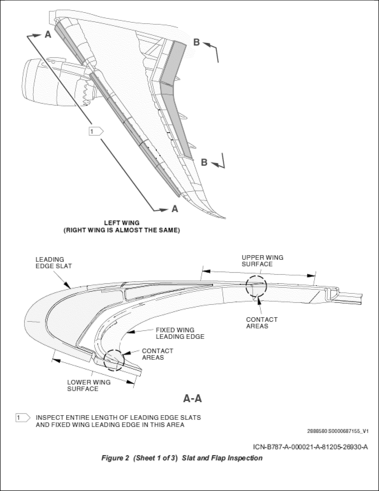
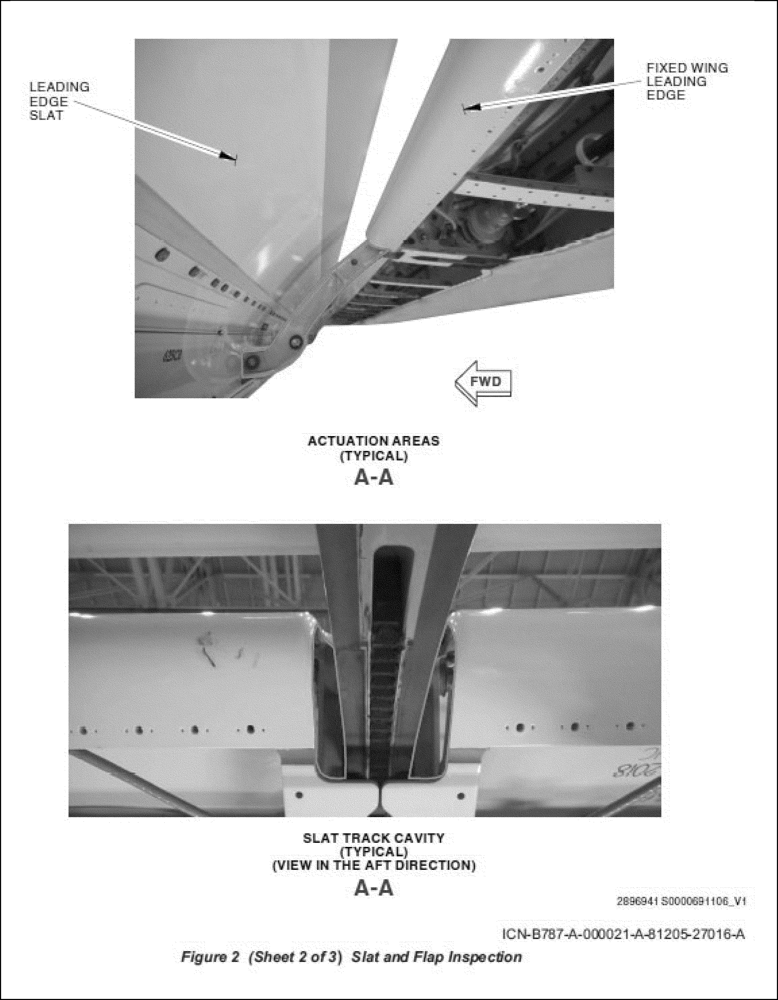
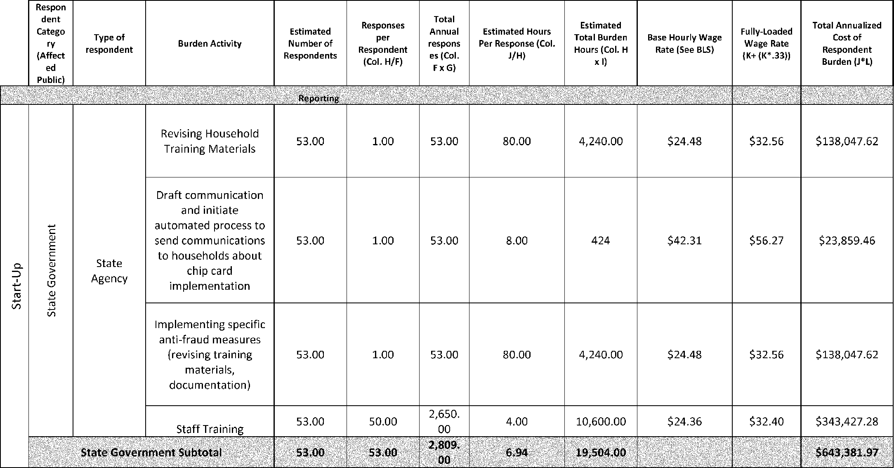
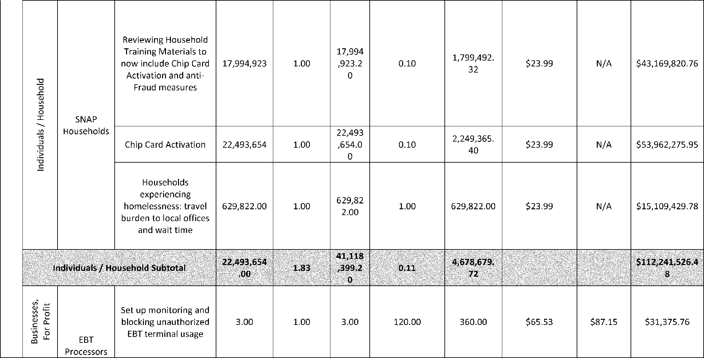

# Daily Digest — 2026-10-23

| | |
|---|---|
| **Digest date** | 2026-10-23 |
| **Data date range** | 2026-10-23 to 2026-10-23 |
| **Generated at** | 2026-10-24T04:03:22Z (UTC) |
| **Pipeline version** | da9394de |
| **Inference** | model layers ran — cli/haiku, opus |
| **Source watermarks** | CREC: 2026-10-23T13:53:56Z · BILLS: 2026-10-23T10:29:56Z · FR: 2026-10-23T16:03:19Z · USCOURTS: 2026-10-23T23:27:24Z · PLAW: 2026-10-22T21:14:57Z |

[Full observed listing for this day](day/2026-10-23.html) — the items our collectors observed for this publication day, mechanical rules applied, frozen at end of day; releases their publishers date on other days are counted there, not listed. This digest is the canonical record.

All items below cite the govinfo package (and granule, where applicable) they
summarize. Selection is mechanical; each item states the rule that included
it. See the Coverage Statement at the end for a full accounting of what was
published, what was summarized, and what was excluded and why.

---

## Contents

- [Day in Review](#day-in-review)
- [1. Congressional Floor Activity](#1-congressional-floor-activity)
- [2. Legislation](#2-legislation)
- [3. Federal Register](#3-federal-register)
- [4. Enacted Laws](#4-enacted-laws)
- [5. Judicial Activity](#5-judicial-activity)
- [6. Agency Announcements](#6-agency-announcements)
- [7. Recorded Votes](#7-recorded-votes)
- [8. Bill Actions](#8-bill-actions)
- [9. Presidential Actions](#9-presidential-actions)
- [Terms Used Today](#terms-used-today)
- [Coverage Statement](#coverage-statement)
- [Methodology](#methodology)

---

## Day in Review

The digest carries 66 House and 4 Senate Congressional Record items, along with 6 Daily Digest entries and 58 Extensions of Remarks. It also carries 29 House bills as introduced and one as reported: H.R. 1382, which would restructure the San Francisco Bay restoration program and set a 75 percent cap on federal cost shares. None of the item summaries describes a recorded vote in either chamber.

On the executive side, the digest carries 6 final rules, 7 proposed rules, 69 notices and one presidential proclamation. The proclamation, dated October 23, modifies which Canadian products remain subject to 50 percent additional duties, effective October 30. Final rules include OCC regulations implementing the GENIUS Act for stablecoin issuance, two NMFS fishery closures in the Gulf of Alaska, and FAA airworthiness actions. Proposed items include a Treasury rule under the ROAD to Housing Act on institutional purchases of single-family homes, USDA changes to SNAP card security, and FDA draft guidance on cadmium in baby food.

The digest carries 66 appellate, 828 district and 9 bankruptcy court items. The Fifth Circuit vacated an injunction against Mississippi House Bill 1193 after finding fabricated citations in the lower court's orders. The Federal Circuit held that a rails-to-trails conversion was not a taking. The Tenth Circuit upheld an air tour ban over Canyon de Chelly. The Third, Fourth and Seventh Circuits each rejected Second Amendment challenges to felon-in-possession convictions.

*Composed from the summarized items below and the day's mechanical
counts; all specifics are cited in their sections.*

---

## 1. Congressional Floor Activity

Source: Congressional Record (CREC), issue observed 2026-10-23, covering proceedings of 2026-10-22. Published by govinfo 2026-10-23T13:53:56Z; observed by our collector 2026-10-23T14:09:46Z. Total issue size: 134 granule(s).

### 1.1 Senate

No Senate floor items met the selection thresholds. 4 floor granule(s) are accounted for in the Coverage Statement.

### 1.2 House of Representatives

Tags: legislative · model keys: executive communications · federal programs · house bills

*In plain terms: Executive communications from Treasury, Education, Labor, Justice, and EPA, plus House bills on defense procurement, military personnel, healthcare, veterans benefits, environmental protection, and education.*

- **Executive Communications, ETC.** — This section records executive communications from federal agencies transmitted to Congress between September and October 2026. Submissions include regulatory documents from the Treasury, Education, Labor, Justice, Environmental Protection Agency, and State departments covering stablecoin certification procedures, Title IX recodification, enforcement regulations, controlled substance scheduling and chemical designations, air quality standards, and pesticide formulations.
  - *In plain terms:* Federal agencies submitted documents to Congress from September through October 2026 on stablecoin certification, education rules, enforcement procedures, drug scheduling, air quality standards, and pesticide regulations.
  - Included because: CREC-SEL-01 — floor item ≥ threshold floor time (19,285 characters) (document dated 2026-10-22)
  - Source: [CREC-2026-10-22 / CREC-2026-10-22-pt1-PgH6053-7](https://www.govinfo.gov/app/details/CREC-2026-10-22/CREC-2026-10-22-pt1-PgH6053-7)
- **Public Bills and Resolutions** — This section lists House bills introduced and referred to various committees. The bills address topics including defense procurement and military personnel matters, healthcare and Medicare access, veterans benefits, environmental protection, education funding restrictions, natural resource management, immigration-related tax provisions, and infrastructure development.
  - *In plain terms:* House members introduced bills for committee review covering military procurement and personnel, healthcare, veterans benefits, environmental protection, education, natural resources, immigration taxes, and infrastructure.
  - Included because: CREC-SEL-01 — floor item ≥ threshold floor time (25,289 characters) (document dated 2026-10-22)
  - Source: [CREC-2026-10-22 / CREC-2026-10-22-pt1-PgH6055-2](https://www.govinfo.gov/app/details/CREC-2026-10-22/CREC-2026-10-22-pt1-PgH6055-2)

### 1.3 Recorded Votes

No recorded votes were published in this issue of the Congressional Record.

---

## 2. Legislation

Source: Congressional Bills (BILLS), text versions published 2026-10-23 to 2026-10-23.

### 2.1 Counts by Stage

| Stage (bill text version) | Count |
|---|---|
| Introduced (ih/is) | 29 |
| Reported (rh/rs) | 1 |
| Engrossed (eh/es) | 0 |
| Enrolled (enr) | 0 |
| Other versions | 0 |
| **Total bill texts published** | **30** |

### 2.2 Bills Listed by Mechanical Rule

Tags: legislative · model keys: bay restoration · federal legislation · water pollution

*In plain terms: H.R. 1382 amends the San Francisco Bay restoration program to change from grants to contracts and expand eligible recipients under the Federal Water Pollution Control Act.*

Bills below are listed because they matched at least one listing rule; the
matching rule is stated per item. All other bill texts are counted above and
accounted for in the Coverage Statement.

- **H. R. 1382 (rh) — 119 HR 1382 RH: To amend the Federal Water Pollution Control Act with respect to San Francisco Bay restoration, and for other purposes.** — H.R. 1382 amends the Federal Water Pollution Control Act to restructure the San Francisco Bay restoration program, expanding eligible recipients and changing from grants to contracts and other funding mechanisms. Federal contributions are limited to 75 percent of project costs, with non-Federal entities required to provide at least 25 percent of funding from non-Federal sources. The bill prohibits federal funds from entities domiciled in or partnered with countries designated as foreign countries of concern.
  - *In plain terms:* H.R. 1382 amends the Federal Water Pollution Control Act for San Francisco Bay by expanding eligible recipients, using contracts instead of grants, requiring partners to fund 25 percent of costs, and blocking funds from designated foreign countries.
  - Included because: BILLS-SEL-01 — reached stage: reported/enrolled/calendar (document dated 2026-10-22)
  - Source: [BILLS-119hr1382rh](https://www.govinfo.gov/app/details/BILLS-119hr1382rh)

---

## 3. Federal Register

Source: Federal Register (FR), issue of 2026-10-23.

### 3.1 Counts by Document Type

| Document type | Count |
|---|---|
| Rules | 6 |
| Proposed rules | 7 |
| Notices | 69 |
| Presidential documents | 0 |
| **Total FR documents** | **82** |

### 3.2 Rules Published

Tags: department of health and human services · executive · securities and exchange commission · model keys: airworthiness · fisheries · stablecoin

*In plain terms: Six final rules covering FAA helicopter and plane airworthiness directives, NMFS pollock and Pacific cod fishing prohibitions off Alaska, USPS NEPA procedures extension, and OCC stablecoin regulations.*

#### DEPARTMENT OF COMMERCE

- **Fisheries of the Exclusive Economic Zone Off Alaska; Pollock in Statistical Area 620 in the Gulf of Alaska** (2026-21676; 50 CFR Part 679) — NMFS is prohibiting directed fishing for pollock in Statistical Area 620 in the Gulf of Alaska (GOA). This action is necessary to prevent exceeding the annual 2026 total allowable catch (TAC) of pollock in Statistical Area 620 in the GOA. Action: Temporary rule; closure. Dates: Effective 1200 hours, Alaska local time (A.l.t.), October 21, 2026 through 2400 hours, A.l.t., December 31, 2026.
  - *In plain terms:* NMFS is prohibiting directed fishing for pollock in Statistical Area 620 in the Gulf of Alaska to prevent exceeding the 2026 annual allowable catch limit.
  - Included because: FR-SEL-01 — document type: final rule (all listed)
  - Source: [FR-2026-10-23 / 2026-21676](https://www.govinfo.gov/app/details/FR-2026-10-23/2026-21676)
- **Fisheries of the Exclusive Economic Zone Off Alaska; Pacific Cod by Catcher Vessels Using Trawl Gear in the Central Regulatory Area of the Gulf of Alaska** (2026-21680; 50 CFR Part 679) — NMFS is prohibiting directed fishing for Pacific cod by catcher vessels using trawl gear in the Central Regulatory Area of the Gulf of Alaska (GOA). This action is necessary to prevent exceeding the 2026 total allowable catch (TAC) of Pacific cod allocated to catcher vessels using trawl gear in the Central Regulatory Area of the GOA. Action: Temporary rule; closure. Dates: Effective 1200 hours, Alaska local time (A.l.t.), October 21, 2026, through 2400 hours, A.l.t., December 31, 2026.
  - *In plain terms:* NMFS is prohibiting directed fishing for Pacific cod by trawl vessels in the Central Regulatory Area of the Gulf of Alaska to prevent exceeding the 2026 annual catch limit.
  - Included because: FR-SEL-01 — document type: final rule (all listed)
  - Source: [FR-2026-10-23 / 2026-21680](https://www.govinfo.gov/app/details/FR-2026-10-23/2026-21680)

#### DEPARTMENT OF THE TREASURY

- **Implementing the Guiding and Establishing National Innovation for U.S. Stablecoins Act for the Issuance of Stablecoins by Entities Subject to the Jurisdiction of the Office of the Comptroller of the Currency** (2026-21706; 12 CFR Parts 3, 6, 8, 15, and 19) — The Office of the Comptroller of the Currency (OCC) is issuing regulations implementing the Guiding and Establishing National Innovation for U.S. Stablecoins Act regarding the issuance of payment stablecoins and certain related activities by entities subject to the OCC's jurisdiction. Action: Final rule. Dates: The final rule is effective on January 18, 2027.
  - *In plain terms:* The OCC is issuing regulations to implement the Guiding and Establishing National Innovation for U.S. Stablecoins Act regarding payment stablecoin issuance by entities subject to its jurisdiction.
  - Included because: FR-SEL-01 — document type: final rule (all listed)
  - Source: [FR-2026-10-23 / 2026-21706](https://www.govinfo.gov/app/details/FR-2026-10-23/2026-21706)

#### DEPARTMENT OF TRANSPORTATION

- **Airworthiness Directives; MD Helicopters, LLC Helicopters** (2026-21664; 14 CFR Part 39) — The FAA is adopting a new airworthiness directive (AD) for certain MD Helicopters, LLC (MDHI) Model 369D, 369E, 369F, 369FF, 369H, and 500N helicopters. This AD was prompted by a report of mechanical damage to the main transmission drive shaft coupling (coupling). This AD requires a one-time visual inspection of the couplings for cracks of the splines and, depending on the results, replacement of the couplings. The FAA is issuing this AD to address the unsafe condition on these products. Action: Final rule. Dates: This AD is effective November 27, 2026.
  - *In plain terms:* The FAA is requiring a one-time visual inspection of main transmission couplings on certain MD Helicopters for cracks and replacement if damage is found.
  - Included because: FR-SEL-01 — document type: final rule (all listed)
  - Source: [FR-2026-10-23 / 2026-21664](https://www.govinfo.gov/app/details/FR-2026-10-23/2026-21664)
- **Airworthiness Directives; The Boeing Company Airplanes; Correction** (2026-21686; 14 CFR Part 39) — The FAA is correcting an airworthiness directive (AD) that was published in the Federal Register . That AD applies to certain The Boeing Company Model 787-8, 787-9, and 787-10 airplanes. As published, a paragraph reference specified in the regulatory text is incorrect. This document corrects that error. In all other respects, the original document remains the same. Action: Final rule; correction. Dates: This correction is effective November 12, 2026. The effective date of AD 2026-20-10 remains November 12, 2026. The Director of the Federal Register approved the incorporation by reference of a certain publication listed in this AD as of November 12, 2026 (91 FR 64259, October 8, 2026). The Director of the Federal Register approved the incorporation by reference of a certain other publication listed in this AD as of October 11, 2019 (84 FR 54765, October 11, 2019).
  - *In plain terms:* The FAA is correcting an incorrect paragraph reference in an airworthiness directive for certain Boeing 787 airplanes, with all other requirements unchanged.
  - Included because: FR-SEL-01 — document type: final rule (all listed)
  - Source: [FR-2026-10-23 / 2026-21686](https://www.govinfo.gov/app/details/FR-2026-10-23/2026-21686)
  -  *Source graphic 1 of 3 from 2026-21686.*
  -  *Source graphic 2 of 3 from 2026-21686.*
  - *Graphics not rendered here: 1 of 3 — see the [source PDF](https://www.govinfo.gov/content/pkg/FR-2026-10-23/pdf/FR-2026-10-23.pdf).*

#### POSTAL SERVICE

- **Revision of National Environmental Policy Act Implementing Procedures; Extension of Comment Period** (2026-21699; 39 CFR Part 775) — On September 25, 2026, the United States Postal Service (USPS) published an interim final rule with request for comments to partially rescind and update its remaining National Environmental Policy Act (NEPA) implementing procedures, which were promulgated to implement the now-rescinded Council on Environmental Quality (CEQ) regulations. USPS requested public comments by October 25, 2026. USPS is now extending the comment period until November 9, 2026, to allow the public additional review and submission time for any comments on the interim final rule. Action: Interim final rule; extension of comment period. Dates: The comment period for the interim final rule published on September 25, 2026 (91 FR 60827) is extended. USPS must receive comments by November 9, 2026, to ensure consideration.
  - *In plain terms:* USPS is extending the public comment period for its updated environmental review procedures from October 25 to November 9, 2026.
  - Included because: FR-SEL-01 — document type: final rule (all listed)
  - Source: [FR-2026-10-23 / 2026-21699](https://www.govinfo.gov/app/details/FR-2026-10-23/2026-21699)

### 3.3 Proposed Rules Published

Tags: department of health and human services · executive · securities and exchange commission · model keys: food safety · housing · securities

*In plain terms: Seven proposed rules including SEC rules review, SNAP EBT card security measures, FDA food safety guidance, Treasury housing investment restrictions, NRC fuel reprocessing petition, and NHTSA test device comment extension.*

#### DEPARTMENT OF AGRICULTURE

- **Supplemental Nutrition Assistance Program: Electronic Benefits Transfer Card Security Measures** (2026-21658; 7 CFR Parts 271, 274 and 278) — The Food and Nutrition Administration (FNA or the Agency), an agency of the U.S. Department of Agriculture (USDA or the Department), is issuing a rule proposing changes to Supplemental Nutrition Assistance Program (SNAP, the Program) regulations to modernize Electronic Benefit Transfer (EBT) technology and align EBT with consumer payment processing industry standards, improving both Program integrity and convenience for SNAP clients. These proposed changes will protect SNAP benefits from thieves and ensure benefits are accessible by approved households. Action: Proposed rule. Dates: Written comments must be received on or before December 22, 2026 to be assured of consideration.
  - *In plain terms:* The USDA is proposing to modernize electronic benefit transfer card technology for SNAP to match industry standards, protecting benefits from thieves and ensuring access for eligible households.
  - Included because: FR-SEL-02 — document type: proposed rule (all listed)
  - Source: [FR-2026-10-23 / 2026-21658](https://www.govinfo.gov/app/details/FR-2026-10-23/2026-21658)
  -  *Source graphic 1 of 6 from 2026-21658.*
  -  *Source graphic 2 of 6 from 2026-21658.*
  - *Graphics not rendered here: 4 of 6 — see the [source PDF](https://www.govinfo.gov/content/pkg/FR-2026-10-23/pdf/FR-2026-10-23.pdf).*

#### DEPARTMENT OF HEALTH AND HUMAN SERVICES

- **Hazard Analysis and Risk-Based Preventive Controls for Human Food; Draft Guidance for Industry; Availability** (2026-21669; 21 CFR Part 117) — The Food and Drug Administration (FDA, the Agency, or we) is announcing the availability of one additional draft chapter of a multichapter draft guidance for industry titled “Hazard Analysis and Risk-Based Preventive Controls for Human Food.” This multichapter draft guidance, when finalized, will explain FDA's current thinking on how to comply with the requirements for hazard analysis and risk-based preventive controls under FDA's regulation titled “Current Good Manufacturing Practice, Hazard Analysis, and Risk-Based Preventive Controls for Human Food.” The newly available draft chapter is titled “Chapter 12: Control of Chemical Hazards.” This draft guidance is not final nor is it in effect at this time. Action: Notification of availability. Dates: Submit either electronic or written comments on the draft guidance by January 21, 2027 to ensure that the Agency considers your comment on this draft guidance before it begins work on the final version of the guidance.
  - *In plain terms:* The FDA is releasing a draft chapter on controlling chemical hazards for a guidance document on how to meet food safety hazard analysis and preventive control requirements.
  - Included because: FR-SEL-02 — document type: proposed rule (all listed)
  - Source: [FR-2026-10-23 / 2026-21669](https://www.govinfo.gov/app/details/FR-2026-10-23/2026-21669)
- **Action Levels for Cadmium in Processed Food Intended for Babies and Young Children; Draft Guidance for Industry; Availability** (2026-21670; 21 CFR Part 109) — The Food and Drug Administration (FDA, the Agency, or we) is announcing the availability of a draft guidance for industry entitled “Action Levels for Cadmium in Processed Food Intended for Babies and Young Children.” The draft guidance, when finalized, will establish action levels for cadmium in certain processed foods intended for babies and young children less than 2 years old. The draft guidance is intended to set achievable action levels that will help further reduce cadmium in the food supply. Action: Notification of availability. Dates: Submit either electronic or written comments on the draft guidance by December 22, 2026 to ensure that the Agency considers your comments on the draft guidance before it begins work on the final version of the guidance.
  - *In plain terms:* The FDA is releasing draft guidance to set achievable limits for cadmium in processed foods for babies and young children under 2 years old.
  - Included because: FR-SEL-02 — document type: proposed rule (all listed)
  - Source: [FR-2026-10-23 / 2026-21670](https://www.govinfo.gov/app/details/FR-2026-10-23/2026-21670)

#### DEPARTMENT OF THE TREASURY

- **21st Century ROAD to Housing Act Prohibition on Large Institutional Investor Purchases of Single-Family Homes** (2026-21675; 31 CFR Part 36) — The Department of the Treasury (Treasury) is issuing this proposed rule to carry out the purposes of section 1001 of the 21st Century ROAD to Housing Act (the Act or the ROAD Act). Section 1001 of the ROAD Act prohibits large institutional investors from purchasing single-family homes, subject to certain exceptions. The proposed rule would clarify certain terms relevant to those restrictions, including “large institutional investor”; clarify the application of certain exceptions from the statutory prohibition; and clarify the statutory enforcement mechanism. The proposed rule is intended to provide clarity to market participants and other stakeholders on the application of the statute before the effective date of the ROAD Act. Action: Notice of proposed rulemaking. Dates: Comments on this notice of proposed rulemaking must be received on or before November 23, 2026.
  - *In plain terms:* The Treasury is proposing regulations to clarify how the 21st Century ROAD to Housing Act's prohibition on large institutional investors buying single-family homes will be applied and enforced.
  - Included because: FR-SEL-02 — document type: proposed rule (all listed)
  - Source: [FR-2026-10-23 / 2026-21675](https://www.govinfo.gov/app/details/FR-2026-10-23/2026-21675)

#### DEPARTMENT OF TRANSPORTATION

- **Part 572; Anthropomorphic Test Devices; Test Device for Human Occupant Restraint 50th Percentile Adult Male Dummy (THOR-50M); Extension of Comment Period** (2026-21730; 49 CFR Part 572) — In response to a request from the Alliance for Automotive Innovation (Auto Innovators), NHTSA is announcing a 30-day extension of the public comment period for the Supplemental Notice of Proposed Rulemaking (SNPRM) published on September 22, 2026. The SNPRM supplements NHTSA's September 2023 notice of proposed rulemaking to amend NHTSA's regulations to include an advanced crash test dummy (the Test Device for Human Occupant Restraint (THOR) 50th percentile adult male) by requesting comment on specifying an additional spine configuration and an alternative to the face foam, and announcing the availability of additional documents. The comment period for the SNPRM was originally scheduled to end on October 22, 2026. It will now end on November 21, 2026. Action: Extension of comment period. Dates: The comment period for the SNPRM published on September 22, 2026 at 91 FR 60068 is extended to November 21, 2026.
  - *In plain terms:* NHTSA is extending the public comment period for new crash test dummy requirements from October 22 to November 21, 2026, to allow additional review time.
  - Included because: FR-SEL-02 — document type: proposed rule (all listed)
  - Source: [FR-2026-10-23 / 2026-21730](https://www.govinfo.gov/app/details/FR-2026-10-23/2026-21730)

#### NUCLEAR REGULATORY COMMISSION

- **Irradiated Fuel Reprocessing Plants** (2026-21690; 10 CFR Part 74) — The U.S. Nuclear Regulatory Commission (NRC) has received a petition for rulemaking (PRM) from Howard L. Hall, Ph.D., dated August 14, 2026, requesting that the NRC remove the exclusion of irradiated fuel reprocessing plants and establish material control and accounting requirements appropriate to that facility class. The petition was docketed by the NRC on September 14, 2026, and has been assigned Docket No. PRM-74-1. The NRC is examining the issues raised in PRM-74-1 to determine whether they should be considered in rulemaking. The NRC is requesting public comment on this petition at this time. Action: Petition for rulemaking; notice of docketing, and request for comment. Dates: Submit comments by November 23, 2026.
  - *In plain terms:* The NRC is accepting public comment on a petition requesting that it remove an exclusion for irradiated fuel reprocessing plants and establish new material control requirements.
  - Included because: FR-SEL-02 — document type: proposed rule (all listed)
  - Source: [FR-2026-10-23 / 2026-21690](https://www.govinfo.gov/app/details/FR-2026-10-23/2026-21690)

#### SECURITIES AND EXCHANGE COMMISSION

- **List of Rules To Be Reviewed Pursuant to the Regulatory Flexibility Act** (2026-21657; 17 CFR Chapter II) — The Securities and Exchange Commission (“Commission”) is publishing a list of rules to be reviewed pursuant to section 610 of the Regulatory Flexibility Act. The list is published to provide the public with notice that these rules are scheduled for review by the agency and to invite public comment on whether the rules should be continued without change, or should be amended or rescinded to minimize any significant economic impact of the rules upon a substantial number of small entities. Action: Publication of list of rules scheduled for review. Dates: This release was published in the Federal Register on October 23, 2026. Comments should be submitted by November 23, 2026.
  - *In plain terms:* The SEC is publishing rules scheduled for review and inviting public comment on whether they should continue unchanged, be amended, or be rescinded to minimize economic impact on small businesses.
  - Included because: FR-SEL-02 — document type: proposed rule (all listed)
  - Source: [FR-2026-10-23 / 2026-21657](https://www.govinfo.gov/app/details/FR-2026-10-23/2026-21657)

### 3.4 Notices and Presidential Documents

Notices are summarized only when they match a listing rule; all are counted
in 3.1 and in the Coverage Statement. Presidential documents in the FR are
always listed.

No notices or presidential documents matched a listing rule.

---

## 4. Enacted Laws

Source: Public and Private Laws (PLAW) published 2026-10-23.

No laws were published in this range.

---

## 5. Judicial Activity

Source: United States Courts Opinions (USCOURTS): opinions observed 2026-10-23
by our collector; each opinion states its own issue date beside its
listing ([how our clocks work](faq.html#fapds-three-clocks)).

Completeness disclosure (standing): USCOURTS carries opinions from
approximately 140 participating appellate, district, bankruptcy, and
national federal courts. Unlike the Congressional Record and the Federal
Register, which are the complete official record of their branches,
USCOURTS is participation-based and is NOT the complete federal judicial
record. Courts post opinions with delay — typically over several days —
so a day's digest carries the opinions that became available that day,
whatever date each was issued.

### 5.1 Appellate and National Court Opinions

Tags: judicial · model keys: administrative law · appellate decisions · criminal appeals

*In plain terms: 66 appellate decisions, mostly affirming lower courts in criminal appeals, civil rights disputes, bankruptcy matters, and administrative law cases.*

Appellate and national court opinions are summarized; district and
bankruptcy opinions are counted in 5.2 and in the Coverage Statement.

#### United States Court of Appeals for the District of Columbia Circuit

- **Theresa Garner v. USA** (No. 26-05127; filed 2026-10-22) — The D.C. Circuit affirmed dismissal of Theresa Garner's complaint as patently insubstantial, finding no federal question suitable for decision. The court determined the complaint constituted an attempt to relitigate prior decisions and that dismissal sua sponte was proper under the Federal Rules of Civil Procedure.
  - *In plain terms:* The court upheld dismissal of Garner's complaint as lacking legal merit, finding it attempted to relitigate prior decisions.
  - Included because: USCOURTS-SEL-01 — appellate court opinion (all listed) (document dated 2026-10-22)
  - Source: [USCOURTS-caDC-26-05127 / USCOURTS-caDC-26-05127-0](https://www.govinfo.gov/app/details/USCOURTS-caDC-26-05127/USCOURTS-caDC-26-05127-0)
- **Anthony Mallgren v. USA, et al** (No. 26-05210; filed 2026-10-22) — The D.C. Circuit affirmed a district court order dismissing Anthony Mallgren's case against the United States and others. Because Mallgren did not address the district court's grounds for dismissal in his appellate brief, he forfeited any challenge to that dismissal.
  - *In plain terms:* The court upheld dismissal of Mallgren's case against the United States because he didn't challenge the dismissal reasons on appeal.
  - Included because: USCOURTS-SEL-01 — appellate court opinion (all listed) (document dated 2026-10-22)
  - Source: [USCOURTS-caDC-26-05210 / USCOURTS-caDC-26-05210-0](https://www.govinfo.gov/app/details/USCOURTS-caDC-26-05210/USCOURTS-caDC-26-05210-0)
- **Anthony Mallgren v. United Healthcare, et al** (No. 26-05211; filed 2026-10-22) — The D.C. Circuit affirmed a district court order dismissing Anthony Mallgren's case against United Healthcare and others. Because Mallgren did not address the district court's grounds for dismissal in his appellate brief, he forfeited any challenge to that dismissal.
  - *In plain terms:* The court upheld dismissal of Mallgren's case against UnitedHealthcare because he didn't challenge the dismissal reasons on appeal.
  - Included because: USCOURTS-SEL-01 — appellate court opinion (all listed) (document dated 2026-10-22)
  - Source: [USCOURTS-caDC-26-05211 / USCOURTS-caDC-26-05211-0](https://www.govinfo.gov/app/details/USCOURTS-caDC-26-05211/USCOURTS-caDC-26-05211-0)
- **Anthony Mallgren v. USA** (No. 26-05215; filed 2026-10-22) — The D.C. Circuit affirmed a district court order dismissing Anthony Mallgren's case. Because Mallgren did not address the district court's grounds for dismissal in his appellate brief, he forfeited any challenge to that dismissal.
  - *In plain terms:* The court upheld dismissal of Mallgren's case because he didn't challenge the dismissal reasons on appeal.
  - Included because: USCOURTS-SEL-01 — appellate court opinion (all listed) (document dated 2026-10-22)
  - Source: [USCOURTS-caDC-26-05215 / USCOURTS-caDC-26-05215-0](https://www.govinfo.gov/app/details/USCOURTS-caDC-26-05215/USCOURTS-caDC-26-05215-0)
- **Anthony Mallgren v. New York State, et al** (No. 26-05216; filed 2026-10-22) — The D.C. Circuit affirmed a district court order dismissing Anthony Mallgren's case against New York State and others. Because Mallgren did not address the district court's grounds for dismissal in his appellate brief, he forfeited any challenge to that dismissal.
  - *In plain terms:* The court upheld dismissal of Mallgren's case against New York State because he didn't challenge the dismissal reasons on appeal.
  - Included because: USCOURTS-SEL-01 — appellate court opinion (all listed) (document dated 2026-10-22)
  - Source: [USCOURTS-caDC-26-05216 / USCOURTS-caDC-26-05216-0](https://www.govinfo.gov/app/details/USCOURTS-caDC-26-05216/USCOURTS-caDC-26-05216-0)
- **Anthony Mallgren v. USA** (No. 26-05217; filed 2026-10-22) — The U.S. Court of Appeals for the District of Columbia Circuit affirmed a district court order from June 1, 2026, in Anthony Brian Mallgren v. United States of America. The appellant did not address certain grounds for dismissal on appeal and thus forfeited any challenge to those grounds.
  - *In plain terms:* The court upheld the June 1, 2026 dismissal of Mallgren's case because he didn't challenge the dismissal reasons on appeal.
  - Included because: USCOURTS-SEL-01 — appellate court opinion (all listed) (document dated 2026-10-22)
  - Source: [USCOURTS-caDC-26-05217 / USCOURTS-caDC-26-05217-0](https://www.govinfo.gov/app/details/USCOURTS-caDC-26-05217/USCOURTS-caDC-26-05217-0)
- **Anthony Mallgren v. USA** (No. 26-05222; filed 2026-10-22) — The U.S. Court of Appeals for the District of Columbia Circuit affirmed a district court order from June 1, 2026, in Anthony Brian Mallgren v. United States of America. The appellant did not address certain grounds for dismissal on appeal and thus forfeited any challenge to those grounds.
  - *In plain terms:* The court upheld the June 1, 2026 dismissal of Mallgren's case because he didn't challenge the dismissal reasons on appeal.
  - Included because: USCOURTS-SEL-01 — appellate court opinion (all listed) (document dated 2026-10-22)
  - Source: [USCOURTS-caDC-26-05222 / USCOURTS-caDC-26-05222-0](https://www.govinfo.gov/app/details/USCOURTS-caDC-26-05222/USCOURTS-caDC-26-05222-0)

#### United States Court of Appeals for the Eighth Circuit

- **United States v. Antwon Tolefree** (No. 25-03333; filed 2026-10-22) — The Eighth Circuit Court of Appeals issued a judgment in United States v. Antwon Tolefree on October 22, 2026, with the clerk notifying counsel of entry of judgment and deadlines for filing petitions for rehearing.
  - *In plain terms:* The appeals court issued judgment with notification to parties and deadlines for requesting rehearing.
  - Included because: USCOURTS-SEL-01 — appellate court opinion (all listed) (document dated 2026-10-22)
  - Source: [USCOURTS-ca8-25-03333 / USCOURTS-ca8-25-03333-0](https://www.govinfo.gov/app/details/USCOURTS-ca8-25-03333/USCOURTS-ca8-25-03333-0)

#### United States Court of Appeals for the Eleventh Circuit

- **First Solar Electric LLC v. Zurich American Insurance Company** (No. 25-10606; filed 2026-10-22) — The Eleventh Circuit affirmed that an insurance company waived its right to apply a higher flood deductible after initially applying a lower water damage deductible and making unconditional advance payments without reserving the right to change the determination. Under Georgia law, the insurer's conduct established a waiver of the ability to later apply the higher deductible to rain events that damaged a solar power plant construction project.
  - *In plain terms:* An insurance company waived the right to apply a higher flood deductible for rain damage to a solar project after initially using a lower deductible and making unconditional payments.
  - Included because: USCOURTS-SEL-01 — appellate court opinion (all listed) (document dated 2026-10-22)
  - Source: [USCOURTS-ca11-25-10606 / USCOURTS-ca11-25-10606-0](https://www.govinfo.gov/app/details/USCOURTS-ca11-25-10606/USCOURTS-ca11-25-10606-0)
- **Kevin Bain v. Brandon McCord, et al** (No. 25-11088; filed 2026-10-22) — The Eleventh Circuit affirmed dismissal of a pro se Section 1983 complaint alleging Fourth Amendment violations related to a search warrant and arrest. The court held that the warrant satisfied the particularity requirement through cross-reference to an attachment, that exigent circumstances justified a warrantless home arrest when officers had probable cause to believe the suspect committed violent felonies, and that executing officers could not be held liable for alleged misstatements in the warrant affidavit they did not prepare.
  - *In plain terms:* A Fourth Amendment complaint about a search warrant and arrest was dismissed; the warrant satisfied legal requirements, exigent circumstances justified a warrantless arrest, and executing officers weren't responsible for false statements in the warrant.
  - Included because: USCOURTS-SEL-01 — appellate court opinion (all listed) (document dated 2026-10-22)
  - Source: [USCOURTS-ca11-25-11088 / USCOURTS-ca11-25-11088-0](https://www.govinfo.gov/app/details/USCOURTS-ca11-25-11088/USCOURTS-ca11-25-11088-0)
- **Raquel Downing v. Cook Brothers Funeral Directors, et al** (No. 25-14108; filed 2026-10-22) — The Eleventh Circuit affirmed summary judgment for a funeral home in a dispute over disposition of deceased remains, finding that Georgia statutory law vested the surviving spouse with primary authority and provided the funeral home statutory immunity for relying in good faith on the spouse's representations. The court also upheld sanctions imposed against the pro se plaintiff for pursuing a motion for default judgment against defendants who had timely answered.
  - *In plain terms:* A funeral home won summary judgment because Georgia law gave a surviving spouse final say over remains and the funeral home had statutory protection for relying in good faith on what the spouse said.
  - Included because: USCOURTS-SEL-01 — appellate court opinion (all listed) (document dated 2026-10-22)
  - Source: [USCOURTS-ca11-25-14108 / USCOURTS-ca11-25-14108-0](https://www.govinfo.gov/app/details/USCOURTS-ca11-25-14108/USCOURTS-ca11-25-14108-0)
- **USA v. Nelson Bellon** (No. 26-10100; filed 2026-10-22) — The Eleventh Circuit affirmed a 114-month sentence for carjacking, finding it was within the guideline range and that the district court properly balanced sentencing factors including the defendant's criminal history and mitigating factors related to mental health issues and substance dependence.
  - *In plain terms:* A 114-month sentence for carjacking was upheld as reasonable and consistent with sentencing guidelines, considering the defendant's criminal history and mental health concerns.
  - Included because: USCOURTS-SEL-01 — appellate court opinion (all listed) (document dated 2026-10-22)
  - Source: [USCOURTS-ca11-26-10100 / USCOURTS-ca11-26-10100-0](https://www.govinfo.gov/app/details/USCOURTS-ca11-26-10100/USCOURTS-ca11-26-10100-0)

#### United States Court of Appeals for the Federal Circuit

- **4023 Sawyer Road I, LLC v. US** (No. 25-01459; filed 2026-10-22) — The Federal Circuit affirmed that a railroad held fee simple title to a rail corridor rather than merely an easement, and therefore the issuance of a Notice of Interim Trail Use for rails-to-trails conversion did not constitute a Fifth Amendment taking. The court applied Florida law and found that historical conveyance deeds and a 1926 condemnation judgment unambiguously conveyed fee simple interest to the railroad.
  - *In plain terms:* A railroad owned complete title to a rail corridor rather than just a temporary right to use it, so converting it to a trail did not constitute a Fifth Amendment taking.
  - Included because: USCOURTS-SEL-01 — appellate court opinion (all listed) (document dated 2026-10-22)
  - Source: [USCOURTS-ca13-25-01459 / USCOURTS-ca13-25-01459-0](https://www.govinfo.gov/app/details/USCOURTS-ca13-25-01459/USCOURTS-ca13-25-01459-0)

#### United States Court of Appeals for the Fifth Circuit

- **La Union v. FEMA** (No. 24-40756; filed 2026-10-22) — LUPE appealed a district court dismissal of its FOIA claim alleging FEMA fails to comply with the statute's reading-room requirement by not publishing disaster relief eligibility standards online. The Fifth Circuit reversed the dismissal in part, finding LUPE plausibly alleged an ongoing violation, and remanded for further proceedings on whether prospective relief requiring FEMA to publish these materials is warranted.
  - *In plain terms:* The court partly reversed dismissal of LUPE's lawsuit claiming FEMA failed to publish disaster relief eligibility standards online as required.
  - Included because: USCOURTS-SEL-01 — appellate court opinion (all listed) (document dated 2026-10-22)
  - Source: [USCOURTS-ca5-24-40756 / USCOURTS-ca5-24-40756-0](https://www.govinfo.gov/app/details/USCOURTS-ca5-24-40756/USCOURTS-ca5-24-40756-0)
- **Shnatzmeyer v. State Farm** (No. 25-11369; filed 2026-10-22) — The homeowners Schnatzmeyer and Sandlin sued State Farm over disputed property damage coverage claims from winter freeze events in 2021 and 2022. The Fifth Circuit affirmed summary judgment for State Farm, holding the statute of limitations barred the claims because they accrued when State Farm issued its decision and payment in March 2021, not when the homeowners later raised additional damage allegations.
  - *In plain terms:* The court upheld summary judgment for State Farm in homeowners' winter freeze damage lawsuit, finding they waited too long to sue.
  - Included because: USCOURTS-SEL-01 — appellate court opinion (all listed) (document dated 2026-10-22)
  - Source: [USCOURTS-ca5-25-11369 / USCOURTS-ca5-25-11369-0](https://www.govinfo.gov/app/details/USCOURTS-ca5-25-11369/USCOURTS-ca5-25-11369-0)
- **USA v. Puac-Ramirez** (No. 25-40718; filed 2026-10-22) — Puac-Ramirez was convicted of illegal reentry and sentenced to time served plus one year of supervised release. He appealed, arguing the supervised release term was procedurally and substantively unreasonable given his status as a deportable alien, but the Fifth Circuit affirmed, finding no clear error in the district court's imposition of supervision.
  - *In plain terms:* The court upheld Puac-Ramirez's sentence of time served plus one year of supervised release for illegal reentry.
  - Included because: USCOURTS-SEL-01 — appellate court opinion (all listed) (document dated 2026-10-22)
  - Source: [USCOURTS-ca5-25-40718 / USCOURTS-ca5-25-40718-0](https://www.govinfo.gov/app/details/USCOURTS-ca5-25-40718/USCOURTS-ca5-25-40718-0)
- **Rincon v. Ibarra** (No. 25-40820; filed 2026-10-22) — Rincon sued Laredo police officers for false arrest and unlawful search based on alleged violation of a COVID-19 curfew order during a February 2021 incident in a parking lot. The Fifth Circuit affirmed dismissal of the City and qualified immunity for the officers, holding that a reasonable officer could have believed the curfew applied to Rincon and that his detention was supported by probable cause.
  - *In plain terms:* The court upheld dismissal of Rincon's false arrest lawsuit and legal protection for the officers in a February 2021 COVID curfew incident.
  - Included because: USCOURTS-SEL-01 — appellate court opinion (all listed) (document dated 2026-10-22)
  - Source: [USCOURTS-ca5-25-40820 / USCOURTS-ca5-25-40820-0](https://www.govinfo.gov/app/details/USCOURTS-ca5-25-40820/USCOURTS-ca5-25-40820-0)
- **USA v. Estrada** (No. 25-50963; filed 2026-10-22) — Estrada, convicted of heroin conspiracy, sought to terminate his supervised release after his sentence was reduced to time served through compassionate release. While his appeal to the Third Circuit on the compassionate release order was pending, his supervision was transferred from Pennsylvania to Texas; the Fifth Circuit affirmed the Texas court's denial of his termination motion, holding the pending appeal did not divest the Pennsylvania court of authority to transfer supervision.
  - *In plain terms:* The court upheld Texas's denial of Estrada's request to end his supervised release after his sentence was reduced to time served.
  - Included because: USCOURTS-SEL-01 — appellate court opinion (all listed) (document dated 2026-10-22)
  - Source: [USCOURTS-ca5-25-50963 / USCOURTS-ca5-25-50963-0](https://www.govinfo.gov/app/details/USCOURTS-ca5-25-50963/USCOURTS-ca5-25-50963-0)
- **Tuang v. Blanche** (No. 25-60394; filed 2026-10-22) — Tuang, a Burmese refugee and permanent resident convicted of sex crimes against a child, sought deferral of removal under the Convention Against Torture. An immigration judge granted relief, but the Board of Immigration Appeals reversed; the Fifth Circuit denied Tuang's petition for review, affirming that he failed to establish he would more likely than not be tortured if removed to Burma.
  - *In plain terms:* The court upheld the denial of Tuang's request to avoid removal, finding he didn't prove he'd likely face torture if sent to Burma.
  - Included because: USCOURTS-SEL-01 — appellate court opinion (all listed) (document dated 2026-10-22)
  - Source: [USCOURTS-ca5-25-60394 / USCOURTS-ca5-25-60394-0](https://www.govinfo.gov/app/details/USCOURTS-ca5-25-60394/USCOURTS-ca5-25-60394-0)
- **Jackson Fed of Tchr v. Fitch** (No. 25-60496; filed 2026-10-22) — The Fifth Circuit vacated a preliminary injunction blocking enforcement of Mississippi House Bill 1193, which restricts certain diversity and inclusion programs at educational institutions, after finding the district judge issued orders containing fabricated factual assertions and nonexistent case citations. The court remanded for reassignment to a different district judge to conduct proceedings consistent with federal law.
  - *In plain terms:* The court vacated the injunction blocking Mississippi House Bill 1193 restricting certain diversity and inclusion programs at educational institutions.
  - Included because: USCOURTS-SEL-01 — appellate court opinion (all listed) (document dated 2026-10-22)
  - Source: [USCOURTS-ca5-25-60496 / USCOURTS-ca5-25-60496-0](https://www.govinfo.gov/app/details/USCOURTS-ca5-25-60496/USCOURTS-ca5-25-60496-0)
- **Zimmer v. Estrada** (No. 26-10046; filed 2026-10-22) — The Fifth Circuit affirmed dismissal of a discrimination complaint brought by a former volunteer at an airport program who alleged his removal violated disability protections under federal law. The court found the plaintiff did not plausibly allege his exclusion was based on his disability rather than other reasons given for his removal.
  - *In plain terms:* The court upheld dismissal of an airport volunteer's disability discrimination complaint, finding he didn't prove his removal was disability-based.
  - Included because: USCOURTS-SEL-01 — appellate court opinion (all listed) (document dated 2026-10-22)
  - Source: [USCOURTS-ca5-26-10046 / USCOURTS-ca5-26-10046-0](https://www.govinfo.gov/app/details/USCOURTS-ca5-26-10046/USCOURTS-ca5-26-10046-0)
- **USA v. Rivas-Gonzalez** (No. 26-50199; filed 2026-10-22) — Appointed counsel moved to withdraw from representing a defendant in a criminal appeal under Anders v. California, and the Fifth Circuit found no nonfrivolous appellate issues available for review. The court granted counsel's motion to withdraw and dismissed the appeal.
  - *In plain terms:* The court granted appointed counsel's motion to withdraw and dismissed the appeal after finding no valid issues for review.
  - Included because: USCOURTS-SEL-01 — appellate court opinion (all listed) (document dated 2026-10-22)
  - Source: [USCOURTS-ca5-26-50199 / USCOURTS-ca5-26-50199-0](https://www.govinfo.gov/app/details/USCOURTS-ca5-26-50199/USCOURTS-ca5-26-50199-0)

#### United States Court of Appeals for the Fourth Circuit

- **US v. Dai'Quan Lane** (No. 24-04083; filed 2026-10-22) — The Fourth Circuit affirmed convictions for possession of ammunition by a convicted felon and possession of a machinegun, rejecting constitutional challenges based on binding Circuit precedent that precedes the Supreme Court's decision in New York State Rifle & Pistol Association v. Bruen.
  - *In plain terms:* A convicted person's convictions for possessing ammunition and a machinegun were upheld based on prior court rulings that came before a recent Supreme Court decision on firearms.
  - Included because: USCOURTS-SEL-01 — appellate court opinion (all listed) (document dated 2026-10-22)
  - Source: [USCOURTS-ca4-24-04083 / USCOURTS-ca4-24-04083-0](https://www.govinfo.gov/app/details/USCOURTS-ca4-24-04083/USCOURTS-ca4-24-04083-0)
- **Barbara Kelly v. US Bank Natl Assn** (No. 25-01474; filed 2026-10-22) — The Fourth Circuit affirmed the district court's order upholding the bankruptcy court's dismissal of Barbara Ann Kelly's bankruptcy petition with prejudice, which included a four-year bar to refiling, prohibition of automatic stay under 11 U.S.C. § 362(a), and imposition of an equitable servitude on her properties.
  - *In plain terms:* A bankruptcy petition was dismissed with a four-year ban on refiling, blocked from the automatic court protection normally provided, and restrictions placed on properties.
  - Included because: USCOURTS-SEL-01 — appellate court opinion (all listed) (document dated 2026-10-22)
  - Source: [USCOURTS-ca4-25-01474 / USCOURTS-ca4-25-01474-0](https://www.govinfo.gov/app/details/USCOURTS-ca4-25-01474/USCOURTS-ca4-25-01474-0)
- **Asani Bolton v. JP Morgan Chase** (No. 25-02426; filed 2026-10-22) — The Fourth Circuit affirmed the district court's order dismissing Asani Bolton's civil complaint without prejudice and denying his motion for relief from judgment under Federal Rule of Civil Procedure 59(e).
  - *In plain terms:* A civil complaint was dismissed without prejudice and a motion for relief from judgment was denied.
  - Included because: USCOURTS-SEL-01 — appellate court opinion (all listed) (document dated 2026-10-22)
  - Source: [USCOURTS-ca4-25-02426 / USCOURTS-ca4-25-02426-0](https://www.govinfo.gov/app/details/USCOURTS-ca4-25-02426/USCOURTS-ca4-25-02426-0)
- **US v. Zakaria Joseph-Majak** (No. 25-04559; filed 2026-10-22) — Zakaria Pathiong Joseph-Majak, who committed new federal offenses while serving supervised release from a 2017 firearms conviction, appealed his 24-month revocation sentence as unreasonable; the Fourth Circuit affirmed, finding the sentence both procedurally and substantively reasonable under applicable sentencing standards.
  - *In plain terms:* A 24-month sentence was upheld as reasonable for violating supervised release terms by committing new federal offenses.
  - Included because: USCOURTS-SEL-01 — appellate court opinion (all listed) (document dated 2026-10-22)
  - Source: [USCOURTS-ca4-25-04559 / USCOURTS-ca4-25-04559-0](https://www.govinfo.gov/app/details/USCOURTS-ca4-25-04559/USCOURTS-ca4-25-04559-0)
- **Casey Tyler v. Leslie Dismukes** (No. 25-06333; filed 2026-10-22) — The Fourth Circuit dismissed Casey Rafael Tyler's appeal of a district court's denial of habeas relief under 28 U.S.C. § 2254, finding he had not made the requisite showing for a certificate of appealability.
  - *In plain terms:* An appeal of a denied petition to challenge detention was dismissed because the required certificate for appeal was not issued.
  - Included because: USCOURTS-SEL-01 — appellate court opinion (all listed) (document dated 2026-10-22)
  - Source: [USCOURTS-ca4-25-06333 / USCOURTS-ca4-25-06333-0](https://www.govinfo.gov/app/details/USCOURTS-ca4-25-06333/USCOURTS-ca4-25-06333-0)
- **Patrick Nichols v. Christopher Kircher** (No. 25-06885; filed 2026-10-22) — The Fourth Circuit affirmed the district court's denial of relief on Patrick Nichols' civil rights complaint under 42 U.S.C. § 1983 against medical personnel.
  - *In plain terms:* An appeals court upheld the dismissal of a civil rights complaint against medical personnel.
  - Included because: USCOURTS-SEL-01 — appellate court opinion (all listed) (document dated 2026-10-22)
  - Source: [USCOURTS-ca4-25-06885 / USCOURTS-ca4-25-06885-0](https://www.govinfo.gov/app/details/USCOURTS-ca4-25-06885/USCOURTS-ca4-25-06885-0)
- **US v. Michael Hill** (No. 25-07077; filed 2026-10-22) — The Fourth Circuit affirmed the district court's denial of Michael Lamar Hill's motion for a sentence reduction under 18 U.S.C. § 3582(c)(2) based on Amendment 821 to the Sentencing Guidelines, finding the court properly calculated the advisory range and reasonably concluded applicable sentencing factors warranted denial.
  - *In plain terms:* The denial of a motion to reduce a sentence under a Sentencing Guidelines amendment was upheld.
  - Included because: USCOURTS-SEL-01 — appellate court opinion (all listed) (document dated 2026-10-22)
  - Source: [USCOURTS-ca4-25-07077 / USCOURTS-ca4-25-07077-0](https://www.govinfo.gov/app/details/USCOURTS-ca4-25-07077/USCOURTS-ca4-25-07077-0)
- **Fatima-Bahallah Fisher v. Anchor Buick GMC** (No. 26-01166; filed 2026-10-22) — Fatima-Bahallah Fisher appealed the district court's dismissal of her civil complaint against Anchor Buick GMC and GM Financial for lack of standing and as frivolous. The Fourth Circuit affirmed the dismissal order, finding no reversible error.
  - *In plain terms:* A civil complaint was dismissed because the plaintiff lacked legal standing and the complaint was frivolous.
  - Included because: USCOURTS-SEL-01 — appellate court opinion (all listed) (document dated 2026-10-22)
  - Source: [USCOURTS-ca4-26-01166 / USCOURTS-ca4-26-01166-0](https://www.govinfo.gov/app/details/USCOURTS-ca4-26-01166/USCOURTS-ca4-26-01166-0)
- **Jordan Dublin v. Wells Fargo Bank, N.A.** (No. 26-01212; filed 2026-10-22) — Jordan Dublin appealed the district court's dismissal of his complaint seeking to vacate an arbitration award under the Federal Arbitration Act and its denial of his motion to alter the judgment. The Fourth Circuit dismissed the portion of the appeal challenging the dismissal as untimely and affirmed the denial of the motion to alter, finding Dublin not entitled to equitable tolling of the FAA's three-month filing deadline.
  - *In plain terms:* An appeal was dismissed as untimely, and a motion to modify a judgment was denied, both because the Federal Arbitration Act's filing deadline had passed.
  - Included because: USCOURTS-SEL-01 — appellate court opinion (all listed) (document dated 2026-10-22)
  - Source: [USCOURTS-ca4-26-01212 / USCOURTS-ca4-26-01212-0](https://www.govinfo.gov/app/details/USCOURTS-ca4-26-01212/USCOURTS-ca4-26-01212-0)
- **John Scroggs v. Palmetto Gourmet Foods Inc.** (No. 26-01238; filed 2026-10-22) — John David Scroggs appealed the district court's summary judgment in favor of Palmetto Gourmet Foods Inc. on his Americans with Disabilities Act and Family and Medical Leave Act claims. The Fourth Circuit affirmed the summary judgment, finding no reversible error.
  - *In plain terms:* Summary judgment was upheld on Americans with Disabilities Act and Family and Medical Leave Act claims.
  - Included because: USCOURTS-SEL-01 — appellate court opinion (all listed) (document dated 2026-10-22)
  - Source: [USCOURTS-ca4-26-01238 / USCOURTS-ca4-26-01238-0](https://www.govinfo.gov/app/details/USCOURTS-ca4-26-01238/USCOURTS-ca4-26-01238-0)
- **Kimberly Reath v. Walnut Trace LLC** (No. 26-01284; filed 2026-10-22) — Kimberly Ann Reath appealed a magistrate judge's order requiring her to amend her complaint and the magistrate judge's recommendation that the district court dismiss her amended complaint. The Fourth Circuit dismissed the appeal for lack of jurisdiction, finding the orders were neither final nor appealable interlocutory or collateral orders.
  - *In plain terms:* An appeal was dismissed because the lower court's orders couldn't be appealed at that stage of the case.
  - Included because: USCOURTS-SEL-01 — appellate court opinion (all listed) (document dated 2026-10-22)
  - Source: [USCOURTS-ca4-26-01284 / USCOURTS-ca4-26-01284-0](https://www.govinfo.gov/app/details/USCOURTS-ca4-26-01284/USCOURTS-ca4-26-01284-0)
- **Celeste Puppolo v. Jason Shoemaker** (No. 26-01286; filed 2026-10-22) — Celeste Puppolo appealed the district court's judgment in her breach of contract and legal malpractice action against former attorney Jason Shoemaker. The district court found the statute of limitations barred most claims but awarded Puppolo $7,166.67 in undisputed damages; the Fourth Circuit affirmed this judgment.
  - *In plain terms:* A judgment awarding $7,166.67 in damages in a contract and malpractice case was upheld, though the statute of limitations barred some claims.
  - Included because: USCOURTS-SEL-01 — appellate court opinion (all listed) (document dated 2026-10-22)
  - Source: [USCOURTS-ca4-26-01286 / USCOURTS-ca4-26-01286-0](https://www.govinfo.gov/app/details/USCOURTS-ca4-26-01286/USCOURTS-ca4-26-01286-0)
- **Meral Cengiz v. Joanne Lang** (No. 26-01335; filed 2026-10-22) — Meral Cengiz appealed the district court's dismissal of discrimination claims brought under the Virginia Human Rights Act against Joanne Lang. The Fourth Circuit affirmed the dismissal order, finding no reversible error.
  - *In plain terms:* A dismissal of discrimination claims under Virginia law was upheld.
  - Included because: USCOURTS-SEL-01 — appellate court opinion (all listed) (document dated 2026-10-22)
  - Source: [USCOURTS-ca4-26-01335 / USCOURTS-ca4-26-01335-0](https://www.govinfo.gov/app/details/USCOURTS-ca4-26-01335/USCOURTS-ca4-26-01335-0)
- **Laura Grice v. Ron DeSantis** (No. 26-01365; filed 2026-10-22) — The Fourth Circuit affirmed the district court's dismissal of Laura Elizabeth Grice's civil action under 28 U.S.C. § 1915(e)(2)(B) and denied her motion for injunctive relief on appeal.
  - *In plain terms:* A civil action was dismissed under federal rules for cases filed by people unable to pay court costs, and a motion for an injunction was denied.
  - Included because: USCOURTS-SEL-01 — appellate court opinion (all listed) (document dated 2026-10-22)
  - Source: [USCOURTS-ca4-26-01365 / USCOURTS-ca4-26-01365-0](https://www.govinfo.gov/app/details/USCOURTS-ca4-26-01365/USCOURTS-ca4-26-01365-0)
- **Desimber Wattleton v. Atlantic Acceptance Corp.** (No. 26-01385; filed 2026-10-22) — The Fourth Circuit affirmed the district court's dismissal of Desimber Rose Wattleton's amended civil complaint without prejudice for failure to effect proper service as to three defendants and denied her motion to appoint counsel on appeal.
  - *In plain terms:* A complaint was dismissed because three defendants were not properly served with papers.
  - Included because: USCOURTS-SEL-01 — appellate court opinion (all listed) (document dated 2026-10-22)
  - Source: [USCOURTS-ca4-26-01385 / USCOURTS-ca4-26-01385-0](https://www.govinfo.gov/app/details/USCOURTS-ca4-26-01385/USCOURTS-ca4-26-01385-0)
- **In re: Moon Kim** (No. 26-01417; filed 2026-10-22) — The Fourth Circuit denied Moon Young Kim's petition for a writ of mandamus seeking recusal of the district court judge and vacatur of prior orders, finding the recusal and reassignment requests moot because the case had been transferred to another judge and vacatur could be sought through ordinary appellate process.
  - *In plain terms:* A petition seeking to remove a judge and cancel prior orders was denied because the case had already been transferred to a different judge.
  - Included because: USCOURTS-SEL-01 — appellate court opinion (all listed) (document dated 2026-10-22)
  - Source: [USCOURTS-ca4-26-01417 / USCOURTS-ca4-26-01417-0](https://www.govinfo.gov/app/details/USCOURTS-ca4-26-01417/USCOURTS-ca4-26-01417-0)
- **David Stebbins v. Joshua Moon** (No. 26-01556; filed 2026-10-22) — The Fourth Circuit affirmed the district court's denial of David Stebbins's application to proceed in forma pauperis in a copyright infringement action and denied his motion for appointment of counsel on appeal.
  - *In plain terms:* An application to proceed without paying court costs in a copyright case was denied.
  - Included because: USCOURTS-SEL-01 — appellate court opinion (all listed) (document dated 2026-10-22)
  - Source: [USCOURTS-ca4-26-01556 / USCOURTS-ca4-26-01556-0](https://www.govinfo.gov/app/details/USCOURTS-ca4-26-01556/USCOURTS-ca4-26-01556-0)
- **Michael McManus v. South Carolina Department of Motor Vehicles** (No. 26-01616; filed 2026-10-22) — The Fourth Circuit affirmed the district court's dismissal of Michael A. McManus's amended civil complaint for lack of subject matter jurisdiction under the Rooker-Feldman doctrine.
  - *In plain terms:* A complaint was dismissed because the federal court lacked jurisdiction under a rule barring direct federal appeals of state court decisions.
  - Included because: USCOURTS-SEL-01 — appellate court opinion (all listed) (document dated 2026-10-22)
  - Source: [USCOURTS-ca4-26-01616 / USCOURTS-ca4-26-01616-0](https://www.govinfo.gov/app/details/USCOURTS-ca4-26-01616/USCOURTS-ca4-26-01616-0)
- **Jeremy Green v. 1600 JA Cocharn Bypass Mcdonalds Chester S.C. Corp** (No. 26-01678; filed 2026-10-22) — The Fourth Circuit dismissed Jeremy Green's appeal because his notice of appeal was filed on May 28, 2026, more than 30 days after the district court's March 6, 2026 order, making the notice untimely.
  - *In plain terms:* An appeal was dismissed because the notice was filed too late, more than 30 days after the court's March 6, 2026 order.
  - Included because: USCOURTS-SEL-01 — appellate court opinion (all listed) (document dated 2026-10-22)
  - Source: [USCOURTS-ca4-26-01678 / USCOURTS-ca4-26-01678-0](https://www.govinfo.gov/app/details/USCOURTS-ca4-26-01678/USCOURTS-ca4-26-01678-0)
- **Giselle Ramseur v. Davita North Charlotte Dialysis Center** (No. 26-01717; filed 2026-10-22) — Giselle Ramseur appealed the district court's denial of her motion for relief from judgment. The Fourth Circuit affirmed the district court's order, finding that Ramseur's motion sought substantially the same relief previously sought and denied. The court noted that Ramseur's arguments were identical to those rejected in her first appeal.
  - *In plain terms:* A motion for relief from judgment was upheld as properly denied because the same claims had already been rejected.
  - Included because: USCOURTS-SEL-01 — appellate court opinion (all listed) (document dated 2026-10-22)
  - Source: [USCOURTS-ca4-26-01717 / USCOURTS-ca4-26-01717-0](https://www.govinfo.gov/app/details/USCOURTS-ca4-26-01717/USCOURTS-ca4-26-01717-0)
- **David Washington v. Bridgestone Retail Operations, LLC** (No. 26-01821; filed 2026-10-22) — David Washington appealed the district court's order denying his motion to vacate an arbitration award and confirming Bridgestone Retail Operations' award. Washington contended the arbitrator refused to hear material evidence and denied him a fair proceeding. The Fourth Circuit affirmed, finding Washington did not demonstrate grounds for vacatur under the Federal Arbitration Act.
  - *In plain terms:* Washington lost his appeal after failing to show the arbitrator treated him unfairly and refused to hear his evidence.
  - Included because: USCOURTS-SEL-01 — appellate court opinion (all listed) (document dated 2026-10-22)
  - Source: [USCOURTS-ca4-26-01821 / USCOURTS-ca4-26-01821-0](https://www.govinfo.gov/app/details/USCOURTS-ca4-26-01821/USCOURTS-ca4-26-01821-0)
- **Ronald Emrit v. Sabrina Carpenter** (No. 26-01914; filed 2026-10-22) — Ronald Emrit filed a notice of appeal approximately one month after filing his complaint and before the district court issued any orders. The Fourth Circuit dismissed the appeal for lack of jurisdiction, finding that Emrit did not appeal a final order or an appealable interlocutory or collateral order.
  - *In plain terms:* The court dismissed Emrit's appeal because he filed it before the district court issued a final decision.
  - Included because: USCOURTS-SEL-01 — appellate court opinion (all listed) (document dated 2026-10-22)
  - Source: [USCOURTS-ca4-26-01914 / USCOURTS-ca4-26-01914-0](https://www.govinfo.gov/app/details/USCOURTS-ca4-26-01914/USCOURTS-ca4-26-01914-0)
- **In re: Paul Schultz** (No. 26-02404; filed 2026-10-22) — Paul Schultz petitioned for a writ of mandamus seeking to compel a district judge's disqualification and reassignment of his bankruptcy appeal. The Fourth Circuit denied the petition, concluding that Schultz did not demonstrate the extraordinary circumstances required for mandamus relief.
  - *In plain terms:* Schultz's request for the court to order the judge to step aside from his bankruptcy appeal was denied.
  - Included because: USCOURTS-SEL-01 — appellate court opinion (all listed) (document dated 2026-10-22)
  - Source: [USCOURTS-ca4-26-02404 / USCOURTS-ca4-26-02404-0](https://www.govinfo.gov/app/details/USCOURTS-ca4-26-02404/USCOURTS-ca4-26-02404-0)
- **In re: Paul Schultz** (No. 26-02405; filed 2026-10-22) — Paul Schultz petitioned for a writ of mandamus seeking to compel a district judge's disqualification and reassignment of his bankruptcy appeal. The Fourth Circuit denied the petition, concluding that Schultz did not demonstrate the extraordinary circumstances required for mandamus relief.
  - *In plain terms:* Schultz's request for the court to order the judge to step aside from his bankruptcy appeal was denied.
  - Included because: USCOURTS-SEL-01 — appellate court opinion (all listed) (document dated 2026-10-22)
  - Source: [USCOURTS-ca4-26-02405 / USCOURTS-ca4-26-02405-0](https://www.govinfo.gov/app/details/USCOURTS-ca4-26-02405/USCOURTS-ca4-26-02405-0)
- **Jonathan Irizarry Vega v. US** (No. 26-06683; filed 2026-10-22) — Jonathan Irizarry Vega appealed the district court's order denying his requests to open several lawsuits. The Fourth Circuit dismissed the appeal for lack of jurisdiction, finding that the order was neither a final order nor an appealable interlocutory or collateral order.
  - *In plain terms:* The court dismissed Irizarry Vega's appeal because the order denying his requests to open lawsuits wasn't a final decision.
  - Included because: USCOURTS-SEL-01 — appellate court opinion (all listed) (document dated 2026-10-22)
  - Source: [USCOURTS-ca4-26-06683 / USCOURTS-ca4-26-06683-0](https://www.govinfo.gov/app/details/USCOURTS-ca4-26-06683/USCOURTS-ca4-26-06683-0)

#### United States Court of Appeals for the Seventh Circuit

- **USA v. Kylan Oliver** (No. 26-01624; filed 2026-10-22) — The Seventh Circuit affirmed conviction under federal law prohibiting felons from possessing firearms. The defendant conceded his Second Amendment challenge was foreclosed by recent circuit precedent and sought to preserve the issue for potential Supreme Court review.
  - *In plain terms:* The court upheld conviction for felony firearm possession after the defendant conceded his Second Amendment challenge was ruled out by precedent.
  - Included because: USCOURTS-SEL-01 — appellate court opinion (all listed) (document dated 2026-10-22)
  - Source: [USCOURTS-ca7-26-01624 / USCOURTS-ca7-26-01624-0](https://www.govinfo.gov/app/details/USCOURTS-ca7-26-01624/USCOURTS-ca7-26-01624-0)
- **USA v. Tyron Whitson, Jr.** (No. 26-02303; filed 2026-10-22) — Tyron Whitson appealed his conviction for possessing a firearm as a felon under 18 U.S.C. § 922(g)(1), arguing the statute violates the Second Amendment on its face. The Seventh Circuit affirmed the district court's dismissal and judgment, finding the challenge foreclosed by prior precedent in United States v. Prince.
  - *In plain terms:* The court upheld Whitson's conviction for felony firearm possession, finding his Second Amendment challenge was barred by prior court precedent.
  - Included because: USCOURTS-SEL-01 — appellate court opinion (all listed) (document dated 2026-10-22)
  - Source: [USCOURTS-ca7-26-02303 / USCOURTS-ca7-26-02303-0](https://www.govinfo.gov/app/details/USCOURTS-ca7-26-02303/USCOURTS-ca7-26-02303-0)

#### United States Court of Appeals for the Sixth Circuit

- **USA v. Car'Don Ozomaro** (No. 25-02173; filed 2026-10-22) — The Sixth Circuit affirmed denial of a motion to suppress evidence obtained during a police encounter following reports of shots fired in the area. The court held the officer possessed reasonable suspicion to believe the suspect was armed based on observed bulges in his waistband and body positioning during questioning.
  - *In plain terms:* The court upheld evidence seizure during a stop following shots-fired reports, based on the officer's reasonable suspicion the person was armed.
  - Included because: USCOURTS-SEL-01 — appellate court opinion (all listed) (document dated 2026-10-22)
  - Source: [USCOURTS-ca6-25-02173 / USCOURTS-ca6-25-02173-0](https://www.govinfo.gov/app/details/USCOURTS-ca6-25-02173/USCOURTS-ca6-25-02173-0)
- **USA v. David Greulich** (No. 25-03530; filed 2026-10-22) — The Sixth Circuit affirmed a 360-month sentence for seven child exploitation offenses involving a minor across two trips to another state. The court found that any errors in how the district court calculated the sentencing guideline range did not affect the final Guidelines calculation, rendering such errors harmless.
  - *In plain terms:* The court upheld a 360-month sentence for seven child exploitation offenses, finding any guideline calculation errors didn't affect the final sentence.
  - Included because: USCOURTS-SEL-01 — appellate court opinion (all listed) (document dated 2026-10-22)
  - Source: [USCOURTS-ca6-25-03530 / USCOURTS-ca6-25-03530-0](https://www.govinfo.gov/app/details/USCOURTS-ca6-25-03530/USCOURTS-ca6-25-03530-0)

#### United States Court of Appeals for the Tenth Circuit

- **United States v. Warner** (No. 25-02149; filed 2026-10-22) — The Tenth Circuit reversed a suppression order, holding that police officers had reasonable suspicion to detain Nathan Warner based on the totality of circumstances when responding to a call about a suspicious person at a sporting goods store where a rifle was visible in his truck. The court upheld the admissibility of drugs and weapons found during the detention.
  - *In plain terms:* The appeals court said police could lawfully detain Warner based on the circumstances and that evidence from the stop was admissible.
  - Included because: USCOURTS-SEL-01 — appellate court opinion (all listed) (document dated 2026-10-22)
  - Source: [USCOURTS-ca10-25-02149 / USCOURTS-ca10-25-02149-0](https://www.govinfo.gov/app/details/USCOURTS-ca10-25-02149/USCOURTS-ca10-25-02149-0)
- **Maxfield v. Bisignano** (No. 25-04136; filed 2026-10-22) — The Tenth Circuit affirmed the Commissioner of Social Security's denial of disability benefits to Charity Maxfield for impairments including cervical and lumbar degenerative disc disease and tinnitus. The court declined to consider new arguments raised on appeal that were not presented in the district court, holding that pro se litigants must comply with the same procedural requirements as all other parties.
  - *In plain terms:* The appeals court upheld denial of disability benefits and said unrepresented parties must follow the same procedural rules as others.
  - Included because: USCOURTS-SEL-01 — appellate court opinion (all listed) (document dated 2026-10-22)
  - Source: [USCOURTS-ca10-25-04136 / USCOURTS-ca10-25-04136-0](https://www.govinfo.gov/app/details/USCOURTS-ca10-25-04136/USCOURTS-ca10-25-04136-0)
- **Adams v. FAA, et al** (No. 25-09526; filed 2026-10-22) — The Tenth Circuit denied Bruce Adams' petition for review of an Air Tour Management Plan prohibiting commercial air tours over Canyon de Chelly National Monument. The court found the Federal Aviation Administration and National Park Service reasonably determined that air tours cause significant adverse impacts to the Monument's cultural resources and Navajo tribal lands.
  - *In plain terms:* The appeals court upheld a ban on commercial air tours over Canyon de Chelly National Monument based on impact to cultural and tribal resources.
  - Included because: USCOURTS-SEL-01 — appellate court opinion (all listed) (document dated 2026-10-22)
  - Source: [USCOURTS-ca10-25-09526 / USCOURTS-ca10-25-09526-0](https://www.govinfo.gov/app/details/USCOURTS-ca10-25-09526/USCOURTS-ca10-25-09526-0)
- **Cervantes, et al v. Wendy's of Colorado Springs** (No. 26-00703; filed 2026-10-22) — The Tenth Circuit denied plaintiffs' petition for permission to appeal a district court's denial of class certification in a case against Wendy's of Colorado Springs. The court found that the plaintiffs did not adequately establish that interlocutory review was appropriate under the applicable standards for such appeals.
  - *In plain terms:* The appeals court refused to let the plaintiffs appeal the dismissal of their class action against Wendy's.
  - Included because: USCOURTS-SEL-01 — appellate court opinion (all listed) (document dated 2026-10-22)
  - Source: [USCOURTS-ca10-26-00703 / USCOURTS-ca10-26-00703-0](https://www.govinfo.gov/app/details/USCOURTS-ca10-26-00703/USCOURTS-ca10-26-00703-0)
- **Rosalez v. Navajo Transitional Energy Company** (No. 26-01300; filed 2026-10-22) — The Tenth Circuit dismissed the appeal in a case brought by Joey Rosalez against Navajo Transitional Energy Company, LLC, pursuant to the parties' stipulation for voluntary dismissal. Each party bears its own appeal costs.
  - *In plain terms:* The appeals court dismissed the case because both sides agreed to end the appeal, with each side paying its own costs.
  - Included because: USCOURTS-SEL-01 — appellate court opinion (all listed) (document dated 2026-10-22)
  - Source: [USCOURTS-ca10-26-01300 / USCOURTS-ca10-26-01300-0](https://www.govinfo.gov/app/details/USCOURTS-ca10-26-01300/USCOURTS-ca10-26-01300-0)
- **Loggins v. Roe v. Wade, et al** (No. 26-01422; filed 2026-10-22) — The Tenth Circuit dismissed Vincent E. Loggins' appeal for lack of jurisdiction. His notice of appeal was filed more than two years after the 30-day deadline to appeal the district court's judgment had passed, which is a mandatory jurisdictional requirement.
  - *In plain terms:* The appeals court dismissed the case because the appeal was filed more than two years after the deadline.
  - Included because: USCOURTS-SEL-01 — appellate court opinion (all listed) (document dated 2026-10-22)
  - Source: [USCOURTS-ca10-26-01422 / USCOURTS-ca10-26-01422-0](https://www.govinfo.gov/app/details/USCOURTS-ca10-26-01422/USCOURTS-ca10-26-01422-0)
- **United States v. Miller** (No. 26-05029; filed 2026-10-22) — The Tenth Circuit affirmed the district court's denial of a federal prisoner's motion to correct his criminal sentence, holding that the district court lacked jurisdiction because the prisoner filed the motion in the district where he was convicted rather than the district where he was incarcerated, as required for § 2241 petitions.
  - *In plain terms:* The appeals court upheld dismissal of the prisoner's motion because he filed it in the wrong district court.
  - Included because: USCOURTS-SEL-01 — appellate court opinion (all listed) (document dated 2026-10-22)
  - Source: [USCOURTS-ca10-26-05029 / USCOURTS-ca10-26-05029-0](https://www.govinfo.gov/app/details/USCOURTS-ca10-26-05029/USCOURTS-ca10-26-05029-0)

#### United States Court of Appeals for the Third Circuit

- **USA v. Darryl Craig** (No. 24-01440; filed 2026-10-22) — The Third Circuit affirmed a conviction for possession of ammunition by a convicted felon, rejecting the defendant's facial constitutional challenge to 18 U.S.C. § 922(g)(1) under United States v. Rahimi, as the court's binding precedent has upheld the statute's applications in various contexts.
  - *In plain terms:* The appeals court upheld the conviction of a felon for possessing ammunition, rejecting his constitutional challenge to the law.
  - Included because: USCOURTS-SEL-01 — appellate court opinion (all listed) (document dated 2026-10-22)
  - Source: [USCOURTS-ca3-24-01440 / USCOURTS-ca3-24-01440-0](https://www.govinfo.gov/app/details/USCOURTS-ca3-24-01440/USCOURTS-ca3-24-01440-0)
- **In re: Sheila Marie Eyajan** (No. 24-02857; filed 2026-10-22) — The Third Circuit affirmed dismissal of a bankruptcy appeal where the appellant failed to comply with Federal Rules of Bankruptcy Procedure by not paying the filing fee or designating the appellate record contents within required timeframes.
  - *In plain terms:* The appeals court upheld dismissal of the bankruptcy appeal because the appellant failed to pay required fees and follow procedural rules.
  - Included because: USCOURTS-SEL-01 — appellate court opinion (all listed) (document dated 2026-10-22)
  - Source: [USCOURTS-ca3-24-02857 / USCOURTS-ca3-24-02857-0](https://www.govinfo.gov/app/details/USCOURTS-ca3-24-02857/USCOURTS-ca3-24-02857-0)
- **Indigo Investment Group v. Tony DeRosa-Grund, et al** (No. 24-03297; filed 2026-10-22) — The Third Circuit affirmed the District Court's decision to enforce a settlement agreement between the parties, deny the defendants' motion to vacate the settlement and dismissal order, and deny their motion to compel arbitration.
  - *In plain terms:* The appeals court upheld enforcement of a settlement agreement and rejected the defendants' attempts to undo it or go to arbitration.
  - Included because: USCOURTS-SEL-01 — appellate court opinion (all listed) (document dated 2026-10-22)
  - Source: [USCOURTS-ca3-24-03297 / USCOURTS-ca3-24-03297-0](https://www.govinfo.gov/app/details/USCOURTS-ca3-24-03297/USCOURTS-ca3-24-03297-0)
- **Juan Scott v. United States Postal Service, et al** (No. 25-01843; filed 2026-10-22) — The Third Circuit affirmed dismissal of a pro se appellant's employment-related complaint against the United States Postal Service and others, finding the appellant failed to adequately raise specific issues on appeal and presented no evidence of judicial bias.
  - *In plain terms:* The appeals court upheld dismissal of the unrepresented appellant's employment complaint for failing to properly raise specific issues on appeal.
  - Included because: USCOURTS-SEL-01 — appellate court opinion (all listed) (document dated 2026-10-22)
  - Source: [USCOURTS-ca3-25-01843 / USCOURTS-ca3-25-01843-0](https://www.govinfo.gov/app/details/USCOURTS-ca3-25-01843/USCOURTS-ca3-25-01843-0)
- **USA v. Michael Redmon** (No. 25-02891; filed 2026-10-22) — The Third Circuit affirmed the sentence of a police officer convicted of wire fraud for stealing more than $80,000 through false overtime reporting, rejecting his unpreserved challenge to the $50,000 fine as within sentencing guidelines with demonstrated ability to pay.
  - *In plain terms:* The appeals court upheld the sentence of a police officer convicted of stealing over $80,000 through false overtime reporting.
  - Included because: USCOURTS-SEL-01 — appellate court opinion (all listed) (document dated 2026-10-22)
  - Source: [USCOURTS-ca3-25-02891 / USCOURTS-ca3-25-02891-0](https://www.govinfo.gov/app/details/USCOURTS-ca3-25-02891/USCOURTS-ca3-25-02891-0)
- **Bryant Arrey v. Jonathan Zebley** (No. 25-03229; filed 2026-10-22) — The U.S. Court of Appeals for the Third Circuit affirmed the district court's denial of qualified immunity for Officer Jonathan Zebley in a false arrest case brought by Bryant Arrey, who was arrested for driving under the influence despite blood tests showing no intoxicants. The court found genuine disputes of material fact regarding whether Zebley had probable cause for the arrest and whether the constitutional right violated was clearly established.
  - *In plain terms:* The appeals court allowed the false arrest lawsuit against the officer to proceed, finding disputed facts about whether he had probable cause.
  - Included because: USCOURTS-SEL-01 — appellate court opinion (all listed) (document dated 2026-10-22)
  - Source: [USCOURTS-ca3-25-03229 / USCOURTS-ca3-25-03229-0](https://www.govinfo.gov/app/details/USCOURTS-ca3-25-03229/USCOURTS-ca3-25-03229-0)
- **Jack Kahriger v. HHS** (No. 26-01070; filed 2026-10-22) — The U.S. Court of Appeals for the Third Circuit affirmed summary judgment for the U.S. Department of Health and Human Services in a Title VII sex discrimination and retaliation case brought by employee Jack Kahriger. Kahriger claimed he was demoted in retaliation for supporting a colleague's EEO complaint and that similarly situated male managers received more favorable treatment. The court found that Kahriger failed to establish a prima facie case of sex discrimination and that no causal connection existed between his protected activity and his demotion.
  - *In plain terms:* The appeals court upheld dismissal of the employee's sex discrimination and retaliation claim, finding he failed to prove discrimination.
  - Included because: USCOURTS-SEL-01 — appellate court opinion (all listed) (document dated 2026-10-22)
  - Source: [USCOURTS-ca3-26-01070 / USCOURTS-ca3-26-01070-0](https://www.govinfo.gov/app/details/USCOURTS-ca3-26-01070/USCOURTS-ca3-26-01070-0)
- **Julie Thomas v. Transcore LP, et al** (No. 26-01187; filed 2026-10-22) — The U.S. Court of Appeals for the Third Circuit affirmed dismissal of a putative class action brought by Julie Thomas against the Pennsylvania Turnpike Commission and TransCore LP regarding E-ZPass toll charges. Thomas claimed she was incorrectly charged $950 in penalties despite properly mounting her transponder and brought claims for breach of contract, unjust enrichment, fraud, and consumer protection violations. The court held that Thomas's non-contract claims were barred by Pennsylvania's gist-of-the-action doctrine because they rested on contractual duties.
  - *In plain terms:* The appeals court upheld dismissal of a class action over incorrect toll penalties, finding the claims rested on the contract.
  - Included because: USCOURTS-SEL-01 — appellate court opinion (all listed) (document dated 2026-10-22)
  - Source: [USCOURTS-ca3-26-01187 / USCOURTS-ca3-26-01187-0](https://www.govinfo.gov/app/details/USCOURTS-ca3-26-01187/USCOURTS-ca3-26-01187-0)

### 5.2 Counts by Court Category

| Court category | Opinions |
|---|---|
| Appellate | 66 |
| District | 828 |
| Bankruptcy | 9 |
| National | 0 |
| **Total opinions extracted** | **903** |

Archive-window disclosure (rule USCOURTS-FETCH-01): 34920 USCOURTS package(s) have been listed in delta syncs but fell outside the 7-day archive window and were not fetched (global running count across all syncs, not limited to this date).

---

## 6. Agency Announcements

Official press releases and statements the agencies themselves date
on 2026-10-23 (sources listed in the source guide). These are the
agencies' own announcements — official advocacy, quoted and
attributed, not findings of this digest. Agency web content can be
edited or removed without notice; captures and hashes are preserved
per the provenance policy.

#### Alcohol and Tobacco Tax and Trade Bureau (email)

- **TTB Newsletter for October 23, 2026** — dated 2026-10-23 by the agency
  - Included because: AGENCYPR-SEL-01 — official agency release dated this day by the agency (all such releases from active sources are listed; titles only in the pilot)
  - Source: agency email bulletin to this project's subscription, captured and DKIM-verified (the bulletin named no canonical page)

#### Animal and Plant Health Inspection Service (email)

- **APHIS Announces Plans To Modernize Chronic Wasting Disease Control in Farmed Cervids, Seeks Comment on Revised Herd Certification Program Standards** — dated 2026-10-23 by the agency
  - Included because: AGENCYPR-SEL-01 — official agency release dated this day by the agency (all such releases from active sources are listed; titles only in the pilot)
  - Source: agency email bulletin to this project's subscription, captured and DKIM-verified (the bulletin named no canonical page)

#### Bureau of Transportation Statistics (email)

- **[BTS Updates Datasets to National Transportation Atlas Database, Fall 2026](https://www.bts.gov/geospatial/national-transportation-atlas-database)** — dated 2026-10-23 by the agency
  - Included because: AGENCYPR-SEL-01 — official agency release dated this day by the agency (all such releases from active sources are listed; titles only in the pilot)
  - Source: agency email bulletin to this project's subscription, captured and DKIM-verified

#### CISA Cybersecurity Advisories

- **[CISA Adds One Known Exploited Vulnerability to Catalog](https://www.cisa.gov/news-events/alerts/2026/10/23/cisa-adds-one-known-exploited-vulnerability-catalog)** — dated 2026-10-23 by the agency
  - Included because: AGENCYPR-SEL-01 — official agency release dated this day by the agency (all such releases from active sources are listed; titles only in the pilot)
- **[CISA Adds One Known Exploited Vulnerability to Catalog](https://www.cisa.gov/news-events/alerts/2026/10/23/cisa-adds-one-known-exploited-vulnerability-catalog-0)** — dated 2026-10-23 by the agency
  - Included because: AGENCYPR-SEL-01 — official agency release dated this day by the agency (all such releases from active sources are listed; titles only in the pilot)

#### CPSC Recalls and News (email)

- **[RECALLED: Outdoor Luminaires, Finger Light Toys, Gas Patio Heaters and more…](https://www.cpsc.gov/Recalls/2027/VQQQ-Gas-Patio-Heaters-Recalled-Due-to-Risk-of-Serious-Injury-or-Death-from-Fire-and-Burn-Hazards?utm_campaign=&utm_content=&utm_medium=email&utm_source=govdelivery&utm_term=20261023)** — dated 2026-10-23 by the agency
  - Included because: AGENCYPR-SEL-01 — official agency release dated this day by the agency (all such releases from active sources are listed; titles only in the pilot)
  - Source: agency email bulletin to this project's subscription, captured and DKIM-verified

#### DEA Updates (email)

- **[Celebrate Red Ribbon Week With Us](https://www.dea.gov/redribbon?Utm_campaign=20261023_rrw4&utm_medium=email&utm_source=govdelivery)** — dated 2026-10-23 by the agency
  - Included because: AGENCYPR-SEL-01 — official agency release dated this day by the agency (all such releases from active sources are listed; titles only in the pilot)
  - Source: agency email bulletin to this project's subscription, captured and DKIM-verified
- **Take Back Day Begins Tomorrow at 10 AM** — dated 2026-10-23 by the agency
  - Included because: AGENCYPR-SEL-01 — official agency release dated this day by the agency (all such releases from active sources are listed; titles only in the pilot)
  - Source: agency email bulletin to this project's subscription, captured and DKIM-verified (the bulletin named no canonical page)

#### Defense News Releases

- **[Hegseth Swears-In Air Force General After Vaccine Mandated Early Retirement](https://www.war.gov/News/News-Stories/Article/Article/4632503/hegseth-swears-in-air-force-general-after-vaccine-mandated-early-retirement/)** — dated 2026-10-23 by the agency
  - Included because: AGENCYPR-SEL-01 — official agency release dated this day by the agency (all such releases from active sources are listed; titles only in the pilot)
- **[Project Agincourt Leaders Reach Out to Industry With Path Forward](https://www.war.gov/News/News-Stories/Article/Article/4632827/project-agincourt-leaders-reach-out-to-industry-with-path-forward/)** — dated 2026-10-23 by the agency
  - Included because: AGENCYPR-SEL-01 — official agency release dated this day by the agency (all such releases from active sources are listed; titles only in the pilot)

#### DHS News Releases

- **[DHS Issues Statement After Illegal Alien Attacks Iwo Jima Memorial in Quantico, Virginia and Decapitates Statue](https://www.dhs.gov/news/2026/10/23/dhs-issues-statement-after-illegal-alien-attacks-iwo-jima-memorial-quantico)** — dated 2026-10-23 by the agency
  - Included because: AGENCYPR-SEL-01 — official agency release dated this day by the agency (all such releases from active sources are listed; titles only in the pilot)
- **[HSI and FBI Arrest Ten Aliens for Voter Fraud in North Carolina](https://www.dhs.gov/news/2026/10/23/hsi-and-fbi-arrest-ten-aliens-voter-fraud-north-carolina)** — dated 2026-10-23 by the agency
  - Included because: AGENCYPR-SEL-01 — official agency release dated this day by the agency (all such releases from active sources are listed; titles only in the pilot)
- **[Secretary Mullin Visits U.S. Coast Guard Facilities in North Carolina](https://www.dhs.gov/news/2026/10/23/secretary-mullin-visits-us-coast-guard-facilities-north-carolina)** — dated 2026-10-23 by the agency
  - Included because: AGENCYPR-SEL-01 — official agency release dated this day by the agency (all such releases from active sources are listed; titles only in the pilot)
- **[WORST OF THE WORST: ICE Arrests Murderers, Pedophiles, and Sexual Predators](https://www.dhs.gov/news/2026/10/23/worst-worst-ice-arrests-murderers-pedophiles-and-sexual-predators)** — dated 2026-10-23 by the agency
  - Included because: AGENCYPR-SEL-01 — official agency release dated this day by the agency (all such releases from active sources are listed; titles only in the pilot)

#### Energy Press Releases

- **[Energy Department Authorizes Strategic Petroleum Reserve Exchange to Support Fuel Supply Stability](https://www.energy.gov/articles/energy-department-authorizes-strategic-petroleum-reserve-exchange-support-fuel-supply)** — dated 2026-10-23 by the agency
  - Included because: AGENCYPR-SEL-01 — official agency release dated this day by the agency (all such releases from active sources are listed; titles only in the pilot)
- **[Energy Department Designates Helium as Critical Material to Strengthen American Manufacturing and Supply Chain Security](https://www.energy.gov/articles/energy-department-designates-helium-critical-material-strengthen-american-manufacturing)** — dated 2026-10-23 by the agency
  - Included because: AGENCYPR-SEL-01 — official agency release dated this day by the agency (all such releases from active sources are listed; titles only in the pilot)

#### EPA News Releases (email)

- **EPA Details Record $1.6 Trillion in Savings Finalized in Past Year Through Historic Deregulatory Agenda** — dated 2026-10-23 by the agency
  - Included because: AGENCYPR-SEL-01 — official agency release dated this day by the agency (all such releases from active sources are listed; titles only in the pilot)
  - Source: agency email bulletin to this project's subscription, captured and DKIM-verified (the bulletin named no canonical page)

#### FAA Updates (email)

- **FAA Orders & Notices Update Notification** — dated 2026-10-23 by the agency
  - Included because: AGENCYPR-SEL-01 — official agency release dated this day by the agency (all such releases from active sources are listed; titles only in the pilot)
  - Source: agency email bulletin to this project's subscription, captured and DKIM-verified (the bulletin named no canonical page)
- **FAA Orders & Notices Update Notification** — dated 2026-10-23 by the agency
  - Included because: AGENCYPR-SEL-01 — official agency release dated this day by the agency (all such releases from active sources are listed; titles only in the pilot)
  - Source: agency email bulletin to this project's subscription, captured and DKIM-verified (the bulletin named no canonical page)
- **FAA Orders & Notices Update Notification** — dated 2026-10-23 by the agency
  - Included because: AGENCYPR-SEL-01 — official agency release dated this day by the agency (all such releases from active sources are listed; titles only in the pilot)
  - Source: agency email bulletin to this project's subscription, captured and DKIM-verified (the bulletin named no canonical page)
- **FAA Orders & Notices Update Notification** — dated 2026-10-23 by the agency
  - Included because: AGENCYPR-SEL-01 — official agency release dated this day by the agency (all such releases from active sources are listed; titles only in the pilot)
  - Source: agency email bulletin to this project's subscription, captured and DKIM-verified (the bulletin named no canonical page)
- **FAA Orders & Notices Update Notification** — dated 2026-10-23 by the agency
  - Included because: AGENCYPR-SEL-01 — official agency release dated this day by the agency (all such releases from active sources are listed; titles only in the pilot)
  - Source: agency email bulletin to this project's subscription, captured and DKIM-verified (the bulletin named no canonical page)
- **New and Emerging Entrants On Airports | Federal Aviation Administration (faa.gov) Update** — dated 2026-10-23 by the agency
  - Included because: AGENCYPR-SEL-01 — official agency release dated this day by the agency (all such releases from active sources are listed; titles only in the pilot)
  - Source: agency email bulletin to this project's subscription, captured and DKIM-verified (the bulletin named no canonical page)

#### FDA Email Updates (email)

- **[Natural Grocers Recalls Natural Grocers Brand Organic 2 Pound Mung Beans Due to Potential Presence of Foreign Material](https://www.fda.gov/safety/recalls-market-withdrawals-safety-alerts/natural-grocers-recalls-natural-grocers-brand-organic-2-pound-mung-beans-due-potential-presence?utm_medium=email&utm_source=govdelivery)** — dated 2026-10-23 by the agency
  - Included because: AGENCYPR-SEL-01 — official agency release dated this day by the agency (all such releases from active sources are listed; titles only in the pilot)
  - Source: agency email bulletin to this project's subscription, captured and DKIM-verified
- **[Wedgewood Pharmacy Issues Recall of Certain Compounded Veterinary Medications Within Expiry Due to Potential Potency Issues](https://www.fda.gov/safety/recalls-market-withdrawals-safety-alerts/wedgewood-pharmacy-issues-recall-certain-compounded-veterinary-medications-within-expiry-due?utm_medium=email&utm_source=govdelivery)** — dated 2026-10-23 by the agency
  - Included because: AGENCYPR-SEL-01 — official agency release dated this day by the agency (all such releases from active sources are listed; titles only in the pilot)
  - Source: agency email bulletin to this project's subscription, captured and DKIM-verified
- **[WinCo Foods LLC Issues Allergy Alert on Undeclared Sesame in Hoagie Rolls](https://www.fda.gov/safety/recalls-market-withdrawals-safety-alerts/winco-foods-llc-issues-allergy-alert-undeclared-sesame-hoagie-rolls?utm_medium=email&utm_source=govdelivery)** — dated 2026-10-23 by the agency
  - Included because: AGENCYPR-SEL-01 — official agency release dated this day by the agency (all such releases from active sources are listed; titles only in the pilot)
  - Source: agency email bulletin to this project's subscription, captured and DKIM-verified

#### FEC Press Releases

- **[Clear and conspicuous disclaimers](https://www.fec.gov/updates/2026-clear-and-conspicuous-disclaimers/)** — dated 2026-10-23 by the agency
  - Included because: AGENCYPR-SEL-01 — official agency release dated this day by the agency (all such releases from active sources are listed; titles only in the pilot)
- **[Week of October 19 – 23, 2026](https://www.fec.gov/updates/week-of-october-19-23-2026/)** — dated 2026-10-23 by the agency
  - Included because: AGENCYPR-SEL-01 — official agency release dated this day by the agency (all such releases from active sources are listed; titles only in the pilot)

#### FEMA Press Releases

- **[If You Can’t Live in Your Home Following the August 2026 Storms](https://www.fema.gov/press-release/20261023/if-you-cant-live-your-home-following-august-2026-storms)** — dated 2026-10-23 by the agency
  - Included because: AGENCYPR-SEL-01 — official agency release dated this day by the agency (all such releases from active sources are listed; titles only in the pilot)

#### FSIS Recalls and Public Health Alerts (email)

- **Constituent Update - October 23, 2026** — dated 2026-10-23 by the agency
  - Included because: AGENCYPR-SEL-01 — official agency release dated this day by the agency (all such releases from active sources are listed; titles only in the pilot)
  - Source: agency email bulletin to this project's subscription, captured and DKIM-verified (the bulletin named no canonical page)
- **USDA Food Safety and Inspection Service Eligible U.S. Establishments by Country Update** — dated 2026-10-23 by the agency
  - Included because: AGENCYPR-SEL-01 — official agency release dated this day by the agency (all such releases from active sources are listed; titles only in the pilot)
  - Source: agency email bulletin to this project's subscription, captured and DKIM-verified (the bulletin named no canonical page)

#### IRS Newsroom

- **[IRS reminder: Year-round tax planning can make filing easier](https://www.irs.gov/newsroom/irs-reminder-year-round-tax-planning-can-make-filing-easier)** — dated 2026-10-23 by the agency
  - Included because: AGENCYPR-SEL-01 — official agency release dated this day by the agency (all such releases from active sources are listed; titles only in the pilot)

#### IRS Newswire (email)

- **[IR-2026-128: IRS reminder: Year-round tax planning can make filing easier](https://www.irs.gov/pub/irs-pdf/p5349a.pdf)** — dated 2026-10-23 by the agency
  - Included because: AGENCYPR-SEL-01 — official agency release dated this day by the agency (all such releases from active sources are listed; titles only in the pilot)
  - Source: agency email bulletin to this project's subscription, captured and DKIM-verified
- **e-News for Tax Professionals 2026-42** — dated 2026-10-23 by the agency
  - Included because: AGENCYPR-SEL-01 — official agency release dated this day by the agency (all such releases from active sources are listed; titles only in the pilot)
  - Source: agency email bulletin to this project's subscription, captured and DKIM-verified (the bulletin named no canonical page)

#### Justice Department News (email)

- **[Associate Attorney General Stanley E. Woodward, Jr. on Federal Government Pro Bono Week 2026](https://www.justice.gov/opa/video/associate-attorney-general-stanley-e-woodward-jr-federal-government-pro-bono-week-2026)** — dated 2026-10-23 by the agency
  - Included because: AGENCYPR-SEL-01 — official agency release dated this day by the agency (all such releases from active sources are listed; titles only in the pilot)
  - Source: agency email bulletin to this project's subscription, captured and DKIM-verified
- **EOIR OCAHO Decisions - Oct. 23, 2026** — dated 2026-10-23 by the agency
  - Included because: AGENCYPR-SEL-01 — official agency release dated this day by the agency (all such releases from active sources are listed; titles only in the pilot)
  - Source: agency email bulletin to this project's subscription, captured and DKIM-verified (the bulletin named no canonical page)
- **[U.S. Government Contractor Arrested for Allegedly Leaking National Defense Information](https://www.justice.gov/opa/pr/us-government-contractor-arrested-allegedly-leaking-national-defense-information)** — dated 2026-10-23 by the agency
  - Included because: AGENCYPR-SEL-01 — official agency release dated this day by the agency (all such releases from active sources are listed; titles only in the pilot)
  - Source: agency email bulletin to this project's subscription, captured and DKIM-verified

#### Justice Press Releases

- **[Alien Charged for Illegal Voting](https://www.justice.gov/usao-nv/pr/alien-charged-illegal-voting)** — dated 2026-10-23 by the agency
  - Included because: AGENCYPR-SEL-01 — official agency release dated this day by the agency (all such releases from active sources are listed; titles only in the pilot)
- **[Auglaize County Man Sentenced to 17 Years in Prison for Child Pornography Charges](https://www.justice.gov/usao-ndoh/pr/auglaize-county-man-sentenced-17-years-prison-child-pornography-charges)** — dated 2026-10-23 by the agency
  - Included because: AGENCYPR-SEL-01 — official agency release dated this day by the agency (all such releases from active sources are listed; titles only in the pilot)
- **[Boston Man Pleads Guilty to Being a Felon in Possession of a Firearm and Ammunition](https://www.justice.gov/usao-ma/pr/boston-man-pleads-guilty-being-felon-possession-firearm-and-ammunition)** — dated 2026-10-23 by the agency
  - Included because: AGENCYPR-SEL-01 — official agency release dated this day by the agency (all such releases from active sources are listed; titles only in the pilot)
- **[Boyfriend Sentenced to 20 Years in Prison for Killing His Romantic Partner](https://www.justice.gov/usao-dc/pr/boyfriend-sentenced-20-years-prison-killing-his-romantic-partner)** — dated 2026-10-23 by the agency
  - Included because: AGENCYPR-SEL-01 — official agency release dated this day by the agency (all such releases from active sources are listed; titles only in the pilot)
- **[California Couple Sentenced for Trafficking Protected Wildlife](https://www.justice.gov/opa/pr/california-couple-sentenced-trafficking-protected-wildlife)** — dated 2026-10-23 by the agency
  - Included because: AGENCYPR-SEL-01 — official agency release dated this day by the agency (all such releases from active sources are listed; titles only in the pilot)
- **[Chinese National Extradited for Alleged Role in Multimillion-Dollar Cryptocurrency Scam Targeting U.S. Citizens](https://www.justice.gov/opa/pr/chinese-national-extradited-alleged-role-multimillion-dollar-cryptocurrency-scam-targeting)** — dated 2026-10-23 by the agency
  - Included because: AGENCYPR-SEL-01 — official agency release dated this day by the agency (all such releases from active sources are listed; titles only in the pilot)
- **[Connecticut Man Pleads Guilty to Interstate Transmission of Threatening Communications and Stalking](https://www.justice.gov/usao-ma/pr/connecticut-man-pleads-guilty-interstate-transmission-threatening-communications-and)** — dated 2026-10-23 by the agency
  - Included because: AGENCYPR-SEL-01 — official agency release dated this day by the agency (all such releases from active sources are listed; titles only in the pilot)
  - Corroborated: the same release (same canonical URL) also arrived via the agency's email bulletin to this project's subscription, DKIM-verified — one document received through two ingestion channels; listed once, both captures preserved.
- **[Convicted Felon Sentenced to Twelve Years in Federal Prison for Drug Trafficking and Firearm Offenses](https://www.justice.gov/usao-ndfl/pr/convicted-felon-sentenced-twelve-years-federal-prison-drug-trafficking-and-firearm)** — dated 2026-10-23 by the agency
  - Included because: AGENCYPR-SEL-01 — official agency release dated this day by the agency (all such releases from active sources are listed; titles only in the pilot)
- **[Convicted felon sentenced to two and a half years in prison for firearms crime in addition to a six-year sentence for fraud](https://www.justice.gov/usao-edva/pr/convicted-felon-sentenced-two-and-half-years-prison-firearms-crime-addition-six-year)** — dated 2026-10-23 by the agency
  - Included because: AGENCYPR-SEL-01 — official agency release dated this day by the agency (all such releases from active sources are listed; titles only in the pilot)
- **[Convicted sex offender sent to prison after 911 call](https://www.justice.gov/usao-ks/pr/convicted-sex-offender-sent-prison-after-911-call)** — dated 2026-10-23 by the agency
  - Included because: AGENCYPR-SEL-01 — official agency release dated this day by the agency (all such releases from active sources are listed; titles only in the pilot)
- **[DEA Hosts the 31st National Prescription Drug Take Back Day on Saturday, October 24th](https://www.justice.gov/usao-wdtn/pr/dea-hosts-31st-national-prescription-drug-take-back-day-saturday-october-24th)** — dated 2026-10-23 by the agency
  - Included because: AGENCYPR-SEL-01 — official agency release dated this day by the agency (all such releases from active sources are listed; titles only in the pilot)
- **[DEA National Prescription Drug Take Back Day](https://www.justice.gov/usao-edtn/pr/dea-national-prescription-drug-take-back-day-7)** — dated 2026-10-23 by the agency
  - Included because: AGENCYPR-SEL-01 — official agency release dated this day by the agency (all such releases from active sources are listed; titles only in the pilot)
  - Corroborated: the same release (same canonical URL) also arrived via the agency's email bulletin to this project's subscription, DKIM-verified — one document received through two ingestion channels; listed once, both captures preserved.
- **[Deadly Arson Spree in Northeast Yields 25 Years in Prison for D.C. Man](https://www.justice.gov/usao-dc/pr/deadly-arson-spree-northeast-yields-25-years-prison-dc-man)** — dated 2026-10-23 by the agency
  - Included because: AGENCYPR-SEL-01 — official agency release dated this day by the agency (all such releases from active sources are listed; titles only in the pilot)
- **[Duxbury Man Sentenced to Over Five Years in Prison for Distributing Child Pornography](https://www.justice.gov/usao-ma/pr/duxbury-man-sentenced-over-five-years-prison-distributing-child-pornography)** — dated 2026-10-23 by the agency
  - Included because: AGENCYPR-SEL-01 — official agency release dated this day by the agency (all such releases from active sources are listed; titles only in the pilot)
- **[Federal Correctional Officer Indicted for Receiving a Bribe and Providing Contraband to A Federal Prisoner](https://www.justice.gov/usao-mdfl/pr/federal-correctional-officer-indicted-receiving-bribe-and-providing-contraband-federal)** — dated 2026-10-23 by the agency
  - Included because: AGENCYPR-SEL-01 — official agency release dated this day by the agency (all such releases from active sources are listed; titles only in the pilot)
  - Corroborated: the same release (same canonical URL) also arrived via the agency's email bulletin to this project's subscription, DKIM-verified — one document received through two ingestion channels; listed once, both captures preserved.
- **[Federal jury convicts Richmond area man for armed robbery of delivery driver](https://www.justice.gov/usao-edva/pr/federal-jury-convicts-richmond-area-man-armed-robbery-delivery-driver)** — dated 2026-10-23 by the agency
  - Included because: AGENCYPR-SEL-01 — official agency release dated this day by the agency (all such releases from active sources are listed; titles only in the pilot)
- **[Firearms dealer sentenced to prison for having unregistered firearms](https://www.justice.gov/usao-ks/pr/firearms-dealer-sentenced-prison-having-unregistered-firearms)** — dated 2026-10-23 by the agency
  - Included because: AGENCYPR-SEL-01 — official agency release dated this day by the agency (all such releases from active sources are listed; titles only in the pilot)
  - Corroborated: the same release (same canonical URL) also arrived via the agency's email bulletin to this project's subscription, DKIM-verified — one document received through two ingestion channels; listed once, both captures preserved.
- **[Five convicted felons indicted for illegal firearm possession](https://www.justice.gov/usao-ks/pr/five-convicted-felons-indicted-illegal-firearm-possession)** — dated 2026-10-23 by the agency
  - Included because: AGENCYPR-SEL-01 — official agency release dated this day by the agency (all such releases from active sources are listed; titles only in the pilot)
  - Corroborated: the same release (same canonical URL) also arrived via the agency's email bulletin to this project's subscription, DKIM-verified — one document received through two ingestion channels; listed once, both captures preserved.
- **[Forest City Township Man Pleads Guilty to Making False Statements](https://www.justice.gov/usao-me/pr/forest-city-township-man-pleads-guilty-making-false-statements)** — dated 2026-10-23 by the agency
  - Included because: AGENCYPR-SEL-01 — official agency release dated this day by the agency (all such releases from active sources are listed; titles only in the pilot)
  - Corroborated: the same release (same canonical URL) also arrived via the agency's email bulletin to this project's subscription, DKIM-verified — one document received through two ingestion channels; listed once, both captures preserved.
- **[Former Hillsborough Township School District Worker Admits to Paying Approximately $70,000 in Kickbacks to Former School District Business Administrator as part of a Fraudulent Overtime Scheme](https://www.justice.gov/usao-nj/pr/former-hillsborough-township-school-district-worker-admits-paying-approximately-70000)** — dated 2026-10-23 by the agency
  - Included because: AGENCYPR-SEL-01 — official agency release dated this day by the agency (all such releases from active sources are listed; titles only in the pilot)
- **[Former Partner at Broker-Dealer Firm Pleads Guilty to Securities Fraud Conspiracy](https://www.justice.gov/usao-nj/pr/former-partner-broker-dealer-firm-pleads-guilty-securities-fraud-conspiracy)** — dated 2026-10-23 by the agency
  - Included because: AGENCYPR-SEL-01 — official agency release dated this day by the agency (all such releases from active sources are listed; titles only in the pilot)
  - Corroborated: the same release (same canonical URL) also arrived via the agency's email bulletin to this project's subscription, DKIM-verified — one document received through two ingestion channels; listed once, both captures preserved.
- **[Four Individuals Plead Guilty to Conspiracy to Make and Distribute Animal Crush Videos Involving Monkeys](https://www.justice.gov/opa/pr/four-individuals-plead-guilty-conspiracy-make-and-distribute-animal-crush-videos-involving)** — dated 2026-10-23 by the agency
  - Included because: AGENCYPR-SEL-01 — official agency release dated this day by the agency (all such releases from active sources are listed; titles only in the pilot)
- **[Fresno man arrested with more than 4 kilograms of fentanyl](https://www.justice.gov/usao-edca/pr/fresno-man-arrested-more-4-kilograms-fentanyl)** — dated 2026-10-23 by the agency
  - Included because: AGENCYPR-SEL-01 — official agency release dated this day by the agency (all such releases from active sources are listed; titles only in the pilot)
  - Corroborated: the same release (same canonical URL) also arrived via the agency's email bulletin to this project's subscription, DKIM-verified — one document received through two ingestion channels; listed once, both captures preserved.
- **[Glenvil Man Convicted for Conspiracy to Distribute Cocaine](https://www.justice.gov/usao-ne/pr/glenvil-man-convicted-conspiracy-distribute-cocaine)** — dated 2026-10-23 by the agency
  - Included because: AGENCYPR-SEL-01 — official agency release dated this day by the agency (all such releases from active sources are listed; titles only in the pilot)
- **[Grand Jury for the District of Nebraska - October 2026](https://www.justice.gov/usao-ne/pr/grand-jury-district-nebraska-october-2026)** — dated 2026-10-23 by the agency
  - Included because: AGENCYPR-SEL-01 — official agency release dated this day by the agency (all such releases from active sources are listed; titles only in the pilot)
- **[HAM Crazy Gang Member Sentenced to 168 Months’ Imprisonment for Being a Felon in Possession of a Firearm](https://www.justice.gov/usao-mn/pr/ham-crazy-gang-member-sentenced-168-months-imprisonment-being-felon-possession-firearm)** — dated 2026-10-23 by the agency
  - Included because: AGENCYPR-SEL-01 — official agency release dated this day by the agency (all such releases from active sources are listed; titles only in the pilot)
- **[Harlingen couple sentenced in multimillion-dollar Medicare fraud scheme](https://www.justice.gov/usao-sdtx/pr/harlingen-couple-sentenced-multimillion-dollar-medicare-fraud-scheme)** — dated 2026-10-23 by the agency
  - Included because: AGENCYPR-SEL-01 — official agency release dated this day by the agency (all such releases from active sources are listed; titles only in the pilot)
- **[Illegal Alien from Dominican Republic Sentenced for Trafficking Methamphetamine, Fentanyl, and Cocaine](https://www.justice.gov/usao-me/pr/illegal-alien-dominican-republic-sentenced-trafficking-methamphetamine-fentanyl-and)** — dated 2026-10-23 by the agency
  - Included because: AGENCYPR-SEL-01 — official agency release dated this day by the agency (all such releases from active sources are listed; titles only in the pilot)
- **[Illegal aliens face immediate deportation for immigration violations](https://www.justice.gov/usao-sdga/pr/illegal-aliens-face-immediate-deportation-immigration-violations-2)** — dated 2026-10-23 by the agency
  - Included because: AGENCYPR-SEL-01 — official agency release dated this day by the agency (all such releases from active sources are listed; titles only in the pilot)
  - Corroborated: the same release (same canonical URL) also arrived via the agency's email bulletin to this project's subscription, DKIM-verified — one document received through two ingestion channels; listed once, both captures preserved.
- **[Indian foreign national arrested on child pornography charges](https://www.justice.gov/usao-sdoh/pr/indian-foreign-national-arrested-child-pornography-charges)** — dated 2026-10-23 by the agency
  - Included because: AGENCYPR-SEL-01 — official agency release dated this day by the agency (all such releases from active sources are listed; titles only in the pilot)
  - Corroborated: the same release (same canonical URL) also arrived via the agency's email bulletin to this project's subscription, DKIM-verified — one document received through two ingestion channels; listed once, both captures preserved.
- **[Indictment Charges Bridgeport Man with Offense Stemming from New Year’s Shooting](https://www.justice.gov/usao-ct/pr/indictment-charges-bridgeport-man-offense-stemming-new-years-shooting)** — dated 2026-10-23 by the agency
  - Included because: AGENCYPR-SEL-01 — official agency release dated this day by the agency (all such releases from active sources are listed; titles only in the pilot)
  - Corroborated: the same release (same canonical URL) also arrived via the agency's email bulletin to this project's subscription, DKIM-verified — one document received through two ingestion channels; listed once, both captures preserved.
- **[Jacksonville Woman Charged with Theft of Dependency and Indemnity Compensation Benefits from the Department of Veterans Affairs](https://www.justice.gov/usao-mdfl/pr/jacksonville-woman-charged-theft-dependency-and-indemnity-compensation-benefits)** — dated 2026-10-23 by the agency
  - Included because: AGENCYPR-SEL-01 — official agency release dated this day by the agency (all such releases from active sources are listed; titles only in the pilot)
  - Corroborated: the same release (same canonical URL) also arrived via the agency's email bulletin to this project's subscription, DKIM-verified — one document received through two ingestion channels; listed once, both captures preserved.
- **[Justice Department Defends Army Corps’ Thorough Review for CWA Permit, Paving the Way for Much Needed Housing Development in Charleston, South Carolina](https://www.justice.gov/opa/pr/justice-department-defends-army-corps-thorough-review-cwa-permit-paving-way-much-needed)** — dated 2026-10-23 by the agency
  - Included because: AGENCYPR-SEL-01 — official agency release dated this day by the agency (all such releases from active sources are listed; titles only in the pilot)
- **[Kansas man receives prison sentence for distributing child pornography](https://www.justice.gov/usao-ks/pr/kansas-man-receives-prison-sentence-distributing-child-pornography)** — dated 2026-10-23 by the agency
  - Included because: AGENCYPR-SEL-01 — official agency release dated this day by the agency (all such releases from active sources are listed; titles only in the pilot)
- **[Kansas man sentenced for sending and receiving child pornography online](https://www.justice.gov/usao-ks/pr/kansas-man-sentenced-sending-and-receiving-child-pornography-online)** — dated 2026-10-23 by the agency
  - Included because: AGENCYPR-SEL-01 — official agency release dated this day by the agency (all such releases from active sources are listed; titles only in the pilot)
- **[Las Vegas Man Sentenced to Eight Years in Prison for Child Sexual Abuse Material Crimes](https://www.justice.gov/usao-nv/pr/las-vegas-man-sentenced-eight-years-prison-child-sexual-abuse-material-crimes)** — dated 2026-10-23 by the agency
  - Included because: AGENCYPR-SEL-01 — official agency release dated this day by the agency (all such releases from active sources are listed; titles only in the pilot)
  - Corroborated: the same release (same canonical URL) also arrived via the agency's email bulletin to this project's subscription, DKIM-verified — one document received through two ingestion channels; listed once, both captures preserved.
- **[Leader of FARC Dissident Group Extradited to South Florida to Face Federal Cocaine Trafficking and Money Laundering Charges](https://www.justice.gov/usao-sdfl/pr/leader-farc-dissident-group-extradited-south-florida-face-federal-cocaine-trafficking)** — dated 2026-10-23 by the agency
  - Included because: AGENCYPR-SEL-01 — official agency release dated this day by the agency (all such releases from active sources are listed; titles only in the pilot)
- **[Madison Man Sentenced to 140 Years in Prison for Child-Exploitation Crimes](https://www.justice.gov/usao-ndal/pr/madison-man-sentenced-140-years-prison-child-exploitation-crimes)** — dated 2026-10-23 by the agency
  - Included because: AGENCYPR-SEL-01 — official agency release dated this day by the agency (all such releases from active sources are listed; titles only in the pilot)
- **[Man Sentenced to 260 Months in Prison for Sexual Exploitation of a 2-year-old Female Minor](https://www.justice.gov/usao-pr/pr/man-sentenced-260-months-prison-sexual-exploitation-2-year-old-female-minor)** — dated 2026-10-23 by the agency
  - Included because: AGENCYPR-SEL-01 — official agency release dated this day by the agency (all such releases from active sources are listed; titles only in the pilot)
  - Corroborated: the same release (same canonical URL) also arrived via the agency's email bulletin to this project's subscription, DKIM-verified — one document received through two ingestion channels; listed once, both captures preserved.
- **[Manchester Resident Charged with Smuggling Machine Gun Conversion Devices from China](https://www.justice.gov/usao-ct/pr/manchester-resident-charged-smuggling-machine-gun-conversion-devices-china)** — dated 2026-10-23 by the agency
  - Included because: AGENCYPR-SEL-01 — official agency release dated this day by the agency (all such releases from active sources are listed; titles only in the pilot)
- **[Member of Violent Gang Sentenced to 20 Years in Prison for Racketeering and Drug Trafficking](https://www.justice.gov/usao-ma/pr/member-violent-gang-sentenced-20-years-prison-racketeering-and-drug-trafficking)** — dated 2026-10-23 by the agency
  - Included because: AGENCYPR-SEL-01 — official agency release dated this day by the agency (all such releases from active sources are listed; titles only in the pilot)
- **[New Orleans Woman Sentenced for $1.3 Million Covid Fraud and Tax Evasion](https://www.justice.gov/usao-edla/pr/new-orleans-woman-sentenced-13-million-covid-fraud-and-tax-evasion)** — dated 2026-10-23 by the agency
  - Included because: AGENCYPR-SEL-01 — official agency release dated this day by the agency (all such releases from active sources are listed; titles only in the pilot)
  - Corroborated: the same release (same canonical URL) also arrived via the agency's email bulletin to this project's subscription, DKIM-verified — one document received through two ingestion channels; listed once, both captures preserved.
- **[Nine Pennsylvania Non-Citizens Charged with Illegally Voting](https://www.justice.gov/usao-edpa/pr/nine-pennsylvania-non-citizens-charged-illegally-voting)** — dated 2026-10-23 by the agency
  - Included because: AGENCYPR-SEL-01 — official agency release dated this day by the agency (all such releases from active sources are listed; titles only in the pilot)
- **[Nine Pennsylvania Non-Citizens Charged with Illegally Voting](https://www.justice.gov/usao-mdpa/pr/nine-pennsylvania-non-citizens-charged-illegally-voting)** — dated 2026-10-23 by the agency
  - Included because: AGENCYPR-SEL-01 — official agency release dated this day by the agency (all such releases from active sources are listed; titles only in the pilot)
- **[North Carolina man pleads guilty for his role in gun trafficking conspiracy](https://www.justice.gov/usao-wdny/pr/north-carolina-man-pleads-guilty-his-role-gun-trafficking-conspiracy)** — dated 2026-10-23 by the agency
  - Included because: AGENCYPR-SEL-01 — official agency release dated this day by the agency (all such releases from active sources are listed; titles only in the pilot)
- **[Over 250 New Immigration Cases Filed This Week in Western District of Texas](https://www.justice.gov/usao-wdtx/pr/over-250-new-immigration-cases-filed-week-western-district-texas)** — dated 2026-10-23 by the agency
  - Included because: AGENCYPR-SEL-01 — official agency release dated this day by the agency (all such releases from active sources are listed; titles only in the pilot)
- **[Panama City Beach Felon Sentenced on Gun and Drug Charges](https://www.justice.gov/usao-ndfl/pr/panama-city-beach-felon-sentenced-gun-and-drug-charges)** — dated 2026-10-23 by the agency
  - Included because: AGENCYPR-SEL-01 — official agency release dated this day by the agency (all such releases from active sources are listed; titles only in the pilot)
- **[Pittsfield Man Sentenced to 30 Months in Prison for Cocaine Trafficking Conspiracy](https://www.justice.gov/usao-ma/pr/pittsfield-man-sentenced-30-months-prison-cocaine-trafficking-conspiracy)** — dated 2026-10-23 by the agency
  - Included because: AGENCYPR-SEL-01 — official agency release dated this day by the agency (all such releases from active sources are listed; titles only in the pilot)
  - Corroborated: the same release (same canonical URL) also arrived via the agency's email bulletin to this project's subscription, DKIM-verified — one document received through two ingestion channels; listed once, both captures preserved.
- **[Project Safe Schools: Former Carrollton-Farmers Branch ISD teacher indicted for making false statements to the FBI](https://www.justice.gov/usao-ndtx/pr/project-safe-schools-former-carrollton-farmers-branch-isd-teacher-indicted-making)** — dated 2026-10-23 by the agency
  - Included because: AGENCYPR-SEL-01 — official agency release dated this day by the agency (all such releases from active sources are listed; titles only in the pilot)
- **[Registered Sex Offender from Rhode Island Indicted for Transportation of Child Pornography](https://www.justice.gov/usao-ma/pr/registered-sex-offender-rhode-island-indicted-transportation-child-pornography)** — dated 2026-10-23 by the agency
  - Included because: AGENCYPR-SEL-01 — official agency release dated this day by the agency (all such releases from active sources are listed; titles only in the pilot)
  - Corroborated: the same release (same canonical URL) also arrived via the agency's email bulletin to this project's subscription, DKIM-verified — one document received through two ingestion channels; listed once, both captures preserved.
- **[Rochester man going to prison for conspiring to defraud victims, including taxpayers, of more than $2,000,000 and money laundering](https://www.justice.gov/usao-wdny/pr/rochester-man-going-prison-conspiring-defraud-victims-including-taxpayers-more-2000000)** — dated 2026-10-23 by the agency
  - Included because: AGENCYPR-SEL-01 — official agency release dated this day by the agency (all such releases from active sources are listed; titles only in the pilot)
- **[Sanostee Man Charged Federally for Violent Attack](https://www.justice.gov/usao-nm/pr/sanostee-man-charged-federally-violent-attack)** — dated 2026-10-23 by the agency
  - Included because: AGENCYPR-SEL-01 — official agency release dated this day by the agency (all such releases from active sources are listed; titles only in the pilot)
- **[Shiprock Man Pleads Guilty to Second-Degree Murder of Woman](https://www.justice.gov/usao-nm/pr/shiprock-man-pleads-guilty-second-degree-murder-woman)** — dated 2026-10-23 by the agency
  - Included because: AGENCYPR-SEL-01 — official agency release dated this day by the agency (all such releases from active sources are listed; titles only in the pilot)
  - Corroborated: the same release (same canonical URL) also arrived via the agency's email bulletin to this project's subscription, DKIM-verified — one document received through two ingestion channels; listed once, both captures preserved.
- **[Suburban Chicago Man Sentenced to Two Years in Federal Prison for Staging Robberies To Help Others Fraudulently Apply for Immigration Visas](https://www.justice.gov/usao-ndil/pr/suburban-chicago-man-sentenced-two-years-federal-prison-staging-robberies-help-others)** — dated 2026-10-23 by the agency
  - Included because: AGENCYPR-SEL-01 — official agency release dated this day by the agency (all such releases from active sources are listed; titles only in the pilot)
  - Corroborated: the same release (same canonical URL) also arrived via the agency's email bulletin to this project's subscription, DKIM-verified — one document received through two ingestion channels; listed once, both captures preserved.
- **[Tallahassee Felon Sentenced to Federal Prison for Firearm Possession While Shoplifting](https://www.justice.gov/usao-ndfl/pr/tallahassee-felon-sentenced-federal-prison-firearm-possession-while-shoplifting)** — dated 2026-10-23 by the agency
  - Included because: AGENCYPR-SEL-01 — official agency release dated this day by the agency (all such releases from active sources are listed; titles only in the pilot)
- **[Tax Preparer Sentenced in $5 Million Tax Fraud](https://www.justice.gov/usao-sdca/pr/tax-preparer-sentenced-5-million-tax-fraud)** — dated 2026-10-23 by the agency
  - Included because: AGENCYPR-SEL-01 — official agency release dated this day by the agency (all such releases from active sources are listed; titles only in the pilot)
  - Corroborated: the same release (same canonical URL) also arrived via the agency's email bulletin to this project's subscription, DKIM-verified — one document received through two ingestion channels; listed once, both captures preserved.
- **[Telemedicine Company Owner Sentenced to 20 Years in Prison for $46M Medicare Fraud Scheme](https://www.justice.gov/opa/pr/telemedicine-company-owner-sentenced-20-years-prison-46m-medicare-fraud-scheme)** — dated 2026-10-23 by the agency
  - Included because: AGENCYPR-SEL-01 — official agency release dated this day by the agency (all such releases from active sources are listed; titles only in the pilot)
- **[Three Defendants Charged with Offenses for Voting as Non-Citizens](https://www.justice.gov/usao-edny/pr/three-defendants-charged-offenses-voting-non-citizens)** — dated 2026-10-23 by the agency
  - Included because: AGENCYPR-SEL-01 — official agency release dated this day by the agency (all such releases from active sources are listed; titles only in the pilot)
- **[Three More Defendants Sentenced to Lengthy Terms of Imprisonment for Federal Crimes Related to the Murder of Puerto Rico Police Sergeant Eliezer Ramos Vélez in Homeland Security Task Force (HSTF) Pros](https://www.justice.gov/usao-pr/pr/three-more-defendants-sentenced-lengthy-terms-imprisonment-federal-crimes-related-murder)** — dated 2026-10-23 by the agency
  - Included because: AGENCYPR-SEL-01 — official agency release dated this day by the agency (all such releases from active sources are listed; titles only in the pilot)
- **[Two Men Charged with Conspiracy to Produce and Production of Child Sexual Abuse Material](https://www.justice.gov/usao-mdpa/pr/two-men-charged-conspiracy-produce-and-production-child-sexual-abuse-material)** — dated 2026-10-23 by the agency
  - Included because: AGENCYPR-SEL-01 — official agency release dated this day by the agency (all such releases from active sources are listed; titles only in the pilot)
- **[Two defendants charged in superseding indictment alleging $19 million health care fraud scheme targeting federal workers’ compensation program](https://www.justice.gov/usao-ndtx/pr/two-defendants-charged-superseding-indictment-alleging-19-million-health-care-fraud)** — dated 2026-10-23 by the agency
  - Included because: AGENCYPR-SEL-01 — official agency release dated this day by the agency (all such releases from active sources are listed; titles only in the pilot)
  - Corroborated: the same release (same canonical URL) also arrived via the agency's email bulletin to this project's subscription, DKIM-verified — one document received through two ingestion channels; listed once, both captures preserved.
- **[U.S. Attorney Ellis Boyle for the Eastern District Administers Oath to New Assistant U.S. Attorney and Legal Assistant](https://www.justice.gov/usao-ednc/pr/us-attorney-ellis-boyle-eastern-district-administers-oath-new-assistant-us-attorney)** — dated 2026-10-23 by the agency
  - Included because: AGENCYPR-SEL-01 — official agency release dated this day by the agency (all such releases from active sources are listed; titles only in the pilot)
- **[U.S. Attorney’s Office Filed 114 Border-Related Cases This Week](https://www.justice.gov/usao-sdca/pr/us-attorneys-office-filed-114-border-related-cases-week-2)** — dated 2026-10-23 by the agency
  - Included because: AGENCYPR-SEL-01 — official agency release dated this day by the agency (all such releases from active sources are listed; titles only in the pilot)
  - Corroborated: the same release (same canonical URL) also arrived via the agency's email bulletin to this project's subscription, DKIM-verified — one document received through two ingestion channels; listed once, both captures preserved.
- **[USP Lewisburg Inmate Charged with Possessing Methamphetamine](https://www.justice.gov/usao-mdpa/pr/usp-lewisburg-inmate-charged-possessing-methamphetamine)** — dated 2026-10-23 by the agency
  - Included because: AGENCYPR-SEL-01 — official agency release dated this day by the agency (all such releases from active sources are listed; titles only in the pilot)
- **[United States Attorneys Available To Receive Election Complaints](https://www.justice.gov/usao-sdny/pr/united-states-attorneys-available-receive-election-complaints-6)** — dated 2026-10-23 by the agency
  - Included because: AGENCYPR-SEL-01 — official agency release dated this day by the agency (all such releases from active sources are listed; titles only in the pilot)
  - Corroborated: the same release (same canonical URL) also arrived via the agency's email bulletin to this project's subscription, DKIM-verified — one document received through two ingestion channels; listed once, both captures preserved.
- **[United States Attorneys Available to Receive Election Complaints](https://www.justice.gov/usao-edny/pr/united-states-attorneys-available-receive-election-complaints-6)** — dated 2026-10-23 by the agency
  - Included because: AGENCYPR-SEL-01 — official agency release dated this day by the agency (all such releases from active sources are listed; titles only in the pilot)
  - Corroborated: the same release (same canonical URL) also arrived via the agency's email bulletin to this project's subscription, DKIM-verified — one document received through two ingestion channels; listed once, both captures preserved.
- **[Vidalia man sentenced to 24 years in prison for firearms-related charge](https://www.justice.gov/usao-sdga/pr/vidalia-man-sentenced-24-years-prison-robbery)** — dated 2026-10-23 by the agency
  - Included because: AGENCYPR-SEL-01 — official agency release dated this day by the agency (all such releases from active sources are listed; titles only in the pilot)
  - Corroborated: the same release (same canonical URL) also arrived via the agency's email bulletin to this project's subscription, DKIM-verified — one document received through two ingestion channels; listed once, both captures preserved.
- **[Violent Repeat Felon Sentenced to Seven Years in Federal Prison for Illegally Possessing a Firearm](https://www.justice.gov/usao-ndga/pr/violent-repeat-felon-sentenced-seven-years-federal-prison-illegally-possessing-firearm)** — dated 2026-10-23 by the agency
  - Included because: AGENCYPR-SEL-01 — official agency release dated this day by the agency (all such releases from active sources are listed; titles only in the pilot)
  - Corroborated: the same release (same canonical URL) also arrived via the agency's email bulletin to this project's subscription, DKIM-verified — one document received through two ingestion channels; listed once, both captures preserved.
- **[Virginia Beach man sentenced to 25 years in prison for sexually exploiting children online](https://www.justice.gov/usao-edva/pr/virginia-beach-man-sentenced-25-years-prison-sexually-exploiting-children-online)** — dated 2026-10-23 by the agency
  - Included because: AGENCYPR-SEL-01 — official agency release dated this day by the agency (all such releases from active sources are listed; titles only in the pilot)
  - Corroborated: the same release (same canonical URL) also arrived via the agency's email bulletin to this project's subscription, DKIM-verified — one document received through two ingestion channels; listed once, both captures preserved.

#### Labor News Releases

- **[US Department of Labor, US Trade Representative secure another USMCA enforcement victory in Amphenol case](http://www.dol.gov/newsroom/releases/ilab/ilab20261023)** — dated 2026-10-23 by the agency
  - Included because: AGENCYPR-SEL-01 — official agency release dated this day by the agency (all such releases from active sources are listed; titles only in the pilot)

#### Library of Congress (email)

- **[Jazz Harp and Stradivari Instruments Take the Stage During Live! At the Library in November](https://newsroom.loc.gov/news/jazz-harp-and-stradivari-instruments-take-the-stage-during-live--at-the-library-in-november/s/84953119-50ae-47e1-9c11-443f9f4e749f?loclr=ealn)** — dated 2026-10-23 by the agency
  - Included because: AGENCYPR-SEL-01 — official agency release dated this day by the agency (all such releases from active sources are listed; titles only in the pilot)
  - Source: agency email bulletin to this project's subscription, captured and DKIM-verified
- **Upcoming Events: October 25 through November 7** — dated 2026-10-23 by the agency
  - Included because: AGENCYPR-SEL-01 — official agency release dated this day by the agency (all such releases from active sources are listed; titles only in the pilot)
  - Source: agency email bulletin to this project's subscription, captured and DKIM-verified (the bulletin named no canonical page)

#### NASA News Releases

- **[APOD: 2026 October 23 – Andromeda in Southern Spring](https://science.nasa.gov/image-article/apod-2026-october-23-andromeda-in-southern-spring/)** — dated 2026-10-23 by the agency
  - Included because: AGENCYPR-SEL-01 — official agency release dated this day by the agency (all such releases from active sources are listed; titles only in the pilot)
- **[El Niño Then and Now](https://science.nasa.gov/earth/earth-observatory/el-nino-then-and-now/)** — dated 2026-10-23 by the agency
  - Included because: AGENCYPR-SEL-01 — official agency release dated this day by the agency (all such releases from active sources are listed; titles only in the pilot)
- **[NASA, Partners Accelerate Lander Development for 2028 Moon Missions](https://www.nasa.gov/missions/artemis/nasa-partners-accelerate-lander-development-for-2028-moon-missions/)** — dated 2026-10-23 by the agency
  - Included because: AGENCYPR-SEL-01 — official agency release dated this day by the agency (all such releases from active sources are listed; titles only in the pilot)
- **[NASA, Virginia Launch Power Partnership for Energy Security](https://www.nasa.gov/centers-and-facilities/langley/nasa-power-energy-partnership/)** — dated 2026-10-23 by the agency
  - Included because: AGENCYPR-SEL-01 — official agency release dated this day by the agency (all such releases from active sources are listed; titles only in the pilot)
- **[NASA’s Artemis III Mission to Test Future Moon Lander Operations](https://www.nasa.gov/missions/artemis/nasas-artemis-iii-mission-to-test-future-moon-lander-operations/)** — dated 2026-10-23 by the agency
  - Included because: AGENCYPR-SEL-01 — official agency release dated this day by the agency (all such releases from active sources are listed; titles only in the pilot)
- **[NASA’s Swift Mission Ends, Leaves Behind Scientific Bonanza](https://science.nasa.gov/missions/swift/nasas-swift-mission-ends/)** — dated 2026-10-23 by the agency
  - Included because: AGENCYPR-SEL-01 — official agency release dated this day by the agency (all such releases from active sources are listed; titles only in the pilot)
- **[RS-25 Engine Tests at NASA Stennis](https://www.nasa.gov/image-article/rs-25-engine-tests-at-nasa-stennis/)** — dated 2026-10-23 by the agency
  - Included because: AGENCYPR-SEL-01 — official agency release dated this day by the agency (all such releases from active sources are listed; titles only in the pilot)

#### NIH News Releases

- **[A precision T-cell therapy stalls treatment-resistant cancers in clinical trial](https://www.nih.gov/news-events/news-releases/precision-t-cell-therapy-stalls-treatment-resistant-cancers-clinical-trial)** — dated 2026-10-23 by the agency
  - Included because: AGENCYPR-SEL-01 — official agency release dated this day by the agency (all such releases from active sources are listed; titles only in the pilot)
- **[An extra year of secondary school lowered dementia diagnoses later in life](https://www.nih.gov/news-events/news-releases/extra-year-secondary-school-lowered-dementia-diagnoses-later-life)** — dated 2026-10-23 by the agency
  - Included because: AGENCYPR-SEL-01 — official agency release dated this day by the agency (all such releases from active sources are listed; titles only in the pilot)

#### OCC Bulletins

- **[Interest Rate Risk: Interest Rate Risk Statistics Report](https://www.occ.gov/news-issuances/bulletins/2026/bulletin-2026-53.html)** — dated 2026-10-23 by the agency
  - Included because: AGENCYPR-SEL-01 — official agency release dated this day by the agency (all such releases from active sources are listed; titles only in the pilot)

#### Office of Justice Programs (email)

- **Join OJP at the IACP Annual Conference and Exposition, October 24–27, 2026!** — dated 2026-10-23 by the agency
  - Included because: AGENCYPR-SEL-01 — official agency release dated this day by the agency (all such releases from active sources are listed; titles only in the pilot)
  - Source: agency email bulletin to this project's subscription, captured and DKIM-verified (the bulletin named no canonical page)

#### SEC Press Releases

- **[SEC Announces Fiscal Year 2027 Examination Priorities](https://www.sec.gov/newsroom/press-releases/2026-109-sec-announces-fiscal-year-2027-examination-priorities)** — dated 2026-10-23 by the agency
  - Included because: AGENCYPR-SEL-01 — official agency release dated this day by the agency (all such releases from active sources are listed; titles only in the pilot)

#### SSA Press Releases (email)

- **[Arizona | Social Security Administration Closings/Delays](https://govlinks.ssa.gov/CL0/https:%2F%2Fwww.ssa.gov%2Fnumber-card%3Futm_campaign=%26utm_content=%26utm_id=70268263%26utm_medium=govdelemail%26utm_source=usssa%26utm_term=/1/010001a168800dd7-0b7016b4-8711-4187-bd90-ae8c0c6500e9-000000/lob4G6pX3sXkhA8f6f40FRv0_lZXbOuAxyzJykZWCbA=452)** — dated 2026-10-23 by the agency
  - Included because: AGENCYPR-SEL-01 — official agency release dated this day by the agency (all such releases from active sources are listed; titles only in the pilot)
  - Source: agency email bulletin to this project's subscription, captured and DKIM-verified
- **[Arizona | Social Security Administration Closings/Delays](https://govlinks.ssa.gov/CL0/https:%2F%2Fwww.ssa.gov%2Fnumber-card%3Futm_campaign=%26utm_content=%26utm_id=70270592%26utm_medium=govdelemail%26utm_source=usssa%26utm_term=/1/010001a169609868-3318d6a8-8de4-435a-a207-242087de499f-000000/Xj5DQhsyKJK_yLdFB5xo1c747BWyKxpNzRGmhFwiE5E=452)** — dated 2026-10-23 by the agency
  - Included because: AGENCYPR-SEL-01 — official agency release dated this day by the agency (all such releases from active sources are listed; titles only in the pilot)
  - Source: agency email bulletin to this project's subscription, captured and DKIM-verified
- **[CORRECTED VERSION: Social Security’s Digital-First Strategy Produces Best Performance in Agency History](https://govlinks.ssa.gov/CL0/http:%2F%2Fwww.socialsecurity.gov%2Fmyaccount%2F%3Futm_campaign=%26utm_content=%26utm_id=70273378%26utm_medium=govdelemail%26utm_source=usssa%26utm_term=/1/010001a16a4af077-d79b884e-d39a-4c8b-b9ae-cee8940df575-000000/b7ZxKcBboE5Scuida-7AHBc56po1JaWKx6G08V9XeXY=452)** — dated 2026-10-23 by the agency
  - Included because: AGENCYPR-SEL-01 — official agency release dated this day by the agency (all such releases from active sources are listed; titles only in the pilot)
  - Source: agency email bulletin to this project's subscription, captured and DKIM-verified
- **[Florida | Social Security Administration Closings/Delays](https://govlinks.ssa.gov/CL0/https:%2F%2Fwww.ssa.gov%2Fnumber-card%3Futm_campaign=%26utm_content=%26utm_id=70272676%26utm_medium=govdelemail%26utm_source=usssa%26utm_term=/1/010001a16a13f875-a71eb52b-d892-435d-8f92-91dffba06a09-000000/mWOxaZSYhEDmRokmcSSg1XnJh_UUpIBiU0d_B0Jdulk=452)** — dated 2026-10-23 by the agency
  - Included because: AGENCYPR-SEL-01 — official agency release dated this day by the agency (all such releases from active sources are listed; titles only in the pilot)
  - Source: agency email bulletin to this project's subscription, captured and DKIM-verified
- **[Iowa | Social Security Administration Closings/Delays](https://govlinks.ssa.gov/CL0/https:%2F%2Fwww.ssa.gov%2Fnumber-card%3Futm_campaign=%26utm_content=%26utm_id=70268373%26utm_medium=govdelemail%26utm_source=usssa%26utm_term=/1/010001a16880567d-9a50ff7a-659c-4e08-be6b-c404888315c0-000000/XqTdpIryEpub9qcADX-5ni4RiozUSGETp6ynC7dSnm4=452)** — dated 2026-10-23 by the agency
  - Included because: AGENCYPR-SEL-01 — official agency release dated this day by the agency (all such releases from active sources are listed; titles only in the pilot)
  - Source: agency email bulletin to this project's subscription, captured and DKIM-verified
- **[New York | Social Security Administration Closings/Delays](https://govlinks.ssa.gov/CL0/https:%2F%2Fwww.ssa.gov%2Fnumber-card%3Futm_campaign=%26utm_content=%26utm_id=70269126%26utm_medium=govdelemail%26utm_source=usssa%26utm_term=/1/010001a168f1bd3d-bedca793-ce28-4aa4-8eee-d644db3a46a6-000000/-UF_JEZWPZf92aRvIR7lWOMt89U2P74CXmkGGhwBb48=452)** — dated 2026-10-23 by the agency
  - Included because: AGENCYPR-SEL-01 — official agency release dated this day by the agency (all such releases from active sources are listed; titles only in the pilot)
  - Source: agency email bulletin to this project's subscription, captured and DKIM-verified
- **[Social Security’s Digital-First Strategy Produces Best Performance in Agency History](https://govlinks.ssa.gov/CL0/http:%2F%2Fwww.socialsecurity.gov%2Fmyaccount%2F%3Futm_campaign=%26utm_content=%26utm_id=70272451%26utm_medium=govdelemail%26utm_source=usssa%26utm_term=/1/010001a16a375fb6-915679fe-e954-43f6-9fc5-a71433b41b0d-000000/--_1zVVjZaUFLoyv0QDcBbcdM600JHNwCDNsEL7FCV0=452)** — dated 2026-10-23 by the agency
  - Included because: AGENCYPR-SEL-01 — official agency release dated this day by the agency (all such releases from active sources are listed; titles only in the pilot)
  - Source: agency email bulletin to this project's subscription, captured and DKIM-verified
- **[Texas | Social Security Administration Closings/Delays](https://govlinks.ssa.gov/CL0/https:%2F%2Fwww.ssa.gov%2Fnumber-card%3Futm_campaign=%26utm_content=%26utm_id=70268259%26utm_medium=govdelemail%26utm_source=usssa%26utm_term=/1/010001a168816613-41ecf10c-d105-49ee-b027-87e9991559c5-000000/b6PhXeWdt47jGyzgKeI7iT9kstlo5JFG6kgVybE87wI=452)** — dated 2026-10-23 by the agency
  - Included because: AGENCYPR-SEL-01 — official agency release dated this day by the agency (all such releases from active sources are listed; titles only in the pilot)
  - Source: agency email bulletin to this project's subscription, captured and DKIM-verified
- **[Texas | Social Security Administration Closings/Delays](https://govlinks.ssa.gov/CL0/https:%2F%2Fwww.ssa.gov%2Fnumber-card%3Futm_campaign=%26utm_content=%26utm_id=70269145%26utm_medium=govdelemail%26utm_source=usssa%26utm_term=/1/010001a168f751a6-fe707565-65af-4070-8d04-7cdd2bfc13d2-000000/3qqxXuNcA14n3cWXSfidjv4U9F3HPl6oeSOo_jR0QWM=452)** — dated 2026-10-23 by the agency
  - Included because: AGENCYPR-SEL-01 — official agency release dated this day by the agency (all such releases from active sources are listed; titles only in the pilot)
  - Source: agency email bulletin to this project's subscription, captured and DKIM-verified
- **[Texas | Social Security Administration Closings/Delays](https://govlinks.ssa.gov/CL0/https:%2F%2Fwww.ssa.gov%2Fnumber-card%3Futm_campaign=%26utm_content=%26utm_id=70269125%26utm_medium=govdelemail%26utm_source=usssa%26utm_term=/1/010001a168f330ca-dfea9e51-d3b7-44db-9048-36f706558f99-000000/hJfCMkjsfB1sRNg5gimRdXD9f70gbkkqyNeyS5SJdwk=452)** — dated 2026-10-23 by the agency
  - Included because: AGENCYPR-SEL-01 — official agency release dated this day by the agency (all such releases from active sources are listed; titles only in the pilot)
  - Source: agency email bulletin to this project's subscription, captured and DKIM-verified

#### State Travel Advisories

- **[Bahrain - Level 3: Reconsider Travel](https://travel.state.gov/content/tsg_aem/us/en/home/international-travel/travel-advisories/destination.bhr.html)** — dated 2026-10-23 by the agency
  - Included because: AGENCYPR-SEL-01 — official agency release dated this day by the agency (all such releases from active sources are listed; titles only in the pilot)
- **[Iran - Level 4: Do Not Travel](https://travel.state.gov/content/tsg_aem/us/en/home/international-travel/travel-advisories/destination.irn.html)** — dated 2026-10-23 by the agency
  - Included because: AGENCYPR-SEL-01 — official agency release dated this day by the agency (all such releases from active sources are listed; titles only in the pilot)

#### Transportation Press Releases (email)

- **FOUR WEEKS AWAY: Veteran-owned Small Business Summit, Washington, DC, November 19, 2026** — dated 2026-10-23 by the agency
  - Included because: AGENCYPR-SEL-01 — official agency release dated this day by the agency (all such releases from active sources are listed; titles only in the pilot)
  - Source: agency email bulletin to this project's subscription, captured and DKIM-verified (the bulletin named no canonical page)

#### Treasury Inspector General for Tax Administration (email)

- **Just in: Our report on potential misconduct by tax return preparers** — dated 2026-10-23 by the agency
  - Included because: AGENCYPR-SEL-01 — official agency release dated this day by the agency (all such releases from active sources are listed; titles only in the pilot)
  - Source: agency email bulletin to this project's subscription, captured and DKIM-verified (the bulletin named no canonical page)

#### Treasury Press Releases (email)

- **IRS Auctions** — dated 2026-10-23 by the agency
  - Included because: AGENCYPR-SEL-01 — official agency release dated this day by the agency (all such releases from active sources are listed; titles only in the pilot)
  - Source: agency email bulletin to this project's subscription, captured and DKIM-verified (the bulletin named no canonical page)
- **IRS Auctions** — dated 2026-10-23 by the agency
  - Included because: AGENCYPR-SEL-01 — official agency release dated this day by the agency (all such releases from active sources are listed; titles only in the pilot)
  - Source: agency email bulletin to this project's subscription, captured and DKIM-verified (the bulletin named no canonical page)
- **U.S. Department of the Treasury Daily Treasury Bill Rates Update** — dated 2026-10-23 by the agency
  - Included because: AGENCYPR-SEL-01 — official agency release dated this day by the agency (all such releases from active sources are listed; titles only in the pilot)
  - Source: agency email bulletin to this project's subscription, captured and DKIM-verified (the bulletin named no canonical page)
- **U.S. Department of the Treasury Daily Treasury Long-Term Rates Update** — dated 2026-10-23 by the agency
  - Included because: AGENCYPR-SEL-01 — official agency release dated this day by the agency (all such releases from active sources are listed; titles only in the pilot)
  - Source: agency email bulletin to this project's subscription, captured and DKIM-verified (the bulletin named no canonical page)
- **U.S. Department of the Treasury Daily Treasury Real Long-Term Rates Update** — dated 2026-10-23 by the agency
  - Included because: AGENCYPR-SEL-01 — official agency release dated this day by the agency (all such releases from active sources are listed; titles only in the pilot)
  - Source: agency email bulletin to this project's subscription, captured and DKIM-verified (the bulletin named no canonical page)
- **U.S. Department of the Treasury Daily Treasury Real Yield Curve Rates Update** — dated 2026-10-23 by the agency
  - Included because: AGENCYPR-SEL-01 — official agency release dated this day by the agency (all such releases from active sources are listed; titles only in the pilot)
  - Source: agency email bulletin to this project's subscription, captured and DKIM-verified (the bulletin named no canonical page)
- **U.S. Department of the Treasury Daily Treasury Yield Curve Rates Update** — dated 2026-10-23 by the agency
  - Included because: AGENCYPR-SEL-01 — official agency release dated this day by the agency (all such releases from active sources are listed; titles only in the pilot)
  - Source: agency email bulletin to this project's subscription, captured and DKIM-verified (the bulletin named no canonical page)

#### U.S. Attorneys News (email)

- **[Austin Man Sentenced to Federal Prison for Wire Fraud and Money Laundering](https://www.justice.gov/usao-wdtx/pr/austin-man-sentenced-federal-prison-wire-fraud-and-money-laundering)** — dated 2026-10-23 by the agency
  - Included because: AGENCYPR-SEL-01 — official agency release dated this day by the agency (all such releases from active sources are listed; titles only in the pilot)
  - Source: agency email bulletin to this project's subscription, captured and DKIM-verified
- **[California man pleads guilty to cyberstalking, including three victims in the Western District of New York](https://www.justice.gov/usao-wdny/pr/california-man-pleads-guilty-cyberstalking-including-three-victims-western-district)** — dated 2026-10-23 by the agency
  - Included because: AGENCYPR-SEL-01 — official agency release dated this day by the agency (all such releases from active sources are listed; titles only in the pilot)
  - Source: agency email bulletin to this project's subscription, captured and DKIM-verified
- **[Chinese National Extradited for Alleged Role in Multimillion-Dollar Cryptocurrency Scam Targeting U.S. Citizens](https://www.justice.gov/usao-cdca/pr/chinese-national-extradited-alleged-role-multimillion-dollar-cryptocurrency-scam)** — dated 2026-10-23 by the agency
  - Included because: AGENCYPR-SEL-01 — official agency release dated this day by the agency (all such releases from active sources are listed; titles only in the pilot)
  - Source: agency email bulletin to this project's subscription, captured and DKIM-verified
- **[Colorado Man Charged in Health Care Fraud Scheme](https://www.justice.gov/usao-nj/pr/colorado-man-charged-health-care-fraud-scheme)** — dated 2026-10-23 by the agency
  - Included because: AGENCYPR-SEL-01 — official agency release dated this day by the agency (all such releases from active sources are listed; titles only in the pilot)
  - Source: agency email bulletin to this project's subscription, captured and DKIM-verified
- **[District of Arizona Charges 318 Individuals for Immigration-Related Criminal Conduct this Week](https://www.justice.gov/usao-az/pr/district-arizona-charges-318-individuals-immigration-related-criminal-conduct-week)** — dated 2026-10-23 by the agency
  - Included because: AGENCYPR-SEL-01 — official agency release dated this day by the agency (all such releases from active sources are listed; titles only in the pilot)
  - Source: agency email bulletin to this project's subscription, captured and DKIM-verified
- **[Douglasville Man Arrested for Attempted Arson of ICE Facility in Downtown Atlanta](https://www.justice.gov/usao-ndga/pr/douglasville-man-charged-attempted-arson-ice-facility-downtown-atlanta)** — dated 2026-10-23 by the agency
  - Included because: AGENCYPR-SEL-01 — official agency release dated this day by the agency (all such releases from active sources are listed; titles only in the pilot)
  - Source: agency email bulletin to this project's subscription, captured and DKIM-verified
- **[Dyersburg Man Sentenced to 31 Years in Federal Prison for Drug Trafficking - Again](https://www.justice.gov/usao-wdtn/pr/dyersburg-man-sentenced-31-years-federal-prison-drug-trafficking-again)** — dated 2026-10-23 by the agency
  - Included because: AGENCYPR-SEL-01 — official agency release dated this day by the agency (all such releases from active sources are listed; titles only in the pilot)
  - Source: agency email bulletin to this project's subscription, captured and DKIM-verified
- **[El Paso Man Sentenced for Defrauding Investors as Third-Party NBA Preseason Game Promoter](https://www.justice.gov/usao-wdtx/pr/el-paso-man-sentenced-defrauding-investors-third-party-nba-preseason-game-promoter)** — dated 2026-10-23 by the agency
  - Included because: AGENCYPR-SEL-01 — official agency release dated this day by the agency (all such releases from active sources are listed; titles only in the pilot)
  - Source: agency email bulletin to this project's subscription, captured and DKIM-verified
- **[Former Texas Tech professor sentenced to 480 months in federal prison for “pink flamingo” fentanyl trafficking conspiracy](https://www.justice.gov/usao-ndtx/pr/former-texas-tech-professor-sentenced-480-months-federal-prison-pink-flamingo-fentanyl)** — dated 2026-10-23 by the agency
  - Included because: AGENCYPR-SEL-01 — official agency release dated this day by the agency (all such releases from active sources are listed; titles only in the pilot)
  - Source: agency email bulletin to this project's subscription, captured and DKIM-verified
- **[Illegal Alien Sentenced for Unlawful Reentry](https://www.justice.gov/usao-ma/pr/illegal-alien-sentenced-unlawful-reentry)** — dated 2026-10-23 by the agency
  - Included because: AGENCYPR-SEL-01 — official agency release dated this day by the agency (all such releases from active sources are listed; titles only in the pilot)
  - Source: agency email bulletin to this project's subscription, captured and DKIM-verified
- **[Lincoln Man Sentenced to 15 Years for Receipt of Child Pornography](https://www.justice.gov/usao-ne/pr/lincoln-man-sentenced-15-years-receipt-child-pornography)** — dated 2026-10-23 by the agency
  - Included because: AGENCYPR-SEL-01 — official agency release dated this day by the agency (all such releases from active sources are listed; titles only in the pilot)
  - Source: agency email bulletin to this project's subscription, captured and DKIM-verified
- **[Michigan Man Sentenced to 70 Months for Pandemic Relief Fraud](https://www.justice.gov/usao-de/pr/michigan-man-sentenced-70-months-pandemic-relief-fraud)** — dated 2026-10-23 by the agency
  - Included because: AGENCYPR-SEL-01 — official agency release dated this day by the agency (all such releases from active sources are listed; titles only in the pilot)
  - Source: agency email bulletin to this project's subscription, captured and DKIM-verified
- **[Rochester drug trafficker going to prison for more than 10 years](https://www.justice.gov/usao-wdny/pr/rochester-drug-trafficker-going-prison-more-10-years)** — dated 2026-10-23 by the agency
  - Included because: AGENCYPR-SEL-01 — official agency release dated this day by the agency (all such releases from active sources are listed; titles only in the pilot)
  - Source: agency email bulletin to this project's subscription, captured and DKIM-verified
- **[Two Former FBI Officials Charged in Lying to Congress about Hunter Biden Investigations](https://www.justice.gov/usao-dc/pr/two-former-fbi-officials-charged-lying-congress-about-hunter-biden-investigations)** — dated 2026-10-23 by the agency
  - Included because: AGENCYPR-SEL-01 — official agency release dated this day by the agency (all such releases from active sources are listed; titles only in the pilot)
  - Source: agency email bulletin to this project's subscription, captured and DKIM-verified
- **[Two men arrested, charged with trafficking firearms](https://www.justice.gov/usao-wdny/pr/two-men-arrested-charged-trafficking-firearms)** — dated 2026-10-23 by the agency
  - Included because: AGENCYPR-SEL-01 — official agency release dated this day by the agency (all such releases from active sources are listed; titles only in the pilot)
  - Source: agency email bulletin to this project's subscription, captured and DKIM-verified
- **[Williamsville man pleads guilty to defrauding dozens of investors out of millions of dollars in multi-million dollar fraud scheme](https://www.justice.gov/usao-wdny/pr/williamsville-man-pleads-guilty-defrauding-dozens-investors-out-millions-dollars-multi)** — dated 2026-10-23 by the agency
  - Included because: AGENCYPR-SEL-01 — official agency release dated this day by the agency (all such releases from active sources are listed; titles only in the pilot)
  - Source: agency email bulletin to this project's subscription, captured and DKIM-verified

#### USDA News (email)

- **[Trump Administration Announces $5 Billion SPUR Guaranteed Loan Program to Expand Processing for American Ranchers and Fishermen](https://www.rd.usda.gov/programs-services/business-programs/spur-program?utm_medium=email&utm_source=govdelivery)** — dated 2026-10-23 by the agency
  - Included because: AGENCYPR-SEL-01 — official agency release dated this day by the agency (all such releases from active sources are listed; titles only in the pilot)
  - Source: agency email bulletin to this project's subscription, captured and DKIM-verified
- **[USDA Announces Tribal Advisory Committee Appointments and Opens Nominations for Additional Members](https://www.federalregister.gov/documents/2026/10/23/2026-21655/tribal-advisory-committee-notice-of-solicitation-for-nominations?utm_medium=email&utm_source=govdelivery)** — dated 2026-10-23 by the agency
  - Included because: AGENCYPR-SEL-01 — official agency release dated this day by the agency (all such releases from active sources are listed; titles only in the pilot)
  - Source: agency email bulletin to this project's subscription, captured and DKIM-verified
- **USDA Daily Radio Newsline - 10/23/2026** — dated 2026-10-23 by the agency
  - Included because: AGENCYPR-SEL-01 — official agency release dated this day by the agency (all such releases from active sources are listed; titles only in the pilot)
  - Source: agency email bulletin to this project's subscription, captured and DKIM-verified (the bulletin named no canonical page)

#### USDA NRCS (email)

- **USDA Announces $65 Million in Innovative Projects that Help Farmers Improve their Operations and Conserve Natural Resources** — dated 2026-10-23 by the agency
  - Included because: AGENCYPR-SEL-01 — official agency release dated this day by the agency (all such releases from active sources are listed; titles only in the pilot)
  - Source: agency email bulletin to this project's subscription, captured and DKIM-verified (the bulletin named no canonical page)

#### USPS Inspector General (email)

- **[In Case You Missed It: Announcing Our New Pushing the Envelope Podcast!](https://www.uspsoig.gov/focus-areas/blog-post/pushing-envelope-rolls-out-new-podcast-format)** — dated 2026-10-23 by the agency
  - Included because: AGENCYPR-SEL-01 — official agency release dated this day by the agency (all such releases from active sources are listed; titles only in the pilot)
  - Source: agency email bulletin to this project's subscription, captured and DKIM-verified
- **[Special Assistant United States Attorney (External)](https://www.uspsoig.gov/work-for-us/special-assistant-united-states-attorney-external-15)** — dated 2026-10-23 by the agency
  - Included because: AGENCYPR-SEL-01 — official agency release dated this day by the agency (all such releases from active sources are listed; titles only in the pilot)
  - Source: agency email bulletin to this project's subscription, captured and DKIM-verified
- **[Special Assistant United States Attorney (Internal)](https://www.uspsoig.gov/work-for-us/special-assistant-united-states-attorney-internal-15)** — dated 2026-10-23 by the agency
  - Included because: AGENCYPR-SEL-01 — official agency release dated this day by the agency (all such releases from active sources are listed; titles only in the pilot)
  - Source: agency email bulletin to this project's subscription, captured and DKIM-verified

#### USTR Press Releases

- **[United States Announces Successful Resolution of Rapid Response Labor Mechanism Matter at Amphenol Optimize](https://ustr.gov/about/policy-offices/press-office/press-releases/2026/october/united-states-announces-successful-resolution-rapid-response-labor-mechanism-matter-amphenol)** — dated 2026-10-23 by the agency
  - Included because: AGENCYPR-SEL-01 — official agency release dated this day by the agency (all such releases from active sources are listed; titles only in the pilot)
- **[United States and Mexico Announce Course of Remediation at Minera Peñasquito](https://ustr.gov/about/policy-offices/press-office/press-releases/2026/october/united-states-and-mexico-announce-course-remediation-minera-penasquito)** — dated 2026-10-23 by the agency
  - Included because: AGENCYPR-SEL-01 — official agency release dated this day by the agency (all such releases from active sources are listed; titles only in the pilot)

#### VA News Releases

- **[Beyond choice: How listening shapes VA’s approach to homelessness](https://news.va.gov/150427/how-listening-shapes-vas-approach-homelessness/)** — dated 2026-10-23 by the agency
  - Included because: AGENCYPR-SEL-01 — official agency release dated this day by the agency (all such releases from active sources are listed; titles only in the pilot)
- **[Rural community profile: Exploring Salem, Virginia](https://news.va.gov/150327/rural-community-profile-exploring-salem-virginia/)** — dated 2026-10-23 by the agency
  - Included because: AGENCYPR-SEL-01 — official agency release dated this day by the agency (all such releases from active sources are listed; titles only in the pilot)
- **[Trick or trust? Spot cyber fraud fast](https://news.va.gov/149751/trick-or-trust-spot-cyber-fraud-fast/)** — dated 2026-10-23 by the agency
  - Included because: AGENCYPR-SEL-01 — official agency release dated this day by the agency (all such releases from active sources are listed; titles only in the pilot)
- **[VA Research Wrap Up: New findings on opioid overdoses, atherosclerosis and lung cancer](https://news.va.gov/150387/va-research-opioid-atherosclerosis-lung-cancer/)** — dated 2026-10-23 by the agency
  - Included because: AGENCYPR-SEL-01 — official agency release dated this day by the agency (all such releases from active sources are listed; titles only in the pilot)

#### White House Briefing Room

- **[Fact Sheet: President Donald J. Trump Announces the America First Seafood Strategy and Seafood.gov](https://www.whitehouse.gov/fact-sheets/2026/10/fact-sheet-president-donald-j-trump-announces-the-america-first-seafood-strategy-and-seafood-gov/)** — dated 2026-10-23 by the agency
  - Included because: AGENCYPR-SEL-01 — official agency release dated this day by the agency (all such releases from active sources are listed; titles only in the pilot)
- **[Fact Sheet: President Donald J. Trump Further Modifies Canadian Products Subject to Tariffs Under Section 338](https://www.whitehouse.gov/fact-sheets/2026/10/fact-sheet-president-donald-j-trump-further-modifies-canadian-products-subject-to-tariffs-under-section-338/)** — dated 2026-10-23 by the agency
  - Included because: AGENCYPR-SEL-01 — official agency release dated this day by the agency (all such releases from active sources are listed; titles only in the pilot)
- **[First Lady Melania Trump Secures Ceasefire Between Russia and Ukraine, Localized to Oleshky](https://www.whitehouse.gov/briefings-statements/2026/10/first-lady-melania-trump-secures-ceasefire-between-russia-and-ukraine-localized-to-oleshky/)** — dated 2026-10-23 by the agency
  - Included because: AGENCYPR-SEL-01 — official agency release dated this day by the agency (all such releases from active sources are listed; titles only in the pilot)
- **[President Trump Returns to the Sunshine State with Major Wins for Workers, Seniors, and Veterans](https://www.whitehouse.gov/releases/2026/10/president-trump-returns-to-the-sunshine-state-with-major-wins-for-workers-seniors-and-veterans/)** — dated 2026-10-23 by the agency
  - Included because: AGENCYPR-SEL-01 — official agency release dated this day by the agency (all such releases from active sources are listed; titles only in the pilot)
- **[Presidential Message on the World Series](https://www.whitehouse.gov/briefings-statements/2026/10/presidential-message-on-the-world-series/)** — dated 2026-10-23 by the agency
  - Included because: AGENCYPR-SEL-01 — official agency release dated this day by the agency (all such releases from active sources are listed; titles only in the pilot)

27 release(s) above arrived through more than one ingestion channel and are each listed once, marked "Corroborated" in place. Every arrival is captured, hashed, and counted in the Coverage Statement — the merge is presentation, not omission.

Also observed this day, not listed above: 8 release(s) the agencies date on other days (feed backfill from newly activated sources). Excluded under AGENCYPR-EX-01; counted in the Coverage Statement; captures preserved.

---

## 7. Recorded Votes

Roll-call votes the chambers themselves record on 2026-10-23, in
vote-number order. Every recorded vote in the window is listed:
selection is by existence, not by importance, and no rule here
prefers one question over another. Tallies and member positions
come from the chamber's own published vote record, captured and
hashed like every other source. This is the chambers' vote record
itself; section 1.3 lists the Congressional Record granules in
which votes were printed.

No recorded votes dated this day were observed.

---

## 8. Bill Actions

What the chambers did with individual measures on 2026-10-23, as the
Library of Congress's own bill-status record states it. Every action
in the ingestion window is listed, in bill-designation order:
selection is by existence, not by importance, and no rule here
prefers one measure over another. Section 2 lists the text of bills
published this day; this section lists what happened to them.

Publication lag: the record dates an action by the day the chamber took it and publishes it the following morning, so this section fills in after the day it describes has ended — the same lag the judicial section carries, and it is restated under Known gaps.

No bill actions dated this day were observed.

---

## 9. Presidential Actions

Source: the Executive Office of the President, as published on
whitehouse.gov and observed 2026-10-23. These are the President's own
instruments — executive orders, proclamations, memoranda — carried
here as the White House published them, days before the Federal
Register compiles them into section 3.

Register (GUIDE §2): titles are the publisher's words and appear verbatim; any prose of ours about them is attributed, exactly as it is for agency releases. This section states what the White House published, never whether it was significant.

### 9.1 Executive Orders

No executive orders were observed this day.

### 9.2 Proclamations

- **[FURTHER MODIFYING THE SCOPE OF PRODUCTS OF CANADA SUBJECT TO THE ADDITIONAL DUTIES IMPOSED TO OFFSET CANADIAN DISCRIMINATION AGAINST THE COMMERCE OF THE UNITED STATES WITH RESPECT TO MOTOR VEHICLES](https://www.whitehouse.gov/presidential-actions/2026/10/further-modifying-the-scope-of-products-of-canada-subject-to-the-additional-duties-imposed-to-offset-canadian-discrimination-against-the-commerce-of-the-united-states-with-respect-to-motor-vehicles/)** — A Presidential Proclamation issued October 23, 2026, modifies the scope of Canadian products subject to 50 percent additional ad valorem duties under Proclamation 11048 of July 20, 2026. Products listed in Annex I, Part A are no longer subject to the additional duty, while those in Annex I, Part B remain subject to the 50 percent duty. The modifications take effect October 30, 2026.
  - *In plain terms:* A Presidential order from October 23, 2026 modifies which Canadian products face 50 percent additional duties, removing some while others remain subject to them, taking effect October 30, 2026.
  - Published by the White House 2026-10-23
  - Included because: PRESACT-SEL-02 — presidential proclamation published by the White House (all listed)

### 9.3 Presidential Memoranda

No presidential memoranda were observed this day.

### 9.4 Other Presidential Actions

No other presidential actions were observed this day.

### 9.5 Nominations and Appointments

No nominations and appointments were observed this day.

---

## Terms Used Today

- *engrossed* — the official text of a bill as passed by one chamber
- *enrolled* — the final text of a bill passed by both chambers, sent to the President
- *incorporation by reference* — making an outside document legally part of a rule without reprinting it
- *interim final rule* — a rule that takes effect without waiting for public comment, though comments are still accepted
- *notice of proposed rulemaking* — the formal announcement of a draft regulation
- *proposed rule* — a draft regulation published for public comment before adoption

---

## Coverage Statement

*This section is mandatory and appears in every digest, including days with
no publications. It accounts for every package observed on this digest day
(GUIDE §3, observation-day filing); each package's own date may differ
and is stated where it does. "Excluded" always names the mechanical rule;
there are no unexplained omissions.*

**Sync summary:** BILLS: completed 2026-10-24T04:00:04Z · CREC: completed 2026-10-24T04:00:04Z · FR: completed 2026-10-24T04:00:05Z · PLAW: completed 2026-10-24T04:00:07Z · USCOURTS: completed 2026-10-24T04:00:06Z; last watermarks as listed in the header.

| Collection | Packages observed | Granules/documents | Summarized | Counted only | Excluded by rule |
|---|---|---|---|---|---|
| CREC | 1 | 134 | 2 | 64 | 68 |
| BILLS | 30 | — | 1 | 29 | 0 |
| FR | 1 | 82 | 13 | 69 | 0 |
| USCOURTS | 445 | 903 | 66 | 837 | 0 |
| PLAW | 0 | 0 | 0 | 0 | 0 |
| AGENCYPR | 211 | 211 | 0 | 203 | 8 |
| VOTES | 0 | 0 | 0 | 0 | 0 |
| BILLACTIONS | 0 | 0 | 0 | 0 | 0 |
| PRESACT | 1 | 1 | 1 | 0 | 0 |

**Exclusion rules applied today:**

- CREC-EX-01: floor granule below floor-time threshold — 68 item(s)
- CREC-EX-02: extensions/daily-digest sections (counted) — 64 item(s)
- FR-EX-01: notices counted, not individually summarized — 69 item(s)
- USCOURTS-EX-01: district court opinions counted, not individually summarized — 828 item(s)
- USCOURTS-EX-02: bankruptcy court opinions counted, not individually summarized — 9 item(s)
- AGENCYPR-EX-01: release dated outside this day by the agency (feed backfill / newly activated source) — counted, not listed — 8 item(s)

**Source graphics:** 9 graphic(s) flagged across today's documents: 9 content graphic(s) (equations, forms, maps, annex pages) and 0 boilerplate (signatures/seals, excluded by rule FR-GPH-01). Of the content graphics, 0 were analyzed via vision pass (vision pass not yet implemented) and 4 embedded above; the remainder are viewable in the cited source PDFs.

**Known gaps:** 16 package(s) were not fetched and are not covered above; courts post opinions with delay; opinions filed on this date may appear in later syncs.

*Verification: any item above can be checked against its source in one click
via its govinfo link. Totals in this table are reproducible from the stored
extraction records for 2026-10-23.*

---

## Methodology

Selection rules, summarization prompts, and thresholds are versioned in this
repository and identified by the pipeline version in the header (da9394de).
Editorial principles — primary sources only, opinion-agnostic prose, mechanical
party-blind selection, full coverage accounting — are defined in
[GUIDE.md](../GUIDE.md) §2. Ruleset in effect: prompt version 2; plain-language version 2. To reproduce this digest: re-run the
report stage against the extracted records for 2026-10-23; no upstream re-fetch
is required (GUIDE.md §5).

*Inference (GUIDE §6 r15, standing): The pipeline finalizes every
publication day with or without an inference provider. Model layers
are additive. When no inference was available for a day, the digest
states that fact in its own prose and nothing more; the cause is
operational detail recorded in the day's provenance and operations
report, not in the published digest. The Coverage Statement's
arithmetic reconciles regardless. Items are listed with their
citations whether or not they were summarized. A day finalized
without model layers is frozen like any other day; prose is not
backfilled into a frozen digest.*

*Filing note (2026-08-06, standing): digests from 2026-08-06 file
govinfo packages under their day of first observation — FAPD's three
clocks are explained in the [FAQ](faq.html#fapds-three-clocks). The
Federal Register files under its cover date, on which it is legally
published. Digests before 2026-08-06 filed by each document's own
date; the two Congressional Record issues observed 2026-08-04/05
(proceedings of 08-03/08-04) fell between the freeze and this change
and appear in no digest — disclosed here, not backfilled.*

*"In plain terms" lines are model-generated restatements of the stored
summaries, derived only from the summary text shown beside them; items
without one had no usable restatement. ALL-CAPS source headings are
case-normalized for display; original casing is preserved at the source
link. Term definitions above are static, repo-versioned prose.*

License: this digest's compilation and prose are
[CC BY 4.0](https://creativecommons.org/licenses/by/4.0/) (credit
"FAPD — Free Agentic Publication Digester"); quoted official
government text is public domain (17 U.S.C. § 105).
