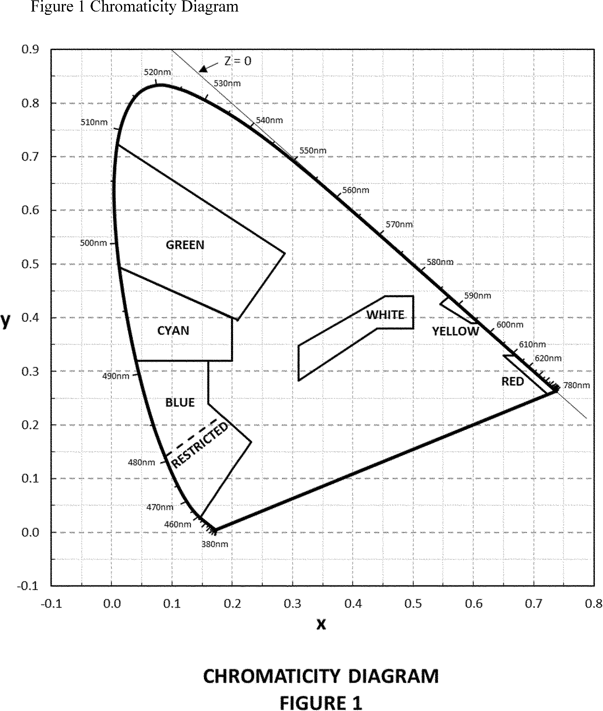

# Daily Digest — 2026-10-26

| | |
|---|---|
| **Digest date** | 2026-10-26 |
| **Data date range** | 2026-10-26 to 2026-10-26 |
| **Generated at** | 2026-10-27T04:02:34Z (UTC) |
| **Pipeline version** | 97a4218f |
| **Inference** | model layers ran — cli/haiku, opus |
| **Source watermarks** | CREC: 2026-10-23T13:53:56Z · BILLS: 2026-10-24T13:26:16Z · FR: 2026-10-26T20:55:50Z · USCOURTS: 2026-10-26T22:35:23Z · PLAW: 2026-10-22T21:14:57Z |

[Full observed listing for this day](day/2026-10-26.html) — the items our collectors observed for this publication day, mechanical rules applied, frozen at end of day; releases their publishers date on other days are counted there, not listed. This digest is the canonical record.

All items below cite the govinfo package (and granule, where applicable) they
summarize. Selection is mechanical; each item states the rule that included
it. See the Coverage Statement at the end for a full accounting of what was
published, what was summarized, and what was excluded and why.

---

## Contents

- [Day in Review](#day-in-review)
- [1. Congressional Floor Activity](#1-congressional-floor-activity)
- [2. Legislation](#2-legislation)
- [3. Federal Register](#3-federal-register)
- [4. Enacted Laws](#4-enacted-laws)
- [5. Judicial Activity](#5-judicial-activity)
- [6. Agency Announcements](#6-agency-announcements)
- [7. Recorded Votes](#7-recorded-votes)
- [8. Bill Actions](#8-bill-actions)
- [9. Presidential Actions](#9-presidential-actions)
- [Terms Used Today](#terms-used-today)
- [Coverage Statement](#coverage-statement)
- [Methodology](#methodology)

---

## Day in Review

The digest carries eight final rules, five proposed rules and 86 notices from the Federal Register. No congressional floor actions or presidential documents appear. Among the proposed rules, the Treasury Department would implement Subtitle C of the Comprehensive Outbound Investment National Security Act. The proposal would require United States persons to notify the department of certain transactions involving foreign persons. NHTSA proposes amendments to FMVSS No. 108, which covers lamps and reflective devices, to accommodate ADS-equipped vehicles. The Federal Communications Commission published a further notice of proposed rulemaking on space modernization and a request for comment on its robocall consent-revocation rules. A petition for reconsideration filed by Harold Feld on behalf of Public Knowledge and others in a Commission proceeding also appears.

Among the final rules, the FCC modified its rules on consumers revoking consent to robocalls. It also exempted certain public, educational and governmental access channel programmers from captioning registration and certification. The NRC amended its regulations so commercial licensing reviews can draw on prior Department of Energy or Department of War authorizations of demonstration reactors. The Office of Surface Mining Reclamation and Enforcement approved amendments to the Ohio and Wyoming regulatory programs. NMFS reallocated Pacific cod in the Bering Sea and Aleutian Islands. The FAA established Class E airspace at Graham Hospital Heliport in Canton, Illinois. A department also issued a correcting amendment to its regulations on employee testimony and document production. The digest also carries 173 agency press releases, one advisory and 18 district court opinions.

*Composed from the summarized items below and the day's mechanical
counts; all specifics are cited in their sections.*

---

## 1. Congressional Floor Activity

No Congressional Record issue was observed on this day. The Record for a day's proceedings is typically published by govinfo the following morning; it appears in the digest for the day it is observed ([how our clocks work](faq.html#fapds-three-clocks)).

### 1.1 Senate

No Senate floor items met the selection thresholds. 0 floor granule(s) are accounted for in the Coverage Statement.

### 1.2 House of Representatives

No House floor items met the selection thresholds. 0 floor granule(s) are accounted for in the Coverage Statement.

### 1.3 Recorded Votes

No recorded votes were published in this issue of the Congressional Record.

---

## 2. Legislation

Source: Congressional Bills (BILLS), text versions published 2026-10-26 to 2026-10-26.

### 2.1 Counts by Stage

| Stage (bill text version) | Count |
|---|---|
| Introduced (ih/is) | 0 |
| Reported (rh/rs) | 0 |
| Engrossed (eh/es) | 0 |
| Enrolled (enr) | 0 |
| Other versions | 0 |
| **Total bill texts published** | **0** |

### 2.2 Bills Listed by Mechanical Rule

Bills below are listed because they matched at least one listing rule; the
matching rule is stated per item. All other bill texts are counted above and
accounted for in the Coverage Statement.

No bill texts published in this range matched a listing rule; all 0 are
accounted for in the Coverage Statement.

---

## 3. Federal Register

Source: Federal Register (FR), issue of 2026-10-26.

### 3.1 Counts by Document Type

| Document type | Count |
|---|---|
| Rules | 8 |
| Proposed rules | 5 |
| Notices | 86 |
| Presidential documents | 0 |
| **Total FR documents** | **99** |

### 3.2 Rules Published

Tags: department of commerce · executive · securities and exchange commission · model keys: fisheries allocation · nuclear reactor designs · robocall consent

*In plain terms: Eight rules, led by an FCC change letting consumers revoke robocall consent and an NRC move to reuse prior reactor authorizations; others cover Alaska cod, Ohio and Wyoming mining, and airspace.*

#### DEPARTMENT OF COMMERCE

- **Streamlining the Regulations Governing Testimony by Employees and the Production of Documents in Legal Proceedings; Correction** (2026-21764; 15 CFR Part 15) — By this action, the Department makes a correcting amendment to its regulations governing testimony by its current and former employees and the production of its documents in legal proceedings. The Department previously amended those regulations via final rule by removing and/or replacing language that is redundant, that references other authorities, or that provides only unnecessary elaboration. One of the amendatory instructions set forth in that rule, however, indicated that certain introductory text and a certain subparagraph were being amended when, in fact, no such amendments were made to those portions. This action merely corrects that inaccurate amendatory instruction and does not make any further changes to the regulations. Action: Final rule; correcting amendment. Dates: The rule is effective October 26, 2026.
  - *In plain terms:* The Department is correcting an error in prior regulations about employee testimony and document production in legal proceedings.
  - Included because: FR-SEL-01 — document type: final rule (all listed)
  - Source: [FR-2026-10-26 / 2026-21764](https://www.govinfo.gov/app/details/FR-2026-10-26/2026-21764)
- **Fisheries of the Exclusive Economic Zone Off Alaska; Reallocation of Pacific Cod in the Bering Sea and Aleutian Islands Management Area** (2026-21805; 50 CFR Part 679) — NMFS is reallocating the projected unused amounts of Pacific cod from catcher vessels using trawl gear to catcher vessels less than 60 feet (18.3 meters (m)) length overall (LOA) using hook-and-line or pot gear and American Fisheries Act (AFA) trawl catcher/processors in the Bering Sea and Aleutian Islands management area (BSAI). This action is necessary to allow the 2026 total allowable catch (TAC) of Pacific cod in the BSAI to be harvested. Action: Temporary rule; reallocation. Dates: Effective 1200 hours, Alaska local time (A.l.t.), October 26, 2026, through 2400 hours, A.l.t., December 31, 2026.
  - *In plain terms:* NMFS is reallocating unused Pacific cod from certain trawl vessels to smaller vessels and AFA trawl processors in the Bering Sea and Aleutian Islands.
  - Included because: FR-SEL-01 — document type: final rule (all listed)
  - Source: [FR-2026-10-26 / 2026-21805](https://www.govinfo.gov/app/details/FR-2026-10-26/2026-21805)

#### DEPARTMENT OF THE INTERIOR

- **Ohio Regulatory Program** (2026-21807; 30 CFR Part 935) — The Office of Surface Mining Reclamation and Enforcement (OSM) is approving an amendment to the Ohio regulatory program (Ohio program) under the Surface Mining Control and Reclamation Act of 1977 (SMCRA or the Act). OSM is approving Ohio's proposal to add, rescind, or modify 39 rules under the Ohio Administrative Code that relate to, among other things: permit applications, hydrologic map and cross-sections, general map requirements, requirements for permits for special categories of mining, underground mining permit application, small operator assistance program, and self-bonding. Action: Final rule; approving. Dates: The effective date is November 25, 2026.
  - *In plain terms:* OSM is approving Ohio's changes to 39 mining rules covering permit applications, maps, special mining categories, underground mining, and bonding requirements.
  - Included because: FR-SEL-01 — document type: final rule (all listed)
  - Source: [FR-2026-10-26 / 2026-21807](https://www.govinfo.gov/app/details/FR-2026-10-26/2026-21807)
- **Wyoming Regulatory Program** (2026-21835; 30 CFR Part 950) — The Office of Surface Mining Reclamation and Enforcement (OSM), are approving an amendment to the Wyoming regulatory program (Wyoming program) under the Surface Mining Control and Reclamation Act of 1977 (SMCRA or the Act). The Wyoming Land Quality Division (WLQD) submitted this proposed amendment in response to our January 19, 2024 partial approval of an amendment to WLQD's regulations for coal exploration by drilling (SATS No. WY-050-FOR; Docket ID No. OSM-2021-0004). In the final rule, under the heading “Revisions to Wyoming's Rules That We Are Not Approving,” OSM listed several provisions containing typographical errors that WLQD would need to correct through future rulemaking. WLQD now proposes those corrections with this amendment (SATS No. WY-055-FOR; Docket ID No. OSM-2025-0002). Action: Final rule; approving. Dates: The effective date is November 25, 2026.
  - *In plain terms:* OSM is approving corrections to Wyoming's coal exploration drilling rules to fix typographical errors from a prior regulation.
  - Included because: FR-SEL-01 — document type: final rule (all listed)
  - Source: [FR-2026-10-26 / 2026-21835](https://www.govinfo.gov/app/details/FR-2026-10-26/2026-21835)

#### DEPARTMENT OF TRANSPORTATION

- **Establishment of Class E Airspace; Canton, IL** (2026-21817; 14 CFR Part 71) — This action establishes Class E airspace at Graham Hospital Heliport, Canton, IL. This action supports new instrument procedures and instrument flight rule (IFR) operations. Action: Final rule. Dates: Effective 0901 UTC, February 18, 2027. The Director of the Federal Register approves this incorporation by reference action under 1 CFR part 51, subject to the annual revision of FAA Order JO 7400.11 and publication of conforming amendments.
  - *In plain terms:* This action establishes Class E airspace at Graham Hospital Heliport in Canton, Illinois to support new instrument flight procedures.
  - Included because: FR-SEL-01 — document type: final rule (all listed)
  - Source: [FR-2026-10-26 / 2026-21817](https://www.govinfo.gov/app/details/FR-2026-10-26/2026-21817)

#### FEDERAL COMMUNICATIONS COMMISSION

- **Closed Captioning of Video Programming** (2026-21808; 47 CFR Part 79) — In this document, the Federal Communications Commission (Commission) exempts video programmers for public, educational, and governmental access (PEG) channels from the requirement to register with the Commission and to certify captioning compliance if the PEG video programmers provide video programming exclusively to PEG channels that are exempt from closed captioning requirements. Additionally, providers of PEG programming are relieved of filing obligations if the administrators of non-exempt PEG channels certify compliance for programming carried on such channels. The Commission similarly exempts providers of programming carried on nonbroadcast networks for distribution by a cable operator or other multichannel video programming distributor (MVPD) from certifying when the nonbroadcast network itself certifies that it is exempt or that all programming comprising the network's linear line-up is either exempt from or compliant with the closed captioning rules. Action: Final rule. Dates: Effective November 25, 2026, except for amendatory instruction 3 (47 CFR 79.1(i)(4) and (m)(6)), which is delayed indefinitely. The Commission will publish a document in the Federal Register announcing the effective date.
  - *In plain terms:* The FCC is exempting certain public, educational, and governmental video programmers from registration and captioning compliance requirements under specific conditions.
  - Included because: FR-SEL-01 — document type: final rule (all listed)
  - Source: [FR-2026-10-26 / 2026-21808](https://www.govinfo.gov/app/details/FR-2026-10-26/2026-21808)
- **Enhancing the Ability of Consumers To Control the Robocalls** (2026-21821; 47 CFR Part 64) — In this document, the Federal Communications Commission (Commission) modifies rules to ensure that consumers can revoke consent for robocalls they no longer wish to receive while continuing to receive those they still want. We also modernize our rules to ensure that consumers have clear, simple, and automated ways to revoke consent while streamlining callers' ability to process revocations. Specifically, we allow callers to interpret a revocation request as applying only to the specific category of informational robocalls to which the revocation was directed, allow callers to designate an exclusive means to revoke consent, and amend the exemption from the consent requirement for financial institutions to allow them to more easily alert customers to fraudulent activity on their account. In addition, we delegate authority to the Consumer and Governmental Affairs Bureau (CGB) in consultation with the Enforcement Bureau (EB) to review our robocall rules to ensure that those rules are clear and easy to read. Action: Final rule. Dates: Effective November 25, 2026.
  - *In plain terms:* The FCC is modifying robocall rules to let consumers revoke specific categories of calls and providing simpler, automated revocation methods.
  - Included because: FR-SEL-01 — document type: final rule (all listed)
  - Source: [FR-2026-10-26 / 2026-21821](https://www.govinfo.gov/app/details/FR-2026-10-26/2026-21821)

#### NUCLEAR REGULATORY COMMISSION

- **NRC Reviews of Reactor Designs Previously Authorized by U.S. Department of Energy or Department of War** (2026-21801; 10 CFR Parts 50 and 53) — The U.S. Nuclear Regulatory Commission (NRC) is amending its regulations to facilitate direct leveraging of prior U.S. Department of Energy or Department of War authorizations of demonstration reactors into the NRC's licensing reviews of commercial reactor facility applications that reference those designs. This rulemaking improves NRC licensing review efficiency, where applicable, by explicitly establishing by regulation an additional means for reactor applicants to demonstrate the safety functions of their reactor designs, thereby contributing to the safe and secure use and deployment of civilian nuclear energy technologies. Action: Final rule. Dates: This final rule is effective on November 25, 2026.
  - *In plain terms:* The NRC is amending regulations to allow prior Department of Energy or War approvals of reactor designs to help streamline commercial reactor licensing reviews.
  - Included because: FR-SEL-01 — document type: final rule (all listed)
  - Source: [FR-2026-10-26 / 2026-21801](https://www.govinfo.gov/app/details/FR-2026-10-26/2026-21801)

### 3.3 Proposed Rules Published

Tags: department of commerce · executive · securities and exchange commission · model keys: outbound investment · robocall rules · vehicle lighting standards

*In plain terms: Five items, led by proposed outbound investment rules and an NHTSA update to FMVSS No. 108 lighting standards; the rest are FCC space and robocall filings and one reconsideration petition.*

#### DEPARTMENT OF THE TREASURY

- **Outbound Investment Security Program Regulations** (2026-21786; 31 CFR Parts 850 and 851) — This proposed rule sets forth regulations that would implement Subtitle C of the Comprehensive Outbound Investment National Security Act, which is codified at Title VIII of the Defense Production Act. The proposed rule would require United States persons to provide notification to the U.S. Department of the Treasury regarding certain transactions involving foreign persons that are engaged in notifiable technologies; and prohibit United States persons from engaging in certain other transactions involving foreign persons that are engaged in prohibited technologies. Where consistent with Title VIII, the proposed rule incorporates certain definitions and concepts from the current regulations governing the Outbound Investment Security Program. The proposed rule also would add applicability dates to the regulations, such that those regulations would continue to apply to activities that occurred within the relevant timeframe. Action: Proposed rule. Dates: Written comments must be received by December 7, 2026.
  - *In plain terms:* Proposed rule would require U.S. persons to notify Treasury about transactions with foreign entities in notifiable technologies and prohibit certain transactions in prohibited technologies.
  - Included because: FR-SEL-02 — document type: proposed rule (all listed)
  - Source: [FR-2026-10-26 / 2026-21786](https://www.govinfo.gov/app/details/FR-2026-10-26/2026-21786)

#### DEPARTMENT OF TRANSPORTATION

- **Federal Motor Vehicle Safety Standards; Modernization of FMVSS No. 108 To Accommodate ADS-Equipped Vehicles** (2026-21794; 49 CFR Part 571) — NHTSA is proposing to amend Federal Motor Vehicle Safety Standard (FMVSS) No. 108, “Lamps, reflective devices, and associated equipment.” The proposed updates to the standard are intended to remove unnecessary requirements and to provide design flexibility without impact on vehicle safety. The first two proposed changes would amend the test voltage specification for integral beam type headlamps and remove requirements that apply to vertical headlamp arrangements. Further proposed changes address vehicles equipped with Automated Driving Systems (ADS) that do not have manually operated driving controls. Those modifications would limit the application of certain requirements for manually operated turn signal, hazard warning signal, and beam switching controls to vehicles with manually operated driving controls. The changes are intended to address regulatory burdens and costs associated with equipment that does not fulfill the same purpose or provide safety benefits in an ADS-equipped vehicle without manually operated driving controls as in a vehicle with such controls. [official summary truncated; see source] Action: Notice of proposed rulemaking. Dates: Comments should be submitted no later than November 25, 2026.
  - *In plain terms:* NHTSA proposes updating headlamp safety standards to remove unnecessary requirements and allow design flexibility for automated vehicles without manual driving controls.
  - Included because: FR-SEL-02 — document type: proposed rule (all listed)
  - Source: [FR-2026-10-26 / 2026-21794](https://www.govinfo.gov/app/details/FR-2026-10-26/2026-21794)
  -  *Source graphic 1 of 1 from 2026-21794.*

#### FEDERAL COMMUNICATIONS COMMISSION

- **Petition for Reconsideration of Action in Rulemaking Proceeding** (2026-21810; 47 CFR Part 1) — Petition for Reconsideration (Petition) has been filed in the Commission's proceeding by Harold Feld on behalf of Public Knowledge and others. Action: Petition for reconsideration. Dates: Oppositions to the Petition must be filed on or before November 10, 2026. Replies to oppositions to the Petition must be filed on or before November 20, 2026.
  - *In plain terms:* Harold Feld on behalf of Public Knowledge and others has filed a petition for reconsideration in an FCC rulemaking proceeding.
  - Included because: FR-SEL-02 — document type: proposed rule (all listed)
  - Source: [FR-2026-10-26 / 2026-21810](https://www.govinfo.gov/app/details/FR-2026-10-26/2026-21810)
- **Space Modernization for the 21st Century** (2026-21818; 47 CFR Parts 5 and 100) — In this document, the Federal Communications Commission (Commission or we) adopts a Further Notice of Proposed Rulemaking ( FNPRM ) that seeks comment on and/or proposes additional reforms. Action: Proposed rule. Dates: Comments are due November 25, 2026. Reply Comments are due December 28, 2026.
  - *In plain terms:* The FCC has issued a further notice of proposed rulemaking seeking public comment on additional reforms for space modernization.
  - Included because: FR-SEL-02 — document type: proposed rule (all listed)
  - Source: [FR-2026-10-26 / 2026-21818](https://www.govinfo.gov/app/details/FR-2026-10-26/2026-21818)
- **Modernizing the Ability of Consumers To Control Robocalls** (2026-21820; 47 CFR Part 64) — In this document, the Commission seeks comment on measures to ensure that the Telephone Consumer Protection Act (TCPA) rules that govern robocalls continue to evolve with changes in technology and industry practices. Specifically, we seek comment on reducing the timeframe callers must honor revocation requests, requirements for two-way texting functionality, requiring a revoke all method, and the treatment of affiliates. Action: Proposed rule. Dates: Comments are due on or before November 25, 2026, and reply comments are due on or before December 28, 2026.
  - *In plain terms:* The FCC seeks comment on updating robocall rules including reducing revocation timeframes, requiring two-way texting, and adding a revoke-all option.
  - Included because: FR-SEL-02 — document type: proposed rule (all listed)
  - Source: [FR-2026-10-26 / 2026-21820](https://www.govinfo.gov/app/details/FR-2026-10-26/2026-21820)

### 3.4 Notices and Presidential Documents

Notices are summarized only when they match a listing rule; all are counted
in 3.1 and in the Coverage Statement. Presidential documents in the FR are
always listed.

No notices or presidential documents matched a listing rule.

---

## 4. Enacted Laws

Source: Public and Private Laws (PLAW) published 2026-10-26.

No laws were published in this range.

---

## 5. Judicial Activity

Source: United States Courts Opinions (USCOURTS): opinions observed 2026-10-26
by our collector; each opinion states its own issue date beside its
listing ([how our clocks work](faq.html#fapds-three-clocks)).

Completeness disclosure (standing): USCOURTS carries opinions from
approximately 140 participating appellate, district, bankruptcy, and
national federal courts. Unlike the Congressional Record and the Federal
Register, which are the complete official record of their branches,
USCOURTS is participation-based and is NOT the complete federal judicial
record. Courts post opinions with delay — typically over several days —
so a day's digest carries the opinions that became available that day,
whatever date each was issued.

### 5.1 Appellate and National Court Opinions

Appellate and national court opinions are summarized; district and
bankruptcy opinions are counted in 5.2 and in the Coverage Statement.

No appellate or national court opinions matched a listing rule for this
date; all opinions are counted in 5.2 and accounted for in the Coverage
Statement.

### 5.2 Counts by Court Category

| Court category | Opinions |
|---|---|
| Appellate | 0 |
| District | 18 |
| Bankruptcy | 0 |
| National | 0 |
| **Total opinions extracted** | **18** |

Archive-window disclosure (rule USCOURTS-FETCH-01): 34870 USCOURTS package(s) have been listed in delta syncs but fell outside the 7-day archive window and were not fetched (global running count across all syncs, not limited to this date).

---

## 6. Agency Announcements

Official press releases and statements the agencies themselves date
on 2026-10-26 (sources listed in the source guide). These are the
agencies' own announcements — official advocacy, quoted and
attributed, not findings of this digest. Agency web content can be
edited or removed without notice; captures and hashes are preserved
per the provenance policy.

#### Bureau of Justice Statistics (email)

- **Just Released: Preliminary 2025 Victimization Estimates from the Redesigned National Crime Victimization Survey** — dated 2026-10-26 by the agency
  - Included because: AGENCYPR-SEL-01 — official agency release dated this day by the agency (all such releases from active sources are listed; titles only in the pilot)
  - Source: agency email bulletin to this project's subscription, captured and DKIM-verified (the bulletin named no canonical page)

#### Census Bureau (email)

- **How Many Trick-or-Treaters Are There in the United States?** — dated 2026-10-26 by the agency
  - Included because: AGENCYPR-SEL-01 — official agency release dated this day by the agency (all such releases from active sources are listed; titles only in the pilot)
  - Source: agency email bulletin to this project's subscription, captured and DKIM-verified (the bulletin named no canonical page)
- **[📅 This Week: New American Community Survey Data](https://www.census.gov/newsroom/press-kits/2026/acs-1-year-estimates.html?utm_campaign=20261026cnmp&utm_medium=email&utm_source=govdelivery)** — dated 2026-10-26 by the agency
  - Included because: AGENCYPR-SEL-01 — official agency release dated this day by the agency (all such releases from active sources are listed; titles only in the pilot)
  - Source: agency email bulletin to this project's subscription, captured and DKIM-verified

#### CFTC Press Releases

- **[CFTC and National Basketball Association Sign MOU to Protect Integrity in Professional Basketball](https://www.cftc.gov/PressRoom/PressReleases/9314-26)** — dated 2026-10-26 by the agency
  - Included because: AGENCYPR-SEL-01 — official agency release dated this day by the agency (all such releases from active sources are listed; titles only in the pilot)

#### CISA Cybersecurity Advisories

- **[CISA Adds Two Known Exploited Vulnerability to Catalog](https://www.cisa.gov/news-events/alerts/2026/10/26/cisa-adds-two-known-exploited-vulnerability-catalog)** — dated 2026-10-26 by the agency
  - Included because: AGENCYPR-SEL-01 — official agency release dated this day by the agency (all such releases from active sources are listed; titles only in the pilot)

#### DEA Updates (email)

- **Learn the Story Behind Red Ribbon Week** — dated 2026-10-26 by the agency
  - Included because: AGENCYPR-SEL-01 — official agency release dated this day by the agency (all such releases from active sources are listed; titles only in the pilot)
  - Source: agency email bulletin to this project's subscription, captured and DKIM-verified (the bulletin named no canonical page)

#### Defense News Releases

- **[Junior ROTC Cadets Test Teamwork, Endurance at National Raider Challenge](https://www.war.gov/News/News-Stories/Article/Article/4633863/junior-rotc-cadets-test-teamwork-endurance-at-national-raider-challenge/)** — dated 2026-10-26 by the agency
  - Included because: AGENCYPR-SEL-01 — official agency release dated this day by the agency (all such releases from active sources are listed; titles only in the pilot)
- **[What's In a Name: 'War' Sends Clarifying Message to Adversaries About Departmental Mission](https://www.war.gov/News/News-Stories/Article/Article/4634063/whats-in-a-name-war-sends-clarifying-message-to-adversaries-about-departmental/)** — dated 2026-10-26 by the agency
  - Included because: AGENCYPR-SEL-01 — official agency release dated this day by the agency (all such releases from active sources are listed; titles only in the pilot)

#### DHS News Releases

- **[DHS Highlights Worst Illegal Aliens Arrested in Michigan](https://www.dhs.gov/news/2026/10/26/dhs-highlights-worst-illegal-aliens-arrested-michigan)** — dated 2026-10-26 by the agency
  - Included because: AGENCYPR-SEL-01 — official agency release dated this day by the agency (all such releases from active sources are listed; titles only in the pilot)
- **[ICE HSI Arrests Five Non-Citizens Charged with Illegally Voting in Florida](https://www.dhs.gov/news/2026/10/26/ice-hsi-arrests-five-non-citizens-charged-illegally-voting-florida)** — dated 2026-10-26 by the agency
  - Included because: AGENCYPR-SEL-01 — official agency release dated this day by the agency (all such releases from active sources are listed; titles only in the pilot)
- **[WORST OF THE WORST: Over the Weekend, ICE Arrests Murderers, Pedophiles, and Sexual Predators](https://www.dhs.gov/news/2026/10/26/worst-worst-over-weekend-ice-arrests-murderers-pedophiles-and-sexual-predators)** — dated 2026-10-26 by the agency
  - Included because: AGENCYPR-SEL-01 — official agency release dated this day by the agency (all such releases from active sources are listed; titles only in the pilot)

#### DOE Office of Indian Energy (email)

- **Save the Date | DOE Office of Indian Energy Announces 2027 Tribal Energy Forum** — dated 2026-10-26 by the agency
  - Included because: AGENCYPR-SEL-01 — official agency release dated this day by the agency (all such releases from active sources are listed; titles only in the pilot)
  - Source: agency email bulletin to this project's subscription, captured and DKIM-verified (the bulletin named no canonical page)

#### DOJ COPS Office (email)

- **Reminder: Submit Your Photo to the COPS Office 2027 Photo Contest!** — dated 2026-10-26 by the agency
  - Included because: AGENCYPR-SEL-01 — official agency release dated this day by the agency (all such releases from active sources are listed; titles only in the pilot)
  - Source: agency email bulletin to this project's subscription, captured and DKIM-verified (the bulletin named no canonical page)

#### EEOC Newsroom

- **[Nevada Logistics Company to Pay Over $396,000 to Resolve EEOC Religious Harassment Charge](https://www.eeoc.gov/newsroom/nevada-logistics-company-pay-over-396000-resolve-eeoc-religious-harassment-charge)** — dated 2026-10-26 by the agency
  - Included because: AGENCYPR-SEL-01 — official agency release dated this day by the agency (all such releases from active sources are listed; titles only in the pilot)

#### EPA News Releases (email)

- **EPA’s First Ever PFAS TECH Strategy Spurs Innovation in Research and Technology to Address PFAS** — dated 2026-10-26 by the agency
  - Included because: AGENCYPR-SEL-01 — official agency release dated this day by the agency (all such releases from active sources are listed; titles only in the pilot)
  - Source: agency email bulletin to this project's subscription, captured and DKIM-verified (the bulletin named no canonical page)

#### FAA Updates (email)

- **FAA Orders & Notices Update Notification** — dated 2026-10-26 by the agency
  - Included because: AGENCYPR-SEL-01 — official agency release dated this day by the agency (all such releases from active sources are listed; titles only in the pilot)
  - Source: agency email bulletin to this project's subscription, captured and DKIM-verified (the bulletin named no canonical page)
- **FAA Orders & Notices Update Notification** — dated 2026-10-26 by the agency
  - Included because: AGENCYPR-SEL-01 — official agency release dated this day by the agency (all such releases from active sources are listed; titles only in the pilot)
  - Source: agency email bulletin to this project's subscription, captured and DKIM-verified (the bulletin named no canonical page)

#### FDA Email Updates (email)

- **FDA MedWatch - Ultimate Forza Male Supplement by Tonight We Ride** — dated 2026-10-26 by the agency
  - Included because: AGENCYPR-SEL-01 — official agency release dated this day by the agency (all such releases from active sources are listed; titles only in the pilot)
  - Source: agency email bulletin to this project's subscription, captured and DKIM-verified (the bulletin named no canonical page)
- **[Tonight We Ride, LLC Issues Voluntary Recall of Ultimate Forza Male Supplement Due to Presence of Undeclared Sildenafil, Tadalafil, and Dapoxetine](https://www.fda.gov/safety/recalls-market-withdrawals-safety-alerts/tonight-we-ride-llc-issues-voluntary-recall-ultimate-forza-male-supplement-due-presence-undeclared?utm_medium=email&utm_source=govdelivery)** — dated 2026-10-26 by the agency
  - Included because: AGENCYPR-SEL-01 — official agency release dated this day by the agency (all such releases from active sources are listed; titles only in the pilot)
  - Source: agency email bulletin to this project's subscription, captured and DKIM-verified

#### FDIC Press Releases

- **[FDIC Announces Six Senior Leadership Appointments](https://www.fdic.gov/news/press-releases/2026/fdic-announces-six-senior-leadership-appointments)** — dated 2026-10-26 by the agency
  - Included because: AGENCYPR-SEL-01 — official agency release dated this day by the agency (all such releases from active sources are listed; titles only in the pilot)

#### FDIC Press Releases (email)

- **Press Release: FDIC Announces Six Senior Leadership Appointments** — dated 2026-10-26 by the agency
  - Included because: AGENCYPR-SEL-01 — official agency release dated this day by the agency (all such releases from active sources are listed; titles only in the pilot)
  - Source: agency email bulletin to this project's subscription, captured and DKIM-verified (the bulletin named no canonical page)

#### FEMA Press Releases

- **[In-Person FEMA Earthquake Help on Hawaiʻi Island Ends Nov. 1, the Same Day as the Application Deadline](https://www.fema.gov/press-release/20261026/person-fema-earthquake-help-hawaii-island-ends-nov-1-same-day-application)** — dated 2026-10-26 by the agency
  - Included because: AGENCYPR-SEL-01 — official agency release dated this day by the agency (all such releases from active sources are listed; titles only in the pilot)

#### FTC Press Releases

- **[FTC and State Partners Sue Dollar General for Charging Consumers More than Advertised for Many Products](https://www.ftc.gov/news-events/news/press-releases/2026/10/ftc-state-partners-sue-dollar-general-charging-consumers-more-advertised-many-products)** — dated 2026-10-26 by the agency
  - Included because: AGENCYPR-SEL-01 — official agency release dated this day by the agency (all such releases from active sources are listed; titles only in the pilot)

#### HHS Office on Women's Health (email)

- **[Thank You for Observing National Women’s Blood Pressure Awareness Week 2026](https://womenshealth.gov/nwbpaw?utm_medium=email&utm_source=govdelivery)** — dated 2026-10-26 by the agency
  - Included because: AGENCYPR-SEL-01 — official agency release dated this day by the agency (all such releases from active sources are listed; titles only in the pilot)
  - Source: agency email bulletin to this project's subscription, captured and DKIM-verified

#### ICE Newsroom

- **[ICE HSI Indianapolis makes significant contributions to massive COVID-era loan fraud crackdown](https://www.ice.gov/news/releases/ice-hsi-indianapolis-makes-significant-contributions-massive-covid-era-loan-fraud)** — dated 2026-10-26 by the agency
  - Included because: AGENCYPR-SEL-01 — official agency release dated this day by the agency (all such releases from active sources are listed; titles only in the pilot)
- **[ICE arrests violent criminal illegal alien with history of battery and assault and obstruction of police, driving under the influence, and cruelty towards wife](https://www.ice.gov/news/releases/ice-arrests-violent-criminal-illegal-alien-history-battery-and-assault-and)** — dated 2026-10-26 by the agency
  - Included because: AGENCYPR-SEL-01 — official agency release dated this day by the agency (all such releases from active sources are listed; titles only in the pilot)
- **[ICE removes accused violent fugitive to face homicide charges in native Guyana](https://www.ice.gov/news/releases/ice-removes-accused-violent-fugitive-face-homicide-charges-native-guyana)** — dated 2026-10-26 by the agency
  - Included because: AGENCYPR-SEL-01 — official agency release dated this day by the agency (all such releases from active sources are listed; titles only in the pilot)
- **[Illegal alien vandalizes Iwo Jima Memorial in Quantico with sledgehammer](https://www.ice.gov/news/releases/illegal-alien-vandalizes-iwo-jima-memorial-quantico-sledgehammer)** — dated 2026-10-26 by the agency
  - Included because: AGENCYPR-SEL-01 — official agency release dated this day by the agency (all such releases from active sources are listed; titles only in the pilot)
- **[Mark Zito named special agent in charge of ICE Homeland Security Investigations Carolinas](https://www.ice.gov/news/releases/mark-zito-named-special-agent-charge-ice-homeland-security-investigations-carolinas)** — dated 2026-10-26 by the agency
  - Included because: AGENCYPR-SEL-01 — official agency release dated this day by the agency (all such releases from active sources are listed; titles only in the pilot)
- **[Netherlands citizen arrested for illegally voting in 2024 election](https://www.ice.gov/news/releases/netherlands-citizen-arrested-illegally-voting-2024-election)** — dated 2026-10-26 by the agency
  - Included because: AGENCYPR-SEL-01 — official agency release dated this day by the agency (all such releases from active sources are listed; titles only in the pilot)

#### Justice Department News (email)

- **[Assistant United States Attorney](https://www.justice.gov/legal-careers/job/assistant-united-states-attorney-719)** — dated 2026-10-26 by the agency
  - Included because: AGENCYPR-SEL-01 — official agency release dated this day by the agency (all such releases from active sources are listed; titles only in the pilot)
  - Source: agency email bulletin to this project's subscription, captured and DKIM-verified
- **[Assistant United States Attorney](https://www.justice.gov/legal-careers/job/assistant-united-states-attorney-717)** — dated 2026-10-26 by the agency
  - Included because: AGENCYPR-SEL-01 — official agency release dated this day by the agency (all such releases from active sources are listed; titles only in the pilot)
  - Source: agency email bulletin to this project's subscription, captured and DKIM-verified
- **EOIR BIA Decision - Oct. 26, 2026** — dated 2026-10-26 by the agency
  - Included because: AGENCYPR-SEL-01 — official agency release dated this day by the agency (all such releases from active sources are listed; titles only in the pilot)
  - Source: agency email bulletin to this project's subscription, captured and DKIM-verified (the bulletin named no canonical page)
- **OIG Ongoing Work Update** — dated 2026-10-26 by the agency
  - Included because: AGENCYPR-SEL-01 — official agency release dated this day by the agency (all such releases from active sources are listed; titles only in the pilot)
  - Source: agency email bulletin to this project's subscription, captured and DKIM-verified (the bulletin named no canonical page)

#### Justice Press Releases

- **[Construction Company Owner and Employees Indicted for Wide-Ranging Tax and Financial Fraud Schemes](https://www.justice.gov/opa/pr/construction-company-owner-and-employees-indicted-wide-ranging-tax-and-financial-fraud-0)** — dated 2026-10-26 by the agency
  - Included because: AGENCYPR-SEL-01 — official agency release dated this day by the agency (all such releases from active sources are listed; titles only in the pilot)
  - Corroborated: the same release (same canonical URL) also arrived via the agency's email bulletin to this project's subscription, DKIM-verified — one document received through two ingestion channels; listed once, both captures preserved.
- **[Beckley Man Pleads Guilty to Federal Drug and Gun Crimes](https://www.justice.gov/usao-sdwv/pr/beckley-man-pleads-guilty-federal-drug-and-gun-crimes-0)** — dated 2026-10-26 by the agency
  - Included because: AGENCYPR-SEL-01 — official agency release dated this day by the agency (all such releases from active sources are listed; titles only in the pilot)
- **[Boston Man Sentenced to Prison for Failure to File Export Information](https://www.justice.gov/usao-ma/pr/boston-man-sentenced-prison-failure-file-export-information)** — dated 2026-10-26 by the agency
  - Included because: AGENCYPR-SEL-01 — official agency release dated this day by the agency (all such releases from active sources are listed; titles only in the pilot)
- **[Bradenton Man Sentenced to Over Ten Years in Federal Prison for Distributing Methamphetamine](https://www.justice.gov/usao-mdfl/pr/bradenton-man-sentenced-over-ten-years-federal-prison-distributing-methamphetamine)** — dated 2026-10-26 by the agency
  - Included because: AGENCYPR-SEL-01 — official agency release dated this day by the agency (all such releases from active sources are listed; titles only in the pilot)
- **[Canton Man Found Guilty of Child Exploitation Offense and Receipt of Child Pornography](https://www.justice.gov/usao-ndny/pr/canton-man-found-guilty-child-exploitation-offense-and-receipt-child-pornography)** — dated 2026-10-26 by the agency
  - Included because: AGENCYPR-SEL-01 — official agency release dated this day by the agency (all such releases from active sources are listed; titles only in the pilot)
  - Corroborated: the same release (same canonical URL) also arrived via the agency's email bulletin to this project's subscription, DKIM-verified — one document received through two ingestion channels; listed once, both captures preserved.
- **[Convicted Sex Offender Sentenced to 30 Years in Prison for Coercion and Enticement of a Minor and Receipt of Child Pornography](https://www.justice.gov/usao-edny/pr/convicted-sex-offender-sentenced-30-years-prison-coercion-and-enticement-minor-and)** — dated 2026-10-26 by the agency
  - Included because: AGENCYPR-SEL-01 — official agency release dated this day by the agency (all such releases from active sources are listed; titles only in the pilot)
- **[DC Man Pleads Guilty to Escaping from Baltimore Correctional Facility](https://www.justice.gov/usao-md/pr/dc-man-pleads-guilty-escaping-baltimore-correctional-facility)** — dated 2026-10-26 by the agency
  - Included because: AGENCYPR-SEL-01 — official agency release dated this day by the agency (all such releases from active sources are listed; titles only in the pilot)
- **[Fayetteville Drug Dealer Sentenced to 17 Years in Federal Prison](https://www.justice.gov/usao-ednc/pr/fayetteville-drug-dealer-sentenced-17-years-federal-prison)** — dated 2026-10-26 by the agency
  - Included because: AGENCYPR-SEL-01 — official agency release dated this day by the agency (all such releases from active sources are listed; titles only in the pilot)
  - Corroborated: the same release (same canonical URL) also arrived via the agency's email bulletin to this project's subscription, DKIM-verified — one document received through two ingestion channels; listed once, both captures preserved.
- **[Federal Jury Convicts Child Sex Trafficker on All Charges](https://www.justice.gov/usao-sdin/pr/federal-jury-convicts-child-sex-trafficker-all-charges)** — dated 2026-10-26 by the agency
  - Included because: AGENCYPR-SEL-01 — official agency release dated this day by the agency (all such releases from active sources are listed; titles only in the pilot)
- **[Federal agents arrest former CEO of child & adolescent residential treatment center on federal child pornography, coercion charges](https://www.justice.gov/usao-sdoh/pr/federal-agents-arrest-former-ceo-child-adolescent-residential-treatment-center-federal)** — dated 2026-10-26 by the agency
  - Included because: AGENCYPR-SEL-01 — official agency release dated this day by the agency (all such releases from active sources are listed; titles only in the pilot)
- **[Federal grand jury indicts North Texas woman in $680,000 COVID fraud and money laundering scheme](https://www.justice.gov/usao-ndtx/pr/federal-grand-jury-indicts-north-texas-woman-680000-covid-fraud-and-money-laundering)** — dated 2026-10-26 by the agency
  - Included because: AGENCYPR-SEL-01 — official agency release dated this day by the agency (all such releases from active sources are listed; titles only in the pilot)
  - Corroborated: the same release (same canonical URL) also arrived via the agency's email bulletin to this project's subscription, DKIM-verified — one document received through two ingestion channels; listed once, both captures preserved.
- **[Florida CPA Sentenced for Tax Evasion](https://www.justice.gov/opa/pr/florida-cpa-sentenced-tax-evasion)** — dated 2026-10-26 by the agency
  - Included because: AGENCYPR-SEL-01 — official agency release dated this day by the agency (all such releases from active sources are listed; titles only in the pilot)
- **[Florida Woman Pleads Guilty to Identity Theft and Money Laundering in $9.1 Million Nail Tech Licensing Scheme](https://www.justice.gov/usao-sdwv/pr/florida-woman-pleads-guilty-identity-theft-and-money-laundering-91-million-nail-tech)** — dated 2026-10-26 by the agency
  - Included because: AGENCYPR-SEL-01 — official agency release dated this day by the agency (all such releases from active sources are listed; titles only in the pilot)
  - Corroborated: the same release (same canonical URL) also arrived via the agency's email bulletin to this project's subscription, DKIM-verified — one document received through two ingestion channels; listed once, both captures preserved.
- **[Former Assistant Superintendent of Norfolk County Sheriff's Office Sentenced to Prison for Ordering Employees to Perform Maintenance at His Home, As Well As Witness Tampering](https://www.justice.gov/usao-ma/pr/former-assistant-superintendent-norfolk-county-sheriffs-office-sentenced-prison-ordering)** — dated 2026-10-26 by the agency
  - Included because: AGENCYPR-SEL-01 — official agency release dated this day by the agency (all such releases from active sources are listed; titles only in the pilot)
- **[Fort Walton Beach Man Pleads Guilty to Federal Drug Trafficking & Firearm Offenses](https://www.justice.gov/usao-ndfl/pr/fort-walton-beach-man-pleads-guilty-federal-drug-trafficking-firearm-offenses)** — dated 2026-10-26 by the agency
  - Included because: AGENCYPR-SEL-01 — official agency release dated this day by the agency (all such releases from active sources are listed; titles only in the pilot)
- **[Fugitive Charged in Fraud Scheme Apprehended at Logan Airport and Ordered Detained in Federal Court](https://www.justice.gov/usao-ri/pr/fugitive-charged-fraud-scheme-apprehended-logan-airport-and-ordered-detained-federal)** — dated 2026-10-26 by the agency
  - Included because: AGENCYPR-SEL-01 — official agency release dated this day by the agency (all such releases from active sources are listed; titles only in the pilot)
- **[Fugitive Fraudster Herb Kimble Sentenced to 20 Years for International Healthcare Fraud Scheme](https://www.justice.gov/usao-sc/pr/fugitive-fraudster-herb-kimble-sentenced-20-years-international-healthcare-fraud-scheme)** — dated 2026-10-26 by the agency
  - Included because: AGENCYPR-SEL-01 — official agency release dated this day by the agency (all such releases from active sources are listed; titles only in the pilot)
- **[High-Ranking Cypress Gangsta Crips Member Convicted of Murder](https://www.justice.gov/usao-edny/pr/high-ranking-cypress-gangsta-crips-member-convicted-murder)** — dated 2026-10-26 by the agency
  - Included because: AGENCYPR-SEL-01 — official agency release dated this day by the agency (all such releases from active sources are listed; titles only in the pilot)
  - Corroborated: the same release (same canonical URL) also arrived via the agency's email bulletin to this project's subscription, DKIM-verified — one document received through two ingestion channels; listed once, both captures preserved.
- **[Homeland Security Task Force Investigation in El Paso Charges 13 for Allegedly Transporting Stolen Vehicles from U.S. to Cartels in Mexico](https://www.justice.gov/usao-wdtx/pr/homeland-security-task-force-investigation-el-paso-charges-13-allegedly-transporting)** — dated 2026-10-26 by the agency
  - Included because: AGENCYPR-SEL-01 — official agency release dated this day by the agency (all such releases from active sources are listed; titles only in the pilot)
- **[Honduran National Indicted For Reentry of a Removed Alien](https://www.justice.gov/usao-edla/pr/honduran-national-indicted-reentry-removed-alien)** — dated 2026-10-26 by the agency
  - Included because: AGENCYPR-SEL-01 — official agency release dated this day by the agency (all such releases from active sources are listed; titles only in the pilot)
- **[Houston man sentenced for selling kilograms of meth and firearms](https://www.justice.gov/usao-sdtx/pr/houston-man-sentenced-selling-kilograms-meth-and-firearms)** — dated 2026-10-26 by the agency
  - Included because: AGENCYPR-SEL-01 — official agency release dated this day by the agency (all such releases from active sources are listed; titles only in the pilot)
  - Corroborated: the same release (same canonical URL) also arrived via the agency's email bulletin to this project's subscription, DKIM-verified — one document received through two ingestion channels; listed once, both captures preserved.
- **[Huntington Man Sentenced to Prison for Federal Drug Crime](https://www.justice.gov/usao-sdwv/pr/huntington-man-sentenced-prison-federal-drug-crime-28)** — dated 2026-10-26 by the agency
  - Included because: AGENCYPR-SEL-01 — official agency release dated this day by the agency (all such releases from active sources are listed; titles only in the pilot)
  - Corroborated: the same release (same canonical URL) also arrived via the agency's email bulletin to this project's subscription, DKIM-verified — one document received through two ingestion channels; listed once, both captures preserved.
- **[Illegal Immigrant from Mexico Pleads Guilty to Staging Fake Kidnapping Last Year Purportedly Committed by Federal Agents](https://www.justice.gov/usao-cdca/pr/illegal-immigrant-mexico-pleads-guilty-staging-fake-kidnapping-last-year-purportedly)** — dated 2026-10-26 by the agency
  - Included because: AGENCYPR-SEL-01 — official agency release dated this day by the agency (all such releases from active sources are listed; titles only in the pilot)
  - Corroborated: the same release (same canonical URL) also arrived via the agency's email bulletin to this project's subscription, DKIM-verified — one document received through two ingestion channels; listed once, both captures preserved.
- **[Jeffersonville Man Gets Decades in Federal Prison for Online Child Exploitation](https://www.justice.gov/usao-sdin/pr/jeffersonville-man-gets-decades-federal-prison-online-child-exploitation)** — dated 2026-10-26 by the agency
  - Included because: AGENCYPR-SEL-01 — official agency release dated this day by the agency (all such releases from active sources are listed; titles only in the pilot)
  - Corroborated: the same release (same canonical URL) also arrived via the agency's email bulletin to this project's subscription, DKIM-verified — one document received through two ingestion channels; listed once, both captures preserved.
- **[Justice Department Announces Charges Involving 48 Aliens for Election-Related Crimes](https://www.justice.gov/opa/pr/justice-department-announces-charges-involving-48-aliens-election-related-crimes)** — dated 2026-10-26 by the agency
  - Included because: AGENCYPR-SEL-01 — official agency release dated this day by the agency (all such releases from active sources are listed; titles only in the pilot)
- **[Lynn Man Convicted of Attempted Witness Tampering](https://www.justice.gov/usao-ma/pr/lynn-man-convicted-attempted-witness-tampering)** — dated 2026-10-26 by the agency
  - Included because: AGENCYPR-SEL-01 — official agency release dated this day by the agency (all such releases from active sources are listed; titles only in the pilot)
- **[Man Sentenced to Federal Prison for Over Five Years for Possessing a Gun While Subject to a Domestic Violence Order of Protection](https://www.justice.gov/usao-ndia/pr/man-sentenced-federal-prison-over-five-years-possessing-gun-while-subject-domestic)** — dated 2026-10-26 by the agency
  - Included because: AGENCYPR-SEL-01 — official agency release dated this day by the agency (all such releases from active sources are listed; titles only in the pilot)
  - Corroborated: the same release (same canonical URL) also arrived via the agency's email bulletin to this project's subscription, DKIM-verified — one document received through two ingestion channels; listed once, both captures preserved.
- **[Maryland Man Indicted for Falsifying Voter Registration in New Mexico](https://www.justice.gov/usao-nm/pr/maryland-man-indicted-falsifying-voter-registration-new-mexico)** — dated 2026-10-26 by the agency
  - Included because: AGENCYPR-SEL-01 — official agency release dated this day by the agency (all such releases from active sources are listed; titles only in the pilot)
- **[Maryland Man Pleads Guilty to Burning Commercial Establishment](https://www.justice.gov/usao-md/pr/maryland-man-pleads-guilty-burning-commercial-establishment)** — dated 2026-10-26 by the agency
  - Included because: AGENCYPR-SEL-01 — official agency release dated this day by the agency (all such releases from active sources are listed; titles only in the pilot)
  - Corroborated: the same release (same canonical URL) also arrived via the agency's email bulletin to this project's subscription, DKIM-verified — one document received through two ingestion channels; listed once, both captures preserved.
- **[Mexican national charged with destruction of the Quantico Iwo Jima Memorial](https://www.justice.gov/usao-edva/pr/mexican-national-charged-destruction-quantico-iwo-jima-memorial)** — dated 2026-10-26 by the agency
  - Included because: AGENCYPR-SEL-01 — official agency release dated this day by the agency (all such releases from active sources are listed; titles only in the pilot)
  - Corroborated: the same release (same canonical URL) also arrived via the agency's email bulletin to this project's subscription, DKIM-verified — one document received through two ingestion channels; listed once, both captures preserved.
- **[National Crime Victimization Survey Shows Violent Crime Plummeted in 2025](https://www.justice.gov/opa/pr/national-crime-victimization-survey-shows-violent-crime-plummeted-2025)** — dated 2026-10-26 by the agency
  - Included because: AGENCYPR-SEL-01 — official agency release dated this day by the agency (all such releases from active sources are listed; titles only in the pilot)
- **[New Orleans Felon Indicted for Possessing Firearm and Ammunition](https://www.justice.gov/usao-edla/pr/new-orleans-felon-indicted-possessing-firearm-and-ammunition)** — dated 2026-10-26 by the agency
  - Included because: AGENCYPR-SEL-01 — official agency release dated this day by the agency (all such releases from active sources are listed; titles only in the pilot)
- **[New Orleans Felon Indicted for Possessing Firearm and Ammunition](https://www.justice.gov/usao-edla/pr/new-orleans-felon-indicted-possessing-firearm-and-ammunition-0)** — dated 2026-10-26 by the agency
  - Included because: AGENCYPR-SEL-01 — official agency release dated this day by the agency (all such releases from active sources are listed; titles only in the pilot)
- **[New Orleans Man Guilty of Bank Robbery and Gun Charges](https://www.justice.gov/usao-edla/pr/new-orleans-man-guilty-bank-robbery-and-gun-charges)** — dated 2026-10-26 by the agency
  - Included because: AGENCYPR-SEL-01 — official agency release dated this day by the agency (all such releases from active sources are listed; titles only in the pilot)
  - Corroborated: the same release (same canonical URL) also arrived via the agency's email bulletin to this project's subscription, DKIM-verified — one document received through two ingestion channels; listed once, both captures preserved.
- **[New Orleans Man Guilty of Felony Drug and Gun Charges](https://www.justice.gov/usao-edla/pr/new-orleans-man-guilty-felony-drug-and-gun-charges-1)** — dated 2026-10-26 by the agency
  - Included because: AGENCYPR-SEL-01 — official agency release dated this day by the agency (all such releases from active sources are listed; titles only in the pilot)
- **[New York Woman Charged With $1.1M Check Cashing Scheme](https://www.justice.gov/opa/pr/new-york-woman-charged-11m-check-cashing-scheme)** — dated 2026-10-26 by the agency
  - Included because: AGENCYPR-SEL-01 — official agency release dated this day by the agency (all such releases from active sources are listed; titles only in the pilot)
- **[Oneida County Man Pleads Guilty to Possession of Child Pornography](https://www.justice.gov/usao-ndny/pr/oneida-county-man-pleads-guilty-possession-child-pornography)** — dated 2026-10-26 by the agency
  - Included because: AGENCYPR-SEL-01 — official agency release dated this day by the agency (all such releases from active sources are listed; titles only in the pilot)
  - Corroborated: the same release (same canonical URL) also arrived via the agency's email bulletin to this project's subscription, DKIM-verified — one document received through two ingestion channels; listed once, both captures preserved.
- **[Operation Take Back America efforts continue with 217 new cases filed related to efforts to secure southern border](https://www.justice.gov/usao-sdtx/pr/operation-take-back-america-efforts-continue-217-new-cases-filed-related-efforts)** — dated 2026-10-26 by the agency
  - Included because: AGENCYPR-SEL-01 — official agency release dated this day by the agency (all such releases from active sources are listed; titles only in the pilot)
- **[Oswego Man Charged with Sexual Exploitation of a Child and Transportation and Possession of Child Pornography](https://www.justice.gov/usao-ndny/pr/oswego-man-charged-sexual-exploitation-child-and-transportation-and-possession-child)** — dated 2026-10-26 by the agency
  - Included because: AGENCYPR-SEL-01 — official agency release dated this day by the agency (all such releases from active sources are listed; titles only in the pilot)
  - Corroborated: the same release (same canonical URL) also arrived via the agency's email bulletin to this project's subscription, DKIM-verified — one document received through two ingestion channels; listed once, both captures preserved.
- **[Public Company Officers Plead Guilty to International Securities Fraud Conspiracies](https://www.justice.gov/usao-ndga/pr/public-company-officers-plead-guilty-international-securities-fraud-conspiracies)** — dated 2026-10-26 by the agency
  - Included because: AGENCYPR-SEL-01 — official agency release dated this day by the agency (all such releases from active sources are listed; titles only in the pilot)
  - Corroborated: the same release (same canonical URL) also arrived via the agency's email bulletin to this project's subscription, DKIM-verified — one document received through two ingestion channels; listed once, both captures preserved.
- **[Quincy Man Arrested and Charged with Mailing Hoax Letters Containing an Unknown Substance to Illinois Congressional Offices](https://www.justice.gov/usao-cdil/pr/quincy-man-arrested-and-charged-mailing-hoax-letters-containing-unknown-substance)** — dated 2026-10-26 by the agency
  - Included because: AGENCYPR-SEL-01 — official agency release dated this day by the agency (all such releases from active sources are listed; titles only in the pilot)
  - Corroborated: the same release (same canonical URL) also arrived via the agency's email bulletin to this project's subscription, DKIM-verified — one document received through two ingestion channels; listed once, both captures preserved.
- **[Rata Data Validation Tool for Agency Annual FOIA Reports Now Available on FOIA.gov](https://www.justice.gov/oip/blog/rata-data-validation-tool-agency-annual-foia-reports-now-available-foiagov)** — dated 2026-10-26 by the agency
  - Included because: AGENCYPR-SEL-01 — official agency release dated this day by the agency (all such releases from active sources are listed; titles only in the pilot)
- **[Romanian National Sentenced for Fraud and Identity Theft](https://www.justice.gov/usao-ndny/pr/romanian-national-sentenced-fraud-and-identity-theft)** — dated 2026-10-26 by the agency
  - Included because: AGENCYPR-SEL-01 — official agency release dated this day by the agency (all such releases from active sources are listed; titles only in the pilot)
- **[Scotia Man Pleads Guity to Attempted Coercion and Enticement of a Minor and Possession of Child Pornography](https://www.justice.gov/usao-ndny/pr/scotia-man-pleads-guity-attempted-coercion-and-enticement-minor-and-possession-child)** — dated 2026-10-26 by the agency
  - Included because: AGENCYPR-SEL-01 — official agency release dated this day by the agency (all such releases from active sources are listed; titles only in the pilot)
- **[Soldier pretends to be a woman to get minors to produce child pornography](https://www.justice.gov/usao-ks/pr/soldier-pretends-be-woman-get-minors-produce-child-pornography)** — dated 2026-10-26 by the agency
  - Included because: AGENCYPR-SEL-01 — official agency release dated this day by the agency (all such releases from active sources are listed; titles only in the pilot)
  - Corroborated: the same release (same canonical URL) also arrived via the agency's email bulletin to this project's subscription, DKIM-verified — one document received through two ingestion channels; listed once, both captures preserved.
- **[South Carolina Woman Sentenced to Prison for Aggravated Identity Theft](https://www.justice.gov/usao-sdwv/pr/south-carolina-woman-sentenced-prison-aggravated-identity-theft)** — dated 2026-10-26 by the agency
  - Included because: AGENCYPR-SEL-01 — official agency release dated this day by the agency (all such releases from active sources are listed; titles only in the pilot)
  - Corroborated: the same release (same canonical URL) also arrived via the agency's email bulletin to this project's subscription, DKIM-verified — one document received through two ingestion channels; listed once, both captures preserved.
- **[Stanislaus County Man Pleads Guilty in Ponzi Scheme that Cost Victims Nearly 90 Victims More than $7 Million](https://www.justice.gov/usao-edca/pr/stanislaus-county-man-pleads-guilty-ponzi-scheme-cost-victims-nearly-90-victims-more-7)** — dated 2026-10-26 by the agency
  - Included because: AGENCYPR-SEL-01 — official agency release dated this day by the agency (all such releases from active sources are listed; titles only in the pilot)
- **[Tallahassee Man Pleads Guilty to Attempted Enticement of a Minor](https://www.justice.gov/usao-ndfl/pr/tallahassee-man-pleads-guilty-attempted-enticement-minor-0)** — dated 2026-10-26 by the agency
  - Included because: AGENCYPR-SEL-01 — official agency release dated this day by the agency (all such releases from active sources are listed; titles only in the pilot)
  - Corroborated: the same release (same canonical URL) also arrived via the agency's email bulletin to this project's subscription, DKIM-verified — one document received through two ingestion channels; listed once, both captures preserved.
- **[Three Plead Guilty to Roles in $9M Romance Fraud Scams Targeting Older Americans](https://www.justice.gov/usao-ndoh/pr/three-plead-guilty-roles-9m-romance-fraud-scams-targeting-older-americans)** — dated 2026-10-26 by the agency
  - Included because: AGENCYPR-SEL-01 — official agency release dated this day by the agency (all such releases from active sources are listed; titles only in the pilot)
- **[Tioga County Man Sentenced to 15 Years in Federal Prison for Sexual Exploitation of a Child and Transportation of Child Pornography](https://www.justice.gov/usao-ndny/pr/tioga-county-man-sentenced-15-years-federal-prison-sexual-exploitation-child-and-0)** — dated 2026-10-26 by the agency
  - Included because: AGENCYPR-SEL-01 — official agency release dated this day by the agency (all such releases from active sources are listed; titles only in the pilot)
  - Corroborated: the same release (same canonical URL) also arrived via the agency's email bulletin to this project's subscription, DKIM-verified — one document received through two ingestion channels; listed once, both captures preserved.
- **[U.S. Attorney Names District Election Officer to Oversee the Handling of Complaints of Election Fraud and Voting Rights Abuses in the November 2026 Midterm General Election](https://www.justice.gov/usao-edca/pr/us-attorney-names-district-election-officer-oversee-handling-complaints-election-1)** — dated 2026-10-26 by the agency
  - Included because: AGENCYPR-SEL-01 — official agency release dated this day by the agency (all such releases from active sources are listed; titles only in the pilot)

#### Labor News Releases

- **[US Department of Labor awards $250,000 in Brookwood-Sago Grants to promote mine safety, health education](http://www.dol.gov/newsroom/releases/msha/msha20261026)** — dated 2026-10-26 by the agency
  - Included because: AGENCYPR-SEL-01 — official agency release dated this day by the agency (all such releases from active sources are listed; titles only in the pilot)
- **[US Department of Labor obtains consent order against retirement plan fiduciaries of defunct Chicago law firm for failing to distribute $6.4M in assets](http://www.dol.gov/newsroom/releases/ebsa/ebsa20261026)** — dated 2026-10-26 by the agency
  - Included because: AGENCYPR-SEL-01 — official agency release dated this day by the agency (all such releases from active sources are listed; titles only in the pilot)

#### Library of Congress (email)

- **[Some of the Spookiest Specters in the Library’s Archives](https://blogs.loc.gov/loc/2026/10/some-of-the-spookiest-specters-in-the-librarys-archives/?loclr=ealocb)** — dated 2026-10-26 by the agency
  - Included because: AGENCYPR-SEL-01 — official agency release dated this day by the agency (all such releases from active sources are listed; titles only in the pilot)
  - Source: agency email bulletin to this project's subscription, captured and DKIM-verified

#### NASA News Releases

- **[2026 October 26 – M42: The Great Nebula in Orion](https://science.nasa.gov/image-article/2026-october-26-m42-the-great-nebula-in-orion/)** — dated 2026-10-26 by the agency
  - Included because: AGENCYPR-SEL-01 — official agency release dated this day by the agency (all such releases from active sources are listed; titles only in the pilot)
- **[Hunting Red Leaves with Satellites](https://science.nasa.gov/earth/earth-observatory/hunting-red-leaves-with-satellites/)** — dated 2026-10-26 by the agency
  - Included because: AGENCYPR-SEL-01 — official agency release dated this day by the agency (all such releases from active sources are listed; titles only in the pilot)
- **[NASA Invites Media to Moon Landing Simulation Experience in California](https://www.nasa.gov/news-release/nasa-invites-media-to-moon-landing-simulation-experience-in-california/)** — dated 2026-10-26 by the agency
  - Included because: AGENCYPR-SEL-01 — official agency release dated this day by the agency (all such releases from active sources are listed; titles only in the pilot)
- **[NASA SEES Interns Tackle Real-World Challenges in Lunar Exploration](https://science.nasa.gov/learning-resources/science-activation/nasa-sees-interns-tackle-real-world-challenges-in-lunar-exploration/)** — dated 2026-10-26 by the agency
  - Included because: AGENCYPR-SEL-01 — official agency release dated this day by the agency (all such releases from active sources are listed; titles only in the pilot)
- **[NASA, USDA Sign Agreement Advancing Earth Science, Agriculture](https://www.nasa.gov/news-release/nasa-usda-sign-agreement-advancing-earth-science-agriculture/)** — dated 2026-10-26 by the agency
  - Included because: AGENCYPR-SEL-01 — official agency release dated this day by the agency (all such releases from active sources are listed; titles only in the pilot)
- **[NASA’s Perseverance Offers Clues to Protect Crews From Mars Dust](https://www.nasa.gov/missions/mars-2020-perseverance/nasas-perseverance-offers-clues-to-protect-crews-from-mars-dust/)** — dated 2026-10-26 by the agency
  - Included because: AGENCYPR-SEL-01 — official agency release dated this day by the agency (all such releases from active sources are listed; titles only in the pilot)
- **[NASA’s Perseverance Views Dust at Neretva Vallis](https://science.nasa.gov/photojournal/nasas-perseverance-views-dust-at-neretva-vallis/)** — dated 2026-10-26 by the agency
  - Included because: AGENCYPR-SEL-01 — official agency release dated this day by the agency (all such releases from active sources are listed; titles only in the pilot)
- **[NASA’s X-59 Aircraft and Test Pilot](https://www.nasa.gov/image-article/nasas-x-59-aircraft-and-test-pilot/)** — dated 2026-10-26 by the agency
  - Included because: AGENCYPR-SEL-01 — official agency release dated this day by the agency (all such releases from active sources are listed; titles only in the pilot)
- **[NEO Surveyor’s Sunshade Gets Inspected](https://science.nasa.gov/photojournal/neo-surveyors-sunshade-gets-inspected/)** — dated 2026-10-26 by the agency
  - Included because: AGENCYPR-SEL-01 — official agency release dated this day by the agency (all such releases from active sources are listed; titles only in the pilot)
- **[Solar Cells Inspected on NASA’s NEO Surveyor](https://science.nasa.gov/photojournal/solar-cells-inspected-on-nasas-neo-surveyor/)** — dated 2026-10-26 by the agency
  - Included because: AGENCYPR-SEL-01 — official agency release dated this day by the agency (all such releases from active sources are listed; titles only in the pilot)
- **[Tinga’s Tale](https://science.nasa.gov/blog/tingas-tale/)** — dated 2026-10-26 by the agency
  - Included because: AGENCYPR-SEL-01 — official agency release dated this day by the agency (all such releases from active sources are listed; titles only in the pilot)

#### OFAC Recent Actions

- **[Issuance of Amended Frequently Asked Questions Regarding Blocking and Rejecting Transactions](https://ofac.treasury.gov/recent-actions/20261026)** — dated 2026-10-26 by the agency
  - Included because: AGENCYPR-SEL-01 — official agency release dated this day by the agency (all such releases from active sources are listed; titles only in the pilot)

#### PBGC Updates (email)

- **Updated Interest Rates** — dated 2026-10-26 by the agency
  - Included because: AGENCYPR-SEL-01 — official agency release dated this day by the agency (all such releases from active sources are listed; titles only in the pilot)
  - Source: agency email bulletin to this project's subscription, captured and DKIM-verified (the bulletin named no canonical page)

#### State Travel Advisories

- **[The West Bank - Level 3: Reconsider Travel](https://travel.state.gov/content/tsg_aem/us/en/home/international-travel/travel-advisories/destination.xwb.html)** — dated 2026-10-26 by the agency
  - Included because: AGENCYPR-SEL-01 — official agency release dated this day by the agency (all such releases from active sources are listed; titles only in the pilot)

#### Treasury Inspector General for Tax Administration (email)

- **7 big challenges facing the IRS** — dated 2026-10-26 by the agency
  - Included because: AGENCYPR-SEL-01 — official agency release dated this day by the agency (all such releases from active sources are listed; titles only in the pilot)
  - Source: agency email bulletin to this project's subscription, captured and DKIM-verified (the bulletin named no canonical page)

#### Treasury Press Releases (email)

- **IRS Auctions** — dated 2026-10-26 by the agency
  - Included because: AGENCYPR-SEL-01 — official agency release dated this day by the agency (all such releases from active sources are listed; titles only in the pilot)
  - Source: agency email bulletin to this project's subscription, captured and DKIM-verified (the bulletin named no canonical page)
- **[Issuance of Amended Frequently Asked Questions Regarding Blocking and Rejecting Transactions and Filing Reports with OFAC](https://ofac.treasury.gov/faqs/topic/1601)** — dated 2026-10-26 by the agency
  - Included because: AGENCYPR-SEL-01 — official agency release dated this day by the agency (all such releases from active sources are listed; titles only in the pilot)
  - Source: agency email bulletin to this project's subscription, captured and DKIM-verified
- **Office of Tribal and Native Affairs Broadcast - October 26, 2026** — dated 2026-10-26 by the agency
  - Included because: AGENCYPR-SEL-01 — official agency release dated this day by the agency (all such releases from active sources are listed; titles only in the pilot)
  - Source: agency email bulletin to this project's subscription, captured and DKIM-verified (the bulletin named no canonical page)
- **U.S. Department of the Treasury Daily Treasury Bill Rates Update** — dated 2026-10-26 by the agency
  - Included because: AGENCYPR-SEL-01 — official agency release dated this day by the agency (all such releases from active sources are listed; titles only in the pilot)
  - Source: agency email bulletin to this project's subscription, captured and DKIM-verified (the bulletin named no canonical page)
- **U.S. Department of the Treasury Daily Treasury Long-Term Rates Update** — dated 2026-10-26 by the agency
  - Included because: AGENCYPR-SEL-01 — official agency release dated this day by the agency (all such releases from active sources are listed; titles only in the pilot)
  - Source: agency email bulletin to this project's subscription, captured and DKIM-verified (the bulletin named no canonical page)
- **U.S. Department of the Treasury Daily Treasury Real Long-Term Rates Update** — dated 2026-10-26 by the agency
  - Included because: AGENCYPR-SEL-01 — official agency release dated this day by the agency (all such releases from active sources are listed; titles only in the pilot)
  - Source: agency email bulletin to this project's subscription, captured and DKIM-verified (the bulletin named no canonical page)
- **U.S. Department of the Treasury Daily Treasury Real Yield Curve Rates Update** — dated 2026-10-26 by the agency
  - Included because: AGENCYPR-SEL-01 — official agency release dated this day by the agency (all such releases from active sources are listed; titles only in the pilot)
  - Source: agency email bulletin to this project's subscription, captured and DKIM-verified (the bulletin named no canonical page)
- **U.S. Department of the Treasury Daily Treasury Yield Curve Rates Update** — dated 2026-10-26 by the agency
  - Included because: AGENCYPR-SEL-01 — official agency release dated this day by the agency (all such releases from active sources are listed; titles only in the pilot)
  - Source: agency email bulletin to this project's subscription, captured and DKIM-verified (the bulletin named no canonical page)

#### U.S. Attorneys News (email)

- **[Broome County Trio Arrested in Large Scale Meth Ring](https://www.justice.gov/usao-ndny/pr/broome-county-trio-arrested-large-scale-meth-ring)** — dated 2026-10-26 by the agency
  - Included because: AGENCYPR-SEL-01 — official agency release dated this day by the agency (all such releases from active sources are listed; titles only in the pilot)
  - Source: agency email bulletin to this project's subscription, captured and DKIM-verified
- **[D.C. Man Arrested for Murdering Two Youths, Ages 12 and 14](https://www.justice.gov/usao-dc/pr/dc-man-arrested-murdering-two-youths-ages-12-and-14)** — dated 2026-10-26 by the agency
  - Included because: AGENCYPR-SEL-01 — official agency release dated this day by the agency (all such releases from active sources are listed; titles only in the pilot)
  - Source: agency email bulletin to this project's subscription, captured and DKIM-verified
- **[Federal data shows hundreds of non-citizens registered to vote in Washington](https://www.justice.gov/usao-wdwa/pr/federal-data-shows-hundreds-non-citizens-registered-vote-washington)** — dated 2026-10-26 by the agency
  - Included because: AGENCYPR-SEL-01 — official agency release dated this day by the agency (all such releases from active sources are listed; titles only in the pilot)
  - Source: agency email bulletin to this project's subscription, captured and DKIM-verified
- **[Federal data shows hundreds of non-citizens registered to vote in Washington](https://www.justice.gov/usao-edwa/pr/federal-data-shows-hundreds-non-citizens-registered-vote-washington)** — dated 2026-10-26 by the agency
  - Included because: AGENCYPR-SEL-01 — official agency release dated this day by the agency (all such releases from active sources are listed; titles only in the pilot)
  - Source: agency email bulletin to this project's subscription, captured and DKIM-verified
- **[Final Defendants Plead Guilty in $65 Million Multinational Fraud Ring Targeting Thousands of Seniors](https://www.justice.gov/usao-sdca/pr/final-defendants-plead-guilty-65-million-multinational-fraud-ring-targeting-thousands)** — dated 2026-10-26 by the agency
  - Included because: AGENCYPR-SEL-01 — official agency release dated this day by the agency (all such releases from active sources are listed; titles only in the pilot)
  - Source: agency email bulletin to this project's subscription, captured and DKIM-verified
- **[Former Newport News firefighter sentenced to life in prison for sexually abusing an infant and distributing videos of the abuse](https://www.justice.gov/usao-edva/pr/former-newport-news-firefighter-sentenced-life-prison-sexually-abusing-infant-and)** — dated 2026-10-26 by the agency
  - Included because: AGENCYPR-SEL-01 — official agency release dated this day by the agency (all such releases from active sources are listed; titles only in the pilot)
  - Source: agency email bulletin to this project's subscription, captured and DKIM-verified
- **[Grove Hill Man Sentenced to Over Twelve Years in Prison for Distributing Computer-Generated Child Pornography](https://www.justice.gov/usao-sdal/pr/grove-hill-man-sentenced-over-twelve-years-prison-distributing-computer-generated)** — dated 2026-10-26 by the agency
  - Included because: AGENCYPR-SEL-01 — official agency release dated this day by the agency (all such releases from active sources are listed; titles only in the pilot)
  - Source: agency email bulletin to this project's subscription, captured and DKIM-verified
- **[Honduran Illegal Alien Indicted for Attempted Coercion and Enticement of A Minor and Illegal Reentry of A Removed Alien](https://www.justice.gov/usao-edla/pr/honduran-illegal-alien-indicted-attempted-coercion-and-enticement-minor-and-illegal)** — dated 2026-10-26 by the agency
  - Included because: AGENCYPR-SEL-01 — official agency release dated this day by the agency (all such releases from active sources are listed; titles only in the pilot)
  - Source: agency email bulletin to this project's subscription, captured and DKIM-verified
- **[Lake Charles Man with Previous Child Pornography Conviction Sentenced to More than 33 Years in Federal Prison for Conspiracy to Distribute Child Pornography](https://www.justice.gov/usao-wdla/pr/lake-charles-man-previous-child-pornography-conviction-sentenced-more-33-years-federal)** — dated 2026-10-26 by the agency
  - Included because: AGENCYPR-SEL-01 — official agency release dated this day by the agency (all such releases from active sources are listed; titles only in the pilot)
  - Source: agency email bulletin to this project's subscription, captured and DKIM-verified
- **[Manchester Man Sentenced to Six Years in Prison for Buying Methamphetamine from the Dark Web](https://www.justice.gov/usao-nh/pr/manchester-man-sentenced-six-years-prison-buying-methamphetamine-dark-web)** — dated 2026-10-26 by the agency
  - Included because: AGENCYPR-SEL-01 — official agency release dated this day by the agency (all such releases from active sources are listed; titles only in the pilot)
  - Source: agency email bulletin to this project's subscription, captured and DKIM-verified
- **[New Orleans Man Guilty of Federal Drug and Firearm Charges](https://www.justice.gov/usao-edla/pr/new-orleans-man-guilty-federal-drug-and-firearm-charges-0)** — dated 2026-10-26 by the agency
  - Included because: AGENCYPR-SEL-01 — official agency release dated this day by the agency (all such releases from active sources are listed; titles only in the pilot)
  - Source: agency email bulletin to this project's subscription, captured and DKIM-verified
- **[Newnan Businessman Sentenced for over $76 Million Ponzi Scheme](https://www.justice.gov/usao-ndga/pr/newnan-businessman-sentenced-over-76-million-ponzi-scheme)** — dated 2026-10-26 by the agency
  - Included because: AGENCYPR-SEL-01 — official agency release dated this day by the agency (all such releases from active sources are listed; titles only in the pilot)
  - Source: agency email bulletin to this project's subscription, captured and DKIM-verified
- **[Reno Man Sentenced to Over 15 Years in Prison for Drug Trafficking Conspiracy](https://www.justice.gov/usao-nv/pr/reno-man-sentenced-over-15-years-prison-drug-trafficking-conspiracy)** — dated 2026-10-26 by the agency
  - Included because: AGENCYPR-SEL-01 — official agency release dated this day by the agency (all such releases from active sources are listed; titles only in the pilot)
  - Source: agency email bulletin to this project's subscription, captured and DKIM-verified
- **[Slidell Man Sentenced for Drug Conspiracy Involving Over 10,000 Grams of Fentanyl, a Firearm, and Money Laundering following Homeland Security Task Force Investigation](https://www.justice.gov/usao-edla/pr/slidell-man-sentenced-drug-conspiracy-involving-over-10000-grams-fentanyl-firearm-and)** — dated 2026-10-26 by the agency
  - Included because: AGENCYPR-SEL-01 — official agency release dated this day by the agency (all such releases from active sources are listed; titles only in the pilot)
  - Source: agency email bulletin to this project's subscription, captured and DKIM-verified
- **[Southern Utah Man Charged for Allegedly Receiving and Possessing Child Pornography](https://www.justice.gov/usao-ut/pr/southern-utah-man-charged-allegedly-receiving-and-possessing-child-pornography)** — dated 2026-10-26 by the agency
  - Included because: AGENCYPR-SEL-01 — official agency release dated this day by the agency (all such releases from active sources are listed; titles only in the pilot)
  - Source: agency email bulletin to this project's subscription, captured and DKIM-verified
- **[Syracuse Man Charged with Making Threats Against the President](https://www.justice.gov/usao-ndny/pr/syracuse-man-charged-making-threats-against-president)** — dated 2026-10-26 by the agency
  - Included because: AGENCYPR-SEL-01 — official agency release dated this day by the agency (all such releases from active sources are listed; titles only in the pilot)
  - Source: agency email bulletin to this project's subscription, captured and DKIM-verified
- **[Tampa Man Pleads Guilty to Threatening to Kill a U.S. Congressmember and a Federal Official’s Family Member](https://www.justice.gov/usao-mdfl/pr/tampa-man-pleads-guilty-threatening-kill-us-congressmember-and-federal-officials)** — dated 2026-10-26 by the agency
  - Included because: AGENCYPR-SEL-01 — official agency release dated this day by the agency (all such releases from active sources are listed; titles only in the pilot)
  - Source: agency email bulletin to this project's subscription, captured and DKIM-verified
- **[Terrorism-Linked Colombian Drug Trafficker Pleads Guilty to Conspiring to Import Nearly 62 Pounds of Cocaine into U.S.](https://www.justice.gov/usao-cdca/pr/terrorism-linked-colombian-drug-trafficker-pleads-guilty-conspiring-import-nearly-62)** — dated 2026-10-26 by the agency
  - Included because: AGENCYPR-SEL-01 — official agency release dated this day by the agency (all such releases from active sources are listed; titles only in the pilot)
  - Source: agency email bulletin to this project's subscription, captured and DKIM-verified
- **[U.S. Attorney’s Office announces 2026 Election Integrity Plan for general election and early voting in Kansas](https://www.justice.gov/usao-ks/pr/us-attorneys-office-announces-2026-election-integrity-plan-general-election-and-early)** — dated 2026-10-26 by the agency
  - Included because: AGENCYPR-SEL-01 — official agency release dated this day by the agency (all such releases from active sources are listed; titles only in the pilot)
  - Source: agency email bulletin to this project's subscription, captured and DKIM-verified
- **[Utah Couple Admits Helping a Suspected Illegal Alien Escape ICE Custody; Sentenced to Imprisonment](https://www.justice.gov/usao-ut/pr/utah-couple-admits-helping-suspected-illegal-alien-escape-ice-custody-sentenced)** — dated 2026-10-26 by the agency
  - Included because: AGENCYPR-SEL-01 — official agency release dated this day by the agency (all such releases from active sources are listed; titles only in the pilot)
  - Source: agency email bulletin to this project's subscription, captured and DKIM-verified
- **[“Fixer” Pleads Guilty to Role in Bribery and Point-Shaving Scheme to Rig NCAA Men’s Basketball Games](https://www.justice.gov/usao-edpa/pr/fixer-pleads-guilty-role-bribery-and-point-shaving-scheme-rig-ncaa-mens-basketball)** — dated 2026-10-26 by the agency
  - Included because: AGENCYPR-SEL-01 — official agency release dated this day by the agency (all such releases from active sources are listed; titles only in the pilot)
  - Source: agency email bulletin to this project's subscription, captured and DKIM-verified

#### USDA News (email)

- **USDA Daily Radio Newsline - 10/26/2026** — dated 2026-10-26 by the agency
  - Included because: AGENCYPR-SEL-01 — official agency release dated this day by the agency (all such releases from active sources are listed; titles only in the pilot)
  - Source: agency email bulletin to this project's subscription, captured and DKIM-verified (the bulletin named no canonical page)
- **USDA Invests Over $325 million in 42 Projects to Boost Farm Operations and Conserve Natural Resources** — dated 2026-10-26 by the agency
  - Included because: AGENCYPR-SEL-01 — official agency release dated this day by the agency (all such releases from active sources are listed; titles only in the pilot)
  - Source: agency email bulletin to this project's subscription, captured and DKIM-verified (the bulletin named no canonical page)
- **USDA to Invest $57 Million to Boost American Meat Processing Capacity and Support U.S. Ranchers** — dated 2026-10-26 by the agency
  - Included because: AGENCYPR-SEL-01 — official agency release dated this day by the agency (all such releases from active sources are listed; titles only in the pilot)
  - Source: agency email bulletin to this project's subscription, captured and DKIM-verified (the bulletin named no canonical page)

#### USPS Inspector General (email)

- **[Did You Miss Our Latest Update on USPS’s Delivering for America Plan? Check Out the Interactive Version!](https://stories.uspsoig.gov/oig-oversight-of-the-usps-delivering-for-america-plan-vol-4/index.html)** — dated 2026-10-26 by the agency
  - Included because: AGENCYPR-SEL-01 — official agency release dated this day by the agency (all such releases from active sources are listed; titles only in the pilot)
  - Source: agency email bulletin to this project's subscription, captured and DKIM-verified

#### USTR Press Releases

- **[Ambassador Greer Issues Statement on the Status of the U.S.-EU Détente Following Record-Breaking Loan from the European Investment Bank to Airbus](https://ustr.gov/about/policy-offices/press-office/press-releases/2026/october/ambassador-greer-issues-statement-status-us-eu-detente-following-record-breaking-loan-european)** — dated 2026-10-26 by the agency
  - Included because: AGENCYPR-SEL-01 — official agency release dated this day by the agency (all such releases from active sources are listed; titles only in the pilot)

#### VA News Releases

- **[2026 Veterans Day discounts, free meals and other retail offers](https://news.va.gov/150505/2026-veterans-day-discounts-free-meals-offers/)** — dated 2026-10-26 by the agency
  - Included because: AGENCYPR-SEL-01 — official agency release dated this day by the agency (all such releases from active sources are listed; titles only in the pilot)
- **[Hiring Veterans: Jobs of the week for Oct. 26, 2026](https://news.va.gov/150531/hiring-veterans-jobs-week-oct-26-2026/)** — dated 2026-10-26 by the agency
  - Included because: AGENCYPR-SEL-01 — official agency release dated this day by the agency (all such releases from active sources are listed; titles only in the pilot)
- **[It was a blessing: How TeleSleep helped one Veteran Finally Rest](https://news.va.gov/150443/how-telesleep-helped-one-veteran-finally-rest/)** — dated 2026-10-26 by the agency
  - Included because: AGENCYPR-SEL-01 — official agency release dated this day by the agency (all such releases from active sources are listed; titles only in the pilot)
- **[Live Whole Health #340: With healthy eating, let the oven do the work](https://news.va.gov/150535/live-whole-health-340-with-healthy-eating-let-the-oven-do-the-work/)** — dated 2026-10-26 by the agency
  - Included because: AGENCYPR-SEL-01 — official agency release dated this day by the agency (all such releases from active sources are listed; titles only in the pilot)

#### White House Briefing Room

- **[First Lady Melania Trump Announces Halloween at the White House 2026](https://www.whitehouse.gov/briefings-statements/2026/10/first-lady-melania-trump-announces-halloween-at-the-white-house-2026/)** — dated 2026-10-26 by the agency
  - Included because: AGENCYPR-SEL-01 — official agency release dated this day by the agency (all such releases from active sources are listed; titles only in the pilot)
- **[From Coast to Coast, President Trump Is Putting American Industry Back on the Map](https://www.whitehouse.gov/releases/2026/10/from-coast-to-coast-president-trump-is-putting-american-industry-back-on-the-map/)** — dated 2026-10-26 by the agency
  - Included because: AGENCYPR-SEL-01 — official agency release dated this day by the agency (all such releases from active sources are listed; titles only in the pilot)
- **[President Trump Puts Mississippi First with Historic Tax Cuts, Surging Investment, and Stronger Communities](https://www.whitehouse.gov/releases/2026/10/president-trump-puts-mississippi-first-with-historic-tax-cuts-surging-investment-and-stronger-communities/)** — dated 2026-10-26 by the agency
  - Included because: AGENCYPR-SEL-01 — official agency release dated this day by the agency (all such releases from active sources are listed; titles only in the pilot)

22 release(s) above arrived through more than one ingestion channel and are each listed once, marked "Corroborated" in place. Every arrival is captured, hashed, and counted in the Coverage Statement — the merge is presentation, not omission.

Also observed this day, not listed above: 8 release(s) the agencies date on other days (feed backfill from newly activated sources). Excluded under AGENCYPR-EX-01; counted in the Coverage Statement; captures preserved.

---

## 7. Recorded Votes

Roll-call votes the chambers themselves record on 2026-10-26, in
vote-number order. Every recorded vote in the window is listed:
selection is by existence, not by importance, and no rule here
prefers one question over another. Tallies and member positions
come from the chamber's own published vote record, captured and
hashed like every other source. This is the chambers' vote record
itself; section 1.3 lists the Congressional Record granules in
which votes were printed.

No recorded votes dated this day were observed.

---

## 8. Bill Actions

What the chambers did with individual measures on 2026-10-26, as the
Library of Congress's own bill-status record states it. Every action
in the ingestion window is listed, in bill-designation order:
selection is by existence, not by importance, and no rule here
prefers one measure over another. Section 2 lists the text of bills
published this day; this section lists what happened to them.

Publication lag: the record dates an action by the day the chamber took it and publishes it the following morning, so this section fills in after the day it describes has ended — the same lag the judicial section carries, and it is restated under Known gaps.

No bill actions dated this day were observed.

---

## 9. Presidential Actions

Source: the Executive Office of the President, as published on
whitehouse.gov and observed 2026-10-26. These are the President's own
instruments — executive orders, proclamations, memoranda — carried
here as the White House published them, days before the Federal
Register compiles them into section 3.

Register (GUIDE §2): titles are the publisher's words and appear verbatim; any prose of ours about them is attributed, exactly as it is for agency releases. This section states what the White House published, never whether it was significant.

No presidential actions dated this day were observed. The White House publishes on its own schedule; an action taken today may appear in a later digest, and one dated earlier is counted under PRESACT-EX-01 rather than listed as today's news.

---

## Terms Used Today

- *engrossed* — the official text of a bill as passed by one chamber
- *enrolled* — the final text of a bill passed by both chambers, sent to the President
- *incorporation by reference* — making an outside document legally part of a rule without reprinting it
- *notice of proposed rulemaking* — the formal announcement of a draft regulation
- *proposed rule* — a draft regulation published for public comment before adoption

---

## Coverage Statement

*This section is mandatory and appears in every digest, including days with
no publications. It accounts for every package observed on this digest day
(GUIDE §3, observation-day filing); each package's own date may differ
and is stated where it does. "Excluded" always names the mechanical rule;
there are no unexplained omissions.*

**Sync summary:** BILLS: completed 2026-10-27T04:00:06Z · CREC: completed 2026-10-27T04:00:06Z · FR: completed 2026-10-27T04:00:07Z · PLAW: completed 2026-10-27T04:00:09Z · USCOURTS: completed 2026-10-27T04:00:08Z; last watermarks as listed in the header.

| Collection | Packages observed | Granules/documents | Summarized | Counted only | Excluded by rule |
|---|---|---|---|---|---|
| CREC | 0 | 0 | 0 | 0 | 0 |
| BILLS | 0 | — | 0 | 0 | 0 |
| FR | 1 | 99 | 13 | 86 | 0 |
| USCOURTS | 11 | 18 | 0 | 18 | 0 |
| PLAW | 0 | 0 | 0 | 0 | 0 |
| AGENCYPR | 174 | 174 | 0 | 166 | 8 |
| VOTES | 0 | 0 | 0 | 0 | 0 |
| BILLACTIONS | 0 | 0 | 0 | 0 | 0 |
| PRESACT | 0 | 0 | 0 | 0 | 0 |

**Exclusion rules applied today:**

- FR-EX-01: notices counted, not individually summarized — 86 item(s)
- USCOURTS-EX-01: district court opinions counted, not individually summarized — 18 item(s)
- AGENCYPR-EX-01: release dated outside this day by the agency (feed backfill / newly activated source) — counted, not listed — 8 item(s)

**Source graphics:** 2 graphic(s) flagged across today's documents: 2 content graphic(s) (equations, forms, maps, annex pages) and 0 boilerplate (signatures/seals, excluded by rule FR-GPH-01). Of the content graphics, 0 were analyzed via vision pass (vision pass not yet implemented) and 1 embedded above; the remainder are viewable in the cited source PDFs.

**Known gaps:** courts post opinions with delay; opinions filed on this date may appear in later syncs.

*Verification: any item above can be checked against its source in one click
via its govinfo link. Totals in this table are reproducible from the stored
extraction records for 2026-10-26.*

---

## Methodology

Selection rules, summarization prompts, and thresholds are versioned in this
repository and identified by the pipeline version in the header (97a4218f).
Editorial principles — primary sources only, opinion-agnostic prose, mechanical
party-blind selection, full coverage accounting — are defined in
[GUIDE.md](../GUIDE.md) §2. Ruleset in effect: prompt version 2; plain-language version 2. To reproduce this digest: re-run the
report stage against the extracted records for 2026-10-26; no upstream re-fetch
is required (GUIDE.md §5).

*Inference (GUIDE §6 r15, standing): The pipeline finalizes every
publication day with or without an inference provider. Model layers
are additive. When no inference was available for a day, the digest
states that fact in its own prose and nothing more; the cause is
operational detail recorded in the day's provenance and operations
report, not in the published digest. The Coverage Statement's
arithmetic reconciles regardless. Items are listed with their
citations whether or not they were summarized. A day finalized
without model layers is frozen like any other day; prose is not
backfilled into a frozen digest.*

*Filing note (2026-08-06, standing): digests from 2026-08-06 file
govinfo packages under their day of first observation — FAPD's three
clocks are explained in the [FAQ](faq.html#fapds-three-clocks). The
Federal Register files under its cover date, on which it is legally
published. Digests before 2026-08-06 filed by each document's own
date; the two Congressional Record issues observed 2026-08-04/05
(proceedings of 08-03/08-04) fell between the freeze and this change
and appear in no digest — disclosed here, not backfilled.*

*"In plain terms" lines are model-generated restatements of the stored
summaries, derived only from the summary text shown beside them; items
without one had no usable restatement. ALL-CAPS source headings are
case-normalized for display; original casing is preserved at the source
link. Term definitions above are static, repo-versioned prose.*

License: this digest's compilation and prose are
[CC BY 4.0](https://creativecommons.org/licenses/by/4.0/) (credit
"FAPD — Free Agentic Publication Digester"); quoted official
government text is public domain (17 U.S.C. § 105).
