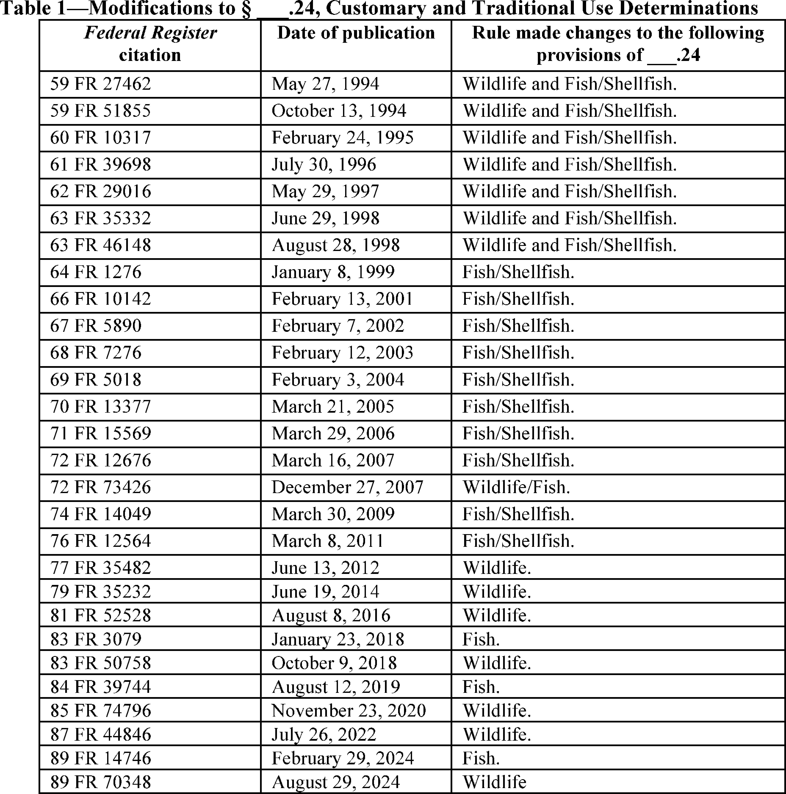
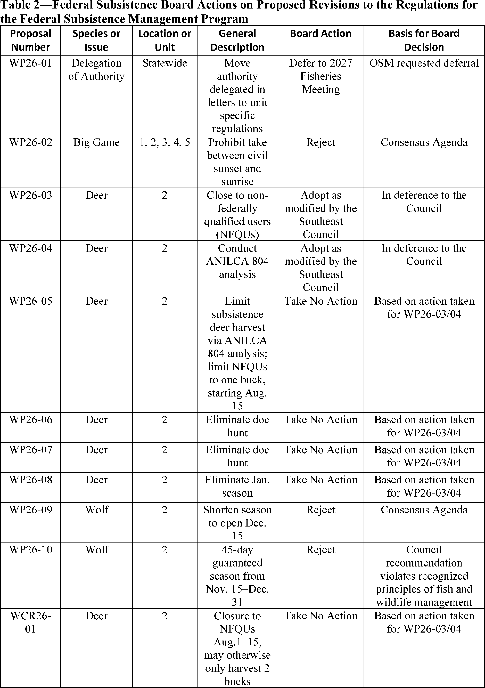
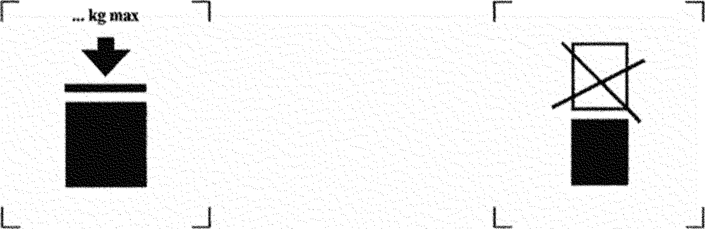

# Daily Digest — 2026-10-27

| | |
|---|---|
| **Digest date** | 2026-10-27 |
| **Data date range** | 2026-10-27 to 2026-10-27 |
| **Generated at** | 2026-10-28T04:03:18Z (UTC) |
| **Pipeline version** | 1f424474 |
| **Inference** | model layers ran — cli/haiku, opus |
| **Source watermarks** | CREC: 2026-10-27T08:25:56Z · BILLS: 2026-10-28T03:17:54Z · FR: 2026-10-27T16:44:33Z · USCOURTS: 2026-10-27T22:55:35Z · PLAW: 2026-10-27T18:12:12Z |

[Full observed listing for this day](day/2026-10-27.html) — the items our collectors observed for this publication day, mechanical rules applied, frozen at end of day; releases their publishers date on other days are counted there, not listed. This digest is the canonical record.

All items below cite the govinfo package (and granule, where applicable) they
summarize. Selection is mechanical; each item states the rule that included
it. See the Coverage Statement at the end for a full accounting of what was
published, what was summarized, and what was excluded and why.

---

## Contents

- [Day in Review](#day-in-review)
- [1. Congressional Floor Activity](#1-congressional-floor-activity)
- [2. Legislation](#2-legislation)
- [3. Federal Register](#3-federal-register)
- [4. Enacted Laws](#4-enacted-laws)
- [5. Judicial Activity](#5-judicial-activity)
- [6. Agency Announcements](#6-agency-announcements)
- [7. Recorded Votes](#7-recorded-votes)
- [8. Bill Actions](#8-bill-actions)
- [9. Presidential Actions](#9-presidential-actions)
- [Terms Used Today](#terms-used-today)
- [Coverage Statement](#coverage-statement)
- [Methodology](#methodology)

---

## Day in Review

The digest carries 23 House and 4 Senate Congressional Record entries, along with 6 Daily Digest items and 24 Extensions of Remarks. None of the summarized items reports a recorded vote. One House entry dated October 26, 2026 lists executive communications EC-4938 through EC-4963 referred to committees. The digest also carries 34 House bills as introduced and one Senate-reported bill, S. 1515, the United States Secret Service Retirement Act of 2011, with a 2012 committee report. Nine public laws appear. They include P.L. 119–134, the License to Drill Act, approved October 20, 2026, which extends a permit-to-drill fee period to 2037, and P.L. 119–129, the Romance Scam Prevention Act.

Federal Register items comprise 13 final rules, 5 proposed rules and 63 notices; no presidential documents appear. Final rules include eight FAA airworthiness directives, Justice Department rules on voluntary NICS employment background checks and the HAVANA Act, and Alaska subsistence wildlife regulations. Proposed rules address Exchange pre-eligibility verification and hazardous materials harmonization with international standards.

The digest carries 38 appellate, 7 bankruptcy and 756 district court opinions. The Ninth Circuit granted in part and denied in part Berkeley's motions for stay in the encampment appeals. It also dismissed for lack of jurisdiction a United States appeal against California concerning vote-by-mail ballots. The Eleventh Circuit dismissed as moot a PAC's challenge to Georgia contribution limits. The Fifth Circuit reversed the dismissal of an ADA suit against Union Pacific on tolling grounds. The Seventh Circuit vacated a Rooker-Feldman dismissal in a Blue Island licensing case.

*Composed from the summarized items below and the day's mechanical
counts; all specifics are cited in their sections.*

---

## 1. Congressional Floor Activity

Source: Congressional Record (CREC), issue observed 2026-10-27, covering proceedings of 2026-10-26. Published by govinfo 2026-10-27T08:25:56Z; observed by our collector 2026-10-27T08:49:57Z. Total issue size: 57 granule(s).

### 1.1 Senate

No Senate floor items met the selection thresholds. 4 floor granule(s) are accounted for in the Coverage Statement.

### 1.2 House of Representatives

Tags: legislative · model keys: congressional record · executive communications · house committee referrals

*In plain terms: One Congressional Record section, dated October 26, 2026, lists executive communications EC-4938 through EC-4963 referred to House committees, including interim and final rules.*

- **Executive Communications, ETC.** — This Congressional Record section (House, October 26, 2026) lists executive communications taken from the Speaker's table and referred to House committees under clause 2 of rule XIV. Entries EC-4938 through EC-4963 include interim and final rules from the Federal Reserve, Department of Labor, Drug Enforcement Administration, Environmental Protection Agency, Federal Communications Commission, Nuclear Regulatory Commission, Treasury's Office of Foreign Assets Control, Fish and Wildlife Service, and NOAA, along with a Superfund five-year review report, D.C. Acts 26-444, 26-445, and 26-448, and a presidential notice of intent to designate David DeArms as Acting Inspector General of the Department of Education. The text is truncated at EC-4963, so later entries are not included.
  - *In plain terms:* On October 26, 2026, the Congressional Record lists House committee communications, including agency rules, Superfund review, D.C. Acts, and a presidential notice of intent to name an Education Department Acting Inspector General; list stops at EC-4963.
  - Included because: CREC-SEL-01 — floor item ≥ threshold floor time (17,670 characters) (document dated 2026-10-26)
  - Source: [CREC-2026-10-26 / CREC-2026-10-26-pt1-PgH6061-7](https://www.govinfo.gov/app/details/CREC-2026-10-26/CREC-2026-10-26-pt1-PgH6061-7)

### 1.3 Recorded Votes

No recorded votes were published in this issue of the Congressional Record.

---

## 2. Legislation

Source: Congressional Bills (BILLS), text versions published 2026-10-27 to 2026-10-27.

### 2.1 Counts by Stage

| Stage (bill text version) | Count |
|---|---|
| Introduced (ih/is) | 34 |
| Reported (rh/rs) | 1 |
| Engrossed (eh/es) | 0 |
| Enrolled (enr) | 0 |
| Other versions | 0 |
| **Total bill texts published** | **35** |

### 2.2 Bills Listed by Mechanical Rule

Tags: legislative · model keys: homeland security committee · secret service retirement · senate report

*In plain terms: One Senate report, No. 112–205, accompanies S. 1515, the United States Secret Service Retirement Act of 2011, introduced by Senator Lieberman and reported by Homeland Security and Governmental Affairs.*

Bills below are listed because they matched at least one listing rule; the
matching rule is stated per item. All other bill texts are counted above and
accounted for in the Coverage Statement.

- **S. 1515 (rs) — To permit certain members of the United States Secret Service and certain members of the United States Secret Service Uniformed Division who were appointed in 1984, 1985, or 1986 to elect to be covered under the District of Columbia Police and Firefighter Retirement and Disability System in the same manner as members appointed prior to 1984.** — Senate Report No. 112–205 accompanies S. 1515, the United States Secret Service Retirement Act of 2011, introduced by Senator Lieberman on September 6, 2011 and reported by the Committee on Homeland Security and Governmental Affairs on August 28, 2012 with an amendment. The bill would allow certain Secret Service Division and Uniformed Division members appointed in 1984, 1985, or 1986 to elect coverage under the District of Columbia Police and Firefighter Retirement and Disability System by making a lump-sum payment equal to a calculated transition cost, funded from their Thrift Savings Fund account. It also amends 5 U.S.C. 8468 to require deduction of District retirement benefits from the pay of reemployed covered retirees and includes a PAYGO compliance clause.
  - *In plain terms:* A bill lets Secret Service members appointed in 1984, 1985, or 1986 join the District of Columbia Police and Firefighter Retirement and Disability System by paying a lump sum from their Thrift Savings Fund.
  - Included because: BILLS-SEL-01 — reached stage: reported/enrolled/calendar (document dated 2012-08-28)
  - Source: [BILLS-112s1515rs](https://www.govinfo.gov/app/details/BILLS-112s1515rs)

---

## 3. Federal Register

Source: Federal Register (FR), issue of 2026-10-27.

### 3.1 Counts by Document Type

| Document type | Count |
|---|---|
| Rules | 13 |
| Proposed rules | 5 |
| Notices | 63 |
| Presidential documents | 0 |
| **Total FR documents** | **81** |

### 3.2 Rules Published

Tags: department of energy · department of transportation · executive · model keys: alaska subsistence hunting · faa airworthiness directives · federal final rules

*In plain terms: 13 rules, led by Alaska subsistence hunting and trapping regulations for 2026-27 and 2027-28; eight are FAA airworthiness directives, and the rest cover Pacific cod fishing and background checks.*

#### DEPARTMENT OF AGRICULTURE

- **Subsistence Management Regulations for Public Lands in Alaska—2026-27 and 2027-28 Subsistence Taking of Wildlife Regulations** (2026-21849; 36 CFR Part 242; 43 CFR Part 51) — This final rule revises regulations for hunting and trapping seasons, harvest limits, and methods and means related to taking of wildlife for subsistence uses during the 2026-27 and 2027-28 regulatory years. The Federal Subsistence Board (hereafter referred to as “the Board”) is on a schedule of completing the process of revising subsistence taking of wildlife regulations in even-numbered years and subsistence taking of fish and shellfish regulations in odd-numbered years; public proposal and review processes take place during the preceding year. The Board also addresses customary and traditional use determinations during the applicable cycle. This final rule revises the existing subsistence wildlife taking regulations, the general regulations on subsistence taking of fish and wildlife, customary and traditional use determinations, and addresses a deferred proposal regarding eulachon harvest in District 1 from the last fish cycle and a deferred proposal regarding brown bear hide sales from the last wildlife cycle. This final rule also makes administrative corrections to the regulations and corrects errors discovered since the last rulemaking. Action: Final rule. Dates: This rule is effective October 27, 2026.
  - *In plain terms:* This final rule updates federal rules on hunting and trapping seasons, harvest limits, and methods for taking wildlife for subsistence use in Alaska during the 2026-27 and 2027-28 regulatory years, with other related changes.
  - Included because: FR-SEL-01 — document type: final rule (all listed)
  - Source: [FR-2026-10-27 / 2026-21849](https://www.govinfo.gov/app/details/FR-2026-10-27/2026-21849)
  -  *Source graphic 1 of 12 from 2026-21849.*
  -  *Source graphic 2 of 12 from 2026-21849.*
  - *Graphics not rendered here: 10 of 12 — see the [source PDF](https://www.govinfo.gov/content/pkg/FR-2026-10-27/pdf/FR-2026-10-27.pdf).*

#### DEPARTMENT OF COMMERCE

- **Fisheries of the Exclusive Economic Zone Off Alaska; Pacific Cod by Vessels Using Pot Gear in the Western Regulatory Area of the Gulf of Alaska** (2026-21888; 50 CFR Part 679) — NMFS is prohibiting directed fishing for Pacific cod by vessels using pot gear in the Western Regulatory Area of the Gulf of Alaska (GOA). This action is necessary to prevent exceeding the 2026 total allowable catch (TAC) of Pacific cod allocated to vessels using pot gear in the Western Regulatory Area of the GOA. Action: Temporary rule; closure. Dates: Effective 1200 hours, Alaska local time (A.l.t.), October 23, 2026, through 2400 hours, A.l.t., December 31, 2026.
  - *In plain terms:* NOAA Fisheries prohibits fishing targeting Pacific cod by vessels using pot gear in the Western Regulatory Area of the Gulf of Alaska, to prevent exceeding the 2026 total allowable catch allocated to those vessels.
  - Included because: FR-SEL-01 — document type: final rule (all listed)
  - Source: [FR-2026-10-27 / 2026-21888](https://www.govinfo.gov/app/details/FR-2026-10-27/2026-21888)

#### DEPARTMENT OF JUSTICE

- **Bipartisan Safer Communities Act of 2022—Criteria for National Instant Criminal Background Check System (“NICS”) Background Checks of Firearm Handlers** (2026-21920; 28 CFR Part 25) — The United States Department of Justice (“Department”) is amending several of its regulations pertaining to the National Instant Criminal Background Check System (“NICS” or “system”) of the Federal Bureau of Investigation (“FBI”) to authorize Federal Firearm Licensees (“FFLs” or “licensees”) to use NICS for purposes of voluntarily conducting employment background checks relating to certain current or prospective FFL employees. This final rule describes in more detail how, upon its effective date, FFLs will be able to conduct “firearm handler background checks” (“FHCs”) of “eligible employees.” Action: Final rule. Dates: This final rule is effective November 27, 2026.
  - *In plain terms:* The Justice Department is amending its rules for the FBI's National Instant Criminal Background Check System to let Federal Firearm Licensees voluntarily run employment background checks on certain current or prospective employees.
  - Included because: FR-SEL-01 — document type: final rule (all listed)
  - Source: [FR-2026-10-27 / 2026-21920](https://www.govinfo.gov/app/details/FR-2026-10-27/2026-21920)
- **Implementation of HAVANA Act of 2021** (2026-21923; 28 CFR Part 106) — On April 19, 2024, the Department of Justice published an interim final rule to implement the HAVANA Act of 2021. No comments were received on the interim final rule. The HAVANA Act authorizes agency heads to provide payments to certain individuals who have incurred qualifying injuries to the brain. This final rule adopts the interim final rule with minor, non-substantive changes to the titles of certain officials involved in the payment review process and the earliest eligibility date for claims in accordance with statutory changes occurring after issuance of the interim final rule. This rule covers current and former Department of Justice employees and their dependents. Action: Final rule. Dates: This final rule is effective on November 27, 2026.
  - *In plain terms:* The Justice Department's April 19, 2024 interim rule implementing the HAVANA Act of 2021 drew no comments and is now adopted as final, with minor changes to official titles and the earliest claim eligibility date.
  - Included because: FR-SEL-01 — document type: final rule (all listed)
  - Source: [FR-2026-10-27 / 2026-21923](https://www.govinfo.gov/app/details/FR-2026-10-27/2026-21923)

#### DEPARTMENT OF TRANSPORTATION

- **Airworthiness Directives; Airbus Helicopters** (2026-21854; 14 CFR Part 39) — The FAA is adopting a new airworthiness directive (AD) for all Airbus Helicopters Model SA 365 N helicopters. This AD was prompted by reports of tightening torque loss on the input flange nut due to circular wear on the faces of the flange, the slip ring, and the input flange. This condition, if not addressed, could lead to degradation or jamming of the input roller bearings and loss of yaw control of the helicopter. This AD requires repetitive functional inspections (checks) and, depending on the results of the inspections, corrective actions. The FAA is issuing this AD to address the unsafe condition on these products. Action: Final rule; request for comments. Dates: This AD is effective November 12, 2026. The Director of the Federal Register approved the incorporation by reference of a certain publication listed in this AD as of November 12, 2026. The FAA must receive comments on this AD by December 11, 2026.
  - *In plain terms:* The FAA adopts a mandatory safety directive for Airbus Helicopters SA 365 N helicopters after reports of input flange nut torque loss that could cause loss of yaw control, requiring repeated inspections.
  - Included because: FR-SEL-01 — document type: final rule (all listed)
  - Source: [FR-2026-10-27 / 2026-21854](https://www.govinfo.gov/app/details/FR-2026-10-27/2026-21854)
- **Airworthiness Directives; Airbus Helicopters Deutschland GmbH (AHD) Helicopters** (2026-21855; 14 CFR Part 39) — The FAA is adopting a new airworthiness directive (AD) for certain Airbus Helicopters Deutschland GmbH (AHD) Model EC135P1, EC135P2, EC135P2+, EC135P3, EC135T1, EC135T2, EC135T2+, EC135T3, EC635T2+, MBB-BK 117 C-2, and MBB-BK 117 D-2 helicopters. This AD was prompted by reports of cracks on the cable drum of the rescue hoist assembly. This AD requires repetitively inspecting the cable drum of certain rescue hoist assemblies for cracks and, depending on the results, replacing or repairing the cable drum of the rescue hoist assembly. This AD also prohibits the operation and the installation of an affected rescue hoist assembly on a helicopter, unless certain requirements are met. The FAA is issuing this AD to address the unsafe condition on these products. Action: Final rule. Dates: This AD is effective December 1, 2026. The Director of the Federal Register approved the incorporation by reference of a certain publication listed in this AD as of December 1, 2026.
  - *In plain terms:* The FAA adopts a mandatory safety directive for Airbus Helicopters Deutschland EC135, EC635, and MBB-BK 117 helicopters after cracks were reported on rescue hoist cable drums, requiring repeated inspections.
  - Included because: FR-SEL-01 — document type: final rule (all listed)
  - Source: [FR-2026-10-27 / 2026-21855](https://www.govinfo.gov/app/details/FR-2026-10-27/2026-21855)
- **Airworthiness Directives; Airbus Helicopters** (2026-21856; 14 CFR Part 39) — The FAA is adopting a new airworthiness directive (AD) for all Airbus Helicopters Model AS350B2, AS350B3, AS355N, AS355NP, and EC130B4 helicopters. This AD was prompted by a report of a release of the load on the cargo hook without manual release initiation by the pilot. This AD requires inspecting the load dropping control system, inspecting the manual release lever for free play, and, depending on the results, performing corrective actions. The FAA is issuing this AD to address the unsafe condition on these products. Action: Final rule; request for comments. Dates: This AD is effective November 12, 2026. The Director of the Federal Register approved the incorporation by reference of a certain publication listed in this AD as of November 12, 2026. The FAA must receive comments on this AD by December 11, 2026.
  - *In plain terms:* The FAA adopts a mandatory safety directive for Airbus Helicopters AS350B2, AS350B3, AS355N, AS355NP, and EC130B4 helicopters after a report of cargo-hook load release without pilot-initiated manual release, requiring inspections and corrective actions.
  - Included because: FR-SEL-01 — document type: final rule (all listed)
  - Source: [FR-2026-10-27 / 2026-21856](https://www.govinfo.gov/app/details/FR-2026-10-27/2026-21856)
- **Airworthiness Directives; Airbus SAS Airplanes** (2026-21861; 14 CFR Part 39) — The FAA is adopting a new airworthiness directive (AD) for certain Airbus SAS Model A330-941 airplanes. This AD was prompted by an occurrence of a triple “PRIM FAULT” in the Flight Control Primary Computer (FCPC) at touchdown. This AD requires the installation of a new FCPC standard and applicable concurrent modifications. This AD also prohibits the installation of certain parts. The FAA is issuing this AD to address the unsafe condition on these products. Action: Final rule. Dates: This AD is effective December 1, 2026. The Director of the Federal Register approved the incorporation by reference of a certain publication listed in this AD as of December 1, 2026.
  - *In plain terms:* The FAA adopts a mandatory safety directive for Airbus A330-941 airplanes after a triple 'PRIM FAULT' in the flight control primary computer at touchdown, requiring a new computer standard to be installed.
  - Included because: FR-SEL-01 — document type: final rule (all listed)
  - Source: [FR-2026-10-27 / 2026-21861](https://www.govinfo.gov/app/details/FR-2026-10-27/2026-21861)
- **Airworthiness Directives; The Boeing Company Airplanes** (2026-21862; 14 CFR Part 39) — The FAA is adopting a new airworthiness directive (AD) for certain The Boeing Company Model 737-700, -700C, -800, and -900ER series airplanes. This AD was prompted by a leak through the form-in-place (FiP) gasket at the engine fuel shutoff valve access panel found during a leak check. This AD requires a detailed inspection of the left- and right-side FiP gasket at the engine fuel shutoff valve access panel for correct sealant installation, a fluid leak test of the engine fuel shutoff valve access panels for any leak, and applicable on-condition actions. The FAA is issuing this AD to address the unsafe condition on these products. Action: Final rule. Dates: This AD is effective December 1, 2026. The Director of the Federal Register approved the incorporation by reference of a certain publication listed in this AD as of December 1, 2026.
  - *In plain terms:* The FAA adopts a mandatory safety directive for certain Boeing 737-700, -700C, -800, and -900ER airplanes after a leak through a form-in-place gasket was found, requiring inspections and a leak test.
  - Included because: FR-SEL-01 — document type: final rule (all listed)
  - Source: [FR-2026-10-27 / 2026-21862](https://www.govinfo.gov/app/details/FR-2026-10-27/2026-21862)
- **Airworthiness Directives; The Boeing Company Airplanes** (2026-21863; 14 CFR Part 39) — The FAA is adopting a new airworthiness directive (AD) for certain The Boeing Company Model 737-8, 737-9, and 737-8200 airplanes. This AD was prompted by a leak through the form-in-place (FiP) gasket found during a leak check. This AD requires a detailed inspection of the FiP gasket at the engine fuel shutoff valve access panel for correct sealant installation, or a detailed inspection at the engine fuel shutoff valve access panel for any damage on the preformed seal, depending on configuration; a fluid leak test of the engine fuel shutoff valve access panel for any leak; and applicable on-condition actions. The FAA is issuing this AD to address the unsafe condition on these products. Action: Final rule. Dates: This AD is effective December 1, 2026. The Director of the Federal Register approved the incorporation by reference of a certain publication listed in this AD as of December 1, 2026.
  - *In plain terms:* The FAA adopts a mandatory safety directive for certain Boeing 737-8, 737-9, and 737-8200 airplanes after a leak through a form-in-place gasket was found, requiring inspections and a fluid leak test.
  - Included because: FR-SEL-01 — document type: final rule (all listed)
  - Source: [FR-2026-10-27 / 2026-21863](https://www.govinfo.gov/app/details/FR-2026-10-27/2026-21863)
- **Airworthiness Directives; The Boeing Company Airplanes** (2026-21864; 14 CFR Part 39) — The FAA is adopting a new airworthiness directive (AD) for certain The Boeing Company Model 757-200 and -300 series airplanes. This AD was prompted by a report that some passenger service unit (PSU)-mounted video monitors became detached from the PSU rails during a hard landing. This AD requires replacing PSU-mounted video monitors that do not have secondary retention lanyards. The FAA is issuing this AD to address the unsafe condition on these products. Action: Final rule. Dates: This AD is effective December 1, 2026. The Director of the Federal Register approved the incorporation by reference of certain publications listed in this AD as of December 1, 2026.
  - *In plain terms:* The FAA adopts a mandatory safety directive for certain Boeing 757-200 and -300 airplanes after passenger service unit video monitors detached during a hard landing, requiring replacement of monitors lacking retention lanyards.
  - Included because: FR-SEL-01 — document type: final rule (all listed)
  - Source: [FR-2026-10-27 / 2026-21864](https://www.govinfo.gov/app/details/FR-2026-10-27/2026-21864)
- **Airworthiness Directives; Ontic Engineering and Manufacturing, Inc. (Type Certificate Previously Held by Swearingen, Fairchild Aircraft, and M7 Aerospace) Airplanes** (2026-21902; 14 CFR Part 39) — The FAA is adopting a new airworthiness directive (AD) for certain Ontic Engineering and Manufacturing, Inc. Model SA226-T, SA226-AT, SA226-T(B), SA226-TC, SA227-AC (C-26A), SA227-AT, SA227-BC (C-26A), SA227-PC, SA227-CC, SA227-DC (C-26B), and SA227-TT (300) airplanes. This AD was prompted by reports of in-flight pitch trim actuator failures. This AD requires repetitively inspecting the pitch trim actuator for cracked, missing, or compromised sealant, replacing and sealing the pitch trim actuator if cracked, missing, or compromised, repetitively measuring the pitch trim actuator travel time, and depending on the results of the measurements, replacing and sealing the pitch trim actuator. This AD also requires certain pitch trim actuators to be sealed after installation. The FAA is issuing this AD to address the unsafe condition on these products. Action: Final rule. Dates: This AD is effective December 1, 2026. The Director of the Federal Register approved the incorporation by reference of certain publications listed in this AD as of December 1, 2026.
  - *In plain terms:* The FAA adopts a mandatory safety directive for certain Ontic Engineering and Manufacturing SA226 and SA227 series airplanes after reports of in-flight pitch trim actuator failures, requiring repeated inspections, replacements, and sealing of actuators.
  - Included because: FR-SEL-01 — document type: final rule (all listed)
  - Source: [FR-2026-10-27 / 2026-21902](https://www.govinfo.gov/app/details/FR-2026-10-27/2026-21902)

#### NATIONAL MEDIATION BOARD

- **Change of Address; Technical Amendment** (2026-21851; 29 CFR Parts 1203, 1208, and 1209) — The National Mediation Board (NMB) is issuing this final rule; technical amendment to amend its regulations to reflect a change in address for its Washington, DC headquarters office. This technical amendment is a nomenclature change that replaces outdated addresses with the NMB's current headquarters address. Additionally, this final rule amends the NMB's regulations to eliminate references to the NMB Chief of Staff position, a position that no longer exists in the agency's organization. This action is administrative, technical, and editorial in nature; is necessary to provide accuracy and clarity to the NMB's Rules; and does not alter the rights, duties, or obligations of the public. Action: Final rule. Dates: The final rule is effective October 27, 2026.
  - *In plain terms:* The final rule updates the National Mediation Board's regulations to show its current Washington, DC headquarters address and removes references to the Chief of Staff position, which no longer exists.
  - Included because: FR-SEL-01 — document type: final rule (all listed)
  - Source: [FR-2026-10-27 / 2026-21851](https://www.govinfo.gov/app/details/FR-2026-10-27/2026-21851)

### 3.3 Proposed Rules Published

Tags: department of energy · department of transportation · executive · model keys: affordable care act · faa engine directive · proposed rulemaking

*In plain terms: Five proposed rules, led by an FAA proposal on CFM56-7B engines and an Affordable Care Act exchange eligibility verification rule; the rest cover Embraer special conditions, firework safety zones, and hazardous materials standards.*

#### DEPARTMENT OF HEALTH AND HUMAN SERVICES

- **Patient Protection and Affordable Care Act, Exchange Pre-Eligibility Verification** (2026-21891; 45 CFR Part 155) — This proposed rule would implement new requirements specified under the Working Families Tax Cut (WFTC) legislation related to Exchange eligibility and verification. This proposed rule contains related updates to provisions affecting inconsistency periods, inconsistency verification procedures, annual eligibility redeterminations and eligibility redeterminations during the plan year, as well as expanding enrollment methods during the verification process and establishing new coverage effective dates. Action: Proposed rule. Dates: To be assured consideration, comments must be received at one of the addresses provided below, by November 27, 2026.
  - *In plain terms:* A proposed rule would implement new requirements from the Working Families Tax Cut legislation for health insurance Exchange eligibility and verification, with related changes to enrollment methods, eligibility reviews, and coverage start dates.
  - Included because: FR-SEL-02 — document type: proposed rule (all listed)
  - Source: [FR-2026-10-27 / 2026-21891](https://www.govinfo.gov/app/details/FR-2026-10-27/2026-21891)

#### DEPARTMENT OF HOMELAND SECURITY

- **Safety Zone; Southern California Annual Firework Events for the Los Angeles-Long Beach Captain of the Port Zone** (2026-21918; 33 CFR Part 165) — The Coast Guard is proposing to amend the Southern California Firework Events for Los Angeles-Long Beach Captain of the Port Zone Annual Safety Zones. The Coast Guard proposes eight new events to be added, thirteen events to be updated, and two events removed. The safety zones are needed to protect waterways users and keep them clear of potentially harmful debris within the fallout zone. This proposed rulemaking would prohibit persons and vessels from being in the safety zone unless specifically authorized by the Captain of the Port Los Angeles-Long Beach. We invite your comments on this proposed rulemaking. Action: Notice of proposed rulemaking. Dates: Comments and related material must be received by the Coast Guard on or before November 27, 2026.
  - *In plain terms:* The Coast Guard proposes to amend Southern California firework safety zones for the Los Angeles-Long Beach Captain of the Port Zone, adding eight events, updating thirteen, and removing two, and would bar unauthorized entry.
  - Included because: FR-SEL-02 — document type: proposed rule (all listed)
  - Source: [FR-2026-10-27 / 2026-21918](https://www.govinfo.gov/app/details/FR-2026-10-27/2026-21918)

#### DEPARTMENT OF TRANSPORTATION

- **Airworthiness Directives; CFM International, S.A. Engines** (2026-21852; 14 CFR Part 39) — The FAA proposes to adopt a new airworthiness directive (AD) for all CFM International, S.A. (CFM) Model CFM56-7B engines. This proposed AD was prompted by an event involving a CFM Model CFM56-7B26/3 engine where a fan blade separated and resulted in an engine in-flight shutdown (IFSD) with debris penetrating the fuselage, which caused a loss of pressurization and prompted an emergency descent. This proposed AD would require a visual inspection of the fan blades for findings considered not serviceable and, depending on the results of the inspection, replacement with a serviceable part and additional fan blade inspections. This proposed AD would also require sending the inspection results to CFM if any finding considered not serviceable is found. The FAA is proposing this AD to address the unsafe condition on these products. Action: Notice of proposed rulemaking (NPRM). Dates: The FAA must receive comments on this proposed AD by November 27, 2026.
  - *In plain terms:* The FAA proposes a mandatory safety directive for all CFM56-7B engines after a fan blade separated in flight; it would require fan blade inspections, part replacements as needed, and reporting unserviceable findings to CFM.
  - Included because: FR-SEL-02 — document type: proposed rule (all listed)
  - Source: [FR-2026-10-27 / 2026-21852](https://www.govinfo.gov/app/details/FR-2026-10-27/2026-21852)
- **Special Conditions: Embraer S.A. Model ERJ 190-400 Airplane; Embraer Enhanced Takeoff System** (2026-21907; 14 CFR Part 25) — This action proposes special conditions for the Embraer S.A. (Embraer) Model ERJ 190-400 series airplane. This airplane will have a novel or unusual design feature when compared to the state of technology envisioned in the airworthiness standards for transport category airplanes. This design feature is a functionality known as the Embraer Enhanced Takeoff System (E 2 TS). The applicable airworthiness regulations do not contain adequate or appropriate safety standards for this design feature. These proposed special conditions contain the additional safety standards that the Administrator considers necessary to establish a level of safety equivalent to that established by the existing airworthiness standards. Action: Notice of proposed special conditions. Dates: Send comments on or before November 27, 2026.
  - *In plain terms:* The FAA proposes special conditions (additional safety requirements) for the Embraer ERJ 190-400 airplane's novel design feature, the Embraer Enhanced Takeoff System, because existing airworthiness standards lack adequate safety standards for it.
  - Included because: FR-SEL-02 — document type: proposed rule (all listed)
  - Source: [FR-2026-10-27 / 2026-21907](https://www.govinfo.gov/app/details/FR-2026-10-27/2026-21907)
- **Hazardous Materials: Harmonization With International Standards** (2026-21922; 49 CFR Parts 171, 172, 173, 175, 176, 178, and 180) — PHMSA proposes to update the Hazardous Materials Regulations to adopt certain international regulations and standards related to proper shipping names, hazard classes, packing groups, special provisions, packaging authorizations, air transport quantity limitations, and vessel stowage requirements. These proposed amendments are intended to maintain consistency with the latest international regulations and standards, to reduce costs to entities or individuals within the United States, and to lower the cost of regulations on the U.S. economy. Action: Notice of proposed rulemaking (NPRM). Dates: Comments must be received by December 28, 2026. To the extent possible, PHMSA will consider late-filed comments while a final rule is developed.
  - *In plain terms:* The Pipeline and Hazardous Materials Safety Administration proposes updating hazardous materials rules to adopt international standards on shipping names, hazard classes, and packaging, intended to stay consistent with international rules and lower costs.
  - Included because: FR-SEL-02 — document type: proposed rule (all listed)
  - Source: [FR-2026-10-27 / 2026-21922](https://www.govinfo.gov/app/details/FR-2026-10-27/2026-21922)
  -  *Source graphic 1 of 1 from 2026-21922.*

### 3.4 Notices and Presidential Documents

Notices are summarized only when they match a listing rule; all are counted
in 3.1 and in the Coverage Statement. Presidential documents in the FR are
always listed.

No notices or presidential documents matched a listing rule.

---

## 4. Enacted Laws

Tags: legislative · model keys: forest service conveyance · public laws · romance scam prevention

*In plain terms: Nine public laws, including the Romance Scam Prevention Act requiring fraud ban notices from online dating services; others address a D.C. criminal code disapproval, Vicksburg park boundaries, and a Forest Service land conveyance.*

Source: Public and Private Laws (PLAW) published 2026-10-27.

- **Public Law 118–1 — Public Law 118–1: Disapproving the action of the District of Columbia Council in approving the Revised Criminal Code Act of 2022.** — Public Law 118–1 is a Joint Resolution that disapproves of an action taken by the District of Columbia Council. Specifically, it disapproves the Revised Criminal Code Act of 2022 (D.C. Act 24–789), which the Council enacted on January 17, 2023. Approved: 2023-03-20.
  - *In plain terms:* Public Law 118–1 is a Joint Resolution that rejects the Revised Criminal Code Act of 2022 (D.C. Act 24–789), which the District of Columbia Council enacted on January 17, 2023.
  - Included because: PLAW-SEL-01 — enacted into law (all public and private laws are listed) (document dated 2023-03-20)
  - Source: [PLAW-118publ1](https://www.govinfo.gov/app/details/PLAW-118publ1)
- **Public Law 118–7 — Public Law 118–7: To modify the age requirement for the Student Incentive Payment Program of the State maritime academies.** — Public Law 118–7, also known as the “Changing Age-Determined Eligibility To Student Incentive Payments Act” or the “CADETS Act,” modifies age requirements for a student program. It amends title 46, United States Code, to specify that the Secretary may make agreements under the Student Incentive Payment Program only with students who will meet the age requirement for enlistment or commission in the Navy Reserve upon graduation. Approved: 2023-06-30.
  - *In plain terms:* Public Law 118–7, also known as the CADETS Act, modifies age requirements for the Student Incentive Payment Program, specifying the Secretary may make agreements only with students who will meet Navy Reserve age rules upon graduation.
  - Included because: PLAW-SEL-01 — enacted into law (all public and private laws are listed) (document dated 2023-06-30)
  - Source: [PLAW-118publ7](https://www.govinfo.gov/app/details/PLAW-118publ7)
- **Public Law 119–125 — Public Law 119–125: To allow a period in which members of the clergy may revoke their exemption from Social Security coverage, and for other purposes.** — Public Law 119-125, the Clergy Act, allows ordained ministers, members of religious orders, and Christian Science practitioners who hold an exemption from Social Security coverage under section 1402(e)(1) of the Internal Revenue Code to revoke that exemption by filing an application with the Commissioner of Internal Revenue by the applicable tax return due date. Revocations take effect for taxable years beginning after December 31, 2028, and applicants may not later re-elect the exemption. The Act also requires the Commissioner of Internal Revenue, in consultation with the Commissioner of Social Security, to submit to Congress within 90 days of enactment a plan to inform affected individuals of their eligibility to revoke the exemption. Approved: 2026-10-20.
  - *In plain terms:* Clergy with a Social Security exemption may revoke it by filing with the Commissioner of Internal Revenue by the tax return due date, effective for taxable years beginning after December 31, 2028; re-electing is barred.
  - Included because: PLAW-SEL-01 — enacted into law (all public and private laws are listed) (document dated 2026-10-20)
  - Source: [PLAW-119publ125](https://www.govinfo.gov/app/details/PLAW-119publ125)
- **Public Law 119–126 — Public Law 119–126: To require the Secretary of Agriculture to convey the Pleasant Valley Ranger District Administrative Site to Gila County, Arizona.** — Public Law 119-126 directs the Secretary of Agriculture, acting through the Forest Service, to convey approximately 232.9 acres of Tonto National Forest land in the Pleasant Valley Ranger District Administrative Site to Gila County, Arizona, if the county submits a written request within 180 days of enactment. The conveyance is to be made without consideration by quitclaim deed, subject to valid existing rights, and at the county's expense for surveys and required environmental and resource analyses. The land must be used only for serving and supporting veterans of the Armed Forces, and it reverts to the United States at the Secretary's discretion if used otherwise. Approved: 2026-10-20.
  - *In plain terms:* The Secretary of Agriculture must convey about 232.9 acres of Tonto National Forest land to Gila County, Arizona, upon its written request within 180 days of enactment, for use only in serving veterans.
  - Included because: PLAW-SEL-01 — enacted into law (all public and private laws are listed) (document dated 2026-10-20)
  - Source: [PLAW-119publ126](https://www.govinfo.gov/app/details/PLAW-119publ126)
- **Public Law 119–127 — Public Law 119–127: To direct the Secretary of Commerce to conduct a study on the feasibility of manufacturing in the United States products for critical infrastructure sectors, and for other purposes.** — Public Law 119-127, the Critical Infrastructure Manufacturing Feasibility Act, directs the Secretary of Commerce to study, within one year of enactment, products in each of the 16 critical infrastructure sectors that are in high demand and imported due to manufacturing, material, or supply chain constraints. The study is to analyze the costs, benefits, and effects on jobs and product prices of manufacturing those products in the United States, including in rural areas and industrial parks. The Secretary must submit a report with recommendations to Congress within 18 months of enactment and post it publicly on the Department of Commerce website, and the Act does not authorize the Secretary to compel information from any person. Approved: 2026-10-20.
  - *In plain terms:* Within one year of enactment, the Secretary of Commerce must study making high-demand, imported products in the 16 critical infrastructure sectors in the United States, and report recommendations to Congress within 18 months.
  - Included because: PLAW-SEL-01 — enacted into law (all public and private laws are listed) (document dated 2026-10-20)
  - Source: [PLAW-119publ127](https://www.govinfo.gov/app/details/PLAW-119publ127)
- **Public Law 119–129 — Public Law 119–129: To require online dating service providers to provide fraud ban notifications to online dating service members, and for other purposes.** — Public Law 119-129, the Romance Scam Prevention Act, requires online dating service providers to send a fraud ban notification to any member who has received a message from a banned member, generally within 24 hours of the ban, with extensions at the provider's judgment or at a law enforcement official's request. Each notification must be clear and conspicuous, sent by email or text message, and include specified contents such as the banned member's profile identifier, a warning against sending cash or financial information, and provider contact information. The Federal Trade Commission and state attorneys general may enforce the Act, and the Act preempts state laws that govern whether or how providers must give such notifications. The Act takes effect one year after enactment. Approved: 2026-10-20.
  - *In plain terms:* Online dating services must send a fraud ban notification to any member who received a message from a banned member, generally within 24 hours of the ban, and takes effect one year after enactment.
  - Included because: PLAW-SEL-01 — enacted into law (all public and private laws are listed) (document dated 2026-10-20)
  - Source: [PLAW-119publ129](https://www.govinfo.gov/app/details/PLAW-119publ129)
- **Public Law 119–131 — Public Law 119–131: To direct the Secretary of Labor to train certain employees of Department of Labor how to effectively detect and assist law enforcement in preventing human trafficking during the course of their official duties, and for other purposes.** — Public Law 119-131, the Enhancing Detection of Human Trafficking Act, directs the Secretary of Labor to implement, within 180 days of enactment, a program of training and periodic continuing education for Department of Labor employees on detecting human trafficking and referring suspected cases. The training is to cover methods for identifying suspected victims and traffickers, a referral course of action to the Department of Justice and other authorities, and an evaluation of the training, with the Wage and Hour Division training considering states with significant increases in oppressive child labor. The Secretary must report annually to the House Committee on Education and Workforce and the Senate Committee on Health, Education, Labor, and Pensions on the training provided, its effectiveness, and the number of referred cases. Approved: 2026-10-20.
  - *In plain terms:* The Secretary of Labor must, within 180 days of enactment, start a training program for Department of Labor employees on detecting human trafficking and referring suspected cases, with annual reports to Congress.
  - Included because: PLAW-SEL-01 — enacted into law (all public and private laws are listed) (document dated 2026-10-20)
  - Source: [PLAW-119publ131](https://www.govinfo.gov/app/details/PLAW-119publ131)
- **Public Law 119–132 — Public Law 119–132: To modify the boundary of the Vicksburg National Military Park in the State of Mississippi, and for other purposes.** — Public Law 119-132, the Vicksburg National Military Park Boundary Modification Act, directs the Secretary of the Interior to convey to the State of Mississippi, by quitclaim deed and without consideration, two parcels of federal land within Vicksburg National Military Park totaling approximately 7.43 acres, as depicted on maps dated September 2024. Upon conveyance, the Secretary must modify the park boundary to exclude the conveyed land. The conveyed land must be used to facilitate public access to the park and enhance the visitor experience in a manner consistent with the park's interpretive mission, and it is subject to any use restrictions the Secretary determines to be appropriate. Approved: 2026-10-20.
  - *In plain terms:* The Secretary of the Interior must convey two parcels totaling about 7.43 acres within Vicksburg National Military Park to the State of Mississippi without payment, then exclude that land from the park boundary.
  - Included because: PLAW-SEL-01 — enacted into law (all public and private laws are listed) (document dated 2026-10-20)
  - Source: [PLAW-119publ132](https://www.govinfo.gov/app/details/PLAW-119publ132)
- **Public Law 119–134 — Public Law 119–134: To amend the Mineral Leasing Act to extend the period of time during which the Secretary of the Interior is required to collect a fee for each new application for a permit to drill, and for other purposes.** — Public Law 119–134, cited as the "License to Drill Act," was approved October 20, 2026, and amends Section 35(d) of the Mineral Leasing Act (30 U.S.C. 191(d)). The amendments replace references to 2026 with 2037 in paragraphs (1) and (4), extending the period during which the Secretary of the Interior is required to collect a fee for each new application for a permit to drill. Paragraph (3) is revised to direct the transfer, for each of fiscal years 2027 through 2037, of all fees collected under the subsection to the BLM Permit Processing Improvement Fund. Approved: 2026-10-20.
  - *In plain terms:* The License to Drill Act, approved October 20, 2026, extends from 2026 to 2037 the period during which the Interior Secretary must collect a fee for each new permit-to-drill application under the Mineral Leasing Act.
  - Included because: PLAW-SEL-01 — enacted into law (all public and private laws are listed) (document dated 2026-10-20)
  - Source: [PLAW-119publ134](https://www.govinfo.gov/app/details/PLAW-119publ134)

---

## 5. Judicial Activity

Source: United States Courts Opinions (USCOURTS): opinions observed 2026-10-27
by our collector; each opinion states its own issue date beside its
listing ([how our clocks work](faq.html#fapds-three-clocks)).

Completeness disclosure (standing): USCOURTS carries opinions from
approximately 140 participating appellate, district, bankruptcy, and
national federal courts. Unlike the Congressional Record and the Federal
Register, which are the complete official record of their branches,
USCOURTS is participation-based and is NOT the complete federal judicial
record. Courts post opinions with delay — typically over several days —
so a day's digest carries the opinions that became available that day,
whatever date each was issued.

### 5.1 Appellate and National Court Opinions

Tags: judicial · model keys: berkeley encampment abatement · federal appellate opinions · ninth circuit orders

*In plain terms: 38 items, led by seven Ninth Circuit orders on the City of Berkeley's abatement of the 8th and Harrison homeless encampment; most others are affirmances, dismissals, or denials.*

Appellate and national court opinions are summarized; district and
bankruptcy opinions are counted in 5.2 and in the Coverage Statement.

#### United States Court of Appeals for the District of Columbia Circuit

- **USA v. Daraya Marshall** (No. 26-03007; filed 2026-10-26) — D.C. Circuit unpublished judgment in United States v. Daraya Marshall (No. 26-3007), filed October 26, 2026, affirming the district court's December 9, 2025 order denying Marshall's third motion for compassionate release or sentence reduction. The court held that Marshall showed no abuse of discretion in the district court's weighing of the 18 U.S.C. § 3553(a) factors and no eligibility for a sentence reduction under 18 U.S.C. § 3582(c)(2). Judge Walker's attached concurring statement summarizes the offense conduct to which Marshall stipulated when pleading guilty to six counts of sex trafficking and related crimes against minors.
  - *In plain terms:* On October 26, 2026, the D.C. Circuit affirmed the December 9, 2025 denial of Daraya Marshall's third motion for compassionate release or sentence reduction, finding no abuse of discretion and no eligibility for a reduction.
  - Included because: USCOURTS-SEL-01 — appellate court opinion (all listed) (document dated 2026-10-26)
  - Source: [USCOURTS-caDC-26-03007 / USCOURTS-caDC-26-03007-0](https://www.govinfo.gov/app/details/USCOURTS-caDC-26-03007/USCOURTS-caDC-26-03007-0)

#### United States Court of Appeals for the Eighth Circuit

- **Corner Post, Inc. v. Board of Governors** (No. 25-03000; filed 2026-10-26) — The Eighth Circuit Clerk of Court sent a letter dated October 26, 2026, to counsel in Corner Post, Inc. v. Board of Governors of the Federal Reserve System, No. 25-3000, stating that the court issued an opinion and entered judgment that day. The letter reminds counsel that petitions for rehearing or rehearing en banc must be received within 45 days of the entry of judgment, must be filed electronically in CM/ECF, and are subject to denial as untimely if received late. The letter lists the parties and counsel copied on it, including the Clerk of the U.S. District Court for North Dakota.
  - *In plain terms:* On October 26, 2026, the Eighth Circuit Clerk's letter in Corner Post, Inc. v. Board of Governors reminded counsel that rehearing petitions must be received within 45 days of judgment.
  - Included because: USCOURTS-SEL-01 — appellate court opinion (all listed) (document dated 2026-10-26)
  - Source: [USCOURTS-ca8-25-03000 / USCOURTS-ca8-25-03000-0](https://www.govinfo.gov/app/details/USCOURTS-ca8-25-03000/USCOURTS-ca8-25-03000-0)
- **United States v. Deangelo Williams** (No. 26-01338; filed 2026-10-26) — The Eighth Circuit dismissed the appeal of Deangelo Gene Williams from his sentence for a drug offense, in an unpublished per curiam opinion filed October 26, 2026. The court found that the appeal waiver in Williams's written plea agreement was valid, enforceable, and applicable to the issue raised. After independently reviewing the record under Penson v. Ohio, the court found no non-frivolous issues outside the scope of the waiver and granted counsel leave to withdraw under Anders v. California.
  - *In plain terms:* On October 26, 2026, the Eighth Circuit dismissed Deangelo Gene Williams's appeal of his drug-offense sentence, finding his written plea agreement's appeal waiver valid and enforceable, and allowed his lawyer to withdraw.
  - Included because: USCOURTS-SEL-01 — appellate court opinion (all listed) (document dated 2026-10-26)
  - Source: [USCOURTS-ca8-26-01338 / USCOURTS-ca8-26-01338-0](https://www.govinfo.gov/app/details/USCOURTS-ca8-26-01338/USCOURTS-ca8-26-01338-0)

#### United States Court of Appeals for the Eleventh Circuit

- **Brett Cormier v. Florida Department of Corrections** (No. 23-11998; filed 2026-10-26) — The Eleventh Circuit affirmed the district court's dismissal of Brett W. Cormier's federal habeas petition as untimely under AEDPA. The opinion addresses whether a Florida Rule 3.800(a) motion challenging a restitution order tolls the one-year limitations period under 28 U.S.C. § 2244(d)(2), and the court amended the certificate of appealability to add that issue and the underlying constitutional claims. The provided text is truncated before the court's full analysis of the tolling question.
  - *In plain terms:* The Eleventh Circuit upheld dismissal of Brett W. Cormier's federal habeas petition as untimely and added to the appeal whether a Florida restitution-order motion pauses the one-year filing deadline; the text ends before that analysis.
  - Included because: USCOURTS-SEL-01 — appellate court opinion (all listed) (document dated 2026-10-26)
  - Source: [USCOURTS-ca11-23-11998 / USCOURTS-ca11-23-11998-0](https://www.govinfo.gov/app/details/USCOURTS-ca11-23-11998/USCOURTS-ca11-23-11998-0)
- **USA v. David Gibson** (No. 23-13132; filed 2026-10-26) — In an unpublished per curiam opinion in United States v. David Gibson, the Eleventh Circuit affirmed in part and relinquished jurisdiction to the district court in part. The appeal concerned a 30-month sentence following a guilty plea to violating 18 U.S.C. § 922(g)(3), and the court rejected the facial Second Amendment challenge to that statute and the argument that the evidence was insufficient. The court remanded for the district court to reconsider the motion to withdraw the guilty plea in light of the Supreme Court's decision in United States v. Hemani.
  - *In plain terms:* The Eleventh Circuit affirmed in part, rejecting David Gibson's facial Second Amendment challenge to § 922(g)(3), and sent his plea-withdrawal motion back to the district court to reconsider in light of United States v. Hemani.
  - Included because: USCOURTS-SEL-01 — appellate court opinion (all listed) (document dated 2026-10-26)
  - Source: [USCOURTS-ca11-23-13132 / USCOURTS-ca11-23-13132-0](https://www.govinfo.gov/app/details/USCOURTS-ca11-23-13132/USCOURTS-ca11-23-13132-0)
- **Safe Affordable Georgia, Inc. v. Chairman of the State Ethics Commission, et al** (No. 26-10312; filed 2026-10-26) — In the published opinion in Safe Affordable Georgia, Inc. v. Chairman of the State Ethics Commission, et al., the Eleventh Circuit dismissed as moot an appeal of the denial of a preliminary injunction against Georgia's contribution and coordination limits as applied to a hybrid PAC. The court reasoned that the 2026 Republican gubernatorial primary had ended and the PAC's preferred candidate had lost, so no meaningful relief was available. The court also considered whether the exception for cases capable of repetition yet evading review applies, and the portion of the opinion provided states that nothing in the record supports a reasonable expectation that the challenged action would recur.
  - *In plain terms:* In a published opinion, the Eleventh Circuit dismissed as moot an appeal over Georgia's contribution and coordination limits for a hybrid PAC, because the 2026 Republican gubernatorial primary had ended and the PAC's preferred candidate lost.
  - Included because: USCOURTS-SEL-01 — appellate court opinion (all listed) (document dated 2026-10-26)
  - Source: [USCOURTS-ca11-26-10312 / USCOURTS-ca11-26-10312-0](https://www.govinfo.gov/app/details/USCOURTS-ca11-26-10312/USCOURTS-ca11-26-10312-0)

#### United States Court of Appeals for the Federal Circuit

- **Gurvey v. Live Nation Entertainment, Inc.** (No. 25-01954; filed 2026-10-26) — The Federal Circuit issued a nonprecedential per curiam decision affirming orders of the Central District of California that granted motions to dismiss filed by Live Nation Entertainment, Inc., Ticketmaster, Major League Baseball, and other defendants in an action brought by Amy Weissbrod Gurvey. The court held that Gurvey waived her appellate arguments, including her claim that the district court acted sua sponte, because she did not timely respond to the motions to dismiss despite repeated extensions. The court also noted that she did not challenge the Noerr-Pennington basis for dismissing the claims against Baker Botts LLP.
  - *In plain terms:* The Federal Circuit affirmed dismissals of Amy Weissbrod Gurvey's suit against Live Nation, Ticketmaster, Major League Baseball, and others, finding she waived her appeal arguments by not timely responding to the motions to dismiss.
  - Included because: USCOURTS-SEL-01 — appellate court opinion (all listed) (document dated 2026-10-26)
  - Source: [USCOURTS-ca13-25-01954 / USCOURTS-ca13-25-01954-0](https://www.govinfo.gov/app/details/USCOURTS-ca13-25-01954/USCOURTS-ca13-25-01954-0)
- **Goodwin v. Pension Benefit Guaranty Corp.** (No. 26-01616; filed 2026-10-26) — The Federal Circuit issued a nonprecedential per curiam decision affirming a Merit Systems Protection Board decision that denied Kiwanna Goodwin's request for corrective action under the Whistleblower Protection Act and the Whistleblower Protection Enhancement Act against the Pension Benefit Guaranty Corporation. The court found that substantial evidence supported the Board's finding that the agency showed by clear and convincing evidence it would have taken the same four personnel actions absent Goodwin's protected disclosures and activity. The personnel actions at issue were the termination of her supervisory appointment, a nondisclosure agreement, pay setting, and a performance rating.
  - *In plain terms:* The Federal Circuit affirmed a Merit Systems Protection Board ruling denying Kiwanna Goodwin's whistleblower claim against the Pension Benefit Guaranty Corporation, finding the agency would have taken four personnel actions regardless of her protected disclosures.
  - Included because: USCOURTS-SEL-01 — appellate court opinion (all listed) (document dated 2026-10-26)
  - Source: [USCOURTS-ca13-26-01616 / USCOURTS-ca13-26-01616-0](https://www.govinfo.gov/app/details/USCOURTS-ca13-26-01616/USCOURTS-ca13-26-01616-0)
- **Camacho v. Army** (No. 26-01728; filed 2026-10-26) — The Federal Circuit affirmed a Merit Systems Protection Board decision that denied Rosie Camacho's request for corrective action in her individual right of action appeal, which alleged retaliation against the Department of the Army for 14 protected disclosures. In this nonprecedential per curiam opinion, decided October 26, 2026, the court found no reversible error in the Board's discovery rulings or its application of the Carr factors under 5 U.S.C. § 1221(e). The court affirmed and awarded no costs.
  - *In plain terms:* On October 26, 2026, the Federal Circuit affirmed a Merit Systems Protection Board decision denying Rosie Camacho's retaliation claim against the Army over 14 protected disclosures.
  - Included because: USCOURTS-SEL-01 — appellate court opinion (all listed) (document dated 2026-10-26)
  - Source: [USCOURTS-ca13-26-01728 / USCOURTS-ca13-26-01728-0](https://www.govinfo.gov/app/details/USCOURTS-ca13-26-01728/USCOURTS-ca13-26-01728-0)

#### United States Court of Appeals for the Fifth Circuit

- **USA v. Burke** (No. 24-20369; filed 2026-10-26) — In an unpublished per curiam opinion in United States v. Burke, the Fifth Circuit affirmed the district court's judgment. Cody Wayne Burke pleaded guilty to receiving and possessing child pornography and appealed the restitution orders imposed under 18 U.S.C. § 2259, as well as arguing that convictions for both offenses violate the Double Jeopardy Clause. Because neither issue was preserved in the district court, the court applied plain error review and found no error that affected substantial rights and no clear or obvious error.
  - *In plain terms:* The Fifth Circuit affirmed the judgment against Cody Wayne Burke, who pleaded guilty to receiving and possessing child pornography, finding no plain error in the restitution or double jeopardy challenges not raised in district court.
  - Included because: USCOURTS-SEL-01 — appellate court opinion (all listed) (document dated 2026-10-26)
  - Source: [USCOURTS-ca5-24-20369 / USCOURTS-ca5-24-20369-0](https://www.govinfo.gov/app/details/USCOURTS-ca5-24-20369/USCOURTS-ca5-24-20369-0)
- **USA v. Hite** (No. 25-40460; filed 2026-10-26) — The Fifth Circuit affirmed the district court's denial of Carl Wayne Hite, Jr.'s motion to withdraw his guilty plea to conspiracy to possess with intent to distribute fentanyl. The court found no abuse of discretion, citing the two-month delay in filing the motion, Hite's failure to assert his innocence, the close assistance of counsel, and the knowing and voluntary nature of the plea. The unpublished per curiam opinion, filed October 26, 2026, also held that denial without an evidentiary hearing was not an abuse of discretion.
  - *In plain terms:* The Fifth Circuit upheld the denial of Carl Wayne Hite, Jr.'s motion to withdraw a guilty plea to fentanyl distribution conspiracy, citing a two-month delay, no assertion of innocence, and close assistance of counsel.
  - Included because: USCOURTS-SEL-01 — appellate court opinion (all listed) (document dated 2026-10-26)
  - Source: [USCOURTS-ca5-25-40460 / USCOURTS-ca5-25-40460-0](https://www.govinfo.gov/app/details/USCOURTS-ca5-25-40460/USCOURTS-ca5-25-40460-0)
- **USA v. Rodriguez** (No. 26-10004; filed 2026-10-26) — The Fifth Circuit granted appointed counsel's motion for leave to withdraw in the appeal of Israel Rodriguez and dismissed the appeal. The court concurred with counsel's Anders brief that the appeal presents no nonfrivolous issue for appellate review. Rodriguez did not file a response, and the unpublished per curiam opinion was filed October 26, 2026.
  - *In plain terms:* The Fifth Circuit granted appointed counsel's request to withdraw and dismissed Israel Rodriguez's appeal, agreeing that it raises no nonfrivolous issue; Rodriguez filed no response.
  - Included because: USCOURTS-SEL-01 — appellate court opinion (all listed) (document dated 2026-10-26)
  - Source: [USCOURTS-ca5-26-10004 / USCOURTS-ca5-26-10004-0](https://www.govinfo.gov/app/details/USCOURTS-ca5-26-10004/USCOURTS-ca5-26-10004-0)
- **Olatunji v. AT&T Services** (No. 26-10336; filed 2026-10-26) — The Fifth Circuit affirmed the district court's grant of summary judgment to AT&T Services, Incorporated in Taofik Olatunji's suit under Title VII. The district court adopted a magistrate judge's report and recommendation, which had concluded that summary judgment should be granted. The unpublished per curiam opinion, filed October 26, 2026, affirmed essentially for the reasons stated in the magistrate judge's report.
  - *In plain terms:* The Fifth Circuit affirmed summary judgment for AT&T Services, Inc. in Taofik Olatunji's Title VII suit, largely for the reasons in a magistrate judge's report that the district court had adopted.
  - Included because: USCOURTS-SEL-01 — appellate court opinion (all listed) (document dated 2026-10-26)
  - Source: [USCOURTS-ca5-26-10336 / USCOURTS-ca5-26-10336-0](https://www.govinfo.gov/app/details/USCOURTS-ca5-26-10336/USCOURTS-ca5-26-10336-0)
- **USA v. Bell** (No. 26-10538; filed 2026-10-26) — The Fifth Circuit denied Robert Lynn Bell's motion to proceed in forma pauperis and dismissed his appeal as frivolous. The appeal concerned the denial of his motion for compassionate release under 18 U.S.C. § 3582(c)(1)(A)(i), which he sought on the basis of his age, length of incarceration, and lack of disciplinary reports. The court held that these circumstances were not shown to be extraordinary and compelling, and it did not reach the 18 U.S.C. § 3553(a) factors. The unpublished per curiam opinion was filed October 26, 2026.
  - *In plain terms:* The Fifth Circuit denied Robert Lynn Bell's fee-waiver request and dismissed the appeal of a compassionate-release denial as frivolous, since age, length of imprisonment, and no disciplinary reports were not shown to be extraordinary and compelling.
  - Included because: USCOURTS-SEL-01 — appellate court opinion (all listed) (document dated 2026-10-26)
  - Source: [USCOURTS-ca5-26-10538 / USCOURTS-ca5-26-10538-0](https://www.govinfo.gov/app/details/USCOURTS-ca5-26-10538/USCOURTS-ca5-26-10538-0)
- **Bien v. Union Pacific** (No. 26-40061; filed 2026-10-26) — The Fifth Circuit reversed and remanded the district court's dismissal of James Bien's Americans with Disabilities Act suit against Union Pacific Railroad Company as time-barred. The court held that a plaintiff is excluded from American Pipe tolling only upon unambiguous exclusion from a class definition, and that Bien was not unambiguously excluded from the revised class in Harris v. Union Pacific Railroad Company. The opinion, filed October 26, 2026, was provided in truncated form, and this summary covers only the portions shown.
  - *In plain terms:* The Fifth Circuit reversed and remanded dismissal of James Bien's Americans with Disabilities Act suit against Union Pacific Railroad as untimely, holding a plaintiff loses class-action tolling only upon unambiguous exclusion from the class definition.
  - Included because: USCOURTS-SEL-01 — appellate court opinion (all listed) (document dated 2026-10-26)
  - Source: [USCOURTS-ca5-26-40061 / USCOURTS-ca5-26-40061-0](https://www.govinfo.gov/app/details/USCOURTS-ca5-26-40061/USCOURTS-ca5-26-40061-0)
- **USA v. Andino-Ortega** (No. 26-50316; filed 2026-10-26) — The Fifth Circuit granted the government's motion for summary affirmance and affirmed German Nahun Andino-Ortega's illegal reentry conviction under 8 U.S.C. § 1326. The court held that his first-time challenge to the § 1326(b) enhancement was foreclosed by Almendarez-Torres v. United States, and it denied the government's alternative motion for an extension of time. The appeal of the supervised release revocation was not challenged, and the unpublished per curiam opinion was filed October 26, 2026.
  - *In plain terms:* The Fifth Circuit summarily affirmed German Nahun Andino-Ortega's illegal reentry conviction under 8 U.S.C. § 1326, finding the first-time challenge to the § 1326(b) enhancement foreclosed by Almendarez-Torres v. United States.
  - Included because: USCOURTS-SEL-01 — appellate court opinion (all listed) (document dated 2026-10-26)
  - Source: [USCOURTS-ca5-26-50316 / USCOURTS-ca5-26-50316-0](https://www.govinfo.gov/app/details/USCOURTS-ca5-26-50316/USCOURTS-ca5-26-50316-0)
- **USA v. Andino-Ortega** (No. 26-50317; filed 2026-10-26) — In an unpublished per curiam opinion dated October 26, 2026, the Fifth Circuit affirmed the conviction for illegal reentry and the separate revocation of supervised release imposed on German Nahun Andino-Ortega by the Western District of Texas. The appellant argued for the first time on appeal that the enhancement in 8 U.S.C. § 1326(b) is unconstitutional, and the court found that argument foreclosed by Almendarez-Torres v. United States and United States v. Pervis. The court granted the government's motion for summary affirmance, denied the alternative motion for an extension of time to file a brief, and affirmed the judgment.
  - *In plain terms:* The Fifth Circuit affirmed German Nahun Andino-Ortega's illegal reentry conviction and supervised release revocation imposed by the Western District of Texas, finding the first-time § 1326(b) enhancement challenge foreclosed by Almendarez-Torres and United States v. Pervis.
  - Included because: USCOURTS-SEL-01 — appellate court opinion (all listed) (document dated 2026-10-26)
  - Source: [USCOURTS-ca5-26-50317 / USCOURTS-ca5-26-50317-0](https://www.govinfo.gov/app/details/USCOURTS-ca5-26-50317/USCOURTS-ca5-26-50317-0)
- **Jasso Martinez v. Blanche** (No. 26-60099; filed 2026-10-26) — In an unpublished per curiam opinion dated October 26, 2026, the Fifth Circuit denied the petition for review of a Board of Immigration Appeals order that dismissed the appeal of Marco Antonio Jasso Martinez from an Immigration Judge's denial of cancellation of removal. The court found that the record did not show the hardship to a qualifying relative required under 8 U.S.C. § 1229b(b)(1)(D), and that the Board was not required to address whether a fraudulent-document conviction also disqualified the petitioner. The court also held that the Board adequately discussed the evidence and arguments before it.
  - *In plain terms:* The Fifth Circuit denied review of a Board of Immigration Appeals order dismissing Marco Antonio Jasso Martinez's appeal, finding the record did not show hardship to a qualifying relative required for cancellation of removal under 8 U.S.C. § 1229b(b)(1)(D).
  - Included because: USCOURTS-SEL-01 — appellate court opinion (all listed) (document dated 2026-10-26)
  - Source: [USCOURTS-ca5-26-60099 / USCOURTS-ca5-26-60099-0](https://www.govinfo.gov/app/details/USCOURTS-ca5-26-60099/USCOURTS-ca5-26-60099-0)

#### United States Court of Appeals for the First Circuit

- **U.S. Bank Trust, N.A. v. Bowden, et al** (No. 25-01034; filed 2026-10-26) — In an opinion dated October 26, 2026, the U.S. Court of Appeals for the First Circuit affirmed the District of Maine's grant of summary judgment to the non-signing spouse, Jackie L. Bowden, in a foreclosure action brought by U.S. Bank Trust, N.A. The court held that a notice under Me. Rev. Stat. Ann. tit. 14, § 6111 is required when a mortgage has matured, when the non-signing spouse holds a judicially determined interest subject to the mortgage, and when a prior foreclosure judgment was entered only against the signing spouse. The court concluded that the notice sent in May 2021 did not comply with the statutory requirements.
  - *In plain terms:* On October 26, 2026, the First Circuit upheld a summary judgment ruling for Jackie L. Bowden, the non-signing spouse, in U.S. Bank Trust's foreclosure case, finding the May 2021 notice did not meet Maine's statutory requirements.
  - Included because: USCOURTS-SEL-01 — appellate court opinion (all listed) (document dated 2026-10-26)
  - Source: [USCOURTS-ca1-25-01034 / USCOURTS-ca1-25-01034-0](https://www.govinfo.gov/app/details/USCOURTS-ca1-25-01034/USCOURTS-ca1-25-01034-0)

#### United States Court of Appeals for the Fourth Circuit

- **Consolidation Coal Company v. DOWCP** (No. 25-02361; filed 2026-10-26) — In an unpublished per curiam opinion in Consolidation Coal Company v. Director, Office of Workers' Compensation Programs, the Fourth Circuit denied a petition for review of a Benefits Review Board decision affirming an award of black lung benefits under 30 U.S.C. §§ 901-944. The petitioner argued that the administrative law judge improperly granted a request to modify the earlier claim based on new evidence and did not consider all relevant medical evidence. The court found no abuse of discretion in the modification, concluded that all relevant medical evidence was considered, and denied the petition.
  - *In plain terms:* The Fourth Circuit denied review of a Benefits Review Board decision upholding a black lung benefits award, finding no abuse of discretion in the modification and that all relevant medical evidence was considered.
  - Included because: USCOURTS-SEL-01 — appellate court opinion (all listed) (document dated 2026-10-26)
  - Source: [USCOURTS-ca4-25-02361 / USCOURTS-ca4-25-02361-0](https://www.govinfo.gov/app/details/USCOURTS-ca4-25-02361/USCOURTS-ca4-25-02361-0)
- **In re: Paul Schultz** (No. 26-02406; filed 2026-10-26) — In an unpublished per curiam opinion in In re: Paul Schultz, the Fourth Circuit denied a petition for a writ of mandamus. The petition sought an order directing the district judge to disqualify that judge in the petitioner's pending bankruptcy appeal, vacating the denial of a recusal motion, and reassigning the appeal to a judge from a different district. The court held that the petitioner had not shown the clear right to relief and extraordinary circumstances that mandamus requires, and denied the related motions to expedite and for a stay as moot.
  - *In plain terms:* The Fourth Circuit denied Paul Schultz's petition seeking to have a judge disqualified from the petitioner's pending bankruptcy appeal and the appeal reassigned, finding the petitioner had not shown a clear right to relief.
  - Included because: USCOURTS-SEL-01 — appellate court opinion (all listed) (document dated 2026-10-26)
  - Source: [USCOURTS-ca4-26-02406 / USCOURTS-ca4-26-02406-0](https://www.govinfo.gov/app/details/USCOURTS-ca4-26-02406/USCOURTS-ca4-26-02406-0)

#### United States Court of Appeals for the Ninth Circuit

- **BERKELEY HOMELESS UNION, ET AL. V. CITY OF BERKELEY, ET AL.** (No. 25-7341; filed 2026-10-26) — Per curiam order of the U.S. Court of Appeals for the Ninth Circuit, filed October 26, 2026, in consolidated appeals arising from the City of Berkeley's abatement of the homeless encampment at 8th and Harrison, including No. 25-7341. The order grants the City's motion for stay pending appeal in part and denies it in part without prejudice, and denies the administrative stay as moot. The excerpt shows the court permitting the City to clear the encampment and remove any remaining vehicles, citing a leptospirosis public health risk, and the discussion of personal property is truncated.
  - *In plain terms:* The Ninth Circuit partly granted Berkeley's stay motion, permitting the city to clear the 8th and Harrison encampment and remove remaining vehicles, citing a leptospirosis public health risk; the personal property discussion is cut off.
  - Included because: USCOURTS-SEL-01 — appellate court opinion (all listed) (document dated 2026-10-26)
  - Source: [USCOURTS-ca9-25-7341 / USCOURTS-ca9-25-7341-0](https://www.govinfo.gov/app/details/USCOURTS-ca9-25-7341/USCOURTS-ca9-25-7341-0)
- **BERKELEY HOMELESS UNION, ET AL. V. CITY OF BERKELEY, ET AL.** (No. 26-2755; filed 2026-10-26) — Per curiam order of the U.S. Court of Appeals for the Ninth Circuit, filed October 26, 2026, in consolidated appeals concerning the City of Berkeley's abatement of the 8th and Harrison homeless encampment, captioned with No. 26-2755 among related appeals. The order grants in part and denies in part without prejudice the City's motion for stay pending appeal and denies the administrative stay as moot. The excerpt shows the court permitting the City to clear the encampment and remove remaining vehicles, citing a leptospirosis public health risk, and the discussion of personal property is truncated.
  - *In plain terms:* In consolidated appeals including No. 26-2755, the Ninth Circuit partly granted Berkeley's stay motion, permitting clearance of the 8th and Harrison encampment and remaining vehicles, citing a leptospirosis public health risk; the text is truncated.
  - Included because: USCOURTS-SEL-01 — appellate court opinion (all listed) (document dated 2026-10-26)
  - Source: [USCOURTS-ca9-26-2755 / USCOURTS-ca9-26-2755-0](https://www.govinfo.gov/app/details/USCOURTS-ca9-26-2755/USCOURTS-ca9-26-2755-0)
- **BERKELEY HOMELESS UNION, ET AL. V. CITY OF BERKELEY, ET AL.** (No. 26-2820; filed 2026-10-26) — Per curiam order of the U.S. Court of Appeals for the Ninth Circuit, filed October 26, 2026, in consolidated appeals concerning the City of Berkeley's abatement of the 8th and Harrison homeless encampment, captioned with No. 26-2820 among related appeals. The order grants in part and denies in part without prejudice the City's motion for stay pending appeal and denies the administrative stay as moot. The excerpt shows the court permitting the City to clear the encampment and remove remaining vehicles, citing a leptospirosis public health risk, and the discussion of personal property is truncated.
  - *In plain terms:* In consolidated appeals including No. 26-2820, the Ninth Circuit partly granted Berkeley's stay motion, permitting clearance of the 8th and Harrison encampment and remaining vehicles, citing a leptospirosis public health risk; the text is truncated.
  - Included because: USCOURTS-SEL-01 — appellate court opinion (all listed) (document dated 2026-10-26)
  - Source: [USCOURTS-ca9-26-2820 / USCOURTS-ca9-26-2820-0](https://www.govinfo.gov/app/details/USCOURTS-ca9-26-2820/USCOURTS-ca9-26-2820-0)
- **PRADO, ET AL. V. CITY OF BERKELEY, ET AL.** (No. 26-2823; filed 2026-10-26) — Per curiam order of the U.S. Court of Appeals for the Ninth Circuit, filed October 26, 2026, in consolidated appeals concerning the City of Berkeley's abatement of the 8th and Harrison homeless encampment, captioned in Prado, et al. v. City of Berkeley, et al. with No. 26-2823 among related appeals. The order grants in part and denies in part without prejudice the City's motion for stay pending appeal and denies the administrative stay as moot. The excerpt shows the court permitting the City to clear the encampment and remove remaining vehicles, citing a leptospirosis public health risk, and the discussion of personal property is truncated.
  - *In plain terms:* In Prado v. City of Berkeley (No. 26-2823), the Ninth Circuit partly granted Berkeley's stay motion, permitting clearance of the 8th and Harrison encampment and remaining vehicles, citing a leptospirosis public health risk; the text is truncated.
  - Included because: USCOURTS-SEL-01 — appellate court opinion (all listed) (document dated 2026-10-26)
  - Source: [USCOURTS-ca9-26-2823 / USCOURTS-ca9-26-2823-0](https://www.govinfo.gov/app/details/USCOURTS-ca9-26-2823/USCOURTS-ca9-26-2823-0)
- **BERKELEY HOMELESS UNION, ET AL. V. CITY OF BERKELEY, ET AL.** (No. 26-6170; filed 2026-10-26) — Per curiam order of the U.S. Court of Appeals for the Ninth Circuit, filed October 26, 2026, in consolidated appeals concerning the City of Berkeley's abatement of the 8th and Harrison homeless encampment, including No. 26-6170. The order grants in part and denies in part without prejudice the City's motion for stay pending appeal and denies the administrative stay as moot. The excerpt shows the court permitting the City to clear the encampment and remove remaining vehicles, citing a leptospirosis public health risk, and the discussion of personal property is truncated.
  - *In plain terms:* In consolidated appeals including No. 26-6170, the Ninth Circuit partly granted Berkeley's stay motion, permitting clearance of the 8th and Harrison encampment and remaining vehicles, citing a leptospirosis public health risk; the text is truncated.
  - Included because: USCOURTS-SEL-01 — appellate court opinion (all listed) (document dated 2026-10-26)
  - Source: [USCOURTS-ca9-26-6170 / USCOURTS-ca9-26-6170-0](https://www.govinfo.gov/app/details/USCOURTS-ca9-26-6170/USCOURTS-ca9-26-6170-0)
- **BERKELEY HOMELESS UNION, ET AL. V. CITY OF BERKELEY, ET AL.** (No. 26-6177; filed 2026-10-26) — Ninth Circuit per curiam order in Berkeley Homeless Union v. City of Berkeley (No. 26-6177 and related appeals), filed October 26, 2026. The order grants in part and denies in part, without prejudice, the City of Berkeley's motion for stay pending appeal of district court orders concerning the abatement of the 8th and Harrison encampment, and denies the administrative stay as moot. The court states that the City may clear the encampment because of a leptospirosis public health risk, and it clarifies that the stay extends to removal of any remaining vehicles; the text provided ends during the discussion of personal property removal.
  - *In plain terms:* In consolidated appeals including No. 26-6177, the Ninth Circuit partly granted the city's stay motion, permitting clearance of the 8th and Harrison encampment and remaining vehicles, citing a leptospirosis public health risk; the text is truncated.
  - Included because: USCOURTS-SEL-01 — appellate court opinion (all listed) (document dated 2026-10-26)
  - Source: [USCOURTS-ca9-26-6177 / USCOURTS-ca9-26-6177-0](https://www.govinfo.gov/app/details/USCOURTS-ca9-26-6177/USCOURTS-ca9-26-6177-0)
- **USA V. STATE OF CALIFORNIA, ET AL.** (No. 26-7070; filed 2026-10-26) — In a per curiam order filed October 26, 2026, the Ninth Circuit dismissed for lack of jurisdiction the United States' appeal in No. 26-7070 against the State of California, the California Secretary of State, and the Los Angeles County Registrar-Recorder/County Clerk, which sought an injunction requiring the set-aside and citizenship verification of vote-by-mail ballots from individuals the federal government identified as likely noncitizens. The court granted the County's motion to dismiss, denied as moot the United States' emergency motion for relief and the pending motions to intervene, and stated that the United States had not allowed the district court adequate opportunity to consider its application for a temporary restraining order before filing the appeal. The order is accompanied by a concurrence by Judge Bennett, a concurrence by Judge Sanchez, and a dissent by Judge Bumatay.
  - *In plain terms:* On October 26, 2026, the Ninth Circuit dismissed the United States' appeal against California and Los Angeles County for lack of jurisdiction; it sought citizenship checks on mail ballots from people flagged as likely noncitizens.
  - Included because: USCOURTS-SEL-01 — appellate court opinion (all listed) (document dated 2026-10-26)
  - Source: [USCOURTS-ca9-26-7070 / USCOURTS-ca9-26-7070-0](https://www.govinfo.gov/app/details/USCOURTS-ca9-26-7070/USCOURTS-ca9-26-7070-0)
- **BERKELEY HOMELESS UNION, ET AL. V. CITY OF BERKELEY, ET AL.** (No. 26-842; filed 2026-10-26) — Ninth Circuit per curiam order in Berkeley Homeless Union v. City of Berkeley (No. 26-842 and related appeals), filed October 26, 2026. The order grants in part and denies in part, without prejudice, the City of Berkeley's motion for stay pending appeal of district court orders concerning the abatement of the 8th and Harrison encampment, and denies the administrative stay as moot. The court states that the City may clear the encampment because of a leptospirosis public health risk, and it clarifies that the stay extends to removal of any remaining vehicles; the text provided ends during the discussion of personal property removal.
  - *In plain terms:* On October 26, 2026, Ninth Circuit granted in part and denied in part Berkeley's stay request on clearing the 8th and Harrison encampment, citing a leptospirosis health risk and extending the stay to remaining vehicles.
  - Included because: USCOURTS-SEL-01 — appellate court opinion (all listed) (document dated 2026-10-26)
  - Source: [USCOURTS-ca9-26-842 / USCOURTS-ca9-26-842-0](https://www.govinfo.gov/app/details/USCOURTS-ca9-26-842/USCOURTS-ca9-26-842-0)

#### United States Court of Appeals for the Seventh Circuit

- **USA v. Dan Waeckerle, Jr.** (No. 24-01941; filed 2026-10-26) — In an opinion dated October 26, 2026, the Seventh Circuit affirmed the judgment of conviction of Dan R. Waeckerle, Jr. on four counts, including soliciting and transferring obscene material to a minor and sexual exploitation of a minor, and the resulting 485-month sentence. The court held that circumstantial evidence, including text messages and phone logs, was sufficient for a jury to find the solicited and transferred material obscene under Miller v. California. The court also addressed Waeckerle's challenges to the exclusion of evidence of the minor's prior sexual history under Federal Rule of Evidence 412, the excusal of a juror during deliberations, and the seating of an alternate juror.
  - *In plain terms:* The Seventh Circuit affirmed the four-count conviction of Dan R. Waeckerle, Jr. and its 485-month sentence, finding circumstantial evidence sufficient to show the materials were obscene under Miller v. California.
  - Included because: USCOURTS-SEL-01 — appellate court opinion (all listed) (document dated 2026-10-26)
  - Source: [USCOURTS-ca7-24-01941 / USCOURTS-ca7-24-01941-0](https://www.govinfo.gov/app/details/USCOURTS-ca7-24-01941/USCOURTS-ca7-24-01941-0)
- **Mary Jane Sweet Spot, LLC, et al v. City of Blue Island, et al** (No. 24-03308; filed 2026-10-26) — In an opinion dated October 26, 2026, the Seventh Circuit vacated the Northern District of Illinois's dismissal of a suit by Mary Jane Sweet Spot, LLC and Ashley McCoy against the City of Blue Island over the denial of a business license. The district court had dismissed the suit for lack of subject matter jurisdiction under the Rooker-Feldman doctrine, and the Seventh Circuit held that the doctrine does not apply here. The court left any claim-preclusion defense for the district court to evaluate on remand, and the plaintiffs' federal claims under 42 U.S.C. §§ 1981 and 1983 remain pending.
  - *In plain terms:* The Seventh Circuit vacated the dismissal of Mary Jane Sweet Spot, LLC and Ashley McCoy's suit against Blue Island over a business license denial, holding the Rooker-Feldman jurisdictional doctrine does not apply, with federal claims still pending.
  - Included because: USCOURTS-SEL-01 — appellate court opinion (all listed) (document dated 2026-10-26)
  - Source: [USCOURTS-ca7-24-03308 / USCOURTS-ca7-24-03308-0](https://www.govinfo.gov/app/details/USCOURTS-ca7-24-03308/USCOURTS-ca7-24-03308-0)
- **Center for Gestalt Development, Inc. v. Charles Bowman, et al** (No. 25-03336; filed 2026-10-26) — Opinion of the U.S. Court of Appeals for the Seventh Circuit, decided October 26, 2026, in No. 25-3336, Center for Gestalt Development, Inc. v. Bowman, et al., affirming the Southern District of Indiana's grant of summary judgment to Charles Bowman and Jean-Marie Robine on the Center's copyright infringement claims. The court explains that under 17 U.S.C. § 103(b) a compilation copyright does not extend to preexisting component works, and that the Center's copyright in a collection of Dr. Perls's manuscripts did not include the article 'Psychopathology of Awareness,' which earlier owners had already licensed to the defendants. The excerpt ends partway through the statement of facts.
  - *In plain terms:* The Seventh Circuit affirmed summary judgment for Charles Bowman and Jean-Marie Robine against the Center for Gestalt Development's copyright claims, since a compilation copyright under 17 U.S.C. § 103(b) does not cover preexisting component works.
  - Included because: USCOURTS-SEL-01 — appellate court opinion (all listed) (document dated 2026-10-26)
  - Source: [USCOURTS-ca7-25-03336 / USCOURTS-ca7-25-03336-0](https://www.govinfo.gov/app/details/USCOURTS-ca7-25-03336/USCOURTS-ca7-25-03336-0)

#### United States Court of Appeals for the Sixth Circuit

- **USA v. Jordan Dodd** (No. 25-03557; filed 2026-10-26) — In a published opinion dated October 26, 2026, the Sixth Circuit affirmed a fifty-year sentence, the statutory maximum, imposed on Jordan Dodd after a guilty plea to possessing child pornography and conspiring to produce child pornography. Dodd challenged the sentence as procedurally and substantively unreasonable, including the five-level pattern enhancement under U.S.S.G. § 2G2.2(b)(5) based on a prior juvenile conviction. The court stated that any procedural error would be harmless and that the sentence fell within the scope of the district court's discretion.
  - *In plain terms:* In a published opinion, the Sixth Circuit affirmed a 50-year statutory maximum sentence for Jordan Dodd's guilty plea to child pornography possession and conspiracy to produce it, despite challenges including a five-level enhancement based on a juvenile conviction.
  - Included because: USCOURTS-SEL-01 — appellate court opinion (all listed) (document dated 2026-10-26)
  - Source: [USCOURTS-ca6-25-03557 / USCOURTS-ca6-25-03557-0](https://www.govinfo.gov/app/details/USCOURTS-ca6-25-03557/USCOURTS-ca6-25-03557-0)
- **F. McDowell, et al v. Board of Trustees for Perry Township, Stark County, et al** (No. 26-03027; filed 2026-10-26) — In an opinion not recommended for publication dated October 26, 2026, the Sixth Circuit affirmed the Southern District of Ohio's denial of summary judgment to former Perry Township Chief of Police Michael T. Pomesky on statutory immunity under Ohio Rev. Code § 2744.03(A) for an abuse of process claim brought by F. Dyann McDowell and Training Marbles Inc. The court reasoned that, viewing the evidence in the light most favorable to McDowell, a reasonable jury could conclude that Pomesky acted with malice or in bad faith, which would defeat immunity under § 2744.03(A)(6)(b). The claim arose from a misdemeanor charge and warrant-based arrest that was later dismissed, after which Pomesky was discharged by the Township.
  - *In plain terms:* The Sixth Circuit affirmed denial of summary judgment to former Perry Township police chief Michael T. Pomesky on statutory immunity for an abuse-of-process claim, finding a jury could conclude malice or bad faith.
  - Included because: USCOURTS-SEL-01 — appellate court opinion (all listed) (document dated 2026-10-26)
  - Source: [USCOURTS-ca6-26-03027 / USCOURTS-ca6-26-03027-0](https://www.govinfo.gov/app/details/USCOURTS-ca6-26-03027/USCOURTS-ca6-26-03027-0)

#### United States Court of Appeals for the Tenth Circuit

- **United States v. Vallejo-Gallo** (No. 25-01447; filed 2026-10-26) — The U.S. Court of Appeals for the Tenth Circuit dismissed as untimely the pro se appeal of Candelaria Vallejo-Gallo from the District of Colorado's denial of her 18 U.S.C. § 3582(c)(1)(A) compassionate-release motion. The court found that the notice of appeal, dated November 5, 2025, did not satisfy the mailbox-rule requirements of Fed. R. App. P. 4(c)(1), including a declaration or notarized statement and a statement that postage was prepaid. The notice was treated as filed on November 24, 2025, when the district court received it, and the government's motion to dismiss was granted.
  - *In plain terms:* The Tenth Circuit dismissed as untimely Candelaria Vallejo-Gallo's self-represented appeal of a compassionate-release denial, because her November 5, 2025 notice did not satisfy mailed-filing rules and counted as filed November 24, 2025.
  - Included because: USCOURTS-SEL-01 — appellate court opinion (all listed) (document dated 2026-10-26)
  - Source: [USCOURTS-ca10-25-01447 / USCOURTS-ca10-25-01447-0](https://www.govinfo.gov/app/details/USCOURTS-ca10-25-01447/USCOURTS-ca10-25-01447-0)
- **Barnett v. Bridges, et al** (No. 25-05047; filed 2026-10-26) — The Tenth Circuit issued an order dismissing the appeal of Christopher J. Barnett from the Northern District of Oklahoma for lack of prosecution, under Tenth Circuit Rules 3.3(B) and 42.1. The dismissal was entered pursuant to the court's July 14, 2026 order. The order states that it stands as the mandate of the court.
  - *In plain terms:* The Tenth Circuit dismissed Christopher J. Barnett's Northern District of Oklahoma appeal for lack of prosecution under Tenth Circuit Rules 3.3(B) and 42.1, per its July 14, 2026 order, which serves as the court's mandate.
  - Included because: USCOURTS-SEL-01 — appellate court opinion (all listed) (document dated 2026-10-26)
  - Source: [USCOURTS-ca10-25-05047 / USCOURTS-ca10-25-05047-0](https://www.govinfo.gov/app/details/USCOURTS-ca10-25-05047/USCOURTS-ca10-25-05047-0)
- **Vizguerra-Ramirez v. Blanche** (No. 25-09559; filed 2026-10-26) — In a published opinion dated October 26, 2026, the Tenth Circuit dismissed Jeanette Vizguerra-Ramirez's petition for review of a July 24, 2013 reinstated order of removal as untimely. The court held that it has jurisdiction to review reinstated orders of removal, consistent with Riley v. Bondi, 606 U.S. 259 (2025), and assumed without deciding that the 30-day deadline in 8 U.S.C. § 1252(b)(1) may be equitably tolled. The court concluded that the petitioner did not demonstrate extraordinary circumstances warranting tolling, and it denied the government's motion for summary disposition as moot.
  - *In plain terms:* On October 26, 2026, the Tenth Circuit dismissed Jeanette Vizguerra-Ramirez's petition challenging a July 24, 2013 reinstated removal order as untimely, finding no extraordinary circumstances warranted extending the 30-day deadline.
  - Included because: USCOURTS-SEL-01 — appellate court opinion (all listed) (document dated 2026-10-26)
  - Source: [USCOURTS-ca10-25-09559 / USCOURTS-ca10-25-09559-0](https://www.govinfo.gov/app/details/USCOURTS-ca10-25-09559/USCOURTS-ca10-25-09559-0)

#### United States Court of Appeals for the Third Circuit

- **C J Hesse Inc, et al v. American Family Home Insurance Co** (No. 25-03085; filed 2026-10-26) — The Third Circuit affirmed a district court's grant of summary judgment to American Family Home Insurance Company in a suit by C.J. Hesse, Inc. and Atlantic Pier Co., Inc., who had argued the insurer owed a duty to defend them in six lawsuits arising from garbage truck accidents at a landfill. The court held that the garbage trucks were not covered autos under the commercial automobile policy, applying New Jersey law on policy interpretation and the duty to defend. This nonprecedential opinion was filed October 26, 2026.
  - *In plain terms:* On October 26, 2026, the Third Circuit affirmed summary judgment for American Family Home Insurance against C.J. Hesse, Inc. and Atlantic Pier Co., Inc., holding the garbage trucks were not covered autos under the policy.
  - Included because: USCOURTS-SEL-01 — appellate court opinion (all listed) (document dated 2026-10-26)
  - Source: [USCOURTS-ca3-25-03085 / USCOURTS-ca3-25-03085-0](https://www.govinfo.gov/app/details/USCOURTS-ca3-25-03085/USCOURTS-ca3-25-03085-0)

### 5.2 Counts by Court Category

| Court category | Opinions |
|---|---|
| Appellate | 38 |
| District | 756 |
| Bankruptcy | 7 |
| National | 0 |
| **Total opinions extracted** | **801** |

Archive-window disclosure (rule USCOURTS-FETCH-01): 34800 USCOURTS package(s) have been listed in delta syncs but fell outside the 7-day archive window and were not fetched (global running count across all syncs, not limited to this date).

---

## 6. Agency Announcements

Official press releases and statements the agencies themselves date
on 2026-10-27 (sources listed in the source guide). These are the
agencies' own announcements — official advocacy, quoted and
attributed, not findings of this digest. Agency web content can be
edited or removed without notice; captures and hashes are preserved
per the provenance policy.

#### Agricultural Marketing Service (email)

- **USDA Seeks Nominees for the National Organic Standards Board** — dated 2026-10-27 by the agency
  - Included because: AGENCYPR-SEL-01 — official agency release dated this day by the agency (all such releases from active sources are listed; titles only in the pilot)
  - Source: agency email bulletin to this project's subscription, captured and DKIM-verified (the bulletin named no canonical page)

#### Agricultural Research Service (email)

- **Scientists Find Gene’s “Playbook” for Protecting Wheat from Top Insect Pest** — dated 2026-10-27 by the agency
  - Included because: AGENCYPR-SEL-01 — official agency release dated this day by the agency (all such releases from active sources are listed; titles only in the pilot)
  - Source: agency email bulletin to this project's subscription, captured and DKIM-verified (the bulletin named no canonical page)

#### CFTC Press Releases

- **[CFTC Announces Semiweekly Publication of the COT Report](https://www.cftc.gov/PressRoom/PressReleases/9316-26)** — dated 2026-10-27 by the agency
  - Included because: AGENCYPR-SEL-01 — official agency release dated this day by the agency (all such releases from active sources are listed; titles only in the pilot)
- **[CFTC Sues to Block State Enforcement in Utah Amid Ongoing Efforts to Preserve Jurisdiction](https://www.cftc.gov/PressRoom/PressReleases/9315-26)** — dated 2026-10-27 by the agency
  - Included because: AGENCYPR-SEL-01 — official agency release dated this day by the agency (all such releases from active sources are listed; titles only in the pilot)
- **[ICYMI: Agricultural Leaders and Market Participants Join CFTC Chairman Selig in Overland Park, Kansas for AgCon 2026](https://www.cftc.gov/PressRoom/PressReleases/9317-26)** — dated 2026-10-27 by the agency
  - Included because: AGENCYPR-SEL-01 — official agency release dated this day by the agency (all such releases from active sources are listed; titles only in the pilot)

#### CISA Cybersecurity Advisories

- **[CISA Adds Two Known Exploited Vulnerabilities to Catalog](https://www.cisa.gov/news-events/alerts/2026/10/27/cisa-adds-two-known-exploited-vulnerabilities-catalog)** — dated 2026-10-27 by the agency
  - Included because: AGENCYPR-SEL-01 — official agency release dated this day by the agency (all such releases from active sources are listed; titles only in the pilot)
- **[EPICS Base](https://www.cisa.gov/news-events/ics-advisories/icsa-26-300-01)** — dated 2026-10-27 by the agency
  - Included because: AGENCYPR-SEL-01 — official agency release dated this day by the agency (all such releases from active sources are listed; titles only in the pilot)
- **[Mitsubishi Electric GENESIS, GENESIS64, ICONICS Suite, Hyper Historian, AnalytiX, MobileHMI, IoTWorX, MC Works64, GENESIS32 and BizViz](https://www.cisa.gov/news-events/ics-advisories/icsa-26-300-02)** — dated 2026-10-27 by the agency
  - Included because: AGENCYPR-SEL-01 — official agency release dated this day by the agency (all such releases from active sources are listed; titles only in the pilot)

#### Defense News Releases

- **[Army Battery Sharpens Skills During Nighttime Reload Training](https://www.war.gov/News/News-Stories/Article/Article/4634460/army-battery-sharpens-skills-during-nighttime-reload-training/)** — dated 2026-10-27 by the agency
  - Included because: AGENCYPR-SEL-01 — official agency release dated this day by the agency (all such releases from active sources are listed; titles only in the pilot)
- **[Assistant Secretary Says There's 'Exceptional Interest' in the Next Great American Base](https://www.war.gov/News/News-Stories/Article/Article/4635071/assistant-secretary-says-theres-exceptional-interest-in-the-next-great-american/)** — dated 2026-10-27 by the agency
  - Included because: AGENCYPR-SEL-01 — official agency release dated this day by the agency (all such releases from active sources are listed; titles only in the pilot)
- **[Caine Says Super Intelligence Is a Strategic Priority](https://www.war.gov/News/News-Stories/Article/Article/4635043/caine-says-super-intelligence-is-a-strategic-priority/)** — dated 2026-10-27 by the agency
  - Included because: AGENCYPR-SEL-01 — official agency release dated this day by the agency (all such releases from active sources are listed; titles only in the pilot)
- **[Transcom Commander Draws Connection Between Hope, Lethality](https://www.war.gov/News/News-Stories/Article/Article/4634683/transcom-commander-draws-connection-between-hope-lethality/)** — dated 2026-10-27 by the agency
  - Included because: AGENCYPR-SEL-01 — official agency release dated this day by the agency (all such releases from active sources are listed; titles only in the pilot)

#### DHS News Releases

- **[DHS Highlights Most Barbaric Illegal Aliens Deported to Third Countries Because Their Home Countries Wouldn’t Take Them Back](https://www.dhs.gov/news/2026/10/27/dhs-highlights-most-barbaric-illegal-aliens-deported-third-countries-because-their)** — dated 2026-10-27 by the agency
  - Included because: AGENCYPR-SEL-01 — official agency release dated this day by the agency (all such releases from active sources are listed; titles only in the pilot)
- **[DHS Highlights Worst Arrests of Illegal Aliens, Including Murderers, Child Abusers, Robbers, and Gang Members in ICE Custody](https://www.dhs.gov/news/2026/10/27/dhs-highlights-worst-arrests-illegal-aliens-including-murderers-child-abusers)** — dated 2026-10-27 by the agency
  - Included because: AGENCYPR-SEL-01 — official agency release dated this day by the agency (all such releases from active sources are listed; titles only in the pilot)
- **[Secretary Mullin Meets with Coast Guard’s Elite Helicopter Interdiction Tactical Squadron](https://www.dhs.gov/news/2026/10/27/secretary-mullin-meets-coast-guards-elite-helicopter-interdiction-tactical-squadron)** — dated 2026-10-27 by the agency
  - Included because: AGENCYPR-SEL-01 — official agency release dated this day by the agency (all such releases from active sources are listed; titles only in the pilot)
- **[WORST OF THE WORST: ICE Arrests Murderers, Pedophiles, and Sexual Predators](https://www.dhs.gov/news/2026/10/27/worst-worst-ice-arrests-murderers-pedophiles-and-sexual-predators)** — dated 2026-10-27 by the agency
  - Included because: AGENCYPR-SEL-01 — official agency release dated this day by the agency (all such releases from active sources are listed; titles only in the pilot)

#### Energy Press Releases

- **[Energy Department Announces $5 Billion Loan to Boost Nuclear Power and Help Lower Costs in Illinois, Maryland, and Pennsylvania](https://www.energy.gov/articles/energy-department-announces-5-billion-loan-boost-nuclear-power-and-help-lower-costs)** — dated 2026-10-27 by the agency
  - Included because: AGENCYPR-SEL-01 — official agency release dated this day by the agency (all such releases from active sources are listed; titles only in the pilot)
- **[FACT SHEET: Project Uprise Is Delivering On President Trump's Agenda To Unleash American Nuclear Power](https://www.energy.gov/articles/fact-sheet-project-uprise-delivering-president-trumps-agenda-unleash-american-nuclear)** — dated 2026-10-27 by the agency
  - Included because: AGENCYPR-SEL-01 — official agency release dated this day by the agency (all such releases from active sources are listed; titles only in the pilot)
- **[FACT SHEET: The Energy Department is Delivering on President Trump's Commitment to Expand American Nuclear Power](https://www.energy.gov/articles/fact-sheet-energy-department-delivering-president-trumps-commitment-expand-american)** — dated 2026-10-27 by the agency
  - Included because: AGENCYPR-SEL-01 — official agency release dated this day by the agency (all such releases from active sources are listed; titles only in the pilot)

#### EPA News Releases (email)

- **EPA Proposes Major New Revisions to Burdensome, Unworkable Biden-era Oil and Natural Gas Regulations** — dated 2026-10-27 by the agency
  - Included because: AGENCYPR-SEL-01 — official agency release dated this day by the agency (all such releases from active sources are listed; titles only in the pilot)
  - Source: agency email bulletin to this project's subscription, captured and DKIM-verified (the bulletin named no canonical page)

#### FAA Updates (email)

- **FAA Orders & Notices Update Notification** — dated 2026-10-27 by the agency
  - Included because: AGENCYPR-SEL-01 — official agency release dated this day by the agency (all such releases from active sources are listed; titles only in the pilot)
  - Source: agency email bulletin to this project's subscription, captured and DKIM-verified (the bulletin named no canonical page)
- **FAA Orders & Notices Update Notification** — dated 2026-10-27 by the agency
  - Included because: AGENCYPR-SEL-01 — official agency release dated this day by the agency (all such releases from active sources are listed; titles only in the pilot)
  - Source: agency email bulletin to this project's subscription, captured and DKIM-verified (the bulletin named no canonical page)
- **Is Your Medicine Cabinet Cleared for Takeoff?** — dated 2026-10-27 by the agency
  - Included because: AGENCYPR-SEL-01 — official agency release dated this day by the agency (all such releases from active sources are listed; titles only in the pilot)
  - Source: agency email bulletin to this project's subscription, captured and DKIM-verified (the bulletin named no canonical page)

#### FEMA Press Releases

- **[FEMA Approves More than $5 Million to Help Communities in Alaska, Oregon and Washington Rebuild, Become More Resilient](https://www.fema.gov/press-release/20261027/fema-approves-more-5-million-help-communities-alaska-oregon-and-washington)** — dated 2026-10-27 by the agency
  - Included because: AGENCYPR-SEL-01 — official agency release dated this day by the agency (all such releases from active sources are listed; titles only in the pilot)
- **[FEMA Approves More than $5.4 Million in Funding to Help Communities Rebuild, Become More Resilient from Recent Disasters in Arizona, Hawai‘i, Nevada and the Northern Mariana Islands](https://www.fema.gov/press-release/20261027/fema-approves-more-54-million-funding-help-communities-rebuild-become-more)** — dated 2026-10-27 by the agency
  - Included because: AGENCYPR-SEL-01 — official agency release dated this day by the agency (all such releases from active sources are listed; titles only in the pilot)
- **[FEMA Approves Nearly $13 Million to Help Communities Rebuild, Become More Resilient in Louisiana, New Mexico, Oklahoma and Texas](https://www.fema.gov/press-release/20261027/fema-approves-nearly-13-million-help-communities-rebuild-become-more)** — dated 2026-10-27 by the agency
  - Included because: AGENCYPR-SEL-01 — official agency release dated this day by the agency (all such releases from active sources are listed; titles only in the pilot)
- **[FEMA is Still Here Helping Hoosiers with Their Recovery](https://www.fema.gov/press-release/20261027/fema-still-here-helping-hoosiers-their-recovery)** — dated 2026-10-27 by the agency
  - Included because: AGENCYPR-SEL-01 — official agency release dated this day by the agency (all such releases from active sources are listed; titles only in the pilot)

#### FSIS Recalls and Public Health Alerts (email)

- **Export Information Update** — dated 2026-10-27 by the agency
  - Included because: AGENCYPR-SEL-01 — official agency release dated this day by the agency (all such releases from active sources are listed; titles only in the pilot)
  - Source: agency email bulletin to this project's subscription, captured and DKIM-verified (the bulletin named no canonical page)

#### FTC Press Releases

- **[FTC Bureau of Competition Statement on Termination of PlayPower’s Acquisition of Rival Playground Manufacturer Burke](https://www.ftc.gov/news-events/news/press-releases/2026/10/ftc-bureau-competition-statement-termination-playpowers-acquisition-rival-playground-manufacturer)** — dated 2026-10-27 by the agency
  - Included because: AGENCYPR-SEL-01 — official agency release dated this day by the agency (all such releases from active sources are listed; titles only in the pilot)

#### GSA News Releases

- **[GSA, Anthropic Reach OneGov Agreement on Discounted, Consumption-Based Pricing for Claude](https://www.gsa.gov/about-gsa/newsroom/news-releases/gsa-anthropic-reach-onegov-agreement-on-discounted-consumptionbased-pricing-10272026)** — dated 2026-10-27 by the agency
  - Included because: AGENCYPR-SEL-01 — official agency release dated this day by the agency (all such releases from active sources are listed; titles only in the pilot)

#### ICE Newsroom

- **[Criminal illegal alien from Guatemala dies in ICE custody in California](https://www.ice.gov/news/releases/criminal-illegal-alien-guatemala-dies-ice-custody-california)** — dated 2026-10-27 by the agency
  - Included because: AGENCYPR-SEL-01 — official agency release dated this day by the agency (all such releases from active sources are listed; titles only in the pilot)
- **[Man, arrested for wife’s murder, tries to blame ICE](https://www.ice.gov/news/releases/man-arrested-wifes-murder-tries-blame-ice)** — dated 2026-10-27 by the agency
  - Included because: AGENCYPR-SEL-01 — official agency release dated this day by the agency (all such releases from active sources are listed; titles only in the pilot)
- **[Man, arrested for wife’s murdered tries to blame ICE](https://www.ice.gov/news/releases/man-arrested-wifes-murdered-tries-blame-ice)** — dated 2026-10-27 by the agency
  - Included because: AGENCYPR-SEL-01 — official agency release dated this day by the agency (all such releases from active sources are listed; titles only in the pilot)

#### IRS Newswire (email)

- **Tax Tip 2026-77: Preparing for retirement? Know how it can affect taxes** — dated 2026-10-27 by the agency
  - Included because: AGENCYPR-SEL-01 — official agency release dated this day by the agency (all such releases from active sources are listed; titles only in the pilot)
  - Source: agency email bulletin to this project's subscription, captured and DKIM-verified (the bulletin named no canonical page)

#### Justice Department News (email)

- **EOIR BIA Decision - Oct. 27, 2026** — dated 2026-10-27 by the agency
  - Included because: AGENCYPR-SEL-01 — official agency release dated this day by the agency (all such releases from active sources are listed; titles only in the pilot)
  - Source: agency email bulletin to this project's subscription, captured and DKIM-verified (the bulletin named no canonical page)
- **[National Security Division Announces First “Near Miss” Non-Prosecution Agreement Under the Department-wide Corporate Enforcement Policy](https://www.justice.gov/opa/pr/national-security-division-announces-first-near-miss-non-prosecution-agreement-under)** — dated 2026-10-27 by the agency
  - Included because: AGENCYPR-SEL-01 — official agency release dated this day by the agency (all such releases from active sources are listed; titles only in the pilot)
  - Source: agency email bulletin to this project's subscription, captured and DKIM-verified
- **OIG Ongoing Work Update** — dated 2026-10-27 by the agency
  - Included because: AGENCYPR-SEL-01 — official agency release dated this day by the agency (all such releases from active sources are listed; titles only in the pilot)
  - Source: agency email bulletin to this project's subscription, captured and DKIM-verified (the bulletin named no canonical page)
- **[U.S. Department of Justice Volunteer Legal Internships Update](https://www.justice.gov/legal-careers/job/legal-intern-volunteer-summer-2026)** — dated 2026-10-27 by the agency
  - Included because: AGENCYPR-SEL-01 — official agency release dated this day by the agency (all such releases from active sources are listed; titles only in the pilot)
  - Source: agency email bulletin to this project's subscription, captured and DKIM-verified

#### Justice Press Releases

- **[Gainesville Woman Convicted in $8.6M Medicare Fraud Scheme](https://www.justice.gov/opa/pr/gainesville-woman-convicted-86m-medicare-fraud-scheme)** — dated 2026-10-27 by the agency
  - Included because: AGENCYPR-SEL-01 — official agency release dated this day by the agency (all such releases from active sources are listed; titles only in the pilot)
  - Corroborated: the same release (same canonical URL) also arrived via the agency's email bulletin to this project's subscription, DKIM-verified — one document received through two ingestion channels; listed once, both captures preserved.
- **[Justice Department Sues to Stop Secret Gender Transitions at Anne Arundel County Public Schools](https://www.justice.gov/opa/pr/justice-department-sues-stop-secret-gender-transitions-anne-arundel-county-public-schools)** — dated 2026-10-27 by the agency
  - Included because: AGENCYPR-SEL-01 — official agency release dated this day by the agency (all such releases from active sources are listed; titles only in the pilot)
  - Corroborated: the same release (same canonical URL) also arrived via the agency's email bulletin to this project's subscription, DKIM-verified — one document received through two ingestion channels; listed once, both captures preserved.
- **[Ukrainian National Sentenced for Role in Hacking Hospitals, Businesses, and Governments as Part of Ransomware Conspiracies Causing Over $100 Million in Losses](https://www.justice.gov/opa/pr/ukrainian-national-sentenced-role-hacking-hospitals-businesses-and-governments-part)** — dated 2026-10-27 by the agency
  - Included because: AGENCYPR-SEL-01 — official agency release dated this day by the agency (all such releases from active sources are listed; titles only in the pilot)
  - Corroborated: the same release (same canonical URL) also arrived via the agency's email bulletin to this project's subscription, DKIM-verified — one document received through two ingestion channels; listed once, both captures preserved.
- **[Alien Smuggling Facilitator Sentenced in El Paso to 9 Years in Federal Prison](https://www.justice.gov/usao-wdtx/pr/alien-smuggling-facilitator-sentenced-el-paso-9-years-federal-prison)** — dated 2026-10-27 by the agency
  - Included because: AGENCYPR-SEL-01 — official agency release dated this day by the agency (all such releases from active sources are listed; titles only in the pilot)
- **[American Woman Convicted of Receiving Military Training From ISIS in Syria](https://www.justice.gov/opa/pr/american-woman-convicted-receiving-military-training-isis-syria)** — dated 2026-10-27 by the agency
  - Included because: AGENCYPR-SEL-01 — official agency release dated this day by the agency (all such releases from active sources are listed; titles only in the pilot)
- **[American Woman Convicted of Receiving Military Training from ISIS in Syria](https://www.justice.gov/usao-edny/pr/american-woman-convicted-receiving-military-training-isis-syria)** — dated 2026-10-27 by the agency
  - Included because: AGENCYPR-SEL-01 — official agency release dated this day by the agency (all such releases from active sources are listed; titles only in the pilot)
- **[Armed Multi-Convicted Felon Sentenced to 132 Months in Federal Prison for Explosive Arson, Fentanyl-Laced Counterfeit Oxycodone, and Cocaine Trafficking](https://www.justice.gov/usao-sdfl/pr/armed-multi-convicted-felon-sentenced-132-months-federal-prison-explosive-arson)** — dated 2026-10-27 by the agency
  - Included because: AGENCYPR-SEL-01 — official agency release dated this day by the agency (all such releases from active sources are listed; titles only in the pilot)
- **[Baltimore Man Sentenced for Assaulting Federal Law Enforcement Officer](https://www.justice.gov/usao-md/pr/baltimore-man-sentenced-assaulting-federal-law-enforcement-officer)** — dated 2026-10-27 by the agency
  - Included because: AGENCYPR-SEL-01 — official agency release dated this day by the agency (all such releases from active sources are listed; titles only in the pilot)
- **[Bangladesh Illegal Alien Charged With Unlawful Voting](https://www.justice.gov/usao-md/pr/bangladesh-illegal-alien-charged-unlawful-voting)** — dated 2026-10-27 by the agency
  - Included because: AGENCYPR-SEL-01 — official agency release dated this day by the agency (all such releases from active sources are listed; titles only in the pilot)
- **[California Man Sentenced for Receiving Child Pornography and Transferring Obscene Material to a Minor](https://www.justice.gov/usao-ndny/pr/california-man-sentenced-receiving-child-pornography-and-transferring-obscene-material)** — dated 2026-10-27 by the agency
  - Included because: AGENCYPR-SEL-01 — official agency release dated this day by the agency (all such releases from active sources are listed; titles only in the pilot)
  - Corroborated: the same release (same canonical URL) also arrived via the agency's email bulletin to this project's subscription, DKIM-verified — one document received through two ingestion channels; listed once, both captures preserved.
- **[Cecil County Man and Woman Indicted on Child Sex Crimes](https://www.justice.gov/usao-md/pr/cecil-county-man-and-woman-indicted-child-sex-crimes)** — dated 2026-10-27 by the agency
  - Included because: AGENCYPR-SEL-01 — official agency release dated this day by the agency (all such releases from active sources are listed; titles only in the pilot)
- **[Contractor Pleads Guilty to Paying Kickbacks Related to U.S. Postal Service Facilities Repair Contracts](https://www.justice.gov/usao-edca/pr/contractor-pleads-guilty-paying-kickbacks-related-us-postal-service-facilities-repair)** — dated 2026-10-27 by the agency
  - Included because: AGENCYPR-SEL-01 — official agency release dated this day by the agency (all such releases from active sources are listed; titles only in the pilot)
  - Corroborated: the same release (same canonical URL) also arrived via the agency's email bulletin to this project's subscription, DKIM-verified — one document received through two ingestion channels; listed once, both captures preserved.
- **[Contractor Pleads Guilty to Paying Kickbacks Related to U.S. Postal Service Facilities Repair Contracts](https://www.justice.gov/opa/pr/contractor-pleads-guilty-paying-kickbacks-related-us-postal-service-facilities-repair)** — dated 2026-10-27 by the agency
  - Included because: AGENCYPR-SEL-01 — official agency release dated this day by the agency (all such releases from active sources are listed; titles only in the pilot)
- **[Davenport Man Sentenced to 340 Months in Federal Prison for Drug and Firearm Charges](https://www.justice.gov/usao-sdia/pr/davenport-man-sentenced-340-months-federal-prison-drug-and-firearm-charges)** — dated 2026-10-27 by the agency
  - Included because: AGENCYPR-SEL-01 — official agency release dated this day by the agency (all such releases from active sources are listed; titles only in the pilot)
- **[Defendant convicted on multiple counts for operating dog-fighting venture](https://www.justice.gov/usao-sdga/pr/defendant-convicted-multiple-counts-operating-dog-fighting-venture)** — dated 2026-10-27 by the agency
  - Included because: AGENCYPR-SEL-01 — official agency release dated this day by the agency (all such releases from active sources are listed; titles only in the pilot)
- **[Detroit Man Admits Shooting to Kill ATF Special Agents](https://www.justice.gov/usao-edmi/pr/detroit-man-admits-shooting-kill-atf-special-agents)** — dated 2026-10-27 by the agency
  - Included because: AGENCYPR-SEL-01 — official agency release dated this day by the agency (all such releases from active sources are listed; titles only in the pilot)
- **[Dialysis Centers Agree to Pay $2 Million to Resolve Allegations of Provider Relief Fund Fraud](https://www.justice.gov/usao-ma/pr/dialysis-centers-agree-pay-2-million-resolve-allegations-provider-relief-fund-fraud)** — dated 2026-10-27 by the agency
  - Included because: AGENCYPR-SEL-01 — official agency release dated this day by the agency (all such releases from active sources are listed; titles only in the pilot)
- **[Erath Man Indicted for Kidnapping and Counterfeiting](https://www.justice.gov/usao-wdla/pr/erath-man-indicted-kidnapping-and-counterfeiting)** — dated 2026-10-27 by the agency
  - Included because: AGENCYPR-SEL-01 — official agency release dated this day by the agency (all such releases from active sources are listed; titles only in the pilot)
- **[Federal Jury Convicts Registered Sex Offender for Child Sex Crimes](https://www.justice.gov/usao-ndfl/pr/federal-jury-convicts-registered-sex-offender-child-sex-crimes)** — dated 2026-10-27 by the agency
  - Included because: AGENCYPR-SEL-01 — official agency release dated this day by the agency (all such releases from active sources are listed; titles only in the pilot)
  - Corroborated: the same release (same canonical URL) also arrived via the agency's email bulletin to this project's subscription, DKIM-verified — one document received through two ingestion channels; listed once, both captures preserved.
- **[Floresville Man Sentenced to 18 Years in Federal Prison for Sharing Child Pornography Over Kik App](https://www.justice.gov/usao-wdtx/pr/floresville-man-sentenced-18-years-federal-prison-sharing-child-pornography-over-kik)** — dated 2026-10-27 by the agency
  - Included because: AGENCYPR-SEL-01 — official agency release dated this day by the agency (all such releases from active sources are listed; titles only in the pilot)
- **[Florida Inmate Sentenced to Almost Six Additional Years in Prison for Mailing Threatening Communications to a Federal Courthouse](https://www.justice.gov/usao-mdfl/pr/florida-inmate-sentenced-almost-six-additional-years-prison-mailing-threatening)** — dated 2026-10-27 by the agency
  - Included because: AGENCYPR-SEL-01 — official agency release dated this day by the agency (all such releases from active sources are listed; titles only in the pilot)
- **[Foreign-Owned Companies To Pay $4.9 Million To Settle Fraud Allegations Related To Paycheck Protection Program Loans](https://www.justice.gov/usao-edmi/pr/foreign-owned-companies-pay-49-million-settle-fraud-allegations-related-paycheck)** — dated 2026-10-27 by the agency
  - Included because: AGENCYPR-SEL-01 — official agency release dated this day by the agency (all such releases from active sources are listed; titles only in the pilot)
- **[Gainesville Woman Convicted in $8.6M Medicare Fraud Scheme](https://www.justice.gov/usao-mdfl/pr/gainesville-woman-convicted-86m-medicare-fraud-scheme)** — dated 2026-10-27 by the agency
  - Included because: AGENCYPR-SEL-01 — official agency release dated this day by the agency (all such releases from active sources are listed; titles only in the pilot)
- **[Georgia Woman Sentenced for Mailing Synthetic Cannabinoids into Alabama Correctional Facilities](https://www.justice.gov/usao-mdal/pr/georgia-woman-sentenced-mailing-synthetic-cannabinoids-alabama-correctional-facilities)** — dated 2026-10-27 by the agency
  - Included because: AGENCYPR-SEL-01 — official agency release dated this day by the agency (all such releases from active sources are listed; titles only in the pilot)
  - Corroborated: the same release (same canonical URL) also arrived via the agency's email bulletin to this project's subscription, DKIM-verified — one document received through two ingestion channels; listed once, both captures preserved.
- **[Guatemalan National Pleads Guilty to Conspiracy to Commit Narcotics Trafficking](https://www.justice.gov/opa/pr/guatemalan-national-pleads-guilty-conspiracy-commit-narcotics-trafficking)** — dated 2026-10-27 by the agency
  - Included because: AGENCYPR-SEL-01 — official agency release dated this day by the agency (all such releases from active sources are listed; titles only in the pilot)
- **[Guatemalan national pleads guilty to conspiracy to commit narcotics trafficking](https://www.justice.gov/usao-edva/pr/guatemalan-national-pleads-guilty-conspiracy-commit-narcotics-trafficking)** — dated 2026-10-27 by the agency
  - Included because: AGENCYPR-SEL-01 — official agency release dated this day by the agency (all such releases from active sources are listed; titles only in the pilot)
- **[Jury Convicts Two Former Pagan’s Motorcycle Club Members for Assaults Against Rivals](https://www.justice.gov/usao-wdmo/pr/jury-convicts-two-former-pagans-motorcycle-club-members-assaults-against-rivals)** — dated 2026-10-27 by the agency
  - Included because: AGENCYPR-SEL-01 — official agency release dated this day by the agency (all such releases from active sources are listed; titles only in the pilot)
- **[Kansas City Woman Pleads Guilty to Paycheck Protection Plan Fraud](https://www.justice.gov/usao-wdmo/pr/kansas-city-woman-pleads-guilty-paycheck-protection-plan-fraud)** — dated 2026-10-27 by the agency
  - Included because: AGENCYPR-SEL-01 — official agency release dated this day by the agency (all such releases from active sources are listed; titles only in the pilot)
- **[Lake Worth Man Sentenced for Distributing Fentanyl and Oxycodone Resulting in Minor’s Death](https://www.justice.gov/usao-sdfl/pr/lake-worth-man-sentenced-distributing-fentanyl-and-oxycodone-resulting-minors-death)** — dated 2026-10-27 by the agency
  - Included because: AGENCYPR-SEL-01 — official agency release dated this day by the agency (all such releases from active sources are listed; titles only in the pilot)
- **[Las Vegas woman sentenced to 15 years and 8 months in prison for role in drug mailing ring involving 83 pounds of methamphetamine](https://www.justice.gov/usao-sdoh/pr/las-vegas-woman-sentenced-15-years-and-8-months-prison-role-drug-mailing-ring)** — dated 2026-10-27 by the agency
  - Included because: AGENCYPR-SEL-01 — official agency release dated this day by the agency (all such releases from active sources are listed; titles only in the pilot)
- **[Manchester Man Sentenced to Two Years in Prison for Failing to Register as a Sex Offender](https://www.justice.gov/usao-nh/pr/manchester-man-sentenced-two-years-prison-failing-register-sex-offender)** — dated 2026-10-27 by the agency
  - Included because: AGENCYPR-SEL-01 — official agency release dated this day by the agency (all such releases from active sources are listed; titles only in the pilot)
- **[Missouri Man Admits Role in Cryptocurrency Robbery Scheme](https://www.justice.gov/usao-ct/pr/missouri-man-admits-role-cryptocurrency-robbery-scheme-0)** — dated 2026-10-27 by the agency
  - Included because: AGENCYPR-SEL-01 — official agency release dated this day by the agency (all such releases from active sources are listed; titles only in the pilot)
- **[Missouri man sentenced for distribution of child pornography](https://www.justice.gov/usao-ks/pr/missouri-man-sentenced-distribution-child-pornography)** — dated 2026-10-27 by the agency
  - Included because: AGENCYPR-SEL-01 — official agency release dated this day by the agency (all such releases from active sources are listed; titles only in the pilot)
  - Corroborated: the same release (same canonical URL) also arrived via the agency's email bulletin to this project's subscription, DKIM-verified — one document received through two ingestion channels; listed once, both captures preserved.
- **[Multiple Individuals Arrested for Health Care Fraud Conspiracy following Homeland Security Task Force Investigation](https://www.justice.gov/usao-me/pr/multiple-individuals-arrested-health-care-fraud-conspiracy-following-homeland-security)** — dated 2026-10-27 by the agency
  - Included because: AGENCYPR-SEL-01 — official agency release dated this day by the agency (all such releases from active sources are listed; titles only in the pilot)
- **[Nigerian Man Extradited from Benin to Face Federal Charges in $100 Million Stolen Identity Tax Scheme](https://www.justice.gov/usao-ndga/pr/nigerian-man-extradited-benin-face-federal-charges-100-million-stolen-identity-tax)** — dated 2026-10-27 by the agency
  - Included because: AGENCYPR-SEL-01 — official agency release dated this day by the agency (all such releases from active sources are listed; titles only in the pilot)
- **[Northern Nevada Business Owner Pleads Guilty to Embezzling Nearly $8 Million From a Federal Grant Project](https://www.justice.gov/usao-nv/pr/northern-nevada-business-owner-pleads-guilty-embezzling-nearly-8-million-federal-grant)** — dated 2026-10-27 by the agency
  - Included because: AGENCYPR-SEL-01 — official agency release dated this day by the agency (all such releases from active sources are listed; titles only in the pilot)
- **[Oklahoma City Man Sentenced to Federal Prison for Possessing a Handgun Equipped with Machinegun Conversion Device](https://www.justice.gov/usao-wdok/pr/oklahoma-city-man-sentenced-federal-prison-possessing-handgun-equipped-machinegun)** — dated 2026-10-27 by the agency
  - Included because: AGENCYPR-SEL-01 — official agency release dated this day by the agency (all such releases from active sources are listed; titles only in the pilot)
- **[Oklahoma Man Sentenced to Prison for Fentanyl Trafficking](https://www.justice.gov/usao-wdpa/pr/oklahoma-man-sentenced-prison-fentanyl-trafficking)** — dated 2026-10-27 by the agency
  - Included because: AGENCYPR-SEL-01 — official agency release dated this day by the agency (all such releases from active sources are listed; titles only in the pilot)
- **[Panama City Felon Pleads Guilty to Unlawful Gun Possession](https://www.justice.gov/usao-ndfl/pr/panama-city-felon-pleads-guilty-unlawful-gun-possession)** — dated 2026-10-27 by the agency
  - Included because: AGENCYPR-SEL-01 — official agency release dated this day by the agency (all such releases from active sources are listed; titles only in the pilot)
- **[Pawtucket Man Sentenced to Federal Prison for Possession of Child Sexual Abuse Material](https://www.justice.gov/usao-ri/pr/pawtucket-man-sentenced-federal-prison-possession-child-sexual-abuse-material)** — dated 2026-10-27 by the agency
  - Included because: AGENCYPR-SEL-01 — official agency release dated this day by the agency (all such releases from active sources are listed; titles only in the pilot)
- **[Personal Assistant Sentenced to 48 Months in Prison for Massive Fraud Scheme Targeting Her Elderly Employers](https://www.justice.gov/usao-edny/pr/personal-assistant-sentenced-48-months-prison-massive-fraud-scheme-targeting-her)** — dated 2026-10-27 by the agency
  - Included because: AGENCYPR-SEL-01 — official agency release dated this day by the agency (all such releases from active sources are listed; titles only in the pilot)
  - Corroborated: the same release (same canonical URL) also arrived via the agency's email bulletin to this project's subscription, DKIM-verified — one document received through two ingestion channels; listed once, both captures preserved.
- **[Philadelphia Man Sentenced to 15 Years in Prison for Drug and Gun Offenses](https://www.justice.gov/usao-edpa/pr/philadelphia-man-sentenced-15-years-prison-drug-and-gun-offenses)** — dated 2026-10-27 by the agency
  - Included because: AGENCYPR-SEL-01 — official agency release dated this day by the agency (all such releases from active sources are listed; titles only in the pilot)
- **[Repeat Sex Offender From Vilas County Sentenced to 10 Years](https://www.justice.gov/usao-wdwi/pr/repeat-sex-offender-vilas-county-sentenced-10-years)** — dated 2026-10-27 by the agency
  - Included because: AGENCYPR-SEL-01 — official agency release dated this day by the agency (all such releases from active sources are listed; titles only in the pilot)
- **[San Francisco Resident Convicted Of Armed Carjacking Targeting $370,000 In Marijuana Trafficking Proceeds](https://www.justice.gov/usao-ndca/pr/san-francisco-resident-convicted-armed-carjacking-targeting-370000-marijuana)** — dated 2026-10-27 by the agency
  - Included because: AGENCYPR-SEL-01 — official agency release dated this day by the agency (all such releases from active sources are listed; titles only in the pilot)
- **[Scam Center Strike Force Expands Reach to Target Global Crime Syndicates; Charges Scammers Based in Africa and Tied to China](https://www.justice.gov/usao-dc/pr/scam-center-strike-force-expands-reach-target-global-crime-syndicates-charges-scammers)** — dated 2026-10-27 by the agency
  - Included because: AGENCYPR-SEL-01 — official agency release dated this day by the agency (all such releases from active sources are listed; titles only in the pilot)
- **[Status of 11 U.S.C. § 330(e) Payments for Fiscal Year 2026](https://www.justice.gov/ust/notice/status-11-usc-ss-330e-payments-fiscal-year-2026)** — dated 2026-10-27 by the agency
  - Included because: AGENCYPR-SEL-01 — official agency release dated this day by the agency (all such releases from active sources are listed; titles only in the pilot)
- **[Tallahassee Serial Felon Pleads Guilty to Federal Drug and Firearms Crimes](https://www.justice.gov/usao-ndfl/pr/tallahassee-serial-felon-pleads-guilty-federal-drug-and-firearms-crimes)** — dated 2026-10-27 by the agency
  - Included because: AGENCYPR-SEL-01 — official agency release dated this day by the agency (all such releases from active sources are listed; titles only in the pilot)
- **[Two Honduran Men Sentenced Each To Seven Years In Prison For Selling Fentanyl](https://www.justice.gov/usao-ndca/pr/two-honduran-men-sentenced-each-seven-years-prison-selling-fentanyl)** — dated 2026-10-27 by the agency
  - Included because: AGENCYPR-SEL-01 — official agency release dated this day by the agency (all such releases from active sources are listed; titles only in the pilot)
- **[U.S. Attorney’s Office announces Election Integrity Plan for 2026 General Election in the Western District of Tennessee](https://www.justice.gov/usao-wdtn/pr/us-attorneys-office-announces-election-integrity-plan-2026-general-election-western)** — dated 2026-10-27 by the agency
  - Included because: AGENCYPR-SEL-01 — official agency release dated this day by the agency (all such releases from active sources are listed; titles only in the pilot)
  - Corroborated: the same release (same canonical URL) also arrived via the agency's email bulletin to this project's subscription, DKIM-verified — one document received through two ingestion channels; listed once, both captures preserved.
- **[U.S. Attorney’s Office in Chicago Announces Election Integrity Plan for November 2026 General Election](https://www.justice.gov/usao-ndil/pr/us-attorneys-office-chicago-announces-election-integrity-plan-november-2026-general)** — dated 2026-10-27 by the agency
  - Included because: AGENCYPR-SEL-01 — official agency release dated this day by the agency (all such releases from active sources are listed; titles only in the pilot)
- **[UK Citizen and Chairman of Zetland Fiduciary Group Arrested on a Money Laundering Indictment](https://www.justice.gov/usao-edca/pr/uk-citizen-and-chairman-zetland-fiduciary-group-arrested-money-laundering-indictment)** — dated 2026-10-27 by the agency
  - Included because: AGENCYPR-SEL-01 — official agency release dated this day by the agency (all such releases from active sources are listed; titles only in the pilot)
- **[Ukrainian National Sentenced to 70 Months in Prison for Multi-Million Dollar Ransomware Conspiracies](https://www.justice.gov/usao-edny/pr/ukrainian-national-sentenced-70-months-prison-multi-million-dollar-ransomware)** — dated 2026-10-27 by the agency
  - Included because: AGENCYPR-SEL-01 — official agency release dated this day by the agency (all such releases from active sources are listed; titles only in the pilot)
- **[West Mifflin Felon Sentenced to Prison for Unlawful Possession of Ammunition](https://www.justice.gov/usao-wdpa/pr/west-mifflin-felon-sentenced-prison-unlawful-possession-ammunition)** — dated 2026-10-27 by the agency
  - Included because: AGENCYPR-SEL-01 — official agency release dated this day by the agency (all such releases from active sources are listed; titles only in the pilot)
- **[West Virginia Man Admits to Role in Supporting Overseas Violence](https://www.justice.gov/usao-ndwv/pr/west-virginia-man-admits-role-supporting-overseas-violence)** — dated 2026-10-27 by the agency
  - Included because: AGENCYPR-SEL-01 — official agency release dated this day by the agency (all such releases from active sources are listed; titles only in the pilot)
  - Corroborated: the same release (same canonical URL) also arrived via the agency's email bulletin to this project's subscription, DKIM-verified — one document received through two ingestion channels; listed once, both captures preserved.
- **[“Bulletproof” website domain seized in international law enforcement operation](https://www.justice.gov/usao-edva/pr/bulletproof-website-domain-seized-international-law-enforcement-operation)** — dated 2026-10-27 by the agency
  - Included because: AGENCYPR-SEL-01 — official agency release dated this day by the agency (all such releases from active sources are listed; titles only in the pilot)

#### Labor News Releases

- **[US Department of Labor finds none of nation’s 12,000 mining operations met criteria for pattern of violations in fiscal year 2026](http://www.dol.gov/newsroom/releases/msha/msha20261027)** — dated 2026-10-27 by the agency
  - Included because: AGENCYPR-SEL-01 — official agency release dated this day by the agency (all such releases from active sources are listed; titles only in the pilot)

#### NASA News Releases

- **[A-81 Reaches South Georgia](https://science.nasa.gov/earth/earth-observatory/a-81-reaches-south-georgia/)** — dated 2026-10-27 by the agency
  - Included because: AGENCYPR-SEL-01 — official agency release dated this day by the agency (all such releases from active sources are listed; titles only in the pilot)
- **[APOD: 2026 October 27 – Noctilucent Clouds over Sweden](https://science.nasa.gov/image-article/apod-2026-october-27-noctilucent-clouds-over-sweden/)** — dated 2026-10-27 by the agency
  - Included because: AGENCYPR-SEL-01 — official agency release dated this day by the agency (all such releases from active sources are listed; titles only in the pilot)
- **[How a Johnson Mentor Shapes the Next Generation of NASA Talent](https://www.nasa.gov/general/how-a-johnson-mentor-shapes-the-next-generation-of-nasa-talent/)** — dated 2026-10-27 by the agency
  - Included because: AGENCYPR-SEL-01 — official agency release dated this day by the agency (all such releases from active sources are listed; titles only in the pilot)
- **[NASA Invites Media to Crew Completion of Yearlong Mars Simulation](https://www.nasa.gov/news-release/nasa-invites-media-to-crew-completion-of-yearlong-mars-simulation/)** — dated 2026-10-27 by the agency
  - Included because: AGENCYPR-SEL-01 — official agency release dated this day by the agency (all such releases from active sources are listed; titles only in the pilot)
- **[NASA’s Neo Surveyor Sunshade](https://www.nasa.gov/image-article/nasas-neo-surveyor-sunshade/)** — dated 2026-10-27 by the agency
  - Included because: AGENCYPR-SEL-01 — official agency release dated this day by the agency (all such releases from active sources are listed; titles only in the pilot)

#### NCUA Press Releases

- **[NCUA Releases 2027–2028 Proposed Budget, Sets November 17 Public Hearing](https://ncua.gov/newsroom/press-release/2026/ncua-releases-2027-2028-proposed-budget-sets-november-17-public-hearing)** — dated 2026-10-27 by the agency
  - Included because: AGENCYPR-SEL-01 — official agency release dated this day by the agency (all such releases from active sources are listed; titles only in the pilot)

#### NHTSA (email)

- **Happening Now | Halloween Impaired Driving Prevention Promotional Material** — dated 2026-10-27 by the agency
  - Included because: AGENCYPR-SEL-01 — official agency release dated this day by the agency (all such releases from active sources are listed; titles only in the pilot)
  - Source: agency email bulletin to this project's subscription, captured and DKIM-verified (the bulletin named no canonical page)

#### NIST News

- **[NIST Report Provides Guidelines for Transition to Post-Quantum Cryptography Standards](https://www.nist.gov/news-events/news/2026/10/nist-report-provides-guidelines-transition-post-quantum-cryptography)** — dated 2026-10-27 by the agency
  - Included because: AGENCYPR-SEL-01 — official agency release dated this day by the agency (all such releases from active sources are listed; titles only in the pilot)

#### NSF News

- **[New dwarf planet candidate discovered by NSF–DOE Rubin Observatory](https://www.nsf.gov/news/new-dwarf-planet-candidate-discovered-nsf-doe-rubin)** — dated 2026-10-27 by the agency
  - Included because: AGENCYPR-SEL-01 — official agency release dated this day by the agency (all such releases from active sources are listed; titles only in the pilot)
- **[Podcast: The future of electronics goes beyond circuit boards](https://www.nsf.gov/news/podcast-future-electronics-goes-beyond-circuit-boards)** — dated 2026-10-27 by the agency
  - Included because: AGENCYPR-SEL-01 — official agency release dated this day by the agency (all such releases from active sources are listed; titles only in the pilot)

#### OCC News Releases

- **[Comptroller Gould Discusses Efforts to Support Community Banks](https://www.occ.gov/news-issuances/news-releases/2026/nr-occ-2026-94.html)** — dated 2026-10-27 by the agency
  - Included because: AGENCYPR-SEL-01 — official agency release dated this day by the agency (all such releases from active sources are listed; titles only in the pilot)

#### OFAC Recent Actions

- **[Settlement Agreement between the U.S. Department of the Treasury's Office of Foreign Assets Control and Extreme Networks, Inc.](https://ofac.treasury.gov/recent-actions/20261027)** — dated 2026-10-27 by the agency
  - Included because: AGENCYPR-SEL-01 — official agency release dated this day by the agency (all such releases from active sources are listed; titles only in the pilot)

#### SSA Press Releases (email)

- **Redesigned Notices for Certain Fully Favorable Disability Hearing Decisions** — dated 2026-10-27 by the agency
  - Included because: AGENCYPR-SEL-01 — official agency release dated this day by the agency (all such releases from active sources are listed; titles only in the pilot)
  - Source: agency email bulletin to this project's subscription, captured and DKIM-verified (the bulletin named no canonical page)
- **[Social Security Administration Actuarial Publications Update](https://govlinks.ssa.gov/CL0/http:%2F%2Fwww.socialsecurity.gov%2Fmyaccount%2F%3Futm_medium=email%26utm_source=govdelivery/1/010001a17e75fae8-79a40806-df0e-4a88-9de4-0337d425ea08-000000/VD5zuFn1Dq_hD0L3GB2FhuFmvgQmKdOalYks4IAPj2s=452)** — dated 2026-10-27 by the agency
  - Included because: AGENCYPR-SEL-01 — official agency release dated this day by the agency (all such releases from active sources are listed; titles only in the pilot)
  - Source: agency email bulletin to this project's subscription, captured and DKIM-verified
- **[Social Security Benefits for Divorced Spouses](https://govlinks.ssa.gov/CL0/http:%2F%2Fwww.socialsecurity.gov%2Fmyaccount%2F%3Futm_content=blog%26utm_medium=email%26utm_source=govdelivery/1/010001a17e8fd6b6-d9c5f1da-4dda-45b7-a07f-edbc0abe1d0c-000000/-lZg05lmYVIPy01_R_-EoYAzi37yg9ul9DU_CDS-02g=452)** — dated 2026-10-27 by the agency
  - Included because: AGENCYPR-SEL-01 — official agency release dated this day by the agency (all such releases from active sources are listed; titles only in the pilot)
  - Source: agency email bulletin to this project's subscription, captured and DKIM-verified

#### Treasury Press Releases (email)

- **IRS Auctions** — dated 2026-10-27 by the agency
  - Included because: AGENCYPR-SEL-01 — official agency release dated this day by the agency (all such releases from active sources are listed; titles only in the pilot)
  - Source: agency email bulletin to this project's subscription, captured and DKIM-verified (the bulletin named no canonical page)
- **U.S. Department of the Treasury Daily Treasury Bill Rates Update** — dated 2026-10-27 by the agency
  - Included because: AGENCYPR-SEL-01 — official agency release dated this day by the agency (all such releases from active sources are listed; titles only in the pilot)
  - Source: agency email bulletin to this project's subscription, captured and DKIM-verified (the bulletin named no canonical page)
- **U.S. Department of the Treasury Daily Treasury Long-Term Rates Update** — dated 2026-10-27 by the agency
  - Included because: AGENCYPR-SEL-01 — official agency release dated this day by the agency (all such releases from active sources are listed; titles only in the pilot)
  - Source: agency email bulletin to this project's subscription, captured and DKIM-verified (the bulletin named no canonical page)
- **U.S. Department of the Treasury Daily Treasury Real Long-Term Rates Update** — dated 2026-10-27 by the agency
  - Included because: AGENCYPR-SEL-01 — official agency release dated this day by the agency (all such releases from active sources are listed; titles only in the pilot)
  - Source: agency email bulletin to this project's subscription, captured and DKIM-verified (the bulletin named no canonical page)
- **U.S. Department of the Treasury Daily Treasury Real Yield Curve Rates Update** — dated 2026-10-27 by the agency
  - Included because: AGENCYPR-SEL-01 — official agency release dated this day by the agency (all such releases from active sources are listed; titles only in the pilot)
  - Source: agency email bulletin to this project's subscription, captured and DKIM-verified (the bulletin named no canonical page)
- **U.S. Department of the Treasury Daily Treasury Yield Curve Rates Update** — dated 2026-10-27 by the agency
  - Included because: AGENCYPR-SEL-01 — official agency release dated this day by the agency (all such releases from active sources are listed; titles only in the pilot)
  - Source: agency email bulletin to this project's subscription, captured and DKIM-verified (the bulletin named no canonical page)

#### U.S. Attorneys News (email)

- **[2 Box Elder men sentenced to prison for trafficking fentanyl on Rocky Boy as part of large drug ring](https://www.justice.gov/usao-mt/pr/2-box-elder-men-sentenced-prison-trafficking-fentanyl-rocky-boy-part-large-drug-ring)** — dated 2026-10-27 by the agency
  - Included because: AGENCYPR-SEL-01 — official agency release dated this day by the agency (all such releases from active sources are listed; titles only in the pilot)
  - Source: agency email bulletin to this project's subscription, captured and DKIM-verified
- **[ADA Agreement Ensures Effective Communication at DaVita, Inc. Dialysis Treatment Centers](https://www.justice.gov/usao-edky/pr/ada-agreement-ensures-effective-communication-davita-inc-dialysis-treatment-centers)** — dated 2026-10-27 by the agency
  - Included because: AGENCYPR-SEL-01 — official agency release dated this day by the agency (all such releases from active sources are listed; titles only in the pilot)
  - Source: agency email bulletin to this project's subscription, captured and DKIM-verified
- **[Buffalo man sentenced for burning down the Old Pink](https://www.justice.gov/usao-wdny/pr/buffalo-man-sentenced-burning-down-old-pink)** — dated 2026-10-27 by the agency
  - Included because: AGENCYPR-SEL-01 — official agency release dated this day by the agency (all such releases from active sources are listed; titles only in the pilot)
  - Source: agency email bulletin to this project's subscription, captured and DKIM-verified
- **[Canadian man pleads guilty to conspiracy to commit bank fraud for his role in fraud scheme](https://www.justice.gov/usao-wdny/pr/canadian-man-pleads-guilty-conspiracy-commit-bank-fraud-his-role-fraud-scheme)** — dated 2026-10-27 by the agency
  - Included because: AGENCYPR-SEL-01 — official agency release dated this day by the agency (all such releases from active sources are listed; titles only in the pilot)
  - Source: agency email bulletin to this project's subscription, captured and DKIM-verified
- **[Jury Finds Man Guilty of Bias-Related Hate Crime for Murdering a Homeless Man](https://www.justice.gov/usao-dc/pr/jury-finds-man-guilty-bias-related-hate-crime-murdering-homeless-man)** — dated 2026-10-27 by the agency
  - Included because: AGENCYPR-SEL-01 — official agency release dated this day by the agency (all such releases from active sources are listed; titles only in the pilot)
  - Source: agency email bulletin to this project's subscription, captured and DKIM-verified
- **[Lehigh County Woman Pleads Guilty to Scheme to Defraud the Government Through Bogus Pandemic Loan Applications, False Tax Returns](https://www.justice.gov/usao-edpa/pr/lehigh-county-woman-pleads-guilty-scheme-defraud-government-through-bogus-pandemic)** — dated 2026-10-27 by the agency
  - Included because: AGENCYPR-SEL-01 — official agency release dated this day by the agency (all such releases from active sources are listed; titles only in the pilot)
  - Source: agency email bulletin to this project's subscription, captured and DKIM-verified
- **[No luck in Wyoming: Las Vegas woman sentenced to federal prison for forged treasury check scheme](https://www.justice.gov/usao-wy/pr/no-luck-wyoming-las-vegas-woman-sentenced-federal-prison-forged-treasury-check-scheme)** — dated 2026-10-27 by the agency
  - Included because: AGENCYPR-SEL-01 — official agency release dated this day by the agency (all such releases from active sources are listed; titles only in the pilot)
  - Source: agency email bulletin to this project's subscription, captured and DKIM-verified
- **[Non-citizen pleads guilty to unlawful voting in federal election](https://www.justice.gov/usao-wy/pr/non-citizen-pleads-guilty-unlawful-voting-federal-election)** — dated 2026-10-27 by the agency
  - Included because: AGENCYPR-SEL-01 — official agency release dated this day by the agency (all such releases from active sources are listed; titles only in the pilot)
  - Source: agency email bulletin to this project's subscription, captured and DKIM-verified
- **[Recidivist Domestic Violence Offender Sentenced To 15 Years In Federal Prison](https://www.justice.gov/usao-edwa/pr/recidivist-domestic-violence-offender-sentenced-15-years-federal-prison)** — dated 2026-10-27 by the agency
  - Included because: AGENCYPR-SEL-01 — official agency release dated this day by the agency (all such releases from active sources are listed; titles only in the pilot)
  - Source: agency email bulletin to this project's subscription, captured and DKIM-verified
- **[Renton, Washington resident sentenced to 4+ years in prison for drug trafficking](https://www.justice.gov/usao-wdwa/pr/renton-washington-resident-sentenced-4-years-prison-drug-trafficking)** — dated 2026-10-27 by the agency
  - Included because: AGENCYPR-SEL-01 — official agency release dated this day by the agency (all such releases from active sources are listed; titles only in the pilot)
  - Source: agency email bulletin to this project's subscription, captured and DKIM-verified
- **[Seattle man arrested on indictment for illegally shipping restricted items to Russia by going through straw buyers in Turkey, Korea, and Kazakhstan](https://www.justice.gov/usao-wdwa/pr/seattle-man-arrested-indictment-illegally-shipping-restricted-items-russia-going)** — dated 2026-10-27 by the agency
  - Included because: AGENCYPR-SEL-01 — official agency release dated this day by the agency (all such releases from active sources are listed; titles only in the pilot)
  - Source: agency email bulletin to this project's subscription, captured and DKIM-verified
- **[Seattle restaurant owner sentenced to prison for failing to pay employment taxes for dozens of employees over ten years](https://www.justice.gov/usao-wdwa/pr/seattle-restaurant-owner-sentenced-prison-failing-pay-employment-taxes-dozens)** — dated 2026-10-27 by the agency
  - Included because: AGENCYPR-SEL-01 — official agency release dated this day by the agency (all such releases from active sources are listed; titles only in the pilot)
  - Source: agency email bulletin to this project's subscription, captured and DKIM-verified
- **[Second Defendant in Largest Methamphetamine Seizure in New Jersey History Admits to Drug Distribution Conspiracy](https://www.justice.gov/usao-nj/pr/second-defendant-largest-methamphetamine-seizure-new-jersey-history-admits-drug)** — dated 2026-10-27 by the agency
  - Included because: AGENCYPR-SEL-01 — official agency release dated this day by the agency (all such releases from active sources are listed; titles only in the pilot)
  - Source: agency email bulletin to this project's subscription, captured and DKIM-verified
- **[Texas Woman Sentenced to Prison for Conspiracy to Distribute Fentanyl Pills](https://www.justice.gov/usao-nv/pr/texas-woman-sentenced-prison-conspiracy-distribute-fentanyl-pills)** — dated 2026-10-27 by the agency
  - Included because: AGENCYPR-SEL-01 — official agency release dated this day by the agency (all such releases from active sources are listed; titles only in the pilot)
  - Source: agency email bulletin to this project's subscription, captured and DKIM-verified

#### USDA News (email)

- **USDA Daily Radio Newsline -10/27/2026** — dated 2026-10-27 by the agency
  - Included because: AGENCYPR-SEL-01 — official agency release dated this day by the agency (all such releases from active sources are listed; titles only in the pilot)
  - Source: agency email bulletin to this project's subscription, captured and DKIM-verified (the bulletin named no canonical page)
- **USDA Opens New Research Facility to Strengthen Water Efficiency and Agricultural Productivity in the Southwest** — dated 2026-10-27 by the agency
  - Included because: AGENCYPR-SEL-01 — official agency release dated this day by the agency (all such releases from active sources are listed; titles only in the pilot)
  - Source: agency email bulletin to this project's subscription, captured and DKIM-verified (the bulletin named no canonical page)
- **USDA Weekly Radio Features - 10/27/2026** — dated 2026-10-27 by the agency
  - Included because: AGENCYPR-SEL-01 — official agency release dated this day by the agency (all such releases from active sources are listed; titles only in the pilot)
  - Source: agency email bulletin to this project's subscription, captured and DKIM-verified (the bulletin named no canonical page)

#### USDA NRCS (email)

- **NRCS Watershed Programs - Cultural Stewardship** — dated 2026-10-27 by the agency
  - Included because: AGENCYPR-SEL-01 — official agency release dated this day by the agency (all such releases from active sources are listed; titles only in the pilot)
  - Source: agency email bulletin to this project's subscription, captured and DKIM-verified (the bulletin named no canonical page)
- **USDA Invests Over $325 Million in 42 Partnership Projects** — dated 2026-10-27 by the agency
  - Included because: AGENCYPR-SEL-01 — official agency release dated this day by the agency (all such releases from active sources are listed; titles only in the pilot)
  - Source: agency email bulletin to this project's subscription, captured and DKIM-verified (the bulletin named no canonical page)

#### USPS Inspector General (email)

- **[Business Analyst Specialist (External)](https://www.uspsoig.gov/work-for-us/business-analyst-specialist-external)** — dated 2026-10-27 by the agency
  - Included because: AGENCYPR-SEL-01 — official agency release dated this day by the agency (all such releases from active sources are listed; titles only in the pilot)
  - Source: agency email bulletin to this project's subscription, captured and DKIM-verified
- **[Business Analyst Specialist (Internal)](https://www.uspsoig.gov/work-for-us/business-analyst-specialist-internal)** — dated 2026-10-27 by the agency
  - Included because: AGENCYPR-SEL-01 — official agency release dated this day by the agency (all such releases from active sources are listed; titles only in the pilot)
  - Source: agency email bulletin to this project's subscription, captured and DKIM-verified
- **[Criminal Investigator - Provider Fraud Investigations Division (External)](https://www.uspsoig.gov/work-for-us/criminal-investigator-provider-fraud-investigations-division-external)** — dated 2026-10-27 by the agency
  - Included because: AGENCYPR-SEL-01 — official agency release dated this day by the agency (all such releases from active sources are listed; titles only in the pilot)
  - Source: agency email bulletin to this project's subscription, captured and DKIM-verified
- **[Criminal Investigator - Provider Fraud Investigations Division (Internal)](https://www.uspsoig.gov/work-for-us/criminal-investigator-provider-fraud-investigations-division-internal)** — dated 2026-10-27 by the agency
  - Included because: AGENCYPR-SEL-01 — official agency release dated this day by the agency (all such releases from active sources are listed; titles only in the pilot)
  - Source: agency email bulletin to this project's subscription, captured and DKIM-verified
- **[Data Scientist Specialist (External)](https://www.uspsoig.gov/work-for-us/data-scientist-specialist-external)** — dated 2026-10-27 by the agency
  - Included because: AGENCYPR-SEL-01 — official agency release dated this day by the agency (all such releases from active sources are listed; titles only in the pilot)
  - Source: agency email bulletin to this project's subscription, captured and DKIM-verified
- **[Data Scientist Specialist (Internal)](https://www.uspsoig.gov/work-for-us/data-scientist-specialist-internal-0)** — dated 2026-10-27 by the agency
  - Included because: AGENCYPR-SEL-01 — official agency release dated this day by the agency (all such releases from active sources are listed; titles only in the pilot)
  - Source: agency email bulletin to this project's subscription, captured and DKIM-verified

#### VA News Releases

- **[Department of Homeland Security resources helping Veterans build a future in homeland security](https://news.va.gov/150561/department-of-homeland-security-resources-helping-veterans-build-a-future-in-homeland-security/)** — dated 2026-10-27 by the agency
  - Included because: AGENCYPR-SEL-01 — official agency release dated this day by the agency (all such releases from active sources are listed; titles only in the pilot)
- **[Remembered: St. Cloud VA ensured a Purple Heart recipient felt seen](https://news.va.gov/150472/va-ensured-purple-heart-recipient-felt-seen/)** — dated 2026-10-27 by the agency
  - Included because: AGENCYPR-SEL-01 — official agency release dated this day by the agency (all such releases from active sources are listed; titles only in the pilot)
- **[The VA community cares for Veterans and each other](https://news.va.gov/150481/va-community-cares-for-veterans-each-other/)** — dated 2026-10-27 by the agency
  - Included because: AGENCYPR-SEL-01 — official agency release dated this day by the agency (all such releases from active sources are listed; titles only in the pilot)
- **[USAA and Call of Duty Endowment offer Veterans free Valor Pack inspired by Medal of Honor recipient Kyle Carpenter](https://news.va.gov/150541/usaa-call-of-duty-endowment-free-valor-pack/)** — dated 2026-10-27 by the agency
  - Included because: AGENCYPR-SEL-01 — official agency release dated this day by the agency (all such releases from active sources are listed; titles only in the pilot)

#### White House Briefing Room

- **[NEW SURVEY: President Trump Delivers Historic Drop in Violent Crime](https://www.whitehouse.gov/releases/2026/10/new-survey-president-trump-delivers-historic-drop-in-violent-crime/)** — dated 2026-10-27 by the agency
  - Included because: AGENCYPR-SEL-01 — official agency release dated this day by the agency (all such releases from active sources are listed; titles only in the pilot)

11 release(s) above arrived through more than one ingestion channel and are each listed once, marked "Corroborated" in place. Every arrival is captured, hashed, and counted in the Coverage Statement — the merge is presentation, not omission.

Also observed this day, not listed above: 19 release(s) the agencies date on other days (feed backfill from newly activated sources). Excluded under AGENCYPR-EX-01; counted in the Coverage Statement; captures preserved.

---

## 7. Recorded Votes

Roll-call votes the chambers themselves record on 2026-10-27, in
vote-number order. Every recorded vote in the window is listed:
selection is by existence, not by importance, and no rule here
prefers one question over another. Tallies and member positions
come from the chamber's own published vote record, captured and
hashed like every other source. This is the chambers' vote record
itself; section 1.3 lists the Congressional Record granules in
which votes were printed.

No recorded votes dated this day were observed.

---

## 8. Bill Actions

What the chambers did with individual measures on 2026-10-27, as the
Library of Congress's own bill-status record states it. Every action
in the ingestion window is listed, in bill-designation order:
selection is by existence, not by importance, and no rule here
prefers one measure over another. Section 2 lists the text of bills
published this day; this section lists what happened to them.

Publication lag: the record dates an action by the day the chamber took it and publishes it the following morning, so this section fills in after the day it describes has ended — the same lag the judicial section carries, and it is restated under Known gaps.

No bill actions dated this day were observed.

---

## 9. Presidential Actions

Source: the Executive Office of the President, as published on
whitehouse.gov and observed 2026-10-27. These are the President's own
instruments — executive orders, proclamations, memoranda — carried
here as the White House published them, days before the Federal
Register compiles them into section 3.

Register (GUIDE §2): titles are the publisher's words and appear verbatim; any prose of ours about them is attributed, exactly as it is for agency releases. This section states what the White House published, never whether it was significant.

No presidential actions dated this day were observed. The White House publishes on its own schedule; an action taken today may appear in a later digest, and one dated earlier is counted under PRESACT-EX-01 rather than listed as today's news.

---

## Terms Used Today

- *engrossed* — the official text of a bill as passed by one chamber
- *enrolled* — the final text of a bill passed by both chambers, sent to the President
- *incorporation by reference* — making an outside document legally part of a rule without reprinting it
- *interim final rule* — a rule that takes effect without waiting for public comment, though comments are still accepted
- *joint resolution* — a measure that, like a bill, becomes law if passed and signed
- *motion to proceed* — a Senate vote on whether to start considering a bill
- *notice of proposed rulemaking* — the formal announcement of a draft regulation
- *proposed rule* — a draft regulation published for public comment before adoption
- *safety zone* — a temporary area of water that vessels may not enter without permission

---

## Coverage Statement

*This section is mandatory and appears in every digest, including days with
no publications. It accounts for every package observed on this digest day
(GUIDE §3, observation-day filing); each package's own date may differ
and is stated where it does. "Excluded" always names the mechanical rule;
there are no unexplained omissions.*

**Sync summary:** BILLS: completed 2026-10-28T04:00:08Z · CREC: completed 2026-10-28T04:00:07Z · FR: completed 2026-10-28T04:00:09Z · PLAW: completed 2026-10-28T04:00:12Z · USCOURTS: completed 2026-10-28T04:00:10Z; last watermarks as listed in the header.

| Collection | Packages observed | Granules/documents | Summarized | Counted only | Excluded by rule |
|---|---|---|---|---|---|
| CREC | 1 | 57 | 1 | 30 | 26 |
| BILLS | 35 | — | 1 | 34 | 0 |
| FR | 1 | 81 | 18 | 63 | 0 |
| USCOURTS | 465 | 801 | 38 | 763 | 0 |
| PLAW | 9 | 9 | 9 | 0 | 0 |
| AGENCYPR | 175 | 175 | 0 | 156 | 19 |
| VOTES | 0 | 0 | 0 | 0 | 0 |
| BILLACTIONS | 0 | 0 | 0 | 0 | 0 |
| PRESACT | 0 | 0 | 0 | 0 | 0 |

**Exclusion rules applied today:**

- CREC-EX-01: floor granule below floor-time threshold — 26 item(s)
- CREC-EX-02: extensions/daily-digest sections (counted) — 30 item(s)
- FR-EX-01: notices counted, not individually summarized — 63 item(s)
- USCOURTS-EX-01: district court opinions counted, not individually summarized — 756 item(s)
- USCOURTS-EX-02: bankruptcy court opinions counted, not individually summarized — 7 item(s)
- AGENCYPR-EX-01: release dated outside this day by the agency (feed backfill / newly activated source) — counted, not listed — 19 item(s)

**Source graphics:** 18 graphic(s) flagged across today's documents: 18 content graphic(s) (equations, forms, maps, annex pages) and 0 boilerplate (signatures/seals, excluded by rule FR-GPH-01). Of the content graphics, 0 were analyzed via vision pass (vision pass not yet implemented) and 3 embedded above; the remainder are viewable in the cited source PDFs.

**Known gaps:** 12 package(s) were not fetched and are not covered above; courts post opinions with delay; opinions filed on this date may appear in later syncs.

*Verification: any item above can be checked against its source in one click
via its govinfo link. Totals in this table are reproducible from the stored
extraction records for 2026-10-27.*

---

## Methodology

Selection rules, summarization prompts, and thresholds are versioned in this
repository and identified by the pipeline version in the header (1f424474).
Editorial principles — primary sources only, opinion-agnostic prose, mechanical
party-blind selection, full coverage accounting — are defined in
[GUIDE.md](../GUIDE.md) §2. Ruleset in effect: prompt version 2; plain-language version 2. To reproduce this digest: re-run the
report stage against the extracted records for 2026-10-27; no upstream re-fetch
is required (GUIDE.md §5).

*Inference (GUIDE §6 r15, standing): The pipeline finalizes every
publication day with or without an inference provider. Model layers
are additive. When no inference was available for a day, the digest
states that fact in its own prose and nothing more; the cause is
operational detail recorded in the day's provenance and operations
report, not in the published digest. The Coverage Statement's
arithmetic reconciles regardless. Items are listed with their
citations whether or not they were summarized. A day finalized
without model layers is frozen like any other day; prose is not
backfilled into a frozen digest.*

*Filing note (2026-08-06, standing): digests from 2026-08-06 file
govinfo packages under their day of first observation — FAPD's three
clocks are explained in the [FAQ](faq.html#fapds-three-clocks). The
Federal Register files under its cover date, on which it is legally
published. Digests before 2026-08-06 filed by each document's own
date; the two Congressional Record issues observed 2026-08-04/05
(proceedings of 08-03/08-04) fell between the freeze and this change
and appear in no digest — disclosed here, not backfilled.*

*"In plain terms" lines are model-generated restatements of the stored
summaries, derived only from the summary text shown beside them; items
without one had no usable restatement. ALL-CAPS source headings are
case-normalized for display; original casing is preserved at the source
link. Term definitions above are static, repo-versioned prose.*

License: this digest's compilation and prose are
[CC BY 4.0](https://creativecommons.org/licenses/by/4.0/) (credit
"FAPD — Free Agentic Publication Digester"); quoted official
government text is public domain (17 U.S.C. § 105).
