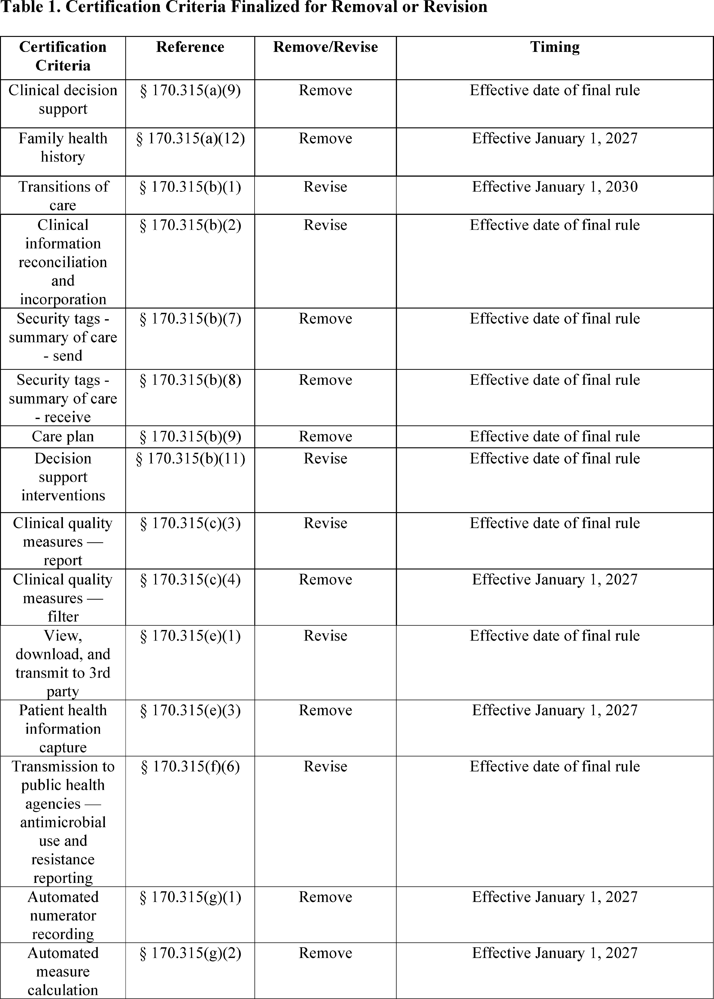
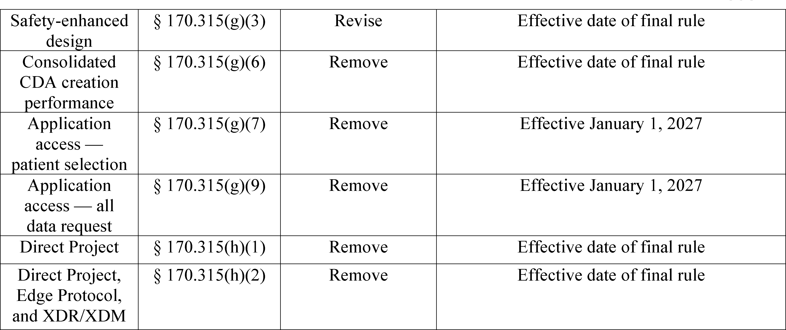
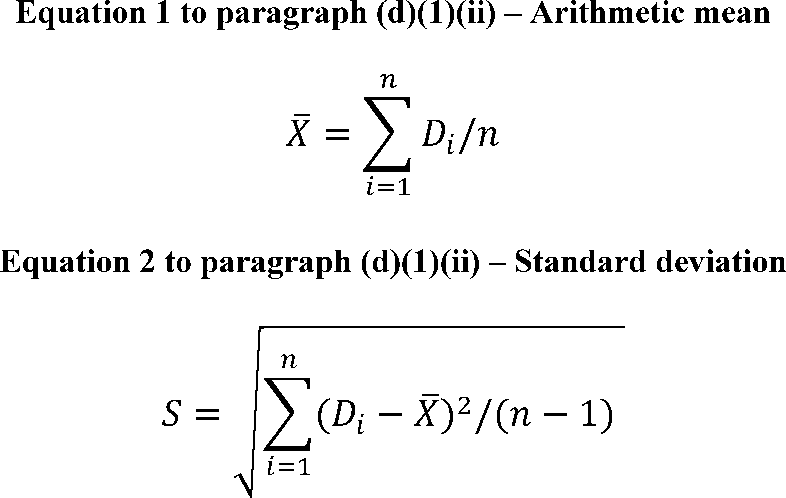

# Daily Digest — 2026-10-28

| | |
|---|---|
| **Digest date** | 2026-10-28 |
| **Data date range** | 2026-10-28 to 2026-10-28 |
| **Generated at** | 2026-10-29T04:02:47Z (UTC) |
| **Pipeline version** | 5384d88a |
| **Inference** | model layers ran — cli/haiku, opus |
| **Source watermarks** | CREC: 2026-10-27T08:25:56Z · BILLS: 2026-10-29T03:38:38Z · FR: 2026-10-28T15:52:11Z · USCOURTS: 2026-10-28T22:54:04Z · PLAW: 2026-10-28T21:03:13Z |

[Full observed listing for this day](day/2026-10-28.html) — the items our collectors observed for this publication day, mechanical rules applied, frozen at end of day; releases their publishers date on other days are counted there, not listed. This digest is the canonical record.

All items below cite the govinfo package (and granule, where applicable) they
summarize. Selection is mechanical; each item states the rule that included
it. See the Coverage Statement at the end for a full accounting of what was
published, what was summarized, and what was excluded and why.

---

## Contents

- [Day in Review](#day-in-review)
- [1. Congressional Floor Activity](#1-congressional-floor-activity)
- [2. Legislation](#2-legislation)
- [3. Federal Register](#3-federal-register)
- [4. Enacted Laws](#4-enacted-laws)
- [5. Judicial Activity](#5-judicial-activity)
- [6. Agency Announcements](#6-agency-announcements)
- [7. Recorded Votes](#7-recorded-votes)
- [8. Bill Actions](#8-bill-actions)
- [9. Presidential Actions](#9-presidential-actions)
- [Terms Used Today](#terms-used-today)
- [Coverage Statement](#coverage-statement)
- [Methodology](#methodology)

---

## Day in Review

The digest carries nine bills introduced in the House and three public laws approved October 20, 2026. These laws take about 1,082.63 acres of federal land in Washington into trust for the Lower Elwha Klallam Tribe, direct the conveyance of about 3.372 acres in Anchorage to the Southcentral Foundation, and redesignate Chiricahua National Monument in Arizona as Chiricahua National Park.

On the executive side, the digest carries ten final rules, three proposed rules and four presidential documents in the Federal Register, plus one separately posted proclamation. Two section 232 proclamations concur with Commerce Department findings on imports, one on wind turbines and one, dated October 28, on robotics and industrial machinery. Executive Order 14438 directs the Federal Housing Finance Agency to set up a mortgage insurance cancellation pilot at Fannie Mae and Freddie Mac. A Defense Production Act determination designates domestic petroleum capacity as essential to the national defense. Final rules include HHS health IT revisions, EPA formaldehyde standard updates and OGE financial disclosure threshold changes. The Copyright Office issued a proposed rule in its triennial DMCA exemption proceeding.

The digest carries 52 appellate, 988 district and two bankruptcy court opinions. The Fourth Circuit affirmed the dismissal of five class actions under a West Virginia statute that the district court had held facially unconstitutional. The Fifth Circuit held that qualified immunity does not apply to FLSA retaliation claims. The Eleventh Circuit held that the 2018 amendment to section 924(c) cannot be an extraordinary and compelling reason for a sentence reduction. The Tenth Circuit reversed summary judgment for a Colorado school district on religious discrimination claims.

*Composed from the summarized items below and the day's mechanical
counts; all specifics are cited in their sections.*

---

## 1. Congressional Floor Activity

No Congressional Record issue was observed on this day. The Record for a day's proceedings is typically published by govinfo the following morning; it appears in the digest for the day it is observed ([how our clocks work](faq.html#fapds-three-clocks)).

### 1.1 Senate

No Senate floor items met the selection thresholds. 0 floor granule(s) are accounted for in the Coverage Statement.

### 1.2 House of Representatives

No House floor items met the selection thresholds. 0 floor granule(s) are accounted for in the Coverage Statement.

### 1.3 Recorded Votes

No recorded votes were published in this issue of the Congressional Record.

---

## 2. Legislation

Source: Congressional Bills (BILLS), text versions published 2026-10-28 to 2026-10-28.

### 2.1 Counts by Stage

| Stage (bill text version) | Count |
|---|---|
| Introduced (ih/is) | 9 |
| Reported (rh/rs) | 0 |
| Engrossed (eh/es) | 0 |
| Enrolled (enr) | 0 |
| Other versions | 0 |
| **Total bill texts published** | **9** |

### 2.2 Bills Listed by Mechanical Rule

Bills below are listed because they matched at least one listing rule; the
matching rule is stated per item. All other bill texts are counted above and
accounted for in the Coverage Statement.

No bill texts published in this range matched a listing rule; all 9 are
accounted for in the Coverage Statement.

---

## 3. Federal Register

Source: Federal Register (FR), issue of 2026-10-28.

### 3.1 Counts by Document Type

| Document type | Count |
|---|---|
| Rules | 10 |
| Proposed rules | 3 |
| Notices | 87 |
| Presidential documents | 4 |
| **Total FR documents** | **104** |

### 3.2 Rules Published

Tags: department of commerce · department of health and human services · executive · model keys: airspace changes · fishery quota transfers · health information technology

*In plain terms: Ten final rules, led by an ONC health information technology rule and an OGE update to gift and travel reporting thresholds; the rest cover FAA airspace changes, fishery quota transfers, and corrections.*

#### DEPARTMENT OF COMMERCE

- **Fisheries of the Northeastern United States; Summer Flounder Fishery; Quota Transfer From Virginia to New Jersey** (2026-22003; 50 CFR Part 648) — NMFS announces that the Commonwealth of Virginia is transferring a portion of its 2026 commercial summer flounder quota to the State of New Jersey. This adjustment to the 2026 fishing year quota is necessary to comply with the Summer Flounder, Scup, and Black Sea Bass Fishery Management Plan (FMP) quota transfer provisions. This announcement informs the public of the revised 2026 commercial quotas for Virginia and New Jersey. Action: Temporary rule; quota transfer. Dates: Effective October 27, 2026, through December 31, 2026.
  - *In plain terms:* The National Marine Fisheries Service announces that Virginia is transferring part of its 2026 commercial summer flounder quota to New Jersey, revising both states' 2026 commercial quotas under the fishery management plan.
  - Included because: FR-SEL-01 — document type: final rule (all listed)
  - Source: [FR-2026-10-28 / 2026-22003](https://www.govinfo.gov/app/details/FR-2026-10-28/2026-22003)
- **Fisheries of the Northeastern United States; Atlantic Bluefish Fishery; Quota Transfer From New York to North Carolina** (2026-22007; 50 CFR Part 648) — NMFS announces that the State of New York is transferring a portion of their 2026 commercial bluefish quota to the State of North Carolina. This quota adjustment is necessary to comply with the Atlantic Bluefish Fishery Management Plan (FMP) quota transfer provisions. This announcement informs the public of the revised 2026 commercial bluefish quotas for New York and North Carolina. Action: Temporary rule; quota transfer. Dates: Effective October 27, 2026 through December 31, 2026.
  - *In plain terms:* The National Marine Fisheries Service announces that New York is transferring part of its 2026 commercial bluefish quota to North Carolina, revising both states' 2026 commercial quotas under the Atlantic Bluefish fishery management plan.
  - Included because: FR-SEL-01 — document type: final rule (all listed)
  - Source: [FR-2026-10-28 / 2026-22007](https://www.govinfo.gov/app/details/FR-2026-10-28/2026-22007)

#### DEPARTMENT OF HEALTH AND HUMAN SERVICES

- **Health Data, Technology, and Interoperability: ONC Deregulatory Actions To Unleash Prosperity** (2026-21943; 45 CFR Parts 170 and 172) — This final rule focuses on deregulatory actions identified in HHS regulations regarding health information technology standards, implementation specifications, and certification criteria and regarding certification programs for health information technology. This final rule reduces burden, offers flexibility to both developers and providers, and supports innovation through the removal and revision of certain certification criteria and regulatory provisions. Action: Final rule. Dates: This final rule is effective on December 28, 2026, except for amendatory instructions 7, 10, and 12 which are effective January 1, 2027. The incorporation by reference of certain material listed in the rule was approved by the Director of the Federal Register between February 12, 2010, and October 1, 2025.
  - *In plain terms:* This final rule removes and revises certain health information technology certification criteria and regulatory provisions to reduce burden and offer flexibility to developers and providers.
  - Included because: FR-SEL-01 — document type: final rule (all listed)
  - Source: [FR-2026-10-28 / 2026-21943](https://www.govinfo.gov/app/details/FR-2026-10-28/2026-21943)
  -  *Source graphic 1 of 11 from 2026-21943.*
  -  *Source graphic 2 of 11 from 2026-21943.*
  - *Graphics not rendered here: 9 of 11 — see the [source PDF](https://www.govinfo.gov/content/pkg/FR-2026-10-28/pdf/FR-2026-10-28.pdf).*

#### DEPARTMENT OF THE INTERIOR

- **Alaska; Wildlife, Harvest, and Access; Correction** (2026-21965; 36 CFR Part 13) — The National Park Service (NPS) is correcting a final rule that appeared in the Federal Register on October 19, 2026. The rule amended regulations for hunting, fishing, trapping, and other harvest-related activities in Alaska and the procedures used to restrict public use and access in Alaska park areas, including for subsistence. Action: Final rule; correction. Dates: Effective November 18, 2026.
  - *In plain terms:* The National Park Service is correcting an October 19, 2026 final rule that amended Alaska hunting, fishing, trapping, and other harvest rules, plus procedures for restricting public use and access in park areas.
  - Included because: FR-SEL-01 — document type: final rule (all listed)
  - Source: [FR-2026-10-28 / 2026-21965](https://www.govinfo.gov/app/details/FR-2026-10-28/2026-21965)

#### DEPARTMENT OF TRANSPORTATION

- **Modification of Class E Airspace, Samaritan North Lincoln Hospital Heliport, Lincoln City, OR** (2026-21978; 14 CFR Part 71) — This action modifies Class E airspace extending upward from 700 feet above the surface at Samaritan North Lincoln Hospital Heliport, Lincoln City, OR. This action supports the safety and management of instrument flight rules (IFR) operations at the heliport. Action: Final rule. Dates: Effective date 0901 UTC, December 24, 2026. The Director of the Federal Register approves this incorporation by reference action under 1 CFR part 51, subject to the annual revision of FAA Order JO 7400.11 and publication of conforming amendments.
  - *In plain terms:* The FAA modifies controlled airspace extending upward from 700 feet above the surface at Samaritan North Lincoln Hospital Heliport in Lincoln City, Oregon, to support safe instrument flight operations there.
  - Included because: FR-SEL-01 — document type: final rule (all listed)
  - Source: [FR-2026-10-28 / 2026-21978](https://www.govinfo.gov/app/details/FR-2026-10-28/2026-21978)
- **Establishment of Class E Airspace; DeKalb, IL; Correction** (2026-21991; 14 CFR Part 71) — This action corrects a final rule published by the FAA in the Federal Register on September 22, 2026, establishing Class E airspace at Northwestern Memorial Healthcare Heliport, DeKalb, IL. Specifically, this action corrects a typographic error in the airspace legal description. Action: Final rule; correction. Dates: The effective date of the final rule published in the Federal Register on September 22, 2026, remains 0901 UTC February 18, 2027. The Director of the Federal Register approves this incorporation by reference action under 1 CFR part 51, subject to the annual revision of FAA Order JO 7400.11 and publication of conforming amendments.
  - *In plain terms:* The FAA corrects a September 22, 2026 final rule that set up controlled airspace at Northwestern Memorial Healthcare Heliport in DeKalb, Illinois, to fix a typographical error in its legal description of the airspace.
  - Included because: FR-SEL-01 — document type: final rule (all listed)
  - Source: [FR-2026-10-28 / 2026-21991](https://www.govinfo.gov/app/details/FR-2026-10-28/2026-21991)
- **Establishment of Class E Airspace; Ottawa, IL; Correction** (2026-21995; 14 CFR Part 71) — This action corrects a final rule published by the FAA in the Federal Register on September 22, 2026, establishing Class E airspace at OSF St Elizabeth Medical Center Heliport, Ottawa, IL. This action corrects a typographical error in the airspace legal description. Action: Final rule; correction. Dates: The effective date of the final rule published in the Federal Register on September 22, 2026 remains 0901 UTC, December 24, 2026. The Director of the Federal Register approves this incorporation by reference action under 1 CFR part 51, subject to the annual revision of FAA Order JO 7400.11 and publication of conforming amendments.
  - *In plain terms:* The FAA corrects a September 22, 2026 final rule that set up controlled airspace at OSF St Elizabeth Medical Center Heliport in Ottawa, Illinois, to fix a typo in the airspace legal description.
  - Included because: FR-SEL-01 — document type: final rule (all listed)
  - Source: [FR-2026-10-28 / 2026-21995](https://www.govinfo.gov/app/details/FR-2026-10-28/2026-21995)

#### ENVIRONMENTAL PROTECTION AGENCY

- **Voluntary Consensus Standards Update; Formaldehyde Emission Standards for Composite Wood Products** (2026-21963; 40 CFR Part 770) — The Environmental Protection Agency (EPA) is publishing a final rule to update the incorporation by reference of several voluntary consensus standards in the Agency's formaldehyde standards for composite wood products regulations under the Toxic Substances Control Act (TSCA) due to the standards having been updated or superseded by the issuing organizations. These new standards primarily update test methods and product standards concerning composite wood products that use formaldehyde. EPA is also conforming these updated standards in the scope and definitional sections in the final rule and incorporating by reference a new small scale quality control chamber test method, similar to current methods already incorporated by reference. EPA is also removing one standard that was previously incorporated by reference to avoid redundancy, given that another identical, internationally recognized version of the standard is already incorporated by reference in this rule. Action: Final rule. Dates: This final rule is effective on November 27, 2026. The incorporation by reference of certain material listed in the rule is approved by the Director of the Federal Register as of November 27, 2026. The incorporation by reference of certain other material listed in the rule was approved by the Director of the Federal Register as of February 10, 2017, February 7, 2018, August 21, 2019, and March 23, 2023.
  - *In plain terms:* EPA is finalizing updates to voluntary standards referenced in formaldehyde rules for composite wood products, mainly test methods and product standards, adding one new small-scale chamber test method and removing one redundant standard.
  - Included because: FR-SEL-01 — document type: final rule (all listed)
  - Source: [FR-2026-10-28 / 2026-21963](https://www.govinfo.gov/app/details/FR-2026-10-28/2026-21963)
  -  *Source graphic 1 of 1 from 2026-21963.*

#### FEDERAL COMMUNICATIONS COMMISSION

- **Television Broadcasting Services Elko, Nevada** (2026-22034; 47 CFR Part 73) — This document amends the Table of TV Allotments (table) of the Federal Communications Commission's (Commission) rules by substituting VHF channel 10 for UHF channel 20 at Elko, Nevada in response to a petition for rulemaking filed by Reno (KENV-TV) Licensee, Inc. (Licensee), the licensee of full power television station KENV-DT (KENV-DT or Station), Elko, Nevada. The Media Bureau (Bureau) previously granted a petition for rulemaking submitted by the Licensee to substitute UHF channel 20 for VHF channel 10 at Elko in the table, and subsequently granted a construction permit for its new channel. The Licensee states that it was unable to complete construction of the channel 20 facility by the deadline specified in the Station's construction permit. The Licensee filed the instant petition to amend the table to substitute VHF channel 10 for UHF channel 20 and allow KENV-DT to continue to operate on channel 10 at its licensed parameters and provide uninterrupted service to viewers. The staff engineering analysis finds that the proposal is in compliance with the Commission's principal community coverage and technical requirements, including the interference protection requirements. [official summary truncated; see source] Action: Final rule. Dates: Effective October 28, 2026.
  - *In plain terms:* The FCC amends its TV allotment table to substitute VHF channel 10 for UHF channel 20 at Elko, Nevada, at the licensee's request after it missed the channel 20 construction deadline.
  - Included because: FR-SEL-01 — document type: final rule (all listed)
  - Source: [FR-2026-10-28 / 2026-22034](https://www.govinfo.gov/app/details/FR-2026-10-28/2026-22034)

#### OFFICE OF GOVERNMENT ETHICS

- **Executive Branch Financial Disclosure and Standards of Ethical Conduct Regulations** (2026-21997; 5 CFR Parts 2634 and 2635) — The U.S. Office of Government Ethics (OGE) is updating its executive branch regulation on financial disclosure to reflect the retroactive statutory increase of the reporting thresholds for gifts and travel reimbursements. OGE is also updating the executive branchwide standards of ethical conduct regulation to raise the widely attended gatherings nonsponsor gifts exception dollar ceiling tied to these thresholds. This latter change is not retroactive. Action: Final rule; technical amendments. Dates: Effective date: This final rule is effective October 28, 2026. Applicability date: The amendments to 5 CFR 2634.304 and 2634.907 are applicable as of January 1, 2026.
  - *In plain terms:* The Office of Government Ethics is updating financial disclosure rules to reflect a retroactive statutory increase in gift and travel reporting thresholds, and raising the widely attended gatherings gift ceiling, not retroactively.
  - Included because: FR-SEL-01 — document type: final rule (all listed)
  - Source: [FR-2026-10-28 / 2026-21997](https://www.govinfo.gov/app/details/FR-2026-10-28/2026-21997)

### 3.3 Proposed Rules Published

Tags: department of commerce · department of health and human services · executive · model keys: airworthiness directives · coast guard zone · dmca exemptions

*In plain terms: Three proposals today: an FAA move to supersede an Airbus Helicopters airworthiness directive, a Coast Guard zone for the E1 Miami Grand Prix, and a Copyright Office DMCA exemption review.*

#### DEPARTMENT OF HOMELAND SECURITY

- **Special Local Regulation; Port Miami Main Shipping Channel, Miami FL** (2026-21949; 33 CFR Part 100) — The Coast Guard is proposing to establish a temporary special local regulation (SLR) for certain navigable waters of the Miami Shipping Channel offshore of Port Miami, Miami, FL in connection with the E1 Miami Grand Prix. The SLR is needed to protect personnel, vessels, and the marine environment from potential hazards created by high-speed powerboat racing. This proposed rulemaking would prohibit persons and vessels from being in or loitering around the regulated area unless specifically authorized by the Captain of the Port, Sector Miami. We invite your comments on this proposed rulemaking. Action: Notice of proposed rulemaking. Dates: Comments and related material must be received by the Coast Guard on or before November 4, 2026.
  - *In plain terms:* The Coast Guard proposes a temporary rule restricting Miami Shipping Channel waters off Port Miami during the E1 Miami Grand Prix, barring people and vessels unless the Captain of the Port authorizes them.
  - Included because: FR-SEL-02 — document type: proposed rule (all listed)
  - Source: [FR-2026-10-28 / 2026-21949](https://www.govinfo.gov/app/details/FR-2026-10-28/2026-21949)

#### DEPARTMENT OF TRANSPORTATION

- **Airworthiness Directives; Airbus Helicopters** (2026-21932; 14 CFR Part 39) — The FAA proposes to supersede Airworthiness Directive (AD) 2013-01-05, which applies to certain Airbus Helicopters (Eurocopter France) Model AS350B3 and EC130B4 helicopters. AD 2013-01-05 requires revising the Limitations section of the rotorcraft flight manual (RFM) supplement to reduce the starter generator operating current to 180 amperes (amps) and installing a placard in the instrument panel to indicate the revised limitation. Since the FAA issued AD 2013-01-05, the manufacturer determined the applicability needs to be revised to add helicopters equipped with certain part numbered starter generators and to remove helicopters with certain engines installed. This proposed AD would require revising the Limitations section of the RFM supplement of the existing RFM for the helicopter, to reduce the starter generator operating current to 180 amps and installing a placard in the instrument panel indicating the revised limitation. The FAA is proposing this AD to address the unsafe condition on these products. Action: Notice of proposed rulemaking (NPRM). Dates: The FAA must receive comments on this NPRM by December 14, 2026.
  - *In plain terms:* The Federal Aviation Administration proposes replacing safety directive 2013-01-05 for certain Airbus Helicopters AS350B3 and EC130B4 models, lowering starter generator current to 180 amps with a flight manual change and instrument panel placard.
  - Included because: FR-SEL-02 — document type: proposed rule (all listed)
  - Source: [FR-2026-10-28 / 2026-21932](https://www.govinfo.gov/app/details/FR-2026-10-28/2026-21932)

#### LIBRARY OF CONGRESS

- **Exemptions To Permit Circumvention of Access Controls on Copyrighted Works** (2026-21939; 37 CFR Part 201) — The United States Copyright Office is conducting the tenth triennial rulemaking proceeding under the Digital Millennium Copyright Act (“DMCA”), concerning temporary exemptions to the DMCA's prohibition against circumvention of technological measures that control access to copyrighted works. Having carefully considered the petitions for new and renewal exemptions and comments received in response to the June 9, 2026 Notification of Inquiry, the Office announces the Register's intention to recommend all but one of the existing exemptions for renewal, and initiates three rounds of public comment on newly proposed exemptions. Comments submitted may not exceed twenty-five pages per class, excluding documentary evidence. Action: Notice of proposed rulemaking. Dates: Initial written comments, along with any documentary or multimedia evidence, from proponents and other members of the public who support the adoption of a proposed exemption, as well as those that neither support nor oppose an exemption but seek to share pertinent information, are due December 7, 2026. Written response comments, along with any documentary or multimedia evidence, from those who oppose the adoption of a proposed exemption are due February 22, 2027. Written reply comments from supporters of a proposal and parties that neither support nor oppose a proposal are due March 22, 2027.
  - *In plain terms:* The Copyright Office's tenth three-year review under the Digital Millennium Copyright Act intends to renew all but one existing exemption and opens three comment rounds on new ones, capped at 25 pages per class.
  - Included because: FR-SEL-02 — document type: proposed rule (all listed)
  - Source: [FR-2026-10-28 / 2026-21939](https://www.govinfo.gov/app/details/FR-2026-10-28/2026-21939)

### 3.4 Notices and Presidential Documents

Tags: department of commerce · department of health and human services · executive · model keys: defense production act · executive orders · wind turbine imports

*In plain terms: Four presidential actions, led by Executive Order 14438 on a Fannie Mae and Freddie Mac housing cost pilot; the others cover wind turbine import adjustments, National Seafood Month, and a Defense Production Act determination.*

Notices are summarized only when they match a listing rule; all are counted
in 3.1 and in the Coverage Statement. Presidential documents in the FR are
always listed.

- **Adjusting Imports of Wind Turbines and Their Parts and Components Into the United States** (2026-22049) — Proclamation 11074 of October 22, 2026, titled 'Adjusting Imports of Wind Turbines and Their Parts and Components Into the United States,' concurs with the Secretary of Commerce's finding under section 232 of the Trade Expansion Act of 1962 that these imports are entering under circumstances that threaten to impair national security. It directs the Secretary of Commerce and the United States Trade Representative to pursue or continue negotiations with foreign trading partners and to report on progress within 180 days, and states that certain wind turbine components made of aluminum, steel, or copper are subject to tariffs under Proclamations 9704, 9705, and 10962. The proclamation cites the Secretary's findings on grid reliability, cybersecurity risks in imported networked inverters, and radar interference.
  - *In plain terms:* Proclamation 11074 of October 22, 2026, agrees that wind turbine imports threaten to impair national security, directs trade negotiations with a 180-day progress report, and states certain steel, aluminum, and copper components face tariffs.
  - Included because: FR-SEL-03 — presidential document (all listed)
  - Source: [FR-2026-10-28 / 2026-22049](https://www.govinfo.gov/app/details/FR-2026-10-28/2026-22049)
  - Corroborated across time: the same document was first published by the White House on [2026-10-22](https://www.whitehouse.gov/presidential-actions/2026/10/adjusting-imports-of-wind-turbines-and-their-parts-and-components-into-the-united-states/), days before the Federal Register compiled it. Listed here as the official record of this day — the earlier publication is referenced, not suppressed; both observations are preserved and counted.
- **National Seafood Month, 2026** (2026-22050) — Proclamation 11075 of October 22, 2026, designates October 2026 as National Seafood Month and calls on Americans to express thanks to those who work in the seafood industry and to hold appropriate events and ceremonies. The proclamation summarizes actions taken by the current Administration on seafood, including an Executive Order on seafood competitiveness, the launch of the Department of Agriculture Office of Seafood, three proclamations restoring commercial fishing access in the Atlantic and Pacific Oceans, and $123.6 million in fishery disaster assistance. It states that the U.S. seafood industry harvests about 8.5 billion pounds of seafood annually, supports more than one million jobs, and generates more than $173 billion in commerce.
  - *In plain terms:* Proclamation 11075 of October 22, 2026, designates October 2026 as National Seafood Month, calling on Americans to thank seafood workers and hold appropriate events and ceremonies.
  - Included because: FR-SEL-03 — presidential document (all listed)
  - Source: [FR-2026-10-28 / 2026-22050](https://www.govinfo.gov/app/details/FR-2026-10-28/2026-22050)
  - Corroborated across time: the same document was first published by the White House on [2026-10-22](https://www.whitehouse.gov/presidential-actions/2026/10/national-seafood-month-2026/), days before the Federal Register compiled it. Listed here as the official record of this day — the earlier publication is referenced, not suppressed; both observations are preserved and counted.
- **Decreasing Housing Costs for the American People** (2026-22051) — Executive Order 14438 of October 22, 2026, titled 'Decreasing Housing Costs for the American People,' directs the Director of the Federal Housing Finance Agency to establish a pilot program under which Fannie Mae and Freddie Mac proactively cancel mortgage insurance on eligible single-family loans using automated valuation models, and to expand the title acceptance pilot into an ongoing nationwide program for eligible refinances. The order establishes a Task Force on Manufactured Housing Innovation, co-chaired by the Secretaries of Housing and Urban Development and the Director of the Federal Housing Finance Agency, which must submit recommendations within 180 days on factory-built housing. It also directs the Secretary of Agriculture and the Secretary of Veterans Affairs to reduce interest rates on single-family loans made directly by their departments, consistent with applicable law and available appropriations.
  - *In plain terms:* Executive Order 14438 of October 22, 2026, directs Fannie Mae and Freddie Mac to cancel mortgage insurance on eligible loans, creates a manufactured-housing task force, and directs Agriculture and Veterans Affairs to reduce loan rates.
  - Included because: FR-SEL-03 — presidential document (all listed)
  - Source: [FR-2026-10-28 / 2026-22051](https://www.govinfo.gov/app/details/FR-2026-10-28/2026-22051)
  - Corroborated across time: the same document was first published by the White House on [2026-10-22](https://www.whitehouse.gov/presidential-actions/2026/10/decreasing-housing-costs-for-the-american-people/), days before the Federal Register compiled it. Listed here as the official record of this day — the earlier publication is referenced, not suppressed; both observations are preserved and counted.
- **Presidential Determination Pursuant to Section 303 of the Defense Production Act of 1950, as Amended, on Domestic Petroleum Production, Refining, and Logistics Capacity** (2026-22052) — Presidential Determination No. 2027-01 of October 22, 2026, addressed to the Secretary of War, determines under section 303 of the Defense Production Act of 1950, as amended, that domestic petroleum production, refining, and logistics capacity are industrial resources, materials, or critical technology items essential to the national defense. The determination states that industry cannot reasonably provide these capabilities in a timely manner without Presidential action, and it waives the requirements of section 303(a)(1) through (a)(6) for the purpose of expanding such capacity. It authorizes and directs the Secretary to implement the determination, including making necessary purchases, commitments, and financial instruments, and supersedes inconsistent prior directives to that extent.
  - *In plain terms:* Presidential Determination 2027-01 of October 22, 2026, finds domestic petroleum production, refining, and logistics capacity essential to national defense, waives Defense Production Act requirements to expand it, and authorizes the Secretary of War to act.
  - Included because: FR-SEL-03 — presidential document (all listed)
  - Source: [FR-2026-10-28 / 2026-22052](https://www.govinfo.gov/app/details/FR-2026-10-28/2026-22052)
  - Corroborated across time: the same document was first published by the White House on [2026-10-22](https://www.whitehouse.gov/presidential-actions/2026/10/presidential-determination-pursuant-to-section-303-of-the-defense-production-act-of-1950-as-amended-on-domestic-petroleum-production-refining-and-logistics-capacity-c139/), days before the Federal Register compiled it. Listed here as the official record of this day — the earlier publication is referenced, not suppressed; both observations are preserved and counted.

---

## 4. Enacted Laws

Tags: legislative · model keys: alaska land conveyance · federal land transfers · national park redesignation

*In plain terms: Three laws approved October 20: one takes about 1,082 acres in Washington into trust for the Lower Elwha Klallam, one redesignates Arizona's Chiricahua National Monument as a national park, and one conveys Alaska land.*

Source: Public and Private Laws (PLAW) published 2026-10-28.

- **Public Law 119–128 — Public Law 119–128: To take certain Federal land in the State of Washington into trust for the Lower Elwha Klallam Tribe, and for other purposes.** — Public Law 119-128, approved October 20, 2026, takes approximately 1,082.63 acres of federal land in Washington State, shown as "NPS Parcels to be Transferred to Tribe" on a December 2021 Olympic National Park map, into trust for the Lower Elwha Klallam Tribe and includes that land in the Lower Elwha Reservation. The Act exempts the land from valuation requirements, directs the Secretary of the Interior to survey its boundaries, and provides that the land is not Indian lands under the Indian Gaming Regulatory Act. It also states that nothing in the Act affects rights under the Treaty of Point no Point of January 26, 1855. Approved: 2026-10-20.
  - *In plain terms:* Public Law 119-128, approved October 20, 2026, places about 1,082.63 acres of federal land in Washington State into trust for the Lower Elwha Klallam Tribe and adds it to the Lower Elwha Reservation.
  - Included because: PLAW-SEL-01 — enacted into law (all public and private laws are listed) (document dated 2026-10-20)
  - Source: [PLAW-119publ128](https://www.govinfo.gov/app/details/PLAW-119publ128)
- **Public Law 119–130 — Public Law 119–130: To provide for the conveyance of certain property to the Southcentral Foundation located in Anchorage, Alaska, and for other purposes.** — Public Law 119-130, approved October 20, 2026, known as the Southcentral Foundation Land Transfer Act of 2025, directs the Secretary of Health and Human Services to convey approximately 3.372 acres in Lot 1A, Block 36 East Addition, Anchorage, Alaska, to the Southcentral Foundation by warranty deed within two years of enactment. The conveyance requires no consideration, imposes no obligations or conditions on the Foundation, and creates no reversionary interest for the United States, and it supersedes any prior quitclaim deed for the property. The Act provides that the Foundation is not liable for pre-conveyance environmental contamination on the property and requires the Secretary to comply with CERCLA section 120(h). Approved: 2026-10-20.
  - *In plain terms:* Public Law 119-130, approved October 20, 2026, directs the Health and Human Services Secretary to convey 3.372 acres in Anchorage, Alaska, to the Southcentral Foundation at no cost by warranty deed within two years of enactment.
  - Included because: PLAW-SEL-01 — enacted into law (all public and private laws are listed) (document dated 2026-10-20)
  - Source: [PLAW-119publ130](https://www.govinfo.gov/app/details/PLAW-119publ130)
- **Public Law 119–133 — Public Law 119–133: To redesignate the Chiricahua National Monument in the State of Arizona as Chiricahua National Park, and for other purposes.** — Public Law 119-133, approved October 20, 2026, known as the Chiricahua National Park Act, redesignates the Chiricahua National Monument in Arizona as Chiricahua National Park, with boundaries unchanged from the monument's boundaries on the date of enactment as shown on a March 2021 map. The Act provides that references in federal law and records to the monument refer to the park and that funds available for the monument are available for the park. The Secretary of the Interior is directed to administer the park under existing presidential proclamations and the laws generally applicable to National Park System units, and to protect traditional cultural and religious sites in consultation with Indian Tribes, including tribal access and temporary closures on request. Approved: 2026-10-20.
  - *In plain terms:* Public Law 119-133, approved October 20, 2026, renames Chiricahua National Monument in Arizona as Chiricahua National Park, keeping its boundaries unchanged and treating references to the monument as references to the park.
  - Included because: PLAW-SEL-01 — enacted into law (all public and private laws are listed) (document dated 2026-10-20)
  - Source: [PLAW-119publ133](https://www.govinfo.gov/app/details/PLAW-119publ133)

---

## 5. Judicial Activity

Source: United States Courts Opinions (USCOURTS): opinions observed 2026-10-28
by our collector; each opinion states its own issue date beside its
listing ([how our clocks work](faq.html#fapds-three-clocks)).

Completeness disclosure (standing): USCOURTS carries opinions from
approximately 140 participating appellate, district, bankruptcy, and
national federal courts. Unlike the Congressional Record and the Federal
Register, which are the complete official record of their branches,
USCOURTS is participation-based and is NOT the complete federal judicial
record. Courts post opinions with delay — typically over several days —
so a day's digest carries the opinions that became available that day,
whatever date each was issued.

### 5.1 Appellate and National Court Opinions

Tags: judicial · model keys: immigration petitions · sentencing appeals · tenth circuit appeals

*In plain terms: 52 appellate items from seven circuits, led by a Tenth Circuit reversal in McNellis v. Douglas County School District and resentencing affirmances in United States v. Hess; many are dismissals and immigration petitions.*

Appellate and national court opinions are summarized; district and
bankruptcy opinions are counted in 5.2 and in the Coverage Statement.

#### United States Court of Appeals for the Eleventh Circuit

- **USA v. Alonzo Hill, Jr.** (No. 23-10149; filed 2026-10-27) — In this unpublished per curiam opinion, the Eleventh Circuit affirmed Alonzo Hill's conviction for possession of a firearm as a convicted felon and his 15-year mandatory minimum sentence under the Armed Career Criminal Act. The court held that the change-of-plea colloquy adequately addressed the core requirements of a knowing and voluntary plea, so there was no plain error. Applying plain-error review to the claim under Erlinger v. United States, the court held that Hill had not shown a reasonable probability that a jury would have found his three prior offenses did not occur on different occasions, citing their timing, location, and drug types.
  - *In plain terms:* In an unpublished opinion, the Eleventh Circuit affirmed Alonzo Hill's conviction for possessing a firearm as a convicted felon and his required 15-year minimum sentence under the Armed Career Criminal Act.
  - Included because: USCOURTS-SEL-01 — appellate court opinion (all listed) (document dated 2026-10-27)
  - Source: [USCOURTS-ca11-23-10149 / USCOURTS-ca11-23-10149-0](https://www.govinfo.gov/app/details/USCOURTS-ca11-23-10149/USCOURTS-ca11-23-10149-0)
- **Dorian O'Kelley v. Warden GDP** (No. 23-12947; filed 2026-10-27) — In this published opinion, the Eleventh Circuit affirmed the denial of the federal habeas corpus petition of Dorian Frank O'Kelley, a Georgia inmate sentenced to death. The court held that the U.S. Constitution did not require the district court to notify O'Kelley of its intent to dismiss six subclaims as insufficiently pleaded under Habeas Rule 2(c), or to give him an opportunity to amend before dismissing them. The opinion also describes the procedural history, including the district court's denial of reconsideration and of leave to amend.
  - *In plain terms:* The Eleventh Circuit upheld the rejection of a federal challenge by Georgia death-sentenced inmate Dorian Frank O'Kelley, holding that six insufficiently pleaded subclaims could be dismissed without notice or a chance to amend.
  - Included because: USCOURTS-SEL-01 — appellate court opinion (all listed) (document dated 2026-10-27)
  - Source: [USCOURTS-ca11-23-12947 / USCOURTS-ca11-23-12947-0](https://www.govinfo.gov/app/details/USCOURTS-ca11-23-12947/USCOURTS-ca11-23-12947-0)
- **USA v. Abel Rizo** (No. 24-11349; filed 2026-10-27) — In this published opinion, the Eleventh Circuit held that it has jurisdiction over the government's appeal of a sentence reduction granted to Abel Rizo under 18 U.S.C. 3582(c)(1)(A)(i). The court held that, under Rutherford v. United States (2026), the 2018 non-retroactive amendment to 18 U.S.C. 924(c) cannot, as a matter of law, constitute an extraordinary and compelling reason for a sentence reduction. The court therefore reversed the district court's order reducing Rizo's consecutive sentence for his second 924(c) conviction from 20 years to 5 years.
  - *In plain terms:* The Eleventh Circuit reversed an order cutting Abel Rizo's consecutive sentence for a second firearm conviction from 20 years to 5 years, holding that a 2018 non-retroactive amendment cannot justify a reduction.
  - Included because: USCOURTS-SEL-01 — appellate court opinion (all listed) (document dated 2026-10-27)
  - Source: [USCOURTS-ca11-24-11349 / USCOURTS-ca11-24-11349-0](https://www.govinfo.gov/app/details/USCOURTS-ca11-24-11349/USCOURTS-ca11-24-11349-0)
- **USA v. Maicor Cepeda-Garcia** (No. 25-13621; filed 2026-10-27) — In this unpublished per curiam opinion, the Eleventh Circuit addresses Maicor Cepeda-Garcia's appeal of his conviction for conspiracy to traffic firearms under 18 U.S.C. 933(a)(3), entered on a guilty plea. He argues that the plea was not knowing and voluntary because the district court did not inform him of the nature of the charges, and that the court should have inquired into a conflict created by the sentence-appeal waiver in his plea agreement. The text provided describes the two change-of-plea hearings, including a first hearing at which the plea was not accepted and a second hearing on July 2, 2026, at which a magistrate judge found the plea knowing, intelligent, and voluntary; it is truncated before the court's final disposition.
  - *In plain terms:* The Eleventh Circuit reviews Maicor Cepeda-Garcia's appeal of his guilty-plea conviction for conspiracy to traffic firearms, arguing his plea was not knowing and voluntary because the nature of the charges was not explained.
  - Included because: USCOURTS-SEL-01 — appellate court opinion (all listed) (document dated 2026-10-27)
  - Source: [USCOURTS-ca11-25-13621 / USCOURTS-ca11-25-13621-0](https://www.govinfo.gov/app/details/USCOURTS-ca11-25-13621/USCOURTS-ca11-25-13621-0)
- **USA v. Anthony Yarbrough** (No. 26-10640; filed 2026-10-27) — In this unpublished per curiam opinion, the Eleventh Circuit granted appointed counsel Perry Russell Steen's motion to withdraw under Anders v. California in the direct criminal appeal of Anthony Steven Yarbrough. After independent review of the entire record, the court found no arguable issues of merit. The court affirmed Yarbrough's convictions and sentences.
  - *In plain terms:* The Eleventh Circuit allowed appointed counsel Perry Russell Steen to withdraw, found no arguable merit issues, and affirmed Anthony Steven Yarbrough's convictions and sentences.
  - Included because: USCOURTS-SEL-01 — appellate court opinion (all listed) (document dated 2026-10-27)
  - Source: [USCOURTS-ca11-26-10640 / USCOURTS-ca11-26-10640-0](https://www.govinfo.gov/app/details/USCOURTS-ca11-26-10640/USCOURTS-ca11-26-10640-0)
- **USA v. Kendrick Lindsay** (No. 26-10734; filed 2026-10-27) — The Eleventh Circuit granted the Government's motion to dismiss Kendrick T. Lindsay's appeal under the appeal waiver in his plea agreement, in an appeal from the Middle District of Florida. The unpublished per curiam order cites Eleventh Circuit and Supreme Court decisions on when sentence appeal waivers are enforced. The order is dated October 27, 2026.
  - *In plain terms:* The Eleventh Circuit granted the government's motion to dismiss Kendrick T. Lindsay's appeal from the Middle District of Florida under his plea agreement's appeal waiver, in an order dated October 27, 2026.
  - Included because: USCOURTS-SEL-01 — appellate court opinion (all listed) (document dated 2026-10-27)
  - Source: [USCOURTS-ca11-26-10734 / USCOURTS-ca11-26-10734-0](https://www.govinfo.gov/app/details/USCOURTS-ca11-26-10734/USCOURTS-ca11-26-10734-0)
- **George Buckley v. Detlef Schneider, et al** (No. 26-11499; filed 2026-10-27) — The Eleventh Circuit affirmed the Southern District of Florida's dismissal, on forum non conveniens grounds, of George Buckley's suit against Detlef Schneider, Rudiger Stahl, Stefan Schneider, TQ-Systems USA, Thomas Kirnberger, and others. The court held that the Munich exclusive-venue clause in the Weframe AG Shareholder Agreement covers Buckley's claims, which include fraudulent inducement and breach of fiduciary duty. The court declined to consider a non-signatory argument raised for the first time on appeal.
  - *In plain terms:* The Eleventh Circuit affirmed dismissal of George Buckley's suit in Florida's Southern District as an inconvenient forum, holding that a Munich exclusive-venue clause in the Weframe AG Shareholder Agreement covers his claims.
  - Included because: USCOURTS-SEL-01 — appellate court opinion (all listed) (document dated 2026-10-27)
  - Source: [USCOURTS-ca11-26-11499 / USCOURTS-ca11-26-11499-0](https://www.govinfo.gov/app/details/USCOURTS-ca11-26-11499/USCOURTS-ca11-26-11499-0)

#### United States Court of Appeals for the Fifth Circuit

- **Dufour v. BP Expl & Prod** (No. 23-60361; filed 2026-10-27) — In an opinion by Judge Richman, the Fifth Circuit affirmed summary judgment for BP Exploration & Production, Inc. and BP America Production Company in a Back-End Litigation Option suit brought by cleanup worker Richard DuFour, Jr., who alleged that exposure to oil and dispersants during Deepwater Horizon response work worsened his asthma. The district court had excluded the causation testimony of DuFour's two experts and denied his request for an evidentiary hearing. The opinion applies general maritime law, which the parties agreed governs, and states that toxic-exposure claims of this kind generally require expert testimony on causation to survive summary judgment.
  - *In plain terms:* The Fifth Circuit affirmed summary judgment for BP entities in a suit by Deepwater Horizon cleanup worker Richard DuFour, Jr., who alleged his asthma was worsened by oil and dispersant exposure.
  - Included because: USCOURTS-SEL-01 — appellate court opinion (all listed) (document dated 2026-10-27)
  - Source: [USCOURTS-ca5-23-60361 / USCOURTS-ca5-23-60361-0](https://www.govinfo.gov/app/details/USCOURTS-ca5-23-60361/USCOURTS-ca5-23-60361-0)
- **Liberty v. North Tarrant** (No. 25-10725; filed 2026-10-27) — In an unpublished per curiam opinion, the Fifth Circuit affirmed summary judgment for Liberty Mutual Fire Insurance Company, holding that it had no duty to defend North Tarrant Infrastructure, L.L.C., Ferrovial Construction US Corporation, and Webber, L.L.C. in lawsuits arising from a February 2021 130-vehicle pileup on I-35W in Fort Worth, Texas. Applying Texas's eight-corners rule, the court found that the underlying petitions alleged failures in roadway maintenance and operation rather than bodily injury arising out of the defendants' completed 2013 to 2018 construction work on the segment. The court did not resolve the parties' dispute over the policy's interpretation, concluding that the claims fell outside even the defendants' own reading of the policy.
  - *In plain terms:* The Fifth Circuit affirmed summary judgment that Liberty Mutual Fire Insurance Company owed no duty to defend North Tarrant Infrastructure and two others in lawsuits over a February 2021 130-vehicle I-35W pileup in Fort Worth.
  - Included because: USCOURTS-SEL-01 — appellate court opinion (all listed) (document dated 2026-10-27)
  - Source: [USCOURTS-ca5-25-10725 / USCOURTS-ca5-25-10725-0](https://www.govinfo.gov/app/details/USCOURTS-ca5-25-10725/USCOURTS-ca5-25-10725-0)
- **Stramaski v. Lawley** (No. 25-20348; filed 2026-10-27) — In an opinion by Judge Willett, the Fifth Circuit affirmed the district court's denial of Mark Lawley's motion to dismiss a Fair Labor Standards Act retaliation suit brought against him individually by former Texas A&M academic advisor Eva Stramaski. The court held that qualified immunity does not apply to FLSA retaliation claims under 29 U.S.C. § 215(a)(3), reasoning that the common law did not immunize such retaliation when Congress authorized private suits in 1977. The complaint alleged that Lawley called Stramaski 'aggressive' about a pay-timing concern, sent her home, issued a coaching letter, and fired her a few days later.
  - *In plain terms:* The Fifth Circuit affirmed denial of Mark Lawley's motion to dismiss a Fair Labor Standards Act retaliation suit by former Texas A&M advisor Eva Stramaski, holding that qualified immunity does not apply to such claims.
  - Included because: USCOURTS-SEL-01 — appellate court opinion (all listed) (document dated 2026-10-27)
  - Source: [USCOURTS-ca5-25-20348 / USCOURTS-ca5-25-20348-0](https://www.govinfo.gov/app/details/USCOURTS-ca5-25-20348/USCOURTS-ca5-25-20348-0)
- **Moriano-Ospina v. Blanche** (No. 25-60430; filed 2026-10-27) — In this unpublished per curiam opinion dated October 27, 2026, the Fifth Circuit addressed a petition for review of a Board of Immigration Appeals order denying Alexis H. Moriano-Ospina's motion to reopen removal proceedings to apply for cancellation of removal. The court held that the Board did not abuse its discretion in rejecting the petitioner's equitable-tolling argument, and it denied that part of the petition. The court also held that it lacked jurisdiction to review the Board's decision not to reopen the proceedings sua sponte, and it dismissed that part of the petition.
  - *In plain terms:* On October 27, 2026, the Fifth Circuit upheld the Board of Immigration Appeals' refusal to reopen Alexis Moriano-Ospina's removal case on equitable-tolling grounds and dismissed, for lack of jurisdiction, the part on own-motion reopening.
  - Included because: USCOURTS-SEL-01 — appellate court opinion (all listed) (document dated 2026-10-27)
  - Source: [USCOURTS-ca5-25-60430 / USCOURTS-ca5-25-60430-0](https://www.govinfo.gov/app/details/USCOURTS-ca5-25-60430/USCOURTS-ca5-25-60430-0)
- **Smith v. Evans** (No. 26-10034; filed 2026-10-27) — In this unpublished per curiam opinion dated October 27, 2026, the Fifth Circuit reviewed a district court judgment that dismissed Jason Finis Smith's complaint with prejudice on immunity grounds. The court determined that Smith had previously filed a notice of voluntary dismissal under Federal Rule of Civil Procedure 41(a)(1)(A)(i) against the same defendants, and that the second dismissal therefore operates as an adjudication on the merits under Rule 41(a)(1)(B). The court modified the judgment to reflect a dismissal under Rule 41(a)(1)(A)(i) and affirmed the judgment as modified.
  - *In plain terms:* On October 27, 2026, the Fifth Circuit modified a judgment dismissing Jason Finis Smith's complaint with prejudice on immunity grounds, recasting it as a voluntary dismissal, and affirmed it as modified.
  - Included because: USCOURTS-SEL-01 — appellate court opinion (all listed) (document dated 2026-10-27)
  - Source: [USCOURTS-ca5-26-10034 / USCOURTS-ca5-26-10034-0](https://www.govinfo.gov/app/details/USCOURTS-ca5-26-10034/USCOURTS-ca5-26-10034-0)
- **Gunter v. Exxon Mobil** (No. 26-20328; filed 2026-10-27) — In this unpublished per curiam opinion dated October 27, 2026, the Fifth Circuit reviewed an appeal by Kyle Gunter from a judgment of the United States District Court for the Southern District of Texas in favor of Exxon Mobil. After reviewing the briefs and the record, the court found no reversible error. The court affirmed the judgment under Fifth Circuit Rule 47.6.
  - *In plain terms:* On October 27, 2026, the Fifth Circuit affirmed the Southern District of Texas judgment for Exxon Mobil in Kyle Gunter's appeal, finding no reversible error and citing Fifth Circuit Rule 47.6.
  - Included because: USCOURTS-SEL-01 — appellate court opinion (all listed) (document dated 2026-10-27)
  - Source: [USCOURTS-ca5-26-20328 / USCOURTS-ca5-26-20328-0](https://www.govinfo.gov/app/details/USCOURTS-ca5-26-20328/USCOURTS-ca5-26-20328-0)
- **Moses v. Sylvia** (No. 26-40118; filed 2026-10-27) — In this unpublished per curiam opinion dated October 27, 2026, the Fifth Circuit addressed Dawn Michelle Moses's motion to proceed in forma pauperis on appeal from the dismissal without prejudice of her complaint for failure to serve defendants under Federal Rule of Civil Procedure 4(c)(1). The court found that Moses was financially eligible to proceed in forma pauperis, but determined that she did not challenge the basis for the district court's dismissal and did not raise a nonfrivolous appellate issue. The court denied the motion and dismissed the appeal as frivolous, and it stated that her requests for accommodations related to her already-filed brief did not present a nonfrivolous issue.
  - *In plain terms:* On October 27, 2026, the Fifth Circuit denied Dawn Michelle Moses's request to appeal without prepaying court fees, finding the appeal frivolous after her complaint was dismissed without prejudice for failure to serve defendants.
  - Included because: USCOURTS-SEL-01 — appellate court opinion (all listed) (document dated 2026-10-27)
  - Source: [USCOURTS-ca5-26-40118 / USCOURTS-ca5-26-40118-0](https://www.govinfo.gov/app/details/USCOURTS-ca5-26-40118/USCOURTS-ca5-26-40118-0)
- **USA v. Yupa-Yupa** (No. 26-50063; filed 2026-10-27) — In this unpublished per curiam opinion dated October 27, 2026, the Fifth Circuit reviewed an appeal by Cristian Manuel Yupa-Yupa of his conviction for illegal reentry under 8 U.S.C. § 1326. Yupa-Yupa argued that his guilty plea was not knowing and voluntary because the district court did not fully comply with Federal Rule of Criminal Procedure 11, and the court reviewed that unpreserved claim for plain error. The court found no clear or obvious error, because Yupa-Yupa was advised of the correct elements of the offense and admitted conduct corresponding to those elements, and it affirmed the judgment.
  - *In plain terms:* The Fifth Circuit affirmed Cristian Manuel Yupa-Yupa's illegal reentry conviction under 8 U.S.C. § 1326, finding no plain error in his guilty plea despite his claim that the court did not fully comply with Rule 11.
  - Included because: USCOURTS-SEL-01 — appellate court opinion (all listed) (document dated 2026-10-27)
  - Source: [USCOURTS-ca5-26-50063 / USCOURTS-ca5-26-50063-0](https://www.govinfo.gov/app/details/USCOURTS-ca5-26-50063/USCOURTS-ca5-26-50063-0)
- **Reyna v. SSA** (No. 26-50364; filed 2026-10-27) — In this unpublished per curiam opinion dated October 27, 2026, the Fifth Circuit reviewed the dismissal with prejudice of Joseph Anthony Reyna's petition to perpetuate testimony under Federal Rule of Civil Procedure 27(a) as frivolous under 28 U.S.C. § 1915(e)(2)(B)(i). The court found that the district court conducted the required de novo review of the magistrate judge's report and recommendation, and that the petition did not meet Rule 27(a) requirements because Reyna identified no deponents and did not show why he could not bring suit against the Social Security Administration. The court also declined to consider a Medicare premium-withholding claim that was not raised in the district court, and it affirmed.
  - *In plain terms:* On October 27, 2026, the Fifth Circuit affirmed dismissal with prejudice of Joseph Anthony Reyna's petition to perpetuate testimony concerning the Social Security Administration as frivolous, finding it failed Rule 27(a)'s requirements.
  - Included because: USCOURTS-SEL-01 — appellate court opinion (all listed) (document dated 2026-10-27)
  - Source: [USCOURTS-ca5-26-50364 / USCOURTS-ca5-26-50364-0](https://www.govinfo.gov/app/details/USCOURTS-ca5-26-50364/USCOURTS-ca5-26-50364-0)
- **Soto-Fierros v. Blanche** (No. 26-60093; filed 2026-10-27) — In a per curiam opinion not designated for publication, the U.S. Court of Appeals for the Fifth Circuit denied Laura Soto-Fierros's petition for review of a Board of Immigration Appeals order that denied her motion to reconsider the summary dismissal of her appeal as untimely. The court held that the BIA did not abuse its discretion and found no extraordinary circumstance warranting equitable tolling. The opinion stated that counsel's choice to attempt a paper filing instead of using the BIA's electronic-filing requirement, together with a 15-month delay in confirming the appeal's filing, weighed against a finding of diligence.
  - *In plain terms:* The Fifth Circuit denied Laura Soto-Fierros's petition for review of a Board of Immigration Appeals order denying her motion to reconsider the dismissal of her untimely appeal, finding no extraordinary circumstance warranted equitable tolling.
  - Included because: USCOURTS-SEL-01 — appellate court opinion (all listed) (document dated 2026-10-27)
  - Source: [USCOURTS-ca5-26-60093 / USCOURTS-ca5-26-60093-0](https://www.govinfo.gov/app/details/USCOURTS-ca5-26-60093/USCOURTS-ca5-26-60093-0)
- **Reyes Rodriguez v. Blanche** (No. 26-60098; filed 2026-10-27) — The Fifth Circuit denied Jose Angel Reyes Rodriguez's petition for review of a Board of Immigration Appeals decision upholding the denial of his application for cancellation of removal. The court stated that 8 U.S.C. § 1252(a)(2)(B)(i) bars review of the agency's underlying factual findings on hardship, but that whether established facts meet the legal hardship standard is reviewable. The court found the record did not support the claim that the agency failed to consider the hardship evidence in the aggregate, and the opinion is not designated for publication.
  - *In plain terms:* The Fifth Circuit denied Jose Angel Reyes Rodriguez's petition for review of a Board of Immigration Appeals decision upholding denial of cancellation of removal, finding the record did not show the hardship evidence was ignored.
  - Included because: USCOURTS-SEL-01 — appellate court opinion (all listed) (document dated 2026-10-27)
  - Source: [USCOURTS-ca5-26-60098 / USCOURTS-ca5-26-60098-0](https://www.govinfo.gov/app/details/USCOURTS-ca5-26-60098/USCOURTS-ca5-26-60098-0)

#### United States Court of Appeals for the Fourth Circuit

- **Michael Jackson v. Thomson Reuters America Corporation** (No. 25-02121; filed 2026-10-27) — The Fourth Circuit affirmed the Northern District of West Virginia's dismissal of five consolidated class actions brought by Michael Jackson under the private cause of action in W. Va. Code § 5A-8-24(e), including the action against Thomson Reuters America Corporation (Appeal No. 25-2121). The district court had held that provision facially unconstitutional under the First and Fourteenth Amendments as a content-based restriction on speech that is not narrowly tailored to a compelling state interest. The published opinion, written by Judge Niemeyer and joined by Judges Agee and Harris, was filed October 27, 2026.
  - *In plain terms:* The Fourth Circuit affirmed dismissal of Michael Jackson's class action against Thomson Reuters America Corporation under West Virginia Code § 5A-8-24(e), a provision the district court held unconstitutional, in an opinion filed October 27, 2026.
  - Included because: USCOURTS-SEL-01 — appellate court opinion (all listed) (document dated 2026-10-27)
  - Source: [USCOURTS-ca4-25-02121 / USCOURTS-ca4-25-02121-0](https://www.govinfo.gov/app/details/USCOURTS-ca4-25-02121/USCOURTS-ca4-25-02121-0)
- **Michael Jackson v. Whitepages, Inc.** (No. 25-02122; filed 2026-10-27) — The Fourth Circuit affirmed the Northern District of West Virginia's dismissal of five consolidated class actions brought by Michael Jackson under the private cause of action in W. Va. Code § 5A-8-24(e), including the action against Whitepages, Inc. (Appeal No. 25-2122). The district court had held that provision facially unconstitutional under the First and Fourteenth Amendments as a content-based restriction on speech that is not narrowly tailored to a compelling state interest. The published opinion, written by Judge Niemeyer and joined by Judges Agee and Harris, was filed October 27, 2026.
  - *In plain terms:* The Fourth Circuit affirmed dismissal of Michael Jackson's class action against Whitepages, Inc. under West Virginia Code § 5A-8-24(e), a provision the district court held unconstitutional, in an opinion filed October 27, 2026.
  - Included because: USCOURTS-SEL-01 — appellate court opinion (all listed) (document dated 2026-10-27)
  - Source: [USCOURTS-ca4-25-02122 / USCOURTS-ca4-25-02122-0](https://www.govinfo.gov/app/details/USCOURTS-ca4-25-02122/USCOURTS-ca4-25-02122-0)
- **Michael Jackson v. Thryv, Inc.** (No. 25-02123; filed 2026-10-27) — The Fourth Circuit affirmed the Northern District of West Virginia's dismissal of five consolidated class actions brought by Michael Jackson under the private cause of action in W. Va. Code § 5A-8-24(e), including the action against Thryv, Inc. (Appeal No. 25-2123). The district court had held that provision facially unconstitutional under the First and Fourteenth Amendments as a content-based restriction on speech that is not narrowly tailored to a compelling state interest. The published opinion, written by Judge Niemeyer and joined by Judges Agee and Harris, was filed October 27, 2026.
  - *In plain terms:* The Fourth Circuit affirmed dismissal of Michael Jackson's class action against Thryv, Inc. under West Virginia Code § 5A-8-24(e), a provision the district court held unconstitutional, in an opinion filed October 27, 2026.
  - Included because: USCOURTS-SEL-01 — appellate court opinion (all listed) (document dated 2026-10-27)
  - Source: [USCOURTS-ca4-25-02123 / USCOURTS-ca4-25-02123-0](https://www.govinfo.gov/app/details/USCOURTS-ca4-25-02123/USCOURTS-ca4-25-02123-0)
- **Michael Jackson v. PeopleConnect, Inc.** (No. 25-02124; filed 2026-10-27) — The Fourth Circuit affirmed the Northern District of West Virginia's dismissal of five consolidated class actions brought by Michael Jackson under the private cause of action in W. Va. Code § 5A-8-24(e), including the action against PeopleConnect, Inc. and its related companies (Appeal No. 25-2124). The district court had held that provision facially unconstitutional under the First and Fourteenth Amendments as a content-based restriction on speech that is not narrowly tailored to a compelling state interest. The published opinion, written by Judge Niemeyer and joined by Judges Agee and Harris, was filed October 27, 2026.
  - *In plain terms:* The Fourth Circuit affirmed dismissal of Michael Jackson's class action against PeopleConnect, Inc. and related companies under West Virginia Code § 5A-8-24(e), a provision the district court held unconstitutional, in an opinion filed October 27, 2026.
  - Included because: USCOURTS-SEL-01 — appellate court opinion (all listed) (document dated 2026-10-27)
  - Source: [USCOURTS-ca4-25-02124 / USCOURTS-ca4-25-02124-0](https://www.govinfo.gov/app/details/USCOURTS-ca4-25-02124/USCOURTS-ca4-25-02124-0)
- **Michael Jackson v. LexisNexis Risk Solutions, Inc.** (No. 25-02125; filed 2026-10-27) — In a published opinion, the U.S. Court of Appeals for the Fourth Circuit affirmed the Northern District of West Virginia's dismissal of five class actions brought by Michael Jackson against Thomson Reuters America Corp., Whitepages, Inc., Thryv, Inc., PeopleConnect, Inc., and LexisNexis Risk Solutions, Inc. The actions sought to enforce the private-action provision of West Virginia Code § 5A-8-24(e), which bars disclosure of the home addresses and unpublished telephone numbers of covered judicial and law enforcement officials under circumstances where a reasonable person would believe the disclosure could expose another to harassment or risk of harm. The district court had dismissed the actions after holding that the provision was facially unconstitutional under the First and Fourteenth Amendments, and the appellate court affirmed.
  - *In plain terms:* The Fourth Circuit affirmed dismissal of Michael Jackson's five class actions against Thomson Reuters, Whitepages, Thryv, PeopleConnect, and LexisNexis Risk Solutions under West Virginia Code § 5A-8-24(e), a provision the district court held unconstitutional.
  - Included because: USCOURTS-SEL-01 — appellate court opinion (all listed) (document dated 2026-10-27)
  - Source: [USCOURTS-ca4-25-02125 / USCOURTS-ca4-25-02125-0](https://www.govinfo.gov/app/details/USCOURTS-ca4-25-02125/USCOURTS-ca4-25-02125-0)
- **Robert Sharpe v. Peter Spark** (No. 25-02346; filed 2026-10-27) — In an unpublished per curiam opinion, the Fourth Circuit affirmed the Eastern District of North Carolina's order dismissing without prejudice Robert Paul Sharpe's appeal of a bankruptcy adversary proceeding dismissal, the dismissal being based on failure to pay the filing fee. After reviewing the record, the panel found no reversible error and dispensed with oral argument. The opinion states that unpublished opinions are not binding precedent in this circuit.
  - *In plain terms:* The Fourth Circuit affirmed the Eastern District of North Carolina's dismissal without prejudice of Robert Paul Sharpe's appeal of a bankruptcy lawsuit dismissal, which rested on failure to pay the filing fee.
  - Included because: USCOURTS-SEL-01 — appellate court opinion (all listed) (document dated 2026-10-27)
  - Source: [USCOURTS-ca4-25-02346 / USCOURTS-ca4-25-02346-0](https://www.govinfo.gov/app/details/USCOURTS-ca4-25-02346/USCOURTS-ca4-25-02346-0)
- **US v. Jeff Adkins** (No. 25-04029; filed 2026-10-27) — In an unpublished per curiam opinion, the Fourth Circuit affirmed a 152-month prison sentence, followed by three years of supervised release, imposed on Jeff Allen Adkins by the Southern District of West Virginia after he pleaded guilty to one count of possession with intent to distribute methamphetamine and fentanyl. Adkins argued that the district court erred by using statements he made to police officers as relevant conduct to calculate additional drug quantities and increase his offense level. The court affirmed the sentence for the reasons stated by the district court.
  - *In plain terms:* The Fourth Circuit affirmed Jeff Allen Adkins's 152-month prison sentence and three years of supervised release for possession with intent to distribute methamphetamine and fentanyl, rejecting his argument over statements he made to police.
  - Included because: USCOURTS-SEL-01 — appellate court opinion (all listed) (document dated 2026-10-27)
  - Source: [USCOURTS-ca4-25-04029 / USCOURTS-ca4-25-04029-0](https://www.govinfo.gov/app/details/USCOURTS-ca4-25-04029/USCOURTS-ca4-25-04029-0)

#### United States Court of Appeals for the Seventh Circuit

- **Jeffrey Leiser v. John Bretzel, et al** (No. 25-02424; filed 2026-10-27) — In a nonprecedential order, the U.S. Court of Appeals for the Seventh Circuit affirmed summary judgment for prison officials in Jeffrey Leiser's suit under 42 U.S.C. § 1983, which alleged that his disciplinary segregation violated due process under the Fourteenth Amendment. Assuming a liberty interest, the court found that Leiser received adequate notice of the conduct report, that the hearing committee was impartial, and that the denial of video evidence without audio did not violate due process. The court affirmed on grounds not reached by the district court.
  - *In plain terms:* In an order not binding as precedent, the Seventh Circuit upheld a ruling for prison officials on Jeffrey Leiser's due process claim over disciplinary segregation, finding adequate notice and an impartial hearing committee.
  - Included because: USCOURTS-SEL-01 — appellate court opinion (all listed) (document dated 2026-10-27)
  - Source: [USCOURTS-ca7-25-02424 / USCOURTS-ca7-25-02424-0](https://www.govinfo.gov/app/details/USCOURTS-ca7-25-02424/USCOURTS-ca7-25-02424-0)
- **Michael Thompson v. Sarah Feltes, et al** (No. 25-03037; filed 2026-10-27) — The Seventh Circuit affirmed summary judgment for prison officials Sarah Feltes and Jeffrey Freund in Michael Thompson's suit under 42 U.S.C. § 1983 alleging First Amendment retaliation and interference with access to counsel. The court found no evidence that Feltes took an adverse action, noting that the warden had sole authority to approve disbursement requests over $250 and that Feltes stated she forwarded Thompson's requests to the warden. The court also found no evidence of retaliatory motive by Freund, and the access-to-counsel claim failed because the record did not show Feltes was at fault for the delay. The nonprecedential order was decided October 27, 2026.
  - *In plain terms:* On October 27, 2026, the Seventh Circuit upheld a ruling without trial for prison officials Sarah Feltes and Jeffrey Freund in Michael Thompson's suit over First Amendment retaliation and access to counsel, finding no evidence.
  - Included because: USCOURTS-SEL-01 — appellate court opinion (all listed) (document dated 2026-10-27)
  - Source: [USCOURTS-ca7-25-03037 / USCOURTS-ca7-25-03037-0](https://www.govinfo.gov/app/details/USCOURTS-ca7-25-03037/USCOURTS-ca7-25-03037-0)
- **Marquise Peggs-Bey v. JPMorgan Chase Bank** (No. 26-01385; filed 2026-10-27) — On October 27, 2026, the Seventh Circuit issued a nonprecedential order affirming the Northern District of Illinois's dismissal with prejudice, as frivolous, of Marquise Peggs-Bey's suit against JPMorgan Chase Bank, N.A. The suit alleged that Chase wrongly refused a payment on credit card debt tendered on a payment slip marked 'Accepted for Deposit.' The court held that dismissal with prejudice was authorized regardless of fee payment, that the claims resembled sovereign citizen theories, and that Chase was not required to answer while the case was stayed, and it directed Peggs-Bey to show cause within 14 days why he should not be sanctioned and why a related appeal should not be summarily affirmed.
  - *In plain terms:* On October 27, 2026, the Seventh Circuit affirmed the Northern District of Illinois's dismissal of Marquise Peggs-Bey's suit against JPMorgan Chase Bank over a refused credit card payment, dismissed with prejudice as frivolous.
  - Included because: USCOURTS-SEL-01 — appellate court opinion (all listed) (document dated 2026-10-27)
  - Source: [USCOURTS-ca7-26-01385 / USCOURTS-ca7-26-01385-0](https://www.govinfo.gov/app/details/USCOURTS-ca7-26-01385/USCOURTS-ca7-26-01385-0)
- **Indeck Power Equipment Company v. Ashley Energy LLC** (No. 26-01390; filed 2026-10-27) — On October 27, 2026, the Seventh Circuit issued an opinion in Indeck Power Equipment Co. v. Ashley Energy LLC (No. 26-1390), affirming the Northern District of Illinois judgment (the body text refers to the defendant as Ashley Power LLC). The case arose from a suit alleging that the defendant breached a boiler lease by damaging leased equipment, in which a jury found that the plaintiff performed its obligations and that the defendant breached but that the plaintiff did not prove resulting damages. The appeal challenged the district court's denial of the plaintiff's motion for a new trial and its petition for attorneys' fees and costs, and the excerpt provided is truncated, so the full reasoning is not reflected here.
  - *In plain terms:* On October 27, 2026, the Seventh Circuit affirmed the Northern District of Illinois judgment in Indeck Power Equipment Co. v. Ashley Energy LLC, a boiler-lease suit where a jury found a breach but no proven damages.
  - Included because: USCOURTS-SEL-01 — appellate court opinion (all listed) (document dated 2026-10-27)
  - Source: [USCOURTS-ca7-26-01390 / USCOURTS-ca7-26-01390-0](https://www.govinfo.gov/app/details/USCOURTS-ca7-26-01390/USCOURTS-ca7-26-01390-0)
- **Marquise Peggs-Bey v. Capital One Bank, N.A.** (No. 26-02671; filed 2026-10-27) — On October 27, 2026, the Seventh Circuit issued a nonprecedential order captioned Marquise Peggs-Bey v. Capital One Bank, N.A. (No. 26-2671), affirming a district court's dismissal with prejudice, as frivolous, of a suit alleging that a bank wrongly refused payment on credit card debt. The body text of the order, however, identifies the case as No. 26-1385 against JPMorgan Chase Bank, N.A., and it rejects the 'vapor money' theory and sovereign citizen-style arguments raised by the appellant. The order also directs the appellant to show cause within 14 days why he should not be sanctioned for the appeal and why his related appeal against Capital One Bank, N.A. should not be summarily affirmed.
  - *In plain terms:* On October 27, 2026, the Seventh Circuit affirmed the dismissal with prejudice, as frivolous, of Marquise Peggs-Bey's suit against Capital One Bank over a refused credit card debt payment.
  - Included because: USCOURTS-SEL-01 — appellate court opinion (all listed) (document dated 2026-10-27)
  - Source: [USCOURTS-ca7-26-02671 / USCOURTS-ca7-26-02671-0](https://www.govinfo.gov/app/details/USCOURTS-ca7-26-02671/USCOURTS-ca7-26-02671-0)

#### United States Court of Appeals for the Sixth Circuit

- **Bayron Castro-Fuentes v. Todd Blanche** (No. 25-03407; filed 2026-10-27) — The Sixth Circuit dismissed Bayron Jose Castro-Fuentes's petition for review of an immigration judge's order affirming a negative reasonable-fear determination. The court held that it lacks jurisdiction because the petition did not challenge a final order of removal, relying on Riley v. Bondi, 606 U.S. 259 (2025), which holds that orders addressing withholding and CAT relief are not final orders of removal. The opinion, recommended for publication, acknowledges that this holding departs from circuit precedent permitting review of BIA orders on withholding-only and CAT relief.
  - *In plain terms:* The Sixth Circuit dismissed Bayron Jose Castro-Fuentes's petition over an immigration judge's order upholding a negative reasonable-fear determination, ruling it lacked jurisdiction because the petition did not challenge a final removal order.
  - Included because: USCOURTS-SEL-01 — appellate court opinion (all listed) (document dated 2026-10-27)
  - Source: [USCOURTS-ca6-25-03407 / USCOURTS-ca6-25-03407-0](https://www.govinfo.gov/app/details/USCOURTS-ca6-25-03407/USCOURTS-ca6-25-03407-0)
- **USA v. Tavaryyuan Johnson** (No. 25-03691; filed 2026-10-27) — The Sixth Circuit issued an opinion in United States v. Tavaryyuan Johnson, an appeal from a drug-conspiracy conviction in the Southern District of Ohio. The opinion states that a majority of the court concluded the district court erred by amending the indictment mid-trial, as addressed in a separate opinion by Judge Moore, and that the court otherwise affirmed. The appellant also challenged the denial of motions to suppress evidence from three searches, the admission of hearsay, and the sufficiency of the evidence on the conspiracy count.
  - *In plain terms:* In United States v. Tavaryyuan Johnson, an appeal of a Southern District of Ohio drug-conspiracy conviction, a majority of the Sixth Circuit held the district court erred by amending the indictment mid-trial and otherwise affirmed.
  - Included because: USCOURTS-SEL-01 — appellate court opinion (all listed) (document dated 2026-10-27)
  - Source: [USCOURTS-ca6-25-03691 / USCOURTS-ca6-25-03691-0](https://www.govinfo.gov/app/details/USCOURTS-ca6-25-03691/USCOURTS-ca6-25-03691-0)
- **Susan Wasserman v. Robert Beggs, et al** (No. 25-03793; filed 2026-10-27) — The Sixth Circuit affirmed the Southern District of Ohio's dismissal with prejudice of Susan Anne Wasserman's action against Robert John Beggs and Beggs Law Offices Co., LPA, and her designation as a vexatious litigator subject to prefiling restrictions. The court held that the district court correctly applied Rule 41(a)(2) because the defendants had already answered, and that the district court gave the notice and opportunity to withdraw required under United States v. 266 Tonawanda Trail (One Tract) before dismissing with prejudice. The court also rejected Wasserman's arguments regarding recusal and alleged fraud on the court.
  - *In plain terms:* The Sixth Circuit upheld a district court's permanent dismissal, with prejudice, of Susan Wasserman's suit against Robert Beggs and Beggs Law Offices, and her designation as a vexatious litigator subject to filing limits.
  - Included because: USCOURTS-SEL-01 — appellate court opinion (all listed) (document dated 2026-10-27)
  - Source: [USCOURTS-ca6-25-03793 / USCOURTS-ca6-25-03793-0](https://www.govinfo.gov/app/details/USCOURTS-ca6-25-03793/USCOURTS-ca6-25-03793-0)
- **Miguel Saldana-Yadaicela v. Todd Blanche** (No. 25-03882; filed 2026-10-27) — The Sixth Circuit denied Miguel Saldana-Yadaicela's petition for review of a Board of Immigration Appeals decision denying his application for cancellation of removal. The court found that the BIA erred by not considering hardship to his eldest daughter, who turned 21 while his appeal was pending, but held the error harmless. The court stated that it lacks jurisdiction to review the immigration judge's factual determinations concerning his daughter's disability and the availability of services in Ecuador and the United States.
  - *In plain terms:* The Sixth Circuit denied Miguel Saldana-Yadaicela's petition over a cancellation-of-removal denial, finding the immigration appeals board's failure to weigh his eldest daughter's hardship an error that did not affect the outcome.
  - Included because: USCOURTS-SEL-01 — appellate court opinion (all listed) (document dated 2026-10-27)
  - Source: [USCOURTS-ca6-25-03882 / USCOURTS-ca6-25-03882-0](https://www.govinfo.gov/app/details/USCOURTS-ca6-25-03882/USCOURTS-ca6-25-03882-0)

#### United States Court of Appeals for the Tenth Circuit

- **United States v. Barrett** (No. 23-07086; filed 2026-10-27) — In United States v. Barrett, the U.S. Court of Appeals for the Tenth Circuit affirmed the district court's denial of Kenneth Eugene Barrett's second or successive 28 U.S.C. § 2255 motion and his related motion to alter or amend. The court held that an offense under 21 U.S.C. § 848(e)(1)(B) constitutes a crime of violence under the elements clause of 18 U.S.C. § 924(c)(3)(A) and can only be committed with an intentional mens rea. The opinion summarizes the state and federal proceedings arising from a 1999 shooting in which a state trooper was killed.
  - *In plain terms:* The Tenth Circuit upheld the denial of Kenneth Eugene Barrett's repeat motion to vacate his federal sentence and held that an offense under 21 U.S.C. § 848(e)(1)(B) is a crime of violence requiring intentional conduct.
  - Included because: USCOURTS-SEL-01 — appellate court opinion (all listed) (document dated 2026-10-27)
  - Source: [USCOURTS-ca10-23-07086 / USCOURTS-ca10-23-07086-0](https://www.govinfo.gov/app/details/USCOURTS-ca10-23-07086/USCOURTS-ca10-23-07086-0)
- **United States v. Williams** (No. 24-07073; filed 2026-10-27) — In United States v. Williams, the Tenth Circuit affirmed a 96-month sentence imposed on Edward Jay Williams after he pleaded guilty to involuntary manslaughter in Indian country following a motorcycle accident. The court held that Williams waived his procedural challenge by failing to object in a non-generalized manner. It further held that the district court adequately weighed the 18 U.S.C. § 3553(a) factors and explained its upward variance, so the sentence was not a substantive abuse of discretion.
  - *In plain terms:* The Tenth Circuit upheld Edward Jay Williams's 96-month sentence after he pleaded guilty to involuntary manslaughter in Indian country following a motorcycle accident, finding the district court adequately explained its above-range sentence.
  - Included because: USCOURTS-SEL-01 — appellate court opinion (all listed) (document dated 2026-10-27)
  - Source: [USCOURTS-ca10-24-07073 / USCOURTS-ca10-24-07073-0](https://www.govinfo.gov/app/details/USCOURTS-ca10-24-07073/USCOURTS-ca10-24-07073-0)
- **Cardenas-Gamez v. Blanche** (No. 24-09563; filed 2026-10-27) — In Cardenas-Gamez v. Blanche, the Tenth Circuit dismissed in part for lack of jurisdiction and denied in part a petition for review of a Board of Immigration Appeals decision affirming the denial of cancellation of removal. The court held that challenges to the agency's factual findings on hardship are unreviewable under Wilkinson v. Garland, and it declined to consider arguments the petitioner did not raise before the BIA. It also rejected the claims that the BIA failed to adequately explain its decision and departed from established precedent.
  - *In plain terms:* The Tenth Circuit dismissed part of Cardenas-Gamez's petition for lack of jurisdiction and denied the rest, holding that challenges to the agency's hardship findings are unreviewable under Wilkinson v. Garland.
  - Included because: USCOURTS-SEL-01 — appellate court opinion (all listed) (document dated 2026-10-27)
  - Source: [USCOURTS-ca10-24-09563 / USCOURTS-ca10-24-09563-0](https://www.govinfo.gov/app/details/USCOURTS-ca10-24-09563/USCOURTS-ca10-24-09563-0)
- **United States v. Koch** (No. 25-01179; filed 2026-10-27) — In consolidated appeals captioned United States v. Koch (Nos. 25-1179, 25-1333) and United States v. Hess (Nos. 25-1191, 25-1354), the Tenth Circuit affirmed resentencing decisions for Shirley Koch and Megan Hess on remand from its 2024 decision in United States v. Hess. The court held that the district court correctly applied the two-level enhancement under U.S.S.G. § 3A1.1(b)(2) for offenses involving a large number of vulnerable victims, based on twenty-one identified victims, and rejected Hess's post-sentencing rehabilitation argument and Koch's substantive reasonableness challenge. The sentences remained 240 months for Hess and 180 months for Koch, the same terms imposed at the original sentencing.
  - *In plain terms:* The Tenth Circuit upheld Shirley Koch's 180-month and Megan Hess's 240-month resentencing terms, unchanged from original sentencing, after a two-level vulnerable-victim enhancement based on twenty-one identified victims.
  - Included because: USCOURTS-SEL-01 — appellate court opinion (all listed) (document dated 2026-10-27)
  - Source: [USCOURTS-ca10-25-01179 / USCOURTS-ca10-25-01179-0](https://www.govinfo.gov/app/details/USCOURTS-ca10-25-01179/USCOURTS-ca10-25-01179-0)
- **United States v. Hess** (No. 25-01191; filed 2026-10-27) — In consolidated appeals captioned United States v. Hess (Nos. 25-1191, 25-1354) and United States v. Koch (Nos. 25-1179, 25-1333), the Tenth Circuit affirmed the resentencing of Megan Hess and Shirley Koch on remand from its 2024 decision in United States v. Hess. The court held that the district court correctly applied the U.S.S.G. § 3A1.1(b)(2) vulnerable-victim enhancement after identifying twenty-one particularly vulnerable victims, and it rejected Hess's challenge to the court's treatment of her post-sentencing rehabilitation evidence and Koch's substantive reasonableness challenge. The resentencing imposed 240 months on Hess and 180 months on Koch, matching the original sentences.
  - *In plain terms:* The Tenth Circuit upheld the resentencing of Megan Hess to 240 months and Shirley Koch to 180 months, unchanged from the original terms, after applying a two-level vulnerable-victim enhancement based on twenty-one identified victims.
  - Included because: USCOURTS-SEL-01 — appellate court opinion (all listed) (document dated 2026-10-27)
  - Source: [USCOURTS-ca10-25-01191 / USCOURTS-ca10-25-01191-0](https://www.govinfo.gov/app/details/USCOURTS-ca10-25-01191/USCOURTS-ca10-25-01191-0)
- **United States v. Koch** (No. 25-01333; filed 2026-10-27) — In consolidated appeals captioned United States v. Koch (Nos. 25-1179, 25-1333) and United States v. Hess (Nos. 25-1191, 25-1354), the Tenth Circuit affirmed resentencing decisions for Megan Hess and Shirley Koch after a remand from its 2024 decision in United States v. Hess. The court concluded that the district court correctly applied the two-level U.S.S.G. § 3A1.1(b)(2) enhancement to calculate each defendant's advisory Guidelines range, and it found no merit in Hess's post-sentencing rehabilitation argument or Koch's substantive reasonableness challenge. The district court's resentencing kept the terms of 240 months for Hess and 180 months for Koch.
  - *In plain terms:* The Tenth Circuit upheld the resentencing of Megan Hess to 240 months and Shirley Koch to 180 months, applying a two-level vulnerable-victim enhancement to each defendant's advisory sentencing guidelines range.
  - Included because: USCOURTS-SEL-01 — appellate court opinion (all listed) (document dated 2026-10-27)
  - Source: [USCOURTS-ca10-25-01333 / USCOURTS-ca10-25-01333-0](https://www.govinfo.gov/app/details/USCOURTS-ca10-25-01333/USCOURTS-ca10-25-01333-0)
- **United States v. Hess** (No. 25-01354; filed 2026-10-27) — In a published opinion filed October 27, 2026, the U.S. Court of Appeals for the Tenth Circuit affirmed the resentencing of Megan Hess and Shirley Koch on remand in United States v. Hess. The panel held that the district court correctly applied the two-level enhancement under U.S.S.G. § 3A1.1(b)(2) and rejected Hess's argument regarding evidence of post-sentencing rehabilitation as well as Koch's substantive reasonableness challenge. The resulting sentences of 240 months for Hess and 180 months for Koch were left in place.
  - *In plain terms:* In a published opinion filed October 27, 2026, the Tenth Circuit upheld the resentencing of Megan Hess and Shirley Koch, leaving 240 months for Hess and 180 for Koch.
  - Included because: USCOURTS-SEL-01 — appellate court opinion (all listed) (document dated 2026-10-27)
  - Source: [USCOURTS-ca10-25-01354 / USCOURTS-ca10-25-01354-0](https://www.govinfo.gov/app/details/USCOURTS-ca10-25-01354/USCOURTS-ca10-25-01354-0)
- **Minski v. Lewis** (No. 25-03216; filed 2026-10-27) — In an order and judgment filed October 27, 2026, the Tenth Circuit affirmed the district court's dismissal under Federal Rule of Civil Procedure 12(b)(6) of a pro se prisoner's 42 U.S.C. § 1983 Eighth Amendment deliberate-indifference claim against dentist Sonya Lewis in Minski v. Lewis. The panel assumed that the objective component of the claim was plausibly alleged but concluded that the complaint did not allege the subjective component. The order is not binding precedent except under the doctrines of law of the case, res judicata, and collateral estoppel.
  - *In plain terms:* In an order filed October 27, 2026, the Tenth Circuit upheld dismissal of a self-represented prisoner's Eighth Amendment deliberate-indifference claim against dentist Sonya Lewis, finding the complaint did not allege the required mental-state element.
  - Included because: USCOURTS-SEL-01 — appellate court opinion (all listed) (document dated 2026-10-27)
  - Source: [USCOURTS-ca10-25-03216 / USCOURTS-ca10-25-03216-0](https://www.govinfo.gov/app/details/USCOURTS-ca10-25-03216/USCOURTS-ca10-25-03216-0)
- **Merrill v. Seagraves, et al** (No. 25-07060; filed 2026-10-27) — In an order and judgment filed October 27, 2026, the Tenth Circuit dismissed for lack of jurisdiction Officer Jonathan Seagraves's interlocutory appeal from the partial denial of qualified immunity in Merrill v. Seagraves, et al. The court held that the appeal turned on disputed facts, including whether Ryan Merrill was subdued before the second taser shot, rather than on a question of law. The court also declined to exercise pendent appellate jurisdiction over Merrill's cross-appeal and dismissed both appeals.
  - *In plain terms:* In an order and judgment filed October 27, 2026, the Tenth Circuit dismissed for lack of jurisdiction Jonathan Seagraves's appeal of a partial denial of qualified immunity in Merrill v. Seagraves, because it turned on disputed facts.
  - Included because: USCOURTS-SEL-01 — appellate court opinion (all listed) (document dated 2026-10-27)
  - Source: [USCOURTS-ca10-25-07060 / USCOURTS-ca10-25-07060-0](https://www.govinfo.gov/app/details/USCOURTS-ca10-25-07060/USCOURTS-ca10-25-07060-0)
- **Merrill v. Seagraves, et al** (No. 25-07061; filed 2026-10-27) — In a companion order and judgment filed October 27, 2026 (Appellate Case No. 25-7061), the Tenth Circuit dismissed for lack of jurisdiction Officer Jonathan Seagraves's interlocutory appeal from the partial denial of qualified immunity in Merrill v. Seagraves, et al. The court held that the appeal turned on disputed facts, including whether Ryan Merrill was subdued before the second taser shot, rather than on a question of law. The court also declined to exercise pendent appellate jurisdiction over Merrill's cross-appeal and dismissed both appeals.
  - *In plain terms:* In a companion order filed October 27, 2026, the Tenth Circuit dismissed for lack of jurisdiction Jonathan Seagraves's appeal of a partial denial of qualified immunity in Merrill v. Seagraves, because it turned on disputed facts.
  - Included because: USCOURTS-SEL-01 — appellate court opinion (all listed) (document dated 2026-10-27)
  - Source: [USCOURTS-ca10-25-07061 / USCOURTS-ca10-25-07061-0](https://www.govinfo.gov/app/details/USCOURTS-ca10-25-07061/USCOURTS-ca10-25-07061-0)
- **United States v. Barrera** (No. 25-08049; filed 2026-10-27) — In a published opinion filed October 27, 2026, the Tenth Circuit affirmed the application of a two-level dangerous weapon enhancement under U.S.S.G. § 2D1.1(b)(1) to Joseph Barrera in United States v. Barrera. The court held that Barrera did not show it was clearly improbable that a baseball bat and baton, which he had used to retake a car containing methamphetamine, were connected to his drug offense. The opinion also addresses how the district court considered weapon type at the clearly improbable step.
  - *In plain terms:* In an opinion filed October 27, 2026, the Tenth Circuit upheld Joseph Barrera's two-level weapon enhancement, finding he did not show it was clearly improbable the bat and baton were tied to the drug offense.
  - Included because: USCOURTS-SEL-01 — appellate court opinion (all listed) (document dated 2026-10-27)
  - Source: [USCOURTS-ca10-25-08049 / USCOURTS-ca10-25-08049-0](https://www.govinfo.gov/app/details/USCOURTS-ca10-25-08049/USCOURTS-ca10-25-08049-0)
- **Bo Zou v. Christopher Redmond** (No. 26-00018; filed 2026-10-27) — In an order filed October 27, 2026, the U.S. Bankruptcy Appellate Panel of the Tenth Circuit dismissed Bo Zou's appeal of a bankruptcy court order approving the chapter 7 trustee's sale of a prepetition cause of action and denying reconsideration. The panel held the appeal moot because the Tenth Circuit had affirmed summary judgment on that cause of action and denied rehearing en banc, leaving no effectual relief available. The panel alternatively held that Zou had not shown he was a person aggrieved by the sale order.
  - *In plain terms:* The Bankruptcy Appellate Panel dismissed Bo Zou's appeal of an order approving a trustee's sale of a pre-bankruptcy claim as moot, since the Tenth Circuit had upheld a ruling against that claim.
  - Included because: USCOURTS-SEL-01 — appellate court opinion (all listed) (document dated 2026-10-27)
  - Source: [USCOURTS-ca10-26-00018 / USCOURTS-ca10-26-00018-0](https://www.govinfo.gov/app/details/USCOURTS-ca10-26-00018/USCOURTS-ca10-26-00018-0)
- **McNellis v. Douglas County School District** (No. 26-01020; filed 2026-10-27) — In McNellis v. Douglas County School District (10th Cir. No. 26-1020, filed October 27, 2026), the Tenth Circuit reversed the district court's December 22, 2025 grant of summary judgment to the school district on a former Ponderosa High School administrator's religious discrimination claims. The panel concluded that the record, including statements attributed to school officials about the termination and proposed edits to an apology letter, presented a genuine dispute of material fact as to pretext. The case was remanded for further proceedings, and the order is designated not precedential.
  - *In plain terms:* In McNellis v. Douglas County School District, the Tenth Circuit reversed a pretrial ruling for the district on a former administrator's religious discrimination claims, finding a genuine factual dispute and sending the case back.
  - Included because: USCOURTS-SEL-01 — appellate court opinion (all listed) (document dated 2026-10-27)
  - Source: [USCOURTS-ca10-26-01020 / USCOURTS-ca10-26-01020-0](https://www.govinfo.gov/app/details/USCOURTS-ca10-26-01020/USCOURTS-ca10-26-01020-0)
- **Kean v. El Paso County, Colorado, et al** (No. 26-01332; filed 2026-10-27) — In Kean v. El Paso County, Colorado, et al. (10th Cir. No. 26-1332, filed October 27, 2026), the Tenth Circuit dismissed the appeal for failure to prosecute under Tenth Circuit Rules 3.3(B) and 42.1. The order states that it stands as the mandate of the court.
  - *In plain terms:* In Kean v. El Paso County, Colorado, the Tenth Circuit dismissed the appeal for failure to prosecute under Tenth Circuit Rules 3.3(B) and 42.1, with the order standing as the court's mandate.
  - Included because: USCOURTS-SEL-01 — appellate court opinion (all listed) (document dated 2026-10-27)
  - Source: [USCOURTS-ca10-26-01332 / USCOURTS-ca10-26-01332-0](https://www.govinfo.gov/app/details/USCOURTS-ca10-26-01332/USCOURTS-ca10-26-01332-0)
- **United States v. Brown** (No. 26-06027; filed 2026-10-27) — In United States v. Brown (10th Cir. No. 26-6027, filed October 27, 2026), counsel filed an Anders brief and a motion to withdraw in an appeal from a federal conviction for possessing a prohibited object at FCI El Reno. The court granted the motion to withdraw and dismissed the appeal after finding no arguable issues, including as to the guilty plea, the 18-month upward variance sentence imposed consecutive to the existing term, and the criminal history calculation. The court stated that any ineffective-assistance claim must be raised in post-conviction proceedings. The order is designated not precedential.
  - *In plain terms:* The Tenth Circuit granted counsel's motion to withdraw and dismissed an appeal from a federal conviction for possessing a prohibited object at FCI El Reno, filed October 27, 2026, finding no arguable issues.
  - Included because: USCOURTS-SEL-01 — appellate court opinion (all listed) (document dated 2026-10-27)
  - Source: [USCOURTS-ca10-26-06027 / USCOURTS-ca10-26-06027-0](https://www.govinfo.gov/app/details/USCOURTS-ca10-26-06027/USCOURTS-ca10-26-06027-0)
- **United States v. Allison** (No. 26-06082; filed 2026-10-27) — In United States v. Allison (10th Cir. No. 26-6082, filed October 27, 2026), the Tenth Circuit granted the parties' joint motion to remand. The court directed the district court to vacate the 24-month revocation sentence imposed on Count 2, a supervised release term that expired on August 6, 2013, and left the revocation sentence on the count carrying a life term of supervised release in place.
  - *In plain terms:* The Tenth Circuit granted a joint motion to remand, directing the district court to vacate the 24-month revocation sentence on Count 2, which expired August 6, 2013, and leaving the other revocation sentence in place.
  - Included because: USCOURTS-SEL-01 — appellate court opinion (all listed) (document dated 2026-10-27)
  - Source: [USCOURTS-ca10-26-06082 / USCOURTS-ca10-26-06082-0](https://www.govinfo.gov/app/details/USCOURTS-ca10-26-06082/USCOURTS-ca10-26-06082-0)

#### United States Court of Appeals for the Third Circuit

- **Nidian Mendez-Chacon v. Attorney General United States of America** (No. 25-02323; filed 2026-10-27) — In Mendez-Chacon v. Attorney General of the United States (3d Cir. No. 25-2323, filed October 27, 2026), the Third Circuit dismissed a petition for review of a Board of Immigration Appeals order denying as untimely a motion to reopen removal proceedings. The court declined to consider an equitable tolling argument that the petitioner had not presented to the Board. It also held that it lacked jurisdiction to review the Board's refusal to reopen sua sponte, because the petitioner did not establish a settled course of adjudication. The disposition is not precedential.
  - *In plain terms:* The Third Circuit dismissed Nidian Mendez-Chacon's petition over a Board of Immigration Appeals denial of her untimely motion to reopen, finding no jurisdiction to review the Board's refusal to reopen on its own initiative.
  - Included because: USCOURTS-SEL-01 — appellate court opinion (all listed) (document dated 2026-10-27)
  - Source: [USCOURTS-ca3-25-02323 / USCOURTS-ca3-25-02323-0](https://www.govinfo.gov/app/details/USCOURTS-ca3-25-02323/USCOURTS-ca3-25-02323-0)
- **Michael Hickson v. PECO Energy Co, et al** (No. 26-01133; filed 2026-10-27) — In Hickson v. PECO Energy Co. (3d Cir. No. 26-1133, filed October 27, 2026), the Third Circuit granted the private appellees' motion for summary affirmance and affirmed the district court's dismissal of a pro se complaint against a utility company and other defendants. The court held that the federal claims against private defendants failed for lack of state action, that the claims against Commonwealth and City defendants were time-barred under Pennsylvania's two-year limitations period, and that the Internal Revenue Code and the Privacy Act provided no basis for relief. The disposition is not precedential.
  - *In plain terms:* The Third Circuit affirmed dismissal of a complaint against a utility company, holding federal claims failed for lack of state action and claims against Commonwealth and City defendants were time-barred under Pennsylvania's two-year limitations period.
  - Included because: USCOURTS-SEL-01 — appellate court opinion (all listed) (document dated 2026-10-27)
  - Source: [USCOURTS-ca3-26-01133 / USCOURTS-ca3-26-01133-0](https://www.govinfo.gov/app/details/USCOURTS-ca3-26-01133/USCOURTS-ca3-26-01133-0)

### 5.2 Counts by Court Category

| Court category | Opinions |
|---|---|
| Appellate | 52 |
| District | 988 |
| Bankruptcy | 2 |
| National | 0 |
| **Total opinions extracted** | **1042** |

Archive-window disclosure (rule USCOURTS-FETCH-01): 34762 USCOURTS package(s) have been listed in delta syncs but fell outside the 7-day archive window and were not fetched (global running count across all syncs, not limited to this date).

---

## 6. Agency Announcements

Official press releases and statements the agencies themselves date
on 2026-10-28 (sources listed in the source guide). These are the
agencies' own announcements — official advocacy, quoted and
attributed, not findings of this digest. Agency web content can be
edited or removed without notice; captures and hashes are preserved
per the provenance policy.

#### Census Bureau (email)

- **Census Bureau Releases New Educational Attainment Data** — dated 2026-10-28 by the agency
  - Included because: AGENCYPR-SEL-01 — official agency release dated this day by the agency (all such releases from active sources are listed; titles only in the pilot)
  - Source: agency email bulletin to this project's subscription, captured and DKIM-verified (the bulletin named no canonical page)
- **Census Bureau to Announce Updates to Current Population Survey Modernization Efforts** — dated 2026-10-28 by the agency
  - Included because: AGENCYPR-SEL-01 — official agency release dated this day by the agency (all such releases from active sources are listed; titles only in the pilot)
  - Source: agency email bulletin to this project's subscription, captured and DKIM-verified (the bulletin named no canonical page)

#### CFTC Press Releases

- **[CFTC to Host Roundtable on 24/7 Trading](https://www.cftc.gov/PressRoom/PressReleases/9318-26)** — dated 2026-10-28 by the agency
  - Included because: AGENCYPR-SEL-01 — official agency release dated this day by the agency (all such releases from active sources are listed; titles only in the pilot)

#### CISA Cybersecurity Advisories

- **[CISA Adds Two Known Exploited Vulnerabilities to Catalog](https://www.cisa.gov/news-events/alerts/2026/10/28/cisa-adds-two-known-exploited-vulnerabilities-catalog)** — dated 2026-10-28 by the agency
  - Included because: AGENCYPR-SEL-01 — official agency release dated this day by the agency (all such releases from active sources are listed; titles only in the pilot)

#### Defense News Releases

- **[Hegseth Outlines Cooperative Agenda for Regional Stability in Asia](https://www.war.gov/News/News-Stories/Article/Article/4635722/hegseth-outlines-cooperative-agenda-for-regional-stability-in-asia/)** — dated 2026-10-28 by the agency
  - Included because: AGENCYPR-SEL-01 — official agency release dated this day by the agency (all such releases from active sources are listed; titles only in the pilot)
- **[Marines, Japanese Forces Sharpen Explosive Disposal Skills During Keen Sword 2027](https://www.war.gov/News/News-Stories/Article/Article/4635804/marines-japanese-forces-sharpen-explosive-disposal-skills-during-keen-sword-2027/)** — dated 2026-10-28 by the agency
  - Included because: AGENCYPR-SEL-01 — official agency release dated this day by the agency (all such releases from active sources are listed; titles only in the pilot)
- **[Navy Submarine Arrives in Western Australia for Scheduled Maintenance Period](https://www.war.gov/News/News-Stories/Article/Article/4635507/navy-submarine-arrives-in-western-australia-for-scheduled-maintenance-period/)** — dated 2026-10-28 by the agency
  - Included because: AGENCYPR-SEL-01 — official agency release dated this day by the agency (all such releases from active sources are listed; titles only in the pilot)

#### DHS News Releases

- **[DHS Highlights Worst Illegal Aliens Arrested in Ohio](https://www.dhs.gov/news/2026/10/28/dhs-highlights-worst-illegal-aliens-arrested-ohio)** — dated 2026-10-28 by the agency
  - Included because: AGENCYPR-SEL-01 — official agency release dated this day by the agency (all such releases from active sources are listed; titles only in the pilot)
- **[DHS Highlights Worst Illegal Aliens Arrested in Texas](https://www.dhs.gov/news/2026/10/28/dhs-highlights-worst-illegal-aliens-arrested-texas)** — dated 2026-10-28 by the agency
  - Included because: AGENCYPR-SEL-01 — official agency release dated this day by the agency (all such releases from active sources are listed; titles only in the pilot)
- **[Dozens of Illegal Aliens Arrested In Nationwide Voter Fraud Crackdown](https://www.dhs.gov/news/2026/10/28/dozens-illegal-aliens-arrested-nationwide-voter-fraud-crackdown)** — dated 2026-10-28 by the agency
  - Included because: AGENCYPR-SEL-01 — official agency release dated this day by the agency (all such releases from active sources are listed; titles only in the pilot)
- **[SANCTUARY INSANITY: DHS Slams New York Sanctuary Politicians for Releasing Illegal Alien from Jail After Assaulting a Police Officer](https://www.dhs.gov/news/2026/10/28/sanctuary-insanity-dhs-slams-new-york-sanctuary-politicians-releasing-illegal-alien)** — dated 2026-10-28 by the agency
  - Included because: AGENCYPR-SEL-01 — official agency release dated this day by the agency (all such releases from active sources are listed; titles only in the pilot)
- **[Under President Trump, DHS Blocks Chinese Genomics Companies Linked to Forced Labor](https://www.dhs.gov/news/2026/10/28/under-president-trump-dhs-blocks-chinese-genomics-companies-linked-forced-labor)** — dated 2026-10-28 by the agency
  - Included because: AGENCYPR-SEL-01 — official agency release dated this day by the agency (all such releases from active sources are listed; titles only in the pilot)
- **[WORST OF THE WORST: ICE Arrests Murderers, Pedophiles, and Violent Assailants](https://www.dhs.gov/news/2026/10/28/worst-worst-ice-arrests-murderers-pedophiles-and-violent-assailants)** — dated 2026-10-28 by the agency
  - Included because: AGENCYPR-SEL-01 — official agency release dated this day by the agency (all such releases from active sources are listed; titles only in the pilot)

#### DOT Inspector General (email)

- **Audit Initiated of FHWA's Processes for Repurposing Earmarked Funds** — dated 2026-10-28 by the agency
  - Included because: AGENCYPR-SEL-01 — official agency release dated this day by the agency (all such releases from active sources are listed; titles only in the pilot)
  - Source: agency email bulletin to this project's subscription, captured and DKIM-verified (the bulletin named no canonical page)

#### Energy Press Releases

- **[Energy Department Closes $5.1 Billion Loan to Lower Electricity Costs and Strengthen Grid Reliability in Iowa and Wisconsin](https://www.energy.gov/articles/energy-department-closes-51-billion-loan-lower-electricity-costs-and-strengthen-grid)** — dated 2026-10-28 by the agency
  - Included because: AGENCYPR-SEL-01 — official agency release dated this day by the agency (all such releases from active sources are listed; titles only in the pilot)

#### FDA Email Updates (email)

- **[HAIFA SMOKED FISH Recalls Cold Smoked Sprats Due to Potential Health Risk](https://www.fda.gov/safety/recalls-market-withdrawals-safety-alerts/haifa-smoked-fish-recalls-cold-smoked-sprats-due-potential-health-risk?utm_medium=email&utm_source=govdelivery)** — dated 2026-10-28 by the agency
  - Included because: AGENCYPR-SEL-01 — official agency release dated this day by the agency (all such releases from active sources are listed; titles only in the pilot)
  - Source: agency email bulletin to this project's subscription, captured and DKIM-verified
- **[Taylor Farms Issues Recall for H-E-B Backyard BBQ Chop Salad Kit Due to the Potential Undeclared Soy and Tree Nuts (Almonds)](https://www.fda.gov/safety/recalls-market-withdrawals-safety-alerts/taylor-farms-issues-recall-h-e-b-backyard-bbq-chop-salad-kit-due-potential-undeclared-soy-and-tree?utm_medium=email&utm_source=govdelivery)** — dated 2026-10-28 by the agency
  - Included because: AGENCYPR-SEL-01 — official agency release dated this day by the agency (all such releases from active sources are listed; titles only in the pilot)
  - Source: agency email bulletin to this project's subscription, captured and DKIM-verified
- **Weekly FDA Warning Letters** — dated 2026-10-28 by the agency
  - Included because: AGENCYPR-SEL-01 — official agency release dated this day by the agency (all such releases from active sources are listed; titles only in the pilot)
  - Source: agency email bulletin to this project's subscription, captured and DKIM-verified (the bulletin named no canonical page)

#### Federal Reserve Press Releases

- **[Federal Reserve issues FOMC statement](https://www.federalreserve.gov/newsevents/pressreleases/monetary20261028a.htm)** — dated 2026-10-28 by the agency
  - Included because: AGENCYPR-SEL-01 — official agency release dated this day by the agency (all such releases from active sources are listed; titles only in the pilot)

#### FEMA Press Releases

- **[FEMA Approves More Than $5.4 Million in Funding to Help Communities Rebuild, Become More Resilient from Recent Disasters in Arizona, Hawai‘i, Nevada, and the Northern Mariana Islands](https://www.fema.gov/press-release/20261028/fema-approves-more-54-million-funding-help-communities-rebuild-become-more)** — dated 2026-10-28 by the agency
  - Included because: AGENCYPR-SEL-01 — official agency release dated this day by the agency (all such releases from active sources are listed; titles only in the pilot)
- **[FEMA Approves More Than $770,000 in Funding to Strengthen Colorado’s Resilience Against Future Disasters](https://www.fema.gov/press-release/20261028/fema-approves-more-770000-funding-strengthen-colorados-resilience-against)** — dated 2026-10-28 by the agency
  - Included because: AGENCYPR-SEL-01 — official agency release dated this day by the agency (all such releases from active sources are listed; titles only in the pilot)
- **[FEMA Approves More than $86 Million to Help Communities Rebuild, Become More Resilient from Disasters Across the Southeast](https://www.fema.gov/press-release/20261028/fema-approves-more-86-million-help-communities-rebuild-become-more-resilient)** — dated 2026-10-28 by the agency
  - Included because: AGENCYPR-SEL-01 — official agency release dated this day by the agency (all such releases from active sources are listed; titles only in the pilot)
- **[FEMA Approves Over $1 Million in Funding to Help Communities Recover from Recent Disasters and Strengthen Their Resilience Against Future Disasters in Vermont](https://www.fema.gov/press-release/20261028/fema-approves-over-1-million-funding-help-communities-recover-recent)** — dated 2026-10-28 by the agency
  - Included because: AGENCYPR-SEL-01 — official agency release dated this day by the agency (all such releases from active sources are listed; titles only in the pilot)
- **[President Donald J. Trump Approves Major Disaster Declaration for Florida](https://www.fema.gov/press-release/20261028/president-donald-j-trump-approves-major-disaster-declaration-florida)** — dated 2026-10-28 by the agency
  - Included because: AGENCYPR-SEL-01 — official agency release dated this day by the agency (all such releases from active sources are listed; titles only in the pilot)

#### FSIS Recalls and Public Health Alerts (email)

- **FSIS Notice 42-26 and 43-26** — dated 2026-10-28 by the agency
  - Included because: AGENCYPR-SEL-01 — official agency release dated this day by the agency (all such releases from active sources are listed; titles only in the pilot)
  - Source: agency email bulletin to this project's subscription, captured and DKIM-verified (the bulletin named no canonical page)
- **FSIS Updates for Small Plants - October 28, 2026** — dated 2026-10-28 by the agency
  - Included because: AGENCYPR-SEL-01 — official agency release dated this day by the agency (all such releases from active sources are listed; titles only in the pilot)
  - Source: agency email bulletin to this project's subscription, captured and DKIM-verified (the bulletin named no canonical page)
- **USDA Food Safety and Inspection Service Eligible U.S. Establishments by Country Update** — dated 2026-10-28 by the agency
  - Included because: AGENCYPR-SEL-01 — official agency release dated this day by the agency (all such releases from active sources are listed; titles only in the pilot)
  - Source: agency email bulletin to this project's subscription, captured and DKIM-verified (the bulletin named no canonical page)

#### FTC Press Releases

- **[FTC Launches Personalized Pricing and Compensation Inquiry](https://www.ftc.gov/news-events/news/press-releases/2026/10/ftc-launches-personalized-pricing-compensation-inquiry)** — dated 2026-10-28 by the agency
  - Included because: AGENCYPR-SEL-01 — official agency release dated this day by the agency (all such releases from active sources are listed; titles only in the pilot)

#### ICE Newsroom

- **[ICE arrests criminal illegal alien convicted of shooting a man in face in Tennessee](https://www.ice.gov/news/releases/ice-arrests-criminal-illegal-alien-convicted-shooting-man-face-tennessee)** — dated 2026-10-28 by the agency
  - Included because: AGENCYPR-SEL-01 — official agency release dated this day by the agency (all such releases from active sources are listed; titles only in the pilot)
- **[ICE picks up Dominican criminal suspected of voter fraud](https://www.ice.gov/news/releases/ice-picks-dominican-criminal-suspected-voter-fraud)** — dated 2026-10-28 by the agency
  - Included because: AGENCYPR-SEL-01 — official agency release dated this day by the agency (all such releases from active sources are listed; titles only in the pilot)
- **[Time runs out for Rolex](https://www.ice.gov/news/releases/time-runs-out-rolex)** — dated 2026-10-28 by the agency
  - Included because: AGENCYPR-SEL-01 — official agency release dated this day by the agency (all such releases from active sources are listed; titles only in the pilot)

#### IRS Newswire (email)

- **Rev. Ruling 2026-22, 401(h) In-Service Distributions** — dated 2026-10-28 by the agency
  - Included because: AGENCYPR-SEL-01 — official agency release dated this day by the agency (all such releases from active sources are listed; titles only in the pilot)
  - Source: agency email bulletin to this project's subscription, captured and DKIM-verified (the bulletin named no canonical page)

#### Justice Department News (email)

- **[DHS v. D.V.D.](https://www.justice.gov/osg/brief/dhs-v-dvd)** — dated 2026-10-28 by the agency
  - Included because: AGENCYPR-SEL-01 — official agency release dated this day by the agency (all such releases from active sources are listed; titles only in the pilot)
  - Source: agency email bulletin to this project's subscription, captured and DKIM-verified
- **[DOJ OIG Releases Report on the Audit of DOJ Components’ Confidential Informants Policies](https://oig.justice.gov/reports/audit-department-justice-components-confidential-informant-policies?utm_source=govdelivery&utm_medium=email&utm_campaign=report&utm_content=title)** — dated 2026-10-28 by the agency
  - Included because: AGENCYPR-SEL-01 — official agency release dated this day by the agency (all such releases from active sources are listed; titles only in the pilot)
  - Source: agency email bulletin to this project's subscription, captured and DKIM-verified
- **EOIR BIA Decision - Oct. 28, 2026** — dated 2026-10-28 by the agency
  - Included because: AGENCYPR-SEL-01 — official agency release dated this day by the agency (all such releases from active sources are listed; titles only in the pilot)
  - Source: agency email bulletin to this project's subscription, captured and DKIM-verified (the bulletin named no canonical page)
- **EOIR BIA Decision - Oct. 28, 2026** — dated 2026-10-28 by the agency
  - Included because: AGENCYPR-SEL-01 — official agency release dated this day by the agency (all such releases from active sources are listed; titles only in the pilot)
  - Source: agency email bulletin to this project's subscription, captured and DKIM-verified (the bulletin named no canonical page)
- **EOIR Operational Status Update - Oct. 28, 2026** — dated 2026-10-28 by the agency
  - Included because: AGENCYPR-SEL-01 — official agency release dated this day by the agency (all such releases from active sources are listed; titles only in the pilot)
  - Source: agency email bulletin to this project's subscription, captured and DKIM-verified (the bulletin named no canonical page)
- **Homeland Security Task Force: Dual Dominican and French National Sentenced to More Than 5 Years in Federal Prison for Trafficking Firearms** — dated 2026-10-28 by the agency
  - Included because: AGENCYPR-SEL-01 — official agency release dated this day by the agency (all such releases from active sources are listed; titles only in the pilot)
  - Source: agency email bulletin to this project's subscription, captured and DKIM-verified (the bulletin named no canonical page)
- **[Trump v. Thakur](https://www.justice.gov/osg/brief/trump-v-thakur-0)** — dated 2026-10-28 by the agency
  - Included because: AGENCYPR-SEL-01 — official agency release dated this day by the agency (all such releases from active sources are listed; titles only in the pilot)
  - Source: agency email bulletin to this project's subscription, captured and DKIM-verified

#### Justice Press Releases

- **[Accountant Sentenced to Federal Prison for Money Laundering, PPP Fraud](https://www.justice.gov/usao-wdtx/pr/accountant-sentenced-federal-prison-money-laundering-ppp-fraud)** — dated 2026-10-28 by the agency
  - Included because: AGENCYPR-SEL-01 — official agency release dated this day by the agency (all such releases from active sources are listed; titles only in the pilot)
  - Corroborated: the same release (same canonical URL) also arrived via the agency's email bulletin to this project's subscription, DKIM-verified — one document received through two ingestion channels; listed once, both captures preserved.
- **[Court Orders Miami Tax Return Preparer to Permanently Shut Down Tax Preparation Business](https://www.justice.gov/opa/pr/court-orders-miami-tax-return-preparer-permanently-shut-down-tax-preparation-business)** — dated 2026-10-28 by the agency
  - Included because: AGENCYPR-SEL-01 — official agency release dated this day by the agency (all such releases from active sources are listed; titles only in the pilot)
  - Corroborated: the same release (same canonical URL) also arrived via the agency's email bulletin to this project's subscription, DKIM-verified — one document received through two ingestion channels; listed once, both captures preserved.
- **[Justice Department Releases Eighth Annual Elder Justice Report](https://www.justice.gov/opa/pr/justice-department-releases-eighth-annual-elder-justice-report)** — dated 2026-10-28 by the agency
  - Included because: AGENCYPR-SEL-01 — official agency release dated this day by the agency (all such releases from active sources are listed; titles only in the pilot)
  - Corroborated: the same release (same canonical URL) also arrived via the agency's email bulletin to this project's subscription, DKIM-verified — one document received through two ingestion channels; listed once, both captures preserved.
- **[Ohio Man Convicted for Lying About His Involvement in the Rwandan Genocide](https://www.justice.gov/opa/pr/ohio-man-convicted-lying-about-his-involvement-rwandan-genocide)** — dated 2026-10-28 by the agency
  - Included because: AGENCYPR-SEL-01 — official agency release dated this day by the agency (all such releases from active sources are listed; titles only in the pilot)
  - Corroborated: the same release (same canonical URL) also arrived via the agency's email bulletin to this project's subscription, DKIM-verified — one document received through two ingestion channels; listed once, both captures preserved.
- **[Virginia Mental Health Professional Charged in $49M Medicaid Fraud Scheme](https://www.justice.gov/opa/pr/virginia-mental-health-professional-charged-49m-medicaid-fraud-scheme)** — dated 2026-10-28 by the agency
  - Included because: AGENCYPR-SEL-01 — official agency release dated this day by the agency (all such releases from active sources are listed; titles only in the pilot)
  - Corroborated: the same release (same canonical URL) also arrived via the agency's email bulletin to this project's subscription, DKIM-verified — one document received through two ingestion channels; listed once, both captures preserved.
- **[17 Members of a Drug Trafficking Organization Charged with Drug Trafficking and Firearms Violations in Aguadilla, PR, as part of the Homeland Security Task Force (HSTF) Initiative](https://www.justice.gov/usao-pr/pr/17-members-drug-trafficking-organization-charged-drug-trafficking-and-firearms)** — dated 2026-10-28 by the agency
  - Included because: AGENCYPR-SEL-01 — official agency release dated this day by the agency (all such releases from active sources are listed; titles only in the pilot)
- **[Albuquerque Man Sentenced for Drug Trafficking and Machinegun Offenses](https://www.justice.gov/usao-nm/pr/albuquerque-man-sentenced-drug-trafficking-and-machinegun-offenses)** — dated 2026-10-28 by the agency
  - Included because: AGENCYPR-SEL-01 — official agency release dated this day by the agency (all such releases from active sources are listed; titles only in the pilot)
  - Corroborated: the same release (same canonical URL) also arrived via the agency's email bulletin to this project's subscription, DKIM-verified — one document received through two ingestion channels; listed once, both captures preserved.
- **[Belarusian Woman Sentenced in D.C. for Illegally Exporting U.S.-Sourced Aviation Components to Russia](https://www.justice.gov/usao-dc/pr/belarusian-woman-sentenced-dc-illegally-exporting-us-sourced-aviation-components-russia)** — dated 2026-10-28 by the agency
  - Included because: AGENCYPR-SEL-01 — official agency release dated this day by the agency (all such releases from active sources are listed; titles only in the pilot)
  - Corroborated: the same release (same canonical URL) also arrived via the agency's email bulletin to this project's subscription, DKIM-verified — one document received through two ingestion channels; listed once, both captures preserved.
- **[Billings man sentenced to 8 months prison, ordered to pay $50K restitution for defrauding bank](https://www.justice.gov/usao-mt/pr/billings-man-sentenced-8-months-prison-ordered-pay-50k-restitution-defrauding-bank)** — dated 2026-10-28 by the agency
  - Included because: AGENCYPR-SEL-01 — official agency release dated this day by the agency (all such releases from active sources are listed; titles only in the pilot)
- **[Box Elder man sentenced to more than 2 years in prison for unlawfully possessing handgun](https://www.justice.gov/usao-mt/pr/box-elder-man-sentenced-more-2-years-prison-unlawfully-possessing-handgun)** — dated 2026-10-28 by the agency
  - Included because: AGENCYPR-SEL-01 — official agency release dated this day by the agency (all such releases from active sources are listed; titles only in the pilot)
- **[CONVICTED SEX OFFENDER SENTENCED TO 36 MONTHS IN FEDERAL PRISON FOR FAILURE TO REGISTER](https://www.justice.gov/usao-mdla/pr/convicted-sex-offender-sentenced-36-months-federal-prison-failure-register)** — dated 2026-10-28 by the agency
  - Included because: AGENCYPR-SEL-01 — official agency release dated this day by the agency (all such releases from active sources are listed; titles only in the pilot)
- **[Chinese National Sentenced to Additional Prison Time for Escaping from FCI Danbury](https://www.justice.gov/usao-ct/pr/chinese-national-sentenced-additional-prison-time-escaping-fci-danbury)** — dated 2026-10-28 by the agency
  - Included because: AGENCYPR-SEL-01 — official agency release dated this day by the agency (all such releases from active sources are listed; titles only in the pilot)
- **[Convictions through Guilty Pleas and Sentencings in Homeland Security Task Force (HSTF) Prosecutions (October 19 through October 23, 2026)](https://www.justice.gov/usao-pr/pr/convictions-through-guilty-pleas-and-sentencings-homeland-security-task-force-hstf-14)** — dated 2026-10-28 by the agency
  - Included because: AGENCYPR-SEL-01 — official agency release dated this day by the agency (all such releases from active sources are listed; titles only in the pilot)
- **[DOJ Honors Northern District of West Virginia Team Member for Superior Performance](https://www.justice.gov/usao-ndwv/pr/doj-honors-northern-district-west-virginia-team-member-superior-performance)** — dated 2026-10-28 by the agency
  - Included because: AGENCYPR-SEL-01 — official agency release dated this day by the agency (all such releases from active sources are listed; titles only in the pilot)
- **[Danbury Man Sentenced for Filing False Tax Returns](https://www.justice.gov/usao-ct/pr/danbury-man-sentenced-filing-false-tax-returns)** — dated 2026-10-28 by the agency
  - Included because: AGENCYPR-SEL-01 — official agency release dated this day by the agency (all such releases from active sources are listed; titles only in the pilot)
  - Corroborated: the same release (same canonical URL) also arrived via the agency's email bulletin to this project's subscription, DKIM-verified — one document received through two ingestion channels; listed once, both captures preserved.
- **[Derby man asks undercover agent to create fake child pornography](https://www.justice.gov/usao-ks/pr/derby-man-asks-undercover-agent-create-fake-child-pornography)** — dated 2026-10-28 by the agency
  - Included because: AGENCYPR-SEL-01 — official agency release dated this day by the agency (all such releases from active sources are listed; titles only in the pilot)
- **[Eagle Butte Man Sentenced to Over 2 Years in Federal Prison for Assaulting a Federal Officer](https://www.justice.gov/usao-sd/pr/eagle-butte-man-sentenced-over-2-years-federal-prison-assaulting-federal-officer)** — dated 2026-10-28 by the agency
  - Included because: AGENCYPR-SEL-01 — official agency release dated this day by the agency (all such releases from active sources are listed; titles only in the pilot)
- **[Eastern Shore Felon Indicted on Firearm Charges](https://www.justice.gov/usao-md/pr/eastern-shore-felon-indicted-firearm-charges)** — dated 2026-10-28 by the agency
  - Included because: AGENCYPR-SEL-01 — official agency release dated this day by the agency (all such releases from active sources are listed; titles only in the pilot)
  - Corroborated: the same release (same canonical URL) also arrived via the agency's email bulletin to this project's subscription, DKIM-verified — one document received through two ingestion channels; listed once, both captures preserved.
- **[Election Integrity Plan for 2026 General Election and Early Voting Announced](https://www.justice.gov/usao-ne/pr/election-integrity-plan-2026-general-election-and-early-voting-announced)** — dated 2026-10-28 by the agency
  - Included because: AGENCYPR-SEL-01 — official agency release dated this day by the agency (all such releases from active sources are listed; titles only in the pilot)
  - Corroborated: the same release (same canonical URL) also arrived via the agency's email bulletin to this project's subscription, DKIM-verified — one document received through two ingestion channels; listed once, both captures preserved.
- **[Federal jury convicts Alexandria man on drug trafficking and firearms charges in Homeland Security Task Force case](https://www.justice.gov/usao-edva/pr/federal-jury-convicts-alexandria-man-drug-trafficking-and-firearms-charges-homeland)** — dated 2026-10-28 by the agency
  - Included because: AGENCYPR-SEL-01 — official agency release dated this day by the agency (all such releases from active sources are listed; titles only in the pilot)
  - Corroborated: the same release (same canonical URL) also arrived via the agency's email bulletin to this project's subscription, DKIM-verified — one document received through two ingestion channels; listed once, both captures preserved.
- **[Federal jury convicts dual U.S.-Jamaican citizen for murder-for-hire and drug-trafficking conspiracy](https://www.justice.gov/usao-edva/pr/federal-jury-convicts-dual-us-jamaican-citizen-murder-hire-and-drug-trafficking)** — dated 2026-10-28 by the agency
  - Included because: AGENCYPR-SEL-01 — official agency release dated this day by the agency (all such releases from active sources are listed; titles only in the pilot)
- **[Federal jury finds Indian national guilty of unlawfully voting in 2024 Presidential Election](https://www.justice.gov/usao-ndtx/pr/federal-jury-finds-indian-national-guilty-unlawfully-voting-2024-presidential-election)** — dated 2026-10-28 by the agency
  - Included because: AGENCYPR-SEL-01 — official agency release dated this day by the agency (all such releases from active sources are listed; titles only in the pilot)
  - Corroborated: the same release (same canonical URL) also arrived via the agency's email bulletin to this project's subscription, DKIM-verified — one document received through two ingestion channels; listed once, both captures preserved.
- **[Former Army Official Pleads Guilty to Conspiracy, Bribery, and Major Fraud Related to Hawaii Defense Contracts](https://www.justice.gov/opa/pr/former-army-official-pleads-guilty-conspiracy-bribery-and-major-fraud-related-hawaii-defense)** — dated 2026-10-28 by the agency
  - Included because: AGENCYPR-SEL-01 — official agency release dated this day by the agency (all such releases from active sources are listed; titles only in the pilot)
- **[Former CFO of Chicago-Area Company’s Subsidiary Sentenced to Three Years in Federal Prison for Embezzlement](https://www.justice.gov/usao-ndil/pr/former-cfo-chicago-area-companys-subsidiary-sentenced-three-years-federal-prison)** — dated 2026-10-28 by the agency
  - Included because: AGENCYPR-SEL-01 — official agency release dated this day by the agency (all such releases from active sources are listed; titles only in the pilot)
  - Corroborated: the same release (same canonical URL) also arrived via the agency's email bulletin to this project's subscription, DKIM-verified — one document received through two ingestion channels; listed once, both captures preserved.
- **[Former Waverly Postmaster Sentenced in Wire Fraud Scheme](https://www.justice.gov/usao-ndia/pr/former-waverly-postmaster-sentenced-wire-fraud-scheme)** — dated 2026-10-28 by the agency
  - Included because: AGENCYPR-SEL-01 — official agency release dated this day by the agency (all such releases from active sources are listed; titles only in the pilot)
  - Corroborated: the same release (same canonical URL) also arrived via the agency's email bulletin to this project's subscription, DKIM-verified — one document received through two ingestion channels; listed once, both captures preserved.
- **[Founder And Former CEO Of Charity Sentenced To Eight Years In Prison For Multimillion-Dollar Charity Fraud And Tax Evasion](https://www.justice.gov/usao-sdny/pr/founder-and-former-ceo-charity-sentenced-eight-years-prison-multimillion-dollar)** — dated 2026-10-28 by the agency
  - Included because: AGENCYPR-SEL-01 — official agency release dated this day by the agency (all such releases from active sources are listed; titles only in the pilot)
- **[Four People Charged with Conspiring to Gain Control of Intellectually Disabled Victims’ Benefits, Defraud U.S. Government, Related Offenses](https://www.justice.gov/usao-edpa/pr/four-people-charged-conspiring-gain-control-intellectually-disabled-victims-benefits)** — dated 2026-10-28 by the agency
  - Included because: AGENCYPR-SEL-01 — official agency release dated this day by the agency (all such releases from active sources are listed; titles only in the pilot)
  - Corroborated: the same release (same canonical URL) also arrived via the agency's email bulletin to this project's subscription, DKIM-verified — one document received through two ingestion channels; listed once, both captures preserved.
- **[Fraud Scheme Exposed: 2 From Texas and New York Stole COVID Federal Housing Funds from NC HOPE Program](https://www.justice.gov/usao-ednc/pr/fraud-scheme-exposed-2-texas-and-new-york-stole-covid-federal-housing-funds-nc-hope)** — dated 2026-10-28 by the agency
  - Included because: AGENCYPR-SEL-01 — official agency release dated this day by the agency (all such releases from active sources are listed; titles only in the pilot)
- **[Fraudulent Document Marketplace Operator Sentenced to Federal Prison](https://www.justice.gov/usao-ndga/pr/fraudulent-document-marketplace-operator-sentenced-federal-prison)** — dated 2026-10-28 by the agency
  - Included because: AGENCYPR-SEL-01 — official agency release dated this day by the agency (all such releases from active sources are listed; titles only in the pilot)
- **[ILLINOIS MAN SENTENCED TO 76 MONTHS IN FEDERAL PRISON FOR ILLEGAL POSSESSION OF DEVICE MAKING EQUIPMENT](https://www.justice.gov/usao-mdla/pr/illinois-man-sentenced-76-months-federal-prison-illegal-possession-device-making)** — dated 2026-10-28 by the agency
  - Included because: AGENCYPR-SEL-01 — official agency release dated this day by the agency (all such releases from active sources are listed; titles only in the pilot)
  - Corroborated: the same release (same canonical URL) also arrived via the agency's email bulletin to this project's subscription, DKIM-verified — one document received through two ingestion channels; listed once, both captures preserved.
- **[Illegal Alien Associated with Mexican Cartel Pleads Guilty to Drug Trafficking Conspiracy](https://www.justice.gov/usao-nj/pr/illegal-alien-associated-mexican-cartel-pleads-guilty-drug-trafficking-conspiracy)** — dated 2026-10-28 by the agency
  - Included because: AGENCYPR-SEL-01 — official agency release dated this day by the agency (all such releases from active sources are listed; titles only in the pilot)
- **[Illegal Alien Sentenced to Three Years in Federal Prison for Illegally Re-Entering United States After Multiple Deportations](https://www.justice.gov/usao-ndil/pr/illegal-alien-sentenced-three-years-federal-prison-illegally-re-entering-united-states)** — dated 2026-10-28 by the agency
  - Included because: AGENCYPR-SEL-01 — official agency release dated this day by the agency (all such releases from active sources are listed; titles only in the pilot)
- **[Illegal Alien from Honduras Sentenced for Illegally Possessing a Firearm and Unlawfully Reentering the United States](https://www.justice.gov/usao-wdmo/pr/illegal-alien-honduras-sentenced-illegally-possessing-firearm-and-unlawfully)** — dated 2026-10-28 by the agency
  - Included because: AGENCYPR-SEL-01 — official agency release dated this day by the agency (all such releases from active sources are listed; titles only in the pilot)
  - Corroborated: the same release (same canonical URL) also arrived via the agency's email bulletin to this project's subscription, DKIM-verified — one document received through two ingestion channels; listed once, both captures preserved.
- **[Kansas City Woman Receives 24 Months Over Destructive Devices Linked to Planned ICE Warehouse Fire](https://www.justice.gov/usao-wdmo/pr/kansas-city-woman-receives-24-months-over-destructive-devices-linked-planned-ice)** — dated 2026-10-28 by the agency
  - Included because: AGENCYPR-SEL-01 — official agency release dated this day by the agency (all such releases from active sources are listed; titles only in the pilot)
- **[Kansas musician pleads guilty to illegal gun possession](https://www.justice.gov/usao-ks/pr/kansas-musician-pleads-guilty-illegal-gun-possession)** — dated 2026-10-28 by the agency
  - Included because: AGENCYPR-SEL-01 — official agency release dated this day by the agency (all such releases from active sources are listed; titles only in the pilot)
  - Corroborated: the same release (same canonical URL) also arrived via the agency's email bulletin to this project's subscription, DKIM-verified — one document received through two ingestion channels; listed once, both captures preserved.
- **[Lame Deer man sentenced to 3 years in prison for beating teen with baseball bat](https://www.justice.gov/usao-mt/pr/lame-deer-man-sentenced-3-years-prison-beating-teen-baseball-bat)** — dated 2026-10-28 by the agency
  - Included because: AGENCYPR-SEL-01 — official agency release dated this day by the agency (all such releases from active sources are listed; titles only in the pilot)
- **[Litigation Team Receives Director’s Award](https://www.justice.gov/usao-nv/pr/litigation-team-receives-directors-award)** — dated 2026-10-28 by the agency
  - Included because: AGENCYPR-SEL-01 — official agency release dated this day by the agency (all such releases from active sources are listed; titles only in the pilot)
- **[Man Sentenced to Federal Prison for Nearly 22 Years for Trafficking Meth](https://www.justice.gov/usao-ndia/pr/man-sentenced-federal-prison-nearly-22-years-trafficking-meth)** — dated 2026-10-28 by the agency
  - Included because: AGENCYPR-SEL-01 — official agency release dated this day by the agency (all such releases from active sources are listed; titles only in the pilot)
  - Corroborated: the same release (same canonical URL) also arrived via the agency's email bulletin to this project's subscription, DKIM-verified — one document received through two ingestion channels; listed once, both captures preserved.
- **[Mexican national sentenced for illegally reentering U.S.](https://www.justice.gov/usao-mt/pr/mexican-national-sentenced-illegally-reentering-us-0)** — dated 2026-10-28 by the agency
  - Included because: AGENCYPR-SEL-01 — official agency release dated this day by the agency (all such releases from active sources are listed; titles only in the pilot)
- **[Minneapolis Man Sentenced to 33 Months’ Imprisonment for Unlawful Possession of a Machine Gun](https://www.justice.gov/usao-mn/pr/minneapolis-man-sentenced-33-months-imprisonment-unlawful-possession-machine-gun)** — dated 2026-10-28 by the agency
  - Included because: AGENCYPR-SEL-01 — official agency release dated this day by the agency (all such releases from active sources are listed; titles only in the pilot)
- **[Monroe Man Recently Convicted on Federal Drug Trafficking and Firearm Offenses Indicted Again for Alleged Assault in Federal Courthouse of Court-Appointed Defense Attorney](https://www.justice.gov/usao-wdla/pr/monroe-man-recently-convicted-federal-drug-trafficking-and-firearm-offenses-indicted)** — dated 2026-10-28 by the agency
  - Included because: AGENCYPR-SEL-01 — official agency release dated this day by the agency (all such releases from active sources are listed; titles only in the pilot)
  - Corroborated: the same release (same canonical URL) also arrived via the agency's email bulletin to this project's subscription, DKIM-verified — one document received through two ingestion channels; listed once, both captures preserved.
- **[Muscatine Man Sentenced to 15 Years in Federal Prison for Transportation of Child Pornography](https://www.justice.gov/usao-sdia/pr/muscatine-man-sentenced-15-years-federal-prison-transportation-child-pornography-0)** — dated 2026-10-28 by the agency
  - Included because: AGENCYPR-SEL-01 — official agency release dated this day by the agency (all such releases from active sources are listed; titles only in the pilot)
  - Corroborated: the same release (same canonical URL) also arrived via the agency's email bulletin to this project's subscription, DKIM-verified — one document received through two ingestion channels; listed once, both captures preserved.
- **[Owner of Now-Closed Adult Family Home Sentenced to Federal Prison for Healthcare Fraud](https://www.justice.gov/usao-edwi/pr/owner-now-closed-adult-family-home-sentenced-federal-prison-healthcare-fraud)** — dated 2026-10-28 by the agency
  - Included because: AGENCYPR-SEL-01 — official agency release dated this day by the agency (all such releases from active sources are listed; titles only in the pilot)
  - Corroborated: the same release (same canonical URL) also arrived via the agency's email bulletin to this project's subscription, DKIM-verified — one document received through two ingestion channels; listed once, both captures preserved.
- **[Owner of Somersworth Pawn Shop Pleads Guilty to Transporting Stolen Property in Organized Retail Crime Scheme](https://www.justice.gov/usao-nh/pr/owner-somersworth-pawn-shop-pleads-guilty-transporting-stolen-property-organized-retail)** — dated 2026-10-28 by the agency
  - Included because: AGENCYPR-SEL-01 — official agency release dated this day by the agency (all such releases from active sources are listed; titles only in the pilot)
- **[Oxford Drug Dealing Felon Sentenced to 8 Years in Federal Prison](https://www.justice.gov/usao-ednc/pr/oxford-drug-dealing-felon-sentenced-8-years-federal-prison)** — dated 2026-10-28 by the agency
  - Included because: AGENCYPR-SEL-01 — official agency release dated this day by the agency (all such releases from active sources are listed; titles only in the pilot)
- **[Prior Felon Indicted by Federal Grand Jury for Carjacking and Illegal Gun Possession After Shooting Three Victims in Fayetteville](https://www.justice.gov/usao-ednc/pr/prior-felon-indicted-federal-grand-jury-carjacking-and-illegal-gun-possession-after)** — dated 2026-10-28 by the agency
  - Included because: AGENCYPR-SEL-01 — official agency release dated this day by the agency (all such releases from active sources are listed; titles only in the pilot)
- **[Red Lake Man Sentenced to 63 Months’ Imprisonment for Sexual Abuse of a Minor](https://www.justice.gov/usao-mn/pr/red-lake-man-sentenced-63-months-imprisonment-sexual-abuse-minor)** — dated 2026-10-28 by the agency
  - Included because: AGENCYPR-SEL-01 — official agency release dated this day by the agency (all such releases from active sources are listed; titles only in the pilot)
- **[Robeson County Tienda Caught Selling Over 19 Pounds of Cocaine and Heroin; Leads to 12 Years in Federal Prison](https://www.justice.gov/usao-ednc/pr/robeson-county-tienda-caught-selling-over-19-pounds-cocaine-and-heroin-leads-12-years)** — dated 2026-10-28 by the agency
  - Included because: AGENCYPR-SEL-01 — official agency release dated this day by the agency (all such releases from active sources are listed; titles only in the pilot)
  - Corroborated: the same release (same canonical URL) also arrived via the agency's email bulletin to this project's subscription, DKIM-verified — one document received through two ingestion channels; listed once, both captures preserved.
- **[Rocky Mount Tax Preparer’s $3.9M Fraud Empire Crumbles, She Confesses Guilt](https://www.justice.gov/usao-ednc/pr/rocky-mount-tax-preparers-39m-fraud-empire-crumbles-she-confesses-guilt)** — dated 2026-10-28 by the agency
  - Included because: AGENCYPR-SEL-01 — official agency release dated this day by the agency (all such releases from active sources are listed; titles only in the pilot)
- **[Russian Woman Charged With Federal Hate Crimes For Stabbing Multiple Jewish Individuals](https://www.justice.gov/usao-sdny/pr/russian-woman-charged-federal-hate-crimes-stabbing-multiple-jewish-individuals)** — dated 2026-10-28 by the agency
  - Included because: AGENCYPR-SEL-01 — official agency release dated this day by the agency (all such releases from active sources are listed; titles only in the pilot)
  - Corroborated: the same release (same canonical URL) also arrived via the agency's email bulletin to this project's subscription, DKIM-verified — one document received through two ingestion channels; listed once, both captures preserved.
- **[San Antonio Man Sentenced to Over 15 Years in Federal Prison for Meth Dealing](https://www.justice.gov/usao-wdtx/pr/san-antonio-man-sentenced-over-15-years-federal-prison-meth-dealing)** — dated 2026-10-28 by the agency
  - Included because: AGENCYPR-SEL-01 — official agency release dated this day by the agency (all such releases from active sources are listed; titles only in the pilot)
  - Corroborated: the same release (same canonical URL) also arrived via the agency's email bulletin to this project's subscription, DKIM-verified — one document received through two ingestion channels; listed once, both captures preserved.
- **[St. Augustine Man Pleads Guilty to Attempted Sex Trafficking of a Child on Second Day of Trial](https://www.justice.gov/usao-sdfl/pr/st-augustine-man-pleads-guilty-attempted-sex-trafficking-child-second-day-trial)** — dated 2026-10-28 by the agency
  - Included because: AGENCYPR-SEL-01 — official agency release dated this day by the agency (all such releases from active sources are listed; titles only in the pilot)
  - Corroborated: the same release (same canonical URL) also arrived via the agency's email bulletin to this project's subscription, DKIM-verified — one document received through two ingestion channels; listed once, both captures preserved.
- **[Two Aliens From Sudan and Afghanistan Charged for Illegal Voting](https://www.justice.gov/usao-nv/pr/two-aliens-sudan-and-afghanistan-charged-illegal-voting)** — dated 2026-10-28 by the agency
  - Included because: AGENCYPR-SEL-01 — official agency release dated this day by the agency (all such releases from active sources are listed; titles only in the pilot)
- **[Two Eastern District of New York Assistant U.S. Attorneys Honored at Department of Justice Director’s Awards Ceremony](https://www.justice.gov/usao-edny/pr/two-eastern-district-new-york-assistant-us-attorneys-honored-department-justice)** — dated 2026-10-28 by the agency
  - Included because: AGENCYPR-SEL-01 — official agency release dated this day by the agency (all such releases from active sources are listed; titles only in the pilot)
- **[Two Men Face Federal Charges For Fraudulent Insurance Scheme](https://www.justice.gov/usao-ndfl/pr/two-men-face-federal-charges-fraudulent-insurance-scheme)** — dated 2026-10-28 by the agency
  - Included because: AGENCYPR-SEL-01 — official agency release dated this day by the agency (all such releases from active sources are listed; titles only in the pilot)
  - Corroborated: the same release (same canonical URL) also arrived via the agency's email bulletin to this project's subscription, DKIM-verified — one document received through two ingestion channels; listed once, both captures preserved.
- **[Two Men Ordered to Pay $86,000 in Total Fines and Restitution for Illegal Deer Hunting Operation in Fayette County](https://www.justice.gov/usao-wdtn/pr/two-men-ordered-pay-86000-total-fines-and-restitution-illegal-deer-hunting-operation)** — dated 2026-10-28 by the agency
  - Included because: AGENCYPR-SEL-01 — official agency release dated this day by the agency (all such releases from active sources are listed; titles only in the pilot)
- **[U.S. Attorney General Honors Eastern District of California Personnel at 2026 Director’s Awards Ceremony](https://www.justice.gov/usao-edca/pr/us-attorney-general-honors-eastern-district-california-personnel-2026-directors-awards)** — dated 2026-10-28 by the agency
  - Included because: AGENCYPR-SEL-01 — official agency release dated this day by the agency (all such releases from active sources are listed; titles only in the pilot)
- **[U.S. Attorney’s Office Announces Election Integrity Plan for 2026 General Election](https://www.justice.gov/usao-ndoh/pr/us-attorneys-office-announces-election-integrity-plan-2026-general-election)** — dated 2026-10-28 by the agency
  - Included because: AGENCYPR-SEL-01 — official agency release dated this day by the agency (all such releases from active sources are listed; titles only in the pilot)
- **[Venezuelan National Pleads Guilty to Jackpotting Conspiracy and to Possessing Child Sexual Abuse Material](https://www.justice.gov/usao-ndal/pr/venezuelan-national-pleads-guilty-jackpotting-conspiracy-and-possessing-child-sexual)** — dated 2026-10-28 by the agency
  - Included because: AGENCYPR-SEL-01 — official agency release dated this day by the agency (all such releases from active sources are listed; titles only in the pilot)
- **[Wisconsin Man Sentenced to 20 Years in Federal Prison for Fentanyl Charge](https://www.justice.gov/usao-sdia/pr/wisconsin-man-sentenced-20-years-federal-prison-fentanyl-charge)** — dated 2026-10-28 by the agency
  - Included because: AGENCYPR-SEL-01 — official agency release dated this day by the agency (all such releases from active sources are listed; titles only in the pilot)

#### Labor News Releases

- **[US Department of Labor recovers $603K for 829 workers denied overtime pay by Indiana auto parts manufacturer](http://www.dol.gov/newsroom/releases/whd/whd20261028)** — dated 2026-10-28 by the agency
  - Included because: AGENCYPR-SEL-01 — official agency release dated this day by the agency (all such releases from active sources are listed; titles only in the pilot)

#### Library of Congress (email)

- **[Death of the Magician: 100th Anniversary of Houdini’s Tragic Death](https://blogs.loc.gov/loc/2026/10/death-of-the-magician-100th-anniversary-of-houdinis-tragic-death/?loclr=ealocb)** — dated 2026-10-28 by the agency
  - Included because: AGENCYPR-SEL-01 — official agency release dated this day by the agency (all such releases from active sources are listed; titles only in the pilot)
  - Source: agency email bulletin to this project's subscription, captured and DKIM-verified

#### NASA News Releases

- **[APOD: 2026 October 28 – The Mutual Occultation of Ganymede and Io](https://science.nasa.gov/image-article/apod-2026-october-28-the-mutual-occultation-of-ganymede-and-io/)** — dated 2026-10-28 by the agency
  - Included because: AGENCYPR-SEL-01 — official agency release dated this day by the agency (all such releases from active sources are listed; titles only in the pilot)
- **[Artemis III SLS Core Stage Joins Boosters at Kennedy](https://www.nasa.gov/image-article/artemis-iii-sls-core-stage-joins-boosters-at-kennedy/)** — dated 2026-10-28 by the agency
  - Included because: AGENCYPR-SEL-01 — official agency release dated this day by the agency (all such releases from active sources are listed; titles only in the pilot)
- **[Caltech Names Artemis II Commander Reid Wiseman as NASA JPL Deputy](https://www.nasa.gov/centers-and-facilities/jpl/caltech-names-artemis-ii-commander-reid-wiseman-as-nasa-jpl-deputy/)** — dated 2026-10-28 by the agency
  - Included because: AGENCYPR-SEL-01 — official agency release dated this day by the agency (all such releases from active sources are listed; titles only in the pilot)
- **[Curiosity Blog, Sols 5043-5049: Preparing to Drill at ‘Nazca’](https://science.nasa.gov/blog/curiosity-blog-sols-5043-5049-preparing-to-drill-at-nazca/)** — dated 2026-10-28 by the agency
  - Included because: AGENCYPR-SEL-01 — official agency release dated this day by the agency (all such releases from active sources are listed; titles only in the pilot)
- **[NASA Selects 19 New Citizen Science Proposals in 2026](https://science.nasa.gov/get-involved/citizen-science/nasa-selects-19-new-citizen-science-proposals-in-2026/)** — dated 2026-10-28 by the agency
  - Included because: AGENCYPR-SEL-01 — official agency release dated this day by the agency (all such releases from active sources are listed; titles only in the pilot)
- **[NASA University Challenge Ignites Trajectory of Drone Entrepreneur](https://www.nasa.gov/aeronautics/nasa-challenge-drone-entrepreneur/)** — dated 2026-10-28 by the agency
  - Included because: AGENCYPR-SEL-01 — official agency release dated this day by the agency (all such releases from active sources are listed; titles only in the pilot)
- **[NASA Welcomes Vietnam as Newest Artemis Accords Signatory](https://www.nasa.gov/organizations/oiir/nasa-welcomes-vietnam-as-newest-artemis-accords-signatory/)** — dated 2026-10-28 by the agency
  - Included because: AGENCYPR-SEL-01 — official agency release dated this day by the agency (all such releases from active sources are listed; titles only in the pilot)
- **[The Land of the Standing-Up Rocks](https://science.nasa.gov/earth/earth-observatory/the-land-of-the-standing-up-rocks/)** — dated 2026-10-28 by the agency
  - Included because: AGENCYPR-SEL-01 — official agency release dated this day by the agency (all such releases from active sources are listed; titles only in the pilot)
- **[Webb Sees Turbulent Star Nursery](https://www.nasa.gov/image-article/webb-sees-turbulent-star-nursery/)** — dated 2026-10-28 by the agency
  - Included because: AGENCYPR-SEL-01 — official agency release dated this day by the agency (all such releases from active sources are listed; titles only in the pilot)

#### National Institute of Food and Agriculture (email)

- **NIFA Update--Oct. 28, 2026** — dated 2026-10-28 by the agency
  - Included because: AGENCYPR-SEL-01 — official agency release dated this day by the agency (all such releases from active sources are listed; titles only in the pilot)
  - Source: agency email bulletin to this project's subscription, captured and DKIM-verified (the bulletin named no canonical page)

#### NHTSA (email)

- **Happening Now | Remind your community to check for vehicle safety recalls** — dated 2026-10-28 by the agency
  - Included because: AGENCYPR-SEL-01 — official agency release dated this day by the agency (all such releases from active sources are listed; titles only in the pilot)
  - Source: agency email bulletin to this project's subscription, captured and DKIM-verified (the bulletin named no canonical page)

#### NIH Office of Research on Women's Health (email)

- **Join us for Updates on OADR-ORWH!** — dated 2026-10-28 by the agency
  - Included because: AGENCYPR-SEL-01 — official agency release dated this day by the agency (all such releases from active sources are listed; titles only in the pilot)
  - Source: agency email bulletin to this project's subscription, captured and DKIM-verified (the bulletin named no canonical page)

#### OFAC Recent Actions

- **[North Korea Designations; Democratic Republic of the Congo-related Designations](https://ofac.treasury.gov/recent-actions/20261028)** — dated 2026-10-28 by the agency
  - Included because: AGENCYPR-SEL-01 — official agency release dated this day by the agency (all such releases from active sources are listed; titles only in the pilot)

#### Treasury Press Releases (email)

- **OFAC SDN List Update: North Korea Designations; Democratic Republic of the Congo-related Designations** — dated 2026-10-28 by the agency
  - Included because: AGENCYPR-SEL-01 — official agency release dated this day by the agency (all such releases from active sources are listed; titles only in the pilot)
  - Source: agency email bulletin to this project's subscription, captured and DKIM-verified (the bulletin named no canonical page)
- **[Settlement Agreement between the U.S. Department of the Treasury's Office of Foreign Assets Control and Extreme Networks, Inc.](https://ofac.treasury.gov/media/937286/download?inline)** — dated 2026-10-28 by the agency
  - Included because: AGENCYPR-SEL-01 — official agency release dated this day by the agency (all such releases from active sources are listed; titles only in the pilot)
  - Source: agency email bulletin to this project's subscription, captured and DKIM-verified
- **Treasury Sanctions Facilitators of DPRK IT Worker Fraud Targeting U.S. Businesses** — dated 2026-10-28 by the agency
  - Included because: AGENCYPR-SEL-01 — official agency release dated this day by the agency (all such releases from active sources are listed; titles only in the pilot)
  - Source: agency email bulletin to this project's subscription, captured and DKIM-verified (the bulletin named no canonical page)
- **Treasury Sanctions Rwandan Ministry of Defence and Financial Institution Supporting M23** — dated 2026-10-28 by the agency
  - Included because: AGENCYPR-SEL-01 — official agency release dated this day by the agency (all such releases from active sources are listed; titles only in the pilot)
  - Source: agency email bulletin to this project's subscription, captured and DKIM-verified (the bulletin named no canonical page)
- **U.S. Department of the Treasury Daily Treasury Bill Rates Update** — dated 2026-10-28 by the agency
  - Included because: AGENCYPR-SEL-01 — official agency release dated this day by the agency (all such releases from active sources are listed; titles only in the pilot)
  - Source: agency email bulletin to this project's subscription, captured and DKIM-verified (the bulletin named no canonical page)
- **U.S. Department of the Treasury Daily Treasury Long-Term Rates Update** — dated 2026-10-28 by the agency
  - Included because: AGENCYPR-SEL-01 — official agency release dated this day by the agency (all such releases from active sources are listed; titles only in the pilot)
  - Source: agency email bulletin to this project's subscription, captured and DKIM-verified (the bulletin named no canonical page)
- **U.S. Department of the Treasury Daily Treasury Real Long-Term Rates Update** — dated 2026-10-28 by the agency
  - Included because: AGENCYPR-SEL-01 — official agency release dated this day by the agency (all such releases from active sources are listed; titles only in the pilot)
  - Source: agency email bulletin to this project's subscription, captured and DKIM-verified (the bulletin named no canonical page)
- **U.S. Department of the Treasury Daily Treasury Real Yield Curve Rates Update** — dated 2026-10-28 by the agency
  - Included because: AGENCYPR-SEL-01 — official agency release dated this day by the agency (all such releases from active sources are listed; titles only in the pilot)
  - Source: agency email bulletin to this project's subscription, captured and DKIM-verified (the bulletin named no canonical page)
- **U.S. Department of the Treasury Daily Treasury Yield Curve Rates Update** — dated 2026-10-28 by the agency
  - Included because: AGENCYPR-SEL-01 — official agency release dated this day by the agency (all such releases from active sources are listed; titles only in the pilot)
  - Source: agency email bulletin to this project's subscription, captured and DKIM-verified (the bulletin named no canonical page)

#### U.S. Attorneys News (email)

- **[2 Southern District of Ohio attorneys recognized at national Director’s Awards for their contributions to justice](https://www.justice.gov/usao-sdoh/pr/2-southern-district-ohio-attorneys-recognized-national-directors-awards-their)** — dated 2026-10-28 by the agency
  - Included because: AGENCYPR-SEL-01 — official agency release dated this day by the agency (all such releases from active sources are listed; titles only in the pilot)
  - Source: agency email bulletin to this project's subscription, captured and DKIM-verified
- **[Alien Pleads Guilty to Illegally Voting in 2024 General Election](https://www.justice.gov/usao-edpa/pr/alien-pleads-guilty-illegally-voting-2024-general-election)** — dated 2026-10-28 by the agency
  - Included because: AGENCYPR-SEL-01 — official agency release dated this day by the agency (all such releases from active sources are listed; titles only in the pilot)
  - Source: agency email bulletin to this project's subscription, captured and DKIM-verified
- **[Another FCI Dublin Correctional Officer Pleads Guilty To Sexually Abusing Female Inmates](https://www.justice.gov/usao-ndca/pr/another-fci-dublin-correctional-officer-pleads-guilty-sexually-abusing-female-inmates)** — dated 2026-10-28 by the agency
  - Included because: AGENCYPR-SEL-01 — official agency release dated this day by the agency (all such releases from active sources are listed; titles only in the pilot)
  - Source: agency email bulletin to this project's subscription, captured and DKIM-verified
- **[Bay Area Real Estate CEO Sentenced To Prison For Defrauding Investors](https://www.justice.gov/usao-ndca/pr/bay-area-real-estate-ceo-sentenced-prison-defrauding-investors)** — dated 2026-10-28 by the agency
  - Included because: AGENCYPR-SEL-01 — official agency release dated this day by the agency (all such releases from active sources are listed; titles only in the pilot)
  - Source: agency email bulletin to this project's subscription, captured and DKIM-verified
- **[Carten-Fujikin Agrees to Pay More Than $750,000 to Resolve False-Claims-Act Allegations Relating to Paycheck Protection Program Loan](https://www.justice.gov/usao-de/pr/carten-fujikin-agrees-pay-more-750000-resolve-false-claims-act-allegations-relating)** — dated 2026-10-28 by the agency
  - Included because: AGENCYPR-SEL-01 — official agency release dated this day by the agency (all such releases from active sources are listed; titles only in the pilot)
  - Source: agency email bulletin to this project's subscription, captured and DKIM-verified
- **[Civil Division Chief Shannon T. Smitherman awarded by United States Attorneys for Outstanding Management](https://www.justice.gov/usao-wdla/pr/civil-division-chief-shannon-t-smitherman-awarded-united-states-attorneys-outstanding)** — dated 2026-10-28 by the agency
  - Included because: AGENCYPR-SEL-01 — official agency release dated this day by the agency (all such releases from active sources are listed; titles only in the pilot)
  - Source: agency email bulletin to this project's subscription, captured and DKIM-verified
- **[Convicted Romance Scammer Indicted for Failure to Report to Federal Prison](https://www.justice.gov/usao-edla/pr/convicted-romance-scammer-indicted-failure-report-federal-prison)** — dated 2026-10-28 by the agency
  - Included because: AGENCYPR-SEL-01 — official agency release dated this day by the agency (all such releases from active sources are listed; titles only in the pilot)
  - Source: agency email bulletin to this project's subscription, captured and DKIM-verified
- **[Defense contractor employee pleads guilty to aiding North Korean remote IT scheme](https://www.justice.gov/usao-edva/pr/defense-contractor-employee-pleads-guilty-aiding-north-korean-remote-it-scheme)** — dated 2026-10-28 by the agency
  - Included because: AGENCYPR-SEL-01 — official agency release dated this day by the agency (all such releases from active sources are listed; titles only in the pilot)
  - Source: agency email bulletin to this project's subscription, captured and DKIM-verified
- **[Denton County man sentenced to 25 years in federal prison as part of Homeland Security Task Force investigation into drone drops at TDCJ prison](https://www.justice.gov/usao-edtx/pr/denton-county-man-sentenced-25-years-federal-prison-part-homeland-security-task-force)** — dated 2026-10-28 by the agency
  - Included because: AGENCYPR-SEL-01 — official agency release dated this day by the agency (all such releases from active sources are listed; titles only in the pilot)
  - Source: agency email bulletin to this project's subscription, captured and DKIM-verified
- **[Eight defendants sentenced to prison for their roles in a cocaine and firearms trafficking conspiracy](https://www.justice.gov/usao-edva/pr/eight-defendants-sentenced-prison-their-roles-cocaine-and-firearms-trafficking)** — dated 2026-10-28 by the agency
  - Included because: AGENCYPR-SEL-01 — official agency release dated this day by the agency (all such releases from active sources are listed; titles only in the pilot)
  - Source: agency email bulletin to this project's subscription, captured and DKIM-verified
- **[Federal Grand Jury Indicts 3 Foreign Nationals Who Registered to Vote in California, Charging Them with Lying on Naturalization Forms](https://www.justice.gov/usao-cdca/pr/federal-grand-jury-indicts-3-foreign-nationals-who-registered-vote-california-charging)** — dated 2026-10-28 by the agency
  - Included because: AGENCYPR-SEL-01 — official agency release dated this day by the agency (all such releases from active sources are listed; titles only in the pilot)
  - Source: agency email bulletin to this project's subscription, captured and DKIM-verified
- **[Fifteen Men Charged in Superseding Indictment Targeting a Transnational Methamphetamine and GBL Trafficking Organization](https://www.justice.gov/usao-dc/pr/fifteen-men-charged-superseding-indictment-targeting-transnational-methamphetamine-and)** — dated 2026-10-28 by the agency
  - Included because: AGENCYPR-SEL-01 — official agency release dated this day by the agency (all such releases from active sources are listed; titles only in the pilot)
  - Source: agency email bulletin to this project's subscription, captured and DKIM-verified
- **[Gainesville Man Responsible for Fentanyl Overdose Death Sentenced to 25 Years in Prison](https://www.justice.gov/usao-ndfl/pr/gainesville-man-responsible-fentanyl-overdose-death-sentenced-25-years-prison)** — dated 2026-10-28 by the agency
  - Included because: AGENCYPR-SEL-01 — official agency release dated this day by the agency (all such releases from active sources are listed; titles only in the pilot)
  - Source: agency email bulletin to this project's subscription, captured and DKIM-verified
- **[Illegal Alien From Mexico With Prior Deportations and Multiple Violent Felony Convictions Sentenced to Two Years in Prison for Illegally Reentering the United States](https://www.justice.gov/usao-nv/pr/illegal-alien-prior-deportations-and-multiple-violent-felony-convictions-sentenced-two)** — dated 2026-10-28 by the agency
  - Included because: AGENCYPR-SEL-01 — official agency release dated this day by the agency (all such releases from active sources are listed; titles only in the pilot)
  - Source: agency email bulletin to this project's subscription, captured and DKIM-verified
- **[Illegal alien from Mexico pleads guilty to smuggling three other aliens into the United States](https://www.justice.gov/usao-wdny/pr/illegal-alien-mexico-pleads-guilty-smuggling-three-other-aliens-united-states)** — dated 2026-10-28 by the agency
  - Included because: AGENCYPR-SEL-01 — official agency release dated this day by the agency (all such releases from active sources are listed; titles only in the pilot)
  - Source: agency email bulletin to this project's subscription, captured and DKIM-verified
- **[Man Pleads Guilty to COVID-19 Loan Fraud Scheme](https://www.justice.gov/usao-nv/pr/man-pleads-guilty-covid-19-loan-fraud-scheme)** — dated 2026-10-28 by the agency
  - Included because: AGENCYPR-SEL-01 — official agency release dated this day by the agency (all such releases from active sources are listed; titles only in the pilot)
  - Source: agency email bulletin to this project's subscription, captured and DKIM-verified
- **[Maryland Woman Indicted for Defrauding the D.C. Medicaid Program](https://www.justice.gov/usao-dc/pr/maryland-woman-indicted-defrauding-dc-medicaid-program)** — dated 2026-10-28 by the agency
  - Included because: AGENCYPR-SEL-01 — official agency release dated this day by the agency (all such releases from active sources are listed; titles only in the pilot)
  - Source: agency email bulletin to this project's subscription, captured and DKIM-verified
- **[Member of Violent NE Philadelphia Drug Trafficking Organization Sentenced to Life Plus 30 Years in Prison](https://www.justice.gov/usao-edpa/pr/member-violent-ne-philadelphia-drug-trafficking-organization-sentenced-life-plus-30)** — dated 2026-10-28 by the agency
  - Included because: AGENCYPR-SEL-01 — official agency release dated this day by the agency (all such releases from active sources are listed; titles only in the pilot)
  - Source: agency email bulletin to this project's subscription, captured and DKIM-verified
- **[Missouri Man Sentenced to 4 Years in Federal Prison for Role in Cryptocurrency Robbery Scheme](https://www.justice.gov/usao-ct/pr/missouri-man-sentenced-4-years-federal-prison-role-cryptocurrency-robbery-scheme)** — dated 2026-10-28 by the agency
  - Included because: AGENCYPR-SEL-01 — official agency release dated this day by the agency (all such releases from active sources are listed; titles only in the pilot)
  - Source: agency email bulletin to this project's subscription, captured and DKIM-verified
- **[Mobile Tax Preparers Indicted for $177 Million Tax Fraud Scheme](https://www.justice.gov/usao-sdal/pr/mobile-tax-preparers-indicted-177-million-tax-fraud-scheme)** — dated 2026-10-28 by the agency
  - Included because: AGENCYPR-SEL-01 — official agency release dated this day by the agency (all such releases from active sources are listed; titles only in the pilot)
  - Source: agency email bulletin to this project's subscription, captured and DKIM-verified
- **[New York Safety Inspector Sentenced For Fabricating Gas Pipeline Test Results Designed To Prevent Gas Leaks And Explosions](https://www.justice.gov/usao-sdny/pr/new-york-safety-inspector-sentenced-fabricating-gas-pipeline-test-results-designed)** — dated 2026-10-28 by the agency
  - Included because: AGENCYPR-SEL-01 — official agency release dated this day by the agency (all such releases from active sources are listed; titles only in the pilot)
  - Source: agency email bulletin to this project's subscription, captured and DKIM-verified
- **[Non-Profit Leader Convicted of Bank Fraud for False Statements in Applications for Paycheck Protection Program Loans](https://www.justice.gov/usao-ndok/pr/non-profit-leader-convicted-bank-fraud-false-statements-applications-paycheck)** — dated 2026-10-28 by the agency
  - Included because: AGENCYPR-SEL-01 — official agency release dated this day by the agency (all such releases from active sources are listed; titles only in the pilot)
  - Source: agency email bulletin to this project's subscription, captured and DKIM-verified
- **[North Carolina Man Sentenced for CARES Act Unemployment Fraud Scheme](https://www.justice.gov/usao-ri/pr/north-carolina-man-sentenced-cares-act-unemployment-fraud-scheme)** — dated 2026-10-28 by the agency
  - Included because: AGENCYPR-SEL-01 — official agency release dated this day by the agency (all such releases from active sources are listed; titles only in the pilot)
  - Source: agency email bulletin to this project's subscription, captured and DKIM-verified
- **[Northampton County Man Sentenced to 50 Years in Prison for Producing, Possessing Child Pornography](https://www.justice.gov/usao-edpa/pr/northampton-county-man-sentenced-50-years-prison-producing-possessing-child)** — dated 2026-10-28 by the agency
  - Included because: AGENCYPR-SEL-01 — official agency release dated this day by the agency (all such releases from active sources are listed; titles only in the pilot)
  - Source: agency email bulletin to this project's subscription, captured and DKIM-verified
- **[Ohio Man Convicted for Lying About His Involvement in the Rwandan Genocide](https://www.justice.gov/usao-ma/pr/ohio-man-convicted-lying-about-his-involvement-rwandan-genocide)** — dated 2026-10-28 by the agency
  - Included because: AGENCYPR-SEL-01 — official agency release dated this day by the agency (all such releases from active sources are listed; titles only in the pilot)
  - Source: agency email bulletin to this project's subscription, captured and DKIM-verified
- **[Prior felon arrested on gun charge after attempting to flee from police](https://www.justice.gov/usao-wdny/pr/prior-felon-arrested-gun-charge-after-attempting-flee-police)** — dated 2026-10-28 by the agency
  - Included because: AGENCYPR-SEL-01 — official agency release dated this day by the agency (all such releases from active sources are listed; titles only in the pilot)
  - Source: agency email bulletin to this project's subscription, captured and DKIM-verified
- **[Prior felon going to prison for possessing fentanyl and a gun](https://www.justice.gov/usao-wdny/pr/prior-felon-going-prison-possessing-fentanyl-and-gun)** — dated 2026-10-28 by the agency
  - Included because: AGENCYPR-SEL-01 — official agency release dated this day by the agency (all such releases from active sources are listed; titles only in the pilot)
  - Source: agency email bulletin to this project's subscription, captured and DKIM-verified
- **[Rochester man who used Roblox to meet minors pleads guilty to child pornography charge](https://www.justice.gov/usao-wdny/pr/rochester-man-who-used-roblox-meet-minors-pleads-guilty-child-pornography-charge)** — dated 2026-10-28 by the agency
  - Included because: AGENCYPR-SEL-01 — official agency release dated this day by the agency (all such releases from active sources are listed; titles only in the pilot)
  - Source: agency email bulletin to this project's subscription, captured and DKIM-verified
- **[St. Louis County Man Who Paid to Watch Sexual Abuse of Children Found Guilty](https://www.justice.gov/usao-edmo/pr/st-louis-county-man-who-paid-watch-sexual-abuse-children-found-guilty)** — dated 2026-10-28 by the agency
  - Included because: AGENCYPR-SEL-01 — official agency release dated this day by the agency (all such releases from active sources are listed; titles only in the pilot)
  - Source: agency email bulletin to this project's subscription, captured and DKIM-verified
- **[U.S. Attorney's Office Prepared to Prosecute Election Crimes, Protect Voters from Intimidation and Interference](https://www.justice.gov/usao-ma/pr/us-attorneys-office-prepared-prosecute-election-crimes-protect-voters-intimidation-and)** — dated 2026-10-28 by the agency
  - Included because: AGENCYPR-SEL-01 — official agency release dated this day by the agency (all such releases from active sources are listed; titles only in the pilot)
  - Source: agency email bulletin to this project's subscription, captured and DKIM-verified
- **[U.S. Attorney’s Office announces $23 million civil recovery for health care fraud victims](https://www.justice.gov/usao-ks/pr/us-attorneys-office-announces-23-million-civil-recovery-health-care-fraud-victims)** — dated 2026-10-28 by the agency
  - Included because: AGENCYPR-SEL-01 — official agency release dated this day by the agency (all such releases from active sources are listed; titles only in the pilot)
  - Source: agency email bulletin to this project's subscription, captured and DKIM-verified
- **[U.S. Extradites to El Salvador Inland Empire Man to Face Charges of Murdering Woman in Front of Infant Son, Whom He Abandoned](https://www.justice.gov/usao-cdca/pr/us-extradites-el-salvador-inland-empire-man-face-charges-murdering-woman-front-infant)** — dated 2026-10-28 by the agency
  - Included because: AGENCYPR-SEL-01 — official agency release dated this day by the agency (all such releases from active sources are listed; titles only in the pilot)
  - Source: agency email bulletin to this project's subscription, captured and DKIM-verified
- **[United States Attorney Darin D. Smith Announces District Election Officer for 2026 General Election in Wyoming](https://www.justice.gov/usao-wy/pr/united-states-attorney-darin-d-smith-announces-district-election-officer-2026-general)** — dated 2026-10-28 by the agency
  - Included because: AGENCYPR-SEL-01 — official agency release dated this day by the agency (all such releases from active sources are listed; titles only in the pilot)
  - Source: agency email bulletin to this project's subscription, captured and DKIM-verified

#### USCIS Newsroom

- **[Suburban Chicago Man Sentenced for Staging Robberies to Help Others Fraudulently Apply for Immigration Visas](https://www.uscis.gov/newsroom/news-releases/suburban-chicago-man-sentenced-for-staging-robberies-to-help-others-fraudulently-apply-for)** — dated 2026-10-28 by the agency
  - Included because: AGENCYPR-SEL-01 — official agency release dated this day by the agency (all such releases from active sources are listed; titles only in the pilot)

#### USDA News (email)

- **USDA Daily Radio Newsline - 10/28/2026** — dated 2026-10-28 by the agency
  - Included because: AGENCYPR-SEL-01 — official agency release dated this day by the agency (all such releases from active sources are listed; titles only in the pilot)
  - Source: agency email bulletin to this project's subscription, captured and DKIM-verified (the bulletin named no canonical page)
- **[USDA Seeks Applications for NAREEE Advisory Board and Citrus Disease Subcommittee Membership](https://nareeeab.ree.usda.gov/committees/citrus-disease-subcommittee?utm_medium=email&utm_source=govdelivery)** — dated 2026-10-28 by the agency
  - Included because: AGENCYPR-SEL-01 — official agency release dated this day by the agency (all such releases from active sources are listed; titles only in the pilot)
  - Source: agency email bulletin to this project's subscription, captured and DKIM-verified

#### USDA NRCS (email)

- **USDA is Cutting Red Tape, Not Standards, on Farm and Ranch Loans** — dated 2026-10-28 by the agency
  - Included because: AGENCYPR-SEL-01 — official agency release dated this day by the agency (all such releases from active sources are listed; titles only in the pilot)
  - Source: agency email bulletin to this project's subscription, captured and DKIM-verified (the bulletin named no canonical page)

#### USPS Inspector General (email)

- **[Joint Investigation Reveals Multi-Million-Dollar Mail Theft Ring](https://www.uspsoig.gov/investigative-work/case-highlights/joint-investigation-reveals-multi-million-dollar-mail-theft-ring)** — dated 2026-10-28 by the agency
  - Included because: AGENCYPR-SEL-01 — official agency release dated this day by the agency (all such releases from active sources are listed; titles only in the pilot)
  - Source: agency email bulletin to this project's subscription, captured and DKIM-verified

#### USTR Press Releases

- **[America First Seafood Strategy Charts Course to Restoring U.S. Seafood Dominance](https://ustr.gov/about/policy-offices/press-office/press-releases/2026/october/america-first-seafood-strategy-charts-course-restoring-us-seafood-dominance)** — dated 2026-10-28 by the agency
  - Included because: AGENCYPR-SEL-01 — official agency release dated this day by the agency (all such releases from active sources are listed; titles only in the pilot)

#### VA News Releases

- **[Job scams: Never pay to work](https://news.va.gov/150596/job-scams-never-pay-to-work/)** — dated 2026-10-28 by the agency
  - Included because: AGENCYPR-SEL-01 — official agency release dated this day by the agency (all such releases from active sources are listed; titles only in the pilot)
- **[Platinum card: How telehealth gave one Veteran his time back](https://news.va.gov/150476/platinum-card-telehealth-gave-veteran-time-back/)** — dated 2026-10-28 by the agency
  - Included because: AGENCYPR-SEL-01 — official agency release dated this day by the agency (all such releases from active sources are listed; titles only in the pilot)
- **[VRCN connects Veterans to employment resources and opportunities](https://news.va.gov/150552/vrcn-connect-employment-resources-opportunities/)** — dated 2026-10-28 by the agency
  - Included because: AGENCYPR-SEL-01 — official agency release dated this day by the agency (all such releases from active sources are listed; titles only in the pilot)

#### VA Updates (email)

- **Record VA cemetery funding** — dated 2026-10-28 by the agency
  - Included because: AGENCYPR-SEL-01 — official agency release dated this day by the agency (all such releases from active sources are listed; titles only in the pilot)
  - Source: agency email bulletin to this project's subscription, captured and DKIM-verified (the bulletin named no canonical page)

#### White House Briefing Room

- **[Fact Sheet: President Donald J. Trump Adjusts Imports of Robotics, Industrial Machinery, and their Parts and Components into the United States](https://www.whitehouse.gov/fact-sheets/2026/10/fact-sheet-president-donald-j-trump-adjusts-imports-of-robotics-industrial-machinery-and-their-parts-and-components-into-the-united-states/)** — dated 2026-10-28 by the agency
  - Included because: AGENCYPR-SEL-01 — official agency release dated this day by the agency (all such releases from active sources are listed; titles only in the pilot)
- **[Fact Sheet: President Donald J. Trump Ended the Illegal and Discriminatory Practices of Diversity, Equity, and Inclusion](https://www.whitehouse.gov/fact-sheets/2026/10/fact-sheet-president-donald-j-trump-ended-the-illegal-and-discriminatory-practices-of-diversity-equity-and-inclusion/)** — dated 2026-10-28 by the agency
  - Included because: AGENCYPR-SEL-01 — official agency release dated this day by the agency (all such releases from active sources are listed; titles only in the pilot)
- **[President Trump Announces Arrival of First One Million Barrels of Oil in Texas Thanks to Historic Oil Deal](https://www.whitehouse.gov/releases/2026/10/president-trump-announces-arrival-of-first-one-million-barrels-of-oil-in-texas-thanks-to-historic-oil-deal/)** — dated 2026-10-28 by the agency
  - Included because: AGENCYPR-SEL-01 — official agency release dated this day by the agency (all such releases from active sources are listed; titles only in the pilot)
- **[President Trump Returns to Ohio With a Record of Results](https://www.whitehouse.gov/releases/2026/10/president-trump-returns-to-ohio-with-a-record-of-results/)** — dated 2026-10-28 by the agency
  - Included because: AGENCYPR-SEL-01 — official agency release dated this day by the agency (all such releases from active sources are listed; titles only in the pilot)
- **[The Economic Benefits of Permitting Reform](https://www.whitehouse.gov/research/2026/10/the-economic-benefits-of-permitting-reform/)** — dated 2026-10-28 by the agency
  - Included because: AGENCYPR-SEL-01 — official agency release dated this day by the agency (all such releases from active sources are listed; titles only in the pilot)

27 release(s) above arrived through more than one ingestion channel and are each listed once, marked "Corroborated" in place. Every arrival is captured, hashed, and counted in the Coverage Statement — the merge is presentation, not omission.

Also observed this day, not listed above: 16 release(s) the agencies date on other days (feed backfill from newly activated sources). Excluded under AGENCYPR-EX-01; counted in the Coverage Statement; captures preserved.

---

## 7. Recorded Votes

Roll-call votes the chambers themselves record on 2026-10-28, in
vote-number order. Every recorded vote in the window is listed:
selection is by existence, not by importance, and no rule here
prefers one question over another. Tallies and member positions
come from the chamber's own published vote record, captured and
hashed like every other source. This is the chambers' vote record
itself; section 1.3 lists the Congressional Record granules in
which votes were printed.

No recorded votes dated this day were observed.

---

## 8. Bill Actions

What the chambers did with individual measures on 2026-10-28, as the
Library of Congress's own bill-status record states it. Every action
in the ingestion window is listed, in bill-designation order:
selection is by existence, not by importance, and no rule here
prefers one measure over another. Section 2 lists the text of bills
published this day; this section lists what happened to them.

Publication lag: the record dates an action by the day the chamber took it and publishes it the following morning, so this section fills in after the day it describes has ended — the same lag the judicial section carries, and it is restated under Known gaps.

No bill actions dated this day were observed.

---

## 9. Presidential Actions

Source: the Executive Office of the President, as published on
whitehouse.gov and observed 2026-10-28. These are the President's own
instruments — executive orders, proclamations, memoranda — carried
here as the White House published them, days before the Federal
Register compiles them into section 3.

Register (GUIDE §2): titles are the publisher's words and appear verbatim; any prose of ours about them is attributed, exactly as it is for agency releases. This section states what the White House published, never whether it was significant.

### 9.1 Executive Orders

No executive orders were observed this day.

### 9.2 Proclamations

- **[ADJUSTING IMPORTS OF ROBOTICS, INDUSTRIAL MACHINERY, AND THEIR PARTS AND COMPONENTS INTO THE UNITED STATES](https://www.whitehouse.gov/presidential-actions/2026/10/adjusting-imports-of-robotics-industrial-machinery-and-their-parts-and-components-into-the-united-states/)** — The proclamation, dated October 28, 2026, adjusts imports of robotics, industrial machinery, and their parts and components under section 232 of the Trade Expansion Act of 1962. The President concurs with the Secretary of Commerce's finding that these imports are entering the United States in quantities and under circumstances that threaten to impair national security. It directs the Secretary of Commerce and the United States Trade Representative to pursue or continue trade negotiations and to report on progress within 180 days, and it states that section 232 authorizes further measures such as tariffs, duties, quotas, and fees.
  - *In plain terms:* A proclamation dated October 28, 2026 adjusts imports of robotics and industrial machinery after a finding that they threaten national security, and directs trade negotiations with a progress report due within 180 days.
  - Published by the White House 2026-10-28
  - Included because: PRESACT-SEL-02 — presidential proclamation published by the White House (all listed)

### 9.3 Presidential Memoranda

No presidential memoranda were observed this day.

### 9.4 Other Presidential Actions

No other presidential actions were observed this day.

### 9.5 Nominations and Appointments

No nominations and appointments were observed this day.

---

## Terms Used Today

- *engrossed* — the official text of a bill as passed by one chamber
- *enrolled* — the final text of a bill passed by both chambers, sent to the President
- *incorporation by reference* — making an outside document legally part of a rule without reprinting it
- *motion to proceed* — a Senate vote on whether to start considering a bill
- *notice of proposed rulemaking* — the formal announcement of a draft regulation
- *proposed rule* — a draft regulation published for public comment before adoption

---

## Coverage Statement

*This section is mandatory and appears in every digest, including days with
no publications. It accounts for every package observed on this digest day
(GUIDE §3, observation-day filing); each package's own date may differ
and is stated where it does. "Excluded" always names the mechanical rule;
there are no unexplained omissions.*

**Sync summary:** BILLS: completed 2026-10-29T04:00:06Z · CREC: completed 2026-10-29T04:00:06Z · FR: completed 2026-10-29T04:00:07Z · PLAW: completed 2026-10-29T04:00:10Z · USCOURTS: completed 2026-10-29T04:00:09Z; last watermarks as listed in the header.

| Collection | Packages observed | Granules/documents | Summarized | Counted only | Excluded by rule |
|---|---|---|---|---|---|
| CREC | 0 | 0 | 0 | 0 | 0 |
| BILLS | 9 | — | 0 | 9 | 0 |
| FR | 1 | 104 | 17 | 87 | 0 |
| USCOURTS | 523 | 1042 | 52 | 990 | 0 |
| PLAW | 3 | 3 | 3 | 0 | 0 |
| AGENCYPR | 214 | 214 | 0 | 198 | 16 |
| VOTES | 0 | 0 | 0 | 0 | 0 |
| BILLACTIONS | 0 | 0 | 0 | 0 | 0 |
| PRESACT | 1 | 1 | 1 | 0 | 0 |

**Exclusion rules applied today:**

- FR-EX-01: notices counted, not individually summarized — 87 item(s)
- USCOURTS-EX-01: district court opinions counted, not individually summarized — 988 item(s)
- USCOURTS-EX-02: bankruptcy court opinions counted, not individually summarized — 2 item(s)
- AGENCYPR-EX-01: release dated outside this day by the agency (feed backfill / newly activated source) — counted, not listed — 16 item(s)

**Source graphics:** 38 graphic(s) flagged across today's documents: 34 content graphic(s) (equations, forms, maps, annex pages) and 4 boilerplate (signatures/seals, excluded by rule FR-GPH-01). Of the content graphics, 0 were analyzed via vision pass (vision pass not yet implemented) and 3 embedded above; the remainder are viewable in the cited source PDFs.

**Known gaps:** 17 package(s) were not fetched and are not covered above; courts post opinions with delay; opinions filed on this date may appear in later syncs.

*Verification: any item above can be checked against its source in one click
via its govinfo link. Totals in this table are reproducible from the stored
extraction records for 2026-10-28.*

---

## Methodology

Selection rules, summarization prompts, and thresholds are versioned in this
repository and identified by the pipeline version in the header (5384d88a).
Editorial principles — primary sources only, opinion-agnostic prose, mechanical
party-blind selection, full coverage accounting — are defined in
[GUIDE.md](../GUIDE.md) §2. Ruleset in effect: prompt version 2; plain-language version 2. To reproduce this digest: re-run the
report stage against the extracted records for 2026-10-28; no upstream re-fetch
is required (GUIDE.md §5).

*Inference (GUIDE §6 r15, standing): The pipeline finalizes every
publication day with or without an inference provider. Model layers
are additive. When no inference was available for a day, the digest
states that fact in its own prose and nothing more; the cause is
operational detail recorded in the day's provenance and operations
report, not in the published digest. The Coverage Statement's
arithmetic reconciles regardless. Items are listed with their
citations whether or not they were summarized. A day finalized
without model layers is frozen like any other day; prose is not
backfilled into a frozen digest.*

*Filing note (2026-08-06, standing): digests from 2026-08-06 file
govinfo packages under their day of first observation — FAPD's three
clocks are explained in the [FAQ](faq.html#fapds-three-clocks). The
Federal Register files under its cover date, on which it is legally
published. Digests before 2026-08-06 filed by each document's own
date; the two Congressional Record issues observed 2026-08-04/05
(proceedings of 08-03/08-04) fell between the freeze and this change
and appear in no digest — disclosed here, not backfilled.*

*"In plain terms" lines are model-generated restatements of the stored
summaries, derived only from the summary text shown beside them; items
without one had no usable restatement. ALL-CAPS source headings are
case-normalized for display; original casing is preserved at the source
link. Term definitions above are static, repo-versioned prose.*

License: this digest's compilation and prose are
[CC BY 4.0](https://creativecommons.org/licenses/by/4.0/) (credit
"FAPD — Free Agentic Publication Digester"); quoted official
government text is public domain (17 U.S.C. § 105).
