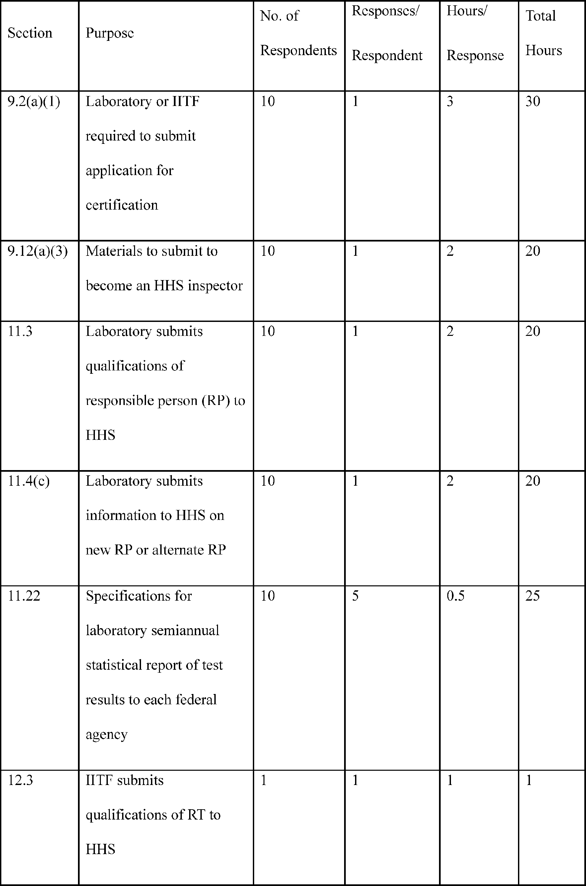
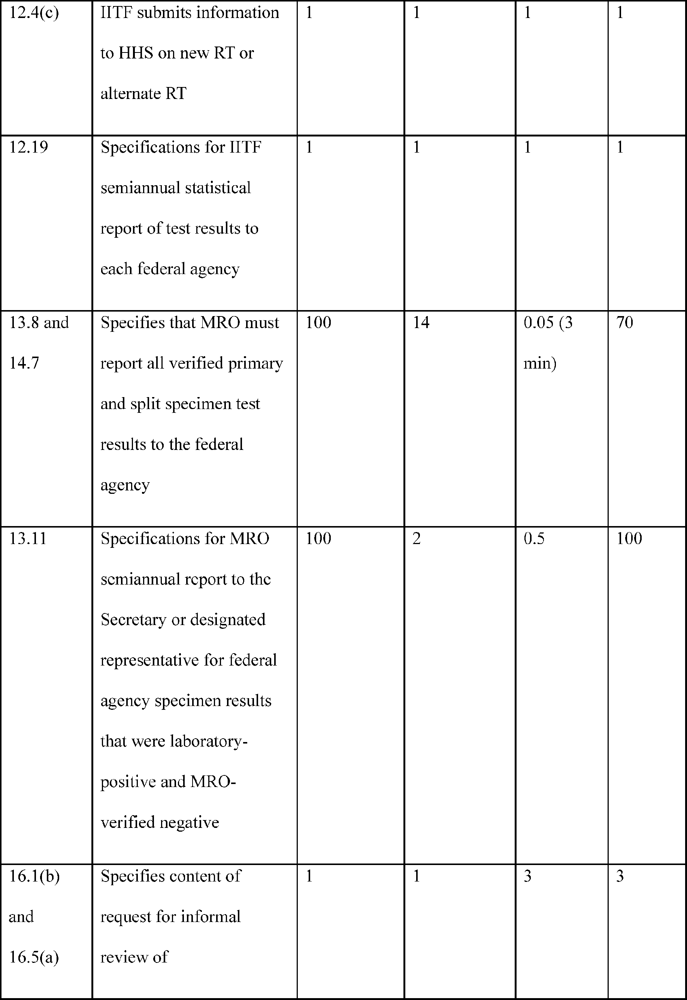
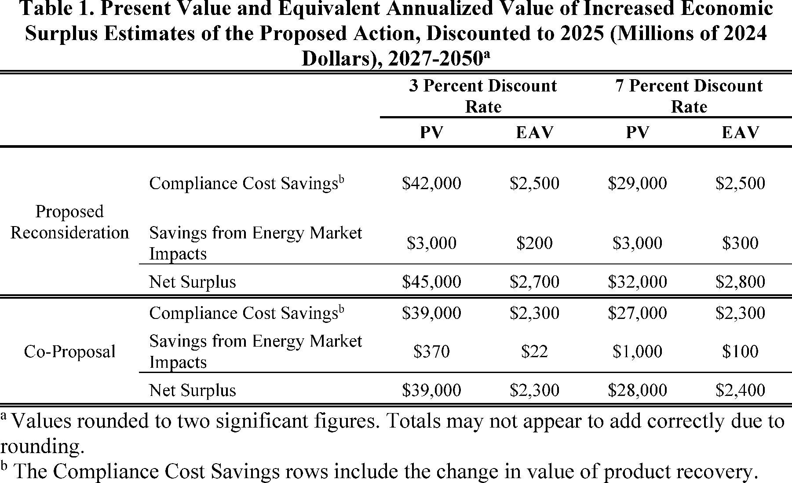
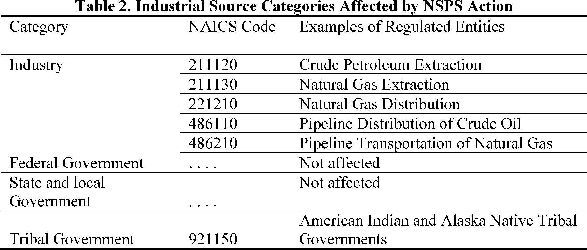

# Daily Digest — 2026-10-29

| | |
|---|---|
| **Digest date** | 2026-10-29 |
| **Data date range** | 2026-10-29 to 2026-10-29 |
| **Generated at** | 2026-10-30T04:02:51Z (UTC) |
| **Pipeline version** | b66a7f63 |
| **Inference** | model layers ran — cli/haiku, opus |
| **Source watermarks** | CREC: 2026-10-27T08:25:56Z · BILLS: 2026-10-29T13:12:11Z · FR: 2026-10-29T15:59:40Z · USCOURTS: 2026-10-29T23:02:49Z · PLAW: 2026-10-29T15:54:03Z |

[Full observed listing for this day](day/2026-10-29.html) — the items our collectors observed for this publication day, mechanical rules applied, frozen at end of day; releases their publishers date on other days are counted there, not listed. This digest is the canonical record.

All items below cite the govinfo package (and granule, where applicable) they
summarize. Selection is mechanical; each item states the rule that included
it. See the Coverage Statement at the end for a full accounting of what was
published, what was summarized, and what was excluded and why.

---

## Contents

- [Day in Review](#day-in-review)
- [1. Congressional Floor Activity](#1-congressional-floor-activity)
- [2. Legislation](#2-legislation)
- [3. Federal Register](#3-federal-register)
- [4. Enacted Laws](#4-enacted-laws)
- [5. Judicial Activity](#5-judicial-activity)
- [6. Agency Announcements](#6-agency-announcements)
- [7. Recorded Votes](#7-recorded-votes)
- [8. Bill Actions](#8-bill-actions)
- [9. Presidential Actions](#9-presidential-actions)
- [Terms Used Today](#terms-used-today)
- [Coverage Statement](#coverage-statement)
- [Methodology](#methodology)

---

## Day in Review

The digest carries two public laws, both approved October 22, 2026. Public Law 119-135 (H.R. 952), the Reversionary Interest Conveyance Act, directs the conveyance of the federal reversionary interest in about 8.43 acres in Sacramento, California. Public Law 119-136 (H.R. 7022), the Mystic Alerts Act, requires covered mobile service providers to tell the Federal Communications Commission whether they will transmit emergency alerts by satellite. The digest also carries six bills introduced in the House.

On the regulatory side, the digest carries seven final rules, eight proposed rules and 87 notices. The final rules include an Office of Personnel Management rule revising strategic human capital management in federal agencies. A child support enforcement rule removes provisions described as unnecessary or obsolete. A Rural Housing Service rule permits guaranteed loans for homes with income-producing accessory dwelling units. Proposed rules include EPA amendments to oil and natural gas emission standards, issued in response to reconsideration petitions. HHS proposes revisions to its federal workplace drug testing guidelines.

The digest carries 36 appellate items, four Court of International Trade items, 852 district court opinions and 17 bankruptcy items. The First Circuit held that Massachusetts law, not the federal filed rate doctrine, governs certain Chapter 93A insurance-rate claims. On remand from the Supreme Court, the Eleventh Circuit reversed a judgment against Monsanto in a Roundup failure-to-warn case. The Federal Circuit affirmed a patent rejection under 35 U.S.C. § 101. The Court of International Trade sustained Commerce's second remand redetermination in a countervailing duty review of Korean steel plate, and it dismissed a pro se complaint for lack of jurisdiction.

*Composed from the summarized items below and the day's mechanical
counts; all specifics are cited in their sections.*

---

## 1. Congressional Floor Activity

No Congressional Record issue was observed on this day. The Record for a day's proceedings is typically published by govinfo the following morning; it appears in the digest for the day it is observed ([how our clocks work](faq.html#fapds-three-clocks)).

### 1.1 Senate

No Senate floor items met the selection thresholds. 0 floor granule(s) are accounted for in the Coverage Statement.

### 1.2 House of Representatives

No House floor items met the selection thresholds. 0 floor granule(s) are accounted for in the Coverage Statement.

### 1.3 Recorded Votes

No recorded votes were published in this issue of the Congressional Record.

---

## 2. Legislation

Source: Congressional Bills (BILLS), text versions published 2026-10-29 to 2026-10-29.

### 2.1 Counts by Stage

| Stage (bill text version) | Count |
|---|---|
| Introduced (ih/is) | 6 |
| Reported (rh/rs) | 0 |
| Engrossed (eh/es) | 0 |
| Enrolled (enr) | 0 |
| Other versions | 0 |
| **Total bill texts published** | **6** |

### 2.2 Bills Listed by Mechanical Rule

Bills below are listed because they matched at least one listing rule; the
matching rule is stated per item. All other bill texts are counted above and
accounted for in the Coverage Statement.

No bill texts published in this range matched a listing rule; all 6 are
accounted for in the Coverage Statement.

---

## 3. Federal Register

Source: Federal Register (FR), issue of 2026-10-29.

### 3.1 Counts by Document Type

| Document type | Count |
|---|---|
| Rules | 7 |
| Proposed rules | 8 |
| Notices | 87 |
| Presidential documents | 0 |
| **Total FR documents** | **102** |

### 3.2 Rules Published

Tags: department of health and human services · environmental protection agency · executive · model keys: federal regulations · housing loans · spectrum allocation

*In plain terms: Seven rules today, led by a USDA change allowing loans for accessory dwelling units; the rest include an FCC C-Band notice, a Tennessee firework safety zone, and OPM personnel rules.*

#### DEPARTMENT OF AGRICULTURE

- **Single Family Housing Guaranteed Loan Program—Income Producing Accessory Dwelling Unit (ADU) Provisions** (2026-22038; 7 CFR Part 3555) — The Rural Housing Service (RHS or the Agency), a Rural Development (RD) agency of the United States Department of Agriculture (USDA), is amending the Single Family Housing Guaranteed Loan Program (SFHGLP) regulation to permit the financing of single family homes with income producing Accessory Dwelling Units (ADUs) and clarify the eligibility of properties with features designed to accommodate home-based operations using non-commercial real estate features. Action: Final rule. Dates: This final rule is effective December 28, 2026.
  - *In plain terms:* The USDA's Rural Housing Service is amending its single family guaranteed loan rules to allow loans for homes with income-producing accessory dwelling units, and to clarify eligibility for properties with features built for home-based operations.
  - Included because: FR-SEL-01 — document type: final rule (all listed)
  - Source: [FR-2026-10-29 / 2026-22038](https://www.govinfo.gov/app/details/FR-2026-10-29/2026-22038)

#### DEPARTMENT OF HEALTH AND HUMAN SERVICES

- **Reducing Bureaucracy and Burden for Child Support Enforcement Programs** (2026-22116; 45 CFR Parts 301, 302, 303, 304, 305, 307, 308, 309, and 310) — This final rule amends the Child Support regulations that were unnecessary or obsolete in the following sections: State Plan Approval and Grant Procedures, State Plan Requirements, Standards for Program Operations, Federal Financial Participation, Program Performance Measures, Standards, Financial Incentives, and Penalties, Computerized Support Enforcement Systems, Annual State Self-Assessment Review and Report, Tribal Child Support Enforcement (IV-D) Program, and Computerized Tribal IV-D Systems and Office Automation. Action: Final rule. Dates: This rule is effective on November 30, 2026.
  - *In plain terms:* This final rule amends child support regulations found unnecessary or obsolete in sections covering state plans, program operations, performance, incentives and penalties, computer systems, self-assessment, and tribal programs.
  - Included because: FR-SEL-01 — document type: final rule (all listed)
  - Source: [FR-2026-10-29 / 2026-22116](https://www.govinfo.gov/app/details/FR-2026-10-29/2026-22116)

#### DEPARTMENT OF HOMELAND SECURITY

- **Safety Zone; Firework Display; Cumberland River, Hendersonville, TN** (2026-22078; 33 CFR Part 165) — The Coast Guard is establishing a safety zone for certain navigable waters of the Sanders Ferry, near Hendersonville, TN. This safety zone is necessary to protect personnel, vessels, and the marine environment from potential hazards during a fireworks show at various times from October 29, 2026, through October 31, 2026. This rulemaking prohibits entry of vessels or persons into this safety zone during enforcement periods unless specifically authorized by the Captain of the Port, Ohio Valley or their designated representative. Action: Final rule. Dates: This rule is effective from 7:15 a.m. local time on October 29, 2026, through 5:30 p.m. local time on October 31, 2026.
  - *In plain terms:* The Coast Guard is creating a safety zone near Sanders Ferry, Hendersonville, Tennessee, for a fireworks show from October 29 through October 31, 2026, barring entry unless the Captain of the Port, Ohio Valley, authorizes it.
  - Included because: FR-SEL-01 — document type: final rule (all listed)
  - Source: [FR-2026-10-29 / 2026-22078](https://www.govinfo.gov/app/details/FR-2026-10-29/2026-22078)
- **Pleasure Vessels of Malta Entitled To Cruising Licenses** (2026-22089; 19 CFR Part 4) — This document amends U.S. Customs and Border Protection (CBP) regulations by adding the Republic of Malta (Malta) to the list of countries whose pleasure vessels may be issued U.S. cruising licenses. The U.S. Department of State has notified CBP that yachts used and employed exclusively as pleasure vessels and belonging to any resident of the United States are allowed to arrive at and depart from Maltese ports, and to cruise in Maltese waters without complying with formal entry and clearance procedures. Therefore, CBP is extending reciprocal cruising privileges to Maltese-flagged pleasure vessels. Action: Final rule. Dates: This amendment is effective October 29, 2026. These reciprocal privileges became applicable for Malta as of June 10, 2026.
  - *In plain terms:* Customs and Border Protection adds Malta to the list of countries whose pleasure vessels can receive U.S. cruising licenses, extending reciprocal cruising privileges to Maltese-flagged yachts.
  - Included because: FR-SEL-01 — document type: final rule (all listed)
  - Source: [FR-2026-10-29 / 2026-22089](https://www.govinfo.gov/app/details/FR-2026-10-29/2026-22089)

#### FEDERAL COMMUNICATIONS COMMISSION

- **Upper C-Band (3.98-4.2 GHz); Expanding Flexible Use of the 3.7 to 4.2 GHz Band** (2026-22037; 47 CFR Part 27) — The Federal Communications Commission (FCC or Commission) announces that the Office of Management and Budget (OMB) has approved the information collection requirements under OMB Control Number 3060-1272, as adopted in the Commission's Report and Order, Order of Proposed Modification, and Order on Reconsideration, FCC 26-46. Action: Final rule; announcement of effective date. Dates: This rule is effective October 29, 2026.
  - *In plain terms:* The Federal Communications Commission announces that the Office of Management and Budget has approved the information collection requirements under control number 3060-1272, adopted in its FCC 26-46 report and order, order of proposed modification, and order on reconsideration.
  - Included because: FR-SEL-01 — document type: final rule (all listed)
  - Source: [FR-2026-10-29 / 2026-22037](https://www.govinfo.gov/app/details/FR-2026-10-29/2026-22037)

#### FEDERAL MEDIATION AND CONCILIATION SERVICE

- **Requests for Arbitration Panels** (2026-22083; 29 CFR Part 1404) — The Federal Mediation and Conciliation Service (FMCS) published an interim final rule on August 4, 2026, and republished on August 28, 2026, that amended its arbitration services regulations to clarify when the Office of Arbitration may decline to issue an arbitration panel, make a direct appointment, or provide related services. This document responds to the comments, clarifies the scope of the rule's threshold inquiry, adds procedural provisions governing notice, written disposition, request dates, and fees, and adopts the interim final rule as a final rule. Action: Final rule. Dates: This final rule is effective October 29, 2026. The amendments to 29 CFR 1404.9, 1404.10, 1404.11, and 1404.12 made by the interim final rule have been in effect since August 4, 2026.
  - *In plain terms:* Making final FMCS's August 4, 2026 temporary rule (republished August 28, 2026) on when its Office of Arbitration may decline panels, direct appointments, or related services, adding rules on notice, decisions, dates, and fees.
  - Included because: FR-SEL-01 — document type: final rule (all listed)
  - Source: [FR-2026-10-29 / 2026-22083](https://www.govinfo.gov/app/details/FR-2026-10-29/2026-22083)

#### OFFICE OF PERSONNEL MANAGEMENT

- **Personnel Management in Agencies: Strategic Human Capital Management** (2026-22093; 5 CFR Part 250) — The Office of Personnel Management (OPM) is issuing a final rule to modernize the framework governing personnel management and strategic human capital management in Federal agencies. This rule amends the regulatory framework for personnel management in Federal agencies to streamline human capital planning and reporting requirements, strengthen the authority of agency Chief Human Capital Officers (CHCOs), update employee survey requirements, and align the regulatory framework with Executive branch priorities for a high-performing Federal workforce. OPM carefully considered all public comments received on the proposed rule and has made targeted revisions in response. Action: Final rule. Dates: Effective November 30, 2026.
  - *In plain terms:* OPM issues a final rule updating federal personnel and human capital rules to streamline planning and reporting, strengthen Chief Human Capital Officers' authority, and update employee surveys, after revising it in response to public comments.
  - Included because: FR-SEL-01 — document type: final rule (all listed)
  - Source: [FR-2026-10-29 / 2026-22093](https://www.govinfo.gov/app/details/FR-2026-10-29/2026-22093)

### 3.3 Proposed Rules Published

Tags: department of health and human services · environmental protection agency · executive · model keys: air quality plans · block grant regulations · drug testing guidelines

*In plain terms: Eight proposed actions, led by an EPA proposal to approve California's Coachella Valley ozone plan; the rest include Winter Haven airspace, HHS drug testing guidelines, and block grant changes.*

#### DEPARTMENT OF HEALTH AND HUMAN SERVICES

- **Mandatory Guidelines for Federal Workplace Drug Testing Programs Using Oral Fluid (OFMG)** (2026-22121; 42 CFR Chapter I) — The Department of Health and Human Services (“HHS” or “Department”) is proposing to revise the Mandatory Guidelines for Federal Workplace Drug Testing Programs using Oral Fluid (OFMG) published on October 12, 2023. Action: Proposed revisions to mandatory guidelines. Dates: Submit comments on or before December 28, 2026.
  - *In plain terms:* HHS proposes revising its Mandatory Guidelines for Federal Workplace Drug Testing Programs Using Oral Fluid, which were published October 12, 2023.
  - Included because: FR-SEL-02 — document type: proposed rule (all listed)
  - Source: [FR-2026-10-29 / 2026-22121](https://www.govinfo.gov/app/details/FR-2026-10-29/2026-22121)
- **Mandatory Guidelines for Federal Workplace Drug Testing Programs Using Urine (UrMG)** (2026-22122; 42 CFR Chapter I) — The Department of Health and Human Services (“HHS” or “Department”) is proposing to revise the Mandatory Guidelines for Federal Workplace Drug Testing Programs using Urine (UrMG), published in the Federal Register on October 12, 2023). Action: Proposed revisions to mandatory guidelines. Dates: Submit comments on or before December 28, 2026.
  - *In plain terms:* HHS proposes revising its Mandatory Guidelines for Federal Workplace Drug Testing Programs Using Urine, which were published in the Federal Register on October 12, 2023.
  - Included because: FR-SEL-02 — document type: proposed rule (all listed)
  - Source: [FR-2026-10-29 / 2026-22122](https://www.govinfo.gov/app/details/FR-2026-10-29/2026-22122)
  -  *Source graphic 1 of 6 from 2026-22122.*
  -  *Source graphic 2 of 6 from 2026-22122.*
  - *Graphics not rendered here: 4 of 6 — see the [source PDF](https://www.govinfo.gov/content/pkg/FR-2026-10-29/pdf/FR-2026-10-29.pdf).*
- **Reducing Bureaucracy and Burden for Block Grants** (2026-22123; 45 CFR Part 96) — ACF proposes to amend its block grant regulations to modernize requirements, reduce administrative burden on States and Tribal grantees, and improve the clarity and efficiency of program administration. The current regulations include outdated provisions and procedural requirements that no longer reflect statutory authority or agency practice. The proposed revisions are intended to streamline grantee obligations, eliminate unnecessary requirements, and align the regulations with current law and policy. Action: Notice of proposed rulemaking. Dates: In order to be considered, written comments on this proposed rule must be received on or before November 30, 2026.
  - *In plain terms:* ACF proposes amending its block grant regulations to update requirements and streamline obligations for State and Tribal grantees, where some provisions no longer reflect current statutory authority or agency practice.
  - Included because: FR-SEL-02 — document type: proposed rule (all listed)
  - Source: [FR-2026-10-29 / 2026-22123](https://www.govinfo.gov/app/details/FR-2026-10-29/2026-22123)

#### DEPARTMENT OF TRANSPORTATION

- **Establishment of Class D Airspace; Winter Haven, FL** (2026-22042; 14 CFR Part 71) — This action proposes to establish Class D airspace extending upward from the surface up to and including 2,500 feet within a 4.4-mile radius of Winter Haven Regional Airport, in Winter Haven, FL, excluding that portion within the Bartow Executive Airport Class D airspace area, as a new air traffic control tower will service the airport. Controlled airspace is necessary for the safety and management of instrument flight rules (IFR) operations at this airport. Action: Notice of proposed rulemaking (NPRM). Dates: Comments must be received on or before December 14, 2026.
  - *In plain terms:* Proposes Class D airspace from the surface up to 2,500 feet within 4.4 miles of Winter Haven Regional Airport, Florida, excluding Bartow Executive Airport's Class D area, because a new control tower will serve it.
  - Included because: FR-SEL-02 — document type: proposed rule (all listed)
  - Source: [FR-2026-10-29 / 2026-22042](https://www.govinfo.gov/app/details/FR-2026-10-29/2026-22042)

#### ENVIRONMENTAL PROTECTION AGENCY

- **Air Plan Approval; California; Reasonable Further Progress Plan for the Coachella Valley Ozone Nonattainment Area** (2026-22055; 40 CFR Part 52) — The U.S. Environmental Protection Agency (EPA or “the Agency”) is proposing to approve a state implementation plan (SIP) revision from the State of California to meet the Clean Air Act (CAA) “Extreme” nonattainment area requirements for the Riverside County (Coachella Valley), California ozone nonattainment area (“Coachella Valley”) for the 2008 8-hour ozone national ambient air quality standards (NAAQS or “standards”). Specifically, the Agency is proposing to approve the reasonable further progress (RFP) demonstration and associated emissions inventory and motor vehicle emissions budgets (“budgets”) for the Coachella Valley. Action: Proposed rule. Dates: Written comments must arrive on or before November 30, 2026.
  - *In plain terms:* The EPA proposes approving California's plan revision for the Coachella Valley in Riverside County, which does not meet 2008 8-hour ozone air standards, covering its progress demonstration, emissions inventory, and motor vehicle emissions budgets.
  - Included because: FR-SEL-02 — document type: proposed rule (all listed)
  - Source: [FR-2026-10-29 / 2026-22055](https://www.govinfo.gov/app/details/FR-2026-10-29/2026-22055)
- **Air Plan Approval and Air Quality Designation; TN; Attainment Plan and Redesignation of the Sullivan County Nonattainment Area for the 2010 1-Hour Primary SO 2 NAAQS** (2026-22063; 40 CFR Part 52 and 81) — The U.S. Environmental Protection Agency (EPA or Agency) is proposing to approve the State of Tennessee's attainment plan for the Sullivan County Nonattainment Area (Sullivan County Area or Area) for the 2010 Sulfur Dioxide (SO 2 ) National Ambient Air Quality Standards (NAAQS). Additionally, the EPA is proposing to determine that the Area has attained the 2010 SO 2 NAAQS and to approve Tennessee's maintenance plan for continued attainment. With these approvals, the EPA is proposing to approve Tennessee's comprehensive source-specific SO 2 permitted limits for two facilities in the Area, other control measures, and provisions for Reasonably Available Control Measures (RACM) and Reasonably Available Control Technology (RACT), reasonable further progress (RFP), a modeling demonstration of SO 2 attainment and maintenance, and to approve Tennessee's request to redesignate the Area from nonattainment to attainment of the 2010 SO 2 NAAQS. The EPA is taking these actions in accordance with the Clean Air Act (CAA or Act). Action: Proposed rule. Dates: Comments must be received on or before November 30, 2026.
  - *In plain terms:* The EPA proposes approving Tennessee's plan for the Sullivan County area to meet the 2010 one-hour sulfur dioxide standard, finding the area meets that standard, and approving its maintenance plan and redesignation as meeting the standard.
  - Included because: FR-SEL-02 — document type: proposed rule (all listed)
  - Source: [FR-2026-10-29 / 2026-22063](https://www.govinfo.gov/app/details/FR-2026-10-29/2026-22063)
- **Additional Reconsideration Standards of Performance for New, Reconstructed, and Modified Sources and Emissions Guidelines for Existing Sources: Oil and Natural Gas Sector Climate Review** (2026-22082; 40 CFR Part 60) — The U.S. Environmental Protection Agency (EPA) is proposing amendments to the New Source Performance Standards and Emission Guidelines for the Crude Oil and Natural Gas Source Category to address additional concerns raised with prior regulatory amendments finalized in March 2024. Specifically, the EPA is proposing changes in response to certain petitions for reconsideration of the March 2024 amendments, changes based on policy decisions and supporting legal interpretations, and changes that correct and clarify the regulatory text of the new source performance standards and emission guidelines. First, the EPA proposes to rescind the Super Emitter Program. Second, the EPA proposes to subcategorize different types of well sites affected and designated facilities to address issues related to the requirements finalized in March 2024 for marginal well sites and conventional well sites. Third, the EPA proposes changes to address issues related to liquids unloading, process controllers, pumps, fugitive emissions, storage vessels, covers and closed vent systems, equipment leaks at gas plants, and associated gas. [official summary truncated; see source] Action: Proposed rule. Dates: Comments must be received on or before December 16, 2026. The EPA will announce further details at https://www.epa.gov/controlling-air-pollution-oil-and-natural-gas-operations. Under the Paperwork Reduction Act, comments on the information collection provisions are best assured of consideration if the Office of Management and Budget receives a copy of your comments on or before November 30, 2026. Public Hearing. The EPA will hold a virtual public hearing on November 13, 2026. Please refer to the SUPPLEMENTARY INFORMATION for information on registering for the public hearing.
  - *In plain terms:* The EPA proposes amending its oil and natural gas emission standards to address concerns with its March 2024 amendments, including rescinding the Super Emitter Program and dividing well sites into subcategories.
  - Included because: FR-SEL-02 — document type: proposed rule (all listed)
  - Source: [FR-2026-10-29 / 2026-22082](https://www.govinfo.gov/app/details/FR-2026-10-29/2026-22082)
  -  *Source graphic 1 of 50 from 2026-22082.*
  -  *Source graphic 2 of 50 from 2026-22082.*
  - *Graphics not rendered here: 48 of 50 — see the [source PDF](https://www.govinfo.gov/content/pkg/FR-2026-10-29/pdf/FR-2026-10-29.pdf).*
- **Alaska Underground Injection Control (UIC) Program; Class VI Primacy** (2026-22085; 40 CFR Part 147) — The U.S. Environmental Protection Agency (EPA or the Agency) has received a complete Underground Injection Control (UIC) application from the State of Alaska, requesting primary enforcement responsibility (primacy) for Class VI injection wells under Safe Drinking Water Act (SDWA) section 1422. The EPA's approval of the State's UIC program primacy application would allow the Alaska Oil and Gas Conservation Commission (AOGCC) to issue and enforce compliance with UIC Class VI permits for injection wells used for geologic carbon sequestration. In this action, the EPA proposes to approve Alaska's application to implement the UIC program for Class VI injection wells located within the State, except those located within Indian country and those located within areas of exclusive Federal jurisdiction. Action: Proposed rule; notice of public hearing. Dates: Comments must be received on or before December 14, 2026. Public hearing: The EPA will hold one virtual public hearing during the comment period. Please refer to the SUPPLEMENTARY INFORMATION section for additional information on the public hearing.
  - *In plain terms:* The EPA proposes approving Alaska's request to run its own permitting for Class VI underground injection wells used to store carbon underground, excluding wells on Indian country lands and areas under exclusive federal jurisdiction.
  - Included because: FR-SEL-02 — document type: proposed rule (all listed)
  - Source: [FR-2026-10-29 / 2026-22085](https://www.govinfo.gov/app/details/FR-2026-10-29/2026-22085)

### 3.4 Notices and Presidential Documents

Notices are summarized only when they match a listing rule; all are counted
in 3.1 and in the Coverage Statement. Presidential documents in the FR are
always listed.

No notices or presidential documents matched a listing rule.

---

## 4. Enacted Laws

Tags: legislative · model keys: federal land conveyance · public laws · satellite emergency alerts

*In plain terms: Two public laws approved October 22: Public Law 119-135 creates the Reversionary Interest Conveyance Act for Interior land, and Public Law 119-136 is the Mystic Alerts Act on satellite emergency alerts.*

Source: Public and Private Laws (PLAW) published 2026-10-29.

- **Public Law 119–135 — Public Law 119–135: To convey the reversionary interest of the United States in certain land in Sacramento, California.** — Public Law 119-135, approved October 22, 2026 (H.R. 952), is known as the Reversionary Interest Conveyance Act. It directs the Secretary of the Interior, acting through the Bureau of Land Management, to offer and convey the United States reversionary interest in approximately 8.43 acres in Sacramento, California, to the owner of record of the adjoining parcels within two years of a buyer's request, for not less than fair market value and subject to valid existing rights. The buyer pays the appraised value plus all related costs, and the proceeds are deposited in the Federal Land Disposal Account. The Act also preserves a right-of-way of at least 50 feet on each side of the Southern Pacific Transportation Company main track centerline and does not confirm any adverse possession, prescription, or abandonment claims. Approved: 2026-10-22.
  - *In plain terms:* Public Law 119-135, approved October 22, 2026, requires the Bureau of Land Management to offer about 8.43 acres in Sacramento, California, to adjoining owners at no less than fair market value.
  - Included because: PLAW-SEL-01 — enacted into law (all public and private laws are listed) (document dated 2026-10-22)
  - Source: [PLAW-119publ135](https://www.govinfo.gov/app/details/PLAW-119publ135)
- **Public Law 119–136 — Public Law 119–136: To provide for the transmission of emergency alerts by satellite, and for other purposes.** — Public Law 119-136, approved October 22, 2026 (H.R. 7022), is known as the Mystic Alerts Act. It requires covered commercial mobile service providers to file an election with the Federal Communications Commission on whether they will transmit emergency alerts by satellite, and sets deadlines for the Commission to publish a notice of proposed rulemaking within 6 months and a final rule within 18 months, in consultation with the Department of Homeland Security and FEMA. The Act sets the rule's effective date as the later of 36 months after Federal Register publication or 12 months after DHS and FEMA implement the necessary alert-origination standards, and prohibits providers from imposing a separate charge for satellite alert transmission. It also limits liability for covered providers that transmit satellite alerts and meet the Act's obligations, and defines a covered service provider as one that voluntarily elects to transmit alerts under the Warning, Alert, and Response Network Act and offers satellite voice and data service. Approved: 2026-10-22.
  - *In plain terms:* Public Law 119-136, approved October 22, 2026, requires commercial mobile providers to file with the Federal Communications Commission whether they will send emergency alerts by satellite, and bars separate charges for that service.
  - Included because: PLAW-SEL-01 — enacted into law (all public and private laws are listed) (document dated 2026-10-22)
  - Source: [PLAW-119publ136](https://www.govinfo.gov/app/details/PLAW-119publ136)

---

## 5. Judicial Activity

Source: United States Courts Opinions (USCOURTS): opinions observed 2026-10-29
by our collector; each opinion states its own issue date beside its
listing ([how our clocks work](faq.html#fapds-three-clocks)).

Completeness disclosure (standing): USCOURTS carries opinions from
approximately 140 participating appellate, district, bankruptcy, and
national federal courts. Unlike the Congressional Record and the Federal
Register, which are the complete official record of their branches,
USCOURTS is participation-based and is NOT the complete federal judicial
record. Courts post opinions with delay — typically over several days —
so a day's digest carries the opinions that became available that day,
whatever date each was issued.

### 5.1 Appellate and National Court Opinions

Tags: judicial · model keys: criminal appeals · federal appellate rulings · prisoner civil rights

*In plain terms: Forty court items today, led by a First Circuit ruling that Massachusetts law governs in Wright v. United Services Automobile Association; many are unpublished, often criminal-sentence appeals.*

Appellate and national court opinions are summarized; district and
bankruptcy opinions are counted in 5.2 and in the Coverage Statement.

#### United States Court of Appeals for the Eighth Circuit

- **United States v. Justin Preston** (No. 25-02288; filed 2026-10-28) — By letter dated October 28, 2026, the Clerk of the Eighth Circuit notified counsel in United States v. Justin Preston, No. 25-2288, that the court issued an opinion and entered judgment in the appeal from the Eastern District of Arkansas (No. 4:19-cr-00672-KGB-1). The letter states that petitions for rehearing or rehearing en banc must be received within 14 days of the entry of judgment, must be filed electronically in CM/ECF, and are not subject to a mailing grace period. The letter does not state the opinion's holding.
  - *In plain terms:* On October 28, 2026, the Eighth Circuit issued an opinion and judgment in United States v. Justin Preston; rehearing petitions must be filed electronically and received within 14 days of judgment, with no mailing grace period.
  - Included because: USCOURTS-SEL-01 — appellate court opinion (all listed) (document dated 2026-10-28)
  - Source: [USCOURTS-ca8-25-02288 / USCOURTS-ca8-25-02288-0](https://www.govinfo.gov/app/details/USCOURTS-ca8-25-02288/USCOURTS-ca8-25-02288-0)
- **United States v. Daijon Stokes** (No. 25-02514; filed 2026-10-28) — By letter dated October 28, 2026, the Clerk of the Eighth Circuit notified counsel in United States v. Daijon Stokes, No. 25-2514, that the court issued an opinion and entered judgment in the appeal from the Northern District of Iowa (No. 6:24-cr-02012-CJW-1). The letter states that petitions for rehearing or rehearing en banc must be received within 14 days of the entry of judgment, must be filed electronically in CM/ECF, and are not subject to a mailing grace period. The letter does not state the opinion's holding.
  - *In plain terms:* On October 28, 2026, the Eighth Circuit issued an opinion and judgment in United States v. Daijon Stokes; rehearing petitions must be filed electronically and received within 14 days of judgment, with no mailing grace period.
  - Included because: USCOURTS-SEL-01 — appellate court opinion (all listed) (document dated 2026-10-28)
  - Source: [USCOURTS-ca8-25-02514 / USCOURTS-ca8-25-02514-0](https://www.govinfo.gov/app/details/USCOURTS-ca8-25-02514/USCOURTS-ca8-25-02514-0)
- **Hall Trucking Inc. v. Secretary of Labor** (No. 25-02769; filed 2026-10-28) — By letter dated October 28, 2026, the Clerk of the Eighth Circuit notified counsel in Hall Trucking Inc. v. Secretary of Labor, No. 25-2769, that the court issued an opinion and entered judgment on that date. The letter states that petitions for rehearing or rehearing en banc must be received within 45 days of the entry of judgment, must be filed electronically in CM/ECF, and are not subject to a mailing grace period. The letter identifies the Occupational Safety and Health Act of 1970, 29 U.S.C. section 660, as the underlying reference.
  - *In plain terms:* On October 28, 2026, the Eighth Circuit issued an opinion and judgment in Hall Trucking Inc. v. Secretary of Labor; rehearing petitions must be filed electronically and received within 45 days of judgment, with no mailing grace period.
  - Included because: USCOURTS-SEL-01 — appellate court opinion (all listed) (document dated 2026-10-28)
  - Source: [USCOURTS-ca8-25-02769 / USCOURTS-ca8-25-02769-0](https://www.govinfo.gov/app/details/USCOURTS-ca8-25-02769/USCOURTS-ca8-25-02769-0)
- **United States v. Kyle Cook** (No. 26-01771; filed 2026-10-28) — In an unpublished per curiam opinion filed October 28, 2026, the Eighth Circuit in United States v. Kyle Ryan Cook, No. 26-1771, affirmed a sentence imposed by the Northern District of Iowa after Cook pled guilty to transmitting a communication containing a threat. The sentence was above the Guidelines range, and counsel's Anders brief challenged its substantive reasonableness. The court found no abuse of discretion, independently reviewed the record under Penson v. Ohio, found no non-frivolous issues, affirmed the judgment, and granted counsel's motion to withdraw.
  - *In plain terms:* The unpublished Eighth Circuit opinion filed October 28, 2026 affirmed Kyle Ryan Cook's sentence, above the Guidelines range, for pleading guilty to transmitting a threatening communication, and granted counsel's motion to withdraw.
  - Included because: USCOURTS-SEL-01 — appellate court opinion (all listed) (document dated 2026-10-28)
  - Source: [USCOURTS-ca8-26-01771 / USCOURTS-ca8-26-01771-0](https://www.govinfo.gov/app/details/USCOURTS-ca8-26-01771/USCOURTS-ca8-26-01771-0)

#### United States Court of Appeals for the Eleventh Circuit

- **USA v. Johnson Saint-Louis** (No. 24-13084; filed 2026-10-28) — The Eleventh Circuit, in an unpublished per curiam opinion, affirmed the convictions of Johnson Saint-Louis for armed bank robbery under 18 U.S.C. § 2113(a) and (d) and for brandishing a firearm under 18 U.S.C. § 924(c)(1)(A)(ii), and vacated the sentence and remanded for resentencing. The appellant argued cumulative trial error based on prosecutorial closing argument and insufficient identity evidence, that the armed-bank-robbery statute does not qualify as a crime of violence under § 924(c), and that a two-level physical restraint enhancement under U.S.S.G. § 2B3.1(b)(4)(B) was improperly applied. The opinion describes a February 2021 robbery of a Bank of America ATM in Longwood, Florida, and a sentence of 87 months on Count 1 plus a consecutive 84 months on Count 2.
  - *In plain terms:* The Eleventh Circuit affirmed Johnson Saint-Louis's armed bank robbery and firearm brandishing convictions, vacated his sentence, and sent the case back for resentencing.
  - Included because: USCOURTS-SEL-01 — appellate court opinion (all listed) (document dated 2026-10-28)
  - Source: [USCOURTS-ca11-24-13084 / USCOURTS-ca11-24-13084-0](https://www.govinfo.gov/app/details/USCOURTS-ca11-24-13084/USCOURTS-ca11-24-13084-0)
- **Nancy Salas v. Monsanto Company** (No. 24-14030; filed 2025-03-19) — In an unpublished per curiam order, the Eleventh Circuit granted Monsanto Company's unopposed motion for summary affirmance and affirmed a final judgment against it on Nancy Salas's Florida state-law negligent failure-to-warn claim concerning Roundup. The court held that its earlier decision in Carson v. Monsanto Co., 92 F.4th 980 (11th Cir. 2024), controls, concluding that the Federal Insecticide, Fungicide, and Rodenticide Act (FIFRA) did not preempt the claim. The court reasoned that Florida law, like Georgia law, requires pesticide manufacturers to warn users of potential health and safety risks, paralleling FIFRA.
  - *In plain terms:* The Eleventh Circuit granted Monsanto's unopposed request to affirm a judgment against it on Nancy Salas's Florida claim that it failed to warn about Roundup risks, ruling federal pesticide law did not preempt the claim.
  - Included because: USCOURTS-SEL-01 — appellate court opinion (all listed) (document dated 2026-10-28)
  - Source: [USCOURTS-ca11-24-14030 / USCOURTS-ca11-24-14030-0](https://www.govinfo.gov/app/details/USCOURTS-ca11-24-14030/USCOURTS-ca11-24-14030-0)
- **Nancy Salas v. Monsanto Company** (No. 24-14030; filed 2026-10-28) — On remand from the Supreme Court, the Eleventh Circuit granted the parties' joint motion for summary adjudication and reversed the district court's judgment against Monsanto Company in the Nancy Salas case. The Supreme Court had granted certiorari, vacated the prior Eleventh Circuit judgment, and remanded for further consideration in light of Monsanto Co. v. Durnell, 609 U.S. 371 (2026). Applying Durnell, the court held that Salas's state common law failure-to-warn claim is preempted by federal law.
  - *In plain terms:* On remand from the Supreme Court, the Eleventh Circuit reversed the judgment against Monsanto on a joint request for decision without trial, holding under Monsanto Co. v. Durnell that federal law preempts Salas's state failure-to-warn claim.
  - Included because: USCOURTS-SEL-01 — appellate court opinion (all listed) (document dated 2026-10-28)
  - Source: [USCOURTS-ca11-24-14030 / USCOURTS-ca11-24-14030-1](https://www.govinfo.gov/app/details/USCOURTS-ca11-24-14030/USCOURTS-ca11-24-14030-1)
- **Cyrille Beckodro v. John Doe 1, et al** (No. 25-12140; filed 2026-10-28) — In an unpublished per curiam opinion, the Eleventh Circuit affirmed the district court's denial of pro se plaintiff Cyrille Kouambo Beckodro's second motion for relief under Federal Rule of Civil Procedure 60(b), which sought reconsideration of the dismissal of his civil complaint against John Doe defendants. The court found no abuse of discretion under Rule 60(b)(2), because the appellant did not show that the newly discovered evidence would be material or would change the basis for dismissal, and under Rule 60(b)(6), because no extraordinary circumstances were shown. The underlying complaint alleged stalking, noise-based harassment, delayed postal deliveries, and discrimination by a university bursar's office, and the district court had dismissed it for failure to state a claim.
  - *In plain terms:* The Eleventh Circuit affirmed the denial of pro se plaintiff Cyrille Kouambo Beckodro's second request to reconsider dismissal of his complaint against John Doe defendants, finding no material new evidence and no extraordinary circumstances.
  - Included because: USCOURTS-SEL-01 — appellate court opinion (all listed) (document dated 2026-10-28)
  - Source: [USCOURTS-ca11-25-12140 / USCOURTS-ca11-25-12140-0](https://www.govinfo.gov/app/details/USCOURTS-ca11-25-12140/USCOURTS-ca11-25-12140-0)
- **Ramon Ruiz v. City of Miami Beach, et al** (No. 25-13239; filed 2026-10-28) — In an unpublished per curiam opinion, the Eleventh Circuit affirmed the district court's dismissal with prejudice of Ramon Ruiz's first amended complaint as a shotgun pleading, finding that amendment would be futile because the false-arrest claim could not state a claim. The underlying suit arose from Ruiz's arrest for being on a Miami Beach public beach after its closing hours under city code § 82-2, and named the City of Miami Beach, arresting officers, Miami-Dade County, and court personnel. The court also held that the derivative search, bench-warrant, and Monell claims failed with the false-arrest claim, and it dismissed the appeal of the restricted-filer order for lack of jurisdiction.
  - *In plain terms:* The Eleventh Circuit affirmed the dismissal with prejudice of Ramon Ruiz's amended complaint, a disorganized pleading that mixes claims together, and dismissed his appeal of a restricted-filer order for lack of jurisdiction.
  - Included because: USCOURTS-SEL-01 — appellate court opinion (all listed) (document dated 2026-10-28)
  - Source: [USCOURTS-ca11-25-13239 / USCOURTS-ca11-25-13239-0](https://www.govinfo.gov/app/details/USCOURTS-ca11-25-13239/USCOURTS-ca11-25-13239-0)
- **Yoel Nunez, et al v. Field Office Director of U.S. Immigration and Cust, et al** (No. 25-13646; filed 2026-10-28) — In an unpublished per curiam opinion, the Eleventh Circuit dismissed in part and affirmed in part the dismissal of a counseled 28 U.S.C. § 2241 habeas petition filed by a married couple from Cuba who had been subjected to expedited removal. The court held that the challenges to their detention were moot because the petitioners were removed from the United States during the appeal, and that the district court lacked jurisdiction over their expedited-removal claims under INA § 242(a)(2) and (e)(2), 8 U.S.C. § 1252(a)(2) and (e)(2). The court also found that the petitioners had abandoned several merits arguments by failing to raise them adequately on appeal, and it granted the respondents' motion for judicial notice of the removal documentation.
  - *In plain terms:* The Eleventh Circuit partly dismissed and partly affirmed the dismissal of a married Cuban couple's habeas petition, finding detention claims moot because they were removed during the appeal and the court lacked jurisdiction over their expedited-removal claims.
  - Included because: USCOURTS-SEL-01 — appellate court opinion (all listed) (document dated 2026-10-28)
  - Source: [USCOURTS-ca11-25-13646 / USCOURTS-ca11-25-13646-0](https://www.govinfo.gov/app/details/USCOURTS-ca11-25-13646/USCOURTS-ca11-25-13646-0)
- **Josue Batista v. Michael Saba** (No. 26-10458; filed 2026-10-28) — In an unpublished per curiam opinion filed October 28, 2026, the Eleventh Circuit reviewed the appeal of pro se plaintiff Josue Batista from the Southern District of Florida's dismissal with prejudice of his second amended complaint against Michael Saba, which alleged race discrimination under 42 U.S.C. §§ 1981 and 1982, and from the denial of his Rule 59(e) motion. The court held that the complaint did not plausibly allege intentional race-based discrimination, that the § 1982 claim was properly dismissed and not improperly merged into the § 1981 analysis, and that further amendment would be futile. The court vacated the dismissal in part and remanded so the district court can first consider whether any retaliation claims were raised and plausibly alleged, affirmed in part, and denied Saba's motion for sanctions.
  - *In plain terms:* In an opinion filed October 28, 2026, the Eleventh Circuit affirmed in part and vacated in part the dismissal of pro se plaintiff Josue Batista's race discrimination complaint against Michael Saba, remanding so the district court can first consider any retaliation claims.
  - Included because: USCOURTS-SEL-01 — appellate court opinion (all listed) (document dated 2026-10-28)
  - Source: [USCOURTS-ca11-26-10458 / USCOURTS-ca11-26-10458-0](https://www.govinfo.gov/app/details/USCOURTS-ca11-26-10458/USCOURTS-ca11-26-10458-0)

#### United States Court of Appeals for the Federal Circuit

- **In re: Wenkman** (No. 26-01424; filed 2026-10-28) — The Federal Circuit affirmed the Patent Trial and Appeal Board's rejection of all pending claims (1-20) of U.S. Patent Application No. 18/424,833, which relates to a computer-implemented method for bartering groceries and other goods for silver and gold. The court agreed that representative claim 1 is directed to the abstract idea of a fundamental economic practice under 35 U.S.C. § 101. The appeal also challenged the Board's written-description rejection under 35 U.S.C. § 112(a).
  - *In plain terms:* The Federal Circuit affirmed the Patent Trial and Appeal Board's rejection of all 20 pending claims in U.S. Patent Application No. 18/424,833 for bartering goods for silver and gold, agreeing claim 1 is directed to an abstract idea under 35 U.S.C. § 101.
  - Included because: USCOURTS-SEL-01 — appellate court opinion (all listed) (document dated 2026-10-28)
  - Source: [USCOURTS-ca13-26-01424 / USCOURTS-ca13-26-01424-0](https://www.govinfo.gov/app/details/USCOURTS-ca13-26-01424/USCOURTS-ca13-26-01424-0)

#### United States Court of Appeals for the Fifth Circuit

- **USA v. Martinez-Ornelas** (No. 25-20488; filed 2026-10-28) — In an unpublished per curiam opinion filed October 28, 2026, the Fifth Circuit vacated one special condition of supervised release imposed on Valentin Martinez-Ornelas following his methamphetamine sentence and remanded for conforming changes to the written judgment. The court held that it had appellate jurisdiction because the unadjudicated Count Three was dismissed during the appeal, and found that the written requirement to report within 72 hours to the nearest probation office after reentry conflicted with the district court's oral pronouncement. The court vacated only that reporting requirement and remanded with instructions to conform the written judgment to the oral pronouncement.
  - *In plain terms:* On October 28, 2026, the Fifth Circuit vacated only one supervised-release condition for Valentin Martinez-Ornelas, a requirement to report to probation within 72 hours after reentry that conflicted with the oral sentence, and remanded to conform the written judgment.
  - Included because: USCOURTS-SEL-01 — appellate court opinion (all listed) (document dated 2026-10-28)
  - Source: [USCOURTS-ca5-25-20488 / USCOURTS-ca5-25-20488-0](https://www.govinfo.gov/app/details/USCOURTS-ca5-25-20488/USCOURTS-ca5-25-20488-0)
- **USA v. Patton** (No. 25-20494; filed 2026-10-28) — In an unpublished per curiam opinion filed October 28, 2026, the Fifth Circuit affirmed the bench-trial convictions of Kelvin Patton for Hobbs Act robbery under 18 U.S.C. § 1951 and for brandishing a firearm during a crime of violence under 18 U.S.C. § 924(c), along with the 146-month sentence. The court held that the robbery of cash belonging to a Denny's restaurant satisfied the interstate commerce element because the business purchased out-of-state goods, that only a de minimis effect on interstate commerce is required, and that the intended victim's identity was not relevant to that element. The court also held that the denial of a U.S.S.G. § 3E1.1 acceptance-of-responsibility reduction was not without foundation, because the defendant challenged the sufficiency of the evidence on an element of the offense.
  - *In plain terms:* On October 28, 2026, the Fifth Circuit affirmed Kelvin Patton's bench-trial convictions for Hobbs Act robbery and brandishing a firearm during a crime of violence, along with his 146-month sentence.
  - Included because: USCOURTS-SEL-01 — appellate court opinion (all listed) (document dated 2026-10-28)
  - Source: [USCOURTS-ca5-25-20494 / USCOURTS-ca5-25-20494-0](https://www.govinfo.gov/app/details/USCOURTS-ca5-25-20494/USCOURTS-ca5-25-20494-0)
- **USA v. Stevens** (No. 25-51048; filed 2026-10-28) — In an unpublished per curiam opinion filed October 28, 2026, the Fifth Circuit dismissed the appeal of Ryan Stevens, who pleaded guilty to being a felon in possession of a firearm under 18 U.S.C. § 922(g) and received a 168-month above-guideline sentence. The court enforced the appeal waiver in the plea agreement, concluding that the alleged criminal history calculation error was a challenge to the application of the Sentencing Guidelines and did not fall within the miscarriage-of-justice exception described in Hunter v. United States. The appeal was dismissed.
  - *In plain terms:* On October 28, 2026, the Fifth Circuit dismissed Ryan Stevens's appeal of his 168-month above-guideline sentence for being a felon in possession of a firearm, enforcing the appeal waiver in his plea agreement.
  - Included because: USCOURTS-SEL-01 — appellate court opinion (all listed) (document dated 2026-10-28)
  - Source: [USCOURTS-ca5-25-51048 / USCOURTS-ca5-25-51048-0](https://www.govinfo.gov/app/details/USCOURTS-ca5-25-51048/USCOURTS-ca5-25-51048-0)
- **USA v. Cook** (No. 26-10168; filed 2026-10-28) — In an unpublished per curiam opinion filed October 28, 2026, the Fifth Circuit affirmed the sentence of Gregory Scott Cook, who pleaded guilty to possession of a firearm by a convicted felon under 18 U.S.C. § 922(g)(1). Cook raised facial Second Amendment and Commerce Clause challenges to § 922(g)(1) for the first time on appeal, conceded that circuit precedent foreclosed both, and asked the court to hold the appeal in abeyance pending the en banc decision in United States v. Squire. The court declined to hold the appeal, stating that it remains bound by existing precedent absent an intervening Supreme Court or en banc decision, and denied the government's alternative motion for an extension as moot.
  - *In plain terms:* On October 28, 2026, the Fifth Circuit affirmed Gregory Scott Cook's sentence for possession of a firearm by a convicted felon, declining to pause the appeal for the full-court decision in United States v. Squire because it remains bound by existing precedent.
  - Included because: USCOURTS-SEL-01 — appellate court opinion (all listed) (document dated 2026-10-28)
  - Source: [USCOURTS-ca5-26-10168 / USCOURTS-ca5-26-10168-0](https://www.govinfo.gov/app/details/USCOURTS-ca5-26-10168/USCOURTS-ca5-26-10168-0)
- **USA v. Hernandez Rangel** (No. 26-40006; filed 2026-10-28) — The Fifth Circuit affirmed an 87-month sentence imposed on Jesus Felipe Hernandez Rangel after he pleaded guilty to conspiracy to transport aliens in a manner that placed a person's life in jeopardy. He challenged two four-level enhancements, one for brandishing a handgun under U.S.S.G. § 2L1.1(b)(5)(B) and one for transporting an unaccompanied minor under § 2L1.1(b)(4). The court held that he had not shown clear error, relying on unrebutted facts in the presentence report, and the opinion is not designated for publication.
  - *In plain terms:* The Fifth Circuit affirmed an 87-month sentence for Jesus Felipe Hernandez Rangel after his guilty plea to conspiracy to transport aliens in a way that put a person's life in danger, finding he had not shown clear error in two sentence increases; the opinion is not designated for publication.
  - Included because: USCOURTS-SEL-01 — appellate court opinion (all listed) (document dated 2026-10-28)
  - Source: [USCOURTS-ca5-26-40006 / USCOURTS-ca5-26-40006-0](https://www.govinfo.gov/app/details/USCOURTS-ca5-26-40006/USCOURTS-ca5-26-40006-0)
- **USA v. De Nova Cantu** (No. 26-40179; filed 2026-10-28) — The Fifth Circuit affirmed an above-guidelines sentence imposed on Gregorio De Nova Cantu after his guilty plea to illegal reentry. He challenged the substantive reasonableness of the sentence, including the district court's comments about his prior murder conviction and the upward variance. The court concluded that these did not establish an abuse of discretion, citing United States v. Gerezano-Rosales, and the opinion is not designated for publication.
  - *In plain terms:* The Fifth Circuit affirmed an above-guidelines sentence for Gregorio De Nova Cantu after his guilty plea to illegal reentry, finding no abuse of discretion in his challenge to its substantive reasonableness; the opinion is not designated for publication.
  - Included because: USCOURTS-SEL-01 — appellate court opinion (all listed) (document dated 2026-10-28)
  - Source: [USCOURTS-ca5-26-40179 / USCOURTS-ca5-26-40179-0](https://www.govinfo.gov/app/details/USCOURTS-ca5-26-40179/USCOURTS-ca5-26-40179-0)
- **Okorie v. Keystone Healthcare** (No. 26-60151; filed 2026-10-28) — The Fifth Circuit affirmed the bankruptcy and district court rulings denying Ikechukwu H. Okorie's motion for violation of the automatic bankruptcy stay and, as moot, his motion for summary judgment. The dispute concerned Keystone Healthcare Partners' recoupment of $151,567.31 in overpayments under a Physician Agreement, which the court held was not subject to the automatic stay because the overpayments and the claim arose from a single contract. The court also held that the bankruptcy court had jurisdiction, and the opinion is not designated for publication.
  - *In plain terms:* The Fifth Circuit affirmed rulings denying Ikechukwu H. Okorie's motion for violation of the automatic bankruptcy stay, holding that Keystone Healthcare Partners' taking back of $151,567.31 in overpayments was not subject to the stay; the opinion is not designated for publication.
  - Included because: USCOURTS-SEL-01 — appellate court opinion (all listed) (document dated 2026-10-28)
  - Source: [USCOURTS-ca5-26-60151 / USCOURTS-ca5-26-60151-0](https://www.govinfo.gov/app/details/USCOURTS-ca5-26-60151/USCOURTS-ca5-26-60151-0)

#### United States Court of Appeals for the First Circuit

- **Wright, et al v. United Services Automobile Association, et al** (No. 25-01979; filed 2026-10-28) — In an opinion filed October 28, 2026, the First Circuit in Wright v. United Services Automobile Association, No. 25-1979, on appeal from the District of Massachusetts, held that Massachusetts law rather than the federal filed rate doctrine governs whether policyholders may sue their motor vehicle insurers under Mass. Gen. Laws ch. 93A over rates approved by the Massachusetts Insurance Commissioner. The plaintiffs allege that the approved rates impermissibly considered income and occupation in violation of implementing regulations. The court certified the state-law questions to the Massachusetts Supreme Judicial Court, and the excerpt provided is truncated.
  - *In plain terms:* On October 28, 2026, the First Circuit held that Massachusetts law, not the federal filed rate doctrine, decides whether policyholders can sue auto insurers under Chapter 93A over rates the Massachusetts Insurance Commissioner approved.
  - Included because: USCOURTS-SEL-01 — appellate court opinion (all listed) (document dated 2026-10-28)
  - Source: [USCOURTS-ca1-25-01979 / USCOURTS-ca1-25-01979-0](https://www.govinfo.gov/app/details/USCOURTS-ca1-25-01979/USCOURTS-ca1-25-01979-0)

#### United States Court of Appeals for the Fourth Circuit

- **US v. Raymond Aigbekaen** (No. 26-06420; filed 2026-10-28) — In an unpublished per curiam decision issued October 28, 2026, the Fourth Circuit affirmed orders of the District of Maryland in United States v. Raymond Idemudia Aigbekaen. The district court had granted in part a 28 U.S.C. § 3582(c)(1)(A)(i) compassionate release motion, reducing the sentence by six months, and had later denied a motion for reconsideration and a subsequent compassionate release motion. The court found no reversible error, denied the appellant's motion for transcripts, denied as moot his motion for bail or release pending appeal, and declined to hold oral argument.
  - *In plain terms:* The Fourth Circuit affirmed District of Maryland orders in United States v. Raymond Idemudia Aigbekaen, including one that granted an early-release motion in part by cutting six months from the sentence, in a decision issued October 28, 2026.
  - Included because: USCOURTS-SEL-01 — appellate court opinion (all listed) (document dated 2026-10-28)
  - Source: [USCOURTS-ca4-26-06420 / USCOURTS-ca4-26-06420-0](https://www.govinfo.gov/app/details/USCOURTS-ca4-26-06420/USCOURTS-ca4-26-06420-0)

#### United States Court of Appeals for the Seventh Circuit

- **USA v. George Sisk** (No. 25-01499; filed 2026-10-28) — The Seventh Circuit granted appointed counsel's motion to withdraw and dismissed the appeal of George Sisk, who pleaded guilty without a plea agreement to Hobbs Act robbery, a firearm offense under 18 U.S.C. § 924(c), and felon-in-possession under § 922(g)(1). Sisk was sentenced to an aggregate 156-month prison term, and the court's order, issued under Anders v. California, found no nonfrivolous issues for appeal. The order addresses the constitutionality of § 922(g)(1), the Rule 11 plea colloquy, competency, the denial of pre-plea motions, sentence reasonableness, and an ineffective-assistance claim reserved for collateral review. The order is nonprecedential.
  - *In plain terms:* The Seventh Circuit allowed appointed counsel to withdraw and dismissed George Sisk's appeal of his 156-month sentence, finding no non-frivolous issues for appeal; the order does not set binding precedent.
  - Included because: USCOURTS-SEL-01 — appellate court opinion (all listed) (document dated 2026-10-28)
  - Source: [USCOURTS-ca7-25-01499 / USCOURTS-ca7-25-01499-0](https://www.govinfo.gov/app/details/USCOURTS-ca7-25-01499/USCOURTS-ca7-25-01499-0)
- **USA v. Troy Burke** (No. 25-02512; filed 2026-10-28) — The Seventh Circuit affirmed the conviction of Troy D. Burke for bank robbery under 18 U.S.C. § 2113(a) and his 20-year sentence, which was the statutory maximum. Burke argued that the evidence was insufficient, particularly the accuracy of GPS tracking device data tied to marked cash he received from a teller. The court found that testimony from the teller, the credit union president, and the arresting officer, along with photographs and surveillance video, was sufficient for a rational trier of fact to find him guilty beyond a reasonable doubt. The order is nonprecedential.
  - *In plain terms:* The Seventh Circuit affirmed Troy D. Burke's bank robbery conviction and 20-year sentence, the statutory maximum, finding the evidence sufficient, including teller and officer testimony and surveillance video; the order does not set binding precedent.
  - Included because: USCOURTS-SEL-01 — appellate court opinion (all listed) (document dated 2026-10-28)
  - Source: [USCOURTS-ca7-25-02512 / USCOURTS-ca7-25-02512-0](https://www.govinfo.gov/app/details/USCOURTS-ca7-25-02512/USCOURTS-ca7-25-02512-0)
- **Steven Ingalls, Jr. v. Centurion Health of Indiana, LLC, et al** (No. 25-02597; filed 2026-10-28) — The Seventh Circuit affirmed summary judgment for the defendants in Steven Ingalls, Jr.'s 42 U.S.C. § 1983 action alleging Eighth Amendment deliberate indifference to his medical needs. The defendants were Centurion Health of Indiana, LLC, Dr. Samuel Byrd, and grievance specialist Shelby Crichfield at Wabash Valley Correctional Facility. The court held that the record showed Dr. Byrd exercised medical judgment, that no Centurion policy or practice violation was established, and that Crichfield's rejection of a grievance as untimely did not show deliberate indifference. The order is nonprecedential.
  - *In plain terms:* The Seventh Circuit affirmed a pre-trial ruling in favor of Centurion Health of Indiana, LLC, Dr. Samuel Byrd, and grievance specialist Shelby Crichfield in Steven Ingalls, Jr.'s medical care suit, finding no deliberate indifference to his medical needs; the order does not set binding precedent.
  - Included because: USCOURTS-SEL-01 — appellate court opinion (all listed) (document dated 2026-10-28)
  - Source: [USCOURTS-ca7-25-02597 / USCOURTS-ca7-25-02597-0](https://www.govinfo.gov/app/details/USCOURTS-ca7-25-02597/USCOURTS-ca7-25-02597-0)
- **USA v. Everett Pullett** (No. 25-02835; filed 2026-10-28) — In United States v. Everett Pullett, No. 25-2835, the Seventh Circuit issued a nonprecedential order on October 28, 2026, affirming a sentence of 144 months' imprisonment that followed Pullett's guilty plea to two counts of assaulting and robbing a mail carrier under 18 U.S.C. § 2114(a). Pullett's appointed counsel filed an Anders brief stating that the appeal was frivolous and moved to withdraw. The court granted the motion and dismissed the appeal, concluding that the sentence fell within the guidelines range of 140 to 175 months and that the firearm enhancement was supported by the record.
  - *In plain terms:* On October 28, 2026, the Seventh Circuit dismissed Everett Pullett's appeal of his 144-month sentence for assaulting and robbing a mail carrier, finding it within the 140-to-175-month guidelines range; the order does not set binding precedent.
  - Included because: USCOURTS-SEL-01 — appellate court opinion (all listed) (document dated 2026-10-28)
  - Source: [USCOURTS-ca7-25-02835 / USCOURTS-ca7-25-02835-0](https://www.govinfo.gov/app/details/USCOURTS-ca7-25-02835/USCOURTS-ca7-25-02835-0)
- **Candie Yer Herr, et al v. Helen M. Ludwig, et al** (No. 25-03093; filed 2026-10-28) — In Candie Yer Herr v. Helen M. Ludwig, No. 25-3093, the Seventh Circuit issued a nonprecedential order on October 28, 2026, affirming the dismissal of a petition for a writ of mandamus under 28 U.S.C. § 1361 that sought to compel actions by a Chapter 7 bankruptcy trustee. The court held that private Chapter 7 trustees are not federal officers or employees and therefore are not subject to § 1361. The court also held that the district court did not abuse its discretion by leaving unaddressed an amended petition filed without leave of court on the same day final judgment was entered.
  - *In plain terms:* On October 28, 2026, the Seventh Circuit affirmed dismissal of Candie Yer Herr's petition asking a court to order a Chapter 7 bankruptcy trustee to act, holding private trustees are not federal officers or employees; the order does not set binding precedent.
  - Included because: USCOURTS-SEL-01 — appellate court opinion (all listed) (document dated 2026-10-28)
  - Source: [USCOURTS-ca7-25-03093 / USCOURTS-ca7-25-03093-0](https://www.govinfo.gov/app/details/USCOURTS-ca7-25-03093/USCOURTS-ca7-25-03093-0)
- **Kelvin Smith v. Kohler Co., et al** (No. 25-03248; filed 2026-10-28) — In Kelvin Smith v. Kohler Co., et al., No. 25-3248, the Seventh Circuit issued a nonprecedential order on October 28, 2026, affirming the dismissal with prejudice of a pro se complaint alleging religious discrimination under Title VII based on a COVID-19 testing requirement. The court held that the amended complaint did not connect the objection to the testing requirement to a religious belief or practice, and that the district court could dismiss under Federal Rule of Civil Procedure 41(b) after the plaintiff failed to file a second amended complaint as ordered. The court also held that a pro se litigant cannot represent other parties or a putative class, and that the district court acted within its discretion in declining to consider untimely and noncompliant filings.
  - *In plain terms:* On October 28, 2026, the Seventh Circuit affirmed dismissal with prejudice of Kelvin Smith's pro se religious discrimination complaint against Kohler Co. over a COVID-19 testing requirement, citing failure to tie his objection to a religious belief.
  - Included because: USCOURTS-SEL-01 — appellate court opinion (all listed) (document dated 2026-10-28)
  - Source: [USCOURTS-ca7-25-03248 / USCOURTS-ca7-25-03248-0](https://www.govinfo.gov/app/details/USCOURTS-ca7-25-03248/USCOURTS-ca7-25-03248-0)
- **Patricia Tillman v. Illinois State Board of Elections, et al** (No. 26-01108; filed 2026-10-28) — In Patricia Tillman v. Illinois State Board of Elections, et al., No. 26-1108, the Seventh Circuit issued a nonprecedential order on October 28, 2026, affirming the dismissal for failure to state a claim of a 42 U.S.C. § 1983 complaint challenging the Board's disqualification of a candidate from the March 2026 primary ballot. The court held that the plaintiff received notice and an opportunity to be heard in the Board proceedings, and that she did not plausibly allege an inadequate post-deprivation remedy because she voluntarily dismissed her state-court challenge. The court also held that the district court did not abuse its discretion by failing to order amendment sua sponte.
  - *In plain terms:* On October 28, 2026, the Seventh Circuit affirmed dismissal for failure to state a claim of Patricia Tillman's civil-rights complaint challenging the Illinois State Board of Elections' disqualification of her from the March 2026 primary ballot.
  - Included because: USCOURTS-SEL-01 — appellate court opinion (all listed) (document dated 2026-10-28)
  - Source: [USCOURTS-ca7-26-01108 / USCOURTS-ca7-26-01108-0](https://www.govinfo.gov/app/details/USCOURTS-ca7-26-01108/USCOURTS-ca7-26-01108-0)
- **USA v. Kevin Cooper** (No. 26-01123; filed 2026-10-28) — In United States v. Kevin M. Cooper, No. 26-1123, the Seventh Circuit issued a nonprecedential order on October 28, 2026, affirming the denial of a third motion for compassionate release under 18 U.S.C. § 3582(c)(1)(A). The court held that a nonretroactive change in law does not constitute an extraordinary and compelling reason under Rutherford v. United States, 146 S. Ct. 1320 (2026), and that the medical conditions and other arguments presented were insufficient to support release. The court also noted that, having found no extraordinary and compelling reason, the district court was not required to determine the extent of any reduction under the sentencing factors in 18 U.S.C. § 3553(a).
  - *In plain terms:* On October 28, 2026, the Seventh Circuit affirmed denial of Kevin M. Cooper's third compassionate release motion, holding that a nonretroactive change in law is not an extraordinary and compelling reason under Rutherford v. United States.
  - Included because: USCOURTS-SEL-01 — appellate court opinion (all listed) (document dated 2026-10-28)
  - Source: [USCOURTS-ca7-26-01123 / USCOURTS-ca7-26-01123-0](https://www.govinfo.gov/app/details/USCOURTS-ca7-26-01123/USCOURTS-ca7-26-01123-0)
- **Calvin McMillan v. National Football League, et al** (No. 26-01957; filed 2026-10-28) — In Calvin McMillan v. National Football League, et al., No. 26-1957, the Seventh Circuit issued a nonprecedential order on October 28, 2026, affirming the dismissal under 28 U.S.C. § 1915(e)(2)(B) of a copyright infringement complaint alleging that lottery ticket phrases copied lyrics from two songs about the Green Bay Packers. The court held that the plaintiff did not prove registration of the works and that the short phrases at issue, including Pack Attack, Pack Is Back, and Go Pack Go, are slogan-like combinations of ordinary words that are not protected by copyright under 37 C.F.R. § 202.1(a). The court also noted that the antitrust claims in the complaint were not pursued on appeal.
  - *In plain terms:* On October 28, 2026, the Seventh Circuit affirmed dismissal of Calvin McMillan's copyright complaint against the National Football League, holding that short slogan-like Green Bay Packers phrases such as 'Pack Attack' are not protected by copyright.
  - Included because: USCOURTS-SEL-01 — appellate court opinion (all listed) (document dated 2026-10-28)
  - Source: [USCOURTS-ca7-26-01957 / USCOURTS-ca7-26-01957-0](https://www.govinfo.gov/app/details/USCOURTS-ca7-26-01957/USCOURTS-ca7-26-01957-0)

#### United States Court of Appeals for the Tenth Circuit

- **T.E.N. Investments v. Jackson, et al** (No. 25-03161; filed 2026-10-28) — The Tenth Circuit granted a joint stipulated motion under Federal Rule of Appellate Procedure 42(b)(1) and dismissed appeal Nos. 25-3108 and 25-3161 in T.E.N. Investments, Inc. v. Jackson, et al., arising from the District of Kansas. The order states that it stands as and for the mandate of the court. It was entered October 28, 2026, and signed by Clerk Christopher M. Wolpert.
  - *In plain terms:* On a joint request from both parties, the Tenth Circuit dismissed appeal Nos. 25-3108 and 25-3161 from the District of Kansas in T.E.N. Investments, Inc. v. Jackson, et al.; the order was entered October 28, 2026.
  - Included because: USCOURTS-SEL-01 — appellate court opinion (all listed) (document dated 2026-10-28)
  - Source: [USCOURTS-ca10-25-03161 / USCOURTS-ca10-25-03161-0](https://www.govinfo.gov/app/details/USCOURTS-ca10-25-03161/USCOURTS-ca10-25-03161-0)
- **Wilson v. Wallace, et al** (No. 25-03197; filed 2026-10-28) — The Tenth Circuit affirmed the District of Kansas dismissal of pro se prisoner Thomas L. Wilson's 42 U.S.C. § 1983 complaint against two Kansas correctional officers, along with the denial of Thomas L. Wilson's motion for appointment of counsel. The court reasoned that the opening brief did not address the basis of the district court's dismissal. The court also denied the request for appointed appellate counsel and granted the motion to proceed in forma pauperis.
  - *In plain terms:* The Tenth Circuit upheld dismissal of Thomas L. Wilson's self-filed civil-rights suit against two Kansas correctional officers and denial of his counsel request, because his opening brief did not address the basis for dismissal.
  - Included because: USCOURTS-SEL-01 — appellate court opinion (all listed) (document dated 2026-10-28)
  - Source: [USCOURTS-ca10-25-03197 / USCOURTS-ca10-25-03197-0](https://www.govinfo.gov/app/details/USCOURTS-ca10-25-03197/USCOURTS-ca10-25-03197-0)
- **United States v. Lerblance** (No. 25-07095; filed 2026-10-28) — The Tenth Circuit dismissed the appeal of Andrew Frank Lerblance, who pled guilty to distribution of methamphetamine and received an 84-month sentence followed by four years of supervised release, and granted counsel's motion to withdraw. The court found that the appeal falls within the scope of a written appeal waiver, that the waiver was knowing and voluntary, and that enforcing it would not result in a miscarriage of justice. The court concluded that the appeal is wholly frivolous.
  - *In plain terms:* The Tenth Circuit dismissed Andrew Frank Lerblance's appeal of his guilty plea to methamphetamine distribution and 84-month sentence as covered by a knowing, voluntary written appeal waiver with no legal merit, and let his lawyer withdraw.
  - Included because: USCOURTS-SEL-01 — appellate court opinion (all listed) (document dated 2026-10-28)
  - Source: [USCOURTS-ca10-25-07095 / USCOURTS-ca10-25-07095-0](https://www.govinfo.gov/app/details/USCOURTS-ca10-25-07095/USCOURTS-ca10-25-07095-0)
- **Contreras Ramirez, et al v. Blanche** (No. 25-09577; filed 2026-10-28) — The Tenth Circuit denied the pro se petition for review filed by Maria Alejandra Contreras Ramirez, Rodrigo Andres Gonzalez Mosquera, and their minor child, who challenged the Board of Immigration Appeals' affirmance of the denial of withholding of removal. The court held that substantial evidence supported the finding that the harm alleged was not on account of a protected ground. The court also found that the petitioners did not show prejudicial error in the due process challenge.
  - *In plain terms:* The Tenth Circuit denied the petition for review by Maria Alejandra Contreras Ramirez, Rodrigo Andres Gonzalez Mosquera, and their minor child, upholding denial of withholding of removal because the harm alleged was not based on a protected ground.
  - Included because: USCOURTS-SEL-01 — appellate court opinion (all listed) (document dated 2026-10-28)
  - Source: [USCOURTS-ca10-25-09577 / USCOURTS-ca10-25-09577-0](https://www.govinfo.gov/app/details/USCOURTS-ca10-25-09577/USCOURTS-ca10-25-09577-0)

#### United States Court of Appeals for the Third Circuit

- **Gurmit Kahlon v. Attorney General United States of America** (No. 25-02681; filed 2026-10-28) — The Third Circuit denied the petition for review filed by Gurmit Singh Kahlon of a Board of Immigration Appeals decision that affirmed the denial of withholding of removal based on religion and political opinion. The court found that substantial evidence supported the finding that Gurmit Singh Kahlon did not show a clear probability of persecution if returned to India. The court also held that the Board did not abuse its discretion in denying the motion to remand for failure to include the adjustment-of-status application required by 8 C.F.R. § 1003.2(c)(1).
  - *In plain terms:* The Third Circuit denied Gurmit Singh Kahlon's petition, upholding denial of withholding of removal based on religion and political opinion because he did not show a clear probability of persecution in India, and finding no abuse of discretion in denying remand.
  - Included because: USCOURTS-SEL-01 — appellate court opinion (all listed) (document dated 2026-10-28)
  - Source: [USCOURTS-ca3-25-02681 / USCOURTS-ca3-25-02681-0](https://www.govinfo.gov/app/details/USCOURTS-ca3-25-02681/USCOURTS-ca3-25-02681-0)
- **Marquis Robinson v. Self Help Movement, et al** (No. 26-01838; filed 2026-10-28) — In a non-precedential per curiam opinion filed October 28, 2026, the U.S. Court of Appeals for the Third Circuit affirmed the Eastern District of Pennsylvania's grant of summary judgment to the defendants in Marquis Robinson v. Self Help Movement, et al. The court held that a supervisor's isolated requests that the plaintiff lift her back did not meet the severe or pervasive standard for hostile work environment harassment under Title VII and the PHRA. The court also held that Robinson's race-based claims concerning outside work offers and a client's racial slur were not exhausted because they fell outside the scope of his EEOC charge, and it denied his motion to file supplemental documents.
  - *In plain terms:* On October 28, 2026, the Third Circuit affirmed summary judgment for the defendants in Marquis Robinson v. Self Help Movement, et al., in a nonprecedential opinion, finding a supervisor's isolated back-lifting requests insufficiently severe or pervasive for a Title VII and PHRA harassment claim.
  - Included because: USCOURTS-SEL-01 — appellate court opinion (all listed) (document dated 2026-10-28)
  - Source: [USCOURTS-ca3-26-01838 / USCOURTS-ca3-26-01838-0](https://www.govinfo.gov/app/details/USCOURTS-ca3-26-01838/USCOURTS-ca3-26-01838-0)

#### United States Court of International Trade

- **POSCO v. United States** (No. 1:24-cv-00006; filed 2025-08-08) — In POSCO v. United States, Court No. 24-00006, filed August 8, 2025, Judge Jane A. Restani of the Court of International Trade partially sustained and partially remanded the Commerce Department's final determination in a countervailing duty administrative review of certain carbon and alloy steel cut-to-length plate from the Republic of Korea. The determination found a 0.87 percent subsidy rate for POSCO based on Korea's electricity provision and its Cap and Trade Law. The portion of the opinion provided holds that Commerce acted unreasonably in grouping the Korean steel industry with two unrelated industries in its de facto specificity analysis of the electricity subsidy.
  - *In plain terms:* On August 8, 2025, the Court of International Trade partially sustained and remanded in part Commerce's review finding a 0.87 percent subsidy rate for POSCO, holding Commerce unreasonably grouped Korean steel with two unrelated industries.
  - Included because: USCOURTS-SEL-02 — national court opinion (all listed) (document dated 2026-10-27)
  - Source: [USCOURTS-cit-1_24-cv-00006 / USCOURTS-cit-1_24-cv-00006-0](https://www.govinfo.gov/app/details/USCOURTS-cit-1_24-cv-00006/USCOURTS-cit-1_24-cv-00006-0)
- **POSCO v. United States** (No. 1:24-cv-00006; filed 2026-04-17) — In this April 17, 2026 Opinion and Order, the U.S. Court of International Trade sustained in part and remanded in part the Department of Commerce's final remand redetermination in the countervailing duty administrative review of certain carbon and alloy steel cut-to-length plate from the Republic of Korea for the 2021 period of review. The court sustained Commerce's findings except the specificity finding regarding the allocation of extra Korea Allowance Units (KAUs), which it remanded. The court also noted that Commerce had found the Korean electricity subsidy was not shown to be de facto specific on remand.
  - *In plain terms:* On April 17, 2026, the Court of International Trade sustained in part and remanded in part Commerce's remand redetermination for the 2021 review period, upholding all findings except the allocation of extra Korea Allowance Units.
  - Included because: USCOURTS-SEL-02 — national court opinion (all listed) (document dated 2026-10-27)
  - Source: [USCOURTS-cit-1_24-cv-00006 / USCOURTS-cit-1_24-cv-00006-1](https://www.govinfo.gov/app/details/USCOURTS-cit-1_24-cv-00006/USCOURTS-cit-1_24-cv-00006-1)
- **POSCO v. United States** (No. 1:24-cv-00006; filed 2026-10-27) — In this October 27, 2026 Opinion and Order, the U.S. Court of International Trade sustained Commerce's second remand redetermination in the same countervailing duty review of carbon and alloy steel cut-to-length plate from Korea. Commerce had determined on remand that the allocation of KAUs is de facto specific under 19 U.S.C. § 1677(5A)(D)(iii)(I), comparing 494 recipients to 906,325 companies within the Government of Korea's jurisdiction. Plaintiffs POSCO and the Government of the Republic of Korea argued that the comparison used an improper denominator, and the court sustained Commerce's determination.
  - *In plain terms:* On October 27, 2026, the Court of International Trade sustained Commerce's second remand redetermination in the Korean steel plate review, which found the KAU allocation de facto specific, comparing 494 recipients to 906,325 companies.
  - Included because: USCOURTS-SEL-02 — national court opinion (all listed) (document dated 2026-10-27)
  - Source: [USCOURTS-cit-1_24-cv-00006 / USCOURTS-cit-1_24-cv-00006-2](https://www.govinfo.gov/app/details/USCOURTS-cit-1_24-cv-00006/USCOURTS-cit-1_24-cv-00006-2)
- **In re Raj K. Patel** (No. 1:26-cv-04703; filed 2026-10-27) — In this October 27, 2026 Opinion and Order, the U.S. Court of International Trade dismissed the complaint of pro se plaintiff Raj K. Patel for lack of subject-matter jurisdiction. The complaint alleged violations of international trade agreements and due-process protections related to access to certain medical technologies, and sought declaratory relief and $380 million in damages. The court denied Patel's motion to compel acceptance of the complaint as moot, finding that the cited trade agreements are not laws falling within the court's residual jurisdiction under 28 U.S.C. § 1581(i).
  - *In plain terms:* On October 27, 2026, the Court of International Trade dismissed Raj K. Patel's complaint for lack of jurisdiction, finding the cited trade agreements are not laws within the court's residual jurisdiction, and denied the motion as moot.
  - Included because: USCOURTS-SEL-02 — national court opinion (all listed) (document dated 2026-10-27)
  - Source: [USCOURTS-cit-1_26-cv-04703 / USCOURTS-cit-1_26-cv-04703-0](https://www.govinfo.gov/app/details/USCOURTS-cit-1_26-cv-04703/USCOURTS-cit-1_26-cv-04703-0)

### 5.2 Counts by Court Category

| Court category | Opinions |
|---|---|
| Appellate | 36 |
| District | 852 |
| Bankruptcy | 17 |
| National | 4 |
| **Total opinions extracted** | **909** |

Archive-window disclosure (rule USCOURTS-FETCH-01): 34721 USCOURTS package(s) have been listed in delta syncs but fell outside the 7-day archive window and were not fetched (global running count across all syncs, not limited to this date).

---

## 6. Agency Announcements

Official press releases and statements the agencies themselves date
on 2026-10-29 (sources listed in the source guide). These are the
agencies' own announcements — official advocacy, quoted and
attributed, not findings of this digest. Agency web content can be
edited or removed without notice; captures and hashes are preserved
per the provenance policy.

#### Animal and Plant Health Inspection Service (email)

- **[Publication of the 2025 Annual Report of the Federal Select Agent Program](https://www.selectagents.gov/resources/publications/annualreport/2025.htm)** — dated 2026-10-29 by the agency
  - Included because: AGENCYPR-SEL-01 — official agency release dated this day by the agency (all such releases from active sources are listed; titles only in the pilot)
  - Source: agency email bulletin to this project's subscription, captured and DKIM-verified

#### Census Bureau (email)

- **[New on America Counts: American Community Survey Data Highlights](https://www.census.gov/library/stories/2026/10/education-college-degrees.html?utm_campaign=20261029aco&utm_medium=email&utm_source=govdelivery)** — dated 2026-10-29 by the agency
  - Included because: AGENCYPR-SEL-01 — official agency release dated this day by the agency (all such releases from active sources are listed; titles only in the pilot)
  - Source: agency email bulletin to this project's subscription, captured and DKIM-verified
- **🆕 2025 American Community Survey 1-Year Estimates Now Available** — dated 2026-10-29 by the agency
  - Included because: AGENCYPR-SEL-01 — official agency release dated this day by the agency (all such releases from active sources are listed; titles only in the pilot)
  - Source: agency email bulletin to this project's subscription, captured and DKIM-verified (the bulletin named no canonical page)

#### CISA Cybersecurity Advisories

- **[CISA Adds Two Known Exploited Vulnerabilities to Catalog](https://www.cisa.gov/news-events/alerts/2026/10/29/cisa-adds-two-known-exploited-vulnerabilities-catalog)** — dated 2026-10-29 by the agency
  - Included because: AGENCYPR-SEL-01 — official agency release dated this day by the agency (all such releases from active sources are listed; titles only in the pilot)
- **[Hitachi Energy CoreTec Product](https://www.cisa.gov/news-events/ics-advisories/icsa-26-302-03)** — dated 2026-10-29 by the agency
  - Included because: AGENCYPR-SEL-01 — official agency release dated this day by the agency (all such releases from active sources are listed; titles only in the pilot)
- **[Hitachi Energy TRO600 series products](https://www.cisa.gov/news-events/ics-advisories/icsa-26-302-02)** — dated 2026-10-29 by the agency
  - Included because: AGENCYPR-SEL-01 — official agency release dated this day by the agency (all such releases from active sources are listed; titles only in the pilot)
- **[Siemens Mendix SAML Module](https://www.cisa.gov/news-events/ics-advisories/icsa-26-302-01)** — dated 2026-10-29 by the agency
  - Included because: AGENCYPR-SEL-01 — official agency release dated this day by the agency (all such releases from active sources are listed; titles only in the pilot)

#### CMS Newsroom (email)

- **In This Edition: ESRD Final Rule | Nurses for Nursing Homes | Chronic Care | Health Tech** — dated 2026-10-29 by the agency
  - Included because: AGENCYPR-SEL-01 — official agency release dated this day by the agency (all such releases from active sources are listed; titles only in the pilot)
  - Source: agency email bulletin to this project's subscription, captured and DKIM-verified (the bulletin named no canonical page)

#### CPSC Recalls and News (email)

- **RECALLED: 5.9 Million Coffee Makers, Space Heaters, Power Banks and more . . .** — dated 2026-10-29 by the agency
  - Included because: AGENCYPR-SEL-01 — official agency release dated this day by the agency (all such releases from active sources are listed; titles only in the pilot)
  - Source: agency email bulletin to this project's subscription, captured and DKIM-verified (the bulletin named no canonical page)

#### Defense News Releases

- **[Army Mountain Division Takes on Panamanian Jungle](https://www.war.gov/News/News-Stories/Article/Article/4636612/army-mountain-division-takes-on-panamanian-jungle/)** — dated 2026-10-29 by the agency
  - Included because: AGENCYPR-SEL-01 — official agency release dated this day by the agency (all such releases from active sources are listed; titles only in the pilot)
- **[Assistant Secretary Says New Infrastructure Initiatives Are a 'National Calling'](https://www.war.gov/News/News-Stories/Article/Article/4637154/assistant-secretary-says-new-infrastructure-initiatives-are-a-national-calling/)** — dated 2026-10-29 by the agency
  - Included because: AGENCYPR-SEL-01 — official agency release dated this day by the agency (all such releases from active sources are listed; titles only in the pilot)
- **[Marine Corps Base Hawaii Barracks Project Crosses Halfway Mark](https://www.war.gov/News/News-Stories/Article/Article/4637113/marine-corps-base-hawaii-barracks-project-crosses-halfway-mark/)** — dated 2026-10-29 by the agency
  - Included because: AGENCYPR-SEL-01 — official agency release dated this day by the agency (all such releases from active sources are listed; titles only in the pilot)
- **[Western Hemisphere Nations Meet to Advance Anti-Cartel Campaign Plan](https://www.war.gov/News/News-Stories/Article/Article/4637181/western-hemisphere-nations-meet-to-advance-anti-cartel-campaign-plan/)** — dated 2026-10-29 by the agency
  - Included because: AGENCYPR-SEL-01 — official agency release dated this day by the agency (all such releases from active sources are listed; titles only in the pilot)

#### DHS News Releases

- **[DHS Highlights Worst Illegal Aliens Arrested in South Carolina](https://www.dhs.gov/news/2026/10/29/dhs-highlights-worst-illegal-aliens-arrested-south-carolina)** — dated 2026-10-29 by the agency
  - Included because: AGENCYPR-SEL-01 — official agency release dated this day by the agency (all such releases from active sources are listed; titles only in the pilot)
- **[SANCTUARY INSANITY: ICE Arrests Illegal Alien Released by Sanctuary Politicians in California](https://www.dhs.gov/news/2026/10/29/sanctuary-insanity-ice-arrests-illegal-alien-released-sanctuary-politicians)** — dated 2026-10-29 by the agency
  - Included because: AGENCYPR-SEL-01 — official agency release dated this day by the agency (all such releases from active sources are listed; titles only in the pilot)
- **[Secretary Mullin Highlights Success of ICE’s Lone Star Mission in Texas, Arresting Over 4,000 Illegal Aliens in Ten Days](https://www.dhs.gov/news/2026/10/29/secretary-mullin-highlights-success-ices-lone-star-mission-texas-arresting-over)** — dated 2026-10-29 by the agency
  - Included because: AGENCYPR-SEL-01 — official agency release dated this day by the agency (all such releases from active sources are listed; titles only in the pilot)
- **[Trump Administration Suspends Birth Tourism Loophole Threatening National Security](https://www.dhs.gov/news/2026/10/29/trump-administration-suspends-birth-tourism-loophole-threatening-national-security)** — dated 2026-10-29 by the agency
  - Included because: AGENCYPR-SEL-01 — official agency release dated this day by the agency (all such releases from active sources are listed; titles only in the pilot)
- **[WORST OF THE WORST: ICE Arrests Murderers, Sexual Predators, and Drug Traffickers](https://www.dhs.gov/news/2026/10/29/worst-worst-ice-arrests-murderers-sexual-predators-and-drug-traffickers)** — dated 2026-10-29 by the agency
  - Included because: AGENCYPR-SEL-01 — official agency release dated this day by the agency (all such releases from active sources are listed; titles only in the pilot)

#### DOE Office of Indian Energy (email)

- **Energy Department Announces New Investments to Strengthen America's Power Grid and Lower Electricity Costs** — dated 2026-10-29 by the agency
  - Included because: AGENCYPR-SEL-01 — official agency release dated this day by the agency (all such releases from active sources are listed; titles only in the pilot)
  - Source: agency email bulletin to this project's subscription, captured and DKIM-verified (the bulletin named no canonical page)

#### E-Verify (email)

- **[November E-Verify & Form I-9 Training Schedule](https://www.e-verify.gov/about-e-verify/e-verify-trainings)** — dated 2026-10-29 by the agency
  - Included because: AGENCYPR-SEL-01 — official agency release dated this day by the agency (all such releases from active sources are listed; titles only in the pilot)
  - Source: agency email bulletin to this project's subscription, captured and DKIM-verified

#### EEOC Newsroom

- **[EEOC Votes to Rescind Enforcement Guidance on Arrest and Conviction Records](https://www.eeoc.gov/newsroom/eeoc-votes-rescind-enforcement-guidance-arrest-and-conviction-records)** — dated 2026-10-29 by the agency
  - Included because: AGENCYPR-SEL-01 — official agency release dated this day by the agency (all such releases from active sources are listed; titles only in the pilot)
- **[Smithfield Fresh Meats Corp. to Pay $245,000 in EEOC Pregnancy Discrimination Suit](https://www.eeoc.gov/newsroom/smithfield-fresh-meats-corp-pay-245000-eeoc-pregnancy-discrimination-suit)** — dated 2026-10-29 by the agency
  - Included because: AGENCYPR-SEL-01 — official agency release dated this day by the agency (all such releases from active sources are listed; titles only in the pilot)

#### EPA News Releases (email)

- **EPA Announces $26 Million to Reduce Exposure to Toxic Lead at Schools and Child Care Facilities** — dated 2026-10-29 by the agency
  - Included because: AGENCYPR-SEL-01 — official agency release dated this day by the agency (all such releases from active sources are listed; titles only in the pilot)
  - Source: agency email bulletin to this project's subscription, captured and DKIM-verified (the bulletin named no canonical page)
- **What They Are Saying: American Energy Leaders Applaud Trump EPA’s Proposal to Revise Biden-Era Oil and Natural Gas Regulations, Saving Americans Tens of Billions of Dollars** — dated 2026-10-29 by the agency
  - Included because: AGENCYPR-SEL-01 — official agency release dated this day by the agency (all such releases from active sources are listed; titles only in the pilot)
  - Source: agency email bulletin to this project's subscription, captured and DKIM-verified (the bulletin named no canonical page)

#### FAA Updates (email)

- **FAA Advisory Circulars Update Notification** — dated 2026-10-29 by the agency
  - Included because: AGENCYPR-SEL-01 — official agency release dated this day by the agency (all such releases from active sources are listed; titles only in the pilot)
  - Source: agency email bulletin to this project's subscription, captured and DKIM-verified (the bulletin named no canonical page)
- **FAA Advisory Circulars Update Notification** — dated 2026-10-29 by the agency
  - Included because: AGENCYPR-SEL-01 — official agency release dated this day by the agency (all such releases from active sources are listed; titles only in the pilot)
  - Source: agency email bulletin to this project's subscription, captured and DKIM-verified (the bulletin named no canonical page)
- **FAA Advisory Circulars Update Notification** — dated 2026-10-29 by the agency
  - Included because: AGENCYPR-SEL-01 — official agency release dated this day by the agency (all such releases from active sources are listed; titles only in the pilot)
  - Source: agency email bulletin to this project's subscription, captured and DKIM-verified (the bulletin named no canonical page)
- **FAA Advisory Circulars Update Notification** — dated 2026-10-29 by the agency
  - Included because: AGENCYPR-SEL-01 — official agency release dated this day by the agency (all such releases from active sources are listed; titles only in the pilot)
  - Source: agency email bulletin to this project's subscription, captured and DKIM-verified (the bulletin named no canonical page)
- **FAA Advisory Circulars Update Notification** — dated 2026-10-29 by the agency
  - Included because: AGENCYPR-SEL-01 — official agency release dated this day by the agency (all such releases from active sources are listed; titles only in the pilot)
  - Source: agency email bulletin to this project's subscription, captured and DKIM-verified (the bulletin named no canonical page)
- **FAA Advisory Circulars Update Notification** — dated 2026-10-29 by the agency
  - Included because: AGENCYPR-SEL-01 — official agency release dated this day by the agency (all such releases from active sources are listed; titles only in the pilot)
  - Source: agency email bulletin to this project's subscription, captured and DKIM-verified (the bulletin named no canonical page)
- **FAA Orders & Notices Update Notification** — dated 2026-10-29 by the agency
  - Included because: AGENCYPR-SEL-01 — official agency release dated this day by the agency (all such releases from active sources are listed; titles only in the pilot)
  - Source: agency email bulletin to this project's subscription, captured and DKIM-verified (the bulletin named no canonical page)
- **FAA Orders & Notices Update Notification** — dated 2026-10-29 by the agency
  - Included because: AGENCYPR-SEL-01 — official agency release dated this day by the agency (all such releases from active sources are listed; titles only in the pilot)
  - Source: agency email bulletin to this project's subscription, captured and DKIM-verified (the bulletin named no canonical page)
- **Part 139 CertAlerts Update -- U.S. Federal Aviation Administration Website** — dated 2026-10-29 by the agency
  - Included because: AGENCYPR-SEL-01 — official agency release dated this day by the agency (all such releases from active sources are listed; titles only in the pilot)
  - Source: agency email bulletin to this project's subscription, captured and DKIM-verified (the bulletin named no canonical page)

#### FDA Email Updates (email)

- **FDA MedWatch - Medline Removes or Corrects All Medline Beds and Accessories** — dated 2026-10-29 by the agency
  - Included because: AGENCYPR-SEL-01 — official agency release dated this day by the agency (all such releases from active sources are listed; titles only in the pilot)
  - Source: agency email bulletin to this project's subscription, captured and DKIM-verified (the bulletin named no canonical page)
- **FDA MedWatch - Medline Removes or Corrects All Medline Beds and Accessories** — dated 2026-10-29 by the agency
  - Included because: AGENCYPR-SEL-01 — official agency release dated this day by the agency (all such releases from active sources are listed; titles only in the pilot)
  - Source: agency email bulletin to this project's subscription, captured and DKIM-verified (the bulletin named no canonical page)

#### Federal Reserve Press Releases

- **[Federal Reserve Board announces approval of application by The Bank of Nova Scotia](https://www.federalreserve.gov/newsevents/pressreleases/orders20261029a.htm)** — dated 2026-10-29 by the agency
  - Included because: AGENCYPR-SEL-01 — official agency release dated this day by the agency (all such releases from active sources are listed; titles only in the pilot)

#### FEMA Press Releases

- **[FEMA Approves More Than $1 Billion in Funding Across the Nation to Help Communities Recover from Recent Disasters and Strengthen Resilience Against Future Disasters](https://www.fema.gov/press-release/20261029/fema-approves-more-1-billion-funding-across-nation-help-communities-recover)** — dated 2026-10-29 by the agency
  - Included because: AGENCYPR-SEL-01 — official agency release dated this day by the agency (all such releases from active sources are listed; titles only in the pilot)
- **[FEMA Approves More Than $45 Million in Funding to Help Communities Rebuild and Become More Resilient from Recent Disasters in Puerto Rico](https://www.fema.gov/press-release/20261029/fema-approves-more-45-million-funding-help-communities-rebuild-and-become)** — dated 2026-10-29 by the agency
  - Included because: AGENCYPR-SEL-01 — official agency release dated this day by the agency (all such releases from active sources are listed; titles only in the pilot)
- **[President Donald J. Trump Amends Major Disaster Declaration for Florida, Authorizing Additional Federal Assistance](https://www.fema.gov/press-release/20261029/president-donald-j-trump-amends-major-disaster-declaration-florida)** — dated 2026-10-29 by the agency
  - Included because: AGENCYPR-SEL-01 — official agency release dated this day by the agency (all such releases from active sources are listed; titles only in the pilot)

#### FTC Press Releases

- **[FTC Highlights Efforts to Combat Imposter Scams and Protect Consumers](https://www.ftc.gov/news-events/news/press-releases/2026/10/ftc-highlights-efforts-combat-imposter-scams-protect-consumers)** — dated 2026-10-29 by the agency
  - Included because: AGENCYPR-SEL-01 — official agency release dated this day by the agency (all such releases from active sources are listed; titles only in the pilot)
- **[FTC Staff Warn Marketers of Healthcare Plans and Lead Generators Not to Deceive Consumers about the Terms of the Advertised Plans](https://www.ftc.gov/news-events/news/press-releases/2026/10/ftc-staff-warn-marketers-healthcare-plans-lead-generators-not-deceive-consumers-about-terms)** — dated 2026-10-29 by the agency
  - Included because: AGENCYPR-SEL-01 — official agency release dated this day by the agency (all such releases from active sources are listed; titles only in the pilot)
- **[FTC and States Take Action Against Toast Inc. over Hidden and Unauthorized Fees, Deceptive Subscription and Cancellation Practices and Other Unlawful Conduct](https://www.ftc.gov/news-events/news/press-releases/2026/10/ftc-states-take-action-against-toast-inc-over-hidden-unauthorized-fees-deceptive-subscription)** — dated 2026-10-29 by the agency
  - Included because: AGENCYPR-SEL-01 — official agency release dated this day by the agency (all such releases from active sources are listed; titles only in the pilot)

#### ICE Newsroom

- **[144 suspects arrested following Las Vegas Homeland Security Task Force investigations](https://www.ice.gov/news/releases/144-suspects-arrested-following-las-vegas-homeland-security-task-force-investigations)** — dated 2026-10-29 by the agency
  - Included because: AGENCYPR-SEL-01 — official agency release dated this day by the agency (all such releases from active sources are listed; titles only in the pilot)
- **[Dozens of illegal aliens arrested in nationwide voter fraud crackdown](https://www.ice.gov/news/releases/dozens-illegal-aliens-arrested-nationwide-voter-fraud-crackdown)** — dated 2026-10-29 by the agency
  - Included because: AGENCYPR-SEL-01 — official agency release dated this day by the agency (all such releases from active sources are listed; titles only in the pilot)
- **[ICE HSI Philadelphia arrests Cuban national for alleged unlawful voting in 2024 election](https://www.ice.gov/news/releases/ice-hsi-philadelphia-arrests-cuban-national-alleged-unlawful-voting-2024-election)** — dated 2026-10-29 by the agency
  - Included because: AGENCYPR-SEL-01 — official agency release dated this day by the agency (all such releases from active sources are listed; titles only in the pilot)

#### IRS Newsroom

- **[Frank Bisignano Donates to Trump Accounts for Children in Brooklyn, NY](https://www.irs.gov/newsroom/frank-bisignano-donates-to-trump-accounts-for-children-in-brooklyn-ny)** — dated 2026-10-29 by the agency
  - Included because: AGENCYPR-SEL-01 — official agency release dated this day by the agency (all such releases from active sources are listed; titles only in the pilot)

#### IRS Newswire (email)

- **Frank Bisignano Donates to Trump Accounts for Children in Brooklyn, NY** — dated 2026-10-29 by the agency
  - Included because: AGENCYPR-SEL-01 — official agency release dated this day by the agency (all such releases from active sources are listed; titles only in the pilot)
  - Source: agency email bulletin to this project's subscription, captured and DKIM-verified (the bulletin named no canonical page)
- **IR-2026-129: IR-2026-129: IRS achieved historic performance in 2026 for American taxpayers, efficiently delivering new tax benefits to working families** — dated 2026-10-29 by the agency
  - Included because: AGENCYPR-SEL-01 — official agency release dated this day by the agency (all such releases from active sources are listed; titles only in the pilot)
  - Source: agency email bulletin to this project's subscription, captured and DKIM-verified (the bulletin named no canonical page)
- **Tax Tip 2026-78: Trick or treat? Don’t get tricked by tax credit scammers** — dated 2026-10-29 by the agency
  - Included because: AGENCYPR-SEL-01 — official agency release dated this day by the agency (all such releases from active sources are listed; titles only in the pilot)
  - Source: agency email bulletin to this project's subscription, captured and DKIM-verified (the bulletin named no canonical page)
- **e-News for Tax Professionals 2026-43** — dated 2026-10-29 by the agency
  - Included because: AGENCYPR-SEL-01 — official agency release dated this day by the agency (all such releases from active sources are listed; titles only in the pilot)
  - Source: agency email bulletin to this project's subscription, captured and DKIM-verified (the bulletin named no canonical page)

#### Justice Department News (email)

- **[Charlotte Woman Pleads Guilty to Federal Charges for $600,000 COVID-19 Fraud Scheme](https://www.justice.gov/usao-wdnc/pr/charlotte-woman-pleads-guilty-federal-charges-600000-covid-19-fraud-scheme)** — dated 2026-10-29 by the agency
  - Included because: AGENCYPR-SEL-01 — official agency release dated this day by the agency (all such releases from active sources are listed; titles only in the pilot)
  - Source: agency email bulletin to this project's subscription, captured and DKIM-verified
- **[Chinese National Sentenced to 12 Years in Prison for Narcotics Trafficking, Money Laundering, and Material Support to Terrorism](https://www.justice.gov/opa/pr/chinese-national-sentenced-12-years-prison-narcotics-trafficking-money-laundering-and)** — dated 2026-10-29 by the agency
  - Included because: AGENCYPR-SEL-01 — official agency release dated this day by the agency (all such releases from active sources are listed; titles only in the pilot)
  - Source: agency email bulletin to this project's subscription, captured and DKIM-verified
- **[Cuban Nationals and Florida Man Sentenced for Their Roles in an International Alien Smuggling, Asylum Fraud, and Money Laundering Conspiracy](https://www.justice.gov/opa/pr/cuban-nationals-and-florida-man-sentenced-their-roles-international-alien-smuggling-asylum)** — dated 2026-10-29 by the agency
  - Included because: AGENCYPR-SEL-01 — official agency release dated this day by the agency (all such releases from active sources are listed; titles only in the pilot)
  - Source: agency email bulletin to this project's subscription, captured and DKIM-verified
- **EOIR BIA Decision - Oct. 29, 2026** — dated 2026-10-29 by the agency
  - Included because: AGENCYPR-SEL-01 — official agency release dated this day by the agency (all such releases from active sources are listed; titles only in the pilot)
  - Source: agency email bulletin to this project's subscription, captured and DKIM-verified (the bulletin named no canonical page)
- **EOIR BIA Decision - Oct. 29, 2026** — dated 2026-10-29 by the agency
  - Included because: AGENCYPR-SEL-01 — official agency release dated this day by the agency (all such releases from active sources are listed; titles only in the pilot)
  - Source: agency email bulletin to this project's subscription, captured and DKIM-verified (the bulletin named no canonical page)
- **EOIR BIA Decision - Oct. 29, 2026** — dated 2026-10-29 by the agency
  - Included because: AGENCYPR-SEL-01 — official agency release dated this day by the agency (all such releases from active sources are listed; titles only in the pilot)
  - Source: agency email bulletin to this project's subscription, captured and DKIM-verified (the bulletin named no canonical page)
- **[Justice Department Announces New Director of the U.S. Trustee Program](https://www.justice.gov/opa/pr/justice-department-announces-new-director-us-trustee-program)** — dated 2026-10-29 by the agency
  - Included because: AGENCYPR-SEL-01 — official agency release dated this day by the agency (all such releases from active sources are listed; titles only in the pilot)
  - Source: agency email bulletin to this project's subscription, captured and DKIM-verified
- **[Press Release – EOIR Announces Fiscal Year 2026 Significant Accomplishments](https://www.justice.gov/eoir/media/1469266/dl?inline)** — dated 2026-10-29 by the agency
  - Included because: AGENCYPR-SEL-01 — official agency release dated this day by the agency (all such releases from active sources are listed; titles only in the pilot)
  - Source: agency email bulletin to this project's subscription, captured and DKIM-verified
- **[Quinones v. Rodriguez Vazquez](https://www.justice.gov/osg/brief/quinones-v-rodriguez-vazquez)** — dated 2026-10-29 by the agency
  - Included because: AGENCYPR-SEL-01 — official agency release dated this day by the agency (all such releases from active sources are listed; titles only in the pilot)
  - Source: agency email bulletin to this project's subscription, captured and DKIM-verified
- **[Rockford Law Student Volunteer, Summer 2027](https://www.justice.gov/legal-careers/job/rockford-law-student-volunteer-summer-2027)** — dated 2026-10-29 by the agency
  - Included because: AGENCYPR-SEL-01 — official agency release dated this day by the agency (all such releases from active sources are listed; titles only in the pilot)
  - Source: agency email bulletin to this project's subscription, captured and DKIM-verified

#### Justice Press Releases

- **[Antitrust Division Announces Successful Referrals in Two Local Asphalt Merger Investigations to State Attorneys General](https://www.justice.gov/opa/pr/antitrust-division-announces-successful-referrals-two-local-asphalt-merger-investigations)** — dated 2026-10-29 by the agency
  - Included because: AGENCYPR-SEL-01 — official agency release dated this day by the agency (all such releases from active sources are listed; titles only in the pilot)
  - Corroborated: the same release (same canonical URL) also arrived via the agency's email bulletin to this project's subscription, DKIM-verified — one document received through two ingestion channels; listed once, both captures preserved.
- **[Justice Department Charges 18 More in North Carolina with Illegally Voting in 2024 Election](https://www.justice.gov/opa/pr/justice-department-charges-18-more-north-carolina-illegally-voting-2024-election)** — dated 2026-10-29 by the agency
  - Included because: AGENCYPR-SEL-01 — official agency release dated this day by the agency (all such releases from active sources are listed; titles only in the pilot)
  - Corroborated: the same release (same canonical URL) also arrived via the agency's email bulletin to this project's subscription, DKIM-verified — one document received through two ingestion channels; listed once, both captures preserved.
- **[Justice Department Provides Update on Collaboration with State Attorneys General on Review of Local Mergers](https://www.justice.gov/opa/pr/justice-department-provides-update-collaboration-state-attorneys-general-review-local)** — dated 2026-10-29 by the agency
  - Included because: AGENCYPR-SEL-01 — official agency release dated this day by the agency (all such releases from active sources are listed; titles only in the pilot)
  - Corroborated: the same release (same canonical URL) also arrived via the agency's email bulletin to this project's subscription, DKIM-verified — one document received through two ingestion channels; listed once, both captures preserved.
- **[Justice Department Unveils Indictments in Nationwide ‘Ghost Student’ Fraud Scam Linked to Kenyan Network](https://www.justice.gov/opa/pr/justice-department-unveils-indictments-nationwide-ghost-student-fraud-scam-linked-kenyan)** — dated 2026-10-29 by the agency
  - Included because: AGENCYPR-SEL-01 — official agency release dated this day by the agency (all such releases from active sources are listed; titles only in the pilot)
  - Corroborated: the same release (same canonical URL) also arrived via the agency's email bulletin to this project's subscription, DKIM-verified — one document received through two ingestion channels; listed once, both captures preserved.
- **[Justice Department unveils indictments in nationwide ‘Ghost Student’ fraud scam linked to Kenyan network](https://www.justice.gov/usao-edva/pr/justice-department-unveils-indictments-nationwide-ghost-student-fraud-scam-linked)** — dated 2026-10-29 by the agency
  - Included because: AGENCYPR-SEL-01 — official agency release dated this day by the agency (all such releases from active sources are listed; titles only in the pilot)
  - Corroborated: the same release (same canonical URL) also arrived via the agency's email bulletin to this project's subscription, DKIM-verified — one document received through two ingestion channels; listed once, both captures preserved.
- **[Man Pleads Guilty to Federal Hate Crimes in Deadly Attack on Boulder, Colorado, Gathering](https://www.justice.gov/opa/pr/man-pleads-guilty-federal-hate-crimes-deadly-attack-boulder-colorado-gathering)** — dated 2026-10-29 by the agency
  - Included because: AGENCYPR-SEL-01 — official agency release dated this day by the agency (all such releases from active sources are listed; titles only in the pilot)
  - Corroborated: the same release (same canonical URL) also arrived via the agency's email bulletin to this project's subscription, DKIM-verified — one document received through two ingestion channels; listed once, both captures preserved.
- **[Owner of Construction Company Sentenced to Prison for Obstructing IRS Efforts to Collect $1.4M in Unpaid Taxes](https://www.justice.gov/opa/pr/owner-construction-company-sentenced-prison-obstructing-irs-efforts-collect-14m-unpaid-taxes)** — dated 2026-10-29 by the agency
  - Included because: AGENCYPR-SEL-01 — official agency release dated this day by the agency (all such releases from active sources are listed; titles only in the pilot)
  - Corroborated: the same release (same canonical URL) also arrived via the agency's email bulletin to this project's subscription, DKIM-verified — one document received through two ingestion channels; listed once, both captures preserved.
- **[Syrian Man Sentenced for Wide-Ranging Hacking Conspiracy Conducted on Behalf of the Bashar Al Assad Regime](https://www.justice.gov/opa/pr/syrian-man-sentenced-wide-ranging-hacking-conspiracy-conducted-behalf-bashar-al-assad-regime)** — dated 2026-10-29 by the agency
  - Included because: AGENCYPR-SEL-01 — official agency release dated this day by the agency (all such releases from active sources are listed; titles only in the pilot)
  - Corroborated: the same release (same canonical URL) also arrived via the agency's email bulletin to this project's subscription, DKIM-verified — one document received through two ingestion channels; listed once, both captures preserved.
- **[U.S. Extradites to El Salvador Southern California Man to Face Charges of Murdering Woman in Front of Infant Son, Whom He Abandoned](https://www.justice.gov/opa/pr/us-extradites-el-salvador-southern-california-man-face-charges-murdering-woman-front-infant)** — dated 2026-10-29 by the agency
  - Included because: AGENCYPR-SEL-01 — official agency release dated this day by the agency (all such releases from active sources are listed; titles only in the pilot)
  - Corroborated: the same release (same canonical URL) also arrived via the agency's email bulletin to this project's subscription, DKIM-verified — one document received through two ingestion channels; listed once, both captures preserved.
- **[Aliens Charged with Illegally Voting in Federal Elections, Unlawfully Attempting to Procure Citizenship, and Making False Statements while Applying for U.S. Citizenship](https://www.justice.gov/usao-nj/pr/aliens-charged-illegally-voting-federal-elections-unlawfully-attempting-procure)** — dated 2026-10-29 by the agency
  - Included because: AGENCYPR-SEL-01 — official agency release dated this day by the agency (all such releases from active sources are listed; titles only in the pilot)
  - Corroborated: the same release (same canonical URL) also arrived via the agency's email bulletin to this project's subscription, DKIM-verified — one document received through two ingestion channels; listed once, both captures preserved.
- **[Alton career criminal sentenced to 188 months in federal prison](https://www.justice.gov/usao-sdil/pr/alton-career-criminal-sentenced-188-months-federal-prison)** — dated 2026-10-29 by the agency
  - Included because: AGENCYPR-SEL-01 — official agency release dated this day by the agency (all such releases from active sources are listed; titles only in the pilot)
  - Corroborated: the same release (same canonical URL) also arrived via the agency's email bulletin to this project's subscription, DKIM-verified — one document received through two ingestion channels; listed once, both captures preserved.
- **[Batesville Man Sentenced to 30 Years in Federal Prison for Production of Child Pornography](https://www.justice.gov/usao-edar/pr/batesville-man-sentenced-30-years-federal-prison-production-child-pornography)** — dated 2026-10-29 by the agency
  - Included because: AGENCYPR-SEL-01 — official agency release dated this day by the agency (all such releases from active sources are listed; titles only in the pilot)
  - Corroborated: the same release (same canonical URL) also arrived via the agency's email bulletin to this project's subscription, DKIM-verified — one document received through two ingestion channels; listed once, both captures preserved.
- **[CONVICTED FELON SENTENCED TO 115 MONTHS IN FEDERAL PRISON FOR POSSESSION OF FIREARMS](https://www.justice.gov/usao-mdla/pr/convicted-felon-sentenced-115-months-federal-prison-possession-firearms)** — dated 2026-10-29 by the agency
  - Included because: AGENCYPR-SEL-01 — official agency release dated this day by the agency (all such releases from active sources are listed; titles only in the pilot)
- **[California Man Sentenced to 26 Months for Selling Drugs in Rutland, Vermont](https://www.justice.gov/usao-vt/pr/california-man-sentenced-26-months-selling-drugs-rutland-vermont)** — dated 2026-10-29 by the agency
  - Included because: AGENCYPR-SEL-01 — official agency release dated this day by the agency (all such releases from active sources are listed; titles only in the pilot)
- **[Chicopee, Massachusetts Man Sentenced to 90 Months for Attempting to Engage in Sexual Conduct with a Minor](https://www.justice.gov/usao-vt/pr/chicopee-massachusetts-man-sentenced-90-months-attempting-engage-sexual-conduct-minor)** — dated 2026-10-29 by the agency
  - Included because: AGENCYPR-SEL-01 — official agency release dated this day by the agency (all such releases from active sources are listed; titles only in the pilot)
  - Corroborated: the same release (same canonical URL) also arrived via the agency's email bulletin to this project's subscription, DKIM-verified — one document received through two ingestion channels; listed once, both captures preserved.
- **[Columbia County woman sentenced to federal prison for possessing stolen mail and identity theft](https://www.justice.gov/usao-sdga/pr/columbia-county-woman-sentenced-federal-prison-possessing-stolen-mail-and-identity)** — dated 2026-10-29 by the agency
  - Included because: AGENCYPR-SEL-01 — official agency release dated this day by the agency (all such releases from active sources are listed; titles only in the pilot)
  - Corroborated: the same release (same canonical URL) also arrived via the agency's email bulletin to this project's subscription, DKIM-verified — one document received through two ingestion channels; listed once, both captures preserved.
- **[DOJ Announces Significant Charges Related to Ghost Student Fraud](https://www.justice.gov/opa/video/doj-announces-significant-charges-related-ghost-student-fraud)** — dated 2026-10-29 by the agency
  - Included because: AGENCYPR-SEL-01 — official agency release dated this day by the agency (all such releases from active sources are listed; titles only in the pilot)
- **[Drug Trafficker Sentenced to 10 Years in Federal Prison for Distributing Methamphetamine](https://www.justice.gov/usao-wdar/pr/drug-trafficker-sentenced-10-years-federal-prison-distributing-methamphetamine)** — dated 2026-10-29 by the agency
  - Included because: AGENCYPR-SEL-01 — official agency release dated this day by the agency (all such releases from active sources are listed; titles only in the pilot)
- **[El Dorado Man Sentenced to 41 Months in Federal Prison for Machinegun Possession](https://www.justice.gov/usao-wdar/pr/el-dorado-man-sentenced-41-months-federal-prison-machinegun-possession)** — dated 2026-10-29 by the agency
  - Included because: AGENCYPR-SEL-01 — official agency release dated this day by the agency (all such releases from active sources are listed; titles only in the pilot)
  - Corroborated: the same release (same canonical URL) also arrived via the agency's email bulletin to this project's subscription, DKIM-verified — one document received through two ingestion channels; listed once, both captures preserved.
- **[Federal Indictment Charges Former President of Suburban Chicago School District Board of Education With Engaging in $1.3 Million Honest Services Fraud Scheme](https://www.justice.gov/usao-ndil/pr/federal-indictment-charges-former-president-suburban-chicago-school-district-board)** — dated 2026-10-29 by the agency
  - Included because: AGENCYPR-SEL-01 — official agency release dated this day by the agency (all such releases from active sources are listed; titles only in the pilot)
  - Corroborated: the same release (same canonical URL) also arrived via the agency's email bulletin to this project's subscription, DKIM-verified — one document received through two ingestion channels; listed once, both captures preserved.
- **[Federal Inmate Pleads Guilty to Possessing Methamphetamine with Intent to Distribute](https://www.justice.gov/usao-mdfl/pr/federal-inmate-pleads-guilty-possessing-methamphetamine-intent-distribute)** — dated 2026-10-29 by the agency
  - Included because: AGENCYPR-SEL-01 — official agency release dated this day by the agency (all such releases from active sources are listed; titles only in the pilot)
- **[Federal Jury Convicts Man of Four Armed Robberies in Doña Ana County](https://www.justice.gov/usao-nm/pr/federal-jury-convicts-man-four-armed-robberies-dona-ana-county)** — dated 2026-10-29 by the agency
  - Included because: AGENCYPR-SEL-01 — official agency release dated this day by the agency (all such releases from active sources are listed; titles only in the pilot)
  - Corroborated: the same release (same canonical URL) also arrived via the agency's email bulletin to this project's subscription, DKIM-verified — one document received through two ingestion channels; listed once, both captures preserved.
- **[Former Bus Driver Sentenced to 20 Years for Child Sexual Abuse Material Conviction](https://www.justice.gov/usao-ndwv/pr/former-bus-driver-sentenced-20-years-child-sexual-abuse-material-conviction)** — dated 2026-10-29 by the agency
  - Included because: AGENCYPR-SEL-01 — official agency release dated this day by the agency (all such releases from active sources are listed; titles only in the pilot)
  - Corroborated: the same release (same canonical URL) also arrived via the agency's email bulletin to this project's subscription, DKIM-verified — one document received through two ingestion channels; listed once, both captures preserved.
- **[Former Sallisaw Resident Pleads Guilty To Wire Fraud](https://www.justice.gov/usao-edok/pr/former-sallisaw-resident-pleads-guilty-wire-fraud)** — dated 2026-10-29 by the agency
  - Included because: AGENCYPR-SEL-01 — official agency release dated this day by the agency (all such releases from active sources are listed; titles only in the pilot)
  - Corroborated: the same release (same canonical URL) also arrived via the agency's email bulletin to this project's subscription, DKIM-verified — one document received through two ingestion channels; listed once, both captures preserved.
- **[Former South Lake Tahoe mayor pleads guilty to wire fraud after embezzling $390,000 from local church](https://www.justice.gov/usao-edca/pr/former-south-lake-tahoe-mayor-pleads-guilty-wire-fraud-after-embezzling-390000-local)** — dated 2026-10-29 by the agency
  - Included because: AGENCYPR-SEL-01 — official agency release dated this day by the agency (all such releases from active sources are listed; titles only in the pilot)
  - Corroborated: the same release (same canonical URL) also arrived via the agency's email bulletin to this project's subscription, DKIM-verified — one document received through two ingestion channels; listed once, both captures preserved.
- **[Former Teacher Sentenced to 105 Months in Prison for Possession of Child Pornography](https://www.justice.gov/usao-nj/pr/former-teacher-sentenced-105-months-prison-possession-child-pornography)** — dated 2026-10-29 by the agency
  - Included because: AGENCYPR-SEL-01 — official agency release dated this day by the agency (all such releases from active sources are listed; titles only in the pilot)
  - Corroborated: the same release (same canonical URL) also arrived via the agency's email bulletin to this project's subscription, DKIM-verified — one document received through two ingestion channels; listed once, both captures preserved.
- **[Former U.S. Postal Service Official Pleads Guilty to Bribery Scheme Related to Contracts Worth Hundreds Millions of Dollars](https://www.justice.gov/opa/pr/former-us-postal-service-official-pleads-guilty-bribery-scheme-related-contracts-worth)** — dated 2026-10-29 by the agency
  - Included because: AGENCYPR-SEL-01 — official agency release dated this day by the agency (all such releases from active sources are listed; titles only in the pilot)
- **[Four Illegal Aliens Sentenced to Prison for Manufacturing and Trafficking over 770 Kilograms of Methamphetamine](https://www.justice.gov/usao-ndga/pr/four-illegal-aliens-sentenced-prison-manufacturing-and-trafficking-over-770-kilograms)** — dated 2026-10-29 by the agency
  - Included because: AGENCYPR-SEL-01 — official agency release dated this day by the agency (all such releases from active sources are listed; titles only in the pilot)
  - Corroborated: the same release (same canonical URL) also arrived via the agency's email bulletin to this project's subscription, DKIM-verified — one document received through two ingestion channels; listed once, both captures preserved.
- **[Four-Deuce Oakland Crips member sentenced to 447 months in federal prison for drug trafficking and firearms offenses](https://www.justice.gov/usao-ndtx/pr/four-deuce-oakland-crips-member-sentenced-447-months-federal-prison-drug-trafficking)** — dated 2026-10-29 by the agency
  - Included because: AGENCYPR-SEL-01 — official agency release dated this day by the agency (all such releases from active sources are listed; titles only in the pilot)
  - Corroborated: the same release (same canonical URL) also arrived via the agency's email bulletin to this project's subscription, DKIM-verified — one document received through two ingestion channels; listed once, both captures preserved.
- **[Fourth Alien Charged for Illegally Voting](https://www.justice.gov/usao-nv/pr/fourth-alien-charged-illegally-voting)** — dated 2026-10-29 by the agency
  - Included because: AGENCYPR-SEL-01 — official agency release dated this day by the agency (all such releases from active sources are listed; titles only in the pilot)
  - Corroborated: the same release (same canonical URL) also arrived via the agency's email bulletin to this project's subscription, DKIM-verified — one document received through two ingestion channels; listed once, both captures preserved.
- **[Grand jury indicts illegal alien from Mexico who has criminal history involving assault, domestic violence, driving under the influence](https://www.justice.gov/usao-sdoh/pr/grand-jury-indicts-illegal-alien-mexico-who-has-criminal-history-involving-assault)** — dated 2026-10-29 by the agency
  - Included because: AGENCYPR-SEL-01 — official agency release dated this day by the agency (all such releases from active sources are listed; titles only in the pilot)
  - Corroborated: the same release (same canonical URL) also arrived via the agency's email bulletin to this project's subscription, DKIM-verified — one document received through two ingestion channels; listed once, both captures preserved.
- **[Hardwick Man Sentenced to 21 Months for Unlawfully Possessing a Firearm](https://www.justice.gov/usao-vt/pr/hardwick-man-sentenced-21-months-unlawfully-possessing-firearm)** — dated 2026-10-29 by the agency
  - Included because: AGENCYPR-SEL-01 — official agency release dated this day by the agency (all such releases from active sources are listed; titles only in the pilot)
  - Corroborated: the same release (same canonical URL) also arrived via the agency's email bulletin to this project's subscription, DKIM-verified — one document received through two ingestion channels; listed once, both captures preserved.
- **[Illegal Alien Pleads Guilty To Unlawful Reentry](https://www.justice.gov/usao-edok/pr/illegal-alien-pleads-guilty-unlawful-reentry-39)** — dated 2026-10-29 by the agency
  - Included because: AGENCYPR-SEL-01 — official agency release dated this day by the agency (all such releases from active sources are listed; titles only in the pilot)
  - Corroborated: the same release (same canonical URL) also arrived via the agency's email bulletin to this project's subscription, DKIM-verified — one document received through two ingestion channels; listed once, both captures preserved.
- **[Illegal Alien Sentenced For Unlawful Reentry](https://www.justice.gov/usao-edok/pr/illegal-alien-sentenced-unlawful-reentry-41)** — dated 2026-10-29 by the agency
  - Included because: AGENCYPR-SEL-01 — official agency release dated this day by the agency (all such releases from active sources are listed; titles only in the pilot)
  - Corroborated: the same release (same canonical URL) also arrived via the agency's email bulletin to this project's subscription, DKIM-verified — one document received through two ingestion channels; listed once, both captures preserved.
- **[Illegal Alien Sentenced For Unlawful Reentry](https://www.justice.gov/usao-edok/pr/illegal-alien-sentenced-unlawful-reentry-40)** — dated 2026-10-29 by the agency
  - Included because: AGENCYPR-SEL-01 — official agency release dated this day by the agency (all such releases from active sources are listed; titles only in the pilot)
  - Corroborated: the same release (same canonical URL) also arrived via the agency's email bulletin to this project's subscription, DKIM-verified — one document received through two ingestion channels; listed once, both captures preserved.
- **[Illegal Alien from Mexico Pleads Guilty to Fentanyl Trafficking Charges](https://www.justice.gov/usao-wdpa/pr/illegal-alien-mexico-pleads-guilty-fentanyl-trafficking-charges)** — dated 2026-10-29 by the agency
  - Included because: AGENCYPR-SEL-01 — official agency release dated this day by the agency (all such releases from active sources are listed; titles only in the pilot)
- **[Indian National Sentenced to Eight Years in Prison for Laundering Money from Fraud Scheme Targeting Elderly](https://www.justice.gov/usao-az/pr/indian-national-sentenced-eight-years-prison-laundering-money-fraud-scheme-targeting)** — dated 2026-10-29 by the agency
  - Included because: AGENCYPR-SEL-01 — official agency release dated this day by the agency (all such releases from active sources are listed; titles only in the pilot)
  - Corroborated: the same release (same canonical URL) also arrived via the agency's email bulletin to this project's subscription, DKIM-verified — one document received through two ingestion channels; listed once, both captures preserved.
- **[Jury convicts fugitive of shooting at U.S. Marshals serving his arrest warrant](https://www.justice.gov/usao-sdil/pr/jury-convicts-fugitive-shooting-us-marshals-serving-his-arrest-warrant)** — dated 2026-10-29 by the agency
  - Included because: AGENCYPR-SEL-01 — official agency release dated this day by the agency (all such releases from active sources are listed; titles only in the pilot)
  - Corroborated: the same release (same canonical URL) also arrived via the agency's email bulletin to this project's subscription, DKIM-verified — one document received through two ingestion channels; listed once, both captures preserved.
- **[Justice Department Announces New Director of the U.S. Trustee Program](https://www.justice.gov/opa/pr/justice-department-announces-new-director-us-trustee-program-2026)** — dated 2026-10-29 by the agency
  - Included because: AGENCYPR-SEL-01 — official agency release dated this day by the agency (all such releases from active sources are listed; titles only in the pilot)
- **[Justice Department Charges 18 More in North Carolina with Illegally Voting in 2024 Election - DOJ Has Charged 30 People in North Carolina this Year for Illegally Voting](https://www.justice.gov/usao-ednc/pr/justice-department-charges-18-more-north-carolina-illegally-voting-2024-election-doj)** — dated 2026-10-29 by the agency
  - Included because: AGENCYPR-SEL-01 — official agency release dated this day by the agency (all such releases from active sources are listed; titles only in the pilot)
  - Corroborated: the same release (same canonical URL) also arrived via the agency's email bulletin to this project's subscription, DKIM-verified — one document received through two ingestion channels; listed once, both captures preserved.
- **[Lubbock man receives 90-year sentence for production of child exploitation material](https://www.justice.gov/usao-ndtx/pr/lubbock-man-receives-90-year-sentence-production-child-exploitation-material)** — dated 2026-10-29 by the agency
  - Included because: AGENCYPR-SEL-01 — official agency release dated this day by the agency (all such releases from active sources are listed; titles only in the pilot)
  - Corroborated: the same release (same canonical URL) also arrived via the agency's email bulletin to this project's subscription, DKIM-verified — one document received through two ingestion channels; listed once, both captures preserved.
- **[Man Who Carried Out Antisemitic Firebomb Attack in Boulder Pleads Guilty To Federal Hate Crimes](https://www.justice.gov/usao-co/pr/man-who-carried-out-antisemitic-firebomb-attack-boulder-pleads-guilty-federal-hate)** — dated 2026-10-29 by the agency
  - Included because: AGENCYPR-SEL-01 — official agency release dated this day by the agency (all such releases from active sources are listed; titles only in the pilot)
  - Corroborated: the same release (same canonical URL) also arrived via the agency's email bulletin to this project's subscription, DKIM-verified — one document received through two ingestion channels; listed once, both captures preserved.
- **[Maryland Law Enforcement Partners to Raise Awareness About Elder Fraud](https://www.justice.gov/usao-md/pr/maryland-law-enforcement-partners-raise-awareness-about-elder-fraud)** — dated 2026-10-29 by the agency
  - Included because: AGENCYPR-SEL-01 — official agency release dated this day by the agency (all such releases from active sources are listed; titles only in the pilot)
- **[Maryland Man Indicted for Cross-Country Sex Abuse Crimes](https://www.justice.gov/usao-md/pr/maryland-man-indicted-cross-country-sex-abuse-crimes)** — dated 2026-10-29 by the agency
  - Included because: AGENCYPR-SEL-01 — official agency release dated this day by the agency (all such releases from active sources are listed; titles only in the pilot)
  - Corroborated: the same release (same canonical URL) also arrived via the agency's email bulletin to this project's subscription, DKIM-verified — one document received through two ingestion channels; listed once, both captures preserved.
- **[Mountain Home Man Sentenced to Over 9 Years in Federal Prison for Possessing Child Sexual Abuse Material](https://www.justice.gov/usao-id/pr/mountain-home-man-sentenced-over-9-years-federal-prison-possessing-child-sexual-abuse)** — dated 2026-10-29 by the agency
  - Included because: AGENCYPR-SEL-01 — official agency release dated this day by the agency (all such releases from active sources are listed; titles only in the pilot)
  - Corroborated: the same release (same canonical URL) also arrived via the agency's email bulletin to this project's subscription, DKIM-verified — one document received through two ingestion channels; listed once, both captures preserved.
- **[Musselshell County man sentenced to 9 years in prison for trafficking meth from Washington](https://www.justice.gov/usao-mt/pr/musselshell-county-man-sentenced-9-years-prison-trafficking-meth-washington)** — dated 2026-10-29 by the agency
  - Included because: AGENCYPR-SEL-01 — official agency release dated this day by the agency (all such releases from active sources are listed; titles only in the pilot)
  - Corroborated: the same release (same canonical URL) also arrived via the agency's email bulletin to this project's subscription, DKIM-verified — one document received through two ingestion channels; listed once, both captures preserved.
- **[Navajo Man Found Guilty of Arson for Burning Down Diné College’s Student Union Building](https://www.justice.gov/usao-az/pr/navajo-man-found-guilty-arson-burning-down-dine-colleges-student-union-building)** — dated 2026-10-29 by the agency
  - Included because: AGENCYPR-SEL-01 — official agency release dated this day by the agency (all such releases from active sources are listed; titles only in the pilot)
  - Corroborated: the same release (same canonical URL) also arrived via the agency's email bulletin to this project's subscription, DKIM-verified — one document received through two ingestion channels; listed once, both captures preserved.
- **[New Jersey Businessman Sentenced to 33 Months in Prison for Bank Fraud Scheme](https://www.justice.gov/usao-edny/pr/new-jersey-businessman-sentenced-33-months-prison-bank-fraud-scheme)** — dated 2026-10-29 by the agency
  - Included because: AGENCYPR-SEL-01 — official agency release dated this day by the agency (all such releases from active sources are listed; titles only in the pilot)
  - Corroborated: the same release (same canonical URL) also arrived via the agency's email bulletin to this project's subscription, DKIM-verified — one document received through two ingestion channels; listed once, both captures preserved.
- **[New Orleans Man Charged With Filing False Tax Returns](https://www.justice.gov/usao-edla/pr/new-orleans-man-charged-filing-false-tax-returns)** — dated 2026-10-29 by the agency
  - Included because: AGENCYPR-SEL-01 — official agency release dated this day by the agency (all such releases from active sources are listed; titles only in the pilot)
  - Corroborated: the same release (same canonical URL) also arrived via the agency's email bulletin to this project's subscription, DKIM-verified — one document received through two ingestion channels; listed once, both captures preserved.
- **[New Orleans Man Guilty of Shooting at Federal Employee and Firearm Charges](https://www.justice.gov/usao-edla/pr/new-orleans-man-guilty-shooting-federal-employee-and-firearm-charges)** — dated 2026-10-29 by the agency
  - Included because: AGENCYPR-SEL-01 — official agency release dated this day by the agency (all such releases from active sources are listed; titles only in the pilot)
  - Corroborated: the same release (same canonical URL) also arrived via the agency's email bulletin to this project's subscription, DKIM-verified — one document received through two ingestion channels; listed once, both captures preserved.
- **[New Orleans Man Sentenced in Drug Distribution Case](https://www.justice.gov/usao-edla/pr/new-orleans-man-sentenced-drug-distribution-case)** — dated 2026-10-29 by the agency
  - Included because: AGENCYPR-SEL-01 — official agency release dated this day by the agency (all such releases from active sources are listed; titles only in the pilot)
  - Corroborated: the same release (same canonical URL) also arrived via the agency's email bulletin to this project's subscription, DKIM-verified — one document received through two ingestion channels; listed once, both captures preserved.
- **[Newbern, Tennessee, Man Sentenced to 15 Years in Federal Prison for Attempted Enticement of a Minor](https://www.justice.gov/usao-edar/pr/newbern-tennessee-man-sentenced-15-years-federal-prison-attempted-enticement-minor)** — dated 2026-10-29 by the agency
  - Included because: AGENCYPR-SEL-01 — official agency release dated this day by the agency (all such releases from active sources are listed; titles only in the pilot)
  - Corroborated: the same release (same canonical URL) also arrived via the agency's email bulletin to this project's subscription, DKIM-verified — one document received through two ingestion channels; listed once, both captures preserved.
- **[Nine Charged as a Result of Homeland Security Task Force Investigation into Southeastern Connecticut Cocaine Trafficking](https://www.justice.gov/usao-ct/pr/nine-charged-result-homeland-security-task-force-investigation-southeastern-connecticut)** — dated 2026-10-29 by the agency
  - Included because: AGENCYPR-SEL-01 — official agency release dated this day by the agency (all such releases from active sources are listed; titles only in the pilot)
- **[Ohio Man and Woman Running Paper-soaking Drug Lab Sentenced to Prison](https://www.justice.gov/usao-ndoh/pr/ohio-man-and-woman-running-paper-soaking-drug-lab-sentenced-prison)** — dated 2026-10-29 by the agency
  - Included because: AGENCYPR-SEL-01 — official agency release dated this day by the agency (all such releases from active sources are listed; titles only in the pilot)
  - Corroborated: the same release (same canonical URL) also arrived via the agency's email bulletin to this project's subscription, DKIM-verified — one document received through two ingestion channels; listed once, both captures preserved.
- **[Salem Man Sentenced to 8 Years in Federal Prison for Distributing Child Sexual Abuse Material](https://www.justice.gov/usao-or/pr/salem-man-sentenced-8-years-federal-prison-distributing-child-sexual-abuse-material)** — dated 2026-10-29 by the agency
  - Included because: AGENCYPR-SEL-01 — official agency release dated this day by the agency (all such releases from active sources are listed; titles only in the pilot)
  - Corroborated: the same release (same canonical URL) also arrived via the agency's email bulletin to this project's subscription, DKIM-verified — one document received through two ingestion channels; listed once, both captures preserved.
- **[Six-Time Convicted Felon Pleads Guilty to Unlawfully Possessing a Loaded Firearm](https://www.justice.gov/usao-mdfl/pr/six-time-convicted-felon-pleads-guilty-unlawfully-possessing-loaded-firearm)** — dated 2026-10-29 by the agency
  - Included because: AGENCYPR-SEL-01 — official agency release dated this day by the agency (all such releases from active sources are listed; titles only in the pilot)
- **[Three Previously Convicted Felons in Alexandria Sentenced After Guilty Pleas to Federal Firearms Charges](https://www.justice.gov/usao-wdla/pr/three-previously-convicted-felons-alexandria-sentenced-after-guilty-pleas-federal)** — dated 2026-10-29 by the agency
  - Included because: AGENCYPR-SEL-01 — official agency release dated this day by the agency (all such releases from active sources are listed; titles only in the pilot)
  - Corroborated: the same release (same canonical URL) also arrived via the agency's email bulletin to this project's subscription, DKIM-verified — one document received through two ingestion channels; listed once, both captures preserved.
- **[Tulsa Man Charged with Obtaining Child Exploitation Material Using Public Library](https://www.justice.gov/usao-ndok/pr/tulsa-man-charged-obtaining-child-exploitation-material-using-public-library)** — dated 2026-10-29 by the agency
  - Included because: AGENCYPR-SEL-01 — official agency release dated this day by the agency (all such releases from active sources are listed; titles only in the pilot)
- **[Two Detroit Men Sentenced to Prison for Stealing Personal Identifying Information and Financial Account Information to Engage in Credit Card Fraud Affecting 15 Victims](https://www.justice.gov/usao-edmi/pr/two-detroit-men-sentenced-prison-stealing-personal-identifying-information-and)** — dated 2026-10-29 by the agency
  - Included because: AGENCYPR-SEL-01 — official agency release dated this day by the agency (all such releases from active sources are listed; titles only in the pilot)
- **[U.S. Attorney Files Lawsuit Against Google For Violating The Uniformed Services Employment And Reemployment Rights Act](https://www.justice.gov/usao-sdny/pr/us-attorney-files-lawsuit-against-google-violating-uniformed-services-employment-and)** — dated 2026-10-29 by the agency
  - Included because: AGENCYPR-SEL-01 — official agency release dated this day by the agency (all such releases from active sources are listed; titles only in the pilot)
- **[U.S. Attorney’s Office Announces Steps to Protect the Integrity of the New Hampshire November 3, 2026 General Election](https://www.justice.gov/usao-nh/pr/us-attorneys-office-announces-steps-protect-integrity-new-hampshire-november-3-2026)** — dated 2026-10-29 by the agency
  - Included because: AGENCYPR-SEL-01 — official agency release dated this day by the agency (all such releases from active sources are listed; titles only in the pilot)
  - Corroborated: the same release (same canonical URL) also arrived via the agency's email bulletin to this project's subscription, DKIM-verified — one document received through two ingestion channels; listed once, both captures preserved.
- **[U.S. Attorney’s Office Obtains Preliminary Injunction Requiring The Town Of Beekman To Allow Opening Of A Sober Home](https://www.justice.gov/usao-sdny/pr/us-attorneys-office-obtains-preliminary-injunction-requiring-town-beekman-allow)** — dated 2026-10-29 by the agency
  - Included because: AGENCYPR-SEL-01 — official agency release dated this day by the agency (all such releases from active sources are listed; titles only in the pilot)
  - Corroborated: the same release (same canonical URL) also arrived via the agency's email bulletin to this project's subscription, DKIM-verified — one document received through two ingestion channels; listed once, both captures preserved.
- **[U.S. Attorney’s Office for Northern Ohio Observes Domestic Violence Awareness Month](https://www.justice.gov/usao-ndoh/pr/us-attorneys-office-northern-ohio-observes-domestic-violence-awareness-month)** — dated 2026-10-29 by the agency
  - Included because: AGENCYPR-SEL-01 — official agency release dated this day by the agency (all such releases from active sources are listed; titles only in the pilot)
  - Corroborated: the same release (same canonical URL) also arrived via the agency's email bulletin to this project's subscription, DKIM-verified — one document received through two ingestion channels; listed once, both captures preserved.
- **[Wolf Point man sentenced to more than 10 years in prison for beating man to death](https://www.justice.gov/usao-mt/pr/wolf-point-man-sentenced-more-10-years-prison-beating-man-death)** — dated 2026-10-29 by the agency
  - Included because: AGENCYPR-SEL-01 — official agency release dated this day by the agency (all such releases from active sources are listed; titles only in the pilot)
  - Corroborated: the same release (same canonical URL) also arrived via the agency's email bulletin to this project's subscription, DKIM-verified — one document received through two ingestion channels; listed once, both captures preserved.
- **[Zuni Woman Sentenced for Involuntary Manslaughter of Infant Daughter](https://www.justice.gov/usao-nm/pr/zuni-woman-sentenced-involuntary-manslaughter-infant-daughter)** — dated 2026-10-29 by the agency
  - Included because: AGENCYPR-SEL-01 — official agency release dated this day by the agency (all such releases from active sources are listed; titles only in the pilot)

#### Labor News Releases

- **[US Department of Labor finalizes pharmacy benefit manager transparency rule, delivering big win for American workers, families](http://www.dol.gov/newsroom/releases/ebsa/ebsa20261029)** — dated 2026-10-29 by the agency
  - Included because: AGENCYPR-SEL-01 — official agency release dated this day by the agency (all such releases from active sources are listed; titles only in the pilot)
- **[Unemployment Insurance Weekly Claims Report](http://www.dol.gov/newsroom/releases/eta/eta20261029)** — dated 2026-10-29 by the agency
  - Included because: AGENCYPR-SEL-01 — official agency release dated this day by the agency (all such releases from active sources are listed; titles only in the pilot)

#### Medicare (email)

- **Save more in 2027 — compare plan choices** — dated 2026-10-29 by the agency
  - Included because: AGENCYPR-SEL-01 — official agency release dated this day by the agency (all such releases from active sources are listed; titles only in the pilot)
  - Source: agency email bulletin to this project's subscription, captured and DKIM-verified (the bulletin named no canonical page)

#### NASA News Releases

- **[APOD: 29 October 2026 – The Horns of Venus](https://science.nasa.gov/image-article/apod-29-october-2026-the-horns-of-venus/)** — dated 2026-10-29 by the agency
  - Included because: AGENCYPR-SEL-01 — official agency release dated this day by the agency (all such releases from active sources are listed; titles only in the pilot)
- **[Arnab Strikes India](https://science.nasa.gov/earth/earth-observatory/arnab-strikes-india/)** — dated 2026-10-29 by the agency
  - Included because: AGENCYPR-SEL-01 — official agency release dated this day by the agency (all such releases from active sources are listed; titles only in the pilot)
- **[Contractor to Civil Servant: NASA Welcomes Jared Spiers](https://www.nasa.gov/centers-and-facilities/stennis/contractor-to-civil-servant-jared-spiers/)** — dated 2026-10-29 by the agency
  - Included because: AGENCYPR-SEL-01 — official agency release dated this day by the agency (all such releases from active sources are listed; titles only in the pilot)
- **[Envía tu nombre a Titán a bordo de la misión Dragonfly de la NASA](https://www.nasa.gov/news-release/envia-tu-nombre-a-titan-a-bordo-de-la-mision-dragonfly-de-la-nasa/)** — dated 2026-10-29 by the agency
  - Included because: AGENCYPR-SEL-01 — official agency release dated this day by the agency (all such releases from active sources are listed; titles only in the pilot)
- **[Ghostly Cat’s Head Nebula Lurks Within Sight of NASA’s Hubble, Webb](https://science.nasa.gov/missions/hubble/ghostly-cats-head-nebula-lurks-within-sight-of-nasas-hubble-webb/)** — dated 2026-10-29 by the agency
  - Included because: AGENCYPR-SEL-01 — official agency release dated this day by the agency (all such releases from active sources are listed; titles only in the pilot)
- **[Halloween Aboard the International Space Station](https://www.nasa.gov/centers-and-facilities/johnson/halloween-aboard-the-international-space-station/)** — dated 2026-10-29 by the agency
  - Included because: AGENCYPR-SEL-01 — official agency release dated this day by the agency (all such releases from active sources are listed; titles only in the pilot)
- **[Map Showing Potential Origins of Martian Meteorite Teghaza 001](https://science.nasa.gov/photojournal/map-showing-potential-origins-of-martian-meteorite-teghaza-001/)** — dated 2026-10-29 by the agency
  - Included because: AGENCYPR-SEL-01 — official agency release dated this day by the agency (all such releases from active sources are listed; titles only in the pilot)
- **[NASA Names Troy Asher Armstrong Flight Research Center Director](https://www.nasa.gov/news-release/nasa-names-troy-asher-armstrong-flight-research-center-director/)** — dated 2026-10-29 by the agency
  - Included because: AGENCYPR-SEL-01 — official agency release dated this day by the agency (all such releases from active sources are listed; titles only in the pilot)
- **[NASA-funded Study Details One of Oldest Mars Meteorites Ever Found](https://www.nasa.gov/solar-system/planets/mars/nasa-funded-study-details-one-of-oldest-mars-meteorites-ever-found/)** — dated 2026-10-29 by the agency
  - Included because: AGENCYPR-SEL-01 — official agency release dated this day by the agency (all such releases from active sources are listed; titles only in the pilot)
- **[NASA’s Hubble Marks Way for Roman Space Telescope](https://www.nasa.gov/image-article/nasas-hubble-marks-way-for-roman-space-telescope/)** — dated 2026-10-29 by the agency
  - Included because: AGENCYPR-SEL-01 — official agency release dated this day by the agency (all such releases from active sources are listed; titles only in the pilot)
- **[NASA’s ISAM State of Play: The Industry Standard for Space Servicing, Assembly, and Manufacturing](https://www.nasa.gov/humans-in-space/commercial-space/nasas-isam-state-of-play-the-industry-standard-for-space-servicing-assembly-and-manufacturing/)** — dated 2026-10-29 by the agency
  - Included because: AGENCYPR-SEL-01 — official agency release dated this day by the agency (all such releases from active sources are listed; titles only in the pilot)
- **[NIH–NASA QuSAFE Challenge](https://www.nasa.gov/directorates/stmd/prizes-challenges-crowdsourcing-program/center-of-excellence-for-collaborative-innovation-coeci/nih-nasa-qusafe-challenge/)** — dated 2026-10-29 by the agency
  - Included because: AGENCYPR-SEL-01 — official agency release dated this day by the agency (all such releases from active sources are listed; titles only in the pilot)
- **[Send Your Name to Titan Aboard NASA’s Dragonfly Mission](https://www.nasa.gov/news-release/send-your-name-to-titan-aboard-nasas-dragonfly-mission/)** — dated 2026-10-29 by the agency
  - Included because: AGENCYPR-SEL-01 — official agency release dated this day by the agency (all such releases from active sources are listed; titles only in the pilot)
- **[Slice of Martian Meteorite Teghaza 001](https://science.nasa.gov/photojournal/slice-of-martian-meteorite-teghaza-001/)** — dated 2026-10-29 by the agency
  - Included because: AGENCYPR-SEL-01 — official agency release dated this day by the agency (all such releases from active sources are listed; titles only in the pilot)

#### OCC News Releases

- **[OCC Raises Concerns with California's Climate Disclosure Laws](https://www.occ.gov/news-issuances/news-releases/2026/nr-occ-2026-95.html)** — dated 2026-10-29 by the agency
  - Included because: AGENCYPR-SEL-01 — official agency release dated this day by the agency (all such releases from active sources are listed; titles only in the pilot)

#### OFAC Recent Actions

- **[Issuance of Amended Iran-related General License](https://ofac.treasury.gov/recent-actions/20261029)** — dated 2026-10-29 by the agency
  - Included because: AGENCYPR-SEL-01 — official agency release dated this day by the agency (all such releases from active sources are listed; titles only in the pilot)

#### SEC Press Releases

- **[Two Entities Charged in $130 Million Fraud Scheme That Used False SEC Filings to Boost Investor Confidence](https://www.sec.gov/newsroom/press-releases/2026-110-two-entities-charged-130-million-fraud-scheme-used-false-sec-filings-boost-investor-confidence)** — dated 2026-10-29 by the agency
  - Included because: AGENCYPR-SEL-01 — official agency release dated this day by the agency (all such releases from active sources are listed; titles only in the pilot)

#### SSA Press Releases (email)

- **SSA Program Policy Updates** — dated 2026-10-29 by the agency
  - Included because: AGENCYPR-SEL-01 — official agency release dated this day by the agency (all such releases from active sources are listed; titles only in the pilot)
  - Source: agency email bulletin to this project's subscription, captured and DKIM-verified (the bulletin named no canonical page)
- **[Social Security Benefits for Surviving Spouses](https://govlinks.ssa.gov/CL0/http:%2F%2Fwww.socialsecurity.gov%2Fmyaccount%2F%3Futm_content=blog%26utm_medium=email%26utm_source=govdelivery/1/010001a188dc1772-bfb88d24-3faa-46fd-a4bd-1ae4519aea84-000000/87v_zq1eJ-y-uGmU-WWa5NxOwgW9JKxvCQxA-CW7kX8=452)** — dated 2026-10-29 by the agency
  - Included because: AGENCYPR-SEL-01 — official agency release dated this day by the agency (all such releases from active sources are listed; titles only in the pilot)
  - Source: agency email bulletin to this project's subscription, captured and DKIM-verified

#### Treasury Press Releases (email)

- **[Issuance of Amended Iran-related General License](https://ofac.treasury.gov/media/937311/download?inline)** — dated 2026-10-29 by the agency
  - Included because: AGENCYPR-SEL-01 — official agency release dated this day by the agency (all such releases from active sources are listed; titles only in the pilot)
  - Source: agency email bulletin to this project's subscription, captured and DKIM-verified
- **U.S. Department of the Treasury Daily Treasury Bill Rates Update** — dated 2026-10-29 by the agency
  - Included because: AGENCYPR-SEL-01 — official agency release dated this day by the agency (all such releases from active sources are listed; titles only in the pilot)
  - Source: agency email bulletin to this project's subscription, captured and DKIM-verified (the bulletin named no canonical page)
- **U.S. Department of the Treasury Daily Treasury Long-Term Rates Update** — dated 2026-10-29 by the agency
  - Included because: AGENCYPR-SEL-01 — official agency release dated this day by the agency (all such releases from active sources are listed; titles only in the pilot)
  - Source: agency email bulletin to this project's subscription, captured and DKIM-verified (the bulletin named no canonical page)
- **U.S. Department of the Treasury Daily Treasury Real Long-Term Rates Update** — dated 2026-10-29 by the agency
  - Included because: AGENCYPR-SEL-01 — official agency release dated this day by the agency (all such releases from active sources are listed; titles only in the pilot)
  - Source: agency email bulletin to this project's subscription, captured and DKIM-verified (the bulletin named no canonical page)
- **U.S. Department of the Treasury Daily Treasury Real Yield Curve Rates Update** — dated 2026-10-29 by the agency
  - Included because: AGENCYPR-SEL-01 — official agency release dated this day by the agency (all such releases from active sources are listed; titles only in the pilot)
  - Source: agency email bulletin to this project's subscription, captured and DKIM-verified (the bulletin named no canonical page)
- **U.S. Department of the Treasury Daily Treasury Yield Curve Rates Update** — dated 2026-10-29 by the agency
  - Included because: AGENCYPR-SEL-01 — official agency release dated this day by the agency (all such releases from active sources are listed; titles only in the pilot)
  - Source: agency email bulletin to this project's subscription, captured and DKIM-verified (the bulletin named no canonical page)

#### U.S. Attorneys News (email)

- **[11 Kansas City-Area Residents Indicted for $400,000 Covid Fraud Conspiracy](https://www.justice.gov/usao-wdmo/pr/11-kansas-city-area-residents-indicted-400000-covid-fraud-conspiracy)** — dated 2026-10-29 by the agency
  - Included because: AGENCYPR-SEL-01 — official agency release dated this day by the agency (all such releases from active sources are listed; titles only in the pilot)
  - Source: agency email bulletin to this project's subscription, captured and DKIM-verified
- **[Alleged Engineer of CJNG Cartel’s Cross-Border Tunnel Indicted for Providing Material Support to Foreign Terrorist Organization](https://www.justice.gov/usao-sdca/pr/alleged-engineer-cjng-cartels-cross-border-tunnel-indicted-providing-material-support)** — dated 2026-10-29 by the agency
  - Included because: AGENCYPR-SEL-01 — official agency release dated this day by the agency (all such releases from active sources are listed; titles only in the pilot)
  - Source: agency email bulletin to this project's subscription, captured and DKIM-verified
- **[Armed Career Criminal from Little Rock Sentenced to More Than 17 Years in Federal Prison for Being a Felon in Possession of a Firearm](https://www.justice.gov/usao-edar/pr/armed-career-criminal-little-rock-sentenced-more-17-years-federal-prison-being-felon)** — dated 2026-10-29 by the agency
  - Included because: AGENCYPR-SEL-01 — official agency release dated this day by the agency (all such releases from active sources are listed; titles only in the pilot)
  - Source: agency email bulletin to this project's subscription, captured and DKIM-verified
- **[Cincinnati man sentenced to prison for lying to federal agents about abusing girlfriend](https://www.justice.gov/usao-sdoh/pr/cincinnati-man-sentenced-prison-lying-federal-agents-about-abusing-girlfriend)** — dated 2026-10-29 by the agency
  - Included because: AGENCYPR-SEL-01 — official agency release dated this day by the agency (all such releases from active sources are listed; titles only in the pilot)
  - Source: agency email bulletin to this project's subscription, captured and DKIM-verified
- **[Cuban Nationals and Florida Man Sentenced for Their Roles in an International Alien Smuggling, Asylum Fraud, and Money Laundering Conspiracy](https://www.justice.gov/usao-mdfl/pr/cuban-nationals-and-florida-man-sentenced-their-roles-international-alien-smuggling)** — dated 2026-10-29 by the agency
  - Included because: AGENCYPR-SEL-01 — official agency release dated this day by the agency (all such releases from active sources are listed; titles only in the pilot)
  - Source: agency email bulletin to this project's subscription, captured and DKIM-verified
- **[Dubuque Man Sentenced to Prison for Possessing Methamphetamine with the Intent to Distribute](https://www.justice.gov/usao-ndia/pr/dubuque-man-sentenced-prison-possessing-methamphetamine-intent-distribute)** — dated 2026-10-29 by the agency
  - Included because: AGENCYPR-SEL-01 — official agency release dated this day by the agency (all such releases from active sources are listed; titles only in the pilot)
  - Source: agency email bulletin to this project's subscription, captured and DKIM-verified
- **[East Tennessee Couple Sentenced To 15 Years For Sexual Exploitation Of A Child](https://www.justice.gov/usao-edtn/pr/east-tennessee-couple-sentenced-15-years-sexual-exploitation-child)** — dated 2026-10-29 by the agency
  - Included because: AGENCYPR-SEL-01 — official agency release dated this day by the agency (all such releases from active sources are listed; titles only in the pilot)
  - Source: agency email bulletin to this project's subscription, captured and DKIM-verified
- **[Federal Jury Convicts California Man and Maryland Woman in Cross-Country Cocaine Trafficking Operation](https://www.justice.gov/usao-md/pr/federal-jury-convicts-california-man-and-maryland-woman-cross-country-cocaine)** — dated 2026-10-29 by the agency
  - Included because: AGENCYPR-SEL-01 — official agency release dated this day by the agency (all such releases from active sources are listed; titles only in the pilot)
  - Source: agency email bulletin to this project's subscription, captured and DKIM-verified
- **[Fugitive wanted for murder who shot at federal officers in Springfield hotel sentenced to 25 years in prison](https://www.justice.gov/usao-sdoh/pr/fugitive-wanted-murder-who-shot-federal-officers-springfield-hotel-sentenced-25-years)** — dated 2026-10-29 by the agency
  - Included because: AGENCYPR-SEL-01 — official agency release dated this day by the agency (all such releases from active sources are listed; titles only in the pilot)
  - Source: agency email bulletin to this project's subscription, captured and DKIM-verified
- **[Jackson County Sex Offender Indicted for Receiving, Distributing and Possessing Child Pornography](https://www.justice.gov/usao-ndfl/pr/jackson-county-sex-offender-indicted-receiving-distributing-and-possessing-child)** — dated 2026-10-29 by the agency
  - Included because: AGENCYPR-SEL-01 — official agency release dated this day by the agency (all such releases from active sources are listed; titles only in the pilot)
  - Source: agency email bulletin to this project's subscription, captured and DKIM-verified
- **[Justice Department Charges 18 More in North Carolina with Illegally Voting in 2024 Election](https://www.justice.gov/usao-wdnc/pr/justice-department-charges-18-more-north-carolina-illegally-voting-2024-election)** — dated 2026-10-29 by the agency
  - Included because: AGENCYPR-SEL-01 — official agency release dated this day by the agency (all such releases from active sources are listed; titles only in the pilot)
  - Source: agency email bulletin to this project's subscription, captured and DKIM-verified
- **[Kansas women sentenced for possessing a gun while trafficking drugs](https://www.justice.gov/usao-ks/pr/kansas-women-sentenced-possessing-gun-while-trafficking-drugs)** — dated 2026-10-29 by the agency
  - Included because: AGENCYPR-SEL-01 — official agency release dated this day by the agency (all such releases from active sources are listed; titles only in the pilot)
  - Source: agency email bulletin to this project's subscription, captured and DKIM-verified
- **[Man Convicted of Sexually Abusing Fellow Passenger Aboard International Flight to Chicago](https://www.justice.gov/usao-ndil/pr/man-convicted-sexually-abusing-fellow-passenger-aboard-international-flight-chicago)** — dated 2026-10-29 by the agency
  - Included because: AGENCYPR-SEL-01 — official agency release dated this day by the agency (all such releases from active sources are listed; titles only in the pilot)
  - Source: agency email bulletin to this project's subscription, captured and DKIM-verified
- **[Masked Gunman Sentenced to Nine Years in Federal Prison For Leon County Z-Mart Robbery](https://www.justice.gov/usao-ndfl/pr/masked-gunman-sentenced-nine-years-federal-prison-leon-county-z-mart-robbery)** — dated 2026-10-29 by the agency
  - Included because: AGENCYPR-SEL-01 — official agency release dated this day by the agency (all such releases from active sources are listed; titles only in the pilot)
  - Source: agency email bulletin to this project's subscription, captured and DKIM-verified
- **[Mississippi Woman and Federal Inmate Sentenced for Drug Smuggling Scheme at the United States Penitentiary in Pollock](https://www.justice.gov/usao-wdla/pr/mississippi-woman-and-federal-inmate-sentenced-drug-smuggling-scheme-united-states)** — dated 2026-10-29 by the agency
  - Included because: AGENCYPR-SEL-01 — official agency release dated this day by the agency (all such releases from active sources are listed; titles only in the pilot)
  - Source: agency email bulletin to this project's subscription, captured and DKIM-verified

#### USCIS Newsroom

- **[Under President Trump’s Leadership, USCIS Takes Unprecedented 2.2 Million Enforcement Actions Protecting Americans Across the Nation](https://www.uscis.gov/newsroom/news-releases/under-president-trumps-leadership-uscis-takes-unprecedented-22-million-enforcement-actions)** — dated 2026-10-29 by the agency
  - Included because: AGENCYPR-SEL-01 — official agency release dated this day by the agency (all such releases from active sources are listed; titles only in the pilot)

#### USDA News (email)

- **Secretary Rollins Commends Governors for Taking Action on Emergency Diesel Relief; Encourages Remaining States to Follow Suit** — dated 2026-10-29 by the agency
  - Included because: AGENCYPR-SEL-01 — official agency release dated this day by the agency (all such releases from active sources are listed; titles only in the pilot)
  - Source: agency email bulletin to this project's subscription, captured and DKIM-verified (the bulletin named no canonical page)
- **USDA Announces $472.5 Million Food Purchase to Support U.S. Producers and Strengthen America’s Food Supply** — dated 2026-10-29 by the agency
  - Included because: AGENCYPR-SEL-01 — official agency release dated this day by the agency (all such releases from active sources are listed; titles only in the pilot)
  - Source: agency email bulletin to this project's subscription, captured and DKIM-verified (the bulletin named no canonical page)
- **USDA Daily Radio Newsline - 10/29/2026** — dated 2026-10-29 by the agency
  - Included because: AGENCYPR-SEL-01 — official agency release dated this day by the agency (all such releases from active sources are listed; titles only in the pilot)
  - Source: agency email bulletin to this project's subscription, captured and DKIM-verified (the bulletin named no canonical page)
- **USDA Rural Development Announces Loan Guarantee for New Beef Processing Facility in Dimmitt, Texas** — dated 2026-10-29 by the agency
  - Included because: AGENCYPR-SEL-01 — official agency release dated this day by the agency (all such releases from active sources are listed; titles only in the pilot)
  - Source: agency email bulletin to this project's subscription, captured and DKIM-verified (the bulletin named no canonical page)

#### USDA NRCS (email)

- **USDA Invests $4.4 Million for Wetland Mitigation Banking Projects to Support Producers and Protect Wetland Ecosystems** — dated 2026-10-29 by the agency
  - Included because: AGENCYPR-SEL-01 — official agency release dated this day by the agency (all such releases from active sources are listed; titles only in the pilot)
  - Source: agency email bulletin to this project's subscription, captured and DKIM-verified (the bulletin named no canonical page)

#### VA News Releases

- **[Cheyenne VA volunteers: Quiet heroes at the heart of Veteran care](https://news.va.gov/150618/volunteers-quiet-heroes-heart-of-veteran-care/)** — dated 2026-10-29 by the agency
  - Included because: AGENCYPR-SEL-01 — official agency release dated this day by the agency (all such releases from active sources are listed; titles only in the pilot)
- **[Federal EHR makes remote infusion care program easier to access for Veterans in Northern Indiana](https://news.va.gov/150743/federal-ehr-makes-remote-infusion-care-program-easier-to-access-for-veterans-in-northern-indiana/)** — dated 2026-10-29 by the agency
  - Included because: AGENCYPR-SEL-01 — official agency release dated this day by the agency (all such releases from active sources are listed; titles only in the pilot)
- **[VHA, DOW and community partners exercise in Kansas City, strengthening medical readiness](https://news.va.gov/150486/vha-kcva-partners-strengthen-medical-readiness/)** — dated 2026-10-29 by the agency
  - Included because: AGENCYPR-SEL-01 — official agency release dated this day by the agency (all such releases from active sources are listed; titles only in the pilot)

#### White House Briefing Room

- **[Memorandum of Understanding Between The Government of the United States of America and the Government of Finland Regarding the Technology Prosperity Deal](https://www.whitehouse.gov/releases/2026/10/memorandum-of-understanding-between-the-government-of-the-united-states-of-america-and-the-government-of-finland-regarding-the-technology-prosperity-deal/)** — dated 2026-10-29 by the agency
  - Included because: AGENCYPR-SEL-01 — official agency release dated this day by the agency (all such releases from active sources are listed; titles only in the pilot)
- **[President Trump Put Money Back in Your Pockets—Radical Democrats Want It Back and More](https://www.whitehouse.gov/releases/2026/10/president-trump-put-money-back-in-your-pockets-radical-democrats-want-it-back-and-more/)** — dated 2026-10-29 by the agency
  - Included because: AGENCYPR-SEL-01 — official agency release dated this day by the agency (all such releases from active sources are listed; titles only in the pilot)
- **[President Trump Unleashes the American Economy: GDP Surges as Investment Hits Multi-Year High](https://www.whitehouse.gov/releases/2026/10/president-trump-unleashes-the-american-economy-gdp-surges-as-investment-hits-multi-year-high/)** — dated 2026-10-29 by the agency
  - Included because: AGENCYPR-SEL-01 — official agency release dated this day by the agency (all such releases from active sources are listed; titles only in the pilot)

50 release(s) above arrived through more than one ingestion channel and are each listed once, marked "Corroborated" in place. Every arrival is captured, hashed, and counted in the Coverage Statement — the merge is presentation, not omission.

Also observed this day, not listed above: 28 release(s) the agencies date on other days (feed backfill from newly activated sources). Excluded under AGENCYPR-EX-01; counted in the Coverage Statement; captures preserved.

---

## 7. Recorded Votes

Roll-call votes the chambers themselves record on 2026-10-29, in
vote-number order. Every recorded vote in the window is listed:
selection is by existence, not by importance, and no rule here
prefers one question over another. Tallies and member positions
come from the chamber's own published vote record, captured and
hashed like every other source. This is the chambers' vote record
itself; section 1.3 lists the Congressional Record granules in
which votes were printed.

No recorded votes dated this day were observed.

---

## 8. Bill Actions

What the chambers did with individual measures on 2026-10-29, as the
Library of Congress's own bill-status record states it. Every action
in the ingestion window is listed, in bill-designation order:
selection is by existence, not by importance, and no rule here
prefers one measure over another. Section 2 lists the text of bills
published this day; this section lists what happened to them.

Publication lag: the record dates an action by the day the chamber took it and publishes it the following morning, so this section fills in after the day it describes has ended — the same lag the judicial section carries, and it is restated under Known gaps.

No bill actions dated this day were observed.

---

## 9. Presidential Actions

Source: the Executive Office of the President, as published on
whitehouse.gov and observed 2026-10-29. These are the President's own
instruments — executive orders, proclamations, memoranda — carried
here as the White House published them, days before the Federal
Register compiles them into section 3.

Register (GUIDE §2): titles are the publisher's words and appear verbatim; any prose of ours about them is attributed, exactly as it is for agency releases. This section states what the White House published, never whether it was significant.

No presidential actions dated this day were observed. The White House publishes on its own schedule; an action taken today may appear in a later digest, and one dated earlier is counted under PRESACT-EX-01 rather than listed as today's news.

---

## Terms Used Today

- *engrossed* — the official text of a bill as passed by one chamber
- *enrolled* — the final text of a bill passed by both chambers, sent to the President
- *interim final rule* — a rule that takes effect without waiting for public comment, though comments are still accepted
- *motion to proceed* — a Senate vote on whether to start considering a bill
- *notice of proposed rulemaking* — the formal announcement of a draft regulation
- *proposed rule* — a draft regulation published for public comment before adoption
- *safety zone* — a temporary area of water that vessels may not enter without permission
- *state implementation plan* — a state's federally-approved plan for meeting national air quality standards

---

## Coverage Statement

*This section is mandatory and appears in every digest, including days with
no publications. It accounts for every package observed on this digest day
(GUIDE §3, observation-day filing); each package's own date may differ
and is stated where it does. "Excluded" always names the mechanical rule;
there are no unexplained omissions.*

**Sync summary:** BILLS: completed 2026-10-30T04:00:06Z · CREC: completed 2026-10-30T04:00:05Z · FR: completed 2026-10-30T04:00:07Z · PLAW: completed 2026-10-30T04:00:09Z · USCOURTS: completed 2026-10-30T04:00:08Z; last watermarks as listed in the header.

| Collection | Packages observed | Granules/documents | Summarized | Counted only | Excluded by rule |
|---|---|---|---|---|---|
| CREC | 0 | 0 | 0 | 0 | 0 |
| BILLS | 6 | — | 0 | 6 | 0 |
| FR | 1 | 102 | 15 | 87 | 0 |
| USCOURTS | 522 | 909 | 40 | 869 | 0 |
| PLAW | 2 | 2 | 2 | 0 | 0 |
| AGENCYPR | 258 | 258 | 0 | 230 | 28 |
| VOTES | 0 | 0 | 0 | 0 | 0 |
| BILLACTIONS | 0 | 0 | 0 | 0 | 0 |
| PRESACT | 0 | 0 | 0 | 0 | 0 |

**Exclusion rules applied today:**

- FR-EX-01: notices counted, not individually summarized — 87 item(s)
- USCOURTS-EX-01: district court opinions counted, not individually summarized — 852 item(s)
- USCOURTS-EX-02: bankruptcy court opinions counted, not individually summarized — 17 item(s)
- AGENCYPR-EX-01: release dated outside this day by the agency (feed backfill / newly activated source) — counted, not listed — 28 item(s)

**Source graphics:** 56 graphic(s) flagged across today's documents: 56 content graphic(s) (equations, forms, maps, annex pages) and 0 boilerplate (signatures/seals, excluded by rule FR-GPH-01). Of the content graphics, 0 were analyzed via vision pass (vision pass not yet implemented) and 4 embedded above; the remainder are viewable in the cited source PDFs.

**Known gaps:** 7 package(s) were not fetched and are not covered above; courts post opinions with delay; opinions filed on this date may appear in later syncs.

*Verification: any item above can be checked against its source in one click
via its govinfo link. Totals in this table are reproducible from the stored
extraction records for 2026-10-29.*

---

## Methodology

Selection rules, summarization prompts, and thresholds are versioned in this
repository and identified by the pipeline version in the header (b66a7f63).
Editorial principles — primary sources only, opinion-agnostic prose, mechanical
party-blind selection, full coverage accounting — are defined in
[GUIDE.md](../GUIDE.md) §2. Ruleset in effect: prompt version 2; plain-language version 2. To reproduce this digest: re-run the
report stage against the extracted records for 2026-10-29; no upstream re-fetch
is required (GUIDE.md §5).

*Inference (GUIDE §6 r15, standing): The pipeline finalizes every
publication day with or without an inference provider. Model layers
are additive. When no inference was available for a day, the digest
states that fact in its own prose and nothing more; the cause is
operational detail recorded in the day's provenance and operations
report, not in the published digest. The Coverage Statement's
arithmetic reconciles regardless. Items are listed with their
citations whether or not they were summarized. A day finalized
without model layers is frozen like any other day; prose is not
backfilled into a frozen digest.*

*Filing note (2026-08-06, standing): digests from 2026-08-06 file
govinfo packages under their day of first observation — FAPD's three
clocks are explained in the [FAQ](faq.html#fapds-three-clocks). The
Federal Register files under its cover date, on which it is legally
published. Digests before 2026-08-06 filed by each document's own
date; the two Congressional Record issues observed 2026-08-04/05
(proceedings of 08-03/08-04) fell between the freeze and this change
and appear in no digest — disclosed here, not backfilled.*

*"In plain terms" lines are model-generated restatements of the stored
summaries, derived only from the summary text shown beside them; items
without one had no usable restatement. ALL-CAPS source headings are
case-normalized for display; original casing is preserved at the source
link. Term definitions above are static, repo-versioned prose.*

License: this digest's compilation and prose are
[CC BY 4.0](https://creativecommons.org/licenses/by/4.0/) (credit
"FAPD — Free Agentic Publication Digester"); quoted official
government text is public domain (17 U.S.C. § 105).
