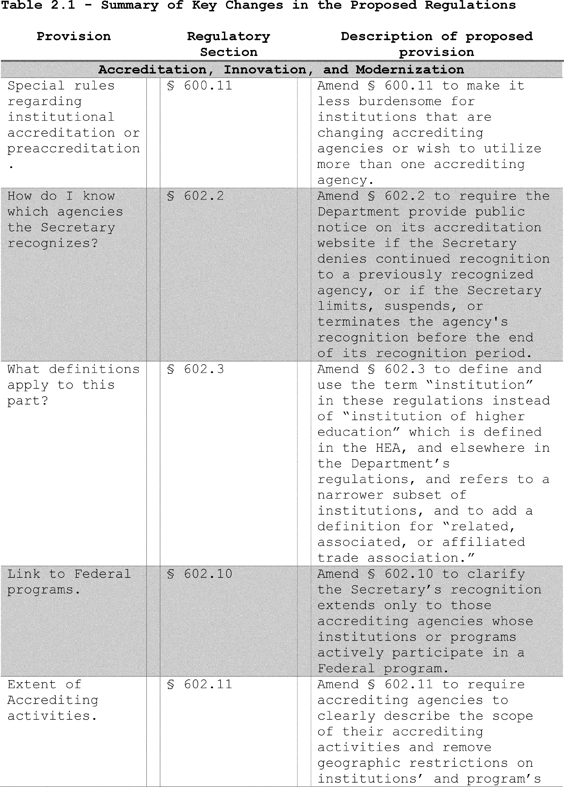
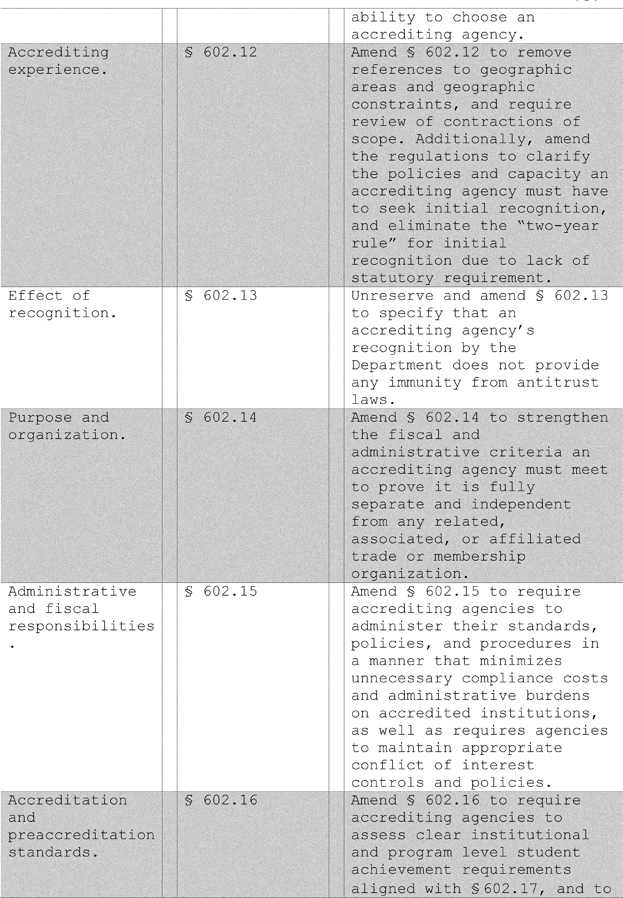
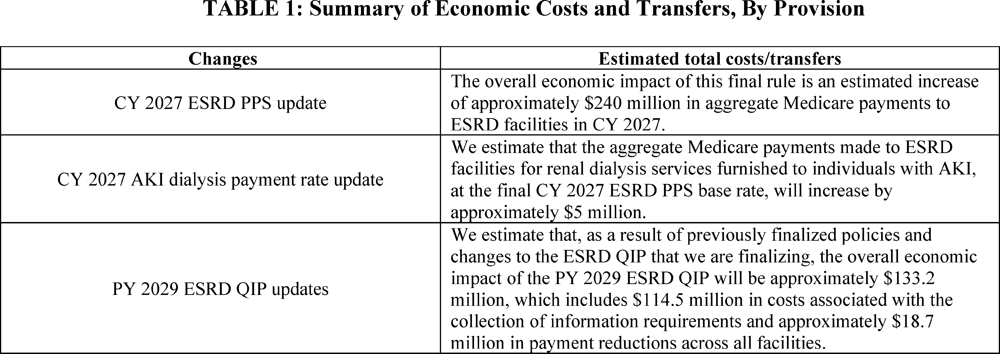
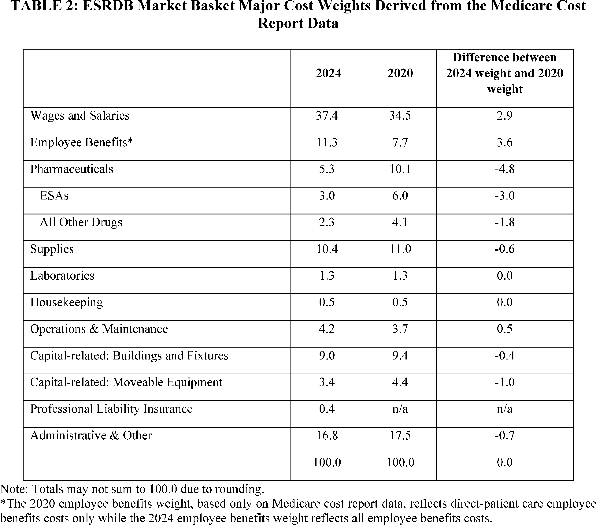
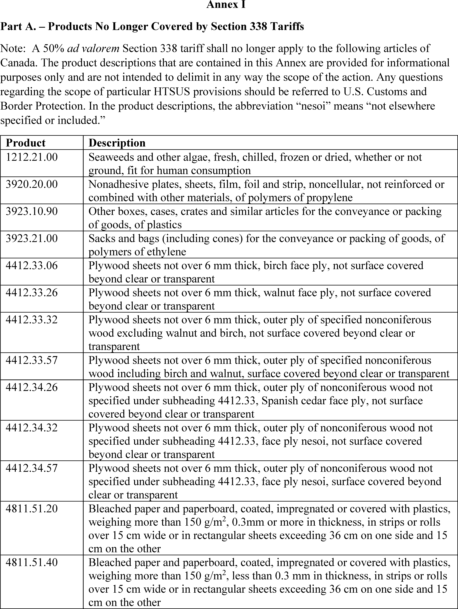
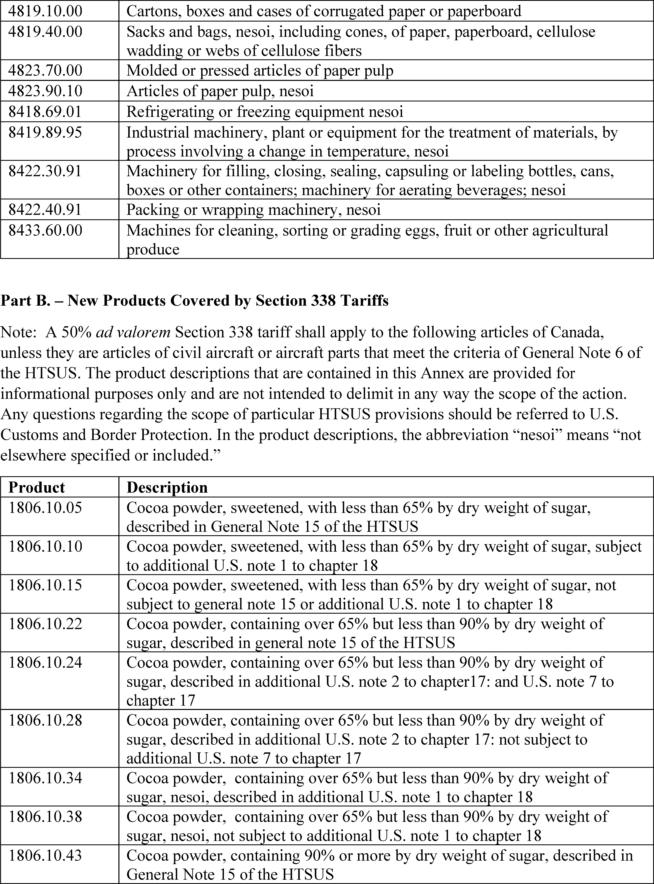

# Daily Digest — 2026-10-30

| | |
|---|---|
| **Digest date** | 2026-10-30 |
| **Data date range** | 2026-10-30 to 2026-10-30 |
| **Generated at** | 2026-10-31T04:03:40Z (UTC) |
| **Pipeline version** | ecad1888 |
| **Inference** | model layers ran — cli/haiku, opus |
| **Source watermarks** | CREC: 2026-10-30T10:29:32Z · BILLS: 2026-10-30T13:32:28Z · FR: 2026-10-30T15:08:47Z · USCOURTS: 2026-10-30T22:48:19Z · PLAW: 2026-10-30T15:30:14Z |

[Full observed listing for this day](day/2026-10-30.html) — the items our collectors observed for this publication day, mechanical rules applied, frozen at end of day; releases their publishers date on other days are counted there, not listed. This digest is the canonical record.

All items below cite the govinfo package (and granule, where applicable) they
summarize. Selection is mechanical; each item states the rule that included
it. See the Coverage Statement at the end for a full accounting of what was
published, what was summarized, and what was excluded and why.

---

## Contents

- [Day in Review](#day-in-review)
- [1. Congressional Floor Activity](#1-congressional-floor-activity)
- [2. Legislation](#2-legislation)
- [3. Federal Register](#3-federal-register)
- [4. Enacted Laws](#4-enacted-laws)
- [5. Judicial Activity](#5-judicial-activity)
- [6. Agency Announcements](#6-agency-announcements)
- [7. Recorded Votes](#7-recorded-votes)
- [8. Bill Actions](#8-bill-actions)
- [9. Presidential Actions](#9-presidential-actions)
- [Terms Used Today](#terms-used-today)
- [Coverage Statement](#coverage-statement)
- [Methodology](#methodology)

---

## Day in Review

The digest carries 48 House and 4 Senate Congressional Record items, along with 34 Extensions of Remarks and 6 Daily Digest entries. The item summaries do not describe any recorded votes. Fourteen bills appear as reported in the House, including measures on the Crossett Experimental Forest conveyance to Arkansas, Indian buffalo management, cormorant management, and the Theodore Roosevelt Presidential Library (S. 675). Five House bills and one Senate bill appear as introduced. The digest also carries Public Law 119–68, approved December 29, 2025, which conveys about 3,400 acres of federal land to La Paz County, Arizona.

On the executive side, the digest carries 17 final rules, 101 notices, and one presidential document. That document is Proclamation 11076, dated October 23, 2026, which changes which Canadian products are subject to the additional 50 percent duties. The rules include:

- an Education Department revision of accreditation regulations implementing Executive Order 14279
- the calendar year 2027 Medicare end-stage renal disease payment rule
- DEA placement of centanafadine in Schedule III
- four FDA device classifications
- a Consumer Product Safety Commission update to its garage door operator standard

The digest carries 52 appellate, 832 district, and one bankruptcy court opinion. The Third Circuit held that private plaintiffs may enforce the Civil Rights Act's Materiality Provision under § 1983, and that Pennsylvania's mail-in ballot dating requirement is immaterial under that provision. The Ninth Circuit affirmed the denial of preliminary injunctions against Seattle's app-based worker deactivation ordinance. It also affirmed an injunction against California's SB 399 and stayed an injunction concerning Diversity Visa registration. The Sixth Circuit rejected a facial Second Amendment challenge to 18 U.S.C. § 922(g)(4).

*Composed from the summarized items below and the day's mechanical
counts; all specifics are cited in their sections.*

---

## 1. Congressional Floor Activity

Source: Congressional Record (CREC), issue observed 2026-10-30, covering proceedings of 2026-10-29. Published by govinfo 2026-10-30T10:29:32Z; observed by our collector 2026-10-30T10:48:44Z. Total issue size: 92 granule(s).

### 1.1 Senate

No Senate floor items met the selection thresholds. 4 floor granule(s) are accounted for in the Coverage Statement.

### 1.2 House of Representatives

Tags: legislative · model keys: committee referrals · congressional record · house bill introductions

*In plain terms: One Congressional Record section from October 29, 2026 lists House bills and resolutions introduced, with sponsors and committee referrals, including H.R. 10918.*

- **Public Bills and Resolutions** — This Congressional Record section (pages H6069-H6070, October 29, 2026) lists public bills and resolutions introduced in the House of Representatives, with their sponsors and committee referrals under clause 2 of rule XII. It enumerates H.R. 10918 through H.R. 10945, with subjects including 340B drug pricing, telemedicine licensing grants, a proposed Medicare for America health program, a 50 percent duty on imported hemp products from China, and public library construction grants. The source text is truncated at the start of H.R. 10946.
  - *In plain terms:* Lists House bills H.R. 10918 through 10945, covering drug pricing, telemedicine licensing grants, a proposed Medicare for America program, a 50 percent duty on Chinese hemp imports, and library construction grants.
  - Included because: CREC-SEL-01 — floor item ≥ threshold floor time (18,297 characters) (document dated 2026-10-29)
  - Source: [CREC-2026-10-29 / CREC-2026-10-29-pt1-PgH6069](https://www.govinfo.gov/app/details/CREC-2026-10-29/CREC-2026-10-29-pt1-PgH6069)

### 1.3 Recorded Votes

No recorded votes were published in this issue of the Congressional Record.

---

## 2. Legislation

Source: Congressional Bills (BILLS), text versions published 2026-10-30 to 2026-10-30.

### 2.1 Counts by Stage

| Stage (bill text version) | Count |
|---|---|
| Introduced (ih/is) | 6 |
| Reported (rh/rs) | 14 |
| Engrossed (eh/es) | 0 |
| Enrolled (enr) | 0 |
| Other versions | 0 |
| **Total bill texts published** | **20** |

### 2.2 Bills Listed by Mechanical Rule

Tags: legislative · model keys: land transfers · national trails · water management

*In plain terms: 14 bills, led by a measure conveying the Crossett Experimental Forest to Arkansas and a $50 million grant for a Theodore Roosevelt Presidential Library; the rest cover water, trails, and land transfers.*

Bills below are listed because they matched at least one listing rule; the
matching rule is stated per item. All other bill texts are counted above and
accounted for in the Coverage Statement.

- **H. R. 10136 (rh) — 119 HR 10136 RH: Crossett Experimental Forest Act of 2026** — H.R. 10136, the Crossett Experimental Forest Act of 2026, directs the Secretary of Agriculture to convey the Crossett Experimental Forest, the R.R. Reynolds Research Natural Area, and associated facilities to the State of Arkansas by quitclaim deed without consideration, if the State submits a written request within 180 days of enactment. The State must pay conveyance costs, designate the land as the Crossett Experimental State Forest, and use it for forest research, education, and demonstration in coordination with the University of Arkansas at Monticello and the University of Arkansas Division of Agriculture. If the State fails to meet these conditions and does not correct the failure within 180 days after written notice, the Secretary may revert the land to the United States, and the Forest Service must provide the State with copies of related research records.
  - *In plain terms:* The Agriculture Secretary would transfer the Crossett Experimental Forest, R.R. Reynolds Research Natural Area, and related facilities to Arkansas at no charge if the state requests it in writing within 180 days of enactment.
  - Included because: BILLS-SEL-01 — reached stage: reported/enrolled/calendar (document dated 2026-10-29)
  - Source: [BILLS-119hr10136rh](https://www.govinfo.gov/app/details/BILLS-119hr10136rh)
- **H. R. 10306 (rh) — 103 HR 10306 RH: Technical Correction to the Shoshone-Paiute Tribes of the Duck Valley Reservation Water Rights Settlement Act of 2025** — H.R. 10306 amends Section 10807(b) of the Omnibus Public Land Management Act of 2009 to authorize payment of adjusted interest on the Development Fund for the Shoshone-Paiute Tribes of the Duck Valley Reservation for fiscal years 2027 through 2033. The adjusted amount is calculated using the daily government overnight rate with daily compounding, consistent with the Act of June 24, 1938 and the American Indian Trust Fund Management Reform Act of 1994. The bill also provides that these amounts may be derived from funds otherwise available to the Secretary for implementing Indian water rights settlements, to the extent provided in advance in appropriations Acts.
  - *In plain terms:* The bill authorizes adjusted interest payments from the Development Fund for the Shoshone-Paiute Tribes of the Duck Valley Reservation for fiscal years 2027 through 2033, calculated at the daily government overnight rate compounded daily.
  - Included because: BILLS-SEL-01 — reached stage: reported/enrolled/calendar (document dated 2026-10-29)
  - Source: [BILLS-119hr10306rh](https://www.govinfo.gov/app/details/BILLS-119hr10306rh)
- **H. R. 3331 (rh) — 119 HR 3331 RH: Mariner Exam Modernization Act** — H.R. 3331, the Mariner Exam Modernization Act, amends Section 7510 of title 46, United States Code, concerning merchant mariner credential examination working groups. The bill adds required members to the working group, including individuals who passed the examination within the prior five years and a representative of the United States Merchant Marine Academy, and requires the Commandant to convene the group annually or when new questions are created. It also requires a review of the examination within 270 days, a plan to update and modernize the examination within 270 days after that review, a prohibition on using new questions until the working group approves them, and a Coast Guard briefing to congressional committees within one year of enactment.
  - *In plain terms:* The bill adds members who passed the mariner exam within the prior five years and a Merchant Marine Academy representative to the exam working group, and requires an exam review within 270 days.
  - Included because: BILLS-SEL-01 — reached stage: reported/enrolled/calendar (document dated 2026-10-29)
  - Source: [BILLS-119hr3331rh](https://www.govinfo.gov/app/details/BILLS-119hr3331rh)
- **H. R. 4598 (rh) — 119 HR 4598 RH: Technical Corrections to the Northwestern New Mexico Rural Water Projects Act, Taos Pueblo Indian Water Rights Settlement Act, and Aamodt Litigation Settlement Act** — H.R. 4598 amends the Omnibus Public Land Management Act of 2009 to authorize adjusted interest payments from the Navajo Nation Water Resources Development Trust Fund for fiscal years 2027 through 2033, calculated using the daily government overnight rate with daily compounding. It also amends Section 509(c)(1) of the Claims Resolution Act of 2010 for the Taos Pueblo Water Development Fund and Section 617(c)(1) of that Act for the Aamodt Settlement Pueblos' Fund to authorize comparable adjusted interest amounts, and directs the Secretary of the Treasury to waive certain amounts due on Aamodt-related interest earned before September 15, 2017. The bill includes disclaimers stating that it does not affect the prior satisfaction of specified conditions precedent or the Secretarial findings published in the Federal Register on October 7, 2016 and September 15, 2017, and it authorizes appropriation of investment earnings credited to the trust funds.
  - *In plain terms:* The bill authorizes adjusted interest payments from the Navajo Nation Water Resources Development Trust Fund for fiscal years 2027 through 2033, and waives certain amounts due on Aamodt-related interest earned before September 15, 2017.
  - Included because: BILLS-SEL-01 — reached stage: reported/enrolled/calendar (document dated 2026-10-29)
  - Source: [BILLS-119hr4598rh](https://www.govinfo.gov/app/details/BILLS-119hr4598rh)
- **H. R. 7254 (rh) — 119 HR 7254 RH: To amend the National Trails System Act to direct the Secretary of the Interior to conduct a study on the feasibility of designating the Bay Area Ridge National Scenic Trail, and for other purposes.** — H.R. 7254 would amend Section 5(c) of the National Trails System Act (16 U.S.C. 1244(c)) to add the Bay Area Ridge National Scenic Trail, described as a multi-use trail of approximately 550 miles along ridgelines around the San Francisco Bay Area. It directs the Secretary of the Interior to complete and submit to Congress a feasibility study for designating the trail within 3 years of enactment, in consultation with interested organizations including the Bay Area Ridge Trail Council and with each federal and state agency whose lands the trail crosses. The Secretary may complete the study by reviewing and certifying a study prepared by interested organizations, and may consider previous National Park Service and other studies.
  - *In plain terms:* H.R. 7254 directs the Interior Secretary to submit to Congress, within 3 years of enactment, a study on whether the 550-mile Bay Area Ridge trail should be designated a National Scenic Trail.
  - Included because: BILLS-SEL-01 — reached stage: reported/enrolled/calendar (document dated 2026-10-29)
  - Source: [BILLS-119hr7254rh](https://www.govinfo.gov/app/details/BILLS-119hr7254rh)
- **H. R. 7954 (rh) — 119 HR 7954 RH: Don Young Doug LaMalfa Indian Buffalo Management Act** — H.R. 7954, the Don Young Doug LaMalfa Indian Buffalo Management Act, sets out congressional findings and purposes regarding buffalo management and reestablishment on Indian land. It directs the Secretary of the Interior to consult with Indian Tribes and Tribal organizations, to enter into contracts, cooperative agreements, and grants for buffalo restoration and management activities, and to provide technical assistance. The bill also requires protection of information identified by Tribes as culturally sensitive, proprietary, or confidential, authorizes the transfer of surplus buffalo from federal land to Tribes with possible waiver of charges, states that treaty rights are not altered, and sunsets the authority 7 years after enactment.
  - *In plain terms:* H.R. 7954 directs the Interior Secretary to work with Tribes on buffalo restoration and management on Indian land through contracts, cooperative agreements, and grants, and ends that authority 7 years after enactment.
  - Included because: BILLS-SEL-01 — reached stage: reported/enrolled/calendar (document dated 2026-10-29)
  - Source: [BILLS-119hr7954rh](https://www.govinfo.gov/app/details/BILLS-119hr7954rh)
- **H. R. 8183 (rh) — 119 HR 8183 RH: Modernizing Access to Talents, Credentials, and Hiring Act of 2026** — H.R. 8183, the Modernizing Access to Talents, Credentials, and Hiring Act of 2026 (MATCH Act of 2026), was reported with amendments and would amend the Workforce Innovation and Opportunity Act to establish a pilot program of up to 5 years in which the Secretary of Labor awards grants to eligible entities for workforce longitudinal data systems and talent marketplaces. The bill sets grant application contents, priority criteria, grant durations of up to 3 years, and requirements for publicly available, consumer-tested websites that present program and talent marketplace information. It also requires reports to Congress, a Government Accountability Office evaluation after the pilot concludes, and the development of validated skills assessment tools in coordination with the Office of Personnel Management.
  - *In plain terms:* H.R. 8183 would amend the Workforce Innovation and Opportunity Act to create a pilot of up to 5 years where the Labor Secretary awards grants lasting up to 3 years for workforce data systems and talent marketplaces.
  - Included because: BILLS-SEL-01 — reached stage: reported/enrolled/calendar (document dated 2026-10-29)
  - Source: [BILLS-119hr8183rh](https://www.govinfo.gov/app/details/BILLS-119hr8183rh)
- **H. R. 8195 (rh) — 119 HR 8195 RH: Responsible Cormorant Management and Control Act of 2026** — H.R. 8195, the Responsible Cormorant Management and Control Act of 2026, directs the Secretary of the Interior, acting through the Director of the U.S. Fish and Wildlife Service, to issue regulations within 1 year of enactment for regional management frameworks governing the take of double-crested cormorants. Each framework must address allowable methods and time periods of take, annual public reporting of take, measures to avoid non-target birds, non-lethal measures, and authorized entities, among other requirements. The bill also requires population surveys and framework updates every 5 years, a report on the feasibility of issuing cormorant hunting licenses within 90 days of enactment, and provides that the Act has no force or effect beginning January 1, 2034.
  - *In plain terms:* H.R. 8195 requires the Interior Secretary, through the Fish and Wildlife Service, to issue regional cormorant management regulations within 1 year of enactment, and the Act ceases to have effect on January 1, 2034.
  - Included because: BILLS-SEL-01 — reached stage: reported/enrolled/calendar (document dated 2026-10-29)
  - Source: [BILLS-119hr8195rh](https://www.govinfo.gov/app/details/BILLS-119hr8195rh)
- **H. R. 8483 (rh) — 119 HR 8483 RH: Barona Group of Capitan Grande Band of Mission Indians Land Transfer Act of 2026** — H.R. 8483, the Barona Group of Capitan Grande Band of Mission Indians Land Transfer Act of 2026, transfers administrative jurisdiction of approximately 683 acres of Forest Service land (Parcels 2 and 3) to the Secretary of the Interior and takes that land, together with approximately 164 acres of Bureau of Land Management land (Parcel 1), into trust for the Barona Group of Capitan Grande Band of Mission Indians. The land becomes part of the Tribe's reservation, subject to existing rights, Forest Service administrative vehicular access, continuing public recreational access, and emergency and fuels-management access. The bill prohibits class II and class III gaming on the transferred land, states that existing water rights are not altered, and requires the Tribe to maintain the fuel break in accordance with Forest Service standards.
  - *In plain terms:* H.R. 8483 places about 683 acres of Forest Service land and about 164 acres of Bureau of Land Management land into trust for the Barona Group of Capitan Grande Band of Mission Indians.
  - Included because: BILLS-SEL-01 — reached stage: reported/enrolled/calendar (document dated 2026-10-29)
  - Source: [BILLS-119hr8483rh](https://www.govinfo.gov/app/details/BILLS-119hr8483rh)
- **H. R. 9269 (rh) — 119 HR 9269 RH: Renewing the African American Civil Rights Network Act** — H.R. 9269, the Renewing the African American Civil Rights Network Act, amends 54 U.S.C. 308404 to change the reference point for the 7-year authorization period so that it runs from the date of enactment of the Renewing the African American Civil Rights Network Act rather than from the date of enactment of the chapter. The bill's only operative provision is this amendment to the authorization period.
  - *In plain terms:* H.R. 9269 changes the 7-year authorization period under 54 U.S.C. 308404 so it runs from the date this Act is enacted rather than from the date the chapter was enacted.
  - Included because: BILLS-SEL-01 — reached stage: reported/enrolled/calendar (document dated 2026-10-29)
  - Source: [BILLS-119hr9269rh](https://www.govinfo.gov/app/details/BILLS-119hr9269rh)
- **H. R. 9600 (rh) — 119 HR 9600 RH: Common Sense 250 Act of 2026** — H.R. 9600, the Common Sense 250 Act of 2026, provides that, notwithstanding the requirements of section 8908(b)(1) of title 40, United States Code (the Commemorative Works Act), the location of a commemorative work for Thomas Paine authorized by section 709 of division DD of the Consolidated Appropriations Act, 2023, is approved. The approved location is within Area I as depicted on the map entitled Commemorative Areas Washington, DC and Environs, numbered 869/86501 B and dated June 24, 2003. The bill requires that the commemorative work be located within Area I.
  - *In plain terms:* H.R. 9600 approves the location of a Thomas Paine commemorative work within Area I, as shown on the map numbered 869/86501 B dated June 24, 2003, without meeting the location requirements of the Commemorative Works Act.
  - Included because: BILLS-SEL-01 — reached stage: reported/enrolled/calendar (document dated 2026-10-29)
  - Source: [BILLS-119hr9600rh](https://www.govinfo.gov/app/details/BILLS-119hr9600rh)
- **H. R. 9640 (rh) — 119 HR 9640 RH: Earth MRI Reauthorization Act of 2026** — H.R. 9640, the Earth MRI Reauthorization Act of 2026, as reported with an amendment, amends Section 40201 of the Infrastructure Investment and Jobs Act to broaden the purpose of the Earth Mapping Resources Initiative to include data from modern sensing technologies and analytical methods, and adds the USGS 3D Hydrography Program as a data source. It authorizes $84,000,000 for fiscal years 2027 through 2031. It also directs the USGS Director to give preference to United States-owned and United States-controlled entities when contracting, and requires contract applicants to disclose the ownership of the primary contractor and each subcontractor.
  - *In plain terms:* H.R. 9640 authorizes $84,000,000 for fiscal years 2027 through 2031 for the Earth Mapping Resources Initiative (Earth MRI) and directs the USGS Director to prefer United States-owned and controlled contractors when contracting.
  - Included because: BILLS-SEL-01 — reached stage: reported/enrolled/calendar (document dated 2026-10-29)
  - Source: [BILLS-119hr9640rh](https://www.govinfo.gov/app/details/BILLS-119hr9640rh)
- **H. R. 9785 (rh) — 119 HR 9785 RH: South Dakota Water Feasibility Studies Act** — H.R. 9785, the South Dakota Water Feasibility Studies Act, as reported with an amendment, directs the Secretary of the Interior to conduct feasibility studies for three proposed Missouri River basin municipal, rural, and industrial water supply projects: the Western Dakota Regional Water System, the Lewis and Clark Regional Water System expansion, and the Dakota Mainstem Water Supply Project. For the first two studies, the Secretary must submit a feasibility report with a recommendation and a non-Federal cost share of at least 25 percent, and for the third study the Secretary may proceed through a cooperative agreement. For all three, the Federal share of study costs is capped at $10,000,000 and 50 percent of the total cost, and each study authority expires 7 years after enactment.
  - *In plain terms:* H.R. 9785 directs the Interior Secretary to study three Missouri River basin water supply projects, capping the federal share at $10,000,000 and 50 percent of total cost, with authority ending 7 years after enactment.
  - Included because: BILLS-SEL-01 — reached stage: reported/enrolled/calendar (document dated 2026-10-29)
  - Source: [BILLS-119hr9785rh](https://www.govinfo.gov/app/details/BILLS-119hr9785rh)
- **S. 675 (rh) — 119 S675 RH: Theodore Roosevelt Presidential Library Act** — S. 675, the Theodore Roosevelt Presidential Library Act, authorizes the Secretary of the Interior to provide grants of up to $50,000,000 to the Theodore Roosevelt Presidential Library Foundation for establishing the Theodore Roosevelt Presidential Library in Medora, North Dakota, subject to appropriations. Grants may not be provided until the Foundation certifies it has received at least $100,000,000 from State of North Dakota funds or non-Federal sources, and grant funds may not be used for the library's maintenance or operation. The Act also authorizes the Secretary, within 180 days of enactment, to enter into agreements to loan Federal museum artifacts and objects from Interior agencies to the Foundation without monetary consideration, and states that no Federal entity is involved in the library's operation unless requested by the non-Federal operator.
  - *In plain terms:* The Interior Secretary may grant up to $50,000,000 to the Theodore Roosevelt Presidential Library Foundation for a Medora, North Dakota library, subject to appropriations and the Foundation certifying at least $100,000,000 non-federal funding.
  - Included because: BILLS-SEL-01 — reached stage: reported/enrolled/calendar (document dated 2026-10-29)
  - Source: [BILLS-119s675rh](https://www.govinfo.gov/app/details/BILLS-119s675rh)

---

## 3. Federal Register

Source: Federal Register (FR), issue of 2026-10-30.

### 3.1 Counts by Document Type

| Document type | Count |
|---|---|
| Rules | 17 |
| Proposed rules | 0 |
| Notices | 101 |
| Presidential documents | 1 |
| **Total FR documents** | **119** |

### 3.2 Rules Published

Tags: department of commerce · department of the interior · executive · model keys: dialysis payment rules · foia fees · medical device classification

*In plain terms: 17 rules and notices, including FDA classifications of four medical devices and the 2027 ESRD dialysis payment update; the rest cover FOIA fees, accreditation, airspace, fishing, and Coast Guard safety zones.*

#### CONSUMER PRODUCT SAFETY COMMISSION

- **Safety Standard for Automatic Residential Garage Door Operators** (2026-22213; 16 CFR Part 1211) — In October 2025, updates to the entrapment protection provisions in the UL 325 standard were accepted under the Consumer Product Safety Improvement Act of 1990 (Improvement Act) for inclusion in the Commission's mandatory safety regulation for automatic residential garage door operators. In this direct final rule, the Consumer Product Safety Commission (Commission) is amending the Commission's automatic residential garage door operators mandatory regulation to align with the changes in UL 325. Action: Direct final rule. Dates: The rule is effective on December 29, 2026, unless we receive significant adverse comments by November 30, 2026. If we receive a timely significant adverse comment, we will publish a notification in the Federal Register , withdrawing this direct final rule before its effective date. The incorporation by reference of certain material listed in this rule is approved by the Director of the Federal Register as of December 29, 2026. The incorporation by reference of certain other material listed in this rule was approved by the Director as of May 9, 2016.
  - *In plain terms:* In October 2025, UL 325 entrapment-protection updates were accepted for inclusion in the Consumer Product Safety Commission's mandatory garage door operator regulation, and the Commission is amending that regulation to match them.
  - Included because: FR-SEL-01 — document type: final rule (all listed)
  - Source: [FR-2026-10-30 / 2026-22213](https://www.govinfo.gov/app/details/FR-2026-10-30/2026-22213)

#### DEPARTMENT OF COMMERCE

- **Fisheries of the Northeastern United States; Atlantic Bluefish Fishery; Quota Transfer From Rhode Island to North Carolina** (2026-22217; 50 CFR Part 648) — NMFS announces that the State of Rhode Island is transferring a portion of their 2026 commercial bluefish quota to the State of North Carolina. This quota adjustment is necessary to comply with the Atlantic Bluefish Fishery Management Plan (FMP) quota transfer provisions. This announcement informs the public of the revised 2026 commercial bluefish quotas for Rhode Island and North Carolina. Action: Temporary rule; quota transfer. Dates: Effective October 29, 2026, through December 31, 2026.
  - *In plain terms:* NMFS announces that Rhode Island is transferring part of its 2026 commercial bluefish quota to North Carolina, revising both states' 2026 commercial bluefish quotas under the Atlantic Bluefish Fishery Management Plan.
  - Included because: FR-SEL-01 — document type: final rule (all listed)
  - Source: [FR-2026-10-30 / 2026-22217](https://www.govinfo.gov/app/details/FR-2026-10-30/2026-22217)
- **Fisheries of the Exclusive Economic Zone off Alaska; Pollock in Statistical Area 630 in the Gulf of Alaska** (2026-22218; 50 CFR Part 679) — NMFS is prohibiting directed fishing for pollock in Statistical Area 630 in the Gulf of Alaska (GOA). This action is necessary to prevent exceeding the annual 2026 total allowable catch (TAC) of pollock in Statistical Area 630 in the GOA. Action: Temporary rule; closure. Dates: Effective 1200 hours, Alaska local time (A.l.t.), October 28, 2026, through 2400 hours, A.l.t., December 31, 2026.
  - *In plain terms:* NMFS is prohibiting targeted pollock fishing in Statistical Area 630 of the Gulf of Alaska to prevent exceeding the 2026 total allowable catch, the annual catch limit, for pollock there.
  - Included because: FR-SEL-01 — document type: final rule (all listed)
  - Source: [FR-2026-10-30 / 2026-22218](https://www.govinfo.gov/app/details/FR-2026-10-30/2026-22218)

#### DEPARTMENT OF EDUCATION

- **Accreditation, Innovation, and Modernization: The Secretary's Recognition of Accrediting Agencies; Institutional Eligibility Under the Higher Education Act of 1965, as Amended; Student Assistance General Provisions** (2026-22174; 34 CFR Parts 600, 602, and 668) — The Department revises the existing accrediting agency recognition regulations to implement the directives set forth in Executive Order 14279, Reforming Accreditation to Strengthen Higher Education, and other Administration priorities, align the regulations more closely with statute, and reduce regulatory burden. Action: Final rule. Dates: This final rule is effective July 1, 2027. Implementation dates: For the implementation dates of the regulatory provisions, see the Implementation Date of These Regulations of this document.
  - *In plain terms:* The Department is revising its accrediting agency recognition regulations to implement Executive Order 14279, Reforming Accreditation to Strengthen Higher Education, and other Administration priorities, to align more closely with statute and reduce regulatory burden.
  - Included because: FR-SEL-01 — document type: final rule (all listed)
  - Source: [FR-2026-10-30 / 2026-22174](https://www.govinfo.gov/app/details/FR-2026-10-30/2026-22174)
  -  *Source graphic 1 of 30 from 2026-22174.*
  -  *Source graphic 2 of 30 from 2026-22174.*
  - *Graphics not rendered here: 28 of 30 — see the [source PDF](https://www.govinfo.gov/content/pkg/FR-2026-10-30/pdf/FR-2026-10-30.pdf).*

#### DEPARTMENT OF HEALTH AND HUMAN SERVICES

- **Medical Devices; General and Plastic Surgery Devices; Classification of the Software-Aided Adjunctive Diagnostic Device for Use by Physicians on Lesions Suspicious for Skin Cancer** (2026-22179; 21 CFR Part 878) — The Food and Drug Administration (FDA) is classifying the software-aided adjunctive diagnostic device for use by physicians on lesions suspicious for skin cancer into class II (special controls). The special controls that apply to the device type are identified in this order and will be part of the codified language for classification of the software-aided adjunctive diagnostic device for use by physicians on lesions suspicious for skin cancer. We are taking this action because we have determined that classifying the device into class II will provide a reasonable assurance of the safety and effectiveness of the device. We believe this action will also enhance patients' access to beneficial innovative devices, in part by reducing regulatory burdens. Action: Final amendment; final order. Dates: This order is effective October 30, 2026. The classification was applicable on January 12, 2024.
  - *In plain terms:* FDA is placing the software-aided adjunctive diagnostic device for use by physicians on lesions suspicious for skin cancer into class II (special controls), which are listed in this order and codified.
  - Included because: FR-SEL-01 — document type: final rule (all listed)
  - Source: [FR-2026-10-30 / 2026-22179](https://www.govinfo.gov/app/details/FR-2026-10-30/2026-22179)
- **Medical Devices; Radiology Devices; Classification of the Radiology Software for Referral of Findings Related to Fibrotic Lung Disease** (2026-22180; 21 CFR Part 892) — The Food and Drug Administration (FDA) is classifying the radiology software for referral of findings related to fibrotic lung disease into class II (special controls). The special controls that apply to the device type are identified in this order and will be part of the codified language for classification of the radiology software for referral of findings related to fibrotic lung disease. We are taking this action because we have determined that classifying the device into class II will provide a reasonable assurance of the safety and effectiveness of the device. We believe this action will also enhance patients' access to beneficial innovative devices, in part by reducing regulatory burdens. Action: Final amendment; final order. Dates: This order is effective October 30, 2026. The classification was applicable on January 12, 2024.
  - *In plain terms:* FDA is placing radiology software for referral of findings related to fibrotic lung disease into class II (special controls), with those special controls listed in this order and codified.
  - Included because: FR-SEL-01 — document type: final rule (all listed)
  - Source: [FR-2026-10-30 / 2026-22180](https://www.govinfo.gov/app/details/FR-2026-10-30/2026-22180)
- **Medical Devices; Anesthesiology Devices; Classification of the Spinal Imaging System for Neuraxial Procedures** (2026-22181; 21 CFR Part 868) — The Food and Drug Administration (FDA) is classifying the spinal imaging system for neuraxial procedures into class II (special controls). The special controls that apply to the device type are identified in this order and will be part of the codified language for classification of the spinal imaging system for neuraxial procedures. We are taking this action because we have determined that classifying the device into class II will provide a reasonable assurance of the safety and effectiveness of the device. We believe this action will also enhance patients' access to beneficial innovative devices, in part by reducing regulatory burdens. Action: Final amendment; final order. Dates: This order is effective October 30, 2026. The classification was applicable on January 19, 2024.
  - *In plain terms:* FDA is placing the spinal imaging system for neuraxial procedures into class II (special controls), with those special controls listed in this order and codified.
  - Included because: FR-SEL-01 — document type: final rule (all listed)
  - Source: [FR-2026-10-30 / 2026-22181](https://www.govinfo.gov/app/details/FR-2026-10-30/2026-22181)
- **Medical Devices; Anesthesiology Devices; Classification of the Over-the-Counter Device To Assess Risk of Sleep Apnea** (2026-22182; 21 CFR Part 868) — The Food and Drug Administration (FDA) is classifying the over-the-counter device to assess risk of sleep apnea into class II (special controls). The special controls that apply to the device type are identified in this order and will be part of the codified language for classification of the over-the-counter device to assess risk of sleep apnea. We are taking this action because we have determined that classifying the device into class II will provide a reasonable assurance of the safety and effectiveness of the device. We believe this action will also enhance patients' access to beneficial innovative devices, in part by reducing regulatory burdens. Action: Final amendment; final order. Dates: This order is effective October 30, 2026. The classification was applicable on February 6, 2024.
  - *In plain terms:* FDA is placing the over-the-counter device to assess risk of sleep apnea into class II (special controls), with those special controls listed in this order and codified.
  - Included because: FR-SEL-01 — document type: final rule (all listed)
  - Source: [FR-2026-10-30 / 2026-22182](https://www.govinfo.gov/app/details/FR-2026-10-30/2026-22182)
- **Medicare Program; CY 2027 Changes to the End-Stage Renal Disease (ESRD) Prospective Payment System, Acute Kidney Injury (AKI) Dialysis Payment, and ESRD Quality Incentive Program** (2026-22194; 42 CFR Part 413) — This final rule updates and revises the End-Stage Renal Disease (ESRD) Prospective Payment System for calendar year 2027. This rule also includes updates to the payment rate for renal dialysis services furnished by an ESRD facility to individuals with acute kidney injury. In addition, this rule updates the requirements for the ESRD Quality Incentive Program. Action: Final rule. Dates: These regulations are effective on January 1, 2027.
  - *In plain terms:* This final Medicare rule updates the End-Stage Renal Disease (ESRD) Prospective Payment System for calendar year 2027, updates the payment rate for dialysis services furnished to individuals with acute kidney injury, and updates ESRD Quality Incentive Program requirements.
  - Included because: FR-SEL-01 — document type: final rule (all listed)
  - Source: [FR-2026-10-30 / 2026-22194](https://www.govinfo.gov/app/details/FR-2026-10-30/2026-22194)
  -  *Source graphic 1 of 41 from 2026-22194.*
  -  *Source graphic 2 of 41 from 2026-22194.*
  - *Graphics not rendered here: 39 of 41 — see the [source PDF](https://www.govinfo.gov/content/pkg/FR-2026-10-30/pdf/FR-2026-10-30.pdf).*

#### DEPARTMENT OF HOMELAND SECURITY

- **Electronic Payments for FOIA Requests** (2026-22165; 6 CFR Part 5) — The Department of Homeland Security (DHS or Department) is updating its regulations related to the payment of fees arising from Freedom of Information Act (FOIA) and Privacy Act of 1974 requests to add the option for requesters to submit electronic payments via the Department's FOIA processing system, which can be made using pay.gov, or as otherwise directed by DHS and its components. Action: Final rule. Dates: This final rule is effective November 30, 2026.
  - *In plain terms:* DHS is updating its rules on fees for Freedom of Information Act and Privacy Act requests to let requesters pay electronically through its FOIA processing system, via pay.gov or as DHS and its components otherwise direct.
  - Included because: FR-SEL-01 — document type: final rule (all listed)
  - Source: [FR-2026-10-30 / 2026-22165](https://www.govinfo.gov/app/details/FR-2026-10-30/2026-22165)
- **Safety Zone; S.S. UNITED STATES Dead Ship Tow, Sector Mobile Captain of the Port Zone, Mobile, AL** (2026-22249; 33 CFR Part 165) — The Coast Guard is establishing a temporary moving safety zone around the S.S. UNITED STATES and all vessels involved in its towage through the Mobile River Channel, Mobile Bay, and the Gulf of America. The safety zone is needed to protect personnel, vessels, and the marine environment from potential hazards created by the dead ship tow. Entry of persons and vessels into this zone is prohibited unless specifically authorized by the Captain of the Port (COTP), Sector Mobile. Action: Temporary final rule. Dates: This rule is effective from November 6, 2026 through November 16, 2026.
  - *In plain terms:* The Coast Guard is establishing a temporary moving safety zone around the S.S. UNITED STATES and all vessels involved in its towage through the Mobile River Channel, Mobile Bay, and the Gulf of America, where entry is prohibited unless the Captain of the Port authorizes it.
  - Included because: FR-SEL-01 — document type: final rule (all listed)
  - Source: [FR-2026-10-30 / 2026-22249](https://www.govinfo.gov/app/details/FR-2026-10-30/2026-22249)
- **Safety Zone; M/T KALAHARI, Gulf of America, Pascagoula, MS** (2026-22269; 33 CFR Part 165) — The Coast Guard is establishing a temporary safety zone for navigable waters of the Gulf of America. The safety zone is needed to protect personnel, vessels, and the marine environment from potential hazards associated with the M/T KALAHARI that will be conducting repairs at anchorage due to both auxiliary boilers being out of service rendering the inert gas system inoperable. Entry of vessels or persons into this zone is prohibited unless specifically authorized by the Captain of the Port, Sector Mobile, or their designated representative. Action: Temporary final rule. Dates: This rule is effective without actual notice from October 30, 2026 through December 27, 2026. For the purposes of enforcement, actual notice will be used from October 28, 2026, through October 30, 2026.
  - *In plain terms:* The Coast Guard is establishing a temporary safety zone in Gulf of America waters at Pascagoula, Mississippi, for the M/T KALAHARI's repairs at anchorage, where entry is barred unless the Captain of the Port, Sector Mobile, or a designated representative authorizes it.
  - Included because: FR-SEL-01 — document type: final rule (all listed)
  - Source: [FR-2026-10-30 / 2026-22269](https://www.govinfo.gov/app/details/FR-2026-10-30/2026-22269)

#### DEPARTMENT OF JUSTICE

- **Schedules of Controlled Substances: Placement of Centanafadine in Schedule III** (2026-22208; 21 CFR Part 1308) — On July 24, 2026, the United States Food and Drug Administration (FDA) approved a new drug application for Simtriyo (centanafadine) for the treatment of attention-deficit/hyperactivity disorder in adults and pediatric patients aged 6 years and older, weighing at least 20 kg. The Department of Health and Human Services provided the Drug Enforcement Administration (DEA) with a scheduling recommendation to place centanafadine, chemically known as (1R,5S)-1-(naphthalen-2-yl)-3-azabicyclo[3.1.0]hexane, in schedule III of the Controlled Substances Act (CSA). In accordance with the CSA, as amended by the Improving Regulatory Transparency for New Medical Therapies Act, DEA is hereby issuing an interim final rule placing centanafadine, including its salts, isomers (whether optical, positional, or geometric), and salts of such isomers whenever the existence of such salts, isomers, and salts of isomers is possible in schedule III of the CSA. Action: Interim final rule; request for comments. Dates: This rule is effective October 30, 2026. Comments must be submitted electronically or postmarked on or before November 30, 2026. The electronic Federal Docket Management System will not accept comments after 11:59 p.m. Eastern Time on the last day of the comment period. Requests for hearing and waivers of an opportunity for a hearing or to participate in a hearing, together with a written statement of position on the matters of fact and law asserted in the hearing, must be received on or before November 30, 2026.
  - *In plain terms:* On July 24, 2026, FDA approved Simtriyo (centanafadine) for attention-deficit/hyperactivity disorder, and DEA is placing centanafadine, with its salts and isomers, in Schedule III of the Controlled Substances Act.
  - Included because: FR-SEL-01 — document type: final rule (all listed)
  - Source: [FR-2026-10-30 / 2026-22208](https://www.govinfo.gov/app/details/FR-2026-10-30/2026-22208)

#### DEPARTMENT OF TRANSPORTATION

- **Amendment of Class D and Establishment of Class E Airspace; Chandler and Phoenix, AZ** (2026-22197; 14 CFR Part 71) — This action amends the Class D airspace and establishes Class E airspace at Chandler and Phoenix, AZ. This action is the result of biennial airspace reviews pursuant to FAA Order JO 7400.2R, Procedures for Handling Airspace Matters. The name and geographic coordinates of the Mesa Gateway Airport, Phoenix, AZ, are also being updated to coincide with the FAA's aeronautical database. This action brings the airspace into compliance with FAA orders and supports instrument flight rule (IFR) procedures and operations. Action: Final rule. Dates: Effective 0901 UTC, February 18, 2027. The Director of the Federal Register approves this incorporation by reference action under 1 CFR part 51, subject to the annual revision of FAA Order JO 7400.11 and publication of conforming amendments.
  - *In plain terms:* The FAA is amending Class D and establishing Class E airspace at Chandler and Phoenix, Arizona, after biennial reviews, and updating Mesa Gateway Airport's name and coordinates to match its aeronautical database.
  - Included because: FR-SEL-01 — document type: final rule (all listed)
  - Source: [FR-2026-10-30 / 2026-22197](https://www.govinfo.gov/app/details/FR-2026-10-30/2026-22197)
- **Standard Instrument Approach Procedures, and Takeoff Minimums and Obstacle Departure Procedures; Miscellaneous Amendments** (2026-22222; 14 CFR Part 97) — This rule establishes, amends, suspends, or removes Standard Instrument Approach Procedures (SIAPS) and associated Takeoff Minimums and Obstacle Departure procedures (ODPs) for operations at certain airports. These regulatory actions are needed because of the adoption of new or revised criteria, or because of changes occurring in the National Airspace System, such as the commissioning of new navigational facilities, adding new obstacles, or changing air traffic requirements. These changes are designed to provide safe and efficient use of the navigable airspace and to promote safe flight operations under instrument flight rules at the affected airports. Action: Final rule. Dates: This rule is effective October 30, 2026. The compliance date for each SIAP, associated Takeoff Minimums, and ODP is specified in the amendatory provisions. The incorporation by reference of certain publications listed in the regulations is approved by the Director of the Federal Register as of October 30, 2026.
  - *In plain terms:* The rule adds, amends, suspends, or removes instrument approach and departure procedures at certain airports because of new criteria or changes to the National Airspace System, such as new navigation facilities or obstacles.
  - Included because: FR-SEL-01 — document type: final rule (all listed)
  - Source: [FR-2026-10-30 / 2026-22222](https://www.govinfo.gov/app/details/FR-2026-10-30/2026-22222)
- **Standard Instrument Approach Procedures, and Takeoff Minimums and Obstacle Departure Procedures; Miscellaneous Amendments** (2026-22223; 14 CFR Part 97) — This rule amends, suspends, or removes Standard Instrument Approach Procedures (SIAPs) and associated Takeoff Minimums and Obstacle Departure Procedures for operations at certain airports. These regulatory actions are needed because of the adoption of new or revised criteria, or because of changes occurring in the National Airspace System, such as the commissioning of new navigational facilities, adding new obstacles, or changing air traffic requirements. These changes are designed to provide for the safe and efficient use of the navigable airspace and to promote safe flight operations under instrument flight rules at the affected airports. Action: Final rule. Dates: This rule is effective October 30, 2026. The compliance date for each SIAP, associated Takeoff Minimums, and ODP is specified in the amendatory provisions. The incorporation by reference of certain publications listed in the regulations is approved by the Director of the Federal Register as of October 30, 2026.
  - *In plain terms:* The rule amends, suspends, or removes instrument approach and departure procedures at certain airports because of new criteria or changes to the National Airspace System, such as new navigation facilities or obstacles.
  - Included because: FR-SEL-01 — document type: final rule (all listed)
  - Source: [FR-2026-10-30 / 2026-22223](https://www.govinfo.gov/app/details/FR-2026-10-30/2026-22223)

#### ENVIRONMENTAL PROTECTION AGENCY

- **Dimethyl Sulfoxide in Pesticide Formulations; Exemptions From the Requirement of a Tolerance** (2026-22176; 40 CFR Part 180) — This regulation establishes exemptions from the requirement of a tolerance for residues of dimethyl sulfoxide (CAS Reg. No. 67-68-5) when used as an inert ingredient (solvent/cosolvent) in pesticide formulations applied to growing crops or to raw agricultural commodities after harvest, in pesticide formulations applied to animals, and in antimicrobial formulations applied to food-contact surfaces in public eating places, dairy-processing equipment, and food-processing equipment and utensils. Spring Regulatory Sciences on behalf of Gaylord Chemical Company, LLC submitted a petition to EPA under the Federal Food, Drug, and Cosmetic Act (FFDCA), requesting establishment of exemptions from the requirement of a tolerance. This regulation eliminates the need to establish maximum permissible levels for residues of dimethyl sulfoxide when used in accordance with the terms of those exemptions. Action: Final rule. Dates: This regulation is effective October 30, 2026. Objections and requests for hearings must be received on or before December 29, 2026 and must be filed in accordance with the instructions provided in 40 CFR part 178 (see also Unit I.C. of this document).
  - *In plain terms:* EPA is exempting residues of dimethyl sulfoxide used as an inert solvent in pesticides and antimicrobials from the tolerance requirement, which sets a maximum permissible residue level, after a petition submitted for Gaylord Chemical Company, LLC.
  - Included because: FR-SEL-01 — document type: final rule (all listed)
  - Source: [FR-2026-10-30 / 2026-22176](https://www.govinfo.gov/app/details/FR-2026-10-30/2026-22176)

### 3.3 Proposed Rules Published

No proposed rules were published in this issue.

### 3.4 Notices and Presidential Documents

Tags: department of commerce · department of the interior · executive · model keys: additional duties · canadian imports · tariff proclamation

*In plain terms: One proclamation dated October 23, 2026 modifies the scope of Canadian products subject to additional 50 percent duties under Proclamation 11048.*

Notices are summarized only when they match a listing rule; all are counted
in 3.1 and in the Coverage Statement. Presidential documents in the FR are
always listed.

- **Further Modifying the Scope of Products of Canada Subject to the Additional Duties Imposed To Offset Canadian Discrimination Against the Commerce of the United States With Respect to Motor Vehicles** (2026-22292) — Proclamation 11076, dated October 23, 2026, modifies the scope of Canadian products subject to the additional 50 percent ad valorem duties imposed under Proclamation 11048, as amended, pursuant to section 338 of the Tariff Act of 1930. Products listed in Annex I, Part A are no longer subject to those duties, and products listed in Annex I, Part B become subject to them, effective with goods entered on or after 12:01 a.m. eastern time on October 30, 2026. The proclamation also modifies the Harmonized Tariff Schedule of the United States as provided in Annex II, directs U.S. Customs and Border Protection to issue implementing rules, and delegates approval authority to the United States Trade Representative under 19 U.S.C. 1338(h).
  - *In plain terms:* Proclamation 11076, dated October 23, 2026, removes some Canadian products from and adds others to the additional 50 percent duties under Proclamation 11048, effective for goods entered on or after 12:01 a.m. Eastern time on October 30, 2026.
  - Included because: FR-SEL-03 — presidential document (all listed)
  - Source: [FR-2026-10-30 / 2026-22292](https://www.govinfo.gov/app/details/FR-2026-10-30/2026-22292)
  - Corroborated across time: the same document was first published by the White House on [2026-10-23](https://www.whitehouse.gov/presidential-actions/2026/10/further-modifying-the-scope-of-products-of-canada-subject-to-the-additional-duties-imposed-to-offset-canadian-discrimination-against-the-commerce-of-the-united-states-with-respect-to-motor-vehicles/), days before the Federal Register compiled it. Listed here as the official record of this day — the earlier publication is referenced, not suppressed; both observations are preserved and counted.
  -  *Source graphic 1 of 8 from 2026-22292.*
  -  *Source graphic 2 of 8 from 2026-22292.*
  - *Graphics not rendered here: 6 of 8 — see the [source PDF](https://www.govinfo.gov/content/pkg/FR-2026-10-30/pdf/FR-2026-10-30.pdf).*

---

## 4. Enacted Laws

Tags: legislative · model keys: arizona land · public land conveyance · solar energy

*In plain terms: Public Law 119-68, approved December 29, 2025, directs the Interior Secretary to convey about 3,400 acres of Bureau of Land Management land in Arizona under the La Paz County Solar Energy and Job Creation Act.*

Source: Public and Private Laws (PLAW) published 2026-10-30.

- **Public Law 119–68 — Public Law 119–68: To direct the Secretary of the Interior to convey certain Federal land in Arizona to La Paz County, Arizona, and for other purposes.** — Public Law 119–68, approved December 29, 2025 as H.R. 1043 and cited as the La Paz County Solar Energy and Job Creation Act, directs the Secretary of the Interior to convey approximately 3,400 acres of Bureau of Land Management-managed federal land in La Paz County, Arizona, to the county upon its request. The conveyance is made at fair market value determined by appraisal, excludes lands containing significant cultural, environmental, wildlife, or recreational resources, and withdraws the land from the mining and mineral leasing laws. The county must pay the appraised value and conveyance costs, meet Tribal artifact protection conditions, and deposit sale proceeds in the Federal Land Disposal Account. Approved: 2025-12-29.
  - *In plain terms:* Public Law 119–68 directs the Interior Secretary to convey about 3,400 acres of federal land in La Paz County, Arizona, to the county on request at appraised value.
  - Included because: PLAW-SEL-01 — enacted into law (all public and private laws are listed) (document dated 2025-12-29)
  - Source: [PLAW-119publ68](https://www.govinfo.gov/app/details/PLAW-119publ68)

---

## 5. Judicial Activity

Source: United States Courts Opinions (USCOURTS): opinions observed 2026-10-30
by our collector; each opinion states its own issue date beside its
listing ([how our clocks work](faq.html#fapds-three-clocks)).

Completeness disclosure (standing): USCOURTS carries opinions from
approximately 140 participating appellate, district, bankruptcy, and
national federal courts. Unlike the Congressional Record and the Federal
Register, which are the complete official record of their branches,
USCOURTS is participation-based and is NOT the complete federal judicial
record. Courts post opinions with delay — typically over several days —
so a day's digest carries the opinions that became available that day,
whatever date each was issued.

### 5.1 Appellate and National Court Opinions

Tags: judicial · model keys: clean air act · federal appellate opinions · section 1983 claims

*In plain terms: 52 federal appellate items, mostly Fifth, Eleventh, and Tenth Circuit opinions, including an affirmed SEC judgment against Benjamin Ballout and a Ninth Circuit affirmance of an injunction blocking California SB 399.*

Appellate and national court opinions are summarized; district and
bankruptcy opinions are counted in 5.2 and in the Coverage Statement.

#### United States Court of Appeals for the Eighth Circuit

- **United States v. Steville Burns** (No. 25-02480; filed 2026-10-29) — The Eighth Circuit Clerk of Court sent a letter dated October 29, 2026, to counsel in United States v. Steville Burns, No. 25-2480, stating that the court issued an opinion and that judgment has been entered in accordance with it. The letter states that petitions for rehearing and petitions for rehearing en banc must be received within 14 days of the entry of judgment, must be filed electronically in CM/ECF, and are not subject to a mailing grace period except as provided by FRAP 25(a)(2)(iii). The letter identifies the underlying district court case as No. 8:23-cr-00096-BCB-1 in the District of Nebraska.
  - *In plain terms:* An Eighth Circuit clerk's October 29, 2026 letter says the opinion issued and judgment was entered; rehearing petitions must be received within 14 days of judgment, filed electronically, with no mailing grace period beyond FRAP 25(a)(2)(iii).
  - Included because: USCOURTS-SEL-01 — appellate court opinion (all listed) (document dated 2026-10-29)
  - Source: [USCOURTS-ca8-25-02480 / USCOURTS-ca8-25-02480-0](https://www.govinfo.gov/app/details/USCOURTS-ca8-25-02480/USCOURTS-ca8-25-02480-0)
- **Donald Stephens v. Harcros Chemicals, et al** (No. 26-01310; filed 2026-10-29) — The Eighth Circuit Clerk of Court sent a letter dated October 29, 2026, to counsel in Donald Stephens v. Harcros Chemicals, et al., No. 26-1310, stating that the court issued an opinion and that judgment has been entered in accordance with it. The letter states that petitions for rehearing and petitions for rehearing en banc must be received within 14 days of the entry of judgment, must be filed electronically in CM/ECF, and are not subject to a mailing grace period except as provided by FRAP 25(a)(2)(iii). The letter identifies the underlying district court case as No. 4:25-cv-00776-JM in the Eastern District of Arkansas.
  - *In plain terms:* An Eighth Circuit clerk's October 29, 2026 letter says the opinion issued and judgment was entered; rehearing petitions must be received within 14 days of judgment, filed electronically, with no mailing grace period beyond FRAP 25(a)(2)(iii).
  - Included because: USCOURTS-SEL-01 — appellate court opinion (all listed) (document dated 2026-10-29)
  - Source: [USCOURTS-ca8-26-01310 / USCOURTS-ca8-26-01310-0](https://www.govinfo.gov/app/details/USCOURTS-ca8-26-01310/USCOURTS-ca8-26-01310-0)

#### United States Court of Appeals for the Eleventh Circuit

- **Securities and Exchange Commission v. Benjamin Ballout, et al** (No. 25-12344; filed 2026-10-29) — In this per curiam opinion, the Eleventh Circuit affirms a judgment in favor of the Securities and Exchange Commission against Benjamin Ballout, former controlling shareholder and chief executive officer of Enerkon Solar International, Inc. The opinion describes the district court's grant of summary judgment on Exchange Act Section 10(b) and Rule 10b-5 claims concerning press releases, corporate filings, and a promissory note conversion, and notes the resulting injunction barring Ballout from serving as an officer or director of a public company and the civil penalty.
  - *In plain terms:* The Eleventh Circuit upheld an SEC judgment against former Enerkon Solar CEO Benjamin Ballout over securities claims, with an injunction barring him from serving as a public company officer or director and a civil penalty.
  - Included because: USCOURTS-SEL-01 — appellate court opinion (all listed) (document dated 2026-10-29)
  - Source: [USCOURTS-ca11-25-12344 / USCOURTS-ca11-25-12344-0](https://www.govinfo.gov/app/details/USCOURTS-ca11-25-12344/USCOURTS-ca11-25-12344-0)
- **Elijah Speed v. Reddy Ice LLC** (No. 25-13888; filed 2026-10-29) — In this per curiam opinion, the Eleventh Circuit addresses the pro se appeal of Elijah Timothy Speed from a district court order dismissing his third amended complaint with prejudice against Reddy Ice LLC. The complaint asserted Title VII retaliation, hostile work environment, and disparate treatment claims, Georgia negligent retention and supervision claims, and a spoliation of evidence claim. The opinion sets out the Rule 12(b)(6) standard of review, the liberal construction afforded to pro se pleadings, and the elements applied to each Title VII claim.
  - *In plain terms:* The Eleventh Circuit reviewed the dismissal with prejudice of self-represented plaintiff Elijah Speed's third amended complaint against Reddy Ice LLC, which raised employment discrimination, Georgia negligent retention and supervision, and evidence spoliation claims.
  - Included because: USCOURTS-SEL-01 — appellate court opinion (all listed) (document dated 2026-10-29)
  - Source: [USCOURTS-ca11-25-13888 / USCOURTS-ca11-25-13888-0](https://www.govinfo.gov/app/details/USCOURTS-ca11-25-13888/USCOURTS-ca11-25-13888-0)
- **Toral Patel v. U.S. Attorney General** (No. 25-13936; filed 2026-10-29) — In this per curiam opinion, the Eleventh Circuit denies in part and dismisses in part Toral Baldevbhai Patel's petition for review of a Board of Immigration Appeals order denying her motion to reopen removal proceedings. The court states that the motion was filed more than 90 days after the removal order became final, and that changes in personal circumstances, including deferred action, employment authorization, and a pending U visa application, do not qualify under the changed country conditions exception in 8 U.S.C. 1229a(c)(7)(C)(ii). The court further holds that the Board did not abuse its discretion, that Patel did not show the substantial prejudice required for a due process claim, and that it lacks jurisdiction to review the Board's refusal to reopen sua sponte.
  - *In plain terms:* The Eleventh Circuit denied in part and dismissed in part Toral Patel's petition against a denial of reopening her removal case, which was filed more than 90 days after the removal order became final.
  - Included because: USCOURTS-SEL-01 — appellate court opinion (all listed) (document dated 2026-10-29)
  - Source: [USCOURTS-ca11-25-13936 / USCOURTS-ca11-25-13936-0](https://www.govinfo.gov/app/details/USCOURTS-ca11-25-13936/USCOURTS-ca11-25-13936-0)
- **USA v. Octavius Durdley** (No. 25-13945; filed 2026-10-29) — In this per curiam opinion, the Eleventh Circuit affirms the sentences imposed on Octavius Lee Durdley, which consisted of a 72-month sentence for failing to register as a sex offender, an upward variance from a guideline range of 21 to 27 months, and a total of 14 months' imprisonment for violating conditions of supervised release. The court holds that Durdley invited any error in the district court's classification of his underlying offense as a Tier II offense under the Sex Offender Registration and Notification Act, and that the sentences were neither procedurally nor substantively unreasonable. The opinion also denies Durdley's motion for judicial notice of sentencing transcripts from unrelated cases.
  - *In plain terms:* The Eleventh Circuit affirmed Octavius Durdley's sentences: 72 months for failing to register as a sex offender, a sentence above the 21-to-27-month guideline range, and 14 months for violating supervised release.
  - Included because: USCOURTS-SEL-01 — appellate court opinion (all listed) (document dated 2026-10-29)
  - Source: [USCOURTS-ca11-25-13945 / USCOURTS-ca11-25-13945-0](https://www.govinfo.gov/app/details/USCOURTS-ca11-25-13945/USCOURTS-ca11-25-13945-0)
- **USA v. Octavius Durdley** (No. 25-13946; filed 2026-10-29) — In this per curiam opinion, the Eleventh Circuit affirms the sentences imposed on Octavius Lee Durdley, which consisted of a 72-month sentence for failing to register as a sex offender, an upward variance from a guideline range of 21 to 27 months, and a total of 14 months' imprisonment for violating conditions of supervised release. The court holds that Durdley invited any error in the district court's classification of his underlying offense as a Tier II offense under the Sex Offender Registration and Notification Act, and that the sentences were neither procedurally nor substantively unreasonable. The opinion also denies Durdley's motion for judicial notice of sentencing transcripts from unrelated cases.
  - *In plain terms:* The Eleventh Circuit affirmed Octavius Durdley's sentences: 72 months for failing to register as a sex offender, a sentence above the 21-to-27-month guideline range, and 14 months for violating supervised release.
  - Included because: USCOURTS-SEL-01 — appellate court opinion (all listed) (document dated 2026-10-29)
  - Source: [USCOURTS-ca11-25-13946 / USCOURTS-ca11-25-13946-0](https://www.govinfo.gov/app/details/USCOURTS-ca11-25-13946/USCOURTS-ca11-25-13946-0)
- **USA v. Octavius Durdley** (No. 25-13948; filed 2026-10-29) — In this per curiam opinion, the Eleventh Circuit affirms the sentences imposed on Octavius Lee Durdley, which consisted of a 72-month sentence for failing to register as a sex offender, an upward variance from a guideline range of 21 to 27 months, and a total of 14 months' imprisonment for violating conditions of supervised release. The court holds that Durdley invited any error in the district court's classification of his underlying offense as a Tier II offense under the Sex Offender Registration and Notification Act, and that the sentences were neither procedurally nor substantively unreasonable. The opinion also denies Durdley's motion for judicial notice of sentencing transcripts from unrelated cases.
  - *In plain terms:* The Eleventh Circuit affirmed Octavius Durdley's sentences: 72 months for failing to register as a sex offender, a sentence above the 21-to-27-month guideline range, and 14 months for violating supervised release.
  - Included because: USCOURTS-SEL-01 — appellate court opinion (all listed) (document dated 2026-10-29)
  - Source: [USCOURTS-ca11-25-13948 / USCOURTS-ca11-25-13948-0](https://www.govinfo.gov/app/details/USCOURTS-ca11-25-13948/USCOURTS-ca11-25-13948-0)
- **USA v. Yovanny Severino** (No. 25-13996; filed 2026-10-29) — The Eleventh Circuit, in an unpublished per curiam opinion in United States v. Severino (No. 25-13996), granted the government's motion for summary affirmance and affirmed the district court's orders denying a pro se defendant's motion for a sentence reduction under 18 U.S.C. § 3582(c)(2) based on Amendment 821 and denying his motion for reconsideration. The court held that neither retroactive provision of Amendment 821 lowered the defendant's guideline range, because he received no status points and had six criminal history points, which precluded the zero-point offender reduction. The court did not reach the government's timeliness arguments because the district court's rulings were correct as a matter of law.
  - *In plain terms:* The Eleventh Circuit affirmed denials of Yovanny Severino's pro se sentence-reduction and reconsideration motions, finding Amendment 821 did not lower his guideline range with six criminal history points and no status points.
  - Included because: USCOURTS-SEL-01 — appellate court opinion (all listed) (document dated 2026-10-29)
  - Source: [USCOURTS-ca11-25-13996 / USCOURTS-ca11-25-13996-0](https://www.govinfo.gov/app/details/USCOURTS-ca11-25-13996/USCOURTS-ca11-25-13996-0)
- **USA v. Ronald Smith, Jr.** (No. 25-14413; filed 2026-10-29) — The Eleventh Circuit, in an unpublished per curiam opinion in United States v. Smith (No. 25-14413), affirmed the conviction for possession of a firearm by a convicted felon and the denial of a motion to suppress evidence from a warrantless vehicle search. The defendant argued for the first time on appeal that, under recent changes to Florida marijuana law, the odor of marijuana alone cannot establish probable cause, and the court reviewed that new theory for plain error. The court held that binding circuit precedent in United States v. Tobin and United States v. Harden treats the smell of marijuana alone as establishing probable cause, so no plain error occurred.
  - *In plain terms:* The Eleventh Circuit affirmed Ronald Smith Jr.'s conviction for firearm possession by a convicted felon and denial of suppression for a warrantless vehicle search, ruling that binding precedent treats marijuana odor alone as probable cause.
  - Included because: USCOURTS-SEL-01 — appellate court opinion (all listed) (document dated 2026-10-29)
  - Source: [USCOURTS-ca11-25-14413 / USCOURTS-ca11-25-14413-0](https://www.govinfo.gov/app/details/USCOURTS-ca11-25-14413/USCOURTS-ca11-25-14413-0)
- **USA v. Brian Guice** (No. 26-11155; filed 2026-10-29) — The Eleventh Circuit, in an unpublished per curiam opinion in United States v. Guice (No. 26-11155), granted the government's motion to dismiss and dismissed the appeal of a 174-month sentence imposed after a guilty plea to possession of a firearm by a convicted felon under 18 U.S.C. § 922(g)(1). The court found the appeal waiver in the plea agreement enforceable because the record showed the defendant understood the waiver through the magistrate judge's Rule 11 colloquy and the signed agreement, and applied the standard in Hunter v. United States. The court concluded that the defendant's challenges to the guideline calculation and sentence reasonableness fell within the waiver and did not present a miscarriage of justice.
  - *In plain terms:* The Eleventh Circuit dismissed Brian Guice's appeal of a 174-month sentence for possessing a firearm as a convicted felon and enforced the plea agreement's waiver of appeal rights because the record showed he understood it.
  - Included because: USCOURTS-SEL-01 — appellate court opinion (all listed) (document dated 2026-10-29)
  - Source: [USCOURTS-ca11-26-11155 / USCOURTS-ca11-26-11155-0](https://www.govinfo.gov/app/details/USCOURTS-ca11-26-11155/USCOURTS-ca11-26-11155-0)

#### United States Court of Appeals for the Federal Circuit

- **Polich v. Collins** (No. 25-01299; filed 2026-10-29) — The Federal Circuit, in a nonprecedential opinion in Polich v. Collins (No. 2025-1299), dismissed an appeal from the United States Court of Appeals for Veterans Claims concerning a disability rating for traumatic brain injury and PTSD. The court held that the claimant's arguments challenged factual findings and the application of law to fact, which fall outside its jurisdiction under 38 U.S.C. § 7292(d)(2). The court also stated that the Board of Veterans' Appeals did not make the finding the claimant attributed to it, and that the disagreement over the diagnostic code selection is not reviewable.
  - *In plain terms:* The Federal Circuit dismissed Polich's appeal from the Court of Appeals for Veterans Claims over a traumatic brain injury and PTSD disability rating, because the arguments challenged factual findings outside its jurisdiction.
  - Included because: USCOURTS-SEL-01 — appellate court opinion (all listed) (document dated 2026-10-29)
  - Source: [USCOURTS-ca13-25-01299 / USCOURTS-ca13-25-01299-0](https://www.govinfo.gov/app/details/USCOURTS-ca13-25-01299/USCOURTS-ca13-25-01299-0)
- **BT Americas, Inc. v. Palo Alto Networks, Inc.** (No. 25-01572; filed 2026-10-29) — The Federal Circuit, in a nonprecedential opinion in BT Americas, Inc. v. Palo Alto Networks, Inc. (No. 2025-1572), affirmed a Patent Trial and Appeal Board final written decision holding claims 1-25 of U.S. Patent No. 7,895,641 unpatentable as obvious under 35 U.S.C. § 103. The court held that substantial evidence supported the Board's findings that the Duvall and Chu references teach dynamic modification of a probe's analysis capability, that a skilled artisan would have been motivated to combine them, and that the claimed analysis at a secure operations center was identified. The court also held, following Apple Inc. v. Gesture Technology Partners, that the Board had jurisdiction over a patent that expired before the petition was filed.
  - *In plain terms:* The Federal Circuit affirmed a Patent Trial and Appeal Board decision finding claims 1-25 of U.S. Patent No. 7,895,641 unpatentable as obvious, and held the Board had jurisdiction over an expired patent.
  - Included because: USCOURTS-SEL-01 — appellate court opinion (all listed) (document dated 2026-10-29)
  - Source: [USCOURTS-ca13-25-01572 / USCOURTS-ca13-25-01572-0](https://www.govinfo.gov/app/details/USCOURTS-ca13-25-01572/USCOURTS-ca13-25-01572-0)

#### United States Court of Appeals for the Fifth Circuit

- **USA v. Harris** (No. 25-60017; filed 2025-12-24) — In an unpublished per curiam opinion dated December 24, 2025, the Fifth Circuit considered the government's motion to dismiss the appeal of Rashon Jermaine Harris, who challenged a 240-month sentence and three years of supervised release imposed after a guilty plea to possession with intent to distribute methamphetamine. The court held that the plea agreement's appeal waiver was knowing and voluntary and applied to the appeal, and it found the challenges foreclosed by circuit precedent, including the majority opinion in United States v. Melancon. The government's motion to dismiss was granted, its alternative motion for summary affirmance was denied, and the appeal was dismissed.
  - *In plain terms:* In a December 24, 2025 opinion, the Fifth Circuit dismissed Rashon Jermaine Harris's appeal of a 240-month sentence for possessing methamphetamine with intent to distribute, enforcing his plea agreement's waiver of appeal rights.
  - Included because: USCOURTS-SEL-01 — appellate court opinion (all listed) (document dated 2026-10-29)
  - Source: [USCOURTS-ca5-25-60017 / USCOURTS-ca5-25-60017-0](https://www.govinfo.gov/app/details/USCOURTS-ca5-25-60017/USCOURTS-ca5-25-60017-0)
- **USA v. Harris** (No. 25-60017; filed 2026-10-29) — On remand from the Supreme Court, the Fifth Circuit issued an opinion dated October 29, 2026 in the appeal of Rashon Jermaine Harris, applying Hunter v. United States (2026), which holds that an appeal waiver is unenforceable when enforcing it would result in a miscarriage of justice. The court found that the appeal waiver was knowing and voluntary, that the same-day timing of the guilty plea did not undermine it, and that application of the U.S.S.G. § 3C1.2 enhancement did not constitute a miscarriage of justice, noting that standard-fare sentencing errors cannot cancel an appeal waiver. The court enforced the appeal waiver and dismissed the appeal.
  - *In plain terms:* On remand from the Supreme Court, the Fifth Circuit's October 29, 2026 opinion applied Hunter v. United States, enforced Rashon Jermaine Harris's waiver of appeal rights, and dismissed the appeal.
  - Included because: USCOURTS-SEL-01 — appellate court opinion (all listed) (document dated 2026-10-29)
  - Source: [USCOURTS-ca5-25-60017 / USCOURTS-ca5-25-60017-1](https://www.govinfo.gov/app/details/USCOURTS-ca5-25-60017/USCOURTS-ca5-25-60017-1)
- **USA v. Seals** (No. 25-60590; filed 2026-10-29) — In an unpublished per curiam opinion dated October 29, 2026, the Fifth Circuit addressed the appeal of Afrika Roshawn Seals from the denial of a motion to dismiss the indictment and from a 292-month within-guidelines sentence imposed after a guilty plea. The court held that the indictment established probable cause, so a preliminary hearing was not required under Gerstein v. Pugh, and it found no clear error in the district court's application of three two-level enhancements under U.S.S.G. §§ 2D1.1(b)(1), 2D1.1(b)(12), and 3C1.1 based on the record. The court also rejected the substantive reasonableness challenge and affirmed the judgment.
  - *In plain terms:* In an October 29, 2026 opinion, the Fifth Circuit affirmed Afrika Roshawn Seals's 292-month sentence and denial of his motion to dismiss the indictment, finding probable cause and no clear error in three enhancements.
  - Included because: USCOURTS-SEL-01 — appellate court opinion (all listed) (document dated 2026-10-29)
  - Source: [USCOURTS-ca5-25-60590 / USCOURTS-ca5-25-60590-0](https://www.govinfo.gov/app/details/USCOURTS-ca5-25-60590/USCOURTS-ca5-25-60590-0)
- **USA v. Lopez** (No. 26-10090; filed 2026-10-29) — In an unpublished per curiam opinion dated October 29, 2026, the Fifth Circuit addressed the appeal of Pedro Garcia Lopez, who was convicted and sentenced under the enhanced penalty provision of 8 U.S.C. § 1326(b)(2). The court acknowledged that Lopez's prior deferred adjudication probation meant no aggravated felony conviction preceded removal, but it found no effect on substantial rights under plain error review, upheld the supervised release term as individually assessed and within the statutory range, and noted that a constitutional challenge to the § 1326(b) recidivism enhancement is foreclosed. The conviction and sentence were affirmed, and the case was remanded for reformation of the written judgment to reflect a conviction under § 1326(b)(1) rather than the cited § 1326(a) and (b)(2).
  - *In plain terms:* In an October 29, 2026 opinion, the Fifth Circuit affirmed Pedro Garcia Lopez's conviction and sentence, and remanded to correct the written judgment to show a conviction under 8 U.S.C. §1326(b)(1).
  - Included because: USCOURTS-SEL-01 — appellate court opinion (all listed) (document dated 2026-10-29)
  - Source: [USCOURTS-ca5-26-10090 / USCOURTS-ca5-26-10090-0](https://www.govinfo.gov/app/details/USCOURTS-ca5-26-10090/USCOURTS-ca5-26-10090-0)
- **Donaldson v. Hiland Dairy** (No. 26-10240; filed 2026-10-29) — In an unpublished per curiam opinion dated October 29, 2026, the Fifth Circuit addressed the appeal of Robert Leon Donaldson, a pro se plaintiff whose Title VII complaint was before the Northern District of Texas. The court determined that it lacked jurisdiction because the record contained no evidence of consent to proceed before a magistrate judge and because a magistrate judge's report and recommendation is not a final decision under 28 U.S.C. § 1291. The court denied leave to proceed in forma pauperis and the motion for equitable tolling, and dismissed the appeal for lack of jurisdiction.
  - *In plain terms:* In an October 29, 2026 opinion, the Fifth Circuit dismissed Robert Leon Donaldson's appeal for lack of jurisdiction, as the record lacked consent to proceed before a magistrate judge.
  - Included because: USCOURTS-SEL-01 — appellate court opinion (all listed) (document dated 2026-10-29)
  - Source: [USCOURTS-ca5-26-10240 / USCOURTS-ca5-26-10240-0](https://www.govinfo.gov/app/details/USCOURTS-ca5-26-10240/USCOURTS-ca5-26-10240-0)
- **Motorola v. ASC** (No. 26-10747; filed 2026-10-29) — In an opinion dated October 29, 2026, authored by Circuit Judge Edith Hollan Jones, the Fifth Circuit reversed a district court order that adopted a magistrate judge's order granting Motorola's 28 U.S.C. § 1782 application for discovery of an unredacted patent purchase agreement from Advanced Standard Communication, L.L.C., for use in European patent proceedings. The court held that the district court should have reviewed the magistrate judge's order de novo as a dispositive matter, and that the district court misapplied the burden of proof and erred in weighing the Intel factors. Only the first discovery request, for the unredacted agreement, remained at issue on appeal.
  - *In plain terms:* In an October 29, 2026 opinion by Judge Edith Hollan Jones, the Fifth Circuit reversed an order allowing Motorola to obtain an unredacted patent purchase agreement from Advanced Standard Communication, L.L.C.
  - Included because: USCOURTS-SEL-01 — appellate court opinion (all listed) (document dated 2026-10-29)
  - Source: [USCOURTS-ca5-26-10747 / USCOURTS-ca5-26-10747-0](https://www.govinfo.gov/app/details/USCOURTS-ca5-26-10747/USCOURTS-ca5-26-10747-0)
- **USA v. Chambers** (No. 26-20114; filed 2026-10-29) — The Fifth Circuit issued an unpublished per curiam opinion dismissing Clarence Christopher Chambers's appeal from the U.S. District Court for the Southern District of Texas after granting his appointed counsel's motion to withdraw under Anders v. California and United States v. Flores. The court declined to consider Chambers's pro se ineffective assistance of counsel claim on direct appeal because the record was not sufficiently developed, and it did so without prejudice to collateral review. The panel consisted of Judges King, Higginson, and Douglas.
  - *In plain terms:* The Fifth Circuit dismissed Clarence Christopher Chambers's appeal from the Southern District of Texas after granting his appointed counsel's motion to withdraw, declining to hear his ineffective-assistance claim without prejudice to later collateral review.
  - Included because: USCOURTS-SEL-01 — appellate court opinion (all listed) (document dated 2026-10-29)
  - Source: [USCOURTS-ca5-26-20114 / USCOURTS-ca5-26-20114-0](https://www.govinfo.gov/app/details/USCOURTS-ca5-26-20114/USCOURTS-ca5-26-20114-0)
- **Warner v. City of Corpus Christi Plce** (No. 26-40198; filed 2026-10-29) — The Fifth Circuit issued an unpublished per curiam opinion affirming the dismissal of pro se plaintiff Amy Lynn Warner's amended complaint against the City of Corpus Christi Police Department for failure to state a claim. The court stated that the district court incorrectly found Warner's objections to the magistrate judge's report untimely, but held the error harmless because the district court alternatively found the objections lacked merit after de novo review. The opinion applies the Rule 12(b)(6) standard and cites DeShaney v. Winnebago County Department of Social Services.
  - *In plain terms:* The Fifth Circuit affirmed dismissal of pro se plaintiff Amy Lynn Warner's amended complaint against the City of Corpus Christi Police Department for failure to state a claim, finding a timeliness error harmless.
  - Included because: USCOURTS-SEL-01 — appellate court opinion (all listed) (document dated 2026-10-29)
  - Source: [USCOURTS-ca5-26-40198 / USCOURTS-ca5-26-40198-0](https://www.govinfo.gov/app/details/USCOURTS-ca5-26-40198/USCOURTS-ca5-26-40198-0)
- **USA v. Rivas Martinez** (No. 26-50141; filed 2026-10-29) — The Fifth Circuit issued an unpublished per curiam opinion affirming the sentence of Mario Alejandro Rivas Martinez, who pleaded guilty to one count of illegal reentry. The district court imposed a 36-month prison term, above the advisory guidelines range of 18 to 24 months, because it found his criminal history was insufficiently represented in the guidelines calculation. The court held that the above-range sentence was not an abuse of discretion.
  - *In plain terms:* The Fifth Circuit affirmed Mario Alejandro Rivas Martinez's sentence for illegal reentry, a 36-month term above the 18-to-24-month advisory guidelines range, finding it was not an abuse of discretion.
  - Included because: USCOURTS-SEL-01 — appellate court opinion (all listed) (document dated 2026-10-29)
  - Source: [USCOURTS-ca5-26-50141 / USCOURTS-ca5-26-50141-0](https://www.govinfo.gov/app/details/USCOURTS-ca5-26-50141/USCOURTS-ca5-26-50141-0)
- **Smith v. Terry** (No. 26-50245; filed 2026-10-29) — The Fifth Circuit issued an unpublished per curiam opinion affirming the district court's judgment in Smith v. Terry, an appeal brought by Douglas K. Smith, M.D., arising from bankruptcy proceedings. The court found the appeal procedurally improper and frivolous, denied Smith's outstanding motion, and cited prior Fifth Circuit rulings rejecting his earlier appeals. The court warned Smith that future frivolous, repetitive, or abusive challenges may result in sanctions, including dismissal, monetary sanctions, and filing restrictions.
  - *In plain terms:* The Fifth Circuit affirmed the judgment in Smith v. Terry, finding Douglas K. Smith, M.D.'s bankruptcy-related appeal procedurally improper and frivolous, and warned him that future such challenges may draw sanctions.
  - Included because: USCOURTS-SEL-01 — appellate court opinion (all listed) (document dated 2026-10-29)
  - Source: [USCOURTS-ca5-26-50245 / USCOURTS-ca5-26-50245-0](https://www.govinfo.gov/app/details/USCOURTS-ca5-26-50245/USCOURTS-ca5-26-50245-0)
- **USA v. Mendoza-Yerbafria** (No. 26-50279; filed 2026-10-29) — The Fifth Circuit issued an unpublished per curiam opinion consolidating appeals Nos. 26-50279 and 26-50283 by Gilberto Mendoza-Yerbafria, who challenged his illegal reentry conviction under the enhancement in 8 U.S.C. § 1326(b) and the revocation of his supervised release. The court granted the government's motion for summary affirmance, denied the government's alternative motion for an extension of time, and affirmed the district court's judgment. The court held that the enhancement challenge is foreclosed by Almendarez-Torres v. United States and United States v. Pervis.
  - *In plain terms:* In a consolidated opinion for Nos. 26-50279 and 26-50283, the Fifth Circuit affirmed Gilberto Mendoza-Yerbafria's illegal reentry conviction and supervised release revocation, holding his 8 U.S.C. §1326(b) enhancement challenge foreclosed by binding precedent.
  - Included because: USCOURTS-SEL-01 — appellate court opinion (all listed) (document dated 2026-10-29)
  - Source: [USCOURTS-ca5-26-50279 / USCOURTS-ca5-26-50279-0](https://www.govinfo.gov/app/details/USCOURTS-ca5-26-50279/USCOURTS-ca5-26-50279-0)
- **USA v. Mendoza-Yerbafria** (No. 26-50283; filed 2026-10-29) — This is the copy of the Fifth Circuit's unpublished per curiam opinion filed under No. 26-50283 in the consolidated appeals of Gilberto Mendoza-Yerbafria, with No. 26-50279. The opinion addresses his challenge to the 8 U.S.C. § 1326(b) enhancement in his illegal reentry case and does not challenge his supervised release revocation. The court granted the government's motion for summary affirmance, denied its alternative motion for an extension of time, and affirmed the district court's judgment.
  - *In plain terms:* The Fifth Circuit's copy under No. 26-50283 affirmed Gilberto Mendoza-Yerbafria's judgment on his 8 U.S.C. §1326(b) enhancement challenge, which does not challenge his supervised release revocation.
  - Included because: USCOURTS-SEL-01 — appellate court opinion (all listed) (document dated 2026-10-29)
  - Source: [USCOURTS-ca5-26-50283 / USCOURTS-ca5-26-50283-0](https://www.govinfo.gov/app/details/USCOURTS-ca5-26-50283/USCOURTS-ca5-26-50283-0)
- **Weathersby v. Boilermakers Union** (No. 26-60230; filed 2026-10-29) — In this unpublished per curiam opinion, the Fifth Circuit affirmed the dismissal of Antonio R. Weathersby's complaint, which asserted a hybrid claim against an employer for breach of a collective bargaining agreement and a claim against Boilermakers Union for breach of the duty of fair representation. The court found that Weathersby abandoned the failure-to-state-a-claim ground for dismissal and did not show an abuse of discretion in the denial of a stay pending NLRB proceedings, the denial of leave to amend, or the decision to decline supplemental jurisdiction. The court also denied the motion for judicial notice.
  - *In plain terms:* The Fifth Circuit affirmed dismissal of Antonio R. Weathersby's complaint against an employer and Boilermakers Union, as he abandoned the failure-to-state-a-claim ground and showed no abuse of discretion.
  - Included because: USCOURTS-SEL-01 — appellate court opinion (all listed) (document dated 2026-10-29)
  - Source: [USCOURTS-ca5-26-60230 / USCOURTS-ca5-26-60230-0](https://www.govinfo.gov/app/details/USCOURTS-ca5-26-60230/USCOURTS-ca5-26-60230-0)

#### United States Court of Appeals for the First Circuit

- **US v. Newton** (No. 25-01101; filed 2026-10-29) — The First Circuit issued an opinion by Judge Dunlap in United States v. Newton, No. 25-1101, affirming the judgment of the District of Massachusetts. A jury convicted Faith Newton of one count of conspiracy to commit health care fraud, one count of health care fraud, and three counts of money laundering, and the district court imposed a 144-month term of imprisonment. On appeal, Newton challenged the grant of self-representation at trial, the denial of suppression for cell phone data obtained by Customs and Border Protection at Boston Logan Airport, and the loss calculation and sophisticated means enhancement at sentencing, and the court stated that none of these arguments succeeded.
  - *In plain terms:* A jury convicted Faith Newton of health care fraud, conspiracy, and money laundering; she received a 144-month prison term. On appeal, the court affirmed, rejecting challenges to self-representation, phone data evidence, and sentencing.
  - Included because: USCOURTS-SEL-01 — appellate court opinion (all listed) (document dated 2026-10-29)
  - Source: [USCOURTS-ca1-25-01101 / USCOURTS-ca1-25-01101-0](https://www.govinfo.gov/app/details/USCOURTS-ca1-25-01101/USCOURTS-ca1-25-01101-0)
- **Greater Boston Legal Services, et al v. U.S. Dep't of Homeland Security, et al** (No. 25-01799; filed 2026-10-29) — The First Circuit issued an opinion by Judge Gelpí in Greater Boston Legal Services v. U.S. Department of Homeland Security, No. 25-1799, affirming the District of Massachusetts judgment for the government on different grounds. Immigration attorneys, a law firm, and a legal services organization had challenged under the Administrative Procedure Act an alleged DHS Nondisclosure Policy of routing immigration discovery requests through Freedom of Information Act requests. The court concluded that the appellants lack Article III standing to challenge the alleged policy.
  - *In plain terms:* The First Circuit affirmed judgment for the government, finding that immigration attorneys and groups lack standing to challenge an alleged DHS policy of routing discovery requests through FOIA requests.
  - Included because: USCOURTS-SEL-01 — appellate court opinion (all listed) (document dated 2026-10-29)
  - Source: [USCOURTS-ca1-25-01799 / USCOURTS-ca1-25-01799-0](https://www.govinfo.gov/app/details/USCOURTS-ca1-25-01799/USCOURTS-ca1-25-01799-0)

#### United States Court of Appeals for the Fourth Circuit

- **US v. Isaiah Gibbs** (No. 24-04150; filed 2026-10-29) — The Fourth Circuit, in an unpublished per curiam opinion in United States v. Gibbs (No. 24-4150), affirmed a 204-month sentence imposed after a guilty plea to possession of a firearm and ammunition by a convicted felon, where the Armed Career Criminal Act mandatory minimum was 180 months and the advisory Guidelines range was 188-235 months. The court found that the district court did not base the sentence on a detective's testimony about a child's death, because the district court repeatedly stated it was not holding the defendant responsible for that death. The court also rejected a substantive reasonableness challenge raised for the first time on appeal regarding the defendant's youth, concluding that the within-Guidelines sentence was presumptively reasonable and the defendant had not rebutted that presumption.
  - *In plain terms:* The Fourth Circuit affirmed Isaiah Gibbs's 204-month sentence for firearm and ammunition possession as a convicted felon, finding the sentence was not based on testimony about a child's death.
  - Included because: USCOURTS-SEL-01 — appellate court opinion (all listed) (document dated 2026-10-29)
  - Source: [USCOURTS-ca4-24-04150 / USCOURTS-ca4-24-04150-0](https://www.govinfo.gov/app/details/USCOURTS-ca4-24-04150/USCOURTS-ca4-24-04150-0)

#### United States Court of Appeals for the Ninth Circuit

- **COLVIN AND SON, LLC, ET AL. V. BURGUM, ET AL.** (No. 25-1888; filed 2026-10-29) — In Colvin & Son, LLC v. Burgum, the Ninth Circuit affirmed summary judgment for federal defendants in a challenge to two Bureau of Land Management gather plans for removing excess wild horses in Nye County, Nevada, covering the Little Fish Lake Joint Management Area and the Stone Cabin Complex. The panel held that the Wild Horses Act requires BLM to remove excess animals as promptly as logistically and reasonably possible, and that the Act does not require a specific time frame for removal actions. The panel concluded that the gather plans complied with the Act's immediacy requirement.
  - *In plain terms:* The Ninth Circuit upheld a ruling for federal defendants in a challenge to wild horse removal plans in Nye County, Nevada, holding the law requires removal as promptly as logistically and reasonably possible but sets no specific time frame.
  - Included because: USCOURTS-SEL-01 — appellate court opinion (all listed) (document dated 2026-10-29)
  - Source: [USCOURTS-ca9-25-1888 / USCOURTS-ca9-25-1888-0](https://www.govinfo.gov/app/details/USCOURTS-ca9-25-1888/USCOURTS-ca9-25-1888-0)
- **UBER TECHNOLOGIES, INC., ET AL. V. CITY OF SEATTLE** (No. 25-228; filed 2026-10-29) — In Uber Technologies, Inc. v. City of Seattle, the Ninth Circuit withdrew its March 4, 2026 opinion and issued a superseding amended opinion and dissent affirming the denial of a preliminary injunction against Seattle's App-Based Worker Deactivation Rights Ordinance. The majority held that the ordinance's requirement that network companies inform workers in writing of their deactivation policies meets the Zauderer test, that the 'reasonably related' requirement regulates speech concerning unlawful deactivations, and that the ordinance is not unconstitutionally vague. Judge Bennett dissented in part, stating that the ordinance compels speech and would vacate and remand for further proceedings.
  - *In plain terms:* The Ninth Circuit replaced its March 4, 2026 opinion with an amended one affirming the denial of Uber's request to temporarily block Seattle's App-Based Worker Deactivation Rights Ordinance; Judge Bennett dissented in part.
  - Included because: USCOURTS-SEL-01 — appellate court opinion (all listed) (document dated 2026-10-29)
  - Source: [USCOURTS-ca9-25-228 / USCOURTS-ca9-25-228-0](https://www.govinfo.gov/app/details/USCOURTS-ca9-25-228/USCOURTS-ca9-25-228-0)
- **MAPLEBEAR INC., ET AL. V. CITY OF SEATTLE** (No. 25-231; filed 2026-10-29) — In Maplebear Inc. (Instacart), et al. v. City of Seattle, the Ninth Circuit issued the same superseding amended opinion and dissent in this companion appeal (No. 25-231), consolidated with No. 25-228, affirming the denial of a preliminary injunction against Seattle's App-Based Worker Deactivation Rights Ordinance. The majority held that the ordinance's written-notice requirement meets the Zauderer test, that the 'reasonably related' requirement regulates speech concerning unlawful deactivations, and that the ordinance is not unconstitutionally vague. Judge Bennett dissented in part, stating that the ordinance compels speech and would vacate and remand.
  - *In plain terms:* In the companion appeal by Maplebear Inc. (Instacart), the Ninth Circuit issued the same amended opinion, affirming the denial of its request to temporarily block Seattle's App-Based Worker Deactivation Rights Ordinance; Judge Bennett dissented in part.
  - Included because: USCOURTS-SEL-01 — appellate court opinion (all listed) (document dated 2026-10-29)
  - Source: [USCOURTS-ca9-25-231 / USCOURTS-ca9-25-231-0](https://www.govinfo.gov/app/details/USCOURTS-ca9-25-231/USCOURTS-ca9-25-231-0)
- **CALIFORNIA CHAMBER OF COMMERCE, ET AL. V. BONTA, ET AL.** (No. 25-6874; filed 2026-10-29) — In California Chamber of Commerce v. Bonta, the Ninth Circuit affirmed a preliminary injunction blocking enforcement of California Senate Bill 399 (Cal. Lab. Code § 1137(c)), which prohibits employers from taking adverse action against employees who decline to attend employer-sponsored meetings or communications about religious or political matters. The panel held that the Western Growers Association had standing and that the industry groups were likely to succeed on their First Amendment claim, applying strict scrutiny and rejecting the captive audience justification for content-based restrictions on nongovernmental speech. The panel did not reach the preemption claim under the National Labor Relations Act.
  - *In plain terms:* The Ninth Circuit upheld a temporary block on California Senate Bill 399, which bars employers from penalizing workers who decline to attend employer-sponsored meetings on religious or political matters, finding the groups likely to win their First Amendment claim.
  - Included because: USCOURTS-SEL-01 — appellate court opinion (all listed) (document dated 2026-10-29)
  - Source: [USCOURTS-ca9-25-6874 / USCOURTS-ca9-25-6874-0](https://www.govinfo.gov/app/details/USCOURTS-ca9-25-6874/USCOURTS-ca9-25-6874-0)
- **RED EAGLE LAW, LC V. RUBIO** (No. 26-6943; filed 2026-10-29) — In Red Eagle Law, L.C. v. Rubio, the Ninth Circuit granted the government's emergency motion for a stay pending appeal of a preliminary injunction that had required the State Department to reopen registration for the fiscal year 2027 Diversity Visa Program. The per curiam order held that the plaintiff law firm is not within the zone of interests of the Diversity Visa Program statute and does not have a cause of action, and it stated that the court does not endorse the Department's failure to open the registration period. Judge N. Randy Smith concurred, writing that the plaintiff also lacks Article III standing.
  - *In plain terms:* The Ninth Circuit granted the government's request to pause, pending appeal, an order requiring the State Department to reopen fiscal year 2027 Diversity Visa Program registration, holding the plaintiff law firm has no legal basis to sue.
  - Included because: USCOURTS-SEL-01 — appellate court opinion (all listed) (document dated 2026-10-29)
  - Source: [USCOURTS-ca9-26-6943 / USCOURTS-ca9-26-6943-0](https://www.govinfo.gov/app/details/USCOURTS-ca9-26-6943/USCOURTS-ca9-26-6943-0)

#### United States Court of Appeals for the Seventh Circuit

- **Jaison Francisco v. CFTC** (No. 25-03302; filed 2026-10-29) — In this nonprecedential order (No. 25-3302), the Seventh Circuit denied Jaison Francisco's petition for review of a Commodity Futures Trading Commission final order. The order affirmed an administrative law judge's summary disposition for broker Tastytrade, Inc. in Francisco's reparations action seeking recovery of approximately $87,800 in trading losses. The court concluded that the Commission's decision was supported by substantial evidence, noting that Francisco opened a margin account, signed risk disclosures, and that the decision rested on the record as a whole.
  - *In plain terms:* The Seventh Circuit rejected Jaison Francisco's challenge to a Commodity Futures Trading Commission order that sided with broker Tastytrade, Inc. in his claim for about $87,800 in trading losses, finding the decision was supported by substantial evidence.
  - Included because: USCOURTS-SEL-01 — appellate court opinion (all listed) (document dated 2026-10-29)
  - Source: [USCOURTS-ca7-25-03302 / USCOURTS-ca7-25-03302-0](https://www.govinfo.gov/app/details/USCOURTS-ca7-25-03302/USCOURTS-ca7-25-03302-0)

#### United States Court of Appeals for the Sixth Circuit

- **Frances Collazo v. Otsego County, MI, et al** (No. 25-01899; filed 2026-10-29) — In this opinion not recommended for publication, the Sixth Circuit affirmed the district court's grant of qualified immunity to Otsego County, Michigan, and to the individual state and county officers named in Frances Collazo's Section 1983 suit. Collazo alleged that the officers used excessive force in arresting her for obstruction and resisting arrest after a 911 report of gunshots and shouting at her residence. The court concluded that the officers acted reasonably in a rapidly evolving situation and that qualified immunity applied even under Collazo's version of the facts.
  - *In plain terms:* The appeals court upheld a ruling that Otsego County, Michigan, and its officers are protected from liability in Frances Collazo's excessive-force suit, finding they acted reasonably in a rapidly changing situation after a 911 report of gunshots and shouting.
  - Included because: USCOURTS-SEL-01 — appellate court opinion (all listed) (document dated 2026-10-29)
  - Source: [USCOURTS-ca6-25-01899 / USCOURTS-ca6-25-01899-0](https://www.govinfo.gov/app/details/USCOURTS-ca6-25-01899/USCOURTS-ca6-25-01899-0)
- **USA v. Joshua Fortson** (No. 25-03210; filed 2026-10-29) — In this opinion not recommended for publication, the Sixth Circuit affirmed the convictions of Joshua Fortson on federal drug-trafficking and firearm charges. Fortson challenged the denial of a pretrial continuance, the denial of a motion to suppress evidence from a warrantless parole search of an apartment, and the admission of post-arrest interview statements. The court found no abuse of discretion in the continuance ruling because Fortson did not show actual prejudice, and it found no reversible error in the remaining challenges.
  - *In plain terms:* The appeals court upheld Joshua Fortson's federal drug-trafficking and firearm convictions, rejecting his challenges to a denied request to postpone trial, a warrantless parole search of an apartment, and his post-arrest statements.
  - Included because: USCOURTS-SEL-01 — appellate court opinion (all listed) (document dated 2026-10-29)
  - Source: [USCOURTS-ca6-25-03210 / USCOURTS-ca6-25-03210-0](https://www.govinfo.gov/app/details/USCOURTS-ca6-25-03210/USCOURTS-ca6-25-03210-0)
- **USA v. Alexander Laykovich** (No. 25-05766; filed 2026-10-29) — In this published opinion (File Name 26a0293p.06), the Sixth Circuit affirmed the conviction of Alexander Miguel Laykovich under 18 U.S.C. § 922(g)(4), which prohibits firearm possession by a person adjudicated as a mental defective or committed to a mental institution. The court rejected Laykovich's facial Second Amendment challenge, holding that the provision has at least some constitutional applications. The court also rejected his challenges to the application of a straw-purchaser guidelines enhancement and to the 48-month sentence imposed by the district court.
  - *In plain terms:* The appeals court upheld Alexander Laykovich's conviction under a federal gun-possession ban for people adjudicated mentally defective, rejecting his challenge to the law as a whole under the Second Amendment and his challenges to a sentencing enhancement and his 48-month sentence.
  - Included because: USCOURTS-SEL-01 — appellate court opinion (all listed) (document dated 2026-10-29)
  - Source: [USCOURTS-ca6-25-05766 / USCOURTS-ca6-25-05766-0](https://www.govinfo.gov/app/details/USCOURTS-ca6-25-05766/USCOURTS-ca6-25-05766-0)
- **Loren Bennink v. Cincinnati Bell Telephone Co** (No. 26-03150; filed 2026-10-29) — In this published opinion (File Name 26a0292p.06), the Sixth Circuit affirmed summary judgment for Cincinnati Bell Telephone Company, LLC, in a suit by Loren Bennink alleging unpaid overtime under the Fair Labor Standards Act and breach of contract. The district court had found that Bennink was exempt from FLSA overtime requirements as a computer employee under 29 U.S.C. § 213(a)(17) and that no contract existed between the parties. The appellate opinion addresses the scope of the computer employee exemption and the statutory language of § 213(a)(17)(B).
  - *In plain terms:* The appeals court upheld a pretrial ruling for Cincinnati Bell Telephone Company, LLC, in Loren Bennink's suit for unpaid overtime and breach of contract, after a lower court found him exempt as a computer employee under federal wage law.
  - Included because: USCOURTS-SEL-01 — appellate court opinion (all listed) (document dated 2026-10-29)
  - Source: [USCOURTS-ca6-26-03150 / USCOURTS-ca6-26-03150-0](https://www.govinfo.gov/app/details/USCOURTS-ca6-26-03150/USCOURTS-ca6-26-03150-0)

#### United States Court of Appeals for the Tenth Circuit

- **Cumani, et al v. Queen** (No. 24-08072; filed 2026-10-29) — The Tenth Circuit affirmed the district court's grant of summary judgment to Wyoming Senior Game Warden Chris Queen on the malicious prosecution and false arrest claims brought under 42 U.S.C. § 1983 by two hunters who had been acquitted of wasting elk. The opinion states that the district court found the plaintiffs had not shown they were detained after the institution of legal process and that Queen had reasonable suspicion for an investigative detention. The order and judgment is non-precedential and may be cited for its persuasive value.
  - *In plain terms:* The appeals court upheld a ruling for Wyoming Warden Chris Queen in two acquitted hunters' suit alleging malicious prosecution and false arrest under 42 U.S.C. § 1983. The decision is nonprecedential.
  - Included because: USCOURTS-SEL-01 — appellate court opinion (all listed) (document dated 2026-10-29)
  - Source: [USCOURTS-ca10-24-08072 / USCOURTS-ca10-24-08072-0](https://www.govinfo.gov/app/details/USCOURTS-ca10-24-08072/USCOURTS-ca10-24-08072-0)
- **United States, et al v. FourPoint Resources** (No. 25-04121; filed 2026-10-29) — The Tenth Circuit affirmed the district court's denial of the Ute Indian Tribe's motion to intervene in a Clean Air Act enforcement action brought by the United States and Utah against Ovintiv's successor, FourPoint Resources. The district court had ruled that the Tribe lacked Article III standing to seek to set aside the consent decree, which required a $5,500,000 civil penalty and emissions mitigation, based on the United States' alleged failure to consult with the Tribe. The panel held that the Tribe did not show an injury in fact to its sovereign, quasi-sovereign, or economic interests, and it did not reach the United States' alternative grounds for affirmance.
  - *In plain terms:* The appeals court upheld the denial of the Ute Indian Tribe's bid to join a Clean Air Act case by the United States and Utah against FourPoint Resources, finding the Tribe had not shown injury.
  - Included because: USCOURTS-SEL-01 — appellate court opinion (all listed) (document dated 2026-10-29)
  - Source: [USCOURTS-ca10-25-04121 / USCOURTS-ca10-25-04121-0](https://www.govinfo.gov/app/details/USCOURTS-ca10-25-04121/USCOURTS-ca10-25-04121-0)
- **Hopgood v. Stancil, et al** (No. 26-01042; filed 2026-10-29) — The Tenth Circuit dismissed the appeal of a pro se prisoner whose § 1983 claims against officials at the Crowley County Correctional Facility were dismissed on screening under 28 U.S.C. § 1915(e)(2)(B)(i). The court held that his objections to the magistrate judge's report and recommendation were general and not sufficiently specific, so the issues were waived under the firm-waiver rule, and it found no basis to apply the interests-of-justice exception. The court granted the motion to proceed in forma pauperis and did not address whether the action was frivolous.
  - *In plain terms:* The court dismissed a self-represented prisoner's appeal over § 1983 claims against Crowley County Correctional Facility officials because his objections were too general. The court granted permission to proceed without prepaying fees.
  - Included because: USCOURTS-SEL-01 — appellate court opinion (all listed) (document dated 2026-10-29)
  - Source: [USCOURTS-ca10-26-01042 / USCOURTS-ca10-26-01042-0](https://www.govinfo.gov/app/details/USCOURTS-ca10-26-01042/USCOURTS-ca10-26-01042-0)
- **Robertson v. Markowski, et al** (No. 26-02149; filed 2026-10-29) — The Tenth Circuit affirmed the district court's dismissal of a pro se plaintiff's § 1983 and New Mexico state-law claims against a private attorney and his law firm arising from a state domestic relations case. The district court dismissed the § 1983 claim because the defendants were not state actors and dismissed the state-law claims without prejudice under 28 U.S.C. § 1367(c)(3). The Tenth Circuit denied the motion to proceed in forma pauperis on the basis of frivolity and denied the motion for electronic-filing privileges as moot.
  - *In plain terms:* The appeals court upheld dismissal of a self-represented plaintiff's § 1983 and state-law claims against a private attorney and his law firm, and denied permission to proceed without prepaying fees as frivolous.
  - Included because: USCOURTS-SEL-01 — appellate court opinion (all listed) (document dated 2026-10-29)
  - Source: [USCOURTS-ca10-26-02149 / USCOURTS-ca10-26-02149-0](https://www.govinfo.gov/app/details/USCOURTS-ca10-26-02149/USCOURTS-ca10-26-02149-0)
- **Johnson v. Goodenow, et al** (No. 26-03025; filed 2026-10-29) — The Tenth Circuit affirmed in part the dismissal of a pro se plaintiff's § 1983 and Title II ADA claims arising from a Kansas state family-law proceeding, which named a state district judge, the state district court, its chief judge, and Johnson County. The court reversed the with-prejudice dismissal of claims dismissed for failure to state a claim, other than the ADA claim against Judge Goodenow in her individual capacity, and remanded with instructions to dismiss those claims without prejudice. The court stated that amendment of the ADA claim against the individual judge would be futile because only public entities are subject to Title II.
  - *In plain terms:* The appeals court upheld dismissal of the ADA claim against Judge Goodenow in her individual capacity, and sent the plaintiff's other § 1983 and ADA claims back to be dismissed without prejudice.
  - Included because: USCOURTS-SEL-01 — appellate court opinion (all listed) (document dated 2026-10-29)
  - Source: [USCOURTS-ca10-26-03025 / USCOURTS-ca10-26-03025-0](https://www.govinfo.gov/app/details/USCOURTS-ca10-26-03025/USCOURTS-ca10-26-03025-0)
- **Brewer v. Warden** (No. 26-05082; filed 2026-10-29) — The Tenth Circuit dismissed the appeal of Renel Anthony Brewer, a habeas petitioner challenging a Warden of the Dick Conner Correctional Center, for failure to prosecute under Tenth Circuit Rule 42.1. The order states that Brewer did not file his combined opening brief and application for a certificate of appealability by the court's extended deadline. The order states that it serves as the court's mandate.
  - *In plain terms:* The appeals court dismissed habeas petitioner Renel Anthony Brewer's appeal for failure to prosecute under Tenth Circuit Rule 42.1, after he missed the extended deadline for his combined opening brief and certificate-of-appealability application.
  - Included because: USCOURTS-SEL-01 — appellate court opinion (all listed) (document dated 2026-10-29)
  - Source: [USCOURTS-ca10-26-05082 / USCOURTS-ca10-26-05082-0](https://www.govinfo.gov/app/details/USCOURTS-ca10-26-05082/USCOURTS-ca10-26-05082-0)
- **Jackson v. Cornwell, et al** (No. 26-05083; filed 2026-10-29) — The Tenth Circuit affirmed the Northern District of Oklahoma's dismissal of Tamar Jackson's pro se 42 U.S.C. § 1983 suit against Derrick Yazel and Misty Cornwell, officials at the Northeast Oklahoma Community Correctional Center, which alleged denial of access to the courts and retaliation. The court held that Jackson could have handwritten his state-court motion, so he did not show the actual injury required for an access claim, and that he did not challenge the district court's retaliation, supervisory-liability, or official-capacity rulings. The order and judgment is nonbinding except as provided under the law of the case, res judicata, and collateral estoppel.
  - *In plain terms:* The appeals court upheld dismissal of Tamar Jackson's self-represented § 1983 suit against two officials at Northeast Oklahoma Community Correctional Center, which alleged denial of court access and retaliation, finding no actual injury.
  - Included because: USCOURTS-SEL-01 — appellate court opinion (all listed) (document dated 2026-10-29)
  - Source: [USCOURTS-ca10-26-05083 / USCOURTS-ca10-26-05083-0](https://www.govinfo.gov/app/details/USCOURTS-ca10-26-05083/USCOURTS-ca10-26-05083-0)

#### United States Court of Appeals for the Third Circuit

- **Linda Migliori, et al v. Lehigh County Board of Elections** (No. 22-01499; filed 2022-05-27) — The Third Circuit held that private plaintiffs may enforce the Materiality Provision of the Civil Rights Act, 52 U.S.C. § 10101(a)(2)(B), through an action under 42 U.S.C. § 1983. It further held that Pennsylvania's requirements that mail-in ballot declarations be dated, 25 Pa. Cons. Stat. §§ 3146.6(a) and 3150.16, are immaterial to voter qualifications under that provision. The court reversed the district court's summary judgment for the Lehigh County Board of Elections and remanded with direction to count the undated ballots at issue.
  - *In plain terms:* The Third Circuit held that private plaintiffs may sue under 42 U.S.C. § 1983 to enforce the Materiality Provision, found Pennsylvania's mail-in declaration dating rules immaterial to voter qualifications, and ordered the undated ballots counted.
  - Included because: USCOURTS-SEL-01 — appellate court opinion (all listed) (document dated 2026-10-29)
  - Source: [USCOURTS-ca3-22-01499 / USCOURTS-ca3-22-01499-0](https://www.govinfo.gov/app/details/USCOURTS-ca3-22-01499/USCOURTS-ca3-22-01499-0)
- **Linda Migliori, et al v. Lehigh County Board of Elections** (No. 22-01499; filed 2022-11-16) — This judgment order, issued November 16, 2022, on remand from the Supreme Court of the United States, dismissed the appeal in No. 22-1499 as moot. The order directed the Clerk to issue the mandate forthwith, in accordance with the Supreme Court mandate issued November 14, 2022.
  - *In plain terms:* On November 16, 2022, the court dismissed appeal No. 22-1499 as moot on remand from the U.S. Supreme Court and ordered the clerk to immediately issue the mandate, the formal notice returning the case.
  - Included because: USCOURTS-SEL-01 — appellate court opinion (all listed) (document dated 2026-10-29)
  - Source: [USCOURTS-ca3-22-01499 / USCOURTS-ca3-22-01499-1](https://www.govinfo.gov/app/details/USCOURTS-ca3-22-01499/USCOURTS-ca3-22-01499-1)
- **Linda Migliori, et al v. Lehigh County Board of Elections** (No. 22-01499; filed 2026-10-29) — This nonprecedential opinion, filed October 29, 2026, resolves a cross-appeal in Nos. 25-2650 and 25-2761 concerning the district court's award of attorneys' fees under 42 U.S.C. § 1988 to the plaintiff voters. The Third Circuit affirmed the district court's rulings on the reduction of hours, the Allentown market and hourly rates, and the denial of fees for litigating the fee petition. Judge Matey dissented, stating that the plaintiffs had no cause of action under 52 U.S.C. § 10101(a)(2)(B) and that fees should be denied or the judgment vacated.
  - *In plain terms:* This nonprecedential opinion, filed October 29, 2026, affirmed the district court's fee rulings under 42 U.S.C. § 1988 for the plaintiff voters. Judge Matey dissented, stating the plaintiffs had no cause of action.
  - Included because: USCOURTS-SEL-01 — appellate court opinion (all listed) (document dated 2026-10-29)
  - Source: [USCOURTS-ca3-22-01499 / USCOURTS-ca3-22-01499-2](https://www.govinfo.gov/app/details/USCOURTS-ca3-22-01499/USCOURTS-ca3-22-01499-2)
- **Linda Migliori, et al v. Lehigh County Board of Elections** (No. 25-02650; filed 2026-10-29) — This nonprecedential opinion, filed October 29, 2026, addresses the Lehigh County Board of Elections' appeal and the plaintiff voters' cross-appeal, both arising from the district court's order granting in part and denying in part attorneys' fees under 42 U.S.C. § 1988. The Third Circuit affirmed, finding the Board's objections sufficiently specific, the hour reduction within the district court's discretion, the Allentown rate determination free of clear error, and the denial of fees for the fee petition supported by the record. Judge Matey dissented, stating that the plaintiffs had no cause of action under 52 U.S.C. § 10101(a)(2)(B) and that fees should be denied or the judgment vacated.
  - *In plain terms:* This nonprecedential opinion, filed October 29, 2026, affirmed a fee award against the Lehigh County Board of Elections under 42 U.S.C. § 1988. Judge Matey dissented, stating the plaintiffs had no cause of action.
  - Included because: USCOURTS-SEL-01 — appellate court opinion (all listed) (document dated 2026-10-29)
  - Source: [USCOURTS-ca3-25-02650 / USCOURTS-ca3-25-02650-0](https://www.govinfo.gov/app/details/USCOURTS-ca3-25-02650/USCOURTS-ca3-25-02650-0)
- **In Re: Invitae Corporation, et al** (No. 25-02735; filed 2026-10-29) — This nonprecedential opinion, filed October 29, 2026, addresses the Official Committee of Unsecured Creditors' appeal in the Invitae Corporation bankruptcy, which challenged the denial of its motion for derivative standing and the confirmation of Invitae's reorganization plan containing releases. The Third Circuit affirmed the district court's affirmance of the Bankruptcy Court's orders. It held that the Bankruptcy Court did not abuse its discretion in its cost-benefit analysis, which found that the costs of the Committee's proposed claims outweighed their likely benefits to the estate.
  - *In plain terms:* This nonprecedential opinion, filed October 29, 2026, affirmed Invitae Corporation bankruptcy rulings, including the finding that a creditors' committee's proposed claims cost more than their likely benefit to the estate.
  - Included because: USCOURTS-SEL-01 — appellate court opinion (all listed) (document dated 2026-10-29)
  - Source: [USCOURTS-ca3-25-02735 / USCOURTS-ca3-25-02735-0](https://www.govinfo.gov/app/details/USCOURTS-ca3-25-02735/USCOURTS-ca3-25-02735-0)
- **Linda Migliori, et al v. Lehigh County Board of Elections** (No. 25-02761; filed 2026-10-29) — In this nonprecedential opinion, the U.S. Court of Appeals for the Third Circuit affirmed a district court's award of attorneys' fees under 42 U.S.C. § 1988 to Linda Migliori and four other voter plaintiffs in their suit against the Lehigh County Board of Elections. The court held that the plaintiffs were a prevailing party, that the Board's objections met the specificity standard of Bell v. United Princeton Properties, Inc., that the district court's hours reduction and its Allentown market-rate determination were within its discretion and not clear error, and that fees for litigating the fee petition were properly denied because no lodestar analysis was submitted. Judge Matey, dissenting, would hold that the plaintiffs have no cause of action under 52 U.S.C. § 10101(a)(2)(B), would find that special circumstances preclude a fee award, and would vacate the judgment and remand.
  - *In plain terms:* This nonprecedential opinion affirmed a district court's attorneys' fee award under 42 U.S.C. § 1988 for five voter plaintiffs against the Lehigh County Board of Elections. Judge Matey dissented.
  - Included because: USCOURTS-SEL-01 — appellate court opinion (all listed) (document dated 2026-10-29)
  - Source: [USCOURTS-ca3-25-02761 / USCOURTS-ca3-25-02761-0](https://www.govinfo.gov/app/details/USCOURTS-ca3-25-02761/USCOURTS-ca3-25-02761-0)

### 5.2 Counts by Court Category

| Court category | Opinions |
|---|---|
| Appellate | 52 |
| District | 832 |
| Bankruptcy | 1 |
| National | 0 |
| **Total opinions extracted** | **885** |

Archive-window disclosure (rule USCOURTS-FETCH-01): 34690 USCOURTS package(s) have been listed in delta syncs but fell outside the 7-day archive window and were not fetched (global running count across all syncs, not limited to this date).

---

## 6. Agency Announcements

Official press releases and statements the agencies themselves date
on 2026-10-30 (sources listed in the source guide). These are the
agencies' own announcements — official advocacy, quoted and
attributed, not findings of this digest. Agency web content can be
edited or removed without notice; captures and hashes are preserved
per the provenance policy.

#### Alcohol and Tobacco Tax and Trade Bureau (email)

- **TTB Newsletter for October 30, 2026** — dated 2026-10-30 by the agency
  - Included because: AGENCYPR-SEL-01 — official agency release dated this day by the agency (all such releases from active sources are listed; titles only in the pilot)
  - Source: agency email bulletin to this project's subscription, captured and DKIM-verified (the bulletin named no canonical page)

#### CDFI Fund (email)

- **[Request for Public Comment: CDFI Program and NACA Program Applications](https://www.cdfifund.gov/media/8018846/download?inline)** — dated 2026-10-30 by the agency
  - Included because: AGENCYPR-SEL-01 — official agency release dated this day by the agency (all such releases from active sources are listed; titles only in the pilot)
  - Source: agency email bulletin to this project's subscription, captured and DKIM-verified
- **[Request for Public Comment: Community Development Entity Certification Application](https://www.cdfifund.gov/media/8018866/download?inline)** — dated 2026-10-30 by the agency
  - Included because: AGENCYPR-SEL-01 — official agency release dated this day by the agency (all such releases from active sources are listed; titles only in the pilot)
  - Source: agency email bulletin to this project's subscription, captured and DKIM-verified
- **[Request for Public Comment: Performance Progress Report and Financial Statement Audit Report Form](https://www.cdfifund.gov/media/8018836/download?inline)** — dated 2026-10-30 by the agency
  - Included because: AGENCYPR-SEL-01 — official agency release dated this day by the agency (all such releases from active sources are listed; titles only in the pilot)
  - Source: agency email bulletin to this project's subscription, captured and DKIM-verified

#### Census Bureau (email)

- **Census Partners Newsletter: October 2026 Issue** — dated 2026-10-30 by the agency
  - Included because: AGENCYPR-SEL-01 — official agency release dated this day by the agency (all such releases from active sources are listed; titles only in the pilot)
  - Source: agency email bulletin to this project's subscription, captured and DKIM-verified (the bulletin named no canonical page)
- **[More From America Counts: ACS Data Highlights](https://www.census.gov/library/stories/2026/10/sewers-or-septic-systems.html?utm_campaign=20261030aco&utm_medium=email&utm_source=govdelivery)** — dated 2026-10-30 by the agency
  - Included because: AGENCYPR-SEL-01 — official agency release dated this day by the agency (all such releases from active sources are listed; titles only in the pilot)
  - Source: agency email bulletin to this project's subscription, captured and DKIM-verified

#### Children's Bureau — News From CB (email)

- **Out-of-State Child Abuse and Neglect Registry Checks** — dated 2026-10-30 by the agency
  - Included because: AGENCYPR-SEL-01 — official agency release dated this day by the agency (all such releases from active sources are listed; titles only in the pilot)
  - Source: agency email bulletin to this project's subscription, captured and DKIM-verified (the bulletin named no canonical page)

#### CISA Cybersecurity Advisories

- **[CISA Adds Two Known Exploited Vulnerabilities to Catalog](https://www.cisa.gov/news-events/alerts/2026/10/30/cisa-adds-two-known-exploited-vulnerabilities-catalog)** — dated 2026-10-30 by the agency
  - Included because: AGENCYPR-SEL-01 — official agency release dated this day by the agency (all such releases from active sources are listed; titles only in the pilot)

#### Coast Guard News (email)

- **USCG Newsletter: Third Quarter Updates & Priorities** — dated 2026-10-30 by the agency
  - Included because: AGENCYPR-SEL-01 — official agency release dated this day by the agency (all such releases from active sources are listed; titles only in the pilot)
  - Source: agency email bulletin to this project's subscription, captured and DKIM-verified (the bulletin named no canonical page)

#### CPSC Recalls and News (email)

- **[RECALLED: 5.9 Million Coffee Makers, Space Heaters, Power Banks and more . . .](https://www.cpsc.gov/Recalls/2027/Bodum-USA-Recalls-5-9-Million-French-Press-Coffee-Makers-with-Replaceable-Glass-Carafes-Due-to-Risk-of-Serious-Burn-Injury?utm_campaign=&utm_content=&utm_medium=email&utm_source=govdelivery&utm_term=20261030)** — dated 2026-10-30 by the agency
  - Included because: AGENCYPR-SEL-01 — official agency release dated this day by the agency (all such releases from active sources are listed; titles only in the pilot)
  - Source: agency email bulletin to this project's subscription, captured and DKIM-verified

#### Defense News Releases

- **[Coast Guard Cutter Stratton Returns Home After Lengthy Northern Patrol](https://www.war.gov/News/News-Stories/Article/Article/4638140/coast-guard-cutter-stratton-returns-home-after-lengthy-northern-patrol/)** — dated 2026-10-30 by the agency
  - Included because: AGENCYPR-SEL-01 — official agency release dated this day by the agency (all such releases from active sources are listed; titles only in the pilot)

#### DHS News Releases

- **[DHS Highlights Worst Illegal Aliens Arrested in Florida](https://www.dhs.gov/news/2026/10/30/dhs-highlights-worst-illegal-aliens-arrested-florida)** — dated 2026-10-30 by the agency
  - Included because: AGENCYPR-SEL-01 — official agency release dated this day by the agency (all such releases from active sources are listed; titles only in the pilot)
- **[ICE Lodges Detainer for Illegal Alien Charged with Attempted Murder and Kidnapping After Stabbing Teenage Girl](https://www.dhs.gov/news/2026/10/30/ice-lodges-detainer-illegal-alien-charged-attempted-murder-and-kidnapping-after)** — dated 2026-10-30 by the agency
  - Included because: AGENCYPR-SEL-01 — official agency release dated this day by the agency (all such releases from active sources are listed; titles only in the pilot)
- **[WANTED CRIMINAL RELEASED BY SANCTUARY POLITICIANS: MS-13 Gang Member with Prior Arrests for Attempted Murder and Sexually Assaulting a Minor Released from Jail by Maryland Sanctuary Politicians](https://www.dhs.gov/news/2026/10/30/wanted-criminal-released-sanctuary-politicians-ms-13-gang-member-prior-arrests)** — dated 2026-10-30 by the agency
  - Included because: AGENCYPR-SEL-01 — official agency release dated this day by the agency (all such releases from active sources are listed; titles only in the pilot)
- **[WORST OF THE WORST: ICE Arrests Murderers, Rapists, and Pedophiles](https://www.dhs.gov/news/2026/10/30/worst-worst-ice-arrests-murderers-rapists-and-pedophiles)** — dated 2026-10-30 by the agency
  - Included because: AGENCYPR-SEL-01 — official agency release dated this day by the agency (all such releases from active sources are listed; titles only in the pilot)

#### Energy Press Releases

- **[Energy Department Announces Over $230 Million Funding Opportunity to Strengthen America's Grid Supply Chain and Lower Electricity Costs](https://www.energy.gov/articles/energy-department-announces-over-230-million-funding-opportunity-strengthen-americas-grid)** — dated 2026-10-30 by the agency
  - Included because: AGENCYPR-SEL-01 — official agency release dated this day by the agency (all such releases from active sources are listed; titles only in the pilot)

#### EPA News Releases (email)

- **Trump EPA Brings Closure to 20-Year-Old Agreement, Ending Decades Long Uncertainty For Thousands of American Farms** — dated 2026-10-30 by the agency
  - Included because: AGENCYPR-SEL-01 — official agency release dated this day by the agency (all such releases from active sources are listed; titles only in the pilot)
  - Source: agency email bulletin to this project's subscription, captured and DKIM-verified (the bulletin named no canonical page)

#### FAA Updates (email)

- **FAA Orders & Notices Update Notification** — dated 2026-10-30 by the agency
  - Included because: AGENCYPR-SEL-01 — official agency release dated this day by the agency (all such releases from active sources are listed; titles only in the pilot)
  - Source: agency email bulletin to this project's subscription, captured and DKIM-verified (the bulletin named no canonical page)

#### FDA Email Updates (email)

- **FDA Approves First Plasmid DNA-based Immunotherapy for Adults with Recurrent Respiratory Papillomatosis** — dated 2026-10-30 by the agency
  - Included because: AGENCYPR-SEL-01 — official agency release dated this day by the agency (all such releases from active sources are listed; titles only in the pilot)
  - Source: agency email bulletin to this project's subscription, captured and DKIM-verified (the bulletin named no canonical page)
- **FDA MedWatch - Nova Biomedical Updates Use Instructions for StatStrip Glucose Meters** — dated 2026-10-30 by the agency
  - Included because: AGENCYPR-SEL-01 — official agency release dated this day by the agency (all such releases from active sources are listed; titles only in the pilot)
  - Source: agency email bulletin to this project's subscription, captured and DKIM-verified (the bulletin named no canonical page)
- **[SLR Food Distribution Inc. Recalls Wise Wife Brand Ground Cinnamon Due to Elevated Lead Levels](https://www.fda.gov/safety/recalls-market-withdrawals-safety-alerts/slr-food-distribution-inc-recalls-wise-wife-brand-ground-cinnamon-due-elevated-lead-levels?utm_medium=email&utm_source=govdelivery)** — dated 2026-10-30 by the agency
  - Included because: AGENCYPR-SEL-01 — official agency release dated this day by the agency (all such releases from active sources are listed; titles only in the pilot)
  - Source: agency email bulletin to this project's subscription, captured and DKIM-verified
- **[Vitality Works Inc. Recalls 365 Whole Foods Market Ashwagandha Capsules Sold Nationwide Due to Potential Salmonella Contamination](https://www.fda.gov/safety/recalls-market-withdrawals-safety-alerts/vitality-works-inc-recalls-365-whole-foods-market-ashwagandha-capsules-sold-nationwide-due-potential?utm_medium=email&utm_source=govdelivery)** — dated 2026-10-30 by the agency
  - Included because: AGENCYPR-SEL-01 — official agency release dated this day by the agency (all such releases from active sources are listed; titles only in the pilot)
  - Source: agency email bulletin to this project's subscription, captured and DKIM-verified

#### FDA Press Announcements

- **[FDA Approves First Plasmid DNA-based Immunotherapy for Adults with Recurrent Respiratory Papillomatosis](http://www.fda.gov/news-events/press-announcements/fda-approves-first-plasmid-dna-based-immunotherapy-adults-recurrent-respiratory-papillomatosis)** — dated 2026-10-30 by the agency
  - Included because: AGENCYPR-SEL-01 — official agency release dated this day by the agency (all such releases from active sources are listed; titles only in the pilot)

#### FDIC Press Releases

- **[FDIC Board Approves Notice of Proposed Rulemaking for Large-Bank Deposit I…](https://www.fdic.gov/news/press-releases/2026/fdic-board-approves-notice-proposed-rulemaking-large-bank-deposit)** — dated 2026-10-30 by the agency
  - Included because: AGENCYPR-SEL-01 — official agency release dated this day by the agency (all such releases from active sources are listed; titles only in the pilot)
- **[FDIC Publishes September Enforcement Actions](https://www.fdic.gov/news/press-releases/2026/fdic-publishes-september-enforcement-actions)** — dated 2026-10-30 by the agency
  - Included because: AGENCYPR-SEL-01 — official agency release dated this day by the agency (all such releases from active sources are listed; titles only in the pilot)

#### FDIC Press Releases (email)

- **FDIC Board of Directors Approve New Action** — dated 2026-10-30 by the agency
  - Included because: AGENCYPR-SEL-01 — official agency release dated this day by the agency (all such releases from active sources are listed; titles only in the pilot)
  - Source: agency email bulletin to this project's subscription, captured and DKIM-verified (the bulletin named no canonical page)
- **[Press Release: FDIC Publishes Enforcement Orders for September 2026](https://orders.fdic.gov/s/press-release-orders?prDate=30&prMonth=10&prYear=2026&source=govdelivery&utm_medium=email&utm_source=govdelivery)** — dated 2026-10-30 by the agency
  - Included because: AGENCYPR-SEL-01 — official agency release dated this day by the agency (all such releases from active sources are listed; titles only in the pilot)
  - Source: agency email bulletin to this project's subscription, captured and DKIM-verified

#### FEC Press Releases

- **[Week of October 26 – 30, 2026](https://www.fec.gov/updates/week-of-october-26-30-2026/)** — dated 2026-10-30 by the agency
  - Included because: AGENCYPR-SEL-01 — official agency release dated this day by the agency (all such releases from active sources are listed; titles only in the pilot)

#### FinCEN Updates (email)

- **FinCEN Updates: FATF Identifies Jurisdictions with AML/CFT/CPF Deficiencies** — dated 2026-10-30 by the agency
  - Included because: AGENCYPR-SEL-01 — official agency release dated this day by the agency (all such releases from active sources are listed; titles only in the pilot)
  - Source: agency email bulletin to this project's subscription, captured and DKIM-verified (the bulletin named no canonical page)
- **FinCEN Updates: FinCEN Issues Alert and Notice to Support New Fraud Prevention Measures in Minnesota** — dated 2026-10-30 by the agency
  - Included because: AGENCYPR-SEL-01 — official agency release dated this day by the agency (all such releases from active sources are listed; titles only in the pilot)
  - Source: agency email bulletin to this project's subscription, captured and DKIM-verified (the bulletin named no canonical page)

#### Food and Nutrition Service (email)

- **USDA is Fueling Healthy Futures with Historic New Child Nutrition Funding** — dated 2026-10-30 by the agency
  - Included because: AGENCYPR-SEL-01 — official agency release dated this day by the agency (all such releases from active sources are listed; titles only in the pilot)
  - Source: agency email bulletin to this project's subscription, captured and DKIM-verified (the bulletin named no canonical page)

#### FSIS Recalls and Public Health Alerts (email)

- **Constituent Update - October 30, 2026** — dated 2026-10-30 by the agency
  - Included because: AGENCYPR-SEL-01 — official agency release dated this day by the agency (all such releases from active sources are listed; titles only in the pilot)
  - Source: agency email bulletin to this project's subscription, captured and DKIM-verified (the bulletin named no canonical page)
- **Export Information Update** — dated 2026-10-30 by the agency
  - Included because: AGENCYPR-SEL-01 — official agency release dated this day by the agency (all such releases from active sources are listed; titles only in the pilot)
  - Source: agency email bulletin to this project's subscription, captured and DKIM-verified (the bulletin named no canonical page)
- **USDA Food Safety and Inspection Service Eligible U.S. Establishments by Country Update** — dated 2026-10-30 by the agency
  - Included because: AGENCYPR-SEL-01 — official agency release dated this day by the agency (all such releases from active sources are listed; titles only in the pilot)
  - Source: agency email bulletin to this project's subscription, captured and DKIM-verified (the bulletin named no canonical page)

#### ICE Newsroom

- **[DHS Cyber Crimes Center expands global partnership to prevent youth cybercrime through InterCOP](https://www.ice.gov/news/releases/dhs-cyber-crimes-center-expands-global-partnership-prevent-youth-cybercrime-through)** — dated 2026-10-30 by the agency
  - Included because: AGENCYPR-SEL-01 — official agency release dated this day by the agency (all such releases from active sources are listed; titles only in the pilot)
- **[ICE continues to arrest dozens of illegal aliens in nationwide crackdown on voter fraud](https://www.ice.gov/news/releases/ice-continues-arrest-dozens-illegal-aliens-nationwide-crackdown-voter-fraud)** — dated 2026-10-30 by the agency
  - Included because: AGENCYPR-SEL-01 — official agency release dated this day by the agency (all such releases from active sources are listed; titles only in the pilot)
- **[Illegal alien accused of assaulting NYPD officer released, now on the loose](https://www.ice.gov/news/releases/illegal-alien-accused-assaulting-nypd-officer-released-now-loose)** — dated 2026-10-30 by the agency
  - Included because: AGENCYPR-SEL-01 — official agency release dated this day by the agency (all such releases from active sources are listed; titles only in the pilot)

#### Justice Department News (email)

- **[Assistant United States Attorney (Civil)](https://www.justice.gov/legal-careers/job/assistant-united-states-attorney-civil-243)** — dated 2026-10-30 by the agency
  - Included because: AGENCYPR-SEL-01 — official agency release dated this day by the agency (all such releases from active sources are listed; titles only in the pilot)
  - Source: agency email bulletin to this project's subscription, captured and DKIM-verified
- **[Bucyrus Business Owner Pleads Guilty to Role in Obtaining Nearly $900,000 in Pandemic Funds](https://www.justice.gov/usao-ndoh/pr/bucyrus-business-owner-pleads-guilty-role-obtaining-nearly-900000-pandemic-funds)** — dated 2026-10-30 by the agency
  - Included because: AGENCYPR-SEL-01 — official agency release dated this day by the agency (all such releases from active sources are listed; titles only in the pilot)
  - Source: agency email bulletin to this project's subscription, captured and DKIM-verified
- **EOIR BIA Decision - Oct. 30, 2026** — dated 2026-10-30 by the agency
  - Included because: AGENCYPR-SEL-01 — official agency release dated this day by the agency (all such releases from active sources are listed; titles only in the pilot)
  - Source: agency email bulletin to this project's subscription, captured and DKIM-verified (the bulletin named no canonical page)
- **EOIR OCAHO Decisions - Oct. 30, 2026** — dated 2026-10-30 by the agency
  - Included because: AGENCYPR-SEL-01 — official agency release dated this day by the agency (all such releases from active sources are listed; titles only in the pilot)
  - Source: agency email bulletin to this project's subscription, captured and DKIM-verified (the bulletin named no canonical page)
- **[Trial Attorney (Bankruptcy)](https://www.justice.gov/legal-careers/job/trial-attorney-bankruptcy-33)** — dated 2026-10-30 by the agency
  - Included because: AGENCYPR-SEL-01 — official agency release dated this day by the agency (all such releases from active sources are listed; titles only in the pilot)
  - Source: agency email bulletin to this project's subscription, captured and DKIM-verified
- **[U.S. Department of Justice Volunteer Legal Internships Update](https://www.justice.gov/legal-careers/job/unpaid-law-student-volunteer-civil-division-enforcement-and-affirmative)** — dated 2026-10-30 by the agency
  - Included because: AGENCYPR-SEL-01 — official agency release dated this day by the agency (all such releases from active sources are listed; titles only in the pilot)
  - Source: agency email bulletin to this project's subscription, captured and DKIM-verified
- **[Virginia Mental Health Professional Charged in $49M Medicaid Fraud Scheme](https://www.justice.gov/opa/pr/virginia-mental-health-professional-charged-49m-medicaid-fraud-scheme-0)** — dated 2026-10-30 by the agency
  - Included because: AGENCYPR-SEL-01 — official agency release dated this day by the agency (all such releases from active sources are listed; titles only in the pilot)
  - Source: agency email bulletin to this project's subscription, captured and DKIM-verified

#### Justice Press Releases

- **[Botox Fraud Doctor Sentenced to 15 Years in Prison for $45M Medicare Scheme](https://www.justice.gov/opa/pr/botox-fraud-doctor-sentenced-15-years-prison-45m-medicare-scheme)** — dated 2026-10-30 by the agency
  - Included because: AGENCYPR-SEL-01 — official agency release dated this day by the agency (all such releases from active sources are listed; titles only in the pilot)
  - Corroborated: the same release (same canonical URL) also arrived via the agency's email bulletin to this project's subscription, DKIM-verified — one document received through two ingestion channels; listed once, both captures preserved.
- **[California Man Pleads Guilty to Attempting to Provide Material Support to the Islamic State of Iraq and al-Sham](https://www.justice.gov/opa/pr/california-man-pleads-guilty-attempting-provide-material-support-islamic-state-iraq-and-al)** — dated 2026-10-30 by the agency
  - Included because: AGENCYPR-SEL-01 — official agency release dated this day by the agency (all such releases from active sources are listed; titles only in the pilot)
  - Corroborated: the same release (same canonical URL) also arrived via the agency's email bulletin to this project's subscription, DKIM-verified — one document received through two ingestion channels; listed once, both captures preserved.
- **[DOJ’s Fraud Division and the U.S. Attorney’s Office for the District Minnesota Uncover Voter Fraud and Nearly $30M in Benefits Fraud in Enforcement Surge](https://www.justice.gov/opa/pr/dojs-fraud-division-and-us-attorneys-office-district-minnesota-uncover-voter-fraud-and)** — dated 2026-10-30 by the agency
  - Included because: AGENCYPR-SEL-01 — official agency release dated this day by the agency (all such releases from active sources are listed; titles only in the pilot)
  - Corroborated: the same release (same canonical URL) also arrived via the agency's email bulletin to this project's subscription, DKIM-verified — one document received through two ingestion channels; listed once, both captures preserved.
- **[Former BizJet Sales Manager Pleads Guilty to Foreign Bribery](https://www.justice.gov/opa/pr/former-bizjet-sales-manager-pleads-guilty-foreign-bribery)** — dated 2026-10-30 by the agency
  - Included because: AGENCYPR-SEL-01 — official agency release dated this day by the agency (all such releases from active sources are listed; titles only in the pilot)
  - Corroborated: the same release (same canonical URL) also arrived via the agency's email bulletin to this project's subscription, DKIM-verified — one document received through two ingestion channels; listed once, both captures preserved.
- **[Former U.S. Government Contractor Arrested for Allegedly Leaking National Defense Information and Stealing Night Vision Goggles](https://www.justice.gov/opa/pr/former-us-government-contractor-arrested-allegedly-leaking-national-defense-information-and)** — dated 2026-10-30 by the agency
  - Included because: AGENCYPR-SEL-01 — official agency release dated this day by the agency (all such releases from active sources are listed; titles only in the pilot)
  - Corroborated: the same release (same canonical URL) also arrived via the agency's email bulletin to this project's subscription, DKIM-verified — one document received through two ingestion channels; listed once, both captures preserved.
- **[Indian National Pleads Guilty to $227M Medicare Fraud](https://www.justice.gov/opa/pr/indian-national-pleads-guilty-227m-medicare-fraud)** — dated 2026-10-30 by the agency
  - Included because: AGENCYPR-SEL-01 — official agency release dated this day by the agency (all such releases from active sources are listed; titles only in the pilot)
  - Corroborated: the same release (same canonical URL) also arrived via the agency's email bulletin to this project's subscription, DKIM-verified — one document received through two ingestion channels; listed once, both captures preserved.
- **[Indianapolis Man Agrees to Plead Guilty in SNAP Fraud and Card Skimming Scheme](https://www.justice.gov/usao-sdin/pr/indianapolis-man-agrees-plead-guilty-snap-fraud-and-card-skimming-scheme)** — dated 2026-10-30 by the agency
  - Included because: AGENCYPR-SEL-01 — official agency release dated this day by the agency (all such releases from active sources are listed; titles only in the pilot)
  - Corroborated: the same release (same canonical URL) also arrived via the agency's email bulletin to this project's subscription, DKIM-verified — one document received through two ingestion channels; listed once, both captures preserved.
- **[Justice Department Announces Issuance of Federal Registrations for Medical Marijuana Dispensaries](https://www.justice.gov/opa/pr/justice-department-announces-issuance-federal-registrations-medical-marijuana-dispensaries)** — dated 2026-10-30 by the agency
  - Included because: AGENCYPR-SEL-01 — official agency release dated this day by the agency (all such releases from active sources are listed; titles only in the pilot)
  - Corroborated: the same release (same canonical URL) also arrived via the agency's email bulletin to this project's subscription, DKIM-verified — one document received through two ingestion channels; listed once, both captures preserved.
- **[Justice Department’s Statement on Its Investigation of Vistra’s Acquisition of Cogentrix](https://www.justice.gov/opa/pr/justice-departments-statement-its-investigation-vistras-acquisition-cogentrix)** — dated 2026-10-30 by the agency
  - Included because: AGENCYPR-SEL-01 — official agency release dated this day by the agency (all such releases from active sources are listed; titles only in the pilot)
  - Corroborated: the same release (same canonical URL) also arrived via the agency's email bulletin to this project's subscription, DKIM-verified — one document received through two ingestion channels; listed once, both captures preserved.
- **[Two Men Sentenced for Acting as Agents of the People’s Republic of China](https://www.justice.gov/opa/pr/two-men-sentenced-acting-agents-peoples-republic-china)** — dated 2026-10-30 by the agency
  - Included because: AGENCYPR-SEL-01 — official agency release dated this day by the agency (all such releases from active sources are listed; titles only in the pilot)
  - Corroborated: the same release (same canonical URL) also arrived via the agency's email bulletin to this project's subscription, DKIM-verified — one document received through two ingestion channels; listed once, both captures preserved.
- **[“Ghost preparer” sentenced for role in tax return scheme](https://www.justice.gov/usao-sdtx/pr/ghost-preparer-sentenced-role-tax-return-scheme)** — dated 2026-10-30 by the agency
  - Included because: AGENCYPR-SEL-01 — official agency release dated this day by the agency (all such releases from active sources are listed; titles only in the pilot)
  - Corroborated: the same release (same canonical URL) also arrived via the agency's email bulletin to this project's subscription, DKIM-verified — one document received through two ingestion channels; listed once, both captures preserved.
- **[2 Dayton men plead guilty to drug & gun charges as part of ‘Operation Fly City’](https://www.justice.gov/usao-sdoh/pr/2-dayton-men-plead-guilty-drug-gun-charges-part-operation-fly-city)** — dated 2026-10-30 by the agency
  - Included because: AGENCYPR-SEL-01 — official agency release dated this day by the agency (all such releases from active sources are listed; titles only in the pilot)
- **[Antiques and Art Dealer Sentenced to More Than 5 Years in Federal Prison for $2.1 Million Theft Scheme](https://www.justice.gov/usao-ct/pr/antiques-and-art-dealer-sentenced-more-5-years-federal-prison-21-million-theft-scheme)** — dated 2026-10-30 by the agency
  - Included because: AGENCYPR-SEL-01 — official agency release dated this day by the agency (all such releases from active sources are listed; titles only in the pilot)
- **[Augusta Woman Pleads Guilty to Social Security Fraud](https://www.justice.gov/usao-me/pr/augusta-woman-pleads-guilty-social-security-fraud)** — dated 2026-10-30 by the agency
  - Included because: AGENCYPR-SEL-01 — official agency release dated this day by the agency (all such releases from active sources are listed; titles only in the pilot)
  - Corroborated: the same release (same canonical URL) also arrived via the agency's email bulletin to this project's subscription, DKIM-verified — one document received through two ingestion channels; listed once, both captures preserved.
- **[Belgrade man sentenced to more than 5 years prison for trafficking meth in Bozeman](https://www.justice.gov/usao-mt/pr/belgrade-man-sentenced-more-5-years-prison-trafficking-meth-bozeman)** — dated 2026-10-30 by the agency
  - Included because: AGENCYPR-SEL-01 — official agency release dated this day by the agency (all such releases from active sources are listed; titles only in the pilot)
  - Corroborated: the same release (same canonical URL) also arrived via the agency's email bulletin to this project's subscription, DKIM-verified — one document received through two ingestion channels; listed once, both captures preserved.
- **[Bronx Man Sentenced to Federal Prison for Mail Theft Offenses](https://www.justice.gov/usao-ct/pr/bronx-man-sentenced-federal-prison-mail-theft-offenses)** — dated 2026-10-30 by the agency
  - Included because: AGENCYPR-SEL-01 — official agency release dated this day by the agency (all such releases from active sources are listed; titles only in the pilot)
  - Corroborated: the same release (same canonical URL) also arrived via the agency's email bulletin to this project's subscription, DKIM-verified — one document received through two ingestion channels; listed once, both captures preserved.
- **[Brothers Sentenced to Total of 326 Months’ Imprisonment for $8 Million Armed Robbery in Cryptocurrency Kidnapping Case](https://www.justice.gov/usao-mn/pr/brothers-sentenced-total-326-months-imprisonment-8-million-armed-robbery-cryptocurrency)** — dated 2026-10-30 by the agency
  - Included because: AGENCYPR-SEL-01 — official agency release dated this day by the agency (all such releases from active sources are listed; titles only in the pilot)
  - Corroborated: the same release (same canonical URL) also arrived via the agency's email bulletin to this project's subscription, DKIM-verified — one document received through two ingestion channels; listed once, both captures preserved.
- **[Byrd Gang Members Sentenced to Life Imprisonment for 2017 Double Homicide Committed Outside Edna Karr High School Basketball Game](https://www.justice.gov/usao-edla/pr/byrd-gang-members-sentenced-life-imprisonment-2017-double-homicide-committed-outside)** — dated 2026-10-30 by the agency
  - Included because: AGENCYPR-SEL-01 — official agency release dated this day by the agency (all such releases from active sources are listed; titles only in the pilot)
  - Corroborated: the same release (same canonical URL) also arrived via the agency's email bulletin to this project's subscription, DKIM-verified — one document received through two ingestion channels; listed once, both captures preserved.
- **[Chesterfield Township Man Charged With Threatening to Kill FBI Director and His Associate](https://www.justice.gov/usao-edmi/pr/chesterfield-township-man-charged-threatening-kill-fbi-director-and-his-associate)** — dated 2026-10-30 by the agency
  - Included because: AGENCYPR-SEL-01 — official agency release dated this day by the agency (all such releases from active sources are listed; titles only in the pilot)
- **[Chinese Nationals Sentenced for Conspiracy to Defraud Elderly Victims](https://www.justice.gov/usao-mdpa/pr/chinese-nationals-sentenced-conspiracy-defraud-elderly-victims)** — dated 2026-10-30 by the agency
  - Included because: AGENCYPR-SEL-01 — official agency release dated this day by the agency (all such releases from active sources are listed; titles only in the pilot)
  - Corroborated: the same release (same canonical URL) also arrived via the agency's email bulletin to this project's subscription, DKIM-verified — one document received through two ingestion channels; listed once, both captures preserved.
- **[Chinese nationals sentenced to prison for operating illicit massage businesses in southern Illinois](https://www.justice.gov/usao-sdil/pr/chinese-nationals-sentenced-prison-operating-illicit-massage-businesses-southern)** — dated 2026-10-30 by the agency
  - Included because: AGENCYPR-SEL-01 — official agency release dated this day by the agency (all such releases from active sources are listed; titles only in the pilot)
  - Corroborated: the same release (same canonical URL) also arrived via the agency's email bulletin to this project's subscription, DKIM-verified — one document received through two ingestion channels; listed once, both captures preserved.
- **[DOJ releases annual report on efforts to combat elder fraud & abuse](https://www.justice.gov/usao-ks/pr/doj-releases-annual-report-efforts-combat-elder-fraud-abuse)** — dated 2026-10-30 by the agency
  - Included because: AGENCYPR-SEL-01 — official agency release dated this day by the agency (all such releases from active sources are listed; titles only in the pilot)
- **[DOJ’s Fraud Division and the United States Attorney’s Office for the District Minnesota Uncover Nearly $30 Million in Benefits Fraud in Enforcement Surge](https://www.justice.gov/usao-mn/pr/dojs-fraud-division-and-united-states-attorneys-office-district-minnesota-uncover-nearly)** — dated 2026-10-30 by the agency
  - Included because: AGENCYPR-SEL-01 — official agency release dated this day by the agency (all such releases from active sources are listed; titles only in the pilot)
- **[District of Arizona Responds to Allegations of Non-Citizen Voter Registration](https://www.justice.gov/usao-az/pr/district-arizona-responds-allegations-non-citizen-voter-registration)** — dated 2026-10-30 by the agency
  - Included because: AGENCYPR-SEL-01 — official agency release dated this day by the agency (all such releases from active sources are listed; titles only in the pilot)
  - Corroborated: the same release (same canonical URL) also arrived via the agency's email bulletin to this project's subscription, DKIM-verified — one document received through two ingestion channels; listed once, both captures preserved.
- **[Dominican National Pleads Guilty to Receiving Over $24,000 in SNAP Benefits](https://www.justice.gov/usao-ma/pr/dominican-national-pleads-guilty-receiving-over-24000-snap-benefits)** — dated 2026-10-30 by the agency
  - Included because: AGENCYPR-SEL-01 — official agency release dated this day by the agency (all such releases from active sources are listed; titles only in the pilot)
  - Corroborated: the same release (same canonical URL) also arrived via the agency's email bulletin to this project's subscription, DKIM-verified — one document received through two ingestion channels; listed once, both captures preserved.
- **[Dominican National Who Led Methuen-Based Drug Trafficking Organization Sentenced to More than 8 Years in Federal Prison](https://www.justice.gov/usao-nh/pr/dominican-national-who-led-methuen-based-drug-trafficking-organization-sentenced-more-8)** — dated 2026-10-30 by the agency
  - Included because: AGENCYPR-SEL-01 — official agency release dated this day by the agency (all such releases from active sources are listed; titles only in the pilot)
  - Corroborated: the same release (same canonical URL) also arrived via the agency's email bulletin to this project's subscription, DKIM-verified — one document received through two ingestion channels; listed once, both captures preserved.
- **[Federal Jury Convicts Georgia Felon for Illegal Possession of a Firearm](https://www.justice.gov/usao-ndfl/pr/federal-jury-convicts-georgia-felon-illegal-possession-firearm)** — dated 2026-10-30 by the agency
  - Included because: AGENCYPR-SEL-01 — official agency release dated this day by the agency (all such releases from active sources are listed; titles only in the pilot)
  - Corroborated: the same release (same canonical URL) also arrived via the agency's email bulletin to this project's subscription, DKIM-verified — one document received through two ingestion channels; listed once, both captures preserved.
- **[Federal Jury Finds Slovakian National Guilty of Voter Fraud](https://www.justice.gov/usao-mdfl/pr/federal-jury-finds-slovakian-national-guilty-voter-fraud)** — dated 2026-10-30 by the agency
  - Included because: AGENCYPR-SEL-01 — official agency release dated this day by the agency (all such releases from active sources are listed; titles only in the pilot)
- **[Federal Law Enforcement Initiative Targets Sex Offender Registration Violations and Child Exploitation](https://www.justice.gov/usao-wdmo/pr/federal-law-enforcement-initiative-targets-sex-offender-registration-violations-and)** — dated 2026-10-30 by the agency
  - Included because: AGENCYPR-SEL-01 — official agency release dated this day by the agency (all such releases from active sources are listed; titles only in the pilot)
  - Corroborated: the same release (same canonical URL) also arrived via the agency's email bulletin to this project's subscription, DKIM-verified — one document received through two ingestion channels; listed once, both captures preserved.
- **[Fifth Alien Charged for Illegally Voting in Nevada](https://www.justice.gov/usao-nv/pr/fifth-alien-charged-illegally-voting-nevada)** — dated 2026-10-30 by the agency
  - Included because: AGENCYPR-SEL-01 — official agency release dated this day by the agency (all such releases from active sources are listed; titles only in the pilot)
- **[Florida Man Charged with Securities Fraud](https://www.justice.gov/usao-ndal/pr/florida-man-charged-securities-fraud)** — dated 2026-10-30 by the agency
  - Included because: AGENCYPR-SEL-01 — official agency release dated this day by the agency (all such releases from active sources are listed; titles only in the pilot)
  - Corroborated: the same release (same canonical URL) also arrived via the agency's email bulletin to this project's subscription, DKIM-verified — one document received through two ingestion channels; listed once, both captures preserved.
- **[Florida Man Sentenced To 70 Months For Counterfeit Treasury Check Scheme Targeting Wyoming Bank](https://www.justice.gov/usao-wy/pr/florida-man-sentenced-70-months-counterfeit-treasury-check-scheme-targeting-wyoming-bank)** — dated 2026-10-30 by the agency
  - Included because: AGENCYPR-SEL-01 — official agency release dated this day by the agency (all such releases from active sources are listed; titles only in the pilot)
- **[Florida Pharmacist Sentenced to Over 7 Years in Prison for Massive Illegal Oxycodone Distribution Conspiracy](https://www.justice.gov/opa/pr/florida-pharmacist-sentenced-over-7-years-prison-massive-illegal-oxycodone-distribution)** — dated 2026-10-30 by the agency
  - Included because: AGENCYPR-SEL-01 — official agency release dated this day by the agency (all such releases from active sources are listed; titles only in the pilot)
- **[Former College Consulting and Financial Planning Business Owner Admits to Defrauding 65 Victims in $9.7 Million Ponzi Scheme](https://www.justice.gov/usao-nj/pr/former-college-consulting-and-financial-planning-business-owner-admits-defrauding-65)** — dated 2026-10-30 by the agency
  - Included because: AGENCYPR-SEL-01 — official agency release dated this day by the agency (all such releases from active sources are listed; titles only in the pilot)
  - Corroborated: the same release (same canonical URL) also arrived via the agency's email bulletin to this project's subscription, DKIM-verified — one document received through two ingestion channels; listed once, both captures preserved.
- **[Former Correctional Officer Sentenced on Federal Civil Rights Charges in Connection with Conspiracy to Violate Inmates’ Rights at West Virginia Jail](https://www.justice.gov/opa/pr/former-correctional-officer-sentenced-federal-civil-rights-charges-connection-conspiracy)** — dated 2026-10-30 by the agency
  - Included because: AGENCYPR-SEL-01 — official agency release dated this day by the agency (all such releases from active sources are listed; titles only in the pilot)
- **[Former Detective Indicted for Smuggling an Individual Into the United States](https://www.justice.gov/usao-nv/pr/former-detective-indicted-smuggling-individual-united-states)** — dated 2026-10-30 by the agency
  - Included because: AGENCYPR-SEL-01 — official agency release dated this day by the agency (all such releases from active sources are listed; titles only in the pilot)
- **[Former Turkey Leg Hut owner sentenced for role in arson-for-hire scheme](https://www.justice.gov/usao-sdtx/pr/houston-businessman-has-been-ordered-federal-prison-conspiring-commit-arson-commercial)** — dated 2026-10-30 by the agency
  - Included because: AGENCYPR-SEL-01 — official agency release dated this day by the agency (all such releases from active sources are listed; titles only in the pilot)
  - Corroborated: the same release (same canonical URL) also arrived via the agency's email bulletin to this project's subscription, DKIM-verified — one document received through two ingestion channels; listed once, both captures preserved.
- **[Former Veterans Affairs Employee Sentenced for Fraudulently Obtaining Multiple Covid-19 Benefits](https://www.justice.gov/usao-ma/pr/former-veterans-affairs-employee-sentenced-fraudulently-obtaining-multiple-covid-19)** — dated 2026-10-30 by the agency
  - Included because: AGENCYPR-SEL-01 — official agency release dated this day by the agency (all such releases from active sources are listed; titles only in the pilot)
- **[Fort Thompson Man Found Guilty of Assaulting a Federal Officer](https://www.justice.gov/usao-sd/pr/fort-thompson-man-found-guilty-assaulting-federal-officer)** — dated 2026-10-30 by the agency
  - Included because: AGENCYPR-SEL-01 — official agency release dated this day by the agency (all such releases from active sources are listed; titles only in the pilot)
  - Corroborated: the same release (same canonical URL) also arrived via the agency's email bulletin to this project's subscription, DKIM-verified — one document received through two ingestion channels; listed once, both captures preserved.
- **[Forty-two Alleged Gang Members and Associates Charged with Trafficking Fentanyl and Methamphetamine Following Homeland Security Task Force Investigation](https://www.justice.gov/usao-sdca/pr/forty-two-alleged-gang-members-and-associates-charged-trafficking-fentanyl-and)** — dated 2026-10-30 by the agency
  - Included because: AGENCYPR-SEL-01 — official agency release dated this day by the agency (all such releases from active sources are listed; titles only in the pilot)
  - Corroborated: the same release (same canonical URL) also arrived via the agency's email bulletin to this project's subscription, DKIM-verified — one document received through two ingestion channels; listed once, both captures preserved.
- **[Gun-Toting Felon Who Ran from Officers Sentenced to Federal Prison](https://www.justice.gov/usao-ndia/pr/gun-toting-felon-who-ran-officers-sentenced-federal-prison)** — dated 2026-10-30 by the agency
  - Included because: AGENCYPR-SEL-01 — official agency release dated this day by the agency (all such releases from active sources are listed; titles only in the pilot)
  - Corroborated: the same release (same canonical URL) also arrived via the agency's email bulletin to this project's subscription, DKIM-verified — one document received through two ingestion channels; listed once, both captures preserved.
- **[H Block Gang Member Pleads Guilty to Drug Conspiracy](https://www.justice.gov/usao-ma/pr/h-block-gang-member-pleads-guilty-drug-conspiracy-1)** — dated 2026-10-30 by the agency
  - Included because: AGENCYPR-SEL-01 — official agency release dated this day by the agency (all such releases from active sources are listed; titles only in the pilot)
  - Corroborated: the same release (same canonical URL) also arrived via the agency's email bulletin to this project's subscription, DKIM-verified — one document received through two ingestion channels; listed once, both captures preserved.
- **[Harford County Registered Sex Offender Indicted on Child Sex Crimes](https://www.justice.gov/usao-md/pr/harford-county-registered-sex-offender-indicted-child-sex-crimes)** — dated 2026-10-30 by the agency
  - Included because: AGENCYPR-SEL-01 — official agency release dated this day by the agency (all such releases from active sources are listed; titles only in the pilot)
  - Corroborated: the same release (same canonical URL) also arrived via the agency's email bulletin to this project's subscription, DKIM-verified — one document received through two ingestion channels; listed once, both captures preserved.
- **[Homeland Security Task Force: Two Connecticut Men Found with 21 Kilos of Cocaine Sentenced to 10 Years in Federal Prison](https://www.justice.gov/usao-ct/pr/homeland-security-task-force-two-connecticut-men-found-21-kilos-cocaine-sentenced-10-0)** — dated 2026-10-30 by the agency
  - Included because: AGENCYPR-SEL-01 — official agency release dated this day by the agency (all such releases from active sources are listed; titles only in the pilot)
- **[Honduran Illegal Alien Guilty of Violation of the Federal Gun Control Act](https://www.justice.gov/usao-edla/pr/honduran-illegal-alien-guilty-violation-federal-gun-control-act)** — dated 2026-10-30 by the agency
  - Included because: AGENCYPR-SEL-01 — official agency release dated this day by the agency (all such releases from active sources are listed; titles only in the pilot)
- **[Honduran National Pleads Guilty to Illegally Reentering U.S.](https://www.justice.gov/usao-ct/pr/honduran-national-pleads-guilty-illegally-reentering-us)** — dated 2026-10-30 by the agency
  - Included because: AGENCYPR-SEL-01 — official agency release dated this day by the agency (all such releases from active sources are listed; titles only in the pilot)
  - Corroborated: the same release (same canonical URL) also arrived via the agency's email bulletin to this project's subscription, DKIM-verified — one document received through two ingestion channels; listed once, both captures preserved.
- **[Illegal Alien Sentenced to 25 Years for Drug Trafficking Crimes](https://www.justice.gov/usao-sdal/pr/illegal-alien-sentenced-25-years-drug-trafficking-crimes)** — dated 2026-10-30 by the agency
  - Included because: AGENCYPR-SEL-01 — official agency release dated this day by the agency (all such releases from active sources are listed; titles only in the pilot)
  - Corroborated: the same release (same canonical URL) also arrived via the agency's email bulletin to this project's subscription, DKIM-verified — one document received through two ingestion channels; listed once, both captures preserved.
- **[Israeli National Extradited to Face Charges for Stealing Nearly $3M in Virtual Currency Heist](https://www.justice.gov/opa/pr/israeli-national-extradited-face-charges-stealing-nearly-3m-virtual-currency-heist)** — dated 2026-10-30 by the agency
  - Included because: AGENCYPR-SEL-01 — official agency release dated this day by the agency (all such releases from active sources are listed; titles only in the pilot)
  - Corroborated: the same release (same canonical URL) also arrived via the agency's email bulletin to this project's subscription, DKIM-verified — one document received through two ingestion channels; listed once, both captures preserved.
- **[Jennings Man Sentenced to Six Years in Federal Prison for Conspiracy to Distribute Fentanyl](https://www.justice.gov/usao-wdla/pr/jennings-man-sentenced-six-years-federal-prison-conspiracy-distribute-fentanyl)** — dated 2026-10-30 by the agency
  - Included because: AGENCYPR-SEL-01 — official agency release dated this day by the agency (all such releases from active sources are listed; titles only in the pilot)
- **[Justice Department Announces Final Rule Allowing Federal Firearms Licensees to Voluntarily Use NICS for Employee Background Checks](https://www.justice.gov/opa/pr/justice-department-announces-final-rule-allowing-federal-firearms-licensees-voluntarily-use)** — dated 2026-10-30 by the agency
  - Included because: AGENCYPR-SEL-01 — official agency release dated this day by the agency (all such releases from active sources are listed; titles only in the pilot)
- **[Justice Department Announces Nearly $300 Million in Awards to Four Model Cities to Combat Violent Crime and Restore Law and Order](https://www.justice.gov/opa/pr/justice-department-announces-nearly-300-million-awards-four-model-cities-combat-violent)** — dated 2026-10-30 by the agency
  - Included because: AGENCYPR-SEL-01 — official agency release dated this day by the agency (all such releases from active sources are listed; titles only in the pilot)
- **[Justice Department Defends the Navy’s Actions to Address a Fuel Release at Joint Base Pearl Harbor-Hickam in Hawaii](https://www.justice.gov/opa/pr/justice-department-defends-navys-actions-address-fuel-release-joint-base-pearl-harbor-hickam)** — dated 2026-10-30 by the agency
  - Included because: AGENCYPR-SEL-01 — official agency release dated this day by the agency (all such releases from active sources are listed; titles only in the pilot)
- **[Kalder CEO Sentenced To 25 Months In Prison](https://www.justice.gov/usao-sdny/pr/kalder-ceo-sentenced-25-months-prison)** — dated 2026-10-30 by the agency
  - Included because: AGENCYPR-SEL-01 — official agency release dated this day by the agency (all such releases from active sources are listed; titles only in the pilot)
- **[Kansas man pleads guilty to illegal gun possession](https://www.justice.gov/usao-ks/pr/kansas-man-pleads-guilty-illegal-gun-possession)** — dated 2026-10-30 by the agency
  - Included because: AGENCYPR-SEL-01 — official agency release dated this day by the agency (all such releases from active sources are listed; titles only in the pilot)
  - Corroborated: the same release (same canonical URL) also arrived via the agency's email bulletin to this project's subscription, DKIM-verified — one document received through two ingestion channels; listed once, both captures preserved.
- **[Kershaw County Sentenced to 15 Years in Federal Prison for Drug Possession](https://www.justice.gov/usao-sc/pr/kershaw-county-sentenced-15-years-federal-prison-drug-possession)** — dated 2026-10-30 by the agency
  - Included because: AGENCYPR-SEL-01 — official agency release dated this day by the agency (all such releases from active sources are listed; titles only in the pilot)
  - Corroborated: the same release (same canonical URL) also arrived via the agency's email bulletin to this project's subscription, DKIM-verified — one document received through two ingestion channels; listed once, both captures preserved.
- **[Kingfield Woman Sentenced for Possessing Child Pornography](https://www.justice.gov/usao-me/pr/kingfield-woman-sentenced-possessing-child-pornography)** — dated 2026-10-30 by the agency
  - Included because: AGENCYPR-SEL-01 — official agency release dated this day by the agency (all such releases from active sources are listed; titles only in the pilot)
- **[Laplace Resident Charged With Mail Fraud](https://www.justice.gov/usao-edla/pr/laplace-resident-charged-mail-fraud)** — dated 2026-10-30 by the agency
  - Included because: AGENCYPR-SEL-01 — official agency release dated this day by the agency (all such releases from active sources are listed; titles only in the pilot)
  - Corroborated: the same release (same canonical URL) also arrived via the agency's email bulletin to this project's subscription, DKIM-verified — one document received through two ingestion channels; listed once, both captures preserved.
- **[Lawful Permanent Resident from Canada Charged with Falsely Claiming to be a United States Citizen to Register to Vote](https://www.justice.gov/usao-wdmo/pr/lawful-permanent-resident-canada-charged-falsely-claiming-be-united-states-citizen)** — dated 2026-10-30 by the agency
  - Included because: AGENCYPR-SEL-01 — official agency release dated this day by the agency (all such releases from active sources are listed; titles only in the pilot)
  - Corroborated: the same release (same canonical URL) also arrived via the agency's email bulletin to this project's subscription, DKIM-verified — one document received through two ingestion channels; listed once, both captures preserved.
- **[Lawrence Man Pleads Guilty to Conspiring to Manufacture and Distribute Counterfeit Pills](https://www.justice.gov/usao-ma/pr/lawrence-man-pleads-guilty-conspiring-manufacture-and-distribute-counterfeit-pills-0)** — dated 2026-10-30 by the agency
  - Included because: AGENCYPR-SEL-01 — official agency release dated this day by the agency (all such releases from active sources are listed; titles only in the pilot)
- **[Leader of South Georgia Check‑Theft and Forgery Scheme Sentenced to Prison](https://www.justice.gov/usao-mdga/pr/leader-south-georgia-check-theft-and-forgery-scheme-sentenced-prison)** — dated 2026-10-30 by the agency
  - Included because: AGENCYPR-SEL-01 — official agency release dated this day by the agency (all such releases from active sources are listed; titles only in the pilot)
- **[Luzerne County Man Sentenced to 108 Months in Federal Prison for Distribution of Child Pornography](https://www.justice.gov/usao-mdpa/pr/luzerne-county-man-sentenced-108-months-federal-prison-distribution-child-pornography)** — dated 2026-10-30 by the agency
  - Included because: AGENCYPR-SEL-01 — official agency release dated this day by the agency (all such releases from active sources are listed; titles only in the pilot)
  - Corroborated: the same release (same canonical URL) also arrived via the agency's email bulletin to this project's subscription, DKIM-verified — one document received through two ingestion channels; listed once, both captures preserved.
- **[Madison Man Sentenced to More Than 2 Years for Illegally Possessing Firearm and Ammunition](https://www.justice.gov/usao-wdwi/pr/madison-man-sentenced-more-2-years-illegally-possessing-firearm-and-ammunition)** — dated 2026-10-30 by the agency
  - Included because: AGENCYPR-SEL-01 — official agency release dated this day by the agency (all such releases from active sources are listed; titles only in the pilot)
  - Corroborated: the same release (same canonical URL) also arrived via the agency's email bulletin to this project's subscription, DKIM-verified — one document received through two ingestion channels; listed once, both captures preserved.
- **[Malden Man Pleads Guilty to Drug Trafficking Conspiracy](https://www.justice.gov/usao-ma/pr/malden-man-pleads-guilty-drug-trafficking-conspiracy-0)** — dated 2026-10-30 by the agency
  - Included because: AGENCYPR-SEL-01 — official agency release dated this day by the agency (all such releases from active sources are listed; titles only in the pilot)
  - Corroborated: the same release (same canonical URL) also arrived via the agency's email bulletin to this project's subscription, DKIM-verified — one document received through two ingestion channels; listed once, both captures preserved.
- **[Man Sentenced to 210 months for Distributing Child Sex Abuse Material](https://www.justice.gov/usao-sdal/pr/man-sentenced-210-months-distributing-child-sex-abuse-material)** — dated 2026-10-30 by the agency
  - Included because: AGENCYPR-SEL-01 — official agency release dated this day by the agency (all such releases from active sources are listed; titles only in the pilot)
- **[Maryland Man Convicted at Trial on Child Exploitation Charges](https://www.justice.gov/usao-ndal/pr/maryland-man-convicted-trial-child-exploitation-charges)** — dated 2026-10-30 by the agency
  - Included because: AGENCYPR-SEL-01 — official agency release dated this day by the agency (all such releases from active sources are listed; titles only in the pilot)
  - Corroborated: the same release (same canonical URL) also arrived via the agency's email bulletin to this project's subscription, DKIM-verified — one document received through two ingestion channels; listed once, both captures preserved.
- **[O.C. Mexican Mafia Leader, Two Other Gangsters Federally Charged with Christmas 2016 San Juan Capistrano Murder](https://www.justice.gov/usao-cdca/pr/oc-mexican-mafia-leader-two-other-gangsters-federally-charged-christmas-2016-san-juan)** — dated 2026-10-30 by the agency
  - Included because: AGENCYPR-SEL-01 — official agency release dated this day by the agency (all such releases from active sources are listed; titles only in the pilot)
  - Corroborated: the same release (same canonical URL) also arrived via the agency's email bulletin to this project's subscription, DKIM-verified — one document received through two ingestion channels; listed once, both captures preserved.
- **[Pennsylvania Man Admits to Armed Bank Robbery](https://www.justice.gov/usao-nj/pr/pennsylvania-man-admits-armed-bank-robbery)** — dated 2026-10-30 by the agency
  - Included because: AGENCYPR-SEL-01 — official agency release dated this day by the agency (all such releases from active sources are listed; titles only in the pilot)
  - Corroborated: the same release (same canonical URL) also arrived via the agency's email bulletin to this project's subscription, DKIM-verified — one document received through two ingestion channels; listed once, both captures preserved.
- **[Pensacola Felon Indicted on Federal Firearm & Machinegun Charges](https://www.justice.gov/usao-ndfl/pr/pensacola-felon-indicted-federal-firearm-machinegun-charges)** — dated 2026-10-30 by the agency
  - Included because: AGENCYPR-SEL-01 — official agency release dated this day by the agency (all such releases from active sources are listed; titles only in the pilot)
- **[Previously Convicted D.C. Man Sentenced to 45 Years for the 2022 Murder of His Children’s Mother](https://www.justice.gov/usao-dc/pr/previously-convicted-dc-man-sentenced-45-years-2022-murder-his-childrens-mother)** — dated 2026-10-30 by the agency
  - Included because: AGENCYPR-SEL-01 — official agency release dated this day by the agency (all such releases from active sources are listed; titles only in the pilot)
  - Corroborated: the same release (same canonical URL) also arrived via the agency's email bulletin to this project's subscription, DKIM-verified — one document received through two ingestion channels; listed once, both captures preserved.
- **[Saluda Water Plant Operator Pleads Guilty to Violating the Clean Water Act](https://www.justice.gov/usao-sc/pr/saluda-water-plant-operator-pleads-guilty-violating-clean-water-act)** — dated 2026-10-30 by the agency
  - Included because: AGENCYPR-SEL-01 — official agency release dated this day by the agency (all such releases from active sources are listed; titles only in the pilot)
  - Corroborated: the same release (same canonical URL) also arrived via the agency's email bulletin to this project's subscription, DKIM-verified — one document received through two ingestion channels; listed once, both captures preserved.
- **[Savannah man convicted for drug trafficking charges](https://www.justice.gov/usao-sdga/pr/savannah-man-convicted-drug-trafficking-charges)** — dated 2026-10-30 by the agency
  - Included because: AGENCYPR-SEL-01 — official agency release dated this day by the agency (all such releases from active sources are listed; titles only in the pilot)
- **[Scott Twito sworn in as Interim U.S. Attorney for the District of Montana](https://www.justice.gov/usao-mt/pr/scott-twito-sworn-interim-us-attorney-district-montana)** — dated 2026-10-30 by the agency
  - Included because: AGENCYPR-SEL-01 — official agency release dated this day by the agency (all such releases from active sources are listed; titles only in the pilot)
- **[Scott Twito sworn in as Interim U.S. Attorney for the District of Montana](https://www.justice.gov/usao-mt/pr/scott-twito-sworn-interim-us-attorney-district-montana-0)** — dated 2026-10-30 by the agency
  - Included because: AGENCYPR-SEL-01 — official agency release dated this day by the agency (all such releases from active sources are listed; titles only in the pilot)
  - Corroborated: the same release (same canonical URL) also arrived via the agency's email bulletin to this project's subscription, DKIM-verified — one document received through two ingestion channels; listed once, both captures preserved.
- **[Sioux Falls Man Sentenced to 10 Years in Federal Prison for Possession of Child Pornography](https://www.justice.gov/usao-sd/pr/sioux-falls-man-sentenced-10-years-federal-prison-possession-child-pornography)** — dated 2026-10-30 by the agency
  - Included because: AGENCYPR-SEL-01 — official agency release dated this day by the agency (all such releases from active sources are listed; titles only in the pilot)
  - Corroborated: the same release (same canonical URL) also arrived via the agency's email bulletin to this project's subscription, DKIM-verified — one document received through two ingestion channels; listed once, both captures preserved.
- **[South Florida Selected as First Pilot Location for National Initiative to Combat Federal Nutrition Assistance Fraud](https://www.justice.gov/usao-sdfl/pr/south-florida-selected-first-pilot-location-national-initiative-combat-federal-0)** — dated 2026-10-30 by the agency
  - Included because: AGENCYPR-SEL-01 — official agency release dated this day by the agency (all such releases from active sources are listed; titles only in the pilot)
  - Corroborated: the same release (same canonical URL) also arrived via the agency's email bulletin to this project's subscription, DKIM-verified — one document received through two ingestion channels; listed once, both captures preserved.
- **[Southport Man Pleads Guilty to Transportation of Child Pornography](https://www.justice.gov/usao-ndfl/pr/southport-man-pleads-guilty-transportation-child-pornography)** — dated 2026-10-30 by the agency
  - Included because: AGENCYPR-SEL-01 — official agency release dated this day by the agency (all such releases from active sources are listed; titles only in the pilot)
  - Corroborated: the same release (same canonical URL) also arrived via the agency's email bulletin to this project's subscription, DKIM-verified — one document received through two ingestion channels; listed once, both captures preserved.
- **[Stamford Man Sentenced to Additional Prison Time for Distributing Crack Prior to Reporting to Prison](https://www.justice.gov/usao-ct/pr/stamford-man-sentenced-additional-prison-time-distributing-crack-prior-reporting-prison)** — dated 2026-10-30 by the agency
  - Included because: AGENCYPR-SEL-01 — official agency release dated this day by the agency (all such releases from active sources are listed; titles only in the pilot)
- **[Stockton man pleads guilty to attempting to provide material support to the Islamic State of Iraq and Al-Sham](https://www.justice.gov/usao-edca/pr/stockton-man-pleads-guilty-attempting-provide-material-support-islamic-state-iraq-and)** — dated 2026-10-30 by the agency
  - Included because: AGENCYPR-SEL-01 — official agency release dated this day by the agency (all such releases from active sources are listed; titles only in the pilot)
  - Corroborated: the same release (same canonical URL) also arrived via the agency's email bulletin to this project's subscription, DKIM-verified — one document received through two ingestion channels; listed once, both captures preserved.
- **[Three Aliens in Middle Tennessee Charged With Illegal Voting in Federal Elections](https://www.justice.gov/usao-mdtn/pr/three-aliens-middle-tennessee-charged-illegal-voting-federal-elections)** — dated 2026-10-30 by the agency
  - Included because: AGENCYPR-SEL-01 — official agency release dated this day by the agency (all such releases from active sources are listed; titles only in the pilot)
  - Corroborated: the same release (same canonical URL) also arrived via the agency's email bulletin to this project's subscription, DKIM-verified — one document received through two ingestion channels; listed once, both captures preserved.
- **[Three Indicted for Violations of the Federal Controlled Substances Act Resulting in Death](https://www.justice.gov/usao-edla/pr/three-indicted-violations-federal-controlled-substances-act-resulting-death)** — dated 2026-10-30 by the agency
  - Included because: AGENCYPR-SEL-01 — official agency release dated this day by the agency (all such releases from active sources are listed; titles only in the pilot)
- **[Top Ecuadorian Leader of Los Choneros, a Violent Foreign Terrorist Organization, Extradited to the United States to Face International Narcotics and Firearm Charges Following Homeland Security Task Fo](https://www.justice.gov/usao-edny/pr/top-ecuadorian-leader-los-choneros-violent-foreign-terrorist-organization-extradited)** — dated 2026-10-30 by the agency
  - Included because: AGENCYPR-SEL-01 — official agency release dated this day by the agency (all such releases from active sources are listed; titles only in the pilot)
  - Corroborated: the same release (same canonical URL) also arrived via the agency's email bulletin to this project's subscription, DKIM-verified — one document received through two ingestion channels; listed once, both captures preserved.
- **[Two Aliens Charged With Illegal Voting](https://www.justice.gov/usao-edtn/pr/two-aliens-charged-illegal-voting)** — dated 2026-10-30 by the agency
  - Included because: AGENCYPR-SEL-01 — official agency release dated this day by the agency (all such releases from active sources are listed; titles only in the pilot)
  - Corroborated: the same release (same canonical URL) also arrived via the agency's email bulletin to this project's subscription, DKIM-verified — one document received through two ingestion channels; listed once, both captures preserved.
- **[U.S. Attorney Aaron Reitz issues statement regarding Harris County DA indicting ICE agent](https://www.justice.gov/usao-sdtx/pr/us-attorney-aaron-reitz-issues-statement-regarding-harris-county-da-indicting-ice)** — dated 2026-10-30 by the agency
  - Included because: AGENCYPR-SEL-01 — official agency release dated this day by the agency (all such releases from active sources are listed; titles only in the pilot)
  - Corroborated: the same release (same canonical URL) also arrived via the agency's email bulletin to this project's subscription, DKIM-verified — one document received through two ingestion channels; listed once, both captures preserved.
- **[U.S. Attorney Announces Influx of Federal Gun Crime Prosecutions in San Antonio](https://www.justice.gov/usao-wdtx/pr/us-attorney-announces-influx-federal-gun-crime-prosecutions-san-antonio)** — dated 2026-10-30 by the agency
  - Included because: AGENCYPR-SEL-01 — official agency release dated this day by the agency (all such releases from active sources are listed; titles only in the pilot)
- **[U.S. Attorney Appoints Election Officers to Respond to Election Fraud or Voting Rights Complaints in Maine](https://www.justice.gov/usao-me/pr/us-attorney-appoints-election-officers-respond-election-fraud-or-voting-rights)** — dated 2026-10-30 by the agency
  - Included because: AGENCYPR-SEL-01 — official agency release dated this day by the agency (all such releases from active sources are listed; titles only in the pilot)
  - Corroborated: the same release (same canonical URL) also arrived via the agency's email bulletin to this project's subscription, DKIM-verified — one document received through two ingestion channels; listed once, both captures preserved.
- **[U.S. Attorney Employees Recognized for Superior Performance](https://www.justice.gov/usao-ndia/pr/us-attorney-employees-recognized-superior-performance)** — dated 2026-10-30 by the agency
  - Included because: AGENCYPR-SEL-01 — official agency release dated this day by the agency (all such releases from active sources are listed; titles only in the pilot)
  - Corroborated: the same release (same canonical URL) also arrived via the agency's email bulletin to this project's subscription, DKIM-verified — one document received through two ingestion channels; listed once, both captures preserved.
- **[U.S. Attorney General Honors Three West Michigan Prosecutors](https://www.justice.gov/usao-wdmi/pr/2026_1030_WDMI_Directors_Award_PR)** — dated 2026-10-30 by the agency
  - Included because: AGENCYPR-SEL-01 — official agency release dated this day by the agency (all such releases from active sources are listed; titles only in the pilot)
  - Corroborated: the same release (same canonical URL) also arrived via the agency's email bulletin to this project's subscription, DKIM-verified — one document received through two ingestion channels; listed once, both captures preserved.
- **[U.S. Attorney Jerome Gorgon Announces Election Day Program](https://www.justice.gov/usao-edmi/pr/us-attorney-jerome-gorgon-announces-election-day-program)** — dated 2026-10-30 by the agency
  - Included because: AGENCYPR-SEL-01 — official agency release dated this day by the agency (all such releases from active sources are listed; titles only in the pilot)
  - Corroborated: the same release (same canonical URL) also arrived via the agency's email bulletin to this project's subscription, DKIM-verified — one document received through two ingestion channels; listed once, both captures preserved.
- **[U.S. Attorney’s Office Exceeds 250 New Immigration Cases for Another Week in Western District of Texas](https://www.justice.gov/usao-wdtx/pr/us-attorneys-office-exceeds-250-new-immigration-cases-another-week-western-district)** — dated 2026-10-30 by the agency
  - Included because: AGENCYPR-SEL-01 — official agency release dated this day by the agency (all such releases from active sources are listed; titles only in the pilot)
- **[USAO-KS & ATF announces results of Operation Iron Sights](https://www.justice.gov/usao-ks/pr/usao-ks-atf-announces-results-operation-iron-sights)** — dated 2026-10-30 by the agency
  - Included because: AGENCYPR-SEL-01 — official agency release dated this day by the agency (all such releases from active sources are listed; titles only in the pilot)
- **[Washington man sentenced to over three years in prison for trafficking meth to Billings](https://www.justice.gov/usao-mt/pr/washington-man-sentenced-over-three-years-prison-trafficking-meth-billings)** — dated 2026-10-30 by the agency
  - Included because: AGENCYPR-SEL-01 — official agency release dated this day by the agency (all such releases from active sources are listed; titles only in the pilot)

#### NASA News Releases

- **[APOD: 2026 October 30 – Haunting the Cepheus Flare](https://science.nasa.gov/image-article/apod-2026-october-30-haunting-the-cepheus-flare/)** — dated 2026-10-30 by the agency
  - Included because: AGENCYPR-SEL-01 — official agency release dated this day by the agency (all such releases from active sources are listed; titles only in the pilot)
- **[NASA Explores Potential Commercial Servicing for Hubble Telescope](https://science.nasa.gov/missions/hubble/nasa-explores-potential-commercial-servicing-for-hubble-telescope/)** — dated 2026-10-30 by the agency
  - Included because: AGENCYPR-SEL-01 — official agency release dated this day by the agency (all such releases from active sources are listed; titles only in the pilot)
- **[NASA Releases MAX POWER Key Events for Media, Participants](https://www.nasa.gov/news-release/nasa-releases-max-power-key-events-for-media-participants/)** — dated 2026-10-30 by the agency
  - Included because: AGENCYPR-SEL-01 — official agency release dated this day by the agency (all such releases from active sources are listed; titles only in the pilot)
- **[NASA’s James Webb Space Telescope Captures Eerie Cat’s Head](https://www.nasa.gov/image-article/nasas-james-webb-space-telescope-captures-eerie-cats-head/)** — dated 2026-10-30 by the agency
  - Included because: AGENCYPR-SEL-01 — official agency release dated this day by the agency (all such releases from active sources are listed; titles only in the pilot)
- **[November’s Night Sky Notes: Light-Day Away](https://science.nasa.gov/solar-system/skywatching/night-sky-network/novembers-night-sky-notes-light-day-away/)** — dated 2026-10-30 by the agency
  - Included because: AGENCYPR-SEL-01 — official agency release dated this day by the agency (all such releases from active sources are listed; titles only in the pilot)
- **[Vega Island Frozen in Fright](https://science.nasa.gov/earth/earth-observatory/vega-island-frozen-in-fright/)** — dated 2026-10-30 by the agency
  - Included because: AGENCYPR-SEL-01 — official agency release dated this day by the agency (all such releases from active sources are listed; titles only in the pilot)

#### NCUA Press Releases

- **[NCUA Charters Accion Opportunity Federal Credit Union](https://ncua.gov/newsroom/press-release/2026/ncua-charters-accion-opportunity-federal-credit-union)** — dated 2026-10-30 by the agency
  - Included because: AGENCYPR-SEL-01 — official agency release dated this day by the agency (all such releases from active sources are listed; titles only in the pilot)
- **[NCUA Charters All Peoples United Federal Credit Union](https://ncua.gov/newsroom/press-release/2026/ncua-charters-all-peoples-united-federal-credit-union)** — dated 2026-10-30 by the agency
  - Included because: AGENCYPR-SEL-01 — official agency release dated this day by the agency (all such releases from active sources are listed; titles only in the pilot)
- **[NCUA Prohibits Two Individuals from Participating in the Affairs of Any Federally Insured Depository Institution](https://ncua.gov/newsroom/press-release/2026/ncua-prohibits-two-individuals-participating-affairs-any-federally-insured-depository-institution-october-2026)** — dated 2026-10-30 by the agency
  - Included because: AGENCYPR-SEL-01 — official agency release dated this day by the agency (all such releases from active sources are listed; titles only in the pilot)

#### NLRB News Releases

- **[Despite Hurdles, Board and General Counsel Report Favorable Case Processing Data for FY 2026, but Emphasize there is More Work to be Done](https://www.nlrb.gov/news-outreach/news-story/despite-hurdles-board-and-general-counsel-report-favorable-case-processing)** — dated 2026-10-30 by the agency
  - Included because: AGENCYPR-SEL-01 — official agency release dated this day by the agency (all such releases from active sources are listed; titles only in the pilot)

#### SEC Press Releases

- **[SEC Issues Exemptive Relief from Treasury Clearing Requirements for Certain Inter-Affiliate and Non-U.S. Repo Transactions](https://www.sec.gov/newsroom/press-releases/2026-111-sec-issues-exemptive-relief-treasury-clearing-requirements-certain-inter-affiliate-non-us-repo)** — dated 2026-10-30 by the agency
  - Included because: AGENCYPR-SEL-01 — official agency release dated this day by the agency (all such releases from active sources are listed; titles only in the pilot)

#### Sentencing Commission News (email)

- **2026 Guidelines Manual** — dated 2026-10-30 by the agency
  - Included because: AGENCYPR-SEL-01 — official agency release dated this day by the agency (all such releases from active sources are listed; titles only in the pilot)
  - Source: agency email bulletin to this project's subscription, captured and DKIM-verified (the bulletin named no canonical page)

#### SSA Press Releases (email)

- **No Tricks, Just Tips: Learn How to Protect Yourself from Scams** — dated 2026-10-30 by the agency
  - Included because: AGENCYPR-SEL-01 — official agency release dated this day by the agency (all such releases from active sources are listed; titles only in the pilot)
  - Source: agency email bulletin to this project's subscription, captured and DKIM-verified (the bulletin named no canonical page)
- **[Social Security Expands Resources and Services for Alaska](https://govlinks.ssa.gov/CL0/http:%2F%2Fwww.socialsecurity.gov%2Fmyaccount%2F%3Futm_campaign=%26utm_content=%26utm_id=70324589%26utm_medium=govdelemail%26utm_source=usssa%26utm_term=/1/010001a18d60e098-ac40c996-3c79-41cd-add1-a860d33ce7b1-000000/UZwGlwpYvH1XL8qXTepcKvTtSZEO087k-_MFlS2z-JM=452)** — dated 2026-10-30 by the agency
  - Included because: AGENCYPR-SEL-01 — official agency release dated this day by the agency (all such releases from active sources are listed; titles only in the pilot)
  - Source: agency email bulletin to this project's subscription, captured and DKIM-verified

#### Transportation Press Releases (email)

- **THREE WEEKS AWAY: Veteran-owned Small Business Summit, Washington, DC, November 19, 2026** — dated 2026-10-30 by the agency
  - Included because: AGENCYPR-SEL-01 — official agency release dated this day by the agency (all such releases from active sources are listed; titles only in the pilot)
  - Source: agency email bulletin to this project's subscription, captured and DKIM-verified (the bulletin named no canonical page)

#### Treasury Inspector General for Tax Administration (email)

- **Spooky schemes in tax administration 🎃** — dated 2026-10-30 by the agency
  - Included because: AGENCYPR-SEL-01 — official agency release dated this day by the agency (all such releases from active sources are listed; titles only in the pilot)
  - Source: agency email bulletin to this project's subscription, captured and DKIM-verified (the bulletin named no canonical page)

#### Treasury Press Releases (email)

- **HAPPENING NOW: U.S. Secretary of the Treasury Scott Bessent Holds Press Conference in Minnesota on The Trump Administration's War on Fraud** — dated 2026-10-30 by the agency
  - Included because: AGENCYPR-SEL-01 — official agency release dated this day by the agency (all such releases from active sources are listed; titles only in the pilot)
  - Source: agency email bulletin to this project's subscription, captured and DKIM-verified (the bulletin named no canonical page)
- **ICYMI: Secretary Bessent, Trump Administration Officials Announce New Fraud Prevention Measures in Minnesota** — dated 2026-10-30 by the agency
  - Included because: AGENCYPR-SEL-01 — official agency release dated this day by the agency (all such releases from active sources are listed; titles only in the pilot)
  - Source: agency email bulletin to this project's subscription, captured and DKIM-verified (the bulletin named no canonical page)
- **STARTING SOON: U.S. Secretary of the Treasury Scott Bessent Holds Press Conference in Minnesota on The Trump Administration's War on Fraud** — dated 2026-10-30 by the agency
  - Included because: AGENCYPR-SEL-01 — official agency release dated this day by the agency (all such releases from active sources are listed; titles only in the pilot)
  - Source: agency email bulletin to this project's subscription, captured and DKIM-verified (the bulletin named no canonical page)
- **Secretary Bessent, Senior U.S. Officials Announce New Fraud Prevention Measures in Minnesota** — dated 2026-10-30 by the agency
  - Included because: AGENCYPR-SEL-01 — official agency release dated this day by the agency (all such releases from active sources are listed; titles only in the pilot)
  - Source: agency email bulletin to this project's subscription, captured and DKIM-verified (the bulletin named no canonical page)
- **U.S. Department of the Treasury Daily Treasury Bill Rates Update** — dated 2026-10-30 by the agency
  - Included because: AGENCYPR-SEL-01 — official agency release dated this day by the agency (all such releases from active sources are listed; titles only in the pilot)
  - Source: agency email bulletin to this project's subscription, captured and DKIM-verified (the bulletin named no canonical page)
- **U.S. Department of the Treasury Daily Treasury Long-Term Rates Update** — dated 2026-10-30 by the agency
  - Included because: AGENCYPR-SEL-01 — official agency release dated this day by the agency (all such releases from active sources are listed; titles only in the pilot)
  - Source: agency email bulletin to this project's subscription, captured and DKIM-verified (the bulletin named no canonical page)
- **U.S. Department of the Treasury Daily Treasury Real Long-Term Rates Update** — dated 2026-10-30 by the agency
  - Included because: AGENCYPR-SEL-01 — official agency release dated this day by the agency (all such releases from active sources are listed; titles only in the pilot)
  - Source: agency email bulletin to this project's subscription, captured and DKIM-verified (the bulletin named no canonical page)
- **U.S. Department of the Treasury Daily Treasury Real Yield Curve Rates Update** — dated 2026-10-30 by the agency
  - Included because: AGENCYPR-SEL-01 — official agency release dated this day by the agency (all such releases from active sources are listed; titles only in the pilot)
  - Source: agency email bulletin to this project's subscription, captured and DKIM-verified (the bulletin named no canonical page)
- **U.S. Department of the Treasury Daily Treasury Yield Curve Rates Update** — dated 2026-10-30 by the agency
  - Included because: AGENCYPR-SEL-01 — official agency release dated this day by the agency (all such releases from active sources are listed; titles only in the pilot)
  - Source: agency email bulletin to this project's subscription, captured and DKIM-verified (the bulletin named no canonical page)

#### U.S. Attorneys News (email)

- **[Anaheim Woman Federally Charged with Animal Crushing for Allegedly Luring Puppy Under Her Minivan Then Driving Over It](https://www.justice.gov/usao-cdca/pr/anaheim-woman-federally-charged-animal-crushing-allegedly-luring-puppy-under-her)** — dated 2026-10-30 by the agency
  - Included because: AGENCYPR-SEL-01 — official agency release dated this day by the agency (all such releases from active sources are listed; titles only in the pilot)
  - Source: agency email bulletin to this project's subscription, captured and DKIM-verified
- **[Federal Law Enforcement Apprehends 14 Violent Criminal Illegal Aliens Following Court Authorization](https://www.justice.gov/usao-or/pr/federal-law-enforcement-apprehends-14-violent-criminal-illegal-aliens-following-court)** — dated 2026-10-30 by the agency
  - Included because: AGENCYPR-SEL-01 — official agency release dated this day by the agency (all such releases from active sources are listed; titles only in the pilot)
  - Source: agency email bulletin to this project's subscription, captured and DKIM-verified
- **[Final defendant sentenced in interstate bank fraud conspiracy](https://www.justice.gov/usao-wdny/pr/final-defendant-sentenced-interstate-bank-fraud-conspiracy)** — dated 2026-10-30 by the agency
  - Included because: AGENCYPR-SEL-01 — official agency release dated this day by the agency (all such releases from active sources are listed; titles only in the pilot)
  - Source: agency email bulletin to this project's subscription, captured and DKIM-verified
- **[Five foreigners charged with election-integrity crimes](https://www.justice.gov/usao-sdtx/pr/five-foreigners-charged-election-integrity-crimes)** — dated 2026-10-30 by the agency
  - Included because: AGENCYPR-SEL-01 — official agency release dated this day by the agency (all such releases from active sources are listed; titles only in the pilot)
  - Source: agency email bulletin to this project's subscription, captured and DKIM-verified
- **[Hollywood Store Owner Charged in $500,000 SNAP Benefits Fraud Scheme](https://www.justice.gov/usao-sdfl/pr/hollywood-store-owner-charged-500000-snap-benefits-fraud-scheme)** — dated 2026-10-30 by the agency
  - Included because: AGENCYPR-SEL-01 — official agency release dated this day by the agency (all such releases from active sources are listed; titles only in the pilot)
  - Source: agency email bulletin to this project's subscription, captured and DKIM-verified
- **[Jamaican National Extradited to United States on Fraud and Money Laundering Charges](https://www.justice.gov/usao-mdpa/pr/jamaican-national-extradited-united-states-fraud-and-money-laundering-charges)** — dated 2026-10-30 by the agency
  - Included because: AGENCYPR-SEL-01 — official agency release dated this day by the agency (all such releases from active sources are listed; titles only in the pilot)
  - Source: agency email bulletin to this project's subscription, captured and DKIM-verified
- **[Livingston County man convicted by a federal jury of multiple child pornography counts going to prison for 30 years](https://www.justice.gov/usao-wdny/pr/livingston-county-man-convicted-federal-jury-multiple-child-pornography-counts-going)** — dated 2026-10-30 by the agency
  - Included because: AGENCYPR-SEL-01 — official agency release dated this day by the agency (all such releases from active sources are listed; titles only in the pilot)
  - Source: agency email bulletin to this project's subscription, captured and DKIM-verified
- **[Man Sentenced for Defrauding Victims in “ADU” Investment Scheme](https://www.justice.gov/usao-sdca/pr/man-sentenced-defrauding-victims-adu-investment-scheme)** — dated 2026-10-30 by the agency
  - Included because: AGENCYPR-SEL-01 — official agency release dated this day by the agency (all such releases from active sources are listed; titles only in the pilot)
  - Source: agency email bulletin to this project's subscription, captured and DKIM-verified
- **[Maryland Man Indicted for Cross-Country Sex Abuse Crimes](https://www.justice.gov/usao-md/pr/maryland-man-indicted-cross-country-sex-abuse-crimes-0)** — dated 2026-10-30 by the agency
  - Included because: AGENCYPR-SEL-01 — official agency release dated this day by the agency (all such releases from active sources are listed; titles only in the pilot)
  - Source: agency email bulletin to this project's subscription, captured and DKIM-verified
- **[U.S. Attorney Announces Charges Against Four Additional Defendants in Sprawling Conspiracy Terrorizing Jewish Community, University of Michigan Officials](https://www.justice.gov/usao-edmi/pr/us-attorney-announces-charges-against-four-additional-defendants-sprawling-conspiracy)** — dated 2026-10-30 by the agency
  - Included because: AGENCYPR-SEL-01 — official agency release dated this day by the agency (all such releases from active sources are listed; titles only in the pilot)
  - Source: agency email bulletin to this project's subscription, captured and DKIM-verified

#### USDA News (email)

- **Secretary Rollins Announces 8 Additional Companies Joining USDA’s Product of USA Label Initiative** — dated 2026-10-30 by the agency
  - Included because: AGENCYPR-SEL-01 — official agency release dated this day by the agency (all such releases from active sources are listed; titles only in the pilot)
  - Source: agency email bulletin to this project's subscription, captured and DKIM-verified (the bulletin named no canonical page)
- **USDA Daily Radio Newsline - 10/30/2026** — dated 2026-10-30 by the agency
  - Included because: AGENCYPR-SEL-01 — official agency release dated this day by the agency (all such releases from active sources are listed; titles only in the pilot)
  - Source: agency email bulletin to this project's subscription, captured and DKIM-verified (the bulletin named no canonical page)
- **USDA is Fueling Healthy Futures with Historic New Child Nutrition Funding** — dated 2026-10-30 by the agency
  - Included because: AGENCYPR-SEL-01 — official agency release dated this day by the agency (all such releases from active sources are listed; titles only in the pilot)
  - Source: agency email bulletin to this project's subscription, captured and DKIM-verified (the bulletin named no canonical page)

#### USDA NRCS (email)

- **Fridays on the Farm: Building a Stable Foundation with Risk Management** — dated 2026-10-30 by the agency
  - Included because: AGENCYPR-SEL-01 — official agency release dated this day by the agency (all such releases from active sources are listed; titles only in the pilot)
  - Source: agency email bulletin to this project's subscription, captured and DKIM-verified (the bulletin named no canonical page)

#### USDA Rural Development (email)

- **News Release: USDA and Partners Deliver $22.9 Million Wastewater Project Supporting Smith Island’s Resilience and Way of Life** — dated 2026-10-30 by the agency
  - Included because: AGENCYPR-SEL-01 — official agency release dated this day by the agency (all such releases from active sources are listed; titles only in the pilot)
  - Source: agency email bulletin to this project's subscription, captured and DKIM-verified (the bulletin named no canonical page)

#### USPS Inspector General (email)

- **[Criminal Investigator - Northeast Area Field Office (NEAFO) (External)](https://www.uspsoig.gov/work-for-us/criminal-investigator-northeast-area-field-office-neafo-external)** — dated 2026-10-30 by the agency
  - Included because: AGENCYPR-SEL-01 — official agency release dated this day by the agency (all such releases from active sources are listed; titles only in the pilot)
  - Source: agency email bulletin to this project's subscription, captured and DKIM-verified
- **[Criminal Investigator - Northeast Area Field Office (NEAFO) (Internal)](https://www.uspsoig.gov/work-for-us/criminal-investigator-northeast-area-field-office-neafo-internal)** — dated 2026-10-30 by the agency
  - Included because: AGENCYPR-SEL-01 — official agency release dated this day by the agency (all such releases from active sources are listed; titles only in the pilot)
  - Source: agency email bulletin to this project's subscription, captured and DKIM-verified
- **[Entry Level Criminal Investigator - Northeast Area Field Office (NEAFO) (External)](https://www.uspsoig.gov/work-for-us/entry-level-criminal-investigator-northeast-area-field-office-neafo-external-0)** — dated 2026-10-30 by the agency
  - Included because: AGENCYPR-SEL-01 — official agency release dated this day by the agency (all such releases from active sources are listed; titles only in the pilot)
  - Source: agency email bulletin to this project's subscription, captured and DKIM-verified
- **[Entry Level Criminal Investigator - Northeast Area Field Office (NEAFO) (Internal)](https://www.uspsoig.gov/work-for-us/entry-level-criminal-investigator-northeast-area-field-office-neafo-internal-1)** — dated 2026-10-30 by the agency
  - Included because: AGENCYPR-SEL-01 — official agency release dated this day by the agency (all such releases from active sources are listed; titles only in the pilot)
  - Source: agency email bulletin to this project's subscription, captured and DKIM-verified
- **[OIG Finds High Risk of Employee Timecard Fraud at Richmond, VA, Mail Facility](https://www.uspsoig.gov/reports/audit-reports/management-alert-time-and-attendance-oversight-richmond-va-regional)** — dated 2026-10-30 by the agency
  - Included because: AGENCYPR-SEL-01 — official agency release dated this day by the agency (all such releases from active sources are listed; titles only in the pilot)
  - Source: agency email bulletin to this project's subscription, captured and DKIM-verified

#### USPS Newsroom

- **[U.S. Postal Service Board of Governors To Meet Nov. 10](https://about.usps.com/newsroom/rssrequest.htm?nr=national-releases/2026/1030-board-of-governors-to-meet-nov-10.htm)** — dated 2026-10-30 by the agency
  - Included because: AGENCYPR-SEL-01 — official agency release dated this day by the agency (all such releases from active sources are listed; titles only in the pilot)

#### VA News Releases

- **[First renal denervation at Houston VA targets high blood pressure](https://news.va.gov/150631/renal-denervation-houston-high-blood-pressure/)** — dated 2026-10-30 by the agency
  - Included because: AGENCYPR-SEL-01 — official agency release dated this day by the agency (all such releases from active sources are listed; titles only in the pilot)
- **[Information technology (IT) specialists build better careers at VA](https://news.va.gov/150484/information-technology-specialists-careers-va/)** — dated 2026-10-30 by the agency
  - Included because: AGENCYPR-SEL-01 — official agency release dated this day by the agency (all such releases from active sources are listed; titles only in the pilot)
- **[VA Research Wrap Up: New findings on colorectal cancer, blast exposure and Alzheimer’s](https://news.va.gov/150510/va-research-colorectal-blast-exposure-alzheimers/)** — dated 2026-10-30 by the agency
  - Included because: AGENCYPR-SEL-01 — official agency release dated this day by the agency (all such releases from active sources are listed; titles only in the pilot)

#### White House Briefing Room

- **[WHAT THEY ARE SAYING: President Trump Puts America’s Fishermen First and Secures American Seafood Dominance](https://www.whitehouse.gov/releases/2026/10/what-they-are-saying-president-trump-puts-americas-fishermen-first-and-secures-american-seafood-dominance/)** — dated 2026-10-30 by the agency
  - Included because: AGENCYPR-SEL-01 — official agency release dated this day by the agency (all such releases from active sources are listed; titles only in the pilot)

59 release(s) above arrived through more than one ingestion channel and are each listed once, marked "Corroborated" in place. Every arrival is captured, hashed, and counted in the Coverage Statement — the merge is presentation, not omission.

Also observed this day, not listed above: 16 release(s) the agencies date on other days (feed backfill from newly activated sources). Excluded under AGENCYPR-EX-01; counted in the Coverage Statement; captures preserved.

---

## 7. Recorded Votes

Roll-call votes the chambers themselves record on 2026-10-30, in
vote-number order. Every recorded vote in the window is listed:
selection is by existence, not by importance, and no rule here
prefers one question over another. Tallies and member positions
come from the chamber's own published vote record, captured and
hashed like every other source. This is the chambers' vote record
itself; section 1.3 lists the Congressional Record granules in
which votes were printed.

No recorded votes dated this day were observed.

---

## 8. Bill Actions

What the chambers did with individual measures on 2026-10-30, as the
Library of Congress's own bill-status record states it. Every action
in the ingestion window is listed, in bill-designation order:
selection is by existence, not by importance, and no rule here
prefers one measure over another. Section 2 lists the text of bills
published this day; this section lists what happened to them.

Publication lag: the record dates an action by the day the chamber took it and publishes it the following morning, so this section fills in after the day it describes has ended — the same lag the judicial section carries, and it is restated under Known gaps.

No bill actions dated this day were observed.

---

## 9. Presidential Actions

Source: the Executive Office of the President, as published on
whitehouse.gov and observed 2026-10-30. These are the President's own
instruments — executive orders, proclamations, memoranda — carried
here as the White House published them, days before the Federal
Register compiles them into section 3.

Register (GUIDE §2): titles are the publisher's words and appear verbatim; any prose of ours about them is attributed, exactly as it is for agency releases. This section states what the White House published, never whether it was significant.

No presidential actions dated this day were observed. The White House publishes on its own schedule; an action taken today may appear in a later digest, and one dated earlier is counted under PRESACT-EX-01 rather than listed as today's news.

---

## Terms Used Today

- *direct final rule* — a rule that takes effect automatically unless significant objections arrive
- *engrossed* — the official text of a bill as passed by one chamber
- *enrolled* — the final text of a bill passed by both chambers, sent to the President
- *incorporation by reference* — making an outside document legally part of a rule without reprinting it
- *interim final rule* — a rule that takes effect without waiting for public comment, though comments are still accepted
- *motion to proceed* — a Senate vote on whether to start considering a bill
- *notice of proposed rulemaking* — the formal announcement of a draft regulation
- *safety zone* — a temporary area of water that vessels may not enter without permission

---

## Coverage Statement

*This section is mandatory and appears in every digest, including days with
no publications. It accounts for every package observed on this digest day
(GUIDE §3, observation-day filing); each package's own date may differ
and is stated where it does. "Excluded" always names the mechanical rule;
there are no unexplained omissions.*

**Sync summary:** BILLS: completed 2026-10-31T04:00:05Z · CREC: completed 2026-10-31T04:00:05Z · FR: completed 2026-10-31T04:00:06Z · PLAW: completed 2026-10-31T04:00:11Z · USCOURTS: completed 2026-10-31T04:00:07Z; last watermarks as listed in the header.

| Collection | Packages observed | Granules/documents | Summarized | Counted only | Excluded by rule |
|---|---|---|---|---|---|
| CREC | 1 | 92 | 1 | 40 | 51 |
| BILLS | 20 | — | 14 | 6 | 0 |
| FR | 1 | 119 | 18 | 101 | 0 |
| USCOURTS | 495 | 885 | 52 | 833 | 0 |
| PLAW | 1 | 1 | 1 | 0 | 0 |
| AGENCYPR | 260 | 260 | 0 | 244 | 16 |
| VOTES | 0 | 0 | 0 | 0 | 0 |
| BILLACTIONS | 0 | 0 | 0 | 0 | 0 |
| PRESACT | 0 | 0 | 0 | 0 | 0 |

**Exclusion rules applied today:**

- CREC-EX-01: floor granule below floor-time threshold — 51 item(s)
- CREC-EX-02: extensions/daily-digest sections (counted) — 40 item(s)
- FR-EX-01: notices counted, not individually summarized — 101 item(s)
- USCOURTS-EX-01: district court opinions counted, not individually summarized — 832 item(s)
- USCOURTS-EX-02: bankruptcy court opinions counted, not individually summarized — 1 item(s)
- AGENCYPR-EX-01: release dated outside this day by the agency (feed backfill / newly activated source) — counted, not listed — 16 item(s)

**Source graphics:** 87 graphic(s) flagged across today's documents: 86 content graphic(s) (equations, forms, maps, annex pages) and 1 boilerplate (signatures/seals, excluded by rule FR-GPH-01). Of the content graphics, 0 were analyzed via vision pass (vision pass not yet implemented) and 6 embedded above; the remainder are viewable in the cited source PDFs.

**Known gaps:** 4 package(s) were not fetched and are not covered above; courts post opinions with delay; opinions filed on this date may appear in later syncs.

*Verification: any item above can be checked against its source in one click
via its govinfo link. Totals in this table are reproducible from the stored
extraction records for 2026-10-30.*

---

## Methodology

Selection rules, summarization prompts, and thresholds are versioned in this
repository and identified by the pipeline version in the header (ecad1888).
Editorial principles — primary sources only, opinion-agnostic prose, mechanical
party-blind selection, full coverage accounting — are defined in
[GUIDE.md](../GUIDE.md) §2. Ruleset in effect: prompt version 2; plain-language version 2. To reproduce this digest: re-run the
report stage against the extracted records for 2026-10-30; no upstream re-fetch
is required (GUIDE.md §5).

*Inference (GUIDE §6 r15, standing): The pipeline finalizes every
publication day with or without an inference provider. Model layers
are additive. When no inference was available for a day, the digest
states that fact in its own prose and nothing more; the cause is
operational detail recorded in the day's provenance and operations
report, not in the published digest. The Coverage Statement's
arithmetic reconciles regardless. Items are listed with their
citations whether or not they were summarized. A day finalized
without model layers is frozen like any other day; prose is not
backfilled into a frozen digest.*

*Filing note (2026-08-06, standing): digests from 2026-08-06 file
govinfo packages under their day of first observation — FAPD's three
clocks are explained in the [FAQ](faq.html#fapds-three-clocks). The
Federal Register files under its cover date, on which it is legally
published. Digests before 2026-08-06 filed by each document's own
date; the two Congressional Record issues observed 2026-08-04/05
(proceedings of 08-03/08-04) fell between the freeze and this change
and appear in no digest — disclosed here, not backfilled.*

*"In plain terms" lines are model-generated restatements of the stored
summaries, derived only from the summary text shown beside them; items
without one had no usable restatement. ALL-CAPS source headings are
case-normalized for display; original casing is preserved at the source
link. Term definitions above are static, repo-versioned prose.*

License: this digest's compilation and prose are
[CC BY 4.0](https://creativecommons.org/licenses/by/4.0/) (credit
"FAPD — Free Agentic Publication Digester"); quoted official
government text is public domain (17 U.S.C. § 105).
