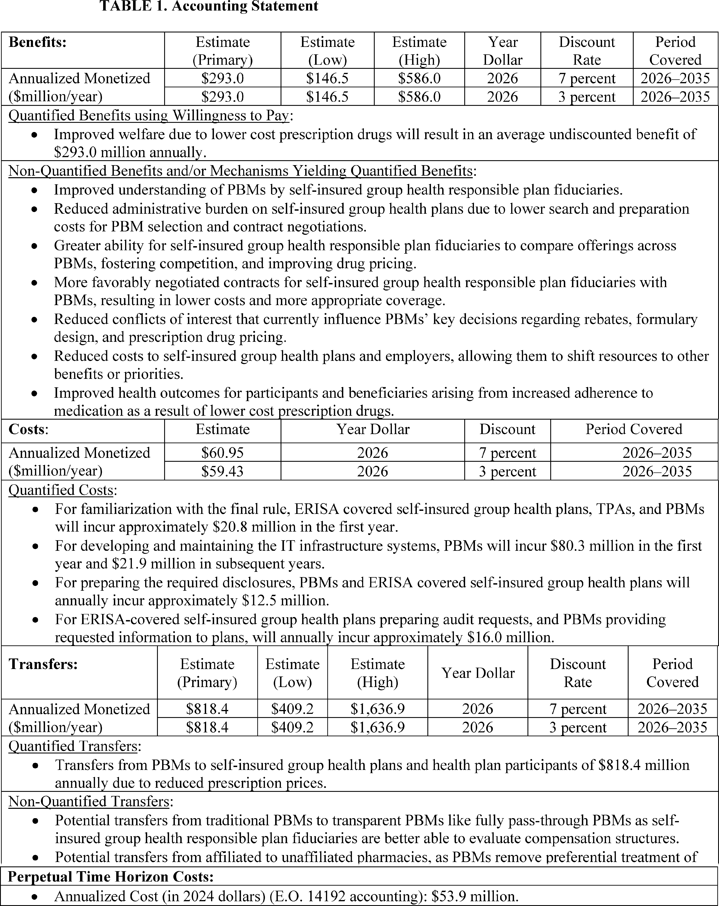
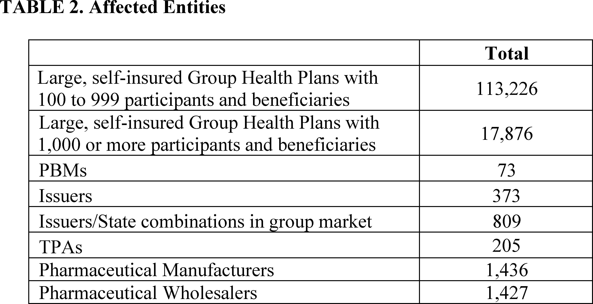

# Daily Digest — 2026-11-02

| | |
|---|---|
| **Digest date** | 2026-11-02 |
| **Data date range** | 2026-11-02 to 2026-11-02 |
| **Generated at** | 2026-11-03T05:04:35Z (UTC) |
| **Pipeline version** | 62af67cb |
| **Inference** | model layers ran — cli/haiku, opus |
| **Source watermarks** | CREC: 2026-10-30T10:29:32Z · BILLS: 2026-11-03T04:50:11Z · FR: 2026-11-02T22:57:18Z · USCOURTS: 2026-11-02T22:28:34Z · PLAW: 2026-10-30T15:30:14Z |

[Full observed listing for this day](day/2026-11-02.html) — the items our collectors observed for this publication day, mechanical rules applied, frozen at end of day; releases their publishers date on other days are counted there, not listed. This digest is the canonical record.

All items below cite the govinfo package (and granule, where applicable) they
summarize. Selection is mechanical; each item states the rule that included
it. See the Coverage Statement at the end for a full accounting of what was
published, what was summarized, and what was excluded and why.

---

## Contents

- [Day in Review](#day-in-review)
- [1. Congressional Floor Activity](#1-congressional-floor-activity)
- [2. Legislation](#2-legislation)
- [3. Federal Register](#3-federal-register)
- [4. Enacted Laws](#4-enacted-laws)
- [5. Judicial Activity](#5-judicial-activity)
- [6. Agency Announcements](#6-agency-announcements)
- [7. Recorded Votes](#7-recorded-votes)
- [8. Bill Actions](#8-bill-actions)
- [9. Presidential Actions](#9-presidential-actions)
- [Terms Used Today](#terms-used-today)
- [Coverage Statement](#coverage-statement)
- [Methodology](#methodology)

---

## Day in Review

The digest carries two presidential documents, both dated October 28, 2026. Proclamation 11077 concurs with the Secretary of Commerce's finding under section 232 of the Trade Expansion Act of 1962 that imports of robotics, industrial machinery, and their parts and components threaten to impair national security. It directs the Secretary of Commerce and the United States Trade Representative to pursue or continue negotiations with trading partners. A memorandum delegates specified presidential functions under section 8335 of the National Defense Authorization Act for Fiscal Year 2026 to the Secretaries of the Treasury and State.

The digest also carries eight final rules and five proposed rule documents, alongside 87 notices and 201 agency press releases. One final regulation requires providers of pharmacy benefit management services to disclose compensation information to fiduciaries of large, self-insured group health plans subject to ERISA. The Forest Service exempts administrative site leases from its special-use regulations. Another rule makes a conforming amendment reflecting the Criminal Law Technical Amendments Act of 2002. The FAA adopts four airworthiness directives covering BRP-Rotax engines, Diamond DA 40 airplanes, and Boeing 747 and 787 models. The FCC's Wireline Competition Bureau issues a correction to a prior notification. Among the proposals, the FDA would amend infant formula nutrient specifications and labeling, and EPA proposes significant new use rules under TSCA. The FCC proposes updating its ultra-wideband device rules. The NRC is discontinuing its "Alternatives to the Use of Credit Ratings" rulemaking. A correction also fixes a typographical error in a proposed rule on copyright access-control exemptions.

*Composed from the summarized items below and the day's mechanical
counts; all specifics are cited in their sections.*

---

## 1. Congressional Floor Activity

No Congressional Record issue was observed on this day. The Record for a day's proceedings is typically published by govinfo the following morning; it appears in the digest for the day it is observed ([how our clocks work](faq.html#fapds-three-clocks)).

### 1.1 Senate

No Senate floor items met the selection thresholds. 0 floor granule(s) are accounted for in the Coverage Statement.

### 1.2 House of Representatives

No House floor items met the selection thresholds. 0 floor granule(s) are accounted for in the Coverage Statement.

### 1.3 Recorded Votes

No recorded votes were published in this issue of the Congressional Record.

---

## 2. Legislation

Source: Congressional Bills (BILLS), text versions published 2026-11-02 to 2026-11-02.

### 2.1 Counts by Stage

| Stage (bill text version) | Count |
|---|---|
| Introduced (ih/is) | 0 |
| Reported (rh/rs) | 0 |
| Engrossed (eh/es) | 0 |
| Enrolled (enr) | 0 |
| Other versions | 0 |
| **Total bill texts published** | **0** |

### 2.2 Bills Listed by Mechanical Rule

Bills below are listed because they matched at least one listing rule; the
matching rule is stated per item. All other bill texts are counted above and
accounted for in the Coverage Statement.

No bill texts published in this range matched a listing rule; all 0 are
accounted for in the Coverage Statement.

---

## 3. Federal Register

Source: Federal Register (FR), issue of 2026-11-02.

### 3.1 Counts by Document Type

| Document type | Count |
|---|---|
| Rules | 8 |
| Proposed rules | 5 |
| Notices | 87 |
| Presidential documents | 2 |
| **Total FR documents** | **102** |

### 3.2 Rules Published

Tags: department of commerce · executive · securities and exchange commission · model keys: administrative site leases · airworthiness directives · pharmacy benefit manager fees

*In plain terms: Eight items, led by a Forest Service final rule exempting administrative site leases from special-use regulations; four are FAA airworthiness directives, and the rest include a pharmacy benefit manager fee disclosure rule.*

#### DEPARTMENT OF AGRICULTURE

- **Administrative Site Leases** (2026-22296; 36 CFR Part 251) — The United States Department of Agriculture (Department), Forest Service (Forest Service or Agency), this final rule will exempt administrative site leases from the regulations for special uses. The purpose of this deregulatory action is to better align Forest Service leasing activities with how leases are commonly legally defined to improve the feasibility of partnering with private developers and local municipalities for leasing and redeveloping administrative sites. Action: Final rule. Dates: The final rule is effective December 2, 2026.
  - *In plain terms:* The Forest Service final rule exempts administrative site leases from its special-uses regulations, a deregulatory action meant to align leasing with how leases are commonly legally defined and to make partnering with private developers and local municipalities more feasible.
  - Included because: FR-SEL-01 — document type: final rule (all listed)
  - Source: [FR-2026-11-02 / 2026-22296](https://www.govinfo.gov/app/details/FR-2026-11-02/2026-22296)

#### DEPARTMENT OF JUSTICE

- **Conforming Amendment Regarding the Criminal Law Technical Amendments Act of 2002** (2026-22285; 21 CFR Part 1301) — The Criminal Law Technical Amendments Act of 2002 (“Technical Amendments Act”) became law on November 2, 2002, as part of the 21st Century Department of Justice Appropriations Authorization Act. The Technical Amendments Act amended sections 401(d), 402(c), and 403 of the Controlled Substances Act by replacing outmoded fine amounts with a reference to title 18 of the United States Code in each place that a specific fine amount had appeared. In this rulemaking, the Drug Enforcement Administration (DEA) is amending its regulations to conform them to the statutory amendments made to the Controlled Substances Act by the Technical Amendments Act. Action: Final rule. Dates: This final rule is effective on November 2, 2026.
  - *In plain terms:* The Criminal Law Technical Amendments Act of 2002 became law on November 2, 2002, replacing outdated fine amounts in three Controlled Substances Act sections with references to title 18 of the U.S. Code; DEA is conforming its regulations.
  - Included because: FR-SEL-01 — document type: final rule (all listed)
  - Source: [FR-2026-11-02 / 2026-22285](https://www.govinfo.gov/app/details/FR-2026-11-02/2026-22285)

#### DEPARTMENT OF LABOR

- **Improving Transparency Into Pharmacy Benefit Manager Fee Disclosure** (2026-22306; 29 CFR Part 2550) — The Department is issuing a final regulation that will require providers of pharmacy benefit management services and affiliated providers of brokerage and consulting services to disclose information about their compensation to fiduciaries of large, self-insured group health plans subject to the Employee Retirement Income Security Act (ERISA). Pharmacy spending is a major driver of overall healthcare costs for employers and is growing faster than medical and surgical spending. These disclosure requirements apply for purposes of ERISA's statutory prohibited transaction exemption for service arrangements under section 408(b)(2). These disclosures are needed so that fiduciaries can assess the reasonableness of contracts or arrangements with these service providers, including the reasonableness of the service providers' compensation. As directed in section 12 of President Trump's Executive Order 14273, Lowering Drug Prices by Once Again Putting Americans First , the Department is issuing this rule to improve employer health plan transparency into the direct and indirect compensation received by pharmacy benefit managers. [official summary truncated; see source] Action: Final rule. Dates: This regulation is effective January 4, 2027. This regulation is applicable to plan years beginning on or after July 1, 2027.
  - *In plain terms:* A final rule requires pharmacy benefit management service providers and affiliated brokerage and consulting providers to disclose their compensation to fiduciaries of large, self-insured group health plans subject to the Employee Retirement Income Security Act (ERISA), so fiduciaries can assess whether these arrangements are reasonable.
  - Included because: FR-SEL-01 — document type: final rule (all listed)
  - Source: [FR-2026-11-02 / 2026-22306](https://www.govinfo.gov/app/details/FR-2026-11-02/2026-22306)
  -  *Source graphic 1 of 21 from 2026-22306.*
  -  *Source graphic 2 of 21 from 2026-22306.*
  - *Graphics not rendered here: 19 of 21 — see the [source PDF](https://www.govinfo.gov/content/pkg/FR-2026-11-02/pdf/FR-2026-11-02.pdf).*

#### DEPARTMENT OF TRANSPORTATION

- **Airworthiness Directives; BRP-Rotax GmbH & Co KG (Formerly BRP-Powertrain GMBH & CO KG and Bombardier-Rotax GmbH) Engines** (2026-22307; 14 CFR Part 39) — The FAA is adopting a new airworthiness directive (AD) for all BRP-Rotax GmbH & Co KG (BRP-Rotax) Model 915 iSc2 C24, 915 iSc3 C24, 916 iSc2 A, 916 iSc2 C24, 916 iSc3 A, and 916 iSc3 C24 engines. This AD was prompted by a report of oil leakage from cracks in the wall of the turbocharger valve housing due to insufficient thickness. This AD requires replacement of the turbocharger valve housing and reidentification of the turbocharger. The FAA is issuing this AD to address the unsafe condition on these products. Action: Final rule; request for comments. Dates: This AD is effective November 23, 2026. The Director of the Federal Register approved the incorporation by reference of a certain publication listed in this AD as of November 4, 2026. The FAA must receive comments on this AD by December 17, 2026.
  - *In plain terms:* The FAA adopts an airworthiness directive for six BRP-Rotax engine models after oil leaked through cracks in turbocharger valve housing walls that were too thin; it requires replacing the housing and reidentifying the turbocharger.
  - Included because: FR-SEL-01 — document type: final rule (all listed)
  - Source: [FR-2026-11-02 / 2026-22307](https://www.govinfo.gov/app/details/FR-2026-11-02/2026-22307)
- **Airworthiness Directives; Diamond Aircraft Industries Inc. Airplanes** (2026-22310; 14 CFR Part 39) — The FAA is adopting a new airworthiness directive (AD) for all Diamond Aircraft Industries Inc. (DAI) Model DA 40, DA 40 F, and DA 40 NG airplanes. This AD was prompted by several reports of passenger door separation during flight. This AD requires revising the existing airplane flight manual (AFM) to provide the flight crew with revised operating limitations, emergency procedures, and normal operating procedures; inspecting the passenger door latching mechanism and safety hook mechanism areas and performing corrective action, as applicable; inspecting the safety hook, latching bolts, front and rear door guide blocks, canopy and passenger door warning light, carbon hinges, tension spring, retaining block, safety hook push button, latching mechanism spring, gas spring, and door frame; measuring the passenger door handle actuation force; modifying the airplane with placards; replacing the gas spring; and replacing the hook assembly, retaining block, door guide blocks, and door sealant if necessary. The FAA is issuing this AD to address the unsafe condition on these products. Action: Final rule. Dates: This AD is effective December 7, 2026. The Director of the Federal Register approved the incorporation by reference of certain publications listed in this AD as of December 7, 2026.
  - *In plain terms:* The FAA adopts an airworthiness directive for all Diamond Aircraft DA 40, DA 40 F, and DA 40 NG airplanes after several reports of passenger door separation during flight; it requires revised flight manual procedures, passenger door inspections, and part replacements as needed.
  - Included because: FR-SEL-01 — document type: final rule (all listed)
  - Source: [FR-2026-11-02 / 2026-22310](https://www.govinfo.gov/app/details/FR-2026-11-02/2026-22310)
- **Airworthiness Directives; The Boeing Company Airplanes** (2026-22317; 14 CFR Part 39) — The FAA is superseding Airworthiness Directive (AD) 2023-07-09, which applied to certain The Boeing Company Model 747-400 and -8 series airplanes. AD 2023-07-09 required inspecting for wear of the transfer pump housing inlet check valves and transfer pump motor impeller inlet adapters for the horizontal stabilizer fuel tank and doing corrective actions, if necessary, and limited the installation of affected parts. This AD was prompted by the manufacturer developing further action to address the unsafe condition. This AD requires repetitive inspections for damage of the transfer pump housing inlet check valves and transfer pump motor impeller inlet adapters for the horizontal stabilizer fuel tank and applicable on-condition actions. This AD also limits the installation of affected parts under certain conditions. The FAA is issuing this AD to address the unsafe condition on these products. Action: Final rule. Dates: This AD is effective December 7, 2026. The Director of the Federal Register approved the incorporation by reference of a certain publication listed in this AD as of December 7, 2026.
  - *In plain terms:* The FAA replaces Airworthiness Directive 2023-07-09 for certain Boeing 747-400 and -8 series airplanes, requiring repetitive inspections for damage to horizontal stabilizer fuel tank transfer pump parts, follow-up actions as applicable, and limits on installing affected parts.
  - Included because: FR-SEL-01 — document type: final rule (all listed)
  - Source: [FR-2026-11-02 / 2026-22317](https://www.govinfo.gov/app/details/FR-2026-11-02/2026-22317)
- **Airworthiness Directives; The Boeing Company Airplanes** (2026-22318; 14 CFR Part 39) — The FAA is adopting a new airworthiness directive (AD) for certain The Boeing Company Model 787-8, 787-9, and 787-10 airplanes. This AD was prompted by a report that, during production, certain sealant installations within the center wing fuel tank did not receive required visual and adhesion inspections. This AD requires a detailed inspection of certain sealant installations in the left, right, and center wing side-of-body areas, an adhesion test of the sealant, and applicable on-condition actions. The FAA is issuing this AD to address the unsafe condition on these products. Action: Final rule. Dates: This AD is effective December 7, 2026. The Director of the Federal Register approved the incorporation by reference of certain publications listed in this AD as of December 7, 2026.
  - *In plain terms:* The FAA adopts an airworthiness directive for certain Boeing 787-8, 787-9, and 787-10 airplanes after a report that some center wing fuel tank sealant installations missed required production inspections; it requires detailed sealant inspections, adhesion tests, and applicable follow-up actions.
  - Included because: FR-SEL-01 — document type: final rule (all listed)
  - Source: [FR-2026-11-02 / 2026-22318](https://www.govinfo.gov/app/details/FR-2026-11-02/2026-22318)

#### FEDERAL COMMUNICATIONS COMMISSION

- **Reducing Barriers to Network Improvements and Service Changes, Accelerating Network Modernization; Correction** (2026-22334; 47 CFR Parts 51 and 63) — In this document, the Wireline Competition Bureau (Bureau) withdraws all amendatory instructions inadvertently included in the notification published on October 1, 2026, announcing the effective dates of amendments to the Federal Communications Commission's network change disclosure and discontinuance rules adopted in a Report and Order (FCC 26-19) that published on April 20, 2026. In this document, the Bureau also announces the effective date for amendments published on April 20, 2026. Action: Final rule; correction; announcement of effective date. Dates: Amendatory instruction 7 (§ 63.62), published at 91 FR 20913, April 20, 2026, is effective on November 2, 2026, and applicable as of October 15, 2026. The corrections in this document are effective on November 2, 2026.
  - *In plain terms:* The FCC Wireline Competition Bureau withdraws instructions mistakenly included in an October 1, 2026 notice about effective dates for network change rules, and announces the effective date for amendments published April 20, 2026.
  - Included because: FR-SEL-01 — document type: final rule (all listed)
  - Source: [FR-2026-11-02 / 2026-22334](https://www.govinfo.gov/app/details/FR-2026-11-02/2026-22334)

### 3.3 Proposed Rules Published

Tags: department of commerce · executive · securities and exchange commission · model keys: chemical substances · infant formula · ultra-wideband devices

*In plain terms: Five proposed rules, led by FDA's infant formula nutrient and labeling amendments; the rest cover an FCC ultra-wideband update, an EPA chemical use rule, a copyright correction, and an NRC discontinued rulemaking.*

#### DEPARTMENT OF HEALTH AND HUMAN SERVICES

- **Infant Formula Nutrient Requirements** (2026-22273; 21 CFR Parts 107 and 184) — The Food and Drug Administration (FDA or we) proposes to amend the regulations on nutrient specifications and labeling for infant formula as part of its phased, comprehensive review of infant formula nutrients. This action, if finalized, would amend the minimum and/or maximum levels of four required nutrients, change the unit of measure for certain nutrients, change the permitted source to meet one of the nutrient requirements, and amend the content of the required labeling. This action also includes a comprehensive assessment of four additional nutrients for which we conclude that the current required levels remain appropriate and reflect the best available scientific evidence on infant nutritional requirements and safe intake levels. Action: Proposed rule. Dates: Either electronic or written comments on the proposed rule must be submitted by March 2, 2027.
  - *In plain terms:* If finalized, the FDA's proposal would change infant formula nutrient rules by adjusting minimum or maximum levels for four nutrients, changing some units of measure, changing one permitted source, and amending labeling, and it concludes current levels for four other nutrients remain appropriate.
  - Included because: FR-SEL-02 — document type: proposed rule (all listed)
  - Source: [FR-2026-11-02 / 2026-22273](https://www.govinfo.gov/app/details/FR-2026-11-02/2026-22273)

#### ENVIRONMENTAL PROTECTION AGENCY

- **Significant New Use Rules on Certain Chemical Substances (26-7)** (2026-22295; 40 CFR Part 721) — EPA is proposing significant new use rules (SNURs) under the Toxic Substances Control Act (TSCA) for certain chemical substances that were the subject of premanufacture notices (PMNs) and are also subject to an Order issued by EPA pursuant to TSCA. Once finalized, the SNURs would require persons who intend to manufacture (defined by statute to include import) or process any of these chemical substances for an activity that is proposed as a significant new use by this rulemaking to notify EPA at least 90 days before commencing that activity. The required notification initiates EPA's evaluation of the conditions of that use for that chemical substance. In addition, the manufacture or processing for the significant new use may not commence until EPA has conducted a review of the required notification, made an appropriate determination regarding that notification, and taken such actions as required by that determination. Action: Proposed rule. Dates: Comments must be received on or before December 2, 2026.
  - *In plain terms:* EPA proposes rules that, if finalized, would require notice at least 90 days before a listed new use of certain Toxic Substances Control Act chemical substances begins, and bar that use until EPA reviews the notice and completes required actions.
  - Included because: FR-SEL-02 — document type: proposed rule (all listed)
  - Source: [FR-2026-11-02 / 2026-22295](https://www.govinfo.gov/app/details/FR-2026-11-02/2026-22295)

#### FEDERAL COMMUNICATIONS COMMISSION

- **Unleashing the Power of Unlicensed Ultra-Wideband Devices; Petition of Robert Bosch LLC for Amendment of the Part 15 Subpart F Ultra-Wideband Rules; and Petition of Alliance for Automative Innovation et al. To Amend Part 15 of the FCC's Rules To Permit the Operation of Certain Ultra-Wideband Devices** (2026-22337; 47 CFR Part 15) — The Federal Communications Commission (Commission or FCC) proposes to update its rules for Ultra-Wideband (UWB) devices to reflect significant technological developments since the rules were first adopted in 2002. UWB technology has matured into a widely used, low-power enabler that supports applications in tracking, automation, precision location, health monitoring, athletic performance, and public safety. As capabilities of UWB have expanded, the existing rules have not kept pace with the technological change, resulting in an increasing number of waiver requests received by the Commission to authorize modern devices. The Notice of Proposed Rulemaking seeks comment on revisions intended to modernize the UWB framework, provide greater flexibility for future applications, promote continued innovation, and ensure the protection of incumbent federal and non-federal spectrum users. Action: Proposed rule. Dates: Comments are due on or before December 2, 2026 and reply comments are due on or before January 4, 2027.
  - *In plain terms:* The FCC proposes updating its 2002 Ultra-Wideband (UWB) device rules to reflect technological advances and seeks comment on revisions that modernize the framework and protect incumbent federal and non-federal spectrum users.
  - Included because: FR-SEL-02 — document type: proposed rule (all listed)
  - Source: [FR-2026-11-02 / 2026-22337](https://www.govinfo.gov/app/details/FR-2026-11-02/2026-22337)

#### LIBRARY OF CONGRESS

- **Exemptions To Permit Circumvention of Access Controls on Copyrighted Works; Correction** (2026-22274; 37 CFR Part 201) — This document corrects the preamble to a proposed rule published in the Federal Register on October 28, 2026, regarding Exemptions to Permit Circumvention of Access Controls on Copyrighted Works. The correction fixes a typographical error within a subsection discussing a petition to renew a current exemption. Action: Proposed rule; correction. Dates: November 2, 2026.
  - *In plain terms:* A correction fixes a typo in an October 28, 2026 proposed rule on Exemptions to Permit Circumvention of Access Controls on Copyrighted Works, in a passage about renewing a current exemption.
  - Included because: FR-SEL-02 — document type: proposed rule (all listed)
  - Source: [FR-2026-11-02 / 2026-22274](https://www.govinfo.gov/app/details/FR-2026-11-02/2026-22274)

#### NUCLEAR REGULATORY COMMISSION

- **Alternatives to the Use of Credit Ratings** (2026-22293; 10 CFR Parts 30, 40, 50, 70, and 72) — The U.S. Nuclear Regulatory Commission (NRC) is discontinuing the rulemaking activity, “Alternatives to the Use of Credit Ratings.” This rulemaking activity will no longer be reported in the NRC's portion of the Unified Agenda of Regulatory and Deregulatory Actions (the Unified Agenda). Action: Discontinuation of rulemaking activity. Dates: Effective November 2, 2026, the rulemaking activity discussed in this document is discontinued.
  - *In plain terms:* The NRC is discontinuing its 'Alternatives to the Use of Credit Ratings' rulemaking, which will no longer appear in the NRC's part of the Unified Agenda of Regulatory and Deregulatory Actions.
  - Included because: FR-SEL-02 — document type: proposed rule (all listed)
  - Source: [FR-2026-11-02 / 2026-22293](https://www.govinfo.gov/app/details/FR-2026-11-02/2026-22293)

### 3.4 Notices and Presidential Documents

Tags: department of commerce · executive · securities and exchange commission · model keys: delegation of authority · industrial machinery · robotics imports

*In plain terms: Two items: Proclamation 11077 concurs with a Commerce section 232 finding on robotics and industrial machinery imports, and a memorandum delegates specified section 8335 NDAA authorities to Treasury and State.*

Notices are summarized only when they match a listing rule; all are counted
in 3.1 and in the Coverage Statement. Presidential documents in the FR are
always listed.

- **Adjusting Imports of Robotics, Industrial Machinery, and Their Parts and Components Into the United States** (2026-22385) — Proclamation 11077, dated October 28, 2026, concurs with the Secretary of Commerce's finding under section 232 of the Trade Expansion Act of 1962 that imports of robotics, industrial machinery, and their parts and components threaten to impair national security. It directs the Secretary of Commerce and the United States Trade Representative to pursue or continue negotiations with trading partners and to report on progress within 180 days. It states that the President may consider further remedies, including tariffs, duties, quotas, fees, and an investment incentive program, and directs continued monitoring of these imports.
  - *In plain terms:* Proclamation 11077 (October 28, 2026) agrees with the Commerce Secretary that imports of robotics and industrial machinery threaten to impair national security, directs negotiations and a 180-day progress report, and says further remedies such as tariffs may be considered.
  - Included because: FR-SEL-03 — presidential document (all listed)
  - Source: [FR-2026-11-02 / 2026-22385](https://www.govinfo.gov/app/details/FR-2026-11-02/2026-22385)
  - Corroborated across time: the same document was first published by the White House on [2026-10-28](https://www.whitehouse.gov/presidential-actions/2026/10/adjusting-imports-of-robotics-industrial-machinery-and-their-parts-and-components-into-the-united-states/), days before the Federal Register compiled it. Listed here as the official record of this day — the earlier publication is referenced, not suppressed; both observations are preserved and counted.
- **Delegation of Authority Under Section 8335 of the National Defense Authorization Act for Fiscal Year 2026** (2026-22386) — Memorandum of October 28, 2026, delegates to the Secretary of the Treasury, in consultation with the Secretary of State, and to the Secretary of State, specified presidential functions and authorities under section 8335 of the National Defense Authorization Act for Fiscal Year 2026 (22 U.S.C. 10704). Once sanctionable foreign persons are identified by the Secretary of State, the memorandum delegates to heads of relevant executive departments and agencies the authority to implement sanctions. The memorandum extends these delegations to substantially similar future public law provisions and directs the Secretary of the Treasury to publish it in the Federal Register.
  - *In plain terms:* A memorandum dated October 28, 2026 delegates presidential functions under section 8335 of the National Defense Authorization Act for Fiscal Year 2026 to the Treasury and State Secretaries, lets agency heads implement sanctions once the Secretary of State identifies sanctionable persons, and extends to similar future provisions.
  - Included because: FR-SEL-03 — presidential document (all listed)
  - Source: [FR-2026-11-02 / 2026-22386](https://www.govinfo.gov/app/details/FR-2026-11-02/2026-22386)

---

## 4. Enacted Laws

Source: Public and Private Laws (PLAW) published 2026-11-02.

No laws were published in this range.

---

## 5. Judicial Activity

Source: United States Courts Opinions (USCOURTS): opinions observed 2026-11-02
by our collector; each opinion states its own issue date beside its
listing ([how our clocks work](faq.html#fapds-three-clocks)).

Completeness disclosure (standing): USCOURTS carries opinions from
approximately 140 participating appellate, district, bankruptcy, and
national federal courts. Unlike the Congressional Record and the Federal
Register, which are the complete official record of their branches,
USCOURTS is participation-based and is NOT the complete federal judicial
record. Courts post opinions with delay — typically over several days —
so a day's digest carries the opinions that became available that day,
whatever date each was issued.

### 5.1 Appellate and National Court Opinions

Appellate and national court opinions are summarized; district and
bankruptcy opinions are counted in 5.2 and in the Coverage Statement.

No appellate or national court opinions matched a listing rule for this
date; all opinions are counted in 5.2 and accounted for in the Coverage
Statement.

### 5.2 Counts by Court Category

| Court category | Opinions |
|---|---|
| Appellate | 0 |
| District | 16 |
| Bankruptcy | 0 |
| National | 0 |
| **Total opinions extracted** | **16** |

Archive-window disclosure (rule USCOURTS-FETCH-01): 34656 USCOURTS package(s) have been listed in delta syncs but fell outside the 7-day archive window and were not fetched (global running count across all syncs, not limited to this date).

---

## 6. Agency Announcements

Official press releases and statements the agencies themselves date
on 2026-11-02 (sources listed in the source guide). These are the
agencies' own announcements — official advocacy, quoted and
attributed, not findings of this digest. Agency web content can be
edited or removed without notice; captures and hashes are preserved
per the provenance policy.

#### Animal and Plant Health Inspection Service (email)

- **USDA Confirms Highly Pathogenic Avian Influenza in a Dairy Herd in Indiana** — dated 2026-11-02 by the agency
  - Included because: AGENCYPR-SEL-01 — official agency release dated this day by the agency (all such releases from active sources are listed; titles only in the pilot)
  - Source: agency email bulletin to this project's subscription, captured and DKIM-verified (the bulletin named no canonical page)

#### Bureau of the Fiscal Service (email)

- **[The Bureau of the Fiscal Service Announces New Savings Bonds Rates. Series I to Earn 5.51%, Series EE to Earn 2.90%](https://treasurydirect.gov/news/2026/release-11-01-rates/)** — dated 2026-11-02 by the agency
  - Included because: AGENCYPR-SEL-01 — official agency release dated this day by the agency (all such releases from active sources are listed; titles only in the pilot)
  - Source: agency email bulletin to this project's subscription, captured and DKIM-verified

#### Census Bureau (email)

- **📅 This Week: New World Population Estimates 🌎** — dated 2026-11-02 by the agency
  - Included because: AGENCYPR-SEL-01 — official agency release dated this day by the agency (all such releases from active sources are listed; titles only in the pilot)
  - Source: agency email bulletin to this project's subscription, captured and DKIM-verified (the bulletin named no canonical page)

#### DEA Updates (email)

- **Come Out for DEA Detroit's Family Summit** — dated 2026-11-02 by the agency
  - Included because: AGENCYPR-SEL-01 — official agency release dated this day by the agency (all such releases from active sources are listed; titles only in the pilot)
  - Source: agency email bulletin to this project's subscription, captured and DKIM-verified (the bulletin named no canonical page)
- **Come Out for DEA Detroit's Family Summit** — dated 2026-11-02 by the agency
  - Included because: AGENCYPR-SEL-01 — official agency release dated this day by the agency (all such releases from active sources are listed; titles only in the pilot)
  - Source: agency email bulletin to this project's subscription, captured and DKIM-verified (the bulletin named no canonical page)

#### Defense News Releases

- **[Idaho Army National Guard Conducts Remote Rescue Mission](https://www.war.gov/News/News-Stories/Article/Article/4639243/idaho-army-national-guard-conducts-remote-rescue-mission/)** — dated 2026-11-02 by the agency
  - Included because: AGENCYPR-SEL-01 — official agency release dated this day by the agency (all such releases from active sources are listed; titles only in the pilot)
- **[USS George Washington Sailors Vote While Deployed](https://www.war.gov/News/News-Stories/Article/Article/4639525/uss-george-washington-sailors-vote-while-deployed/)** — dated 2026-11-02 by the agency
  - Included because: AGENCYPR-SEL-01 — official agency release dated this day by the agency (all such releases from active sources are listed; titles only in the pilot)

#### DHS News Releases

- **[DHS Blasts California Sanctuary Politicians for Releasing Nearly 24,000 Criminal Illegal Alien Murderers, Child Abusers, Kidnappers, and Gang Members from Jail Back onto the Street](https://www.dhs.gov/news/2026/11/02/dhs-blasts-california-sanctuary-politicians-releasing-nearly-24000-criminal-illegal)** — dated 2026-11-02 by the agency
  - Included because: AGENCYPR-SEL-01 — official agency release dated this day by the agency (all such releases from active sources are listed; titles only in the pilot)
- **[DHS Highlights Worst Illegal Aliens Arrested in Iowa](https://www.dhs.gov/news/2026/11/02/dhs-highlights-worst-illegal-aliens-arrested-iowa)** — dated 2026-11-02 by the agency
  - Included because: AGENCYPR-SEL-01 — official agency release dated this day by the agency (all such releases from active sources are listed; titles only in the pilot)
- **[DHS Highlights Worst Illegal Aliens Arrested in Kansas](https://www.dhs.gov/news/2026/11/02/dhs-highlights-worst-illegal-aliens-arrested-kansas)** — dated 2026-11-02 by the agency
  - Included because: AGENCYPR-SEL-01 — official agency release dated this day by the agency (all such releases from active sources are listed; titles only in the pilot)
- **[Secretary Mullin Announces Results of Operation Guardian Crackdown on Illegal Aliens with Commercial Driver’s Licenses](https://www.dhs.gov/news/2026/11/02/secretary-mullin-announces-results-operation-guardian-crackdown-illegal-aliens)** — dated 2026-11-02 by the agency
  - Included because: AGENCYPR-SEL-01 — official agency release dated this day by the agency (all such releases from active sources are listed; titles only in the pilot)
- **[WORST OF THE WORST: ICE Arrests Murderers, Pedophiles, and Rapists Over the Weekend](https://www.dhs.gov/news/2026/11/02/worst-worst-ice-arrests-murderers-pedophiles-and-rapists-over-weekend)** — dated 2026-11-02 by the agency
  - Included because: AGENCYPR-SEL-01 — official agency release dated this day by the agency (all such releases from active sources are listed; titles only in the pilot)

#### DOJ COPS Office (email)

- **DEADLINE EXTENDED | The COPS Office Highlighting Heroes Photo Contest** — dated 2026-11-02 by the agency
  - Included because: AGENCYPR-SEL-01 — official agency release dated this day by the agency (all such releases from active sources are listed; titles only in the pilot)
  - Source: agency email bulletin to this project's subscription, captured and DKIM-verified (the bulletin named no canonical page)

#### EEOC Newsroom

- **[Gator Strong Services Resolves EEOC Sexual Harassment Suit](https://www.eeoc.gov/newsroom/gator-strong-services-resolves-eeoc-sexual-harassment-suit)** — dated 2026-11-02 by the agency
  - Included because: AGENCYPR-SEL-01 — official agency release dated this day by the agency (all such releases from active sources are listed; titles only in the pilot)

#### EPA News Releases (email)

- **TODAY: EPA Administrator Lee Zeldin to Visit Boca Raton** — dated 2026-11-02 by the agency
  - Included because: AGENCYPR-SEL-01 — official agency release dated this day by the agency (all such releases from active sources are listed; titles only in the pilot)
  - Source: agency email bulletin to this project's subscription, captured and DKIM-verified (the bulletin named no canonical page)

#### FAA Updates (email)

- **MMEL Update for B-747-8, Rev. 8, Date -- 11/2/2026** — dated 2026-11-02 by the agency
  - Included because: AGENCYPR-SEL-01 — official agency release dated this day by the agency (all such releases from active sources are listed; titles only in the pilot)
  - Source: agency email bulletin to this project's subscription, captured and DKIM-verified (the bulletin named no canonical page)

#### FDA Email Updates (email)

- **FDA MedWatch - FDA Advises Consumers Not to Buy or Serve Once Upon a Farm Tractor Wheels Organic Toddler Soft-Baked Bars** — dated 2026-11-02 by the agency
  - Included because: AGENCYPR-SEL-01 — official agency release dated this day by the agency (all such releases from active sources are listed; titles only in the pilot)
  - Source: agency email bulletin to this project's subscription, captured and DKIM-verified (the bulletin named no canonical page)

#### FDA Press Announcements

- **[FDA Provides Clarity to Support Cell and Gene Therapy Development and Quality](http://www.fda.gov/news-events/press-announcements/fda-provides-clarity-support-cell-and-gene-therapy-development-and-quality)** — dated 2026-11-02 by the agency
  - Included because: AGENCYPR-SEL-01 — official agency release dated this day by the agency (all such releases from active sources are listed; titles only in the pilot)
  - Corroborated: the same release (same canonical URL) also arrived via the agency's email bulletin to this project's subscription, DKIM-verified — one document received through two ingestion channels; listed once, both captures preserved.

#### FDIC Press Releases (email)

- **Financial Institution Letter: Supervisory Relief to Help Financial Institutions and Facilitate Recovery for the Oglala Sioux Tribe of the Pine Ridge Reservation in South Dakota Affected by Severe Storms, Straight-Line Winds, and Flooding** — dated 2026-11-02 by the agency
  - Included because: AGENCYPR-SEL-01 — official agency release dated this day by the agency (all such releases from active sources are listed; titles only in the pilot)
  - Source: agency email bulletin to this project's subscription, captured and DKIM-verified (the bulletin named no canonical page)
- **Financial Institution Letter: Supervisory Relief to Help Financial Institutions and Facilitate Recovery in Areas of Indiana Affected by Severe Storms, Straight-Line Winds, Tornadoes, and Flooding** — dated 2026-11-02 by the agency
  - Included because: AGENCYPR-SEL-01 — official agency release dated this day by the agency (all such releases from active sources are listed; titles only in the pilot)
  - Source: agency email bulletin to this project's subscription, captured and DKIM-verified (the bulletin named no canonical page)

#### FEC Press Releases

- **[Election day resources](https://www.fec.gov/updates/election-day-resources/)** — dated 2026-11-02 by the agency
  - Included because: AGENCYPR-SEL-01 — official agency release dated this day by the agency (all such releases from active sources are listed; titles only in the pilot)

#### FEMA Press Releases

- **[FEMA to Evaluate Readiness of the State of Delaware](https://www.fema.gov/press-release/20261102/fema-evaluate-readiness-state-delaware)** — dated 2026-11-02 by the agency
  - Included because: AGENCYPR-SEL-01 — official agency release dated this day by the agency (all such releases from active sources are listed; titles only in the pilot)

#### FMC Press Releases

- **[FMC will Host a Research Symposium on Demurrage and Detention](https://www.fmc.gov/articles/fmc-will-host-a-research-symposium-on-demurrage-and-detention/)** — dated 2026-11-02 by the agency
  - Included because: AGENCYPR-SEL-01 — official agency release dated this day by the agency (all such releases from active sources are listed; titles only in the pilot)

#### FSIS Recalls and Public Health Alerts (email)

- **FSIS Notice 44-26** — dated 2026-11-02 by the agency
  - Included because: AGENCYPR-SEL-01 — official agency release dated this day by the agency (all such releases from active sources are listed; titles only in the pilot)
  - Source: agency email bulletin to this project's subscription, captured and DKIM-verified (the bulletin named no canonical page)

#### FTC Press Releases

- **[FTC, Washington Take Action Against Payment Processor for Deceiving Small Businesses About Costs and Cancellation Terms](https://www.ftc.gov/news-events/news/press-releases/2026/11/ftc-washington-take-action-against-payment-processor-deceiving-small-businesses-about-costs)** — dated 2026-11-02 by the agency
  - Included because: AGENCYPR-SEL-01 — official agency release dated this day by the agency (all such releases from active sources are listed; titles only in the pilot)

#### ICE Newsroom

- **[ICE Houston deports criminal illegal alien and accused child rapist who was granted conditional permanent resident status by Biden administration](https://www.ice.gov/news/releases/ice-houston-deports-criminal-illegal-alien-and-accused-child-rapist-who-was-granted)** — dated 2026-11-02 by the agency
  - Included because: AGENCYPR-SEL-01 — official agency release dated this day by the agency (all such releases from active sources are listed; titles only in the pilot)
- **[ICE arrests more than 180 illegal aliens during 5-day operation in Alabama](https://www.ice.gov/news/releases/ice-arrests-more-180-illegal-aliens-during-5-day-operation-alabama)** — dated 2026-11-02 by the agency
  - Included because: AGENCYPR-SEL-01 — official agency release dated this day by the agency (all such releases from active sources are listed; titles only in the pilot)
- **[Illegal alien from Venezuela passes away in Texas after lengthy hospital stay](https://www.ice.gov/news/releases/illegal-alien-venezuela-passes-away-texas-after-lengthy-hospital-stay)** — dated 2026-11-02 by the agency
  - Included because: AGENCYPR-SEL-01 — official agency release dated this day by the agency (all such releases from active sources are listed; titles only in the pilot)
- **[In Nationwide crackdown on voter fraud ICE arrests dozens of aliens](https://www.ice.gov/news/releases/nationwide-crackdown-voter-fraud-ice-arrests-dozens-aliens)** — dated 2026-11-02 by the agency
  - Included because: AGENCYPR-SEL-01 — official agency release dated this day by the agency (all such releases from active sources are listed; titles only in the pilot)
- **[Maple leaf, meet ballot thief: ICE HSI Tucson arrests Canadian for voter fraud](https://www.ice.gov/news/releases/maple-leaf-meet-ballot-thief-ice-hsi-tucson-arrests-canadian-voter-fraud)** — dated 2026-11-02 by the agency
  - Included because: AGENCYPR-SEL-01 — official agency release dated this day by the agency (all such releases from active sources are listed; titles only in the pilot)

#### Justice Department News (email)

- **EOIR BIA Decision - Nov. 2, 2026** — dated 2026-11-02 by the agency
  - Included because: AGENCYPR-SEL-01 — official agency release dated this day by the agency (all such releases from active sources are listed; titles only in the pilot)
  - Source: agency email bulletin to this project's subscription, captured and DKIM-verified (the bulletin named no canonical page)
- **[Investigative Summary: Findings of Misconduct by Two Deputy U.S. Marshals for Consumption of Alcohol While on Duty, One of Whom Engaged in Conduct Prejudicial to the Government](https://oig.justice.gov/reports/investigative-summary-findings-misconduct-two-deputy-us-marshals-consumption-alcohol-while?utm_source=govdelivery&utm_medium=email&utm_campaign=report)** — dated 2026-11-02 by the agency
  - Included because: AGENCYPR-SEL-01 — official agency release dated this day by the agency (all such releases from active sources are listed; titles only in the pilot)
  - Source: agency email bulletin to this project's subscription, captured and DKIM-verified
- **[Justice Department Announces Charges Involving 63 Individuals for Election-Related Crimes](https://www.justice.gov/opa/pr/justice-department-announces-charges-involving-63-individuals-election-related-crimes)** — dated 2026-11-02 by the agency
  - Included because: AGENCYPR-SEL-01 — official agency release dated this day by the agency (all such releases from active sources are listed; titles only in the pilot)
  - Source: agency email bulletin to this project's subscription, captured and DKIM-verified

#### Justice Press Releases

- **[California man pleads guilty to shipping fentanyl cross country to Buffalo following Homeland Security Task Force investigation](https://www.justice.gov/usao-wdny/pr/california-man-pleads-guilty-shipping-fentanyl-cross-country-buffalo-following)** — dated 2026-11-02 by the agency
  - Included because: AGENCYPR-SEL-01 — official agency release dated this day by the agency (all such releases from active sources are listed; titles only in the pilot)
  - Corroborated: the same release (same canonical URL) also arrived via the agency's email bulletin to this project's subscription, DKIM-verified — one document received through two ingestion channels; listed once, both captures preserved.
- **[Chesapeake esthetician pleads guilty in laser treatment case](https://www.justice.gov/usao-edva/pr/chesapeake-esthetician-pleads-guilty-laser-treatment-case)** — dated 2026-11-02 by the agency
  - Included because: AGENCYPR-SEL-01 — official agency release dated this day by the agency (all such releases from active sources are listed; titles only in the pilot)
  - Corroborated: the same release (same canonical URL) also arrived via the agency's email bulletin to this project's subscription, DKIM-verified — one document received through two ingestion channels; listed once, both captures preserved.
- **[Federal Jury Convicts Smiths Station Man of Methamphetamine Distribution](https://www.justice.gov/usao-mdal/pr/federal-jury-convicts-smiths-station-man-methamphetamine-distribution)** — dated 2026-11-02 by the agency
  - Included because: AGENCYPR-SEL-01 — official agency release dated this day by the agency (all such releases from active sources are listed; titles only in the pilot)
  - Corroborated: the same release (same canonical URL) also arrived via the agency's email bulletin to this project's subscription, DKIM-verified — one document received through two ingestion channels; listed once, both captures preserved.
- **[Federal, state and local partners launch "Operation Deep Cover" to end violence in Deep Ellum; Convicted felon charged with federal firearm offense](https://www.justice.gov/usao-ndtx/pr/federal-state-and-local-partners-launch-operation-deep-cover-end-violence-deep-ellum)** — dated 2026-11-02 by the agency
  - Included because: AGENCYPR-SEL-01 — official agency release dated this day by the agency (all such releases from active sources are listed; titles only in the pilot)
  - Corroborated: the same release (same canonical URL) also arrived via the agency's email bulletin to this project's subscription, DKIM-verified — one document received through two ingestion channels; listed once, both captures preserved.
- **[Fort Dodge Man to Federal Prison for Methamphetamine Trafficking](https://www.justice.gov/usao-ndia/pr/fort-dodge-man-federal-prison-methamphetamine-trafficking)** — dated 2026-11-02 by the agency
  - Included because: AGENCYPR-SEL-01 — official agency release dated this day by the agency (all such releases from active sources are listed; titles only in the pilot)
- **[Fourth Alien Arrested in North Georgia for Voting in Federal Elections](https://www.justice.gov/usao-ndga/pr/fourth-alien-arrested-north-georgia-voting-federal-elections)** — dated 2026-11-02 by the agency
  - Included because: AGENCYPR-SEL-01 — official agency release dated this day by the agency (all such releases from active sources are listed; titles only in the pilot)
  - Corroborated: the same release (same canonical URL) also arrived via the agency's email bulletin to this project's subscription, DKIM-verified — one document received through two ingestion channels; listed once, both captures preserved.
- **[Georgia Man Sentenced to More Than 21 Years in Prison for Methamphetamine Trafficking](https://www.justice.gov/usao-mdal/pr/georgia-man-sentenced-more-21-years-prison-methamphetamine-trafficking)** — dated 2026-11-02 by the agency
  - Included because: AGENCYPR-SEL-01 — official agency release dated this day by the agency (all such releases from active sources are listed; titles only in the pilot)
  - Corroborated: the same release (same canonical URL) also arrived via the agency's email bulletin to this project's subscription, DKIM-verified — one document received through two ingestion channels; listed once, both captures preserved.
- **[Georgia man pleads guilty to his role in international drug trafficking ring involving pharmaceuticals following Homeland Security Task Force investigation](https://www.justice.gov/usao-wdny/pr/georgia-man-pleads-guilty-his-role-international-drug-trafficking-ring-involving)** — dated 2026-11-02 by the agency
  - Included because: AGENCYPR-SEL-01 — official agency release dated this day by the agency (all such releases from active sources are listed; titles only in the pilot)
  - Corroborated: the same release (same canonical URL) also arrived via the agency's email bulletin to this project's subscription, DKIM-verified — one document received through two ingestion channels; listed once, both captures preserved.
- **[Guilty Plea by Gainesville Felon in Federal Firearms Prosecution](https://www.justice.gov/usao-ndfl/pr/guilty-plea-gainesville-felon-federal-firearms-prosecution)** — dated 2026-11-02 by the agency
  - Included because: AGENCYPR-SEL-01 — official agency release dated this day by the agency (all such releases from active sources are listed; titles only in the pilot)
  - Corroborated: the same release (same canonical URL) also arrived via the agency's email bulletin to this project's subscription, DKIM-verified — one document received through two ingestion channels; listed once, both captures preserved.
- **[High Museum of Art's Former Chief Operating Officer Sentenced to Federal Prison for Embezzlement](https://www.justice.gov/usao-ndga/pr/high-museum-arts-former-chief-operating-officer-sentenced-federal-prison-embezzlement)** — dated 2026-11-02 by the agency
  - Included because: AGENCYPR-SEL-01 — official agency release dated this day by the agency (all such releases from active sources are listed; titles only in the pilot)
  - Corroborated: the same release (same canonical URL) also arrived via the agency's email bulletin to this project's subscription, DKIM-verified — one document received through two ingestion channels; listed once, both captures preserved.
- **[Homeland Security Task Force Case Results in Life Imprisonment for Illegal Alien](https://www.justice.gov/usao-wdtx/pr/homeland-security-task-force-case-results-life-imprisonment-illegal-alien)** — dated 2026-11-02 by the agency
  - Included because: AGENCYPR-SEL-01 — official agency release dated this day by the agency (all such releases from active sources are listed; titles only in the pilot)
- **[Homeland Security Task Force Investigation Yields Federal Charges for Thirteen Foreign Nationals Charged with Fraud Against the United States](https://www.justice.gov/usao-mdfl/pr/homeland-security-task-force-investigation-yields-federal-charges-thirteen-foreign)** — dated 2026-11-02 by the agency
  - Included because: AGENCYPR-SEL-01 — official agency release dated this day by the agency (all such releases from active sources are listed; titles only in the pilot)
- **[Honduran Illegal Alien Guilty of Illegal Reentry of a Removed Alien](https://www.justice.gov/usao-edla/pr/honduran-illegal-alien-guilty-illegal-reentry-removed-alien)** — dated 2026-11-02 by the agency
  - Included because: AGENCYPR-SEL-01 — official agency release dated this day by the agency (all such releases from active sources are listed; titles only in the pilot)
  - Corroborated: the same release (same canonical URL) also arrived via the agency's email bulletin to this project's subscription, DKIM-verified — one document received through two ingestion channels; listed once, both captures preserved.
- **[Illegal Alien Pleads Guilty To Unlawful Reentry](https://www.justice.gov/usao-edok/pr/illegal-alien-pleads-guilty-unlawful-reentry-40)** — dated 2026-11-02 by the agency
  - Included because: AGENCYPR-SEL-01 — official agency release dated this day by the agency (all such releases from active sources are listed; titles only in the pilot)
  - Corroborated: the same release (same canonical URL) also arrived via the agency's email bulletin to this project's subscription, DKIM-verified — one document received through two ingestion channels; listed once, both captures preserved.
- **[Joint Base San Antonio Contractor Arrested for Mishandling Classified Documents, Possessing Firearms While on Base](https://www.justice.gov/usao-wdtx/pr/joint-base-san-antonio-contractor-arrested-mishandling-classified-documents-possessing)** — dated 2026-11-02 by the agency
  - Included because: AGENCYPR-SEL-01 — official agency release dated this day by the agency (all such releases from active sources are listed; titles only in the pilot)
  - Corroborated: the same release (same canonical URL) also arrived via the agency's email bulletin to this project's subscription, DKIM-verified — one document received through two ingestion channels; listed once, both captures preserved.
- **[Jury Convicts Tennessee Man of Trafficking Drugs and Illegally Possessing a Firearm in West Memphis](https://www.justice.gov/usao-edar/pr/jury-convicts-tennessee-man-trafficking-drugs-and-illegally-possessing-firearm-west)** — dated 2026-11-02 by the agency
  - Included because: AGENCYPR-SEL-01 — official agency release dated this day by the agency (all such releases from active sources are listed; titles only in the pilot)
  - Corroborated: the same release (same canonical URL) also arrived via the agency's email bulletin to this project's subscription, DKIM-verified — one document received through two ingestion channels; listed once, both captures preserved.
- **[Justice Department Awards FSU Federal Grant to Combat Domestic Violence, Dating Violence, Sexual Assault, & Stalking on Campus](https://www.justice.gov/usao-ndfl/pr/justice-department-awards-fsu-federal-grant-combat-domestic-violence-dating-violence)** — dated 2026-11-02 by the agency
  - Included because: AGENCYPR-SEL-01 — official agency release dated this day by the agency (all such releases from active sources are listed; titles only in the pilot)
- **[Knoxville Man Sentenced To More Than 10 Years For Distribution of Child Pornography](https://www.justice.gov/usao-edtn/pr/knoxville-man-sentenced-more-10-years-distribution-child-pornography)** — dated 2026-11-02 by the agency
  - Included because: AGENCYPR-SEL-01 — official agency release dated this day by the agency (all such releases from active sources are listed; titles only in the pilot)
  - Corroborated: the same release (same canonical URL) also arrived via the agency's email bulletin to this project's subscription, DKIM-verified — one document received through two ingestion channels; listed once, both captures preserved.
- **[Large-Scale Bastrop Methamphetamine Distributor Sentenced to 28 Years in Federal Prison](https://www.justice.gov/usao-wdla/pr/large-scale-bastrop-methamphetamine-distributor-sentenced-28-years-federal-prison)** — dated 2026-11-02 by the agency
  - Included because: AGENCYPR-SEL-01 — official agency release dated this day by the agency (all such releases from active sources are listed; titles only in the pilot)
  - Corroborated: the same release (same canonical URL) also arrived via the agency's email bulletin to this project's subscription, DKIM-verified — one document received through two ingestion channels; listed once, both captures preserved.
- **[Madison Man Sentenced to 10 Years in Homeland Security Task Force Drug Case](https://www.justice.gov/usao-wdwi/pr/madison-man-sentenced-10-years-homeland-security-task-force-drug-case)** — dated 2026-11-02 by the agency
  - Included because: AGENCYPR-SEL-01 — official agency release dated this day by the agency (all such releases from active sources are listed; titles only in the pilot)
  - Corroborated: the same release (same canonical URL) also arrived via the agency's email bulletin to this project's subscription, DKIM-verified — one document received through two ingestion channels; listed once, both captures preserved.
- **[Man Sentenced to Federal Prison for Conspiracy to Distribute Methamphetamine While Possessing a Loaded Firearm](https://www.justice.gov/usao-ndia/pr/man-sentenced-federal-prison-conspiracy-distribute-methamphetamine-while-possessing)** — dated 2026-11-02 by the agency
  - Included because: AGENCYPR-SEL-01 — official agency release dated this day by the agency (all such releases from active sources are listed; titles only in the pilot)
- **[Michigan Man Sentenced to 12 Years in Prison for Fentanyl Crime](https://www.justice.gov/usao-sdwv/pr/michigan-man-sentenced-12-years-prison-fentanyl-crime)** — dated 2026-11-02 by the agency
  - Included because: AGENCYPR-SEL-01 — official agency release dated this day by the agency (all such releases from active sources are listed; titles only in the pilot)
  - Corroborated: the same release (same canonical URL) also arrived via the agency's email bulletin to this project's subscription, DKIM-verified — one document received through two ingestion channels; listed once, both captures preserved.
- **[Michigan Woman Pleads Guilty to Role in Huntington-Area Drug Trafficking Conspiracy](https://www.justice.gov/usao-sdwv/pr/michigan-woman-pleads-guilty-role-huntington-area-drug-trafficking-conspiracy)** — dated 2026-11-02 by the agency
  - Included because: AGENCYPR-SEL-01 — official agency release dated this day by the agency (all such releases from active sources are listed; titles only in the pilot)
- **[Ohio Man Pleads Guilty to Fentanyl Crime](https://www.justice.gov/usao-sdwv/pr/ohio-man-pleads-guilty-fentanyl-crime-5)** — dated 2026-11-02 by the agency
  - Included because: AGENCYPR-SEL-01 — official agency release dated this day by the agency (all such releases from active sources are listed; titles only in the pilot)
  - Corroborated: the same release (same canonical URL) also arrived via the agency's email bulletin to this project's subscription, DKIM-verified — one document received through two ingestion channels; listed once, both captures preserved.
- **[Philippine National Charged with Voting Illegally as an Alien in Federal Election](https://www.justice.gov/usao-ndok/pr/philippine-national-charged-voting-illegally-alien-federal-election)** — dated 2026-11-02 by the agency
  - Included because: AGENCYPR-SEL-01 — official agency release dated this day by the agency (all such releases from active sources are listed; titles only in the pilot)
  - Corroborated: the same release (same canonical URL) also arrived via the agency's email bulletin to this project's subscription, DKIM-verified — one document received through two ingestion channels; listed once, both captures preserved.
- **[Pittsburgh Financial Advisor Pleads Guilty to Falsely Impersonating Department of Labor Employee](https://www.justice.gov/usao-wdpa/pr/pittsburgh-financial-advisor-pleads-guilty-falsely-impersonating-department-labor)** — dated 2026-11-02 by the agency
  - Included because: AGENCYPR-SEL-01 — official agency release dated this day by the agency (all such releases from active sources are listed; titles only in the pilot)
  - Corroborated: the same release (same canonical URL) also arrived via the agency's email bulletin to this project's subscription, DKIM-verified — one document received through two ingestion channels; listed once, both captures preserved.
- **[Reno Man Pleads Guilty to Bank Robbery](https://www.justice.gov/usao-nv/pr/reno-man-pleads-guilty-bank-robbery-0)** — dated 2026-11-02 by the agency
  - Included because: AGENCYPR-SEL-01 — official agency release dated this day by the agency (all such releases from active sources are listed; titles only in the pilot)
  - Corroborated: the same release (same canonical URL) also arrived via the agency's email bulletin to this project's subscription, DKIM-verified — one document received through two ingestion channels; listed once, both captures preserved.
- **[Rosebud Woman Sentenced to Federal Prison for Involuntary Manslaughter](https://www.justice.gov/usao-sd/pr/rosebud-woman-sentenced-federal-prison-involuntary-manslaughter)** — dated 2026-11-02 by the agency
  - Included because: AGENCYPR-SEL-01 — official agency release dated this day by the agency (all such releases from active sources are listed; titles only in the pilot)
  - Corroborated: the same release (same canonical URL) also arrived via the agency's email bulletin to this project's subscription, DKIM-verified — one document received through two ingestion channels; listed once, both captures preserved.
- **[Sioux City Woman to Federal Prison for Meth Distribution Conspiracy](https://www.justice.gov/usao-ndia/pr/sioux-city-woman-federal-prison-meth-distribution-conspiracy)** — dated 2026-11-02 by the agency
  - Included because: AGENCYPR-SEL-01 — official agency release dated this day by the agency (all such releases from active sources are listed; titles only in the pilot)
- **[St. Louis Man Who Sold Fentanyl, Meth to the ATF Sentenced to 8 years in Prison](https://www.justice.gov/usao-edmo/pr/st-louis-man-who-sold-fentanyl-meth-atf-sentenced-8-years-prison)** — dated 2026-11-02 by the agency
  - Included because: AGENCYPR-SEL-01 — official agency release dated this day by the agency (all such releases from active sources are listed; titles only in the pilot)
  - Corroborated: the same release (same canonical URL) also arrived via the agency's email bulletin to this project's subscription, DKIM-verified — one document received through two ingestion channels; listed once, both captures preserved.
- **[Tallahassee Woman Pleads Guilty to Defrauding the Tallahassee Housing Authority](https://www.justice.gov/usao-ndfl/pr/tallahassee-woman-pleads-guilty-defrauding-tallahassee-housing-authority)** — dated 2026-11-02 by the agency
  - Included because: AGENCYPR-SEL-01 — official agency release dated this day by the agency (all such releases from active sources are listed; titles only in the pilot)
- **[Two Aliens in West Tennessee Charged with Illegal Voting in Federal Elections](https://www.justice.gov/usao-wdtn/pr/two-aliens-west-tennessee-charged-illegal-voting-federal-elections)** — dated 2026-11-02 by the agency
  - Included because: AGENCYPR-SEL-01 — official agency release dated this day by the agency (all such releases from active sources are listed; titles only in the pilot)
  - Corroborated: the same release (same canonical URL) also arrived via the agency's email bulletin to this project's subscription, DKIM-verified — one document received through two ingestion channels; listed once, both captures preserved.
- **[U.S. Attorney Gerace announces District Election Officers](https://www.justice.gov/usao-sdoh/pr/us-attorney-gerace-announces-district-election-officers)** — dated 2026-11-02 by the agency
  - Included because: AGENCYPR-SEL-01 — official agency release dated this day by the agency (all such releases from active sources are listed; titles only in the pilot)
- **[U.S. Attorney Gerace announces FY2026 prosecution statistics](https://www.justice.gov/usao-sdoh/pr/us-attorney-gerace-announces-fy2026-prosecution-statistics)** — dated 2026-11-02 by the agency
  - Included because: AGENCYPR-SEL-01 — official agency release dated this day by the agency (all such releases from active sources are listed; titles only in the pilot)
  - Corroborated: the same release (same canonical URL) also arrived via the agency's email bulletin to this project's subscription, DKIM-verified — one document received through two ingestion channels; listed once, both captures preserved.
- **[U.S. Attorney’s Office Stands United with Law Enforcement Partners Addressing Violent Crime](https://www.justice.gov/usao-ndal/pr/us-attorneys-office-stands-united-law-enforcement-partners-addressing-violent-crime)** — dated 2026-11-02 by the agency
  - Included because: AGENCYPR-SEL-01 — official agency release dated this day by the agency (all such releases from active sources are listed; titles only in the pilot)
  - Corroborated: the same release (same canonical URL) also arrived via the agency's email bulletin to this project's subscription, DKIM-verified — one document received through two ingestion channels; listed once, both captures preserved.
- **[United States Attorney Designates Election Officer For The Eastern District Of Oklahoma](https://www.justice.gov/usao-edok/pr/united-states-attorney-designates-election-officer-eastern-district-oklahoma)** — dated 2026-11-02 by the agency
  - Included because: AGENCYPR-SEL-01 — official agency release dated this day by the agency (all such releases from active sources are listed; titles only in the pilot)
- **[United States Attorney’s Office Available to Receive Allegations of Interference with Our Elections and Campaigns](https://www.justice.gov/usao-mdpa/pr/united-states-attorneys-office-available-receive-allegations-interference-our)** — dated 2026-11-02 by the agency
  - Included because: AGENCYPR-SEL-01 — official agency release dated this day by the agency (all such releases from active sources are listed; titles only in the pilot)
  - Corroborated: the same release (same canonical URL) also arrived via the agency's email bulletin to this project's subscription, DKIM-verified — one document received through two ingestion channels; listed once, both captures preserved.
- **[Utah County Man Admits His Part in a Multimillion-Dollar Ponzi Scheme](https://www.justice.gov/usao-ut/pr/utah-county-man-admits-his-part-multimillion-dollar-ponzi-scheme)** — dated 2026-11-02 by the agency
  - Included because: AGENCYPR-SEL-01 — official agency release dated this day by the agency (all such releases from active sources are listed; titles only in the pilot)
  - Corroborated: the same release (same canonical URL) also arrived via the agency's email bulletin to this project's subscription, DKIM-verified — one document received through two ingestion channels; listed once, both captures preserved.
- **[Violent Fort Myers Felon Sent Back to Prison for Possessing a Stolen Gun](https://www.justice.gov/usao-mdfl/pr/violent-fort-myers-felon-sent-back-prison-possessing-stolen-gun)** — dated 2026-11-02 by the agency
  - Included because: AGENCYPR-SEL-01 — official agency release dated this day by the agency (all such releases from active sources are listed; titles only in the pilot)
  - Corroborated: the same release (same canonical URL) also arrived via the agency's email bulletin to this project's subscription, DKIM-verified — one document received through two ingestion channels; listed once, both captures preserved.

#### Labor News Releases

- **[US Department of Labor launches Registered Apprenticeship incentive payments for high-growth industries](http://www.dol.gov/newsroom/releases/eta/eta20261102)** — dated 2026-11-02 by the agency
  - Included because: AGENCYPR-SEL-01 — official agency release dated this day by the agency (all such releases from active sources are listed; titles only in the pilot)

#### NASA News Releases

- **[APOD: 2026 November 2 – A Long Cloud on Mars](https://science.nasa.gov/image-article/apod-2026-november-2-a-long-cloud-on-mars/)** — dated 2026-11-02 by the agency
  - Included because: AGENCYPR-SEL-01 — official agency release dated this day by the agency (all such releases from active sources are listed; titles only in the pilot)
- **[Happy 65 Years: NASA’s Johnson Space Center Then and Now](https://www.nasa.gov/centers-and-facilities/johnson/happy-65-years-nasas-johnson-space-center-then-and-now/)** — dated 2026-11-02 by the agency
  - Included because: AGENCYPR-SEL-01 — official agency release dated this day by the agency (all such releases from active sources are listed; titles only in the pilot)
- **[NASA Invites Media to Northrop Grumman CRS-25 Station Resupply Launch](https://www.nasa.gov/news-release/nasa-invites-media-to-northrop-grumman-crs-25-station-resupply-launch/)** — dated 2026-11-02 by the agency
  - Included because: AGENCYPR-SEL-01 — official agency release dated this day by the agency (all such releases from active sources are listed; titles only in the pilot)
- **[NASA’s CHAPEA Crew “Returns” to Earth](https://www.nasa.gov/image-article/nasas-chapea-crew-returns-to-earth/)** — dated 2026-11-02 by the agency
  - Included because: AGENCYPR-SEL-01 — official agency release dated this day by the agency (all such releases from active sources are listed; titles only in the pilot)
- **[NASA’s Hubble Uncovers Case of Missing Oxygen in Nearby Dwarf Galaxies](https://science.nasa.gov/missions/hubble/nasas-hubble-uncovers-case-of-missing-oxygen-in-nearby-dwarf-galaxies/)** — dated 2026-11-02 by the agency
  - Included because: AGENCYPR-SEL-01 — official agency release dated this day by the agency (all such releases from active sources are listed; titles only in the pilot)
- **[Pennsylvania’s Grand Canyon](https://science.nasa.gov/earth/earth-observatory/pennsylvanias-grand-canyon/)** — dated 2026-11-02 by the agency
  - Included because: AGENCYPR-SEL-01 — official agency release dated this day by the agency (all such releases from active sources are listed; titles only in the pilot)
- **[TB 26-09 Measured Hammer-Tap Inputs](https://www.nasa.gov/centers-and-facilities/nesc/tb-26-09-measured-hammer-tap-inputs/)** — dated 2026-11-02 by the agency
  - Included because: AGENCYPR-SEL-01 — official agency release dated this day by the agency (all such releases from active sources are listed; titles only in the pilot)
- **[What’s Up: November 2026 Skywatching Tips from NASA](https://science.nasa.gov/solar-system/skywatching/whats-up-november-2026-skywatching-tips-from-nasa/)** — dated 2026-11-02 by the agency
  - Included because: AGENCYPR-SEL-01 — official agency release dated this day by the agency (all such releases from active sources are listed; titles only in the pilot)

#### NIST News

- **[Self-Employed? Solopreneur? NIST Has a Cybersecurity Guide Just for You](https://www.nist.gov/news-events/news/2026/11/self-employed-solopreneur-nist-has-cybersecurity-guide-just-you)** — dated 2026-11-02 by the agency
  - Included because: AGENCYPR-SEL-01 — official agency release dated this day by the agency (all such releases from active sources are listed; titles only in the pilot)

#### NLRB News Releases

- **[Amy L. Cocuzza Named Solicitor to the National Labor Relations Board](https://www.nlrb.gov/news-outreach/news-story/amy-l-cocuzza-named-solicitor-to-the-national-labor-relations-board)** — dated 2026-11-02 by the agency
  - Included because: AGENCYPR-SEL-01 — official agency release dated this day by the agency (all such releases from active sources are listed; titles only in the pilot)

#### NSF News

- **[Podcast: The laser that could break the laws of physics](https://www.nsf.gov/news/podcast-laser-could-break-laws-physics)** — dated 2026-11-02 by the agency
  - Included because: AGENCYPR-SEL-01 — official agency release dated this day by the agency (all such releases from active sources are listed; titles only in the pilot)

#### OCC News Releases

- **[OCC Releases CRA Performance Evaluations for 19 National Banks and Federal Savings Associations](https://www.occ.gov/news-issuances/news-releases/2026/nr-occ-2026-96.html)** — dated 2026-11-02 by the agency
  - Included because: AGENCYPR-SEL-01 — official agency release dated this day by the agency (all such releases from active sources are listed; titles only in the pilot)

#### SSA Press Releases (email)

- **[Don’t forget- it’s time to report your wages to Social Security!](https://govlinks.ssa.gov/CL0/https:%2F%2Fwww.ssa.gov%2Fmyaccount%2F%3Futm_campaign=%26utm_content=%26utm_id=70323922%26utm_medium=govdelemail%26utm_source=usssa%26utm_term=/1/010001a19dc0faee-af5fc5ab-553a-445c-ac62-9b7dd63c3e72-000000/VFYvA2yZz8c7ackCr2n_rJRFzUfr_84y6X8JLJ8YZss=452)** — dated 2026-11-02 by the agency
  - Included because: AGENCYPR-SEL-01 — official agency release dated this day by the agency (all such releases from active sources are listed; titles only in the pilot)
  - Source: agency email bulletin to this project's subscription, captured and DKIM-verified
- **SSA Program Policy Updates** — dated 2026-11-02 by the agency
  - Included because: AGENCYPR-SEL-01 — official agency release dated this day by the agency (all such releases from active sources are listed; titles only in the pilot)
  - Source: agency email bulletin to this project's subscription, captured and DKIM-verified (the bulletin named no canonical page)
- **[Social Security Administration’s FY 2026 Progress and Accomplishments](https://govlinks.ssa.gov/CL0/http:%2F%2Fwww.socialsecurity.gov%2Fmyaccount%2F%3Futm_medium=email%26utm_source=govdelivery/1/010001a19ccbbacd-3ac50eb0-08b3-4616-aaae-43c722e2b25f-000000/GopGw37rZqYp8a-AzHfn6s26G5X42x7iXH-YKQZE7k4=452)** — dated 2026-11-02 by the agency
  - Included because: AGENCYPR-SEL-01 — official agency release dated this day by the agency (all such releases from active sources are listed; titles only in the pilot)
  - Source: agency email bulletin to this project's subscription, captured and DKIM-verified

#### Transportation Press Releases (email)

- **Release 24 web service online** — dated 2026-11-02 by the agency
  - Included because: AGENCYPR-SEL-01 — official agency release dated this day by the agency (all such releases from active sources are listed; titles only in the pilot)
  - Source: agency email bulletin to this project's subscription, captured and DKIM-verified (the bulletin named no canonical page)

#### Treasury Press Releases (email)

- **IRS Auctions** — dated 2026-11-02 by the agency
  - Included because: AGENCYPR-SEL-01 — official agency release dated this day by the agency (all such releases from active sources are listed; titles only in the pilot)
  - Source: agency email bulletin to this project's subscription, captured and DKIM-verified (the bulletin named no canonical page)
- **IRS Auctions** — dated 2026-11-02 by the agency
  - Included because: AGENCYPR-SEL-01 — official agency release dated this day by the agency (all such releases from active sources are listed; titles only in the pilot)
  - Source: agency email bulletin to this project's subscription, captured and DKIM-verified (the bulletin named no canonical page)
- **Office of Tribal and Native Affairs Broadcast - November 2, 2026** — dated 2026-11-02 by the agency
  - Included because: AGENCYPR-SEL-01 — official agency release dated this day by the agency (all such releases from active sources are listed; titles only in the pilot)
  - Source: agency email bulletin to this project's subscription, captured and DKIM-verified (the bulletin named no canonical page)
- **READOUT: Secretary of the Treasury Scott Bessent’s Meeting with Venezuelan Foreign Minister Oliver Blanco** — dated 2026-11-02 by the agency
  - Included because: AGENCYPR-SEL-01 — official agency release dated this day by the agency (all such releases from active sources are listed; titles only in the pilot)
  - Source: agency email bulletin to this project's subscription, captured and DKIM-verified (the bulletin named no canonical page)
- **Treasury Announces Marketable Borrowing Estimates** — dated 2026-11-02 by the agency
  - Included because: AGENCYPR-SEL-01 — official agency release dated this day by the agency (all such releases from active sources are listed; titles only in the pilot)
  - Source: agency email bulletin to this project's subscription, captured and DKIM-verified (the bulletin named no canonical page)
- **U.S. Department of the Treasury Daily Treasury Bill Rates Update** — dated 2026-11-02 by the agency
  - Included because: AGENCYPR-SEL-01 — official agency release dated this day by the agency (all such releases from active sources are listed; titles only in the pilot)
  - Source: agency email bulletin to this project's subscription, captured and DKIM-verified (the bulletin named no canonical page)
- **U.S. Department of the Treasury Daily Treasury Long-Term Rates Update** — dated 2026-11-02 by the agency
  - Included because: AGENCYPR-SEL-01 — official agency release dated this day by the agency (all such releases from active sources are listed; titles only in the pilot)
  - Source: agency email bulletin to this project's subscription, captured and DKIM-verified (the bulletin named no canonical page)
- **U.S. Department of the Treasury Daily Treasury Real Long-Term Rates Update** — dated 2026-11-02 by the agency
  - Included because: AGENCYPR-SEL-01 — official agency release dated this day by the agency (all such releases from active sources are listed; titles only in the pilot)
  - Source: agency email bulletin to this project's subscription, captured and DKIM-verified (the bulletin named no canonical page)
- **U.S. Department of the Treasury Daily Treasury Real Yield Curve Rates Update** — dated 2026-11-02 by the agency
  - Included because: AGENCYPR-SEL-01 — official agency release dated this day by the agency (all such releases from active sources are listed; titles only in the pilot)
  - Source: agency email bulletin to this project's subscription, captured and DKIM-verified (the bulletin named no canonical page)
- **U.S. Department of the Treasury Daily Treasury Yield Curve Rates Update** — dated 2026-11-02 by the agency
  - Included because: AGENCYPR-SEL-01 — official agency release dated this day by the agency (all such releases from active sources are listed; titles only in the pilot)
  - Source: agency email bulletin to this project's subscription, captured and DKIM-verified (the bulletin named no canonical page)

#### U.S. Attorneys News (email)

- **[Armed Career Criminal Sentenced in D.C. to 135 Months After Loaded Glock Pistol Found in His Parked Vehicle](https://www.justice.gov/usao-dc/pr/armed-career-criminal-sentenced-dc-135-months-after-loaded-glock-pistol-found-his-parked)** — dated 2026-11-02 by the agency
  - Included because: AGENCYPR-SEL-01 — official agency release dated this day by the agency (all such releases from active sources are listed; titles only in the pilot)
  - Source: agency email bulletin to this project's subscription, captured and DKIM-verified
- **[Buffalo man pleads guilty for his role in gun trafficking conspiracy](https://www.justice.gov/usao-wdny/pr/buffalo-man-pleads-guilty-his-role-gun-trafficking-conspiracy)** — dated 2026-11-02 by the agency
  - Included because: AGENCYPR-SEL-01 — official agency release dated this day by the agency (all such releases from active sources are listed; titles only in the pilot)
  - Source: agency email bulletin to this project's subscription, captured and DKIM-verified
- **[Central Georgian Faces 30 Years in Prison for Stolen Check-Washing Scheme](https://www.justice.gov/usao-mdga/pr/central-georgian-faces-30-years-prison-stolen-check-washing-scheme)** — dated 2026-11-02 by the agency
  - Included because: AGENCYPR-SEL-01 — official agency release dated this day by the agency (all such releases from active sources are listed; titles only in the pilot)
  - Source: agency email bulletin to this project's subscription, captured and DKIM-verified
- **[Convicted Felon Sentenced To Extra Year In Federal Prison For Failing To Self-Surrender](https://www.justice.gov/usao-id/pr/convicted-felon-sentenced-extra-year-federal-prison-failing-self-surrender)** — dated 2026-11-02 by the agency
  - Included because: AGENCYPR-SEL-01 — official agency release dated this day by the agency (all such releases from active sources are listed; titles only in the pilot)
  - Source: agency email bulletin to this project's subscription, captured and DKIM-verified
- **[Creighton Man Sentenced to More Than 20 Years for Drug and Gun Charges](https://www.justice.gov/usao-ne/pr/creighton-man-sentenced-more-20-years-drug-and-gun-charges)** — dated 2026-11-02 by the agency
  - Included because: AGENCYPR-SEL-01 — official agency release dated this day by the agency (all such releases from active sources are listed; titles only in the pilot)
  - Source: agency email bulletin to this project's subscription, captured and DKIM-verified
- **[Defendant sentenced to 16 years in prison after pleading guilty to drug distribution charges](https://www.justice.gov/usao-sdga/pr/defendant-sentenced-16-years-prison-after-pleading-guilty-drug-distribution-charges)** — dated 2026-11-02 by the agency
  - Included because: AGENCYPR-SEL-01 — official agency release dated this day by the agency (all such releases from active sources are listed; titles only in the pilot)
  - Source: agency email bulletin to this project's subscription, captured and DKIM-verified
- **[Department of Justice Recognizes Two U.S. Attorney’s Office Employees with Director’s Award](https://www.justice.gov/usao-wdnc/pr/department-justice-recognizes-two-us-attorneys-office-employees-directors-award)** — dated 2026-11-02 by the agency
  - Included because: AGENCYPR-SEL-01 — official agency release dated this day by the agency (all such releases from active sources are listed; titles only in the pilot)
  - Source: agency email bulletin to this project's subscription, captured and DKIM-verified
- **[Detroit Man Pleads Guilty to Federal Drug Crime](https://www.justice.gov/usao-sdwv/pr/detroit-man-pleads-guilty-federal-drug-crime-20)** — dated 2026-11-02 by the agency
  - Included because: AGENCYPR-SEL-01 — official agency release dated this day by the agency (all such releases from active sources are listed; titles only in the pilot)
  - Source: agency email bulletin to this project's subscription, captured and DKIM-verified
- **[District Election Officers Support Election Integrity and Voter Protection On Election Day](https://www.justice.gov/usao-md/pr/district-election-officers-support-election-integrity-and-voter-protection-election-day)** — dated 2026-11-02 by the agency
  - Included because: AGENCYPR-SEL-01 — official agency release dated this day by the agency (all such releases from active sources are listed; titles only in the pilot)
  - Source: agency email bulletin to this project's subscription, captured and DKIM-verified
- **[El Dorado Hills woman pleads guilty to stealing nearly $18 million from her employer](https://www.justice.gov/usao-edca/pr/el-dorado-hills-woman-pleads-guilty-stealing-nearly-18-million-her-employer)** — dated 2026-11-02 by the agency
  - Included because: AGENCYPR-SEL-01 — official agency release dated this day by the agency (all such releases from active sources are listed; titles only in the pilot)
  - Source: agency email bulletin to this project's subscription, captured and DKIM-verified
- **[Fayetteville Tech Community College Professor Stole $150,000 in Phony Covid Loan Pleads Guilty](https://www.justice.gov/usao-ednc/pr/fayetteville-tech-community-college-professor-stole-150000-phony-covid-loan-pleads)** — dated 2026-11-02 by the agency
  - Included because: AGENCYPR-SEL-01 — official agency release dated this day by the agency (all such releases from active sources are listed; titles only in the pilot)
  - Source: agency email bulletin to this project's subscription, captured and DKIM-verified
- **[Five Grainger County Residents Sentenced In Methamphetamine Trafficking Ring](https://www.justice.gov/usao-edtn/pr/five-grainger-county-residents-sentenced-methamphetamine-trafficking-ring)** — dated 2026-11-02 by the agency
  - Included because: AGENCYPR-SEL-01 — official agency release dated this day by the agency (all such releases from active sources are listed; titles only in the pilot)
  - Source: agency email bulletin to this project's subscription, captured and DKIM-verified
- **[Former Bellevue East High School Vocal Music Teacher Sentenced to 168 Months for Receipt and Distribution of Child Pornography](https://www.justice.gov/usao-ne/pr/former-bellevue-east-high-school-vocal-music-teacher-sentenced-168-months-receipt-and)** — dated 2026-11-02 by the agency
  - Included because: AGENCYPR-SEL-01 — official agency release dated this day by the agency (all such releases from active sources are listed; titles only in the pilot)
  - Source: agency email bulletin to this project's subscription, captured and DKIM-verified
- **[Former Elk Grove man sentenced to 3 years in prison for filing false tax returns and using proceeds to buy gold, silver and a house](https://www.justice.gov/usao-edca/pr/former-elk-grove-man-sentenced-3-years-prison-filing-false-tax-returns-and-using)** — dated 2026-11-02 by the agency
  - Included because: AGENCYPR-SEL-01 — official agency release dated this day by the agency (all such releases from active sources are listed; titles only in the pilot)
  - Source: agency email bulletin to this project's subscription, captured and DKIM-verified
- **[Former U.S. Sailor Sentenced to 60 Months in Prison](https://www.justice.gov/usao-wdmi/pr/2026_1102_Condreay_Sentencing_PR)** — dated 2026-11-02 by the agency
  - Included because: AGENCYPR-SEL-01 — official agency release dated this day by the agency (all such releases from active sources are listed; titles only in the pilot)
  - Source: agency email bulletin to this project's subscription, captured and DKIM-verified
- **[Fresno Executive Indicted for $65 Million Fraud Scheme that Defrauded Farmer MAC and Others](https://www.justice.gov/usao-edca/pr/fresno-executive-indicted-65-million-fraud-scheme-defrauded-farmer-mac-and-others)** — dated 2026-11-02 by the agency
  - Included because: AGENCYPR-SEL-01 — official agency release dated this day by the agency (all such releases from active sources are listed; titles only in the pilot)
  - Source: agency email bulletin to this project's subscription, captured and DKIM-verified
- **[Garner Convicted Felon Sentenced to Almost Twelve Years in Prison for Gun Possession After Multi-County High Speed Chase](https://www.justice.gov/usao-ednc/pr/garner-convicted-felon-sentenced-almost-twelve-years-prison-gun-possession-after-multi)** — dated 2026-11-02 by the agency
  - Included because: AGENCYPR-SEL-01 — official agency release dated this day by the agency (all such releases from active sources are listed; titles only in the pilot)
  - Source: agency email bulletin to this project's subscription, captured and DKIM-verified
- **[Hampshire County Man Admits to Fentanyl Trafficking](https://www.justice.gov/usao-ndwv/pr/hampshire-county-man-admits-fentanyl-trafficking)** — dated 2026-11-02 by the agency
  - Included because: AGENCYPR-SEL-01 — official agency release dated this day by the agency (all such releases from active sources are listed; titles only in the pilot)
  - Source: agency email bulletin to this project's subscription, captured and DKIM-verified
- **[Honduran National Indicted for Escape and Assault on a Federal Officer](https://www.justice.gov/usao-edla/pr/honduran-national-indicted-escape-and-assault-federal-officer)** — dated 2026-11-02 by the agency
  - Included because: AGENCYPR-SEL-01 — official agency release dated this day by the agency (all such releases from active sources are listed; titles only in the pilot)
  - Source: agency email bulletin to this project's subscription, captured and DKIM-verified
- **[Honduran National Unlawfully Residing in the United States Sentenced to 17½ Years in Federal Prison for Selling Fentanyl that Resulted in a Fatal Overdose](https://www.justice.gov/usao-or/pr/honduran-national-unlawfully-residing-united-states-sentenced-17-12-years-federal-prison)** — dated 2026-11-02 by the agency
  - Included because: AGENCYPR-SEL-01 — official agency release dated this day by the agency (all such releases from active sources are listed; titles only in the pilot)
  - Source: agency email bulletin to this project's subscription, captured and DKIM-verified
- **[Jury Convicts Jacksonville Man of Firearms Charges](https://www.justice.gov/usao-edar/pr/jury-convicts-jacksonville-man-firearms-charges)** — dated 2026-11-02 by the agency
  - Included because: AGENCYPR-SEL-01 — official agency release dated this day by the agency (all such releases from active sources are listed; titles only in the pilot)
  - Source: agency email bulletin to this project's subscription, captured and DKIM-verified
- **[Jury Convicts Little Rock Woman of Conspiracy to Commit Sex Trafficking of a Minor](https://www.justice.gov/usao-edar/pr/jury-convicts-little-rock-woman-conspiracy-commit-sex-trafficking-minor)** — dated 2026-11-02 by the agency
  - Included because: AGENCYPR-SEL-01 — official agency release dated this day by the agency (all such releases from active sources are listed; titles only in the pilot)
  - Source: agency email bulletin to this project's subscription, captured and DKIM-verified
- **[Maryland Woman Sentenced for Aiding and Abetting Deposit of Counterfeit Treasury Check](https://www.justice.gov/usao-me/pr/maryland-woman-sentenced-aiding-and-abetting-deposit-counterfeit-treasury-check)** — dated 2026-11-02 by the agency
  - Included because: AGENCYPR-SEL-01 — official agency release dated this day by the agency (all such releases from active sources are listed; titles only in the pilot)
  - Source: agency email bulletin to this project's subscription, captured and DKIM-verified
- **[McLoud Man Pleads Guilty after Firing at FBI Agents, Threatening to Kill Federal Officers and Others on YouTube](https://www.justice.gov/usao-wdok/pr/mcloud-man-pleads-guilty-after-firing-fbi-agents-threatening-kill-federal-officers-and)** — dated 2026-11-02 by the agency
  - Included because: AGENCYPR-SEL-01 — official agency release dated this day by the agency (all such releases from active sources are listed; titles only in the pilot)
  - Source: agency email bulletin to this project's subscription, captured and DKIM-verified
- **[Michigan Man Sentenced to Prison for Federal Drug Crime](https://www.justice.gov/usao-sdwv/pr/michigan-man-sentenced-prison-federal-drug-crime-7)** — dated 2026-11-02 by the agency
  - Included because: AGENCYPR-SEL-01 — official agency release dated this day by the agency (all such releases from active sources are listed; titles only in the pilot)
  - Source: agency email bulletin to this project's subscription, captured and DKIM-verified
- **[Montgomery Teacher Facing Federal Drug Trafficking and Firearms Offenses](https://www.justice.gov/usao-mdal/pr/montgomery-teacher-facing-federal-drug-trafficking-and-firearms-offenses)** — dated 2026-11-02 by the agency
  - Included because: AGENCYPR-SEL-01 — official agency release dated this day by the agency (all such releases from active sources are listed; titles only in the pilot)
  - Source: agency email bulletin to this project's subscription, captured and DKIM-verified
- **[North Carolina Man and Pennsylvania Woman Charged With Offenses Targeting Philadelphia’s Liberty Bell](https://www.justice.gov/usao-edpa/pr/north-carolina-man-and-pennsylvania-woman-charged-offenses-targeting-philadelphias)** — dated 2026-11-02 by the agency
  - Included because: AGENCYPR-SEL-01 — official agency release dated this day by the agency (all such releases from active sources are listed; titles only in the pilot)
  - Source: agency email bulletin to this project's subscription, captured and DKIM-verified
- **[North Carolina man pleads guilty to defrauding the government out of hundreds of thousands of dollars](https://www.justice.gov/usao-wdny/pr/north-carolina-man-pleads-guilty-defrauding-government-out-hundreds-thousands-dollars)** — dated 2026-11-02 by the agency
  - Included because: AGENCYPR-SEL-01 — official agency release dated this day by the agency (all such releases from active sources are listed; titles only in the pilot)
  - Source: agency email bulletin to this project's subscription, captured and DKIM-verified
- **[Perinton man arrested, charged with production of child pornography](https://www.justice.gov/usao-wdny/pr/perinton-man-arrested-charged-production-child-pornography)** — dated 2026-11-02 by the agency
  - Included because: AGENCYPR-SEL-01 — official agency release dated this day by the agency (all such releases from active sources are listed; titles only in the pilot)
  - Source: agency email bulletin to this project's subscription, captured and DKIM-verified
- **[Previously Convicted Killer of a Maryland Man Pleads Guilty in D.C. to Unlawful Possession of Firearm](https://www.justice.gov/usao-dc/pr/previously-convicted-killer-maryland-man-pleads-guilty-dc-unlawful-possession-firearm)** — dated 2026-11-02 by the agency
  - Included because: AGENCYPR-SEL-01 — official agency release dated this day by the agency (all such releases from active sources are listed; titles only in the pilot)
  - Source: agency email bulletin to this project's subscription, captured and DKIM-verified
- **[Rockland Man Sentenced to More Than Seven Years in Prison for Drug Conspiracy](https://www.justice.gov/usao-ma/pr/rockland-man-sentenced-more-seven-years-prison-drug-conspiracy)** — dated 2026-11-02 by the agency
  - Included because: AGENCYPR-SEL-01 — official agency release dated this day by the agency (all such releases from active sources are listed; titles only in the pilot)
  - Source: agency email bulletin to this project's subscription, captured and DKIM-verified
- **[Sacramento postal employee charged with obstructing delivery of political campaign mail](https://www.justice.gov/usao-edca/pr/sacramento-postal-employee-charged-obstructing-delivery-political-campaign-mail)** — dated 2026-11-02 by the agency
  - Included because: AGENCYPR-SEL-01 — official agency release dated this day by the agency (all such releases from active sources are listed; titles only in the pilot)
  - Source: agency email bulletin to this project's subscription, captured and DKIM-verified
- **[Sanford Man Pleads Guilty to Multiple Firearm Offenses](https://www.justice.gov/usao-me/pr/sanford-man-pleads-guilty-multiple-firearm-offenses)** — dated 2026-11-02 by the agency
  - Included because: AGENCYPR-SEL-01 — official agency release dated this day by the agency (all such releases from active sources are listed; titles only in the pilot)
  - Source: agency email bulletin to this project's subscription, captured and DKIM-verified
- **[Six Additional Aliens Charged with Illegal Voting in the Counties of Fresno, Kings, Sacramento, Solano, Stanislaus, and Tulare](https://www.justice.gov/usao-edca/pr/six-additional-aliens-charged-illegal-voting-counties-fresno-kings-sacramento-solano)** — dated 2026-11-02 by the agency
  - Included because: AGENCYPR-SEL-01 — official agency release dated this day by the agency (all such releases from active sources are listed; titles only in the pilot)
  - Source: agency email bulletin to this project's subscription, captured and DKIM-verified
- **[Six Additional Foreign Nationals in L.A. County Who Registered to Vote and Voted in U.S. Elections Charged with Lying on Naturalization Forms](https://www.justice.gov/usao-cdca/pr/six-additional-foreign-nationals-la-county-who-registered-vote-and-voted-us-elections)** — dated 2026-11-02 by the agency
  - Included because: AGENCYPR-SEL-01 — official agency release dated this day by the agency (all such releases from active sources are listed; titles only in the pilot)
  - Source: agency email bulletin to this project's subscription, captured and DKIM-verified
- **[Sussex County Man Sentenced to 78 Months in Prison for $2.1 Million COVID-19 Fraud Scheme](https://www.justice.gov/usao-nj/pr/sussex-county-man-sentenced-78-months-prison-21-million-covid-19-fraud-scheme)** — dated 2026-11-02 by the agency
  - Included because: AGENCYPR-SEL-01 — official agency release dated this day by the agency (all such releases from active sources are listed; titles only in the pilot)
  - Source: agency email bulletin to this project's subscription, captured and DKIM-verified
- **[U.S. Attorney asks public for help Investigating Shooting during Youth Football Game at Madison Senior High School](https://www.justice.gov/usao-sdil/pr/us-attorney-asks-public-help-investigating-shooting-during-youth-football-game-madison)** — dated 2026-11-02 by the agency
  - Included because: AGENCYPR-SEL-01 — official agency release dated this day by the agency (all such releases from active sources are listed; titles only in the pilot)
  - Source: agency email bulletin to this project's subscription, captured and DKIM-verified
- **[United States Attorney Names District Election Officer to Oversee Election Day Complaints](https://www.justice.gov/usao-vi/pr/united-states-attorney-names-district-election-officer-oversee-election-day-complaints-0)** — dated 2026-11-02 by the agency
  - Included because: AGENCYPR-SEL-01 — official agency release dated this day by the agency (all such releases from active sources are listed; titles only in the pilot)
  - Source: agency email bulletin to this project's subscription, captured and DKIM-verified
- **[Violent Vallejo felon pleads guilty to being a felon in possession of a firearm on eve of trial](https://www.justice.gov/usao-edca/pr/violent-vallejo-felon-pleads-guilty-being-felon-possession-firearm-eve-trial)** — dated 2026-11-02 by the agency
  - Included because: AGENCYPR-SEL-01 — official agency release dated this day by the agency (all such releases from active sources are listed; titles only in the pilot)
  - Source: agency email bulletin to this project's subscription, captured and DKIM-verified
- **[York County Man Indicted for Child Pornography Offenses](https://www.justice.gov/usao-mdpa/pr/york-county-man-indicted-child-pornography-offenses-0)** — dated 2026-11-02 by the agency
  - Included because: AGENCYPR-SEL-01 — official agency release dated this day by the agency (all such releases from active sources are listed; titles only in the pilot)
  - Source: agency email bulletin to this project's subscription, captured and DKIM-verified

#### U.S. Courts News

- **[Judge Curtis L. Collier Receives 2026 Devitt Award](http://www.uscourts.gov/data-news/judiciary-news/2026/11/02/judge-curtis-l-collier-receives-2026-devitt-award)** — dated 2026-11-02 by the agency
  - Included because: AGENCYPR-SEL-01 — official agency release dated this day by the agency (all such releases from active sources are listed; titles only in the pilot)

#### USCIS Newsroom

- **[Homeland Security Task Force Investigation Yields Federal Charges for 13 Aliens Charged with Fraud Against the United States](https://www.uscis.gov/newsroom/news-releases/homeland-security-task-force-investigation-yields-federal-charges-for-13-aliens-charged-with-fraud)** — dated 2026-11-02 by the agency
  - Included because: AGENCYPR-SEL-01 — official agency release dated this day by the agency (all such releases from active sources are listed; titles only in the pilot)

#### USDA News (email)

- **USDA Daily Radio Newsline - 11/02/2026** — dated 2026-11-02 by the agency
  - Included because: AGENCYPR-SEL-01 — official agency release dated this day by the agency (all such releases from active sources are listed; titles only in the pilot)
  - Source: agency email bulletin to this project's subscription, captured and DKIM-verified (the bulletin named no canonical page)

#### USDA NRCS (email)

- **USDA Invests $21 Million in an Additional 10 Projects to Expand Wildlife Conservation, Outdoor Access** — dated 2026-11-02 by the agency
  - Included because: AGENCYPR-SEL-01 — official agency release dated this day by the agency (all such releases from active sources are listed; titles only in the pilot)
  - Source: agency email bulletin to this project's subscription, captured and DKIM-verified (the bulletin named no canonical page)

#### USDA Rural Development (email)

- **NEWS RELEASE - USDA Invests Nearly $4 Million to Expand Kansas Meat Processing Capacity, Strengthen Competition and Support American Ranchers** — dated 2026-11-02 by the agency
  - Included because: AGENCYPR-SEL-01 — official agency release dated this day by the agency (all such releases from active sources are listed; titles only in the pilot)
  - Source: agency email bulletin to this project's subscription, captured and DKIM-verified (the bulletin named no canonical page)

#### USTR Press Releases

- **[Ambassador Greer Issues Statement on President Trump’s Intent to Terminate Rwanda and South Africa from the AGOA Trade Preference Program](https://ustr.gov/about/policy-offices/press-office/press-releases/2026/october/ambassador-greer-issues-statement-president-trumps-intent-terminate-rwanda-and-south-africa-agoa)** — dated 2026-11-02 by the agency
  - Included because: AGENCYPR-SEL-01 — official agency release dated this day by the agency (all such releases from active sources are listed; titles only in the pilot)
- **[Ambassador Greer Issues Statement on President Trump’s Intent to Terminate Rwanda and South Africa from the AGOA Trade Preference Program](https://ustr.gov/about/policy-offices/press-office/press-releases/2026/november/ambassador-greer-issues-statement-president-trumps-intent-terminate-rwanda-and-south-africa-agoa)** — dated 2026-11-02 by the agency
  - Included because: AGENCYPR-SEL-01 — official agency release dated this day by the agency (all such releases from active sources are listed; titles only in the pilot)
- **[United States Seeks Mexico’s Review of Alleged Denial of Workers’ Rights at Madobox](https://ustr.gov/about/policy-offices/press-office/press-releases/2026/november/united-states-seeks-mexicos-review-alleged-denial-workers-rights-madobox)** — dated 2026-11-02 by the agency
  - Included because: AGENCYPR-SEL-01 — official agency release dated this day by the agency (all such releases from active sources are listed; titles only in the pilot)
- **[United States and Mexico Announce Memorandum of Understanding at Industrias Tecnos Facility](https://ustr.gov/about/policy-offices/press-office/press-releases/2026/october/united-states-and-mexico-announce-memorandum-understanding-industrias-tecnos-facility)** — dated 2026-11-02 by the agency
  - Included because: AGENCYPR-SEL-01 — official agency release dated this day by the agency (all such releases from active sources are listed; titles only in the pilot)
- **[United States and Mexico Announce Memorandum of Understanding at Industrias Tecnos Facility](https://ustr.gov/about/policy-offices/press-office/press-releases/2026/november/united-states-and-mexico-announce-memorandum-understanding-industrias-tecnos-facility)** — dated 2026-11-02 by the agency
  - Included because: AGENCYPR-SEL-01 — official agency release dated this day by the agency (all such releases from active sources are listed; titles only in the pilot)

#### VA News Releases

- **[2026 Veterans Day Teachers Resource Guide](https://news.va.gov/150674/2026-veterans-day-teachers-resource-guide/)** — dated 2026-11-02 by the agency
  - Included because: AGENCYPR-SEL-01 — official agency release dated this day by the agency (all such releases from active sources are listed; titles only in the pilot)
- **[Hiring Veterans: Jobs of the week for Nov. 2, 2026](https://news.va.gov/150756/hiring-veterans-jobs-week-nov-2-2026/)** — dated 2026-11-02 by the agency
  - Included because: AGENCYPR-SEL-01 — official agency release dated this day by the agency (all such releases from active sources are listed; titles only in the pilot)
- **[Live Whole Health #341: Pace yourself](https://news.va.gov/150781/live-whole-health-341-pace-yourself/)** — dated 2026-11-02 by the agency
  - Included because: AGENCYPR-SEL-01 — official agency release dated this day by the agency (all such releases from active sources are listed; titles only in the pilot)
- **[VA North Texas marks milestone during Overdose Awareness Week](https://news.va.gov/150673/va-north-texas-marks-overdose-awareness-week/)** — dated 2026-11-02 by the agency
  - Included because: AGENCYPR-SEL-01 — official agency release dated this day by the agency (all such releases from active sources are listed; titles only in the pilot)
- **[“The mission is not over”: Veteran firefighter continues serving his hometown](https://news.va.gov/150632/veteran-firefighter-continues-serving-hometown/)** — dated 2026-11-02 by the agency
  - Included because: AGENCYPR-SEL-01 — official agency release dated this day by the agency (all such releases from active sources are listed; titles only in the pilot)

#### White House Briefing Room

- **[President Trump Completes Historic Travel Blitz: 30 Events, 20 States, 32 Days](https://www.whitehouse.gov/releases/2026/11/president-trump-completes-historic-travel-blitz-30-events-20-states-32-days/)** — dated 2026-11-02 by the agency
  - Included because: AGENCYPR-SEL-01 — official agency release dated this day by the agency (all such releases from active sources are listed; titles only in the pilot)
- **[President Trump’s Second Term: Promises Made, Promises Kept, Results Delivered](https://www.whitehouse.gov/releases/2026/11/president-trumps-second-term-promises-made-promises-kept-results-delivered/)** — dated 2026-11-02 by the agency
  - Included because: AGENCYPR-SEL-01 — official agency release dated this day by the agency (all such releases from active sources are listed; titles only in the pilot)

30 release(s) above arrived through more than one ingestion channel and are each listed once, marked "Corroborated" in place. Every arrival is captured, hashed, and counted in the Coverage Statement — the merge is presentation, not omission.

Also observed this day, not listed above: 15 release(s) the agencies date on other days (feed backfill from newly activated sources). Excluded under AGENCYPR-EX-01; counted in the Coverage Statement; captures preserved.

---

## 7. Recorded Votes

Roll-call votes the chambers themselves record on 2026-11-02, in
vote-number order. Every recorded vote in the window is listed:
selection is by existence, not by importance, and no rule here
prefers one question over another. Tallies and member positions
come from the chamber's own published vote record, captured and
hashed like every other source. This is the chambers' vote record
itself; section 1.3 lists the Congressional Record granules in
which votes were printed.

No recorded votes dated this day were observed.

---

## 8. Bill Actions

What the chambers did with individual measures on 2026-11-02, as the
Library of Congress's own bill-status record states it. Every action
in the ingestion window is listed, in bill-designation order:
selection is by existence, not by importance, and no rule here
prefers one measure over another. Section 2 lists the text of bills
published this day; this section lists what happened to them.

Publication lag: the record dates an action by the day the chamber took it and publishes it the following morning, so this section fills in after the day it describes has ended — the same lag the judicial section carries, and it is restated under Known gaps.

No bill actions dated this day were observed.

---

## 9. Presidential Actions

Source: the Executive Office of the President, as published on
whitehouse.gov and observed 2026-11-02. These are the President's own
instruments — executive orders, proclamations, memoranda — carried
here as the White House published them, days before the Federal
Register compiles them into section 3.

Register (GUIDE §2): titles are the publisher's words and appear verbatim; any prose of ours about them is attributed, exactly as it is for agency releases. This section states what the White House published, never whether it was significant.

No presidential actions dated this day were observed. The White House publishes on its own schedule; an action taken today may appear in a later digest, and one dated earlier is counted under PRESACT-EX-01 rather than listed as today's news.

---

## Terms Used Today

- *engrossed* — the official text of a bill as passed by one chamber
- *enrolled* — the final text of a bill passed by both chambers, sent to the President
- *incorporation by reference* — making an outside document legally part of a rule without reprinting it
- *notice of proposed rulemaking* — the formal announcement of a draft regulation
- *proposed rule* — a draft regulation published for public comment before adoption

---

## Coverage Statement

*This section is mandatory and appears in every digest, including days with
no publications. It accounts for every package observed on this digest day
(GUIDE §3, observation-day filing); each package's own date may differ
and is stated where it does. "Excluded" always names the mechanical rule;
there are no unexplained omissions.*

**Sync summary:** BILLS: completed 2026-11-03T05:00:05Z · CREC: completed 2026-11-03T05:00:04Z · FR: completed 2026-11-03T05:00:26Z · PLAW: completed 2026-11-03T05:00:29Z · USCOURTS: completed 2026-11-03T05:00:27Z; last watermarks as listed in the header.

| Collection | Packages observed | Granules/documents | Summarized | Counted only | Excluded by rule |
|---|---|---|---|---|---|
| CREC | 0 | 0 | 0 | 0 | 0 |
| BILLS | 0 | — | 0 | 0 | 0 |
| FR | 1 | 102 | 15 | 87 | 0 |
| USCOURTS | 11 | 16 | 0 | 16 | 0 |
| PLAW | 0 | 0 | 0 | 0 | 0 |
| AGENCYPR | 201 | 201 | 0 | 186 | 15 |
| VOTES | 0 | 0 | 0 | 0 | 0 |
| BILLACTIONS | 0 | 0 | 0 | 0 | 0 |
| PRESACT | 0 | 0 | 0 | 0 | 0 |

**Exclusion rules applied today:**

- FR-EX-01: notices counted, not individually summarized — 87 item(s)
- USCOURTS-EX-01: district court opinions counted, not individually summarized — 16 item(s)
- AGENCYPR-EX-01: release dated outside this day by the agency (feed backfill / newly activated source) — counted, not listed — 15 item(s)

**Source graphics:** 23 graphic(s) flagged across today's documents: 21 content graphic(s) (equations, forms, maps, annex pages) and 2 boilerplate (signatures/seals, excluded by rule FR-GPH-01). Of the content graphics, 0 were analyzed via vision pass (vision pass not yet implemented) and 2 embedded above; the remainder are viewable in the cited source PDFs.

**Known gaps:** courts post opinions with delay; opinions filed on this date may appear in later syncs.

*Verification: any item above can be checked against its source in one click
via its govinfo link. Totals in this table are reproducible from the stored
extraction records for 2026-11-02.*

---

## Methodology

Selection rules, summarization prompts, and thresholds are versioned in this
repository and identified by the pipeline version in the header (62af67cb).
Editorial principles — primary sources only, opinion-agnostic prose, mechanical
party-blind selection, full coverage accounting — are defined in
[GUIDE.md](../GUIDE.md) §2. Ruleset in effect: prompt version 2; plain-language version 2. To reproduce this digest: re-run the
report stage against the extracted records for 2026-11-02; no upstream re-fetch
is required (GUIDE.md §5).

*Inference (GUIDE §6 r15, standing): The pipeline finalizes every
publication day with or without an inference provider. Model layers
are additive. When no inference was available for a day, the digest
states that fact in its own prose and nothing more; the cause is
operational detail recorded in the day's provenance and operations
report, not in the published digest. The Coverage Statement's
arithmetic reconciles regardless. Items are listed with their
citations whether or not they were summarized. A day finalized
without model layers is frozen like any other day; prose is not
backfilled into a frozen digest.*

*Filing note (2026-08-06, standing): digests from 2026-08-06 file
govinfo packages under their day of first observation — FAPD's three
clocks are explained in the [FAQ](faq.html#fapds-three-clocks). The
Federal Register files under its cover date, on which it is legally
published. Digests before 2026-08-06 filed by each document's own
date; the two Congressional Record issues observed 2026-08-04/05
(proceedings of 08-03/08-04) fell between the freeze and this change
and appear in no digest — disclosed here, not backfilled.*

*"In plain terms" lines are model-generated restatements of the stored
summaries, derived only from the summary text shown beside them; items
without one had no usable restatement. ALL-CAPS source headings are
case-normalized for display; original casing is preserved at the source
link. Term definitions above are static, repo-versioned prose.*

License: this digest's compilation and prose are
[CC BY 4.0](https://creativecommons.org/licenses/by/4.0/) (credit
"FAPD — Free Agentic Publication Digester"); quoted official
government text is public domain (17 U.S.C. § 105).
