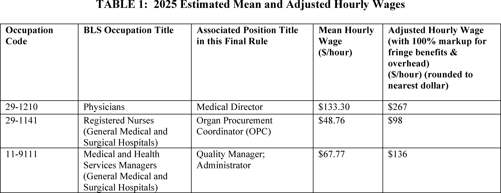
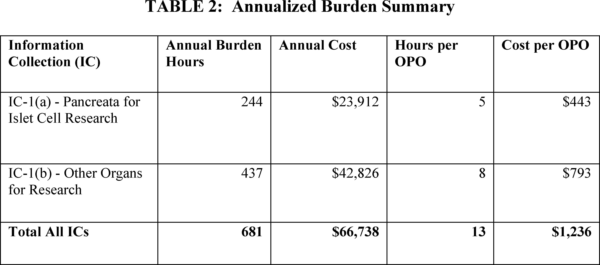
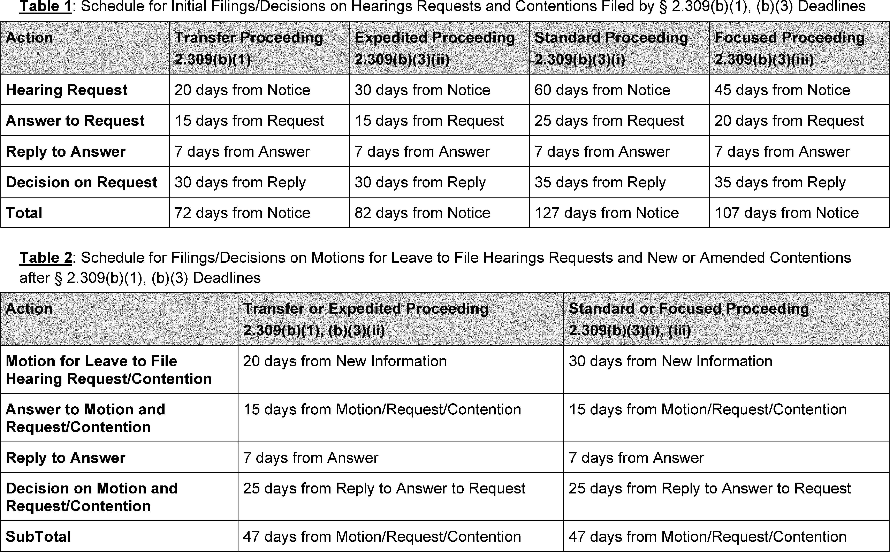
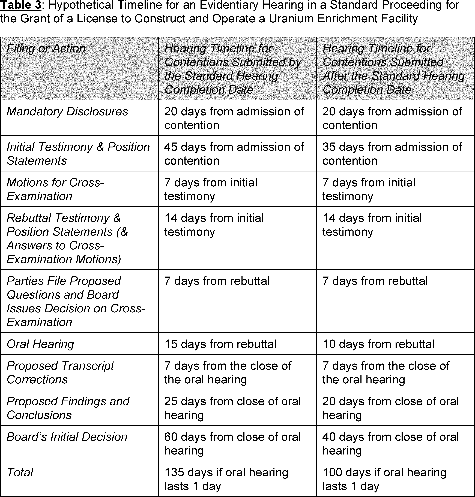
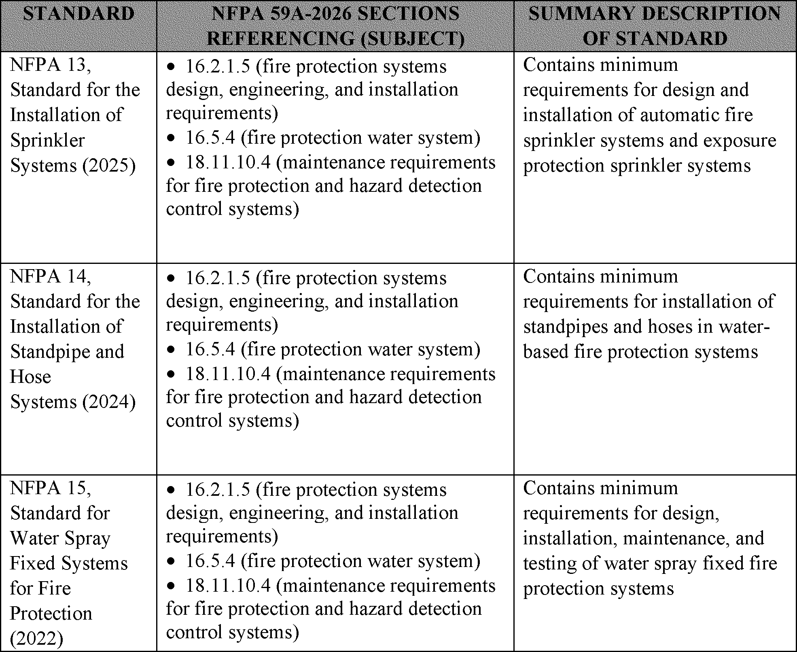
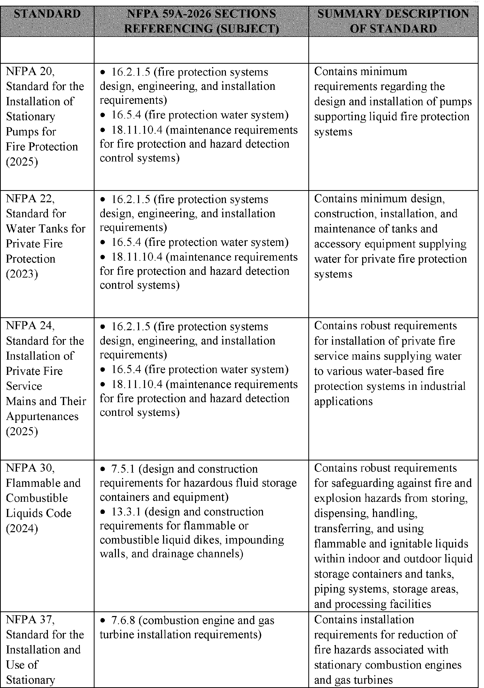

# Daily Digest — 2026-11-03

| | |
|---|---|
| **Digest date** | 2026-11-03 |
| **Data date range** | 2026-11-03 to 2026-11-03 |
| **Generated at** | 2026-11-04T05:02:12Z (UTC) |
| **Pipeline version** | 5e85a802 |
| **Inference** | model layers ran — cli/haiku, opus |
| **Source watermarks** | CREC: 2026-11-03T11:50:48Z · BILLS: 2026-11-04T03:22:59Z · FR: 2026-11-03T06:52:51Z · USCOURTS: 2026-11-03T22:57:19Z · PLAW: 2026-10-30T15:30:14Z |

[Full observed listing for this day](day/2026-11-03.html) — the items our collectors observed for this publication day, mechanical rules applied, frozen at end of day; releases their publishers date on other days are counted there, not listed. This digest is the canonical record.

All items below cite the govinfo package (and granule, where applicable) they
summarize. Selection is mechanical; each item states the rule that included
it. See the Coverage Statement at the end for a full accounting of what was
published, what was summarized, and what was excluded and why.

---

## Contents

- [Day in Review](#day-in-review)
- [1. Congressional Floor Activity](#1-congressional-floor-activity)
- [2. Legislation](#2-legislation)
- [3. Federal Register](#3-federal-register)
- [4. Enacted Laws](#4-enacted-laws)
- [5. Judicial Activity](#5-judicial-activity)
- [6. Agency Announcements](#6-agency-announcements)
- [7. Recorded Votes](#7-recorded-votes)
- [8. Bill Actions](#8-bill-actions)
- [9. Presidential Actions](#9-presidential-actions)
- [Terms Used Today](#terms-used-today)
- [Coverage Statement](#coverage-statement)
- [Methodology](#methodology)

---

## Day in Review

The digest carries 15 House and 4 Senate Congressional Record items, 6 Daily Digest entries, and 43 Extensions of Remarks. None of the summarized items records a floor vote. Two House bills appear as reported, with amendments, from the Committee on Education and Workforce on November 2: the RURAL Healthcare Act (H.R. 8347), on the employment status of locum tenens professionals, and the VEST Act (H.R. 8660), on restricted stock units under the Fair Labor Standards Act. The digest also carries 28 introduced House bills.

On the executive side, the digest carries 7 rules, 5 proposed rules, 69 notices, and 2 proclamations. HHS revised its section 504 disability nondiscrimination regulation, and CMS revised conditions for coverage for organ procurement organizations. The NRC revised its procedures for contested licensing adjudications under the ADVANCE Act and Executive Order 14300. Proposed rules include four FAA airworthiness directives and PHMSA updates to LNG facility standards. Proclamations dated November 3 designate Anti-Communism Week and issue the American Declaration of Freedom in Space.

The digest carries 36 appellate, 3 national, 775 district, and 7 bankruptcy court items. On remand from the Supreme Court, the Fourth Circuit held that adjustment-of-status applicants must prove admissibility by a preponderance of the evidence. The Seventh Circuit affirmed a permanent injunction against two Indiana union-dues payroll laws. The Ninth Circuit held an officer entitled to qualified immunity in Johnson v. Adgar and stayed a temporary restraining order against DOJ and DHS pending appeal. The Court of Federal Claims dismissed three pro se complaints.

*Composed from the summarized items below and the day's mechanical
counts; all specifics are cited in their sections.*

---

## 1. Congressional Floor Activity

Source: Congressional Record (CREC), issue observed 2026-11-03, covering proceedings of 2026-11-02. Published by govinfo 2026-11-03T11:50:48Z; observed by our collector 2026-11-03T12:02:25Z. Total issue size: 68 granule(s).

### 1.1 Senate

No Senate floor items met the selection thresholds. 4 floor granule(s) are accounted for in the Coverage Statement.

### 1.2 House of Representatives

Tags: legislative · model keys: department of war · draft legislative proposals · executive communications

*In plain terms: 34 executive communications, EC-5003 through EC-5036, from the Department of War transmitting draft legislative proposals referred to House committees.*

- **Executive Communications, ETC.** — Under clause 2 of rule XIV, this section of the Congressional Record lists executive communications referred to House committees. Entries EC-5003 through EC-5036 are letters from the Department of War transmitting draft legislative proposals, all referred to the Committee on Armed Services, on subjects including military construction thresholds, National Guard equipment and facilities, and military justice. Entry EC-5037 transmits the Fiscal Year 2023 Community Services Block Grant report to the Committee on Education and Workforce, and entry EC-5038 transmits a six-month periodic report on the national emergency with respect to South Sudan, declared in Executive Order 13664, to the Committee on Foreign Affairs.
  - *In plain terms:* Department of War letters on military construction, National Guard, and military justice go to Armed Services; FY2023 Community Services Block Grant report goes to Education and Workforce; six-month South Sudan emergency report goes to Foreign Affairs.
  - Included because: CREC-SEL-01 — floor item ≥ threshold floor time (20,941 characters) (document dated 2026-11-02)
  - Source: [CREC-2026-11-02 / CREC-2026-11-02-pt1-PgH6073-7](https://www.govinfo.gov/app/details/CREC-2026-11-02/CREC-2026-11-02-pt1-PgH6073-7)

### 1.3 Recorded Votes

No recorded votes were published in this issue of the Congressional Record.

---

## 2. Legislation

Source: Congressional Bills (BILLS), text versions published 2026-11-03 to 2026-11-03.

### 2.1 Counts by Stage

| Stage (bill text version) | Count |
|---|---|
| Introduced (ih/is) | 28 |
| Reported (rh/rs) | 2 |
| Engrossed (eh/es) | 0 |
| Enrolled (enr) | 0 |
| Other versions | 0 |
| **Total bill texts published** | **30** |

### 2.2 Bills Listed by Mechanical Rule

Tags: legislative · model keys: employee stock · house bills · rural healthcare

*In plain terms: Two House bills, H.R. 8347 (RURAL Healthcare Act) and H.R. 8660 (VEST Act), were both reported with an amendment on November 2, 2026, after referral to the Education and Workforce Committee.*

Bills below are listed because they matched at least one listing rule; the
matching rule is stated per item. All other bill texts are counted above and
accounted for in the Coverage Statement.

- **H. R. 8347 (rh) — 119 HR 8347 RH: Reinforcing Underserved, Rural, and Local Healthcare Act** — H.R. 8347, the Reinforcing Underserved, Rural, and Local Healthcare Act (RURAL Healthcare Act), was introduced April 16, 2026, by Mr. Owens and referred to the Committee on Education and Workforce, then reported with an amendment on November 2, 2026. The reported text would provide that a qualified locum tenens professional or advanced care practitioner is not considered an employee of the entity receiving temporary services under the Fair Labor Standards Act of 1938 and the National Labor Relations Act. The bill defines qualified individuals as physicians, nurse practitioners, physician assistants, or certified registered nurse anesthetists providing services for no more than one continuous year at a single site under a written contract stating they will not be treated as employees.
  - *In plain terms:* Temporary physicians, nurse practitioners, physician assistants, or certified registered nurse anesthetists serving up to one continuous year at one site under a written contract are not employees of the receiving entity under federal labor laws.
  - Included because: BILLS-SEL-01 — reached stage: reported/enrolled/calendar (document dated 2026-11-02)
  - Source: [BILLS-119hr8347rh](https://www.govinfo.gov/app/details/BILLS-119hr8347rh)
- **H. R. 8660 (rh) — 106 HR 8660 RH: Valuing Employee Stock Today Act** — H.R. 8660, the Valuing Employee Stock Today Act (VEST Act), was introduced May 4, 2026, by Mr. Mackenzie and referred to the Committee on Education and Workforce, then reported with an amendment on November 2, 2026. The reported text amends section 7(e)(8) of the Fair Labor Standards Act of 1938 to include restricted stock unit programs in the exemption for equity income from the regular rate calculation for overtime, and changes "exercise" to "exercise or acceptance" in subparagraph (C). The amendments would take effect 90 days after enactment, and the bill limits employer liability for certain restricted stock unit grants obtained before the effective date, within a 12-month period under specified conditions, or under a collective bargaining agreement in effect on that date.
  - *In plain terms:* Takes effect 90 days after enactment; would add restricted stock unit programs to the Fair Labor Standards Act's overtime exemption for equity income and limit employer liability for certain grants obtained before that date.
  - Included because: BILLS-SEL-01 — reached stage: reported/enrolled/calendar (document dated 2026-11-02)
  - Source: [BILLS-119hr8660rh](https://www.govinfo.gov/app/details/BILLS-119hr8660rh)

---

## 3. Federal Register

Source: Federal Register (FR), issue of 2026-11-03.

### 3.1 Counts by Document Type

| Document type | Count |
|---|---|
| Rules | 7 |
| Proposed rules | 5 |
| Notices | 69 |
| Presidential documents | 0 |
| **Total FR documents** | **81** |

### 3.2 Rules Published

Tags: department of commerce · department of energy · executive · model keys: disability nondiscrimination · nuclear licensing adjudications · organ procurement organizations

*In plain terms: Seven rules, led by an HHS revision of disability nondiscrimination rules under Section 504 and an NRC streamlining of licensing adjudications; the rest are corrections and an FCC rule removal.*

#### DEPARTMENT OF HEALTH AND HUMAN SERVICES

- **Nondiscrimination on the Basis of Disability in Programs or Activities Receiving Federal Financial Assistance** (2026-22380; 45 CFR Part 84) — The Department of Health and Human Services (HHS or Department) issues this rule to revise the regulation implementing section 504 of the Rehabilitation Act of 1973 (section 504) as it applies to recipients of HHS funding (entitled “Nondiscrimination on the Basis of Disability in Programs or Activities Receiving Federal Financial Assistance,” (“2024 Final Rule”)), published on May 9, 2024. This rule clarifies that the Department interprets the statutory exclusion of “gender identity disorders not resulting from physical impairments” from the terms “individual with a disability” and “disability” set forth in our regulations to encompass “gender dysphoria not resulting from a physical impairment” for purposes of the regulation. This clarification is necessary to resolve ambiguity introduced in the preamble to the 2024 Final Rule and to ensure compliance with the best reading of the governing statute. Action: Final rule. Dates: This rule is effective January 4, 2027.
  - *In plain terms:* HHS clarifies that its disability nondiscrimination rule interprets the statutory exclusion of 'gender identity disorders not resulting from physical impairments' to encompass 'gender dysphoria not resulting from a physical impairment.'
  - Included because: FR-SEL-01 — document type: final rule (all listed)
  - Source: [FR-2026-11-03 / 2026-22380](https://www.govinfo.gov/app/details/FR-2026-11-03/2026-22380)
- **Medicare and Medicaid Programs; Organ Procurement Organizations Conditions for Coverage: Revisions to the Conditions for Coverage** (2026-22381; 42 CFR Part 486) — This final rule revises the Conditions for Coverage for Organ Procurement Organizations (OPOs) to clarify outstanding procedural questions and provide additional operational flexibility for OPOs to achieve high performance resulting in the successful procurement, distribution, and transplantation of more life-saving organs. This rule revises definitions, revises the designation requirements for OPOs, clarifies when an OPO's service area is open for competition, and updates the process for appeals. We are committed to holding all OPOs accountable for their performance and this final rule does not revise the focus on improving the volume of donors and transplants assessed in the outcome measures or the tier structure used for re-certification and de-certification of OPOs. Action: Final rule. Dates: These regulations are effective on January 4, 2027.
  - *In plain terms:* This final rule revises conditions for coverage for organ procurement organizations (OPOs) on definitions, designation, competition for service areas, and appeals, but leaves unchanged the outcome measures and tier structure used for recertification and decertification.
  - Included because: FR-SEL-01 — document type: final rule (all listed)
  - Source: [FR-2026-11-03 / 2026-22381](https://www.govinfo.gov/app/details/FR-2026-11-03/2026-22381)
  -  *Source graphic 1 of 8 from 2026-22381.*
  -  *Source graphic 2 of 8 from 2026-22381.*
  - *Graphics not rendered here: 6 of 8 — see the [source PDF](https://www.govinfo.gov/content/pkg/FR-2026-11-03/pdf/FR-2026-11-03.pdf).*

#### ENVIRONMENTAL PROTECTION AGENCY

- **National Emission Standards for Hazardous Air Pollutants: Lime Manufacturing Plants Technology Review; Correction** (2026-22404; 40 CFR Part 63) — The Environmental Protection Agency (EPA) is making a correction to the National Emission Standards for Hazardous Air Pollutants for Lime Manufacturing Plants (Lime Manufacturing NESHAP) technology review final rule that appeared in the Federal Register on July 16, 2024. Following publication of this final rule, the EPA discovered an inadvertent error in the regulatory text and is correcting the error in this action. Action: Correcting amendment. Dates: The final rule is effective on November 3, 2026.
  - *In plain terms:* The EPA corrects an inadvertent error in the regulatory text of its July 16, 2024 technology review final rule for Lime Manufacturing Plants under the National Emission Standards for Hazardous Air Pollutants.
  - Included because: FR-SEL-01 — document type: final rule (all listed)
  - Source: [FR-2026-11-03 / 2026-22404](https://www.govinfo.gov/app/details/FR-2026-11-03/2026-22404)

#### FEDERAL COMMUNICATIONS COMMISSION

- **Review of the Commission's Broadcast and Cable Equal Employment Opportunity Rules and Policies; Delete, Delete, Delete** (2026-22408; 47 CFR Parts 73 and 74) — In this document, the Media Bureau of the Federal Communications Commission (Commission) adopts an Order that removes a section of the Commission's Rules and references to that section to conform the Commission's Rules to the decision of the Fifth Circuit Court of Appeals in National Religious Broadcasters v. FCC. Action: Final rule. Dates: Effective November 3, 2026.
  - *In plain terms:* The FCC's Media Bureau adopts an order removing a rule section and its references to conform the Commission's rules to the Fifth Circuit Court of Appeals' decision in National Religious Broadcasters v. FCC.
  - Included because: FR-SEL-01 — document type: final rule (all listed)
  - Source: [FR-2026-11-03 / 2026-22408](https://www.govinfo.gov/app/details/FR-2026-11-03/2026-22408)

#### FEDERAL ELECTION COMMISSION

- **Compliance Procedure (52 U.S.C. 30109, 30107(a))** (2026-22402; 11 CFR Part 111) — This Federal Register correction, published by the Office of the Federal Register and issued under 11 CFR Part 111 (Compliance Procedure, 52 U.S.C. 30109 and 30107(a)), fixes editorial and technical errors in the Title 11 CFR annual revision as of January 1, 2026. In section 111.24, paragraph (a)(2)(ii) is amended by replacing $84,852 with $87,056. In paragraph (b), the figure $7,455 is replaced with $7,445.
  - *In plain terms:* This correction fixes errors in the Title 11 Code of Federal Regulations as of January 1, 2026, changing $84,852 to $87,056 in section 111.24(a)(2)(ii) and $7,455 to $7,445 in paragraph (b).
  - Included because: FR-SEL-01 — document type: final rule (all listed)
  - Source: [FR-2026-11-03 / 2026-22402](https://www.govinfo.gov/app/details/FR-2026-11-03/2026-22402)

#### NUCLEAR REGULATORY COMMISSION

- **List of Approved Spent Fuel Storage Casks: TN Americas, LLC: Standardized NUHOMS® Horizontal Modular Storage System for Irradiated Nuclear Fuel, Certificate of Compliance No. 1004, Renewed Amendment No. 19** (2026-22421; 10 CFR Part 72) — The U.S. Nuclear Regulatory Commission (NRC) is confirming the effective date of November 9, 2026, for the direct final rule that was published in the Federal Register on August 26, 2026. This direct final rule amended the TN Americas, LLC Standardized NUHOMS® Horizontal Modular Storage System for Irradiated Nuclear Fuel listing within the “List of approved spent fuel storage casks” to include Amendment No. 19 to Certificate of Compliance No. 1004. Amendment No. 19 revises the certificate of compliance to provide for a 61BTH improved basket design using staggered plates similar the 24PTH Type 3 basket approved in CoC 1004 Amendment 18 and similar to the EOS 37PTH and 89BTH baskets approved in CoC 1042. This will simplify construction, reduce weight and improve fabricability. Additional changes are proposed to address editorial corrections, consistency, and terminology clarifications. Action: Direct final rule; confirmation of effective date. Dates: The effective date of November 9, 2026, for the direct final rule published August 26, 2026 (91 FR 54941), is confirmed.
  - *In plain terms:* Effective November 9, 2026, a direct final rule published August 26, 2026 adds Amendment No. 19 to the TN Americas NUHOMS cask listing, with a 61BTH basket design that simplifies construction and reduces weight.
  - Included because: FR-SEL-01 — document type: final rule (all listed)
  - Source: [FR-2026-11-03 / 2026-22421](https://www.govinfo.gov/app/details/FR-2026-11-03/2026-22421)
- **Streamlining Contested Adjudications in Licensing Proceedings** (2026-22443; 10 CFR Parts 2, 51, 52, 53, and 54) — The U.S. Nuclear Regulatory Commission (NRC, agency, or Commission) is revising the agency's rules of practice and procedure to streamline contested adjudications in NRC licensing proceedings in response to the Accelerating Deployment of Versatile, Advanced Nuclear for Clean Energy Act of 2024 (ADVANCE Act) and Executive Order 14300, Ordering the Reform of the Nuclear Regulatory Commission. Action: Final rule. Dates: This final rule is effective on December 3, 2026, and applies to contested adjudicatory proceedings noticed on or after the effective date.
  - *In plain terms:* The NRC is revising its rules of practice to streamline contested adjudications (disputed licensing hearings) in response to the ADVANCE Act of 2024 and Executive Order 14300 on reforming the NRC.
  - Included because: FR-SEL-01 — document type: final rule (all listed)
  - Source: [FR-2026-11-03 / 2026-22443](https://www.govinfo.gov/app/details/FR-2026-11-03/2026-22443)
  -  *Source graphic 1 of 13 from 2026-22443.*
  -  *Source graphic 2 of 13 from 2026-22443.*
  - *Graphics not rendered here: 11 of 13 — see the [source PDF](https://www.govinfo.gov/content/pkg/FR-2026-11-03/pdf/FR-2026-11-03.pdf).*

### 3.3 Proposed Rules Published

Tags: department of commerce · department of energy · executive · model keys: airworthiness directives · lng facilities · pipeline safety

*In plain terms: Five proposed rules: four FAA airworthiness directives for helicopters and airplanes, led by a Boeing 757 relay and wire bundle change, plus a PHMSA proposal updating liquefied natural gas facility standards.*

#### DEPARTMENT OF TRANSPORTATION

- **Airworthiness Directives; MD Helicopters, LLC Helicopters** (2026-22373; 14 CFR Part 39) — The FAA proposes to supersede Airworthiness Directive (AD) 90-19-02, which applies to all MD Helicopters, LLC (type certificate previously held by McDonnell Douglas Helicopter Company) Model 369, 369A, 369D, 369E, 369F, 369FF, 369H, 369HE, 369HM, and 369HS, helicopters, that are equipped with a cargo hook. AD 90-19-02 requires replacing the overrunning clutch assembly and sprag assembly with airworthy parts and repetitively inspecting the sprag assembly, clutch inner and outer races of the overrunning clutch assembly. Since the FAA issued AD 90-19-02, after further analysis the FAA determined that additional helicopter models are affected by this unsafe condition. This proposed AD would expand the applicability and would require removing certain overrunning clutch assemblies and certain overrunning clutch subassemblies from service, installing or replacing parts, and reidentifying certain overrunning clutch assemblies, as applicable. [official summary truncated; see source] Action: Notice of proposed rulemaking (NPRM). Dates: The FAA must receive comments on this proposed AD by December 18, 2026.
  - *In plain terms:* The FAA proposes a new mandatory safety order replacing AD 90-19-02 for MD Helicopters 369-series helicopters with cargo hooks, adding more models found to have the same safety problem.
  - Included because: FR-SEL-02 — document type: proposed rule (all listed)
  - Source: [FR-2026-11-03 / 2026-22373](https://www.govinfo.gov/app/details/FR-2026-11-03/2026-22373)
- **Airworthiness Directives; Embraer S.A. (Type Certificate Previously Held by Yaborã Indústria Aeronáutica S.A.; Embraer S.A.) Airplanes** (2026-22382; 14 CFR Part 39) — The FAA proposes to supersede Airworthiness Directive (AD) 2024-17-03, which applies to certain Embraer S.A. Model ERJ 190-100 STD, -100 LR, -100 IGW, and -100 ECJ airplanes; and Model ERJ 190-200 STD, -200 LR, and -200 IGW airplanes. AD 2024-17-03 requires revising the existing maintenance or inspection program, as applicable, to incorporate new or more restrictive airworthiness limitations. Since the FAA issued AD 2024-17-03, the FAA has determined that new or more restrictive airworthiness limitations are necessary. This proposed AD would continue to require certain actions in AD 2024-17-03 and would require revising the existing maintenance or inspection program, as applicable, to incorporate new or more restrictive airworthiness limitations. The FAA is proposing this AD to address the unsafe condition on these products. Action: Notice of proposed rulemaking (NPRM). Dates: The FAA must receive comments on this proposed AD by December 18, 2026.
  - *In plain terms:* The FAA proposes a new mandatory safety order replacing AD 2024-17-03 for certain Embraer ERJ 190 airplanes, continuing its current requirements and requiring maintenance or inspection programs to add new or stricter airworthiness limits.
  - Included because: FR-SEL-02 — document type: proposed rule (all listed)
  - Source: [FR-2026-11-03 / 2026-22382](https://www.govinfo.gov/app/details/FR-2026-11-03/2026-22382)
- **Airworthiness Directives; The Boeing Company Airplanes** (2026-22383; 14 CFR Part 39) — The FAA proposes to supersede Airworthiness Directive (AD) 2024-25-09, which applies to certain The Boeing Company Model 757 airplanes. AD 2024-25-09 requires installing new relays and changing certain wire bundles leading to the power transfer unit (PTU) control valve. Since the FAA issued AD 2024-25-09, the FAA determined that the requirements bulletin mandated by AD 2024-25-09 contains errors. In some cases, those errors prevent the actions required by AD 2024-25-09 from being fully accomplished. In other cases, the errors would allow actions that could introduce new hazards affecting the operation and thus the availability of the PTU. This proposed AD would require, depending on the airplane configuration, installing new relays and new connectors, changing certain wire bundles, doing an operational test, and applicable on-condition actions. The FAA is proposing this AD to address the unsafe condition on these products. Action: Notice of proposed rulemaking (NPRM). Dates: The FAA must receive comments on this proposed AD by December 18, 2026.
  - *In plain terms:* The FAA proposes replacing safety order AD 2024-25-09 for certain Boeing 757 airplanes after finding errors in its referenced bulletin, requiring new relays, connectors, rewired bundles, and an operational test depending on configuration.
  - Included because: FR-SEL-02 — document type: proposed rule (all listed)
  - Source: [FR-2026-11-03 / 2026-22383](https://www.govinfo.gov/app/details/FR-2026-11-03/2026-22383)
- **Pipeline Safety: Amendments to Liquefied Natural Gas Facilities** (2026-22396; 49 CFR Parts 191 and 193) — PHMSA proposes updating its regulations for liquefied natural gas (LNG) facilities to incorporate by reference the most recent industry safety standards and to make other changes to account for more than two decades of improvements and technological advancements. This rulemaking also responds to congressional mandates directing PHMSA to integrate risk-based regulatory approaches for certain LNG facilities. Action: Notice of proposed rulemaking (NPRM). Dates: Comments on this NPRM must be submitted by January 4, 2027. A public meeting of PHMSA's statutory advisory committees will be held on a date to be announced in the Federal Register .
  - *In plain terms:* PHMSA proposes updating liquefied natural gas (LNG) facility rules to adopt by reference the latest industry safety standards and reflect over two decades of technological advances, responding to congressional mandates for risk-based approaches to certain facilities.
  - Included because: FR-SEL-02 — document type: proposed rule (all listed)
  - Source: [FR-2026-11-03 / 2026-22396](https://www.govinfo.gov/app/details/FR-2026-11-03/2026-22396)
  -  *Source graphic 1 of 16 from 2026-22396.*
  -  *Source graphic 2 of 16 from 2026-22396.*
  - *Graphics not rendered here: 14 of 16 — see the [source PDF](https://www.govinfo.gov/content/pkg/FR-2026-11-03/pdf/FR-2026-11-03.pdf).*
- **Airworthiness Directives; Airbus Helicopters** (2026-22400; 14 CFR Part 39) — The FAA proposes to adopt a new airworthiness directive (AD) for certain Airbus Helicopters Model AS350B2, AS350B3, and EC130B4 helicopters. This proposed AD was prompted by a report of an occurrence of partial blocking of a pilot pedal. This proposed AD would require modifying and reidentifying an affected fuse cover and would prohibit installing an affected fuse cover on any helicopter. The FAA is proposing this AD to address the unsafe condition on these products. Action: Notice of proposed rulemaking (NPRM). Dates: The FAA must receive comments on this NPRM by December 18, 2026.
  - *In plain terms:* The FAA proposes a safety order for Airbus Helicopters AS350B2, AS350B3, and EC130B4 helicopters after a report of partial pilot-pedal blocking, requiring modification and relabeling of the fuse cover and barring its installation on any helicopter.
  - Included because: FR-SEL-02 — document type: proposed rule (all listed)
  - Source: [FR-2026-11-03 / 2026-22400](https://www.govinfo.gov/app/details/FR-2026-11-03/2026-22400)

### 3.4 Notices and Presidential Documents

Notices are summarized only when they match a listing rule; all are counted
in 3.1 and in the Coverage Statement. Presidential documents in the FR are
always listed.

No notices or presidential documents matched a listing rule.

---

## 4. Enacted Laws

Source: Public and Private Laws (PLAW) published 2026-11-03.

No laws were published in this range.

---

## 5. Judicial Activity

Source: United States Courts Opinions (USCOURTS): opinions observed 2026-11-03
by our collector; each opinion states its own issue date beside its
listing ([how our clocks work](faq.html#fapds-three-clocks)).

Completeness disclosure (standing): USCOURTS carries opinions from
approximately 140 participating appellate, district, bankruptcy, and
national federal courts. Unlike the Congressional Record and the Federal
Register, which are the complete official record of their branches,
USCOURTS is participation-based and is NOT the complete federal judicial
record. Courts post opinions with delay — typically over several days —
so a day's digest carries the opinions that became available that day,
whatever date each was issued.

### 5.1 Appellate and National Court Opinions

Tags: judicial · model keys: criminal appeal · federal appellate rulings · tax deficiency appeal

*In plain terms: 39 rulings, led by a Fourth Circuit opinion granting Nivar Santana's petition on remand from the Supreme Court and a Tenth Circuit affirmance in Blum; the rest are mostly affirmances and dismissals.*

Appellate and national court opinions are summarized; district and
bankruptcy opinions are counted in 5.2 and in the Coverage Statement.

#### United States Court of Appeals for the Eleventh Circuit

- **Shirley Reed v. Mike Williams, et al** (No. 25-12339; filed 2026-11-02) — The Eleventh Circuit, in an unpublished per curiam opinion, affirmed the Middle District of Florida's denial of Shirley Reed's Rule 60(b) motion in her 42 U.S.C. section 1983 suit against Detective T.C. McKenzie and former Sheriff Mike Williams. The court held that a later-filed summary judgment motion does not supersede a pending motion to dismiss, and that the dismissal itself rendered the pending summary judgment motion moot. The court also stated that its Rule 60(b) review does not extend to issues in the underlying judgment.
  - *In plain terms:* The appeals court upheld the denial of Shirley Reed's motion to reopen her civil rights case, holding that the dismissal made a pending summary judgment motion moot.
  - Included because: USCOURTS-SEL-01 — appellate court opinion (all listed) (document dated 2026-11-02)
  - Source: [USCOURTS-ca11-25-12339 / USCOURTS-ca11-25-12339-0](https://www.govinfo.gov/app/details/USCOURTS-ca11-25-12339/USCOURTS-ca11-25-12339-0)
- **Steven Epperson v. The Hertz Corporation** (No. 25-13871; filed 2026-11-02) — The Eleventh Circuit, in an unpublished per curiam opinion, affirmed the district court's grant of summary judgment for The Hertz Corporation in an age discrimination and retaliation suit brought by Steven Epperson under the Age Discrimination in Employment Act and the Florida Civil Rights Act. The opinion addresses whether a written warning issued to Epperson was an adverse employment action, and discusses Muldrow v. City of St. Louis on that standard. The excerpt provided is truncated, so the court's full analysis of the retaliation claim is not included in this summary.
  - *In plain terms:* The appeals court upheld a ruling in Hertz's favor without a trial in Steven Epperson's age discrimination and retaliation suit, addressing whether a written warning was a harmful job action.
  - Included because: USCOURTS-SEL-01 — appellate court opinion (all listed) (document dated 2026-11-02)
  - Source: [USCOURTS-ca11-25-13871 / USCOURTS-ca11-25-13871-0](https://www.govinfo.gov/app/details/USCOURTS-ca11-25-13871/USCOURTS-ca11-25-13871-0)
- **Larry Thomas, Jr. v. Ron James, et al** (No. 25-13876; filed 2026-11-02) — The Eleventh Circuit, in an unpublished per curiam opinion, vacated and remanded a Middle District of Georgia order that denied pro se plaintiff Larry Thomas, Jr.'s second motion for leave to proceed in forma pauperis in his civil rights action against Thomas County Sheriff officials. The court held that the district court abused its discretion in finding Thomas had not shown financial eligibility, because his affidavits stated he was homeless, unemployed, and without savings or assets. The court also found the district court's frivolousness and sanctions analyses insufficient for appellate review and remanded for further proceedings.
  - *In plain terms:* The appeals court vacated and sent back the denial of Larry Thomas, Jr.'s request to proceed without paying court fees, saying his affidavits showed he was homeless, unemployed, and had no savings or assets.
  - Included because: USCOURTS-SEL-01 — appellate court opinion (all listed) (document dated 2026-11-02)
  - Source: [USCOURTS-ca11-25-13876 / USCOURTS-ca11-25-13876-0](https://www.govinfo.gov/app/details/USCOURTS-ca11-25-13876/USCOURTS-ca11-25-13876-0)
- **USA v. Malcolm Jeffrey** (No. 25-14537; filed 2026-11-02) — The Eleventh Circuit, in an unpublished per curiam opinion, affirmed the conviction of Malcolm Jeffrey for conspiracy to commit mail fraud and the district court's related restitution order. The opinion describes evidence that a Georgia unemployment portal account associated with Down N Dirty Transportation LLC, which Jeffrey administered, filed roughly 7,300 claims using about 4,900 Social Security numbers, resulting in around $16 million in payments on debit cards. The excerpt provided is truncated, so the court's analysis of the remaining challenges and the sentencing ruling is not included in this summary.
  - *In plain terms:* The appeals court upheld Malcolm Jeffrey's conspiracy to commit mail fraud conviction and related restitution order, describing claims filed through an unemployment account he administered.
  - Included because: USCOURTS-SEL-01 — appellate court opinion (all listed) (document dated 2026-11-02)
  - Source: [USCOURTS-ca11-25-14537 / USCOURTS-ca11-25-14537-0](https://www.govinfo.gov/app/details/USCOURTS-ca11-25-14537/USCOURTS-ca11-25-14537-0)
- **USA v. Joel Lubin** (No. 26-10415; filed 2026-11-02) — The Eleventh Circuit, in an unpublished per curiam opinion, affirmed a 60-month prison sentence imposed on Joel Lubin after his guilty plea to conspiracy to commit wire fraud. Lubin argued that the district court did not state whether it granted the government's U.S.S.G. section 5K1.1 substantial-assistance departure motion and that his sentence was substantively unreasonable. The court found no plain procedural error and held the sentence substantively reasonable, noting it was well below the 20-year statutory maximum.
  - *In plain terms:* The appeals court upheld Joel Lubin's 60-month prison sentence for conspiracy to commit wire fraud, finding no plain procedural error and that the sentence was reasonable and well below the 20-year maximum.
  - Included because: USCOURTS-SEL-01 — appellate court opinion (all listed) (document dated 2026-11-02)
  - Source: [USCOURTS-ca11-26-10415 / USCOURTS-ca11-26-10415-0](https://www.govinfo.gov/app/details/USCOURTS-ca11-26-10415/USCOURTS-ca11-26-10415-0)
- **Ji Fung v. U.S. Attorney General** (No. 26-10463; filed 2026-11-02) — The Eleventh Circuit, in an unpublished per curiam opinion, denied in part and dismissed in part Ji Xing Fung's petition for review of a Board of Immigration Appeals order denying his motion to reopen removal proceedings. The court agreed that the motion was untimely under the 90-day deadline, and found that Fung had not exhausted his argument under 8 C.F.R. section 1003.1(m). It held that it lacks jurisdiction to review the BIA's discretionary decision not to reopen the proceedings sua sponte.
  - *In plain terms:* The appeals court partly denied and partly dismissed Ji Xing Fung's challenge to the denial of his request to reopen immigration removal proceedings, finding it was filed after the 90-day deadline.
  - Included because: USCOURTS-SEL-01 — appellate court opinion (all listed) (document dated 2026-11-02)
  - Source: [USCOURTS-ca11-26-10463 / USCOURTS-ca11-26-10463-0](https://www.govinfo.gov/app/details/USCOURTS-ca11-26-10463/USCOURTS-ca11-26-10463-0)
- **Southern Equipment & Services, LLC v. Windamir Development, Inc., et al** (No. 26-10601; filed 2026-11-02) — In this unpublished per curiam opinion filed November 2, 2026, the Eleventh Circuit considered a subcontractor's Miller Act claim against a general contractor and its surety on a U.S. Army Corps of Engineers contract for a blast booth facility at Fort Stewart, Georgia. The court concluded that the subcontractor performed labor within one year before filing suit, held that the claim was timely, and vacated the district court's summary judgment ruling that the statute of limitations barred the claim. The opinion was issued by Circuit Judges Rosenbaum, Grant, and Carnes.
  - *In plain terms:* In a November 2, 2026 opinion, the appeals court vacated a ruling that a filing deadline barred a subcontractor's federal construction payment claim, finding it performed labor within one year before filing suit.
  - Included because: USCOURTS-SEL-01 — appellate court opinion (all listed) (document dated 2026-11-02)
  - Source: [USCOURTS-ca11-26-10601 / USCOURTS-ca11-26-10601-0](https://www.govinfo.gov/app/details/USCOURTS-ca11-26-10601/USCOURTS-ca11-26-10601-0)
- **USA v. Cortez Green** (No. 26-10645; filed 2026-11-02) — In this unpublished per curiam opinion, the Eleventh Circuit reviewed the district court's revocation of Cortez Deandre Green's supervised release and imposition of a 24-month prison sentence, an upward variance from an advisory guidelines range of 8 to 14 months. Green challenged the sufficiency of the evidence that he participated in the theft of tires from his former employer and the substantive reasonableness of the sentence. The opinion describes the revocation hearing testimony, video evidence, and the district court's findings.
  - *In plain terms:* The appeals court reviewed the revocation of Cortez Deandre Green's supervised release and his 24-month prison sentence, which was above the advisory guideline range of 8 to 14 months.
  - Included because: USCOURTS-SEL-01 — appellate court opinion (all listed) (document dated 2026-11-02)
  - Source: [USCOURTS-ca11-26-10645 / USCOURTS-ca11-26-10645-0](https://www.govinfo.gov/app/details/USCOURTS-ca11-26-10645/USCOURTS-ca11-26-10645-0)

#### United States Court of Appeals for the Fifth Circuit

- **McGee v. PlainsCapital Bank** (No. 25-11383; filed 2026-11-02) — The Fifth Circuit affirmed the dismissal of Joanthony McGee's complaint against PlainsCapital Bank under 28 U.S.C. § 1915(e)(2)(B) as frivolous and for failure to state a claim. The court found that McGee's Equal Credit Opportunity Act allegations were conclusory, that his claim under 8 U.S.C. § 1503(a) did not allege the required agency action, and that his claim under the Treaty of Peace and Friendship with Morocco rested on an indisputably meritless legal theory. The opinion is not designated for publication.
  - *In plain terms:* The appeals court affirmed the dismissal of Joanthony McGee's complaint against PlainsCapital Bank as frivolous and for failure to state a claim, in an opinion not designated for publication.
  - Included because: USCOURTS-SEL-01 — appellate court opinion (all listed) (document dated 2026-11-02)
  - Source: [USCOURTS-ca5-25-11383 / USCOURTS-ca5-25-11383-0](https://www.govinfo.gov/app/details/USCOURTS-ca5-25-11383/USCOURTS-ca5-25-11383-0)
- **USA v. Dew** (No. 25-30623; filed 2026-11-02) — The Fifth Circuit affirmed the life sentence imposed on Thomas Dew after he pleaded guilty to conspiracy to possess with intent to distribute methamphetamine. The court rejected his claim, raised for the first time on appeal, that the Government breached the plea agreement, and it found not clearly erroneous the district court's drug-quantity attribution of 10.88 kilograms, which relied on the presentence report and co-conspirator testimony. The court also rejected his argument that the sentence was substantively unreasonable. The opinion is not designated for publication.
  - *In plain terms:* The appeals court affirmed Thomas Dew's life sentence for conspiracy to possess methamphetamine with intent to distribute, upholding a drug-quantity finding of 10.88 kilograms, in an opinion not designated for publication.
  - Included because: USCOURTS-SEL-01 — appellate court opinion (all listed) (document dated 2026-11-02)
  - Source: [USCOURTS-ca5-25-30623 / USCOURTS-ca5-25-30623-0](https://www.govinfo.gov/app/details/USCOURTS-ca5-25-30623/USCOURTS-ca5-25-30623-0)
- **USA v. Herndon** (No. 25-40388; filed 2026-11-02) — The Fifth Circuit affirmed the convictions of Desnique Deshawn Herndon on six counts of sex trafficking of children under 18 U.S.C. § 1591(a) and one count of conspiracy under 18 U.S.C. § 1594(c). The court held that a jury instruction permitting conviction under the reasonable-opportunity-to-observe provision of § 1591(c) constructively amended the indictment, but that the error, reviewed for plain error, did not affect Herndon's substantial rights because he had notice of the theory and the evidence showed he knew or recklessly disregarded the victims' ages. The court declined to exercise its discretion to reverse.
  - *In plain terms:* The appeals court affirmed Desnique Deshawn Herndon's convictions on six counts of sex trafficking of minors and one conspiracy count, finding a jury instruction effectively changed the indictment but did not affect his substantial rights.
  - Included because: USCOURTS-SEL-01 — appellate court opinion (all listed) (document dated 2026-11-02)
  - Source: [USCOURTS-ca5-25-40388 / USCOURTS-ca5-25-40388-0](https://www.govinfo.gov/app/details/USCOURTS-ca5-25-40388/USCOURTS-ca5-25-40388-0)
- **Tiller v. Capital One** (No. 26-30227; filed 2026-11-02) — The Fifth Circuit dismissed the appeal of Sean Michael Tiller, a pro se plaintiff whose Americans with Disabilities Act claims against Capital One, National Association were dismissed by the district court, which also denied his post-judgment motion treated under Rule 59(e). The court found that Tiller's opening brief violated Federal Rule of Appellate Procedure 28(a)(6) and (8)(A) because it cited no part of the record and did not adequately cite authority, and it stated that pro se litigants must comply with Rule 28. The opinion is not designated for publication.
  - *In plain terms:* The appeals court dismissed Sean Michael Tiller's appeal of his Americans with Disabilities Act claims against Capital One, because his brief cited no part of the record and did not adequately cite legal authority.
  - Included because: USCOURTS-SEL-01 — appellate court opinion (all listed) (document dated 2026-11-02)
  - Source: [USCOURTS-ca5-26-30227 / USCOURTS-ca5-26-30227-0](https://www.govinfo.gov/app/details/USCOURTS-ca5-26-30227/USCOURTS-ca5-26-30227-0)

#### United States Court of Appeals for the First Circuit

- **Grygiel v. HealthEquity, Inc.** (No. 25-02109; filed 2026-11-02) — The First Circuit affirmed the District of Massachusetts's dismissal under Federal Rule of Civil Procedure 12(b)(6) of a complaint by Tracy Grygiel against HealthEquity, Inc., which alleged sex discrimination and retaliation under Title VII of the Civil Rights Act and Massachusetts law. The court held that the complaint did not allege sufficient facts to make the claims plausible, and it reviewed the dismissal de novo. The opinion, by Circuit Judge Rikelman, notes that the plaintiff did not pursue the interference claim on appeal.
  - *In plain terms:* The First Circuit upheld the dismissal of Tracy Grygiel's lawsuit against HealthEquity, which alleged sex discrimination and retaliation under federal and Massachusetts law, finding the complaint lacked enough facts to make the claims plausible.
  - Included because: USCOURTS-SEL-01 — appellate court opinion (all listed) (document dated 2026-11-02)
  - Source: [USCOURTS-ca1-25-02109 / USCOURTS-ca1-25-02109-0](https://www.govinfo.gov/app/details/USCOURTS-ca1-25-02109/USCOURTS-ca1-25-02109-0)

#### United States Court of Appeals for the Fourth Circuit

- **Sintia Nivar Santana v. Todd Blanche** (No. 22-02114; filed 2024-02-02) — In this published opinion issued February 2, 2024, the Fourth Circuit denied Sintia Dines Nivar Santana's petition for review of a Board of Immigration Appeals order that affirmed an immigration judge's decision finding her ineligible for adjustment of status. The immigration judge had found her inadmissible for falsely claiming United States citizenship on an employment eligibility form and had applied a clearly and beyond doubt standard of proof. The court also rejected her contention that the admission of the form rendered the evidentiary hearing fundamentally unfair.
  - *In plain terms:* On February 2, 2024, the appeals court denied Sintia Nivar Santana's challenge to an immigration board order finding her ineligible for permanent residence (adjustment of status) for falsely claiming U.S. citizenship on an employment form.
  - Included because: USCOURTS-SEL-01 — appellate court opinion (all listed) (document dated 2026-11-02)
  - Source: [USCOURTS-ca4-22-02114 / USCOURTS-ca4-22-02114-0](https://www.govinfo.gov/app/details/USCOURTS-ca4-22-02114/USCOURTS-ca4-22-02114-0)
- **Sintia Nivar Santana v. Todd Blanche** (No. 22-02114; filed 2026-11-02) — In this published opinion issued November 2, 2026, on remand from the Supreme Court of the United States, the Fourth Circuit granted Sintia Dines Nivar Santana's petition for review. The court held that adjustment of status applicants bear the burden of proving admissibility by a preponderance of the evidence, reconsidering its prior decision in light of Loper Bright Enterprises v. Raimondo. The court held that the immigration judge and Board of Immigration Appeals erred in requiring proof of admissibility clearly and beyond doubt, and it remanded for proceedings consistent with the opinion.
  - *In plain terms:* On November 2, 2026, on remand from the Supreme Court, the appeals court granted Sintia Nivar Santana's petition, holding applicants must prove admissibility more likely than not, not clearly and beyond doubt.
  - Included because: USCOURTS-SEL-01 — appellate court opinion (all listed) (document dated 2026-11-02)
  - Source: [USCOURTS-ca4-22-02114 / USCOURTS-ca4-22-02114-1](https://www.govinfo.gov/app/details/USCOURTS-ca4-22-02114/USCOURTS-ca4-22-02114-1)
- **E.K. v. Department of Defense Education Activity** (No. 25-02497; filed 2026-11-02) — In this order filed November 2, 2026, in E.K. v. Department of Defense Education Activity, the Fourth Circuit granted the appellants' unopposed motion for limited remand. The court retained jurisdiction and remanded the cases for the limited purpose of allowing the district court to modify the preliminary injunction that is the subject of the appeals. The order was issued over the signature of Clerk Nwamaka Anowi.
  - *In plain terms:* On November 2, 2026, the appeals court granted the appellants' unopposed motion for limited remand, keeping jurisdiction while sending the cases back so the district court could modify the preliminary injunction.
  - Included because: USCOURTS-SEL-01 — appellate court opinion (all listed) (document dated 2026-11-02)
  - Source: [USCOURTS-ca4-25-02497 / USCOURTS-ca4-25-02497-0](https://www.govinfo.gov/app/details/USCOURTS-ca4-25-02497/USCOURTS-ca4-25-02497-0)
- **US v. Ronald Lefler** (No. 25-04661; filed 2026-11-02) — In this unpublished per curiam opinion filed November 2, 2026, the Fourth Circuit affirmed the district court's finding that Ronald E. Lefler violated the conditions of his supervised release by committing larcenies of a check, and affirmed the revocation decision. The court vacated Lefler's sentence of a 3-month prison term and 33-month term of supervised release because the written judgment included an office search condition that the district court did not orally pronounce at the revocation hearing, citing United States v. Rogers. The case was remanded for resentencing.
  - *In plain terms:* On November 2, 2026, the appeals court upheld Ronald E. Lefler's supervised release violation for check thefts but vacated his sentence over a written office search condition not stated orally at the hearing, and remanded for resentencing.
  - Included because: USCOURTS-SEL-01 — appellate court opinion (all listed) (document dated 2026-11-02)
  - Source: [USCOURTS-ca4-25-04661 / USCOURTS-ca4-25-04661-0](https://www.govinfo.gov/app/details/USCOURTS-ca4-25-04661/USCOURTS-ca4-25-04661-0)
- **E.K. v. Department of Defense Education Activity** (No. 26-01002; filed 2026-11-02) — The Fourth Circuit issued an order granting the appellants' unopposed motion for limited remand in appeals docketed under No. 25-2497 (L), in which student plaintiffs sued the Department of Defense Education Activity and two officials. The court retained jurisdiction over the appeals and remanded to the district court for the limited purpose of allowing that court to modify the preliminary injunction that is the subject of the appeals.
  - *In plain terms:* The appeals court granted an unopposed request to send the appeals in No. 25-2497 (L) back to the district court for a limited purpose of modifying the preliminary injunction, retaining jurisdiction over the appeals.
  - Included because: USCOURTS-SEL-01 — appellate court opinion (all listed) (document dated 2026-11-02)
  - Source: [USCOURTS-ca4-26-01002 / USCOURTS-ca4-26-01002-0](https://www.govinfo.gov/app/details/USCOURTS-ca4-26-01002/USCOURTS-ca4-26-01002-0)

#### United States Court of Appeals for the Ninth Circuit

- **JOHNSON V. ADGAR, ET AL.** (No. 25-1392; filed 2026-11-02) — In an opinion filed November 2, 2026, the Ninth Circuit held that San Jose Police Officer James Adgar is entitled to qualified immunity on Kyle Johnson's Fourth Amendment excessive force claim under 42 U.S.C. § 1983, and reversed the district court's denial of Adgar's post-verdict motion for judgment as a matter of law on that claim, with Judge Paez dissenting in part. The panel found that substantial evidence supported a finding that Adgar violated the Fourth Amendment by firing a 40mm projectile impact weapon indiscriminately into a crowd, and it concluded that the precedent Nelson v. City of Davis was materially distinguishable. The panel remanded for recalculation of attorneys' fees, directed the district court to defer that recalculation until it decides the Bane Act claim, and in a concurrently filed order certified a question on the Bane Act standard to the California Supreme Court.
  - *In plain terms:* On November 2, 2026, the Ninth Circuit reversed the denial of Officer James Adgar's motion after the verdict in Kyle Johnson's excessive force case, holding Adgar protected from liability by qualified immunity.
  - Included because: USCOURTS-SEL-01 — appellate court opinion (all listed) (document dated 2026-11-02)
  - Source: [USCOURTS-ca9-25-1392 / USCOURTS-ca9-25-1392-0](https://www.govinfo.gov/app/details/USCOURTS-ca9-25-1392/USCOURTS-ca9-25-1392-0)
- **JOHNSON V. ADGAR, ET AL.** (No. 25-5468; filed 2026-11-02) — The Ninth Circuit's November 2, 2026 published opinion in Johnson v. Adgar, filed under No. 25-5468 and consolidated with No. 25-1392, reverses the district court's denial of Officer James Adgar's post-verdict motion for judgment as a matter of law on Kyle Johnson's Fourth Amendment excessive force claim under 42 U.S.C. § 1983. The panel held that Adgar is entitled to qualified immunity because Nelson v. City of Davis was materially distinguishable from the circumstances he faced, while stating that substantial evidence supported a finding that he violated the Fourth Amendment. The opinion remands for recalculation of attorneys' fees, which is deferred pending the court's decision on the Bane Act claim, and a concurrently filed order certifies a question on the Bane Act standard to the California Supreme Court.
  - *In plain terms:* In a November 2, 2026 published opinion, the Ninth Circuit reversed the denial of Officer James Adgar's motion after the verdict on Kyle Johnson's excessive force claim, holding Adgar entitled to qualified immunity.
  - Included because: USCOURTS-SEL-01 — appellate court opinion (all listed) (document dated 2026-11-02)
  - Source: [USCOURTS-ca9-25-5468 / USCOURTS-ca9-25-5468-0](https://www.govinfo.gov/app/details/USCOURTS-ca9-25-5468/USCOURTS-ca9-25-5468-0)
- **SERVICE EMPLOYEES INTERNATIONAL UNION, ET AL. V. DOJ - UNITED STATES DEPARTMENT OF JUSTICE, ET AL.** (No. 26-7303; filed 2026-11-02) — In a November 2, 2026 order, the Ninth Circuit granted the Government's motion for an immediate administrative stay and a stay pending appeal of a district court temporary restraining order. The order barred the Department of Justice and the Department of Homeland Security from making further ballot-sequestration requests or threats of prosecution regarding letters sent to California and Washington election officials, and required notice to recipients of those letters. The panel held that the order was reviewable as a preliminary injunction, that the Government had shown a likelihood of success because Section 11(b) of the Voting Rights Act contains no express private cause of action, and that the Elections Clause claim was also likely unsuccessful, and it noted that the TRO was scheduled to expire on November 16, 2026.
  - *In plain terms:* On November 2, 2026, the Ninth Circuit stayed a temporary restraining order barring DOJ and DHS from threats of prosecution or requests for ballot sequestration over letters to California and Washington election officials, set to expire November 16, 2026.
  - Included because: USCOURTS-SEL-01 — appellate court opinion (all listed) (document dated 2026-11-02)
  - Source: [USCOURTS-ca9-26-7303 / USCOURTS-ca9-26-7303-0](https://www.govinfo.gov/app/details/USCOURTS-ca9-26-7303/USCOURTS-ca9-26-7303-0)

#### United States Court of Appeals for the Seventh Circuit

- **Anderson Federation of Teachers, et al v. Todd Rokita** (No. 23-01823; filed 2026-11-02) — The Seventh Circuit affirmed the district court's permanent injunction against enforcement of Indiana Senate Enrolled Acts 251 and 297, which impose authorization, renewal, and notice requirements on public school employees who seek payroll deduction of union dues and do not apply to other public employees. The opinion addresses whether the revised statement on the authorization form is government speech or private expression, and reasons that the statement originated with the government and that the government controlled its content. The court also addresses the plaintiff unions' freedom of association claim.
  - *In plain terms:* The appeals court affirmed a permanent injunction blocking enforcement of Indiana Senate Enrolled Acts 251 and 297, which set authorization, renewal, and notice requirements for public school employees seeking payroll deduction of union dues.
  - Included because: USCOURTS-SEL-01 — appellate court opinion (all listed) (document dated 2026-11-02)
  - Source: [USCOURTS-ca7-23-01823 / USCOURTS-ca7-23-01823-0](https://www.govinfo.gov/app/details/USCOURTS-ca7-23-01823/USCOURTS-ca7-23-01823-0)
- **Robert Aland v. DOI, et al** (No. 25-03056; filed 2026-11-02) — In a nonprecedential order dated November 2, 2026, the Seventh Circuit vacated the district court's summary judgment for the Department of the Interior and the Fish and Wildlife Service in Robert Aland's Freedom of Information Act suit and remanded for further proceedings. The court held that Aland failed to exhaust administrative remedies for his request to the Fish and Wildlife Service, which it treated as a separate request from the one sent to the Office of the Secretary. It held that Aland constructively exhausted his remedies for the Office of the Secretary request because that office's October 2022 interim letter did not constitute a determination under 5 U.S.C. § 552(a)(6)(A).
  - *In plain terms:* In a November 2, 2026 order, the Seventh Circuit vacated a ruling for the Interior Department in Robert Aland's records suit, finding he did not exhaust administrative steps for his Fish and Wildlife Service request.
  - Included because: USCOURTS-SEL-01 — appellate court opinion (all listed) (document dated 2026-11-02)
  - Source: [USCOURTS-ca7-25-03056 / USCOURTS-ca7-25-03056-0](https://www.govinfo.gov/app/details/USCOURTS-ca7-25-03056/USCOURTS-ca7-25-03056-0)
- **Li Men v. Inguran, LLC** (No. 25-03342; filed 2026-11-02) — In a nonprecedential order dated November 2, 2026, the Seventh Circuit affirmed summary judgment for Inguran, LLC in Li Men's suit under the Age Discrimination in Employment Act. The court concluded that the record did not support a finding that Inguran terminated Men because of her age or in retaliation for her complaint to human resources, and that the company's stated performance reasons were not shown to be pretextual. The court also noted that it applies the Supreme Court's Muldrow standard, under which a plaintiff must show only some injury to employment terms or conditions, to ADEA discrimination claims, and stated that this standard did not change its outcome.
  - *In plain terms:* In a November 2, 2026 order, the appeals court affirmed a ruling for Inguran, LLC in Li Men's age discrimination suit, finding the record did not show she was fired for age or her HR complaint.
  - Included because: USCOURTS-SEL-01 — appellate court opinion (all listed) (document dated 2026-11-02)
  - Source: [USCOURTS-ca7-25-03342 / USCOURTS-ca7-25-03342-0](https://www.govinfo.gov/app/details/USCOURTS-ca7-25-03342/USCOURTS-ca7-25-03342-0)
- **Welby Cox v. DOJ, et al** (No. 26-02122; filed 2026-11-02) — In a nonprecedential order dated November 2, 2026, the Seventh Circuit affirmed summary judgment for the Department of Justice and the United States Attorney for the Southern District of Indiana on Welby Cox's Administrative Procedure Act claim concerning the referral of his restitution debt to the Treasury Offset Program. The court concluded that the Department's 2015 Notice of Intent to Offset letter satisfied the notice and opportunity-for-review requirements of 31 U.S.C. § 3716(a). It further held that any procedural error from the Department serving filings at Cox's former address was harmless under Federal Rule of Civil Procedure 61, because Cox did not identify any resulting prejudice.
  - *In plain terms:* In a November 2, 2026 order, the appeals court affirmed a ruling for the Justice Department in Welby Cox's challenge to a Treasury offset of his restitution debt, finding the 2015 notice met legal requirements.
  - Included because: USCOURTS-SEL-01 — appellate court opinion (all listed) (document dated 2026-11-02)
  - Source: [USCOURTS-ca7-26-02122 / USCOURTS-ca7-26-02122-0](https://www.govinfo.gov/app/details/USCOURTS-ca7-26-02122/USCOURTS-ca7-26-02122-0)

#### United States Court of Appeals for the Sixth Circuit

- **Estate of Elijah Isham v. Craig Richardson, et al** (No. 25-03942; filed 2026-11-02) — The Sixth Circuit reversed the Southern District of Ohio's dismissal of the Estate of Elijah Isham's Section 1983 complaint and remanded the case. The district court had treated the complaint as a legal nullity because it was initially filed by the administrator without counsel. The court found no abuse of discretion in the denial of reconsideration, and it addressed under 28 U.S.C. § 1654 whether a pro se filing on behalf of an estate can be cured by later retaining counsel.
  - *In plain terms:* The Sixth Circuit reversed the Southern District of Ohio's dismissal of the Estate of Elijah Isham's Section 1983 complaint, which the lower court had treated as a legal nullity, and sent the case back.
  - Included because: USCOURTS-SEL-01 — appellate court opinion (all listed) (document dated 2026-11-02)
  - Source: [USCOURTS-ca6-25-03942 / USCOURTS-ca6-25-03942-0](https://www.govinfo.gov/app/details/USCOURTS-ca6-25-03942/USCOURTS-ca6-25-03942-0)
- **Sinmier, LLC v. Everest Indemnity Insurance Company, et al** (No. 25-04018; filed 2026-11-02) — The Sixth Circuit affirmed summary judgment for Everest Indemnity Insurance Company, Bearing Insurance Group, and EverSports & Entertainment Insurance in a suit brought by Sinmier, LLC as a mortgagee. Applying Ohio law, the court held that the settlement agreement and deed in lieu of foreclosure extinguished Sinmier's insurable mortgagee interest once the mortgage debt was released. Because each of Sinmier's claims depended on that interest, the court found the claims fail as a matter of law.
  - *In plain terms:* The Sixth Circuit upheld summary judgment for three insurers, including Everest Indemnity Insurance Company, in Sinmier, LLC's suit, holding under Ohio law that its mortgagee interest ended when the mortgage debt was released.
  - Included because: USCOURTS-SEL-01 — appellate court opinion (all listed) (document dated 2026-11-02)
  - Source: [USCOURTS-ca6-25-04018 / USCOURTS-ca6-25-04018-0](https://www.govinfo.gov/app/details/USCOURTS-ca6-25-04018/USCOURTS-ca6-25-04018-0)
- **In re: Wells Fargo COVID Forbearance Settlement** (No. 26-03216; filed 2026-11-02) — In a non-precedential opinion in No. 26-3216, In re: Wells Fargo COVID Forbearance Settlement Litigation, the U.S. Court of Appeals for the Sixth Circuit affirmed the Southern District of Ohio's denial of motions by Kenneth and Kayla Rogers to intervene under Federal Rule of Civil Procedure 24(a)(2) and its denial of their request for an evidentiary hearing. The court found that the Rogerses did not meet the substantial legal interest requirement because, under the approved settlement's class definition, they are not class members, and it noted that the settlement had already been approved and payments had begun when intervention was sought. The court did not decide whether the district court abused its discretion in finding the motions timely.
  - *In plain terms:* The Sixth Circuit affirmed denial of Kenneth and Kayla Rogers's motions to intervene, or join, in the Wells Fargo COVID Forbearance Settlement litigation, finding they are not class members under the approved settlement's class definition.
  - Included because: USCOURTS-SEL-01 — appellate court opinion (all listed) (document dated 2026-11-02)
  - Source: [USCOURTS-ca6-26-03216 / USCOURTS-ca6-26-03216-0](https://www.govinfo.gov/app/details/USCOURTS-ca6-26-03216/USCOURTS-ca6-26-03216-0)

#### United States Court of Appeals for the Tenth Circuit

- **Mostafa v. Blanche, et al** (No. 25-01454; filed 2026-11-02) — The Tenth Circuit affirmed the District of Colorado's dismissal and summary judgment rulings in a suit by Mostafa Kamel Mostafa, a federal prisoner serving a life sentence at the Administrative Maximum Prison in Florence, Colorado. The suit asserted constitutional, Religious Freedom Restoration Act, Rehabilitation Act, and Administrative Procedure Act claims against federal officials, and the appeal principally concerned an Eighth Amendment deliberate-indifference-to-medical-needs claim dismissed under Bivens. The court exercised jurisdiction under 28 U.S.C. § 1291 and affirmed.
  - *In plain terms:* The Tenth Circuit affirmed rulings dismissing and granting judgment without trial in a suit by federal prisoner Mostafa Kamel Mostafa, mainly over an Eighth Amendment medical-care claim dismissed under Bivens, a federal-officer damages suit.
  - Included because: USCOURTS-SEL-01 — appellate court opinion (all listed) (document dated 2026-11-02)
  - Source: [USCOURTS-ca10-25-01454 / USCOURTS-ca10-25-01454-0](https://www.govinfo.gov/app/details/USCOURTS-ca10-25-01454/USCOURTS-ca10-25-01454-0)
- **Blum, et al v. CIR** (No. 25-09001; filed 2026-11-02) — The Tenth Circuit affirmed a United States Tax Court decision rejecting the challenges of Scott and Audrey Blum to IRS notices of deficiency for tax years 1999, 2007, and 2010, which disallowed a $78.5 million tax shelter loss and assessed about $22 million in taxes and penalties. The Blums had argued that the IRS's partnership-level determination was untimely, and the Tax Court held that they waived that argument by not raising it in the partnership-level proceeding in the Northern District of California. The opinion, by Circuit Judge Matheson, describes the two-level TEFRA framework for partnership items and affected items under the Internal Revenue Code.
  - *In plain terms:* The Tenth Circuit upheld the Tax Court's rejection of Scott and Audrey Blum's challenges to IRS notices for tax years 1999, 2007, and 2010, which disallowed a $78.5 million tax shelter loss.
  - Included because: USCOURTS-SEL-01 — appellate court opinion (all listed) (document dated 2026-11-02)
  - Source: [USCOURTS-ca10-25-09001 / USCOURTS-ca10-25-09001-0](https://www.govinfo.gov/app/details/USCOURTS-ca10-25-09001/USCOURTS-ca10-25-09001-0)
- **Joppy v. HCA-HealthOne** (No. 26-01394; filed 2026-11-02) — The Tenth Circuit entered an order in appeal No. 26-1394 granting the parties' Stipulated Motion to Voluntarily Dismiss Appeals in Joppy v. HCA-HealthOne LLC, d/b/a The Medical Center of Aurora, and dismissing the cross-appeals under Fed. R. App. P. 42(b) and 10th Cir. R. 27.5(A)(9). Fees and costs related to the cross-appeals are to be apportioned as set forth in the stipulated motion. The order, filed November 2, 2026, provides that it stands as the mandate in each cross-appeal, and it arises from District of Colorado case No. 1:22-CV-00986-CNS-STV.
  - *In plain terms:* The Tenth Circuit granted the parties' joint motion to dismiss the appeals and cross-appeals in Joppy v. HCA-HealthOne, with fees and costs split as the motion stated; the order was filed November 2, 2026.
  - Included because: USCOURTS-SEL-01 — appellate court opinion (all listed) (document dated 2026-11-02)
  - Source: [USCOURTS-ca10-26-01394 / USCOURTS-ca10-26-01394-0](https://www.govinfo.gov/app/details/USCOURTS-ca10-26-01394/USCOURTS-ca10-26-01394-0)
- **Joppy v. HCA-HealthOne** (No. 26-01421; filed 2026-11-02) — The Tenth Circuit entered an order in appeal No. 26-1421, a companion cross-appeal in Joppy v. HCA-HealthOne LLC, d/b/a The Medical Center of Aurora, granting the parties' Stipulated Motion to Voluntarily Dismiss Appeals and dismissing the cross-appeals under Fed. R. App. P. 42(b) and 10th Cir. R. 27.5(A)(9). The order states that fees and costs related to the cross-appeals are to be apportioned as set forth in the stipulated motion. The order, filed November 2, 2026, provides that it stands as the mandate in each cross-appeal.
  - *In plain terms:* The Tenth Circuit granted the parties' joint motion to dismiss the companion cross-appeal in Joppy v. HCA-HealthOne, with fees and costs divided as the motion sets out; the order was filed November 2, 2026.
  - Included because: USCOURTS-SEL-01 — appellate court opinion (all listed) (document dated 2026-11-02)
  - Source: [USCOURTS-ca10-26-01421 / USCOURTS-ca10-26-01421-0](https://www.govinfo.gov/app/details/USCOURTS-ca10-26-01421/USCOURTS-ca10-26-01421-0)
- **United States v. Capps** (No. 26-03142; filed 2026-11-02) — The Tenth Circuit dismissed appeal No. 26-3142 in United States v. Michael R. Capps, which arises from District of Kansas criminal case No. 6:21-CR-10073-EFM-1, after granting the appellant's unopposed motion for voluntary dismissal. The order, entered November 2, 2026, cites Fed. R. App. P. 42(b)(2) and 10th Cir. R. 27.5(A)(9). It provides that the order stands as the mandate of the court.
  - *In plain terms:* The Tenth Circuit dismissed appeal No. 26-3142 in United States v. Capps after the appellant's unopposed request to withdraw the appeal, in an order entered November 2, 2026.
  - Included because: USCOURTS-SEL-01 — appellate court opinion (all listed) (document dated 2026-11-02)
  - Source: [USCOURTS-ca10-26-03142 / USCOURTS-ca10-26-03142-0](https://www.govinfo.gov/app/details/USCOURTS-ca10-26-03142/USCOURTS-ca10-26-03142-0)
- **United States v. Cifuentes-Lopez** (No. 26-06138; filed 2026-11-02) — The Tenth Circuit denied a certificate of appealability to Rolando Cifuentes-Lopez, a pro se appellant seeking review of the denial of his 28 U.S.C. § 2255 motion, and dismissed the appeal. The order states that he did not make a substantial showing of the denial of a constitutional right. The district court had rejected his claims of actual innocence, inadequate Spanish interpretation during his guilty plea, and ineffective assistance of trial counsel.
  - *In plain terms:* The Tenth Circuit denied Rolando Cifuentes-Lopez a certificate of appealability and dismissed his appeal of the denial of his § 2255 motion, finding he made no substantial showing of a denied constitutional right.
  - Included because: USCOURTS-SEL-01 — appellate court opinion (all listed) (document dated 2026-11-02)
  - Source: [USCOURTS-ca10-26-06138 / USCOURTS-ca10-26-06138-0](https://www.govinfo.gov/app/details/USCOURTS-ca10-26-06138/USCOURTS-ca10-26-06138-0)

#### United States Court of Appeals for the Third Circuit

- **Maria Menas v. Township of Washington, et al** (No. 25-01896; filed 2026-11-02) — The Third Circuit issued a nonprecedential opinion in Maria Menas v. Washington Township, et al., an appeal from a grant of summary judgment for the township and two police officers on Fourteenth Amendment claims arising from the July 5, 2021 death of Dimitrios Menas. The opinion recites the stipulated facts of his arrest for driving under the influence, his statements while in custody, and his later death at home. The court states that it will affirm the grant of summary judgment.
  - *In plain terms:* A Third Circuit opinion not setting binding precedent states it will uphold judgment without trial for the township and two police officers on Fourteenth Amendment claims arising from Dimitrios Menas's July 5, 2021 death.
  - Included because: USCOURTS-SEL-01 — appellate court opinion (all listed) (document dated 2026-11-02)
  - Source: [USCOURTS-ca3-25-01896 / USCOURTS-ca3-25-01896-0](https://www.govinfo.gov/app/details/USCOURTS-ca3-25-01896/USCOURTS-ca3-25-01896-0)
- **Jasmine Coleman v. Capital One** (No. 25-03206; filed 2026-11-02) — The Third Circuit issued a nonprecedential per curiam opinion affirming the District of New Jersey's dismissal of pro se appellant Jasmine Coleman's amended complaint against Capital One, which arose from a credit line payment dispute, and the denial of leave to file a second amended complaint. The court found that the district court adequately explained why the claims failed to meet the plausibility standard and why amendment would be futile. The court also held that arguments not raised in the opening brief were forfeited.
  - *In plain terms:* The Third Circuit issued an opinion not setting binding precedent upholding the dismissal of self-represented plaintiff Jasmine Coleman's amended complaint against Capital One and the denial of leave to file a second amended complaint.
  - Included because: USCOURTS-SEL-01 — appellate court opinion (all listed) (document dated 2026-11-02)
  - Source: [USCOURTS-ca3-25-03206 / USCOURTS-ca3-25-03206-0](https://www.govinfo.gov/app/details/USCOURTS-ca3-25-03206/USCOURTS-ca3-25-03206-0)

#### United States Court of Federal Claims

- **GREGG v. USA** (No. 1:26-cv-00448; filed 2026-10-30) — In a Memorandum Opinion and Order filed October 30, 2026, the United States Court of Federal Claims granted the Government's motion to dismiss a pro se complaint by a federal inmate seeking more than $100,000 under the Federal Tort Claims Act. The complaint alleged that United States Marshals Service and Bureau of Prisons personnel lost the plaintiff's hearing aids during a January 2023 transfer and that the Bureau of Prisons refused to replace them. The court held that the Tucker Act excludes tort claims from its jurisdiction and declined to transfer the case to a federal district court because the United States has not waived sovereign immunity for claims arising from alleged negligent loss of inmate property.
  - *In plain terms:* In an opinion filed October 30, 2026, the Court of Federal Claims granted the government's motion to dismiss a federal inmate's Federal Tort Claims Act complaint seeking more than $100,000 concerning lost hearing aids.
  - Included because: USCOURTS-SEL-02 — national court opinion (all listed) (document dated 2026-10-30)
  - Source: [USCOURTS-cofc-1_26-cv-00448 / USCOURTS-cofc-1_26-cv-00448-0](https://www.govinfo.gov/app/details/USCOURTS-cofc-1_26-cv-00448/USCOURTS-cofc-1_26-cv-00448-0)
- **PRAIRIE v. USA** (No. 1:26-cv-01159; filed 2026-10-30) — In an order filed October 30, 2026, Judge Ryan T. Holte of the United States Court of Federal Claims dismissed without prejudice a pro se complaint filed August 10, 2026 for failure to prosecute under Rule 41(b) of the Rules of the Court of Federal Claims. The order states that the plaintiff neither paid the filing fee nor submitted a completed in forma pauperis application by the September 21, 2026 deadline set in an August 20, 2026 order. Court mailings to the address listed on the complaint envelope were returned as undeliverable, and the Clerk was directed to enter judgment.
  - *In plain terms:* Judge Ryan T. Holte dismissed the case, allowing refiling, a complaint filed August 10, 2026, for failure to prosecute, because the plaintiff neither paid the fee nor filed a fee-waiver application by September 21, 2026.
  - Included because: USCOURTS-SEL-02 — national court opinion (all listed) (document dated 2026-10-30)
  - Source: [USCOURTS-cofc-1_26-cv-01159 / USCOURTS-cofc-1_26-cv-01159-0](https://www.govinfo.gov/app/details/USCOURTS-cofc-1_26-cv-01159/USCOURTS-cofc-1_26-cv-01159-0)
- **POLK v. USA** (No. 1:26-cv-01604; filed 2026-10-30) — In an order of dismissal filed October 30, 2026, Judge Armando O. Bonilla of the United States Court of Federal Claims dismissed a pro se complaint for lack of subject-matter jurisdiction. The court found that, although the United States was named as defendant, the complaint asserted allegations only against individuals, including state and local officials and judicial officers, related to a Harris County, Texas state criminal prosecution, and identified no non-frivolous substantive claim against the United States. The order notes that a related complaint filed in the Southern District of Texas had previously been dismissed.
  - *In plain terms:* Judge Armando O. Bonilla of the Court of Federal Claims dismissed a complaint for lack of jurisdiction; its allegations targeted only individuals in a Harris County, Texas prosecution and stated no claim against the U.S.
  - Included because: USCOURTS-SEL-02 — national court opinion (all listed) (document dated 2026-10-30)
  - Source: [USCOURTS-cofc-1_26-cv-01604 / USCOURTS-cofc-1_26-cv-01604-0](https://www.govinfo.gov/app/details/USCOURTS-cofc-1_26-cv-01604/USCOURTS-cofc-1_26-cv-01604-0)

### 5.2 Counts by Court Category

| Court category | Opinions |
|---|---|
| Appellate | 36 |
| District | 775 |
| Bankruptcy | 7 |
| National | 3 |
| **Total opinions extracted** | **821** |

Archive-window disclosure (rule USCOURTS-FETCH-01): 34611 USCOURTS package(s) have been listed in delta syncs but fell outside the 7-day archive window and were not fetched (global running count across all syncs, not limited to this date).

---

## 6. Agency Announcements

Official press releases and statements the agencies themselves date
on 2026-11-03 (sources listed in the source guide). These are the
agencies' own announcements — official advocacy, quoted and
attributed, not findings of this digest. Agency web content can be
edited or removed without notice; captures and hashes are preserved
per the provenance policy.

#### Animal and Plant Health Inspection Service (email)

- **APHIS Releases Second Report From the Beef Feedlot 2021 Study** — dated 2026-11-03 by the agency
  - Included because: AGENCYPR-SEL-01 — official agency release dated this day by the agency (all such releases from active sources are listed; titles only in the pilot)
  - Source: agency email bulletin to this project's subscription, captured and DKIM-verified (the bulletin named no canonical page)

#### Census Bureau (email)

- **Harvest New Classroom Ideas This November** — dated 2026-11-03 by the agency
  - Included because: AGENCYPR-SEL-01 — official agency release dated this day by the agency (all such releases from active sources are listed; titles only in the pilot)
  - Source: agency email bulletin to this project's subscription, captured and DKIM-verified (the bulletin named no canonical page)
- **Share of Older Adults With Disabilities Fell at All Education Levels** — dated 2026-11-03 by the agency
  - Included because: AGENCYPR-SEL-01 — official agency release dated this day by the agency (all such releases from active sources are listed; titles only in the pilot)
  - Source: agency email bulletin to this project's subscription, captured and DKIM-verified (the bulletin named no canonical page)
- **💻 SIPP Modernization: An Update on the Field Test and Program Participation** — dated 2026-11-03 by the agency
  - Included because: AGENCYPR-SEL-01 — official agency release dated this day by the agency (all such releases from active sources are listed; titles only in the pilot)
  - Source: agency email bulletin to this project's subscription, captured and DKIM-verified (the bulletin named no canonical page)

#### CFTC Press Releases

- **[CFTC Chairman Selig Releases Statement on Equity Perpetual Futures](https://www.cftc.gov/PressRoom/PressReleases/9319-26)** — dated 2026-11-03 by the agency
  - Included because: AGENCYPR-SEL-01 — official agency release dated this day by the agency (all such releases from active sources are listed; titles only in the pilot)
- **[CFTC Secures Court Order Directing Texas Man and His Company to Pay Over $13 Million in Commodities Fraud](https://www.cftc.gov/PressRoom/PressReleases/9320-26)** — dated 2026-11-03 by the agency
  - Included because: AGENCYPR-SEL-01 — official agency release dated this day by the agency (all such releases from active sources are listed; titles only in the pilot)

#### CISA Cybersecurity Advisories

- **[CISA Adds One Known Exploited Vulnerability to Catalog](https://www.cisa.gov/news-events/alerts/2026/11/03/cisa-adds-one-known-exploited-vulnerability-catalog)** — dated 2026-11-03 by the agency
  - Included because: AGENCYPR-SEL-01 — official agency release dated this day by the agency (all such releases from active sources are listed; titles only in the pilot)
- **[Subnet Solutions PowerSYSTEM Center](https://www.cisa.gov/news-events/ics-advisories/icsa-26-307-01)** — dated 2026-11-03 by the agency
  - Included because: AGENCYPR-SEL-01 — official agency release dated this day by the agency (all such releases from active sources are listed; titles only in the pilot)

#### DEA Updates (email)

- **DEA’s National Prescription Drug Take Back Day Safely Removes more than 645,000 Pounds of Unwanted Medications Nationwide** — dated 2026-11-03 by the agency
  - Included because: AGENCYPR-SEL-01 — official agency release dated this day by the agency (all such releases from active sources are listed; titles only in the pilot)
  - Source: agency email bulletin to this project's subscription, captured and DKIM-verified (the bulletin named no canonical page)

#### Defense News Releases

- **[Army Medical Center Tests Emergency Readiness During Mass Casualty Exercise](https://www.war.gov/News/News-Stories/Article/Article/4640590/army-medical-center-tests-emergency-readiness-during-mass-casualty-exercise/)** — dated 2026-11-03 by the agency
  - Included because: AGENCYPR-SEL-01 — official agency release dated this day by the agency (all such releases from active sources are listed; titles only in the pilot)
- **[Army WCAP Women Wrestlers Help Team USA Capture World Title](https://www.war.gov/News/News-Stories/Article/Article/4640708/army-wcap-women-wrestlers-help-team-usa-capture-world-title/)** — dated 2026-11-03 by the agency
  - Included because: AGENCYPR-SEL-01 — official agency release dated this day by the agency (all such releases from active sources are listed; titles only in the pilot)
- **[Operation Unified Resolve Sees 70% Drop in Rio Grande Valley Crossings](https://www.war.gov/News/News-Stories/Article/Article/4640814/operation-unified-resolve-sees-70-drop-in-rio-grande-valley-crossings/)** — dated 2026-11-03 by the agency
  - Included because: AGENCYPR-SEL-01 — official agency release dated this day by the agency (all such releases from active sources are listed; titles only in the pilot)

#### DHS News Releases

- **[MAKING AMERICA SAFE AGAIN: Under President Trump, DHS Delivered the Most Secure Border in History and is Removing Criminal Illegal Aliens at a Record Pace](https://www.dhs.gov/news/2026/11/03/making-america-safe-again-under-president-trump-dhs-delivered-most-secure-border)** — dated 2026-11-03 by the agency
  - Included because: AGENCYPR-SEL-01 — official agency release dated this day by the agency (all such releases from active sources are listed; titles only in the pilot)
- **[SANCTUARY INSANITY: DHS Condemns Sanctuary Politicians in Washington State for Refusing ICE Detainer Against Convicted Child Molester](https://www.dhs.gov/news/2026/11/03/sanctuary-insanity-dhs-condemns-sanctuary-politicians-washington-state-refusing-ice)** — dated 2026-11-03 by the agency
  - Included because: AGENCYPR-SEL-01 — official agency release dated this day by the agency (all such releases from active sources are listed; titles only in the pilot)
- **[WORST OF THE WORST: ICE Arrests Pedophiles, Violent Assailants, and Drunk Drivers](https://www.dhs.gov/news/2026/11/03/worst-worst-ice-arrests-pedophiles-violent-assailants-and-drunk-drivers)** — dated 2026-11-03 by the agency
  - Included because: AGENCYPR-SEL-01 — official agency release dated this day by the agency (all such releases from active sources are listed; titles only in the pilot)

#### DOT Inspector General (email)

- **Audit Initiated of FAA's Safety Oversight of Helicopter Air Tour Operations** — dated 2026-11-03 by the agency
  - Included because: AGENCYPR-SEL-01 — official agency release dated this day by the agency (all such releases from active sources are listed; titles only in the pilot)
  - Source: agency email bulletin to this project's subscription, captured and DKIM-verified (the bulletin named no canonical page)

#### EEOC Newsroom

- **[Mid-Michigan Home Health & Hospice LLC to Pay $41,137 in EEOC Race Discrimination and Retaliation Lawsuit](https://www.eeoc.gov/newsroom/mid-michigan-home-health-hospice-llc-pay-41137-eeoc-race-discrimination-and-retaliation)** — dated 2026-11-03 by the agency
  - Included because: AGENCYPR-SEL-01 — official agency release dated this day by the agency (all such releases from active sources are listed; titles only in the pilot)

#### EPA News Releases (email)

- **EPA Enforcement Leadership Helps Promote Military Readiness and Participates in Training During Swing Through Wyoming and Colorado** — dated 2026-11-03 by the agency
  - Included because: AGENCYPR-SEL-01 — official agency release dated this day by the agency (all such releases from active sources are listed; titles only in the pilot)
  - Source: agency email bulletin to this project's subscription, captured and DKIM-verified (the bulletin named no canonical page)

#### FDA Email Updates (email)

- **FDA MedWatch - Compact Medical Removes or Updates Instructions for ButterflyBVM** — dated 2026-11-03 by the agency
  - Included because: AGENCYPR-SEL-01 — official agency release dated this day by the agency (all such releases from active sources are listed; titles only in the pilot)
  - Source: agency email bulletin to this project's subscription, captured and DKIM-verified (the bulletin named no canonical page)
- **[Once Upon A Farm Recalls All Lots and Varieties of Tractor Wheels Organic Toddler Soft-Baked Bars Due to Potential Choking Hazard](https://www.fda.gov/safety/recalls-market-withdrawals-safety-alerts/once-upon-farm-recalls-all-lots-and-varieties-tractor-wheels-organic-toddler-soft-baked-bars-due?utm_medium=email&utm_source=govdelivery)** — dated 2026-11-03 by the agency
  - Included because: AGENCYPR-SEL-01 — official agency release dated this day by the agency (all such releases from active sources are listed; titles only in the pilot)
  - Source: agency email bulletin to this project's subscription, captured and DKIM-verified
- **[Snack Right Super Foods, Inc. dba Brad's Raw Chips Recalls Brad's Crunchy Kale & Veggie Chips Due to Potential Thallium Contamination](https://www.fda.gov/safety/recalls-market-withdrawals-safety-alerts/snack-right-super-foods-inc-dba-brads-raw-chips-recalls-brads-crunchy-kale-veggie-chips-due?utm_medium=email&utm_source=govdelivery)** — dated 2026-11-03 by the agency
  - Included because: AGENCYPR-SEL-01 — official agency release dated this day by the agency (all such releases from active sources are listed; titles only in the pilot)
  - Source: agency email bulletin to this project's subscription, captured and DKIM-verified

#### FDIC Press Releases (email)

- **Financial Institution Letter: Revisions to the Consolidated Reports of Condition and Income (Call Reports)** — dated 2026-11-03 by the agency
  - Included because: AGENCYPR-SEL-01 — official agency release dated this day by the agency (all such releases from active sources are listed; titles only in the pilot)
  - Source: agency email bulletin to this project's subscription, captured and DKIM-verified (the bulletin named no canonical page)

#### FSIS Recalls and Public Health Alerts (email)

- **FSIS Notice 45-26** — dated 2026-11-03 by the agency
  - Included because: AGENCYPR-SEL-01 — official agency release dated this day by the agency (all such releases from active sources are listed; titles only in the pilot)
  - Source: agency email bulletin to this project's subscription, captured and DKIM-verified (the bulletin named no canonical page)
- **USDA Food Safety and Inspection Service Eligible Foreign Establishments Update** — dated 2026-11-03 by the agency
  - Included because: AGENCYPR-SEL-01 — official agency release dated this day by the agency (all such releases from active sources are listed; titles only in the pilot)
  - Source: agency email bulletin to this project's subscription, captured and DKIM-verified (the bulletin named no canonical page)
- **USDA Food Safety and Inspection Service Eligible U.S. Establishments by Country Update** — dated 2026-11-03 by the agency
  - Included because: AGENCYPR-SEL-01 — official agency release dated this day by the agency (all such releases from active sources are listed; titles only in the pilot)
  - Source: agency email bulletin to this project's subscription, captured and DKIM-verified (the bulletin named no canonical page)

#### ICE Newsroom

- **[ICE HSI Chattanooga busts 2 foreign nationals accused of voting illegally in 2024 election](https://www.ice.gov/news/releases/ice-hsi-chattanooga-busts-2-foreign-nationals-accused-voting-illegally-2024-election)** — dated 2026-11-03 by the agency
  - Included because: AGENCYPR-SEL-01 — official agency release dated this day by the agency (all such releases from active sources are listed; titles only in the pilot)
- **[ICE HSI New Jersey arrests Jamaican national accused of voting illegally over 22-year span](https://www.ice.gov/news/releases/ice-hsi-new-jersey-arrests-jamaican-national-accused-voting-illegally-over-22-year)** — dated 2026-11-03 by the agency
  - Included because: AGENCYPR-SEL-01 — official agency release dated this day by the agency (all such releases from active sources are listed; titles only in the pilot)
- **[ICE Washington, D.C. arrests illegal alien, gang member in Fairfax County, Va.](https://www.ice.gov/news/releases/ice-washington-dc-arrests-illegal-alien-gang-member-fairfax-county-va)** — dated 2026-11-03 by the agency
  - Included because: AGENCYPR-SEL-01 — official agency release dated this day by the agency (all such releases from active sources are listed; titles only in the pilot)
- **[ICE arrests citizen of the Philippines for federal election fraud](https://www.ice.gov/news/releases/ice-arrests-citizen-philippines-federal-election-fraud)** — dated 2026-11-03 by the agency
  - Included because: AGENCYPR-SEL-01 — official agency release dated this day by the agency (all such releases from active sources are listed; titles only in the pilot)
- **[ICE requests transfer of criminal illegal aliens, California jail chooses lockdown instead](https://www.ice.gov/news/releases/ice-requests-transfer-criminal-illegal-aliens-california-jail-chooses-lockdown)** — dated 2026-11-03 by the agency
  - Included because: AGENCYPR-SEL-01 — official agency release dated this day by the agency (all such releases from active sources are listed; titles only in the pilot)
- **[Voter fraud crackdown continues as ICE arrests more aliens who voted illegally](https://www.ice.gov/news/releases/voter-fraud-crackdown-continues-ice-arrests-more-aliens-who-voted-illegally)** — dated 2026-11-03 by the agency
  - Included because: AGENCYPR-SEL-01 — official agency release dated this day by the agency (all such releases from active sources are listed; titles only in the pilot)

#### IRS Newswire (email)

- **Tax Tip 2026-79: Purchasing a new vehicle? Car loan interest could be eligible for a tax deduction** — dated 2026-11-03 by the agency
  - Included because: AGENCYPR-SEL-01 — official agency release dated this day by the agency (all such releases from active sources are listed; titles only in the pilot)
  - Source: agency email bulletin to this project's subscription, captured and DKIM-verified (the bulletin named no canonical page)

#### Justice Department News (email)

- **[American Man Extradited from Germany to Face Charges of Defrauding U.S. Consumers in Fake Psychic Mailing-Fraud Scheme](https://www.justice.gov/opa/pr/american-man-extradited-germany-face-charges-defrauding-us-consumers-fake-psychic-mailing)** — dated 2026-11-03 by the agency
  - Included because: AGENCYPR-SEL-01 — official agency release dated this day by the agency (all such releases from active sources are listed; titles only in the pilot)
  - Source: agency email bulletin to this project's subscription, captured and DKIM-verified
- **[Ohio Pet Breeder Agrees to Surrender Over 1,100 Chinchillas](https://www.justice.gov/opa/pr/ohio-pet-breeder-agrees-surrender-over-1100-chinchillas)** — dated 2026-11-03 by the agency
  - Included because: AGENCYPR-SEL-01 — official agency release dated this day by the agency (all such releases from active sources are listed; titles only in the pilot)
  - Source: agency email bulletin to this project's subscription, captured and DKIM-verified
- **[Padula v. Cirrus Rojas](https://www.justice.gov/osg/brief/padula-v-cirrus-rojas)** — dated 2026-11-03 by the agency
  - Included because: AGENCYPR-SEL-01 — official agency release dated this day by the agency (all such releases from active sources are listed; titles only in the pilot)
  - Source: agency email bulletin to this project's subscription, captured and DKIM-verified
- **[United States Dep't of the Interior v. Shoshone-Bannock Tribes of the Fort Hall Reservation](https://www.justice.gov/osg/brief/united-states-dept-interior-v-shoshone-bannock-tribes-fort-hall-reservation)** — dated 2026-11-03 by the agency
  - Included because: AGENCYPR-SEL-01 — official agency release dated this day by the agency (all such releases from active sources are listed; titles only in the pilot)
  - Source: agency email bulletin to this project's subscription, captured and DKIM-verified

#### Justice Press Releases

- **[DOJ To Monitor Elections in All 50 States for First Time](https://www.justice.gov/opa/pr/doj-monitor-elections-all-50-states-first-time)** — dated 2026-11-03 by the agency
  - Included because: AGENCYPR-SEL-01 — official agency release dated this day by the agency (all such releases from active sources are listed; titles only in the pilot)
  - Corroborated: the same release (same canonical URL) also arrived via the agency's email bulletin to this project's subscription, DKIM-verified — one document received through two ingestion channels; listed once, both captures preserved.
- **[Defense and Aerospace Contractors ILC Dover and ILC Astrospace Agree to Pay $13M to Resolve Cybersecurity Fraud Allegations](https://www.justice.gov/opa/pr/defense-and-aerospace-contractors-ilc-dover-and-ilc-astrospace-agree-pay-13m-resolve)** — dated 2026-11-03 by the agency
  - Included because: AGENCYPR-SEL-01 — official agency release dated this day by the agency (all such releases from active sources are listed; titles only in the pilot)
  - Corroborated: the same release (same canonical URL) also arrived via the agency's email bulletin to this project's subscription, DKIM-verified — one document received through two ingestion channels; listed once, both captures preserved.
- **[Oklahoma Man Charged in Connection with Sending Threatening Letters Containing Non-Toxic White Powder to Election and Government Officials Across the Country](https://www.justice.gov/opa/pr/oklahoma-man-charged-connection-sending-threatening-letters-containing-non-toxic-white)** — dated 2026-11-03 by the agency
  - Included because: AGENCYPR-SEL-01 — official agency release dated this day by the agency (all such releases from active sources are listed; titles only in the pilot)
  - Corroborated: the same release (same canonical URL) also arrived via the agency's email bulletin to this project's subscription, DKIM-verified — one document received through two ingestion channels; listed once, both captures preserved.
- **[Attorney General Honors Six Northern District of Georgia Employees at National Award Ceremony](https://www.justice.gov/usao-ndga/pr/attorney-general-honors-six-northern-district-georgia-employees-national-award)** — dated 2026-11-03 by the agency
  - Included because: AGENCYPR-SEL-01 — official agency release dated this day by the agency (all such releases from active sources are listed; titles only in the pilot)
- **[Browning man sentenced to five years in prison for strangling one victim, beating another, and witness tampering](https://www.justice.gov/usao-mt/pr/browning-man-sentenced-five-years-prison-strangling-one-victim-beating-another-and)** — dated 2026-11-03 by the agency
  - Included because: AGENCYPR-SEL-01 — official agency release dated this day by the agency (all such releases from active sources are listed; titles only in the pilot)
- **[DOJ To Monitor Elections in All 50 States for First Time](https://www.justice.gov/usao-wdtn/pr/doj-monitor-elections-all-50-states-first-time)** — dated 2026-11-03 by the agency
  - Included because: AGENCYPR-SEL-01 — official agency release dated this day by the agency (all such releases from active sources are listed; titles only in the pilot)
- **[Dubuque Man Sentenced to Federal Prison for COVID-19 Related Unemployment Fraud](https://www.justice.gov/usao-ndia/pr/dubuque-man-sentenced-federal-prison-covid-19-related-unemployment-fraud)** — dated 2026-11-03 by the agency
  - Included because: AGENCYPR-SEL-01 — official agency release dated this day by the agency (all such releases from active sources are listed; titles only in the pilot)
- **[FBI hosts Laramie law enforcement briefing featuring FBI Director Kash Patel, U.S. Attorney Darin Smith, U.S. Rep. Harriet Hageman and FBI Special Agent in Charge Amanda Koldjeski](https://www.justice.gov/usao-wy/pr/fbi-hosts-laramie-law-enforcement-briefing-featuring-fbi-director-kash-patel-us-attorney)** — dated 2026-11-03 by the agency
  - Included because: AGENCYPR-SEL-01 — official agency release dated this day by the agency (all such releases from active sources are listed; titles only in the pilot)
  - Corroborated: the same release (same canonical URL) also arrived via the agency's email bulletin to this project's subscription, DKIM-verified — one document received through two ingestion channels; listed once, both captures preserved.
- **[Federal Indictment Charges Adams Morgan Club Owner in Methamphetamine Trafficking](https://www.justice.gov/usao-dc/pr/federal-indictment-charges-adams-morgan-club-owner-methamphetamine-trafficking)** — dated 2026-11-03 by the agency
  - Included because: AGENCYPR-SEL-01 — official agency release dated this day by the agency (all such releases from active sources are listed; titles only in the pilot)
  - Corroborated: the same release (same canonical URL) also arrived via the agency's email bulletin to this project's subscription, DKIM-verified — one document received through two ingestion channels; listed once, both captures preserved.
- **[Federal grand jury indicts fourteen defendants in $370 million nationwide bank account takeover conspiracy](https://www.justice.gov/usao-ndtx/pr/federal-grand-jury-indicts-fourteen-defendants-370-million-nationwide-bank-account)** — dated 2026-11-03 by the agency
  - Included because: AGENCYPR-SEL-01 — official agency release dated this day by the agency (all such releases from active sources are listed; titles only in the pilot)
  - Corroborated: the same release (same canonical URL) also arrived via the agency's email bulletin to this project's subscription, DKIM-verified — one document received through two ingestion channels; listed once, both captures preserved.
- **[Felon Sent Back to Federal Prison for Illegally Possessing Gun](https://www.justice.gov/usao-ndia/pr/felon-sent-back-federal-prison-illegally-possessing-gun)** — dated 2026-11-03 by the agency
  - Included because: AGENCYPR-SEL-01 — official agency release dated this day by the agency (all such releases from active sources are listed; titles only in the pilot)
- **[Felon Sent to Prison for More Than Four Years for Illegally Possessing a Gun](https://www.justice.gov/usao-ndia/pr/felon-sent-prison-more-four-years-illegally-possessing-gun)** — dated 2026-11-03 by the agency
  - Included because: AGENCYPR-SEL-01 — official agency release dated this day by the agency (all such releases from active sources are listed; titles only in the pilot)
- **[Former Berkeley County Sheriff’s Office Employee Admits Guilt in Multi-Million-Dollar Fraud Scheme](https://www.justice.gov/usao-ndwv/pr/former-berkeley-county-sheriffs-office-employee-admits-guilt-multi-million-dollar)** — dated 2026-11-03 by the agency
  - Included because: AGENCYPR-SEL-01 — official agency release dated this day by the agency (all such releases from active sources are listed; titles only in the pilot)
- **[Former Missouri Postal Worker Admits Stealing Rebates, Receipts from the U.S. Mail](https://www.justice.gov/usao-edmo/pr/former-missouri-postal-worker-admits-stealing-rebates-receipts-us-mail)** — dated 2026-11-03 by the agency
  - Included because: AGENCYPR-SEL-01 — official agency release dated this day by the agency (all such releases from active sources are listed; titles only in the pilot)
- **[Former St. Louis Building Inspector Sentenced to 6 Years in Prison for $1.6 Million Fraud](https://www.justice.gov/usao-edmo/pr/former-st-louis-building-inspector-sentenced-6-years-prison-16-million-fraud)** — dated 2026-11-03 by the agency
  - Included because: AGENCYPR-SEL-01 — official agency release dated this day by the agency (all such releases from active sources are listed; titles only in the pilot)
- **[Former U.S. Government Contractor Pleads Guilty to Spying for Ethiopia](https://www.justice.gov/opa/pr/former-us-government-contractor-pleads-guilty-spying-ethiopia)** — dated 2026-11-03 by the agency
  - Included because: AGENCYPR-SEL-01 — official agency release dated this day by the agency (all such releases from active sources are listed; titles only in the pilot)
- **[Former U.S. Government Contractor Pleads Guilty to Spying for Ethiopia](https://www.justice.gov/usao-dc/pr/former-us-government-contractor-pleads-guilty-spying-ethiopia)** — dated 2026-11-03 by the agency
  - Included because: AGENCYPR-SEL-01 — official agency release dated this day by the agency (all such releases from active sources are listed; titles only in the pilot)
- **[Fort Myers Man Sentenced to More than 21 Years in Federal Prison for Child Exploitation Offenses](https://www.justice.gov/usao-mdfl/pr/fort-myers-man-sentenced-more-21-years-federal-prison-child-exploitation-offenses)** — dated 2026-11-03 by the agency
  - Included because: AGENCYPR-SEL-01 — official agency release dated this day by the agency (all such releases from active sources are listed; titles only in the pilot)
  - Corroborated: the same release (same canonical URL) also arrived via the agency's email bulletin to this project's subscription, DKIM-verified — one document received through two ingestion channels; listed once, both captures preserved.
- **[Four-Time Convicted Felon Sentenced to More than 10 Years in Prison for Illegal Possession of Multiple Firearms](https://www.justice.gov/usao-ndal/pr/four-time-convicted-felon-sentenced-more-10-years-prison-illegal-possession-multiple)** — dated 2026-11-03 by the agency
  - Included because: AGENCYPR-SEL-01 — official agency release dated this day by the agency (all such releases from active sources are listed; titles only in the pilot)
- **[Gang Member Pleads Guilty to Conspiring to Smuggle Synthetic Drugs Into Prison](https://www.justice.gov/usao-ma/pr/gang-member-pleads-guilty-conspiring-smuggle-synthetic-drugs-prison)** — dated 2026-11-03 by the agency
  - Included because: AGENCYPR-SEL-01 — official agency release dated this day by the agency (all such releases from active sources are listed; titles only in the pilot)
- **[Garner Convicted Felon Sentenced to Almost Twelve Years in Prison for Gun Possession After Multi-County High Speed Chase](https://www.justice.gov/usao-ednc/pr/garner-convicted-felon-sentenced-almost-twelve-years-prison-gun-possession-after-1)** — dated 2026-11-03 by the agency
  - Included because: AGENCYPR-SEL-01 — official agency release dated this day by the agency (all such releases from active sources are listed; titles only in the pilot)
- **[Garner Convicted Felon Sentenced to Almost Twelve Years in Prison for Gun Possession After Multi-County High Speed Chase](https://www.justice.gov/usao-ednc/pr/garner-convicted-felon-sentenced-almost-twelve-years-prison-gun-possession-after-0)** — dated 2026-11-03 by the agency
  - Included because: AGENCYPR-SEL-01 — official agency release dated this day by the agency (all such releases from active sources are listed; titles only in the pilot)
  - Corroborated: the same release (same canonical URL) also arrived via the agency's email bulletin to this project's subscription, DKIM-verified — one document received through two ingestion channels; listed once, both captures preserved.
- **[Grandfather and Grandson Charged in Early Morning Armed Robbery, Kidnapping, Carjacking Crime Spree](https://www.justice.gov/usao-wdmo/pr/grandfather-and-grandson-charged-early-morning-armed-robbery-kidnapping-carjacking)** — dated 2026-11-03 by the agency
  - Included because: AGENCYPR-SEL-01 — official agency release dated this day by the agency (all such releases from active sources are listed; titles only in the pilot)
- **[Harrisburg Man Sentenced To Five Years in Prison for Methamphetamine Trafficking](https://www.justice.gov/usao-mdpa/pr/harrisburg-man-sentenced-five-years-prison-methamphetamine-trafficking)** — dated 2026-11-03 by the agency
  - Included because: AGENCYPR-SEL-01 — official agency release dated this day by the agency (all such releases from active sources are listed; titles only in the pilot)
- **[Homeland Security Task Force Ensures a Repeat Drug Trafficker from Barren County Spends Two Decades in Federal Prison](https://www.justice.gov/usao-wdky/pr/homeland-security-task-force-ensures-repeat-drug-trafficker-barren-county-spends-two)** — dated 2026-11-03 by the agency
  - Included because: AGENCYPR-SEL-01 — official agency release dated this day by the agency (all such releases from active sources are listed; titles only in the pilot)
- **[Homeland Security Task Force Investigation Results in Record Powder Fentanyl Seizure and Federal Charges](https://www.justice.gov/usao-nm/pr/homeland-security-task-force-investigation-results-record-powder-fentanyl-seizure-and)** — dated 2026-11-03 by the agency
  - Included because: AGENCYPR-SEL-01 — official agency release dated this day by the agency (all such releases from active sources are listed; titles only in the pilot)
- **[Illegal Alien from Dominican Republic Indicted for Unlawful Reentry](https://www.justice.gov/usao-ma/pr/illegal-alien-dominican-republic-indicted-unlawful-reentry)** — dated 2026-11-03 by the agency
  - Included because: AGENCYPR-SEL-01 — official agency release dated this day by the agency (all such releases from active sources are listed; titles only in the pilot)
- **[Illegal Alien from Mexico Pleads Guilty to Illegal Reentry](https://www.justice.gov/usao-ma/pr/illegal-alien-mexico-pleads-guilty-illegal-reentry)** — dated 2026-11-03 by the agency
  - Included because: AGENCYPR-SEL-01 — official agency release dated this day by the agency (all such releases from active sources are listed; titles only in the pilot)
  - Corroborated: the same release (same canonical URL) also arrived via the agency's email bulletin to this project's subscription, DKIM-verified — one document received through two ingestion channels; listed once, both captures preserved.
- **[Illegal Alien from the Dominican Republic Charged with Healthcare Benefit Fraud and Aggravated Identity Theft](https://www.justice.gov/usao-ma/pr/illegal-alien-dominican-republic-charged-healthcare-benefit-fraud-and-aggravated)** — dated 2026-11-03 by the agency
  - Included because: AGENCYPR-SEL-01 — official agency release dated this day by the agency (all such releases from active sources are listed; titles only in the pilot)
  - Corroborated: the same release (same canonical URL) also arrived via the agency's email bulletin to this project's subscription, DKIM-verified — one document received through two ingestion channels; listed once, both captures preserved.
- **[Kansas postal worker indicted for mail theft](https://www.justice.gov/usao-ks/pr/kansas-postal-worker-indicted-mail-theft)** — dated 2026-11-03 by the agency
  - Included because: AGENCYPR-SEL-01 — official agency release dated this day by the agency (all such releases from active sources are listed; titles only in the pilot)
- **[Lead Woman Sentenced to More Than 3 Years in Federal Prison for Aggravated Assault](https://www.justice.gov/usao-sd/pr/lead-woman-sentenced-more-3-years-federal-prison-aggravated-assault)** — dated 2026-11-03 by the agency
  - Included because: AGENCYPR-SEL-01 — official agency release dated this day by the agency (all such releases from active sources are listed; titles only in the pilot)
  - Corroborated: the same release (same canonical URL) also arrived via the agency's email bulletin to this project's subscription, DKIM-verified — one document received through two ingestion channels; listed once, both captures preserved.
- **[Leader of Honduran fentanyl trafficking ring sentenced to 14 years in prison](https://www.justice.gov/usao-edca/pr/leader-honduran-fentanyl-trafficking-ring-sentenced-14-years-prison)** — dated 2026-11-03 by the agency
  - Included because: AGENCYPR-SEL-01 — official agency release dated this day by the agency (all such releases from active sources are listed; titles only in the pilot)
- **[Man Pleads Guilty to Sexually Exploiting a Child in Vinton, Iowa, and to Possessing Child Pornography](https://www.justice.gov/usao-ndia/pr/man-pleads-guilty-sexually-exploiting-child-vinton-iowa-and-possessing-child)** — dated 2026-11-03 by the agency
  - Included because: AGENCYPR-SEL-01 — official agency release dated this day by the agency (all such releases from active sources are listed; titles only in the pilot)
- **[Maryland Man Pleads Guilty to Role in Tax and COVID-Fraud Conspiracy](https://www.justice.gov/usao-md/pr/maryland-man-pleads-guilty-role-tax-and-covid-fraud-conspiracy)** — dated 2026-11-03 by the agency
  - Included because: AGENCYPR-SEL-01 — official agency release dated this day by the agency (all such releases from active sources are listed; titles only in the pilot)
- **[McKinley County Man Pleads Guilty to Assaulting Woman](https://www.justice.gov/usao-nm/pr/mckinley-county-man-pleads-guilty-assaulting-woman)** — dated 2026-11-03 by the agency
  - Included because: AGENCYPR-SEL-01 — official agency release dated this day by the agency (all such releases from active sources are listed; titles only in the pilot)
- **[Multiple defendants sentenced to federal prison in separate cases](https://www.justice.gov/usao-sdga/pr/multiple-defendants-sentenced-federal-prison-separate-cases)** — dated 2026-11-03 by the agency
  - Included because: AGENCYPR-SEL-01 — official agency release dated this day by the agency (all such releases from active sources are listed; titles only in the pilot)
  - Corroborated: the same release (same canonical URL) also arrived via the agency's email bulletin to this project's subscription, DKIM-verified — one document received through two ingestion channels; listed once, both captures preserved.
- **[New Orleans Man Sentenced in D.C. for Coercing and Enticing a Minor](https://www.justice.gov/usao-dc/pr/new-orleans-man-sentenced-dc-coercing-and-enticing-minor)** — dated 2026-11-03 by the agency
  - Included because: AGENCYPR-SEL-01 — official agency release dated this day by the agency (all such releases from active sources are listed; titles only in the pilot)
- **[Palmetto Man Pleads Guilty to Illegal Disposal of a Deceased Body](https://www.justice.gov/usao-mdfl/pr/palmetto-man-pleads-guilty-illegal-disposal-deceased-body)** — dated 2026-11-03 by the agency
  - Included because: AGENCYPR-SEL-01 — official agency release dated this day by the agency (all such releases from active sources are listed; titles only in the pilot)
  - Corroborated: the same release (same canonical URL) also arrived via the agency's email bulletin to this project's subscription, DKIM-verified — one document received through two ingestion channels; listed once, both captures preserved.
- **[Seffner Man Sentenced to 24 years, Consecutive to 25-year State Prison Sentence, for Production and Distribution of Child Sexual Abuse Material](https://www.justice.gov/usao-mdfl/pr/seffner-man-sentenced-24-years-consecutive-25-year-state-prison-sentence-production)** — dated 2026-11-03 by the agency
  - Included because: AGENCYPR-SEL-01 — official agency release dated this day by the agency (all such releases from active sources are listed; titles only in the pilot)
- **[Sioux Falls Man Sentenced to 2 years in Federal Prison for Possession of a Firearm by a Prohibited Person](https://www.justice.gov/usao-sd/pr/sioux-falls-man-sentenced-2-years-federal-prison-possession-firearm-prohibited-person)** — dated 2026-11-03 by the agency
  - Included because: AGENCYPR-SEL-01 — official agency release dated this day by the agency (all such releases from active sources are listed; titles only in the pilot)
- **[St. Louis Felon Who Shot and Wounded Man Sentenced to 115 Months in Prison](https://www.justice.gov/usao-edmo/pr/st-louis-felon-who-shot-and-wounded-man-sentenced-115-months-prison)** — dated 2026-11-03 by the agency
  - Included because: AGENCYPR-SEL-01 — official agency release dated this day by the agency (all such releases from active sources are listed; titles only in the pilot)
- **[St. Louis Man Charged with Firearms Offense](https://www.justice.gov/usao-wdmo/pr/st-louis-man-charged-firearms-offense)** — dated 2026-11-03 by the agency
  - Included because: AGENCYPR-SEL-01 — official agency release dated this day by the agency (all such releases from active sources are listed; titles only in the pilot)
  - Corroborated: the same release (same canonical URL) also arrived via the agency's email bulletin to this project's subscription, DKIM-verified — one document received through two ingestion channels; listed once, both captures preserved.
- **[Strand Book Store, Inc. to Pay Nearly $1.5 Million for Improper Receipt of Paycheck Protection Program Loan](https://www.justice.gov/usao-dc/pr/strand-book-store-inc-pay-nearly-15-million-improper-receipt-paycheck-protection-program)** — dated 2026-11-03 by the agency
  - Included because: AGENCYPR-SEL-01 — official agency release dated this day by the agency (all such releases from active sources are listed; titles only in the pilot)
- **[Three Men Charged with Running Hartford-Based Drug Trafficking Ring](https://www.justice.gov/usao-ct/pr/three-men-charged-running-hartford-based-drug-trafficking-ring)** — dated 2026-11-03 by the agency
  - Included because: AGENCYPR-SEL-01 — official agency release dated this day by the agency (all such releases from active sources are listed; titles only in the pilot)
  - Corroborated: the same release (same canonical URL) also arrived via the agency's email bulletin to this project's subscription, DKIM-verified — one document received through two ingestion channels; listed once, both captures preserved.
- **[Venezuelan national sentenced to 12 years in prison for laundering over a billion dollars in illicit funds](https://www.justice.gov/usao-edva/pr/venezuelan-national-sentenced-12-years-prison-laundering-over-billion-dollars-illicit)** — dated 2026-11-03 by the agency
  - Included because: AGENCYPR-SEL-01 — official agency release dated this day by the agency (all such releases from active sources are listed; titles only in the pilot)
  - Corroborated: the same release (same canonical URL) also arrived via the agency's email bulletin to this project's subscription, DKIM-verified — one document received through two ingestion channels; listed once, both captures preserved.

#### NASA News Releases

- **[APOD: 2026 November 3 – Comet PanSTARRs and Rainbow Meteor](https://science.nasa.gov/image-article/apod-2026-november-3-comet-panstarrs-and-rainbow-meteor/)** — dated 2026-11-03 by the agency
  - Included because: AGENCYPR-SEL-01 — official agency release dated this day by the agency (all such releases from active sources are listed; titles only in the pilot)
- **[Astronaut and Earth](https://www.nasa.gov/image-article/astronaut-and-earth/)** — dated 2026-11-03 by the agency
  - Included because: AGENCYPR-SEL-01 — official agency release dated this day by the agency (all such releases from active sources are listed; titles only in the pilot)
- **[NASA Astronaut, STEM Creator Connect with Students for STEM Day](https://www.nasa.gov/learning-resources/nasa-astronaut-stem-creator-connect-with-students-for-stem-day/)** — dated 2026-11-03 by the agency
  - Included because: AGENCYPR-SEL-01 — official agency release dated this day by the agency (all such releases from active sources are listed; titles only in the pilot)
- **[TB 26-10 Printed Circuit Board Assembly Chip Resistor Body Cracking](https://www.nasa.gov/centers-and-facilities/nesc/tb-26-10-printed-circuit-board-assembly-chip-resistor-body-cracking/)** — dated 2026-11-03 by the agency
  - Included because: AGENCYPR-SEL-01 — official agency release dated this day by the agency (all such releases from active sources are listed; titles only in the pilot)
- **[The Pacific’s Busy Storm Season](https://science.nasa.gov/earth/earth-observatory/the-pacifics-busy-storm-season/)** — dated 2026-11-03 by the agency
  - Included because: AGENCYPR-SEL-01 — official agency release dated this day by the agency (all such releases from active sources are listed; titles only in the pilot)

#### NCUA Press Releases

- **[NCUA Announces Fourteenth Round of Deregulation Proposals](https://ncua.gov/newsroom/press-release/2026/ncua-announces-fourteenth-round-deregulation-proposals)** — dated 2026-11-03 by the agency
  - Included because: AGENCYPR-SEL-01 — official agency release dated this day by the agency (all such releases from active sources are listed; titles only in the pilot)

#### SSA Press Releases (email)

- **SSA Program Policy Updates** — dated 2026-11-03 by the agency
  - Included because: AGENCYPR-SEL-01 — official agency release dated this day by the agency (all such releases from active sources are listed; titles only in the pilot)
  - Source: agency email bulletin to this project's subscription, captured and DKIM-verified (the bulletin named no canonical page)

#### Treasury Press Releases (email)

- **IRS Auctions** — dated 2026-11-03 by the agency
  - Included because: AGENCYPR-SEL-01 — official agency release dated this day by the agency (all such releases from active sources are listed; titles only in the pilot)
  - Source: agency email bulletin to this project's subscription, captured and DKIM-verified (the bulletin named no canonical page)
- **IRS Auctions** — dated 2026-11-03 by the agency
  - Included because: AGENCYPR-SEL-01 — official agency release dated this day by the agency (all such releases from active sources are listed; titles only in the pilot)
  - Source: agency email bulletin to this project's subscription, captured and DKIM-verified (the bulletin named no canonical page)
- **IRS Auctions** — dated 2026-11-03 by the agency
  - Included because: AGENCYPR-SEL-01 — official agency release dated this day by the agency (all such releases from active sources are listed; titles only in the pilot)
  - Source: agency email bulletin to this project's subscription, captured and DKIM-verified (the bulletin named no canonical page)
- **IRS Auctions** — dated 2026-11-03 by the agency
  - Included because: AGENCYPR-SEL-01 — official agency release dated this day by the agency (all such releases from active sources are listed; titles only in the pilot)
  - Source: agency email bulletin to this project's subscription, captured and DKIM-verified (the bulletin named no canonical page)
- **U.S. Department of the Treasury Daily Treasury Bill Rates Update** — dated 2026-11-03 by the agency
  - Included because: AGENCYPR-SEL-01 — official agency release dated this day by the agency (all such releases from active sources are listed; titles only in the pilot)
  - Source: agency email bulletin to this project's subscription, captured and DKIM-verified (the bulletin named no canonical page)
- **U.S. Department of the Treasury Daily Treasury Long-Term Rates Update** — dated 2026-11-03 by the agency
  - Included because: AGENCYPR-SEL-01 — official agency release dated this day by the agency (all such releases from active sources are listed; titles only in the pilot)
  - Source: agency email bulletin to this project's subscription, captured and DKIM-verified (the bulletin named no canonical page)
- **U.S. Department of the Treasury Daily Treasury Real Long-Term Rates Update** — dated 2026-11-03 by the agency
  - Included because: AGENCYPR-SEL-01 — official agency release dated this day by the agency (all such releases from active sources are listed; titles only in the pilot)
  - Source: agency email bulletin to this project's subscription, captured and DKIM-verified (the bulletin named no canonical page)
- **U.S. Department of the Treasury Daily Treasury Real Yield Curve Rates Update** — dated 2026-11-03 by the agency
  - Included because: AGENCYPR-SEL-01 — official agency release dated this day by the agency (all such releases from active sources are listed; titles only in the pilot)
  - Source: agency email bulletin to this project's subscription, captured and DKIM-verified (the bulletin named no canonical page)
- **U.S. Department of the Treasury Daily Treasury Yield Curve Rates Update** — dated 2026-11-03 by the agency
  - Included because: AGENCYPR-SEL-01 — official agency release dated this day by the agency (all such releases from active sources are listed; titles only in the pilot)
  - Source: agency email bulletin to this project's subscription, captured and DKIM-verified (the bulletin named no canonical page)

#### U.S. Attorneys News (email)

- **[CONVICTED FELON PLEADS GUILTY TO PANDEMIC RELIEF PROGRAM FRAUD](https://www.justice.gov/usao-mdla/pr/convicted-felon-pleads-guilty-pandemic-relief-program-fraud)** — dated 2026-11-03 by the agency
  - Included because: AGENCYPR-SEL-01 — official agency release dated this day by the agency (all such releases from active sources are listed; titles only in the pilot)
  - Source: agency email bulletin to this project's subscription, captured and DKIM-verified
- **[Canadian man extradited to the U.S. for his role in computer hacking scheme targeting universities](https://www.justice.gov/usao-wdny/pr/canadian-man-extradited-us-his-role-computer-hacking-scheme-targeting-universities)** — dated 2026-11-03 by the agency
  - Included because: AGENCYPR-SEL-01 — official agency release dated this day by the agency (all such releases from active sources are listed; titles only in the pilot)
  - Source: agency email bulletin to this project's subscription, captured and DKIM-verified
- **[Child Victim Identified After Years of Investigation and an Oklahoma Couple Now Faces Federal Charges](https://www.justice.gov/usao-ndok/pr/child-victim-identified-after-years-investigation-and-oklahoma-couple-now-faces)** — dated 2026-11-03 by the agency
  - Included because: AGENCYPR-SEL-01 — official agency release dated this day by the agency (all such releases from active sources are listed; titles only in the pilot)
  - Source: agency email bulletin to this project's subscription, captured and DKIM-verified
- **[Criminal Illegal Alien from Mexico Who Impregnated Child Sentenced to Federal Prison for Unlawful Reentry](https://www.justice.gov/usao-ndfl/pr/criminal-illegal-alien-mexico-who-impregnated-child-sentenced-federal-prison-unlawful)** — dated 2026-11-03 by the agency
  - Included because: AGENCYPR-SEL-01 — official agency release dated this day by the agency (all such releases from active sources are listed; titles only in the pilot)
  - Source: agency email bulletin to this project's subscription, captured and DKIM-verified
- **[Eunice Man Sentenced to 42 Months in Federal Prison for Ammunition Charge and False Identification](https://www.justice.gov/usao-wdla/pr/eunice-man-sentenced-42-months-federal-prison-ammunition-charge-and-false)** — dated 2026-11-03 by the agency
  - Included because: AGENCYPR-SEL-01 — official agency release dated this day by the agency (all such releases from active sources are listed; titles only in the pilot)
  - Source: agency email bulletin to this project's subscription, captured and DKIM-verified
- **[Former Executive of Company Sentenced to One Year and a Day in Prison for Stealing Over $250,000 from Company](https://www.justice.gov/usao-mdpa/pr/former-executive-company-sentenced-one-year-and-day-prison-stealing-over-250000)** — dated 2026-11-03 by the agency
  - Included because: AGENCYPR-SEL-01 — official agency release dated this day by the agency (all such releases from active sources are listed; titles only in the pilot)
  - Source: agency email bulletin to this project's subscription, captured and DKIM-verified
- **[Former Police Officer Admits Failing to Report Death and Pocketing Nearly $300,000 in Stolen Government Benefits](https://www.justice.gov/usao-sdca/pr/former-police-officer-admits-failing-report-death-and-pocketing-nearly-300000-stolen)** — dated 2026-11-03 by the agency
  - Included because: AGENCYPR-SEL-01 — official agency release dated this day by the agency (all such releases from active sources are listed; titles only in the pilot)
  - Source: agency email bulletin to this project's subscription, captured and DKIM-verified
- **[Gainesville Felon Pleads Guilty to Unlawful Possession of a Firearm and Ammunition](https://www.justice.gov/usao-ndfl/pr/gainesville-felon-pleads-guilty-unlawful-possession-firearm-and-ammunition)** — dated 2026-11-03 by the agency
  - Included because: AGENCYPR-SEL-01 — official agency release dated this day by the agency (all such releases from active sources are listed; titles only in the pilot)
  - Source: agency email bulletin to this project's subscription, captured and DKIM-verified
- **[Holliston Man Pleads Guilty to Sexual Exploitation of Children](https://www.justice.gov/usao-ma/pr/holliston-man-pleads-guilty-sexual-exploitation-children)** — dated 2026-11-03 by the agency
  - Included because: AGENCYPR-SEL-01 — official agency release dated this day by the agency (all such releases from active sources are listed; titles only in the pilot)
  - Source: agency email bulletin to this project's subscription, captured and DKIM-verified
- **[Indiana man sentenced to 15 years in prison for sex trafficking underage Montana girl](https://www.justice.gov/usao-mt/pr/indiana-man-sentenced-15-years-prison-sex-trafficking-underage-montana-girl)** — dated 2026-11-03 by the agency
  - Included because: AGENCYPR-SEL-01 — official agency release dated this day by the agency (all such releases from active sources are listed; titles only in the pilot)
  - Source: agency email bulletin to this project's subscription, captured and DKIM-verified
- **[Massachusetts Man Charged with Distributing Synthetic Opioids that Resulted in Second Death](https://www.justice.gov/usao-ma/pr/massachusetts-man-charged-distributing-synthetic-opioids-resulted-second-death)** — dated 2026-11-03 by the agency
  - Included because: AGENCYPR-SEL-01 — official agency release dated this day by the agency (all such releases from active sources are listed; titles only in the pilot)
  - Source: agency email bulletin to this project's subscription, captured and DKIM-verified
- **[Northern District of Oklahoma Staff and Bartlesville Police Department Detective Honored by Attorney General Todd Blanche at 2026 Director’s Awards](https://www.justice.gov/usao-ndok/pr/northern-district-oklahoma-staff-and-bartlesville-police-department-detective-honored)** — dated 2026-11-03 by the agency
  - Included because: AGENCYPR-SEL-01 — official agency release dated this day by the agency (all such releases from active sources are listed; titles only in the pilot)
  - Source: agency email bulletin to this project's subscription, captured and DKIM-verified
- **[Northern Nevada Man Sentenced to Prison for Assault With a Dangerous Weapon in Indian Country](https://www.justice.gov/usao-nv/pr/northern-nevada-man-sentenced-prison-assault-dangerous-weapon-indian-country)** — dated 2026-11-03 by the agency
  - Included because: AGENCYPR-SEL-01 — official agency release dated this day by the agency (all such releases from active sources are listed; titles only in the pilot)
  - Source: agency email bulletin to this project's subscription, captured and DKIM-verified
- **[Ohio Man Sentenced to Prison for Violating Supervised Release](https://www.justice.gov/usao-sdwv/pr/ohio-man-sentenced-prison-violating-supervised-release)** — dated 2026-11-03 by the agency
  - Included because: AGENCYPR-SEL-01 — official agency release dated this day by the agency (all such releases from active sources are listed; titles only in the pilot)
  - Source: agency email bulletin to this project's subscription, captured and DKIM-verified
- **[Oklahoma Man Charged in Connection with Sending Threatening Letters Containing Non-Toxic White Powder to Election and Government Officials Across the Country](https://www.justice.gov/usao-wdok/pr/oklahoma-man-charged-connection-sending-threatening-letters-containing-non-toxic-white)** — dated 2026-11-03 by the agency
  - Included because: AGENCYPR-SEL-01 — official agency release dated this day by the agency (all such releases from active sources are listed; titles only in the pilot)
  - Source: agency email bulletin to this project's subscription, captured and DKIM-verified
- **[Portland Man Pleads Guilty to Federal Conspiracy, Access Device Fraud and Aggravated Identity Theft Related to SNAP EBT Skimming Scheme](https://www.justice.gov/usao-or/pr/portland-man-pleads-guilty-federal-conspiracy-access-device-fraud-and-aggravated)** — dated 2026-11-03 by the agency
  - Included because: AGENCYPR-SEL-01 — official agency release dated this day by the agency (all such releases from active sources are listed; titles only in the pilot)
  - Source: agency email bulletin to this project's subscription, captured and DKIM-verified
- **[Prior felon pleads guilty to gun charge](https://www.justice.gov/usao-wdny/pr/prior-felon-pleads-guilty-gun-charge-1)** — dated 2026-11-03 by the agency
  - Included because: AGENCYPR-SEL-01 — official agency release dated this day by the agency (all such releases from active sources are listed; titles only in the pilot)
  - Source: agency email bulletin to this project's subscription, captured and DKIM-verified
- **[Rapid City Federal Prosecutor Receives National Award from the Department of Justice for Superior Performance in Indian Country](https://www.justice.gov/usao-sd/pr/rapid-city-federal-prosecutor-receives-national-award-department-justice-superior)** — dated 2026-11-03 by the agency
  - Included because: AGENCYPR-SEL-01 — official agency release dated this day by the agency (all such releases from active sources are listed; titles only in the pilot)
  - Source: agency email bulletin to this project's subscription, captured and DKIM-verified
- **[Repeat felon sentenced on drug and gun charges](https://www.justice.gov/usao-wdny/pr/repeat-felon-sentenced-drug-and-gun-charges)** — dated 2026-11-03 by the agency
  - Included because: AGENCYPR-SEL-01 — official agency release dated this day by the agency (all such releases from active sources are listed; titles only in the pilot)
  - Source: agency email bulletin to this project's subscription, captured and DKIM-verified
- **[Springfield Man Sentenced to 80 Months for Firearms Offenses Related to a 2025 Shooting](https://www.justice.gov/usao-wdmo/pr/springfield-man-sentenced-80-months-firearms-offenses-related-2025-shooting)** — dated 2026-11-03 by the agency
  - Included because: AGENCYPR-SEL-01 — official agency release dated this day by the agency (all such releases from active sources are listed; titles only in the pilot)
  - Source: agency email bulletin to this project's subscription, captured and DKIM-verified
- **[Trinitarios Gang Member Pleads Guilty to RICO Conspiracy Involving Home Invasion](https://www.justice.gov/usao-ma/pr/trinitarios-gang-member-pleads-guilty-rico-conspiracy-involving-home-invasion)** — dated 2026-11-03 by the agency
  - Included because: AGENCYPR-SEL-01 — official agency release dated this day by the agency (all such releases from active sources are listed; titles only in the pilot)
  - Source: agency email bulletin to this project's subscription, captured and DKIM-verified
- **[Two Men Indicted for Drug Conspiracy and Distribution](https://www.justice.gov/usao-ma/pr/two-men-indicted-drug-conspiracy-and-distribution)** — dated 2026-11-03 by the agency
  - Included because: AGENCYPR-SEL-01 — official agency release dated this day by the agency (all such releases from active sources are listed; titles only in the pilot)
  - Source: agency email bulletin to this project's subscription, captured and DKIM-verified
- **[Washington Man Pleads Guilty to Wire Fraud and Money Laundering After Defrauding Victim of More Than $330,000 in Romance Scam](https://www.justice.gov/usao-or/pr/washington-man-pleads-guilty-wire-fraud-and-money-laundering-after-defrauding-victim)** — dated 2026-11-03 by the agency
  - Included because: AGENCYPR-SEL-01 — official agency release dated this day by the agency (all such releases from active sources are listed; titles only in the pilot)
  - Source: agency email bulletin to this project's subscription, captured and DKIM-verified
- **[York Woman Sentenced to Four Years in Prison for Her Role in Large Scale Cocaine Trafficking in York](https://www.justice.gov/usao-mdpa/pr/york-woman-sentenced-four-years-prison-her-role-large-scale-cocaine-trafficking-york)** — dated 2026-11-03 by the agency
  - Included because: AGENCYPR-SEL-01 — official agency release dated this day by the agency (all such releases from active sources are listed; titles only in the pilot)
  - Source: agency email bulletin to this project's subscription, captured and DKIM-verified

#### USCIS Newsroom

- **[Alien from Canada Charged with Falsely Claiming to be a US Citizen to Register to Vote](https://www.uscis.gov/newsroom/news-releases/alien-from-canada-charged-with-falsely-claiming-to-be-a-us-citizen-to-register-to-vote)** — dated 2026-11-03 by the agency
  - Included because: AGENCYPR-SEL-01 — official agency release dated this day by the agency (all such releases from active sources are listed; titles only in the pilot)

#### USDA News (email)

- **USDA Daily Radio Newsline - 11/03/2026** — dated 2026-11-03 by the agency
  - Included because: AGENCYPR-SEL-01 — official agency release dated this day by the agency (all such releases from active sources are listed; titles only in the pilot)
  - Source: agency email bulletin to this project's subscription, captured and DKIM-verified (the bulletin named no canonical page)
- **USDA Weekly Features Package - 11/03/2026** — dated 2026-11-03 by the agency
  - Included because: AGENCYPR-SEL-01 — official agency release dated this day by the agency (all such releases from active sources are listed; titles only in the pilot)
  - Source: agency email bulletin to this project's subscription, captured and DKIM-verified (the bulletin named no canonical page)

#### USDA NRCS (email)

- **USDA Awards $51.9 Million to 29 Partnership Projects to Combat Feral Swine on American Agricultural Lands** — dated 2026-11-03 by the agency
  - Included because: AGENCYPR-SEL-01 — official agency release dated this day by the agency (all such releases from active sources are listed; titles only in the pilot)
  - Source: agency email bulletin to this project's subscription, captured and DKIM-verified (the bulletin named no canonical page)

#### VA News Releases

- **[A Veteran’s family honors the nurse who listened](https://news.va.gov/150686/veterans-family-honors-nurse-who-listened/)** — dated 2026-11-03 by the agency
  - Included because: AGENCYPR-SEL-01 — official agency release dated this day by the agency (all such releases from active sources are listed; titles only in the pilot)
- **[Advance your dental career with VA](https://news.va.gov/150714/advance-your-dental-career-with-va/)** — dated 2026-11-03 by the agency
  - Included because: AGENCYPR-SEL-01 — official agency release dated this day by the agency (all such releases from active sources are listed; titles only in the pilot)
- **[Apply for a scholarship to start your K-12 career](https://news.va.gov/150652/apply-scholarship-start-your-k-12-career/)** — dated 2026-11-03 by the agency
  - Included because: AGENCYPR-SEL-01 — official agency release dated this day by the agency (all such releases from active sources are listed; titles only in the pilot)
- **[DAV Patriot Boot Camp helps Veteran entrepreneurs build businesses and community](https://news.va.gov/150740/dav-patriot-boot-camp-veterans-build-businesses/)** — dated 2026-11-03 by the agency
  - Included because: AGENCYPR-SEL-01 — official agency release dated this day by the agency (all such releases from active sources are listed; titles only in the pilot)
- **[United in service, united in support: American Red Cross launches Military 2 Veteran Network](https://news.va.gov/150767/american-red-cross-military-2-veteran-network/)** — dated 2026-11-03 by the agency
  - Included because: AGENCYPR-SEL-01 — official agency release dated this day by the agency (all such releases from active sources are listed; titles only in the pilot)

#### White House Briefing Room

- **[Congressional Bills H.R. 1744 and H.R. 8205 Signed into Law](https://www.whitehouse.gov/briefings-statements/2026/11/congressional-bills-h-r-1744-and-h-r-8205-signed-into-law/)** — dated 2026-11-03 by the agency
  - Included because: AGENCYPR-SEL-01 — official agency release dated this day by the agency (all such releases from active sources are listed; titles only in the pilot)
- **[First Lady Melania Trump to Convene Russian and Ukrainian Representatives at the White House](https://www.whitehouse.gov/briefings-statements/2026/11/first-lady-melania-trump-to-convene-russian-and-ukrainian-representatives-at-the-white-house/)** — dated 2026-11-03 by the agency
  - Included because: AGENCYPR-SEL-01 — official agency release dated this day by the agency (all such releases from active sources are listed; titles only in the pilot)
- **[ICYMI: Drug Prices Are Falling at the Fastest Rate in Over 60 Years Under President Trump](https://www.whitehouse.gov/releases/2026/11/icymi-drug-prices-are-falling-at-the-fastest-rate-in-over-60-years-under-president-trump/)** — dated 2026-11-03 by the agency
  - Included because: AGENCYPR-SEL-01 — official agency release dated this day by the agency (all such releases from active sources are listed; titles only in the pilot)
- **[ICYMI: Relentless Travel Schedule Puts Trump Administration’s Results Front and Center](https://www.whitehouse.gov/releases/2026/11/icymi-relentless-travel-schedule-puts-trump-administrations-results-front-and-center/)** — dated 2026-11-03 by the agency
  - Included because: AGENCYPR-SEL-01 — official agency release dated this day by the agency (all such releases from active sources are listed; titles only in the pilot)
- **[President Trump Is Powering an American Manufacturing Renaissance](https://www.whitehouse.gov/releases/2026/11/president-trump-is-powering-an-american-manufacturing-renaissance/)** — dated 2026-11-03 by the agency
  - Included because: AGENCYPR-SEL-01 — official agency release dated this day by the agency (all such releases from active sources are listed; titles only in the pilot)

16 release(s) above arrived through more than one ingestion channel and are each listed once, marked "Corroborated" in place. Every arrival is captured, hashed, and counted in the Coverage Statement — the merge is presentation, not omission.

Also observed this day, not listed above: 17 release(s) the agencies date on other days (feed backfill from newly activated sources). Excluded under AGENCYPR-EX-01; counted in the Coverage Statement; captures preserved.

---

## 7. Recorded Votes

Roll-call votes the chambers themselves record on 2026-11-03, in
vote-number order. Every recorded vote in the window is listed:
selection is by existence, not by importance, and no rule here
prefers one question over another. Tallies and member positions
come from the chamber's own published vote record, captured and
hashed like every other source. This is the chambers' vote record
itself; section 1.3 lists the Congressional Record granules in
which votes were printed.

No recorded votes dated this day were observed.

---

## 8. Bill Actions

What the chambers did with individual measures on 2026-11-03, as the
Library of Congress's own bill-status record states it. Every action
in the ingestion window is listed, in bill-designation order:
selection is by existence, not by importance, and no rule here
prefers one measure over another. Section 2 lists the text of bills
published this day; this section lists what happened to them.

Publication lag: the record dates an action by the day the chamber took it and publishes it the following morning, so this section fills in after the day it describes has ended — the same lag the judicial section carries, and it is restated under Known gaps.

No bill actions dated this day were observed.

---

## 9. Presidential Actions

Source: the Executive Office of the President, as published on
whitehouse.gov and observed 2026-11-03. These are the President's own
instruments — executive orders, proclamations, memoranda — carried
here as the White House published them, days before the Federal
Register compiles them into section 3.

Register (GUIDE §2): titles are the publisher's words and appear verbatim; any prose of ours about them is attributed, exactly as it is for agency releases. This section states what the White House published, never whether it was significant.

### 9.1 Executive Orders

No executive orders were observed this day.

### 9.2 Proclamations

- **[ANTI-COMMUNISM WEEK, 2026](https://www.whitehouse.gov/presidential-actions/2026/11/anti-communism-week-2026/)** — The proclamation, dated November 3, 2026, designates the week of November 1 through November 7, 2026 as Anti-Communism Week and calls on Americans to defend against threats to the American way of life. It describes communist and socialist ideologies as having restricted individual opportunity, rights, and political expression, and it states that the United States will not become a communist country. The text is signed by President Donald J. Trump.
  - *In plain terms:* A November 3, 2026 proclamation designates November 1–7, 2026 as Anti-Communism Week, urges Americans to defend against threats to the American way of life, and says the United States will not become a communist country.
  - Published by the White House 2026-11-03
  - Included because: PRESACT-SEL-02 — presidential proclamation published by the White House (all listed)
- **[THE AMERICAN DECLARATION OF FREEDOM IN SPACE](https://www.whitehouse.gov/presidential-actions/2026/11/the-american-declaration-of-freedom-in-space/)** — Dated November 3, 2026, this proclamation by President Donald J. Trump declares that the solar system and all of outer space beyond Earth are the province of all humans and are open to exploration, development, use, and the establishment of a permanent presence by American citizens, consistent with United States law and the international obligations of the United States. The text recounts that the Artemis II mission carried astronauts around the Moon in April, states that Artemis III is planned for the following summer, and sets a goal of returning to the Moon by 2028. It also references executive orders and directives on human spaceflight and the commercial space industry, and affirms the intent of the United States to lead in space exploration.
  - *In plain terms:* Dated November 3, 2026, a proclamation by President Trump declares outer space open to all humans for exploration and permanent presence by American citizens, and sets a 2028 goal of returning to the Moon.
  - Published by the White House 2026-11-03
  - Included because: PRESACT-SEL-02 — presidential proclamation published by the White House (all listed)

### 9.3 Presidential Memoranda

No presidential memoranda were observed this day.

### 9.4 Other Presidential Actions

No other presidential actions were observed this day.

### 9.5 Nominations and Appointments

No nominations and appointments were observed this day.

---

## Terms Used Today

- *certificate of compliance* — an official approval that a specific design meets regulatory requirements
- *direct final rule* — a rule that takes effect automatically unless significant objections arrive
- *engrossed* — the official text of a bill as passed by one chamber
- *enrolled* — the final text of a bill passed by both chambers, sent to the President
- *notice of proposed rulemaking* — the formal announcement of a draft regulation
- *proposed rule* — a draft regulation published for public comment before adoption

---

## Coverage Statement

*This section is mandatory and appears in every digest, including days with
no publications. It accounts for every package observed on this digest day
(GUIDE §3, observation-day filing); each package's own date may differ
and is stated where it does. "Excluded" always names the mechanical rule;
there are no unexplained omissions.*

**Sync summary:** BILLS: completed 2026-11-04T05:00:04Z · CREC: completed 2026-11-04T05:00:03Z · FR: completed 2026-11-04T05:00:05Z · PLAW: completed 2026-11-04T05:00:07Z · USCOURTS: completed 2026-11-04T05:00:06Z; last watermarks as listed in the header.

| Collection | Packages observed | Granules/documents | Summarized | Counted only | Excluded by rule |
|---|---|---|---|---|---|
| CREC | 1 | 68 | 1 | 49 | 18 |
| BILLS | 30 | — | 2 | 28 | 0 |
| FR | 1 | 81 | 12 | 69 | 0 |
| USCOURTS | 486 | 821 | 39 | 782 | 0 |
| PLAW | 0 | 0 | 0 | 0 | 0 |
| AGENCYPR | 168 | 168 | 0 | 151 | 17 |
| VOTES | 0 | 0 | 0 | 0 | 0 |
| BILLACTIONS | 0 | 0 | 0 | 0 | 0 |
| PRESACT | 2 | 2 | 2 | 0 | 0 |

**Exclusion rules applied today:**

- CREC-EX-01: floor granule below floor-time threshold — 18 item(s)
- CREC-EX-02: extensions/daily-digest sections (counted) — 49 item(s)
- FR-EX-01: notices counted, not individually summarized — 69 item(s)
- USCOURTS-EX-01: district court opinions counted, not individually summarized — 775 item(s)
- USCOURTS-EX-02: bankruptcy court opinions counted, not individually summarized — 7 item(s)
- AGENCYPR-EX-01: release dated outside this day by the agency (feed backfill / newly activated source) — counted, not listed — 17 item(s)

**Source graphics:** 37 graphic(s) flagged across today's documents: 37 content graphic(s) (equations, forms, maps, annex pages) and 0 boilerplate (signatures/seals, excluded by rule FR-GPH-01). Of the content graphics, 0 were analyzed via vision pass (vision pass not yet implemented) and 6 embedded above; the remainder are viewable in the cited source PDFs.

**Known gaps:** 19 package(s) were not fetched and are not covered above; courts post opinions with delay; opinions filed on this date may appear in later syncs.

*Verification: any item above can be checked against its source in one click
via its govinfo link. Totals in this table are reproducible from the stored
extraction records for 2026-11-03.*

---

## Methodology

Selection rules, summarization prompts, and thresholds are versioned in this
repository and identified by the pipeline version in the header (5e85a802).
Editorial principles — primary sources only, opinion-agnostic prose, mechanical
party-blind selection, full coverage accounting — are defined in
[GUIDE.md](../GUIDE.md) §2. Ruleset in effect: prompt version 2; plain-language version 2. To reproduce this digest: re-run the
report stage against the extracted records for 2026-11-03; no upstream re-fetch
is required (GUIDE.md §5).

*Inference (GUIDE §6 r15, standing): The pipeline finalizes every
publication day with or without an inference provider. Model layers
are additive. When no inference was available for a day, the digest
states that fact in its own prose and nothing more; the cause is
operational detail recorded in the day's provenance and operations
report, not in the published digest. The Coverage Statement's
arithmetic reconciles regardless. Items are listed with their
citations whether or not they were summarized. A day finalized
without model layers is frozen like any other day; prose is not
backfilled into a frozen digest.*

*Filing note (2026-08-06, standing): digests from 2026-08-06 file
govinfo packages under their day of first observation — FAPD's three
clocks are explained in the [FAQ](faq.html#fapds-three-clocks). The
Federal Register files under its cover date, on which it is legally
published. Digests before 2026-08-06 filed by each document's own
date; the two Congressional Record issues observed 2026-08-04/05
(proceedings of 08-03/08-04) fell between the freeze and this change
and appear in no digest — disclosed here, not backfilled.*

*"In plain terms" lines are model-generated restatements of the stored
summaries, derived only from the summary text shown beside them; items
without one had no usable restatement. ALL-CAPS source headings are
case-normalized for display; original casing is preserved at the source
link. Term definitions above are static, repo-versioned prose.*

License: this digest's compilation and prose are
[CC BY 4.0](https://creativecommons.org/licenses/by/4.0/) (credit
"FAPD — Free Agentic Publication Digester"); quoted official
government text is public domain (17 U.S.C. § 105).
