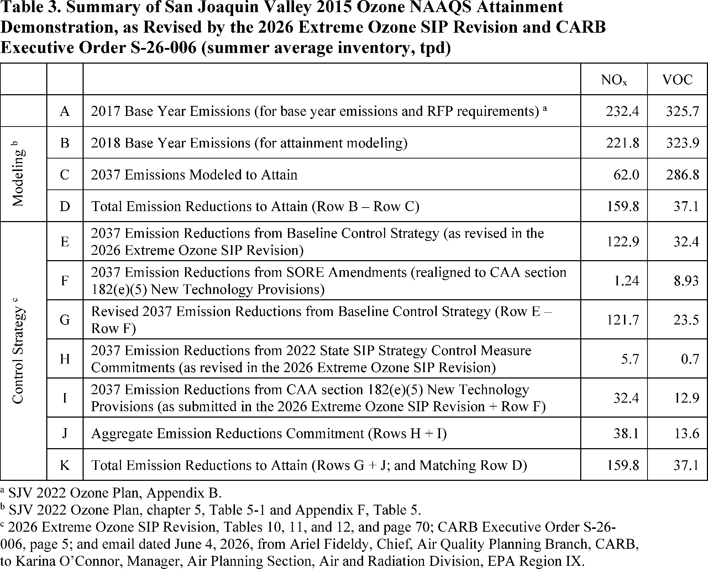

# Daily Digest — 2026-11-05

| | |
|---|---|
| **Digest date** | 2026-11-05 |
| **Data date range** | 2026-11-05 to 2026-11-05 |
| **Generated at** | 2026-11-06T05:05:37Z (UTC) |
| **Pipeline version** | 7cd4c68d |
| **Inference** | model layers ran — cli/haiku, opus |
| **Source watermarks** | CREC: 2026-11-03T11:50:48Z · BILLS: 2026-11-06T04:47:12Z · FR: 2026-11-05T06:14:52Z · USCOURTS: 2026-11-05T22:36:24Z · PLAW: 2026-11-05T17:09:33Z |

[Full observed listing for this day](day/2026-11-05.html) — the items our collectors observed for this publication day, mechanical rules applied, frozen at end of day; releases their publishers date on other days are counted there, not listed. This digest is the canonical record.

All items below cite the govinfo package (and granule, where applicable) they
summarize. Selection is mechanical; each item states the rule that included
it. See the Coverage Statement at the end for a full accounting of what was
published, what was summarized, and what was excluded and why.

---

## Contents

- [Day in Review](#day-in-review)
- [1. Congressional Floor Activity](#1-congressional-floor-activity)
- [2. Legislation](#2-legislation)
- [3. Federal Register](#3-federal-register)
- [4. Enacted Laws](#4-enacted-laws)
- [5. Judicial Activity](#5-judicial-activity)
- [6. Agency Announcements](#6-agency-announcements)
- [7. Recorded Votes](#7-recorded-votes)
- [8. Bill Actions](#8-bill-actions)
- [9. Presidential Actions](#9-presidential-actions)
- [Terms Used Today](#terms-used-today)
- [Coverage Statement](#coverage-statement)
- [Methodology](#methodology)

---

## Day in Review

The digest carries no congressional floor proceedings or recorded votes; it records one bill introduced in the House.

On the executive side, the digest carries four presidential documents. Each is a notice dated November 3, 2026, continuing for one year a national emergency: with respect to Iran, the proliferation of weapons of mass destruction, the situation in Nicaragua, and securities investments that finance certain companies of the People's Republic of China. A proclamation dated November 5, 2026, establishes the Oval Office National Monument, to be managed by the National Park Service. The digest also carries 10 rules, 11 proposed rules, and 86 notices. Final rules include:

- EPA significant new use rules under the Toxic Substances Control Act.
- FDA classifications of three medical device types into class II.
- Legal Services Corporation revisions to cost and prior-approval standards.

Proposed rules include FAA airworthiness directives for Tecnam and Airbus airplanes and Maritime Administration procedures for licensing deepwater ports.

The digest carries 54 appellate, 722 district, and 6 bankruptcy court opinions. In published opinions, the Ninth Circuit held that 11 U.S.C. § 1307(b) gives a debtor an absolute right to voluntarily dismiss a Chapter 13 case. The Fifth Circuit vacated a judgment in a tequila trademark dispute and remanded. The Eleventh Circuit affirmed a ruling that Florida's Medicaid termination notices violated due process. The Federal Circuit affirmed a Court of Appeals for Veterans Claims decision on an effective-date dispute.

*Composed from the summarized items below and the day's mechanical
counts; all specifics are cited in their sections.*

---

## 1. Congressional Floor Activity

No Congressional Record issue was observed on this day. The Record for a day's proceedings is typically published by govinfo the following morning; it appears in the digest for the day it is observed ([how our clocks work](faq.html#fapds-three-clocks)).

### 1.1 Senate

No Senate floor items met the selection thresholds. 0 floor granule(s) are accounted for in the Coverage Statement.

### 1.2 House of Representatives

No House floor items met the selection thresholds. 0 floor granule(s) are accounted for in the Coverage Statement.

### 1.3 Recorded Votes

No recorded votes were published in this issue of the Congressional Record.

---

## 2. Legislation

Source: Congressional Bills (BILLS), text versions published 2026-11-05 to 2026-11-05.

### 2.1 Counts by Stage

| Stage (bill text version) | Count |
|---|---|
| Introduced (ih/is) | 1 |
| Reported (rh/rs) | 0 |
| Engrossed (eh/es) | 0 |
| Enrolled (enr) | 0 |
| Other versions | 0 |
| **Total bill texts published** | **1** |

### 2.2 Bills Listed by Mechanical Rule

Bills below are listed because they matched at least one listing rule; the
matching rule is stated per item. All other bill texts are counted above and
accounted for in the Coverage Statement.

No bill texts published in this range matched a listing rule; all 1 are
accounted for in the Coverage Statement.

---

## 3. Federal Register

Source: Federal Register (FR), issue of 2026-11-05.

### 3.1 Counts by Document Type

| Document type | Count |
|---|---|
| Rules | 10 |
| Proposed rules | 11 |
| Notices | 86 |
| Presidential documents | 4 |
| **Total FR documents** | **111** |

### 3.2 Rules Published

Tags: department of commerce · department of health and human services · executive · model keys: chemical substances · medical device classification · satellite spectrum sharing

*In plain terms: 10 final rules, led by FDA classifications of three devices into class II and an FCC satellite spectrum sharing update; the rest are EPA plans, airspace changes, and other agency actions.*

#### DEPARTMENT OF HEALTH AND HUMAN SERVICES

- **Medical Devices; Orthopedic Devices; Classification of the Wearable Vibration Device for Orthopedic Use** (2026-22589; 21 CFR Part 888) — The Food and Drug Administration (FDA) is classifying the wearable vibration device for orthopedic use into class II (special controls). The special controls that apply to the device type are identified in this order and will be part of the codified language for classification of the wearable vibration device for orthopedic use. We are taking this action because we have determined that classifying the device into class II will provide a reasonable assurance of the safety and effectiveness of the device. We believe this action will also enhance patients' access to beneficial innovative devices, in part by reducing regulatory burdens. Action: Final amendment; final order. Dates: This order is effective November 5, 2026. The classification was applicable on January 12, 2024.
  - *In plain terms:* FDA is classifying wearable vibration devices for orthopedic use into class II, with special controls that will be codified; the agency determined this classification provides reasonable assurance of the device's safety and effectiveness.
  - Included because: FR-SEL-01 — document type: final rule (all listed)
  - Source: [FR-2026-11-05 / 2026-22589](https://www.govinfo.gov/app/details/FR-2026-11-05/2026-22589)
- **Medical Devices; Neurological Devices; Classification of the Prognostic Assessment Software of Mild Cognitive Impairment** (2026-22590; 21 CFR Part 882) — The Food and Drug Administration (FDA) is classifying the prognostic assessment software of mild cognitive impairment into class II (special controls). The special controls that apply to the device type are identified in this order and will be part of the codified language for classification of the prognostic assessment software of mild cognitive impairment. We are taking this action because we have determined that classifying the device into class II will provide a reasonable assurance of the safety and effectiveness of the device. We believe this action will also enhance patients' access to beneficial innovative devices, in part by reducing regulatory burdens. Action: Final amendment; final order. Dates: This order is effective November 5, 2026. The classification was applicable on January 11, 2024.
  - *In plain terms:* FDA is classifying prognostic assessment software for mild cognitive impairment into class II, with special controls that will be codified; the agency determined this classification provides reasonable assurance of the device's safety and effectiveness.
  - Included because: FR-SEL-01 — document type: final rule (all listed)
  - Source: [FR-2026-11-05 / 2026-22590](https://www.govinfo.gov/app/details/FR-2026-11-05/2026-22590)
- **Medical Devices; Hematology and Pathology Devices; Classification of the Digital Cervical Cytology Slide Imaging System With Artificial Intelligence Algorithm** (2026-22593; 21 CFR Part 864) — The Food and Drug Administration (FDA) is classifying the digital cervical cytology slide imaging system with artificial intelligence algorithm into class II (special controls). The special controls that apply to the device type are identified in this order and will be part of the codified language for classification of the digital cervical cytology slide imaging system with artificial intelligence algorithm. We are taking this action because we have determined that classifying the device into class II will provide a reasonable assurance of the safety and effectiveness of the device. We believe this action will also enhance patients' access to beneficial innovative devices, in part by reducing regulatory burdens. Action: Final amendment; final order. Dates: This order is effective November 5, 2026. The classification was applicable on January 31, 2024.
  - *In plain terms:* FDA is classifying the digital cervical cytology slide imaging system with artificial intelligence algorithm into class II, with special controls that will be codified; the agency determined this classification provides reasonable assurance of safety and effectiveness.
  - Included because: FR-SEL-01 — document type: final rule (all listed)
  - Source: [FR-2026-11-05 / 2026-22593](https://www.govinfo.gov/app/details/FR-2026-11-05/2026-22593)

#### DEPARTMENT OF TRANSPORTATION

- **Modification of Class D and Class E Airspace Areas; Roberts Field/Redmond Municipal Airport, Redmond, OR** (2026-22642; 14 CFR Part 71) — This action modifies the Class D and Class E airspace areas designated as a surface area, the Class E airspace area designated as an extension to a Class D or Class E surface area, and the Class E airspace area extending upward from 700 feet above the surface at Roberts Field/Redmond Municipal Airport, Redmond, OR. This action supports the safety and management of visual flight rules (VFR) and instrument flight rules (IFR) operations at the airport. Action: Final rule. Dates: Effective date 0901 UTC, February 18, 2027, the Director of the Federal Register approves this incorporation by reference action under 1 CFR part 51, subject to the annual revision of FAA Order JO 7400.11 and publication of conforming amendments.
  - *In plain terms:* The FAA modifies Class D and Class E airspace at Roberts Field/Redmond Municipal Airport in Redmond, Oregon, to support safe visual and instrument flight operations there.
  - Included because: FR-SEL-01 — document type: final rule (all listed)
  - Source: [FR-2026-11-05 / 2026-22642](https://www.govinfo.gov/app/details/FR-2026-11-05/2026-22642)

#### ENVIRONMENTAL PROTECTION AGENCY

- **Significant New Use Rules on Certain Chemical Substances (25-3.5e)** (2026-22576; 40 CFR Part 721) — EPA is issuing significant new use rules (SNURs) under the Toxic Substances Control Act (TSCA) for certain chemical substances that were the subject of premanufacture notices (PMNs) and are also subject to an Order issued by EPA pursuant to TSCA. The SNURs require persons to notify EPA at least 90 days before commencing the manufacture (defined by statute to include import) or processing of any of these chemical substances for an activity that is designated as a significant new use in the SNUR. The required notification initiates EPA's evaluation of the conditions of that use for that chemical substance. In addition, the manufacture or processing for the significant new use may not commence until EPA has conducted a review of the required notification; made an appropriate determination regarding that notification; and taken such actions as required by that determination. Action: Final rule. Dates: This rule is effective on January 4, 2027. For purposes of judicial review, this rule shall be promulgated at 1 p.m. (EST) on November 19, 2026.
  - *In plain terms:* Under the Toxic Substances Control Act, EPA requires 90 days' advance notice before making or processing certain chemicals for a designated new use, and that use may not begin until EPA completes its review.
  - Included because: FR-SEL-01 — document type: final rule (all listed)
  - Source: [FR-2026-11-05 / 2026-22576](https://www.govinfo.gov/app/details/FR-2026-11-05/2026-22576)
- **Approval and Promulgation of State Plans for Designated Facilities and Pollutants; West Virginia; Control of Emissions From Existing Municipal Solid Waste Landfills** (2026-22584; 40 CFR Part 62) — The Environmental Protection Agency (EPA) is approving a Clean Air Act (CAA) section 111(d) plan revision submitted by the West Virginia Department of Environmental Protection (WVDEP). This revision updates the plan to include changes made to Emissions Guidelines and Compliance Times for municipal solid waste (MSW) landfills. This action is being taken under the Clean Air Act (CAA). Action: Final rule. Dates: This final rule is effective on December 7, 2026. The incorporation by reference of certain material listed in the rule is approved by the Director of the Federal Register as of December 7, 2026. The incorporation by reference of certain other material listed in the rule was approved by the Director of the Federal Register as of December 23, 2019.
  - *In plain terms:* EPA is approving a West Virginia Department of Environmental Protection plan revision under Clean Air Act section 111(d) that updates the state plan for existing municipal solid waste landfills to reflect changes to emissions guidelines and compliance times.
  - Included because: FR-SEL-01 — document type: final rule (all listed)
  - Source: [FR-2026-11-05 / 2026-22584](https://www.govinfo.gov/app/details/FR-2026-11-05/2026-22584)
- **Air Plan Revisions; Arizona; Maricopa County Air Quality Department; New Source Review; Emission Reduction Credits** (2026-22647; 40 CFR Part 52) — The U.S. Environmental Protection Agency (EPA) is taking final action to approve a revision to the Maricopa County Air Quality Department (MCAQD or “Department”) portion of the Arizona State Implementation Plan (SIP). This revision establishes a federally enforceable program allowing for the generation of emission reduction credits (ERCs) by retrofitting or replacing existing on-road vehicles with lower emitting vehicles while meeting other Clean Air Act (CAA or “Act”) requirements. These ERCs are intended to be used as offsets for major stationary sources under the Department's Nonattainment New Source Review (NNSR) program. The EPA is approving this SIP revision because we find that it meets the applicable CAA requirements. Action: Final rule. Dates: This rule is effective December 7, 2026.
  - *In plain terms:* EPA is approving a Maricopa County plan revision creating a federally enforceable program for emission reduction credits from retrofitting or replacing on-road vehicles with cleaner ones, usable as offsets for major stationary sources.
  - Included because: FR-SEL-01 — document type: final rule (all listed)
  - Source: [FR-2026-11-05 / 2026-22647](https://www.govinfo.gov/app/details/FR-2026-11-05/2026-22647)

#### FEDERAL COMMUNICATIONS COMMISSION

- **Modernizing Spectrum Sharing for Satellite Broadband** (2026-22600; 47 CFR Part 25) — In this document, the Space Bureau (Bureau or we) within the Federal Communications Commission (Commission) updates the initial set of geostationary (GSO) satellite network reference links adopted in the Modernizing Spectrum Sharing for Satellite Broadband Report and Order (Order). Ensuring the GSO reference links appropriately reflect typical and widespread GSO satellite operations in the United States will promote efficient spectrum sharing among today's broadband satellite systems. Action: Final action. Dates: Effective December 7, 2026.
  - *In plain terms:* The FCC Space Bureau is updating the initial set of geostationary satellite network reference links adopted in the Modernizing Spectrum Sharing for Satellite Broadband order so they reflect typical satellite operations in the United States.
  - Included because: FR-SEL-01 — document type: final rule (all listed)
  - Source: [FR-2026-11-05 / 2026-22600](https://www.govinfo.gov/app/details/FR-2026-11-05/2026-22600)
- **Video Relay Service Improvements; Incarcerated People's Communication Services; Implementation of the Martha Wright-Reed Act; Rates for Interstate Inmate Calling Services; Access to Video Conferencing** (2026-22601; 47 CFR Part 64) — In this document, the Federal Communications Commission (Commission) announces that the Office of Management and Budget has approved new information collection requirements under OMB Control Number 3060-1089, as adopted in the Commission's Report and Orders, FCC 23-116, FCC 24-75 and FCC 24-95. Action: Final rule; announcement of effective date. Dates: Amendatory instruction 3 (47 CFR 64.604(c)(5)(iii)(D)( 8 ), (d)(1)(iii)(C), (d)(2)(iv), and (d)(6)), published at 89 FR 20125, March 21, 2024; amendatory instruction 6 (47 CFR 64.606(g)(6)), published at 89 FR 100878, December 13, 2024; and amendatory instruction 7 (47 CFR 64.611(l)(2), (l)(3), (l)(5), (l)(6)), and amendatory instruction 15 (47 CFR 64.6040(f)), published at 89 FR 77244, September 20, 2024, are effective November 5, 2026.
  - *In plain terms:* The FCC announces that OMB approved new information collection requirements under control number 3060-1089, as adopted in Report and Orders FCC 23-116, FCC 24-75, and FCC 24-95.
  - Included because: FR-SEL-01 — document type: final rule (all listed)
  - Source: [FR-2026-11-05 / 2026-22601](https://www.govinfo.gov/app/details/FR-2026-11-05/2026-22601)

#### LEGAL SERVICES CORPORATION

- **Cost Standards and Procedures; Purchasing and Property Management** (2026-22649; 45 CFR Parts 1630 and 1631) — This final rule revises the Legal Services Corporation's (LSC or Corporation) regulations governing cost allowability, prior approval requirements, and property and procurement standards applicable to LSC recipients. The final rule clarifies when recipients must obtain prior approval for expenditures of LSC funds; increases the monetary threshold for prior approval; clarifies the treatment of proceeds from fundraising activities supported with LSC funds; provides additional flexibility in LSC's review of prior approval requests; clarifies documentation requirements for prior approval requests; and revises the deadline and requirements for accounting for LSC funds invested in real estate. These amendments are intended to clarify existing requirements, reduce administrative burden, promote consistent oversight and enforcement, and strengthen accountability in the use of Federal funds. Action: Final rule. Dates: This final rule is effective on June 1, 2027.
  - *In plain terms:* The Legal Services Corporation's final rule revises its cost, prior-approval, and property rules for recipients, raising the prior-approval threshold, clarifying fundraising proceeds, and changing the deadline for accounting for real estate funds.
  - Included because: FR-SEL-01 — document type: final rule (all listed)
  - Source: [FR-2026-11-05 / 2026-22649](https://www.govinfo.gov/app/details/FR-2026-11-05/2026-22649)

### 3.3 Proposed Rules Published

Tags: department of commerce · department of health and human services · executive · model keys: air quality · airworthiness directives · ozone implementation plan

*In plain terms: 11 proposed items, led by an FAA directive on Tecnam P2006T engine mounts and a California San Joaquin Valley ozone plan; the rest span aviation, air quality, and other agency proposals.*

#### DEPARTMENT OF EDUCATION

- **Proposed Priorities and Definitions—Secretary's Supplemental Priorities and Definitions** (2026-22615; 34 CFR Part 75) — The Secretary proposes to amend the Notice of Final Priorities and Definitions—Secretary's Supplemental Priorities and Definitions on Evidence-Based Literacy, Education Choice, and Returning Education to the States published in the Federal Register on September 9, 2025, the Notice of Final Priority and Definitions—Secretary's Supplemental Priority and Definitions on Meaningful Learning Opportunities published in the Federal Register on February 12, 2026, the Notice of Final Priority and Definitions—Secretary's Supplemental Priority and Definitions on Career Pathways and Workforce Readiness published in the Federal Register on April 13, 2026, and the Notice of Final Priority and Definitions—Secretary's Supplemental Priority and Definitions on Advancing Artificial Intelligence in Education published in the Federal Register on April 13, 2026. The proposed amendments are needed to ensure that the U.S. Department of Education (ED, or the Department) has priorities that represent the full spectrum of learners, reflect the expertise of the Federal agencies that are active partners in our mission, and incorporate lessons learned from implementation in FY 2026 grant competitions. Action: Proposed priorities and definitions. Dates: We must receive your comments on or before December 7, 2026.
  - *In plain terms:* The Education Department proposes amending four earlier final priority notices, published from September 2025 through April 2026, to cover the full spectrum of learners, partner agencies' expertise, and lessons from FY 2026 grant competitions.
  - Included because: FR-SEL-02 — document type: proposed rule (all listed)
  - Source: [FR-2026-11-05 / 2026-22615](https://www.govinfo.gov/app/details/FR-2026-11-05/2026-22615)

#### DEPARTMENT OF HOMELAND SECURITY

- **Safety Zone; FRL Inaugural Invitational eFoil Exhibition Race, Miami Marine Stadium Basin, Miami, FL; Correction** (2026-22614; 33 CFR Part 165) — The Coast Guard is correcting the comment submission deadline in its notice of proposed rulemaking published October 19, 2026, proposing to establish a temporary safety zone for the FRL Inaugural Invitational eFoil Exhibition Race in the Miami Marine Stadium Basin, Miami, Florida. The proposed safety zone would be enforced on November 15, 2026. This correction shortens the comment period so the Coast Guard may consider timely submitted comments before determining whether to issue a final rule in advance of the event. Action: Notice of proposed rulemaking; correction. Dates: The comment deadline published October 19, 2026, at 91 FR 66033, is corrected. Comments and related material must be received by the Coast Guard on or before November 6, 2026.
  - *In plain terms:* The Coast Guard corrects the comment deadline for its October 19, 2026 proposal to set a temporary safety zone for the FRL eFoil Exhibition Race in Miami on November 15, 2026; the correction shortens the comment period.
  - Included because: FR-SEL-02 — document type: proposed rule (all listed)
  - Source: [FR-2026-11-05 / 2026-22614](https://www.govinfo.gov/app/details/FR-2026-11-05/2026-22614)

#### DEPARTMENT OF TRANSPORTATION

- **Airworthiness Directives; Costruzioni Aeronautiche Tecnam S.P.A. Airplanes** (2026-22564; 14 CFR Part 39) — The FAA proposes to adopt a new airworthiness directive (AD) for all Costruzioni Aeronautiche Tecnam S.P.A. (Tecnam) Model P2006T airplanes. This proposed AD was prompted by a report of damage on the engine mount structure caused by defective non-conforming engine shock mounts being installed. This proposed AD would require inspecting for the installation of non-conforming engine shock mounts and replacing any non-conforming engine shock mount with an approved part. This proposed AD would also prohibit installation of a non-conforming engine shock mount on any airplane. The FAA is proposing this AD to address the unsafe condition on these products. Action: Notice of proposed rulemaking (NPRM). Dates: The FAA must receive comments on this NPRM by December 21, 2026.
  - *In plain terms:* The FAA proposes a new safety directive for all Tecnam P2006T airplanes, requiring checks for improperly made engine shock mounts, replacement with approved parts, and a ban on installing them.
  - Included because: FR-SEL-02 — document type: proposed rule (all listed)
  - Source: [FR-2026-11-05 / 2026-22564](https://www.govinfo.gov/app/details/FR-2026-11-05/2026-22564)
- **Airworthiness Directives; Airbus SAS Airplanes** (2026-22587; 14 CFR Part 39) — The FAA proposes to adopt a new airworthiness directive (AD) for certain Airbus SAS Model A318-111 and -112 airplanes; Model A319-111, -112, -113, -114, -115, -131, -132, and -133 airplanes; Model A320-211, -212, -214, -216, -231, -232, and -233 airplanes; and Model A321-111, -112, -131, -211, -212, -213, -231, and -232 airplanes. This proposed AD was prompted by reports of damage to the YZ-axis attachment points on airplanes equipped with certain overhead stowage compartments (OHSC) bins. Investigations showed that bushings, retainer rings, and pins had migrated from their original positions. This proposed AD would require a one-time inspection for discrepancies of affected OHSC bins and, depending on findings, accomplishment of applicable corrective actions. This proposed AD would also prohibit the installation of affected parts. The FAA is proposing this AD to address the unsafe condition on these products. Action: Notice of proposed rulemaking (NPRM). Dates: The FAA must receive comments on this proposed AD by December 21, 2026.
  - *In plain terms:* The FAA proposes an airworthiness directive for listed Airbus A318, A319, A320, and A321 airplanes, requiring a one-time inspection of overhead stowage bins for discrepancies, corrective actions as needed, and a ban on installing affected parts.
  - Included because: FR-SEL-02 — document type: proposed rule (all listed)
  - Source: [FR-2026-11-05 / 2026-22587](https://www.govinfo.gov/app/details/FR-2026-11-05/2026-22587)
- **Deepwater Port Application Processing and Licensing** (2026-22617; 46 CFR Part 248) — This document proposes procedures for the processing of applications for the licensing of deepwater ports. The proposed rule reflects the transfer of deepwater port license application processing management under the Deepwater Port Act from the United States Coast Guard (USCG) to MARAD. Pursuant to the National Defense Authorization Act for Fiscal Year 2026 (2026 NDAA), MARAD is the Federal lead agency for purposes of the National Environmental Policy Act of 1969 (NEPA) for all deepwater port license applications. USCG responsibility for authorities pertaining to design, construction, equipment, operation of deepwater ports, and navigational safety are not affected by the 2026 NDAA statutory changes, or this proposed rule and will continue to be administered by USCG. Action: Notice of proposed rulemaking and request for comments. Dates: Comments should be filed on or before January 4, 2027. Late comments will be considered to the extent practicable.
  - *In plain terms:* This proposal sets deepwater port license application procedures, moving processing from the Coast Guard to MARAD under the 2026 NDAA, which makes MARAD the environmental-review lead agency; Coast Guard keeps authority over design, operation, and navigational safety.
  - Included because: FR-SEL-02 — document type: proposed rule (all listed)
  - Source: [FR-2026-11-05 / 2026-22617](https://www.govinfo.gov/app/details/FR-2026-11-05/2026-22617)

#### ENVIRONMENTAL PROTECTION AGENCY

- **Approval and Promulgation of Delegation of Authority for Designated Facilities and Pollutants; Allegheny County; Delegation of Authority of the Federal Plan for Existing Municipal Solid Waste Landfills** (2026-22583; 40 CFR Part 62) — The Environmental Protection Agency (EPA) is proposing to approve a request from the Allegheny County Health Department (ACHD) for delegation of authority to implement and enforce the Federal Plan requirements for existing Municipal Solid Waste (MSW) landfills within Allegheny County in the Commonwealth of Pennsylvania. On May 21, 2021, the EPA promulgated the Federal Plan for MSW landfills to fulfill the requirements of section 111(d) of the Clean Air Act (CAA). The Federal Plan addresses the implementation and enforcement of the emission guidelines applicable to existing MSW landfills located in areas not covered by an approved and currently effective State plan. The Federal Plan imposes emission limits and other control requirements for existing MSW landfills which will reduce designated pollutants. Action: Proposed rule. Dates: Written comments must be received on or before December 7, 2026.
  - *In plain terms:* EPA proposes approving Allegheny County Health Department's request for authority to implement and enforce the federal plan for existing municipal solid waste landfills in the county, which EPA issued on May 21, 2021.
  - Included because: FR-SEL-02 — document type: proposed rule (all listed)
  - Source: [FR-2026-11-05 / 2026-22583](https://www.govinfo.gov/app/details/FR-2026-11-05/2026-22583)
- **Approval and Promulgation of State Plans for Designated Facilities and Pollutants; Arizona; Control of Emissions From Existing Municipal Solid Waste Landfills** (2026-22585; 40 CFR Part 62) — The Environmental Protection Agency (EPA) is proposing to approve a State plan submitted by the Maricopa County Air Quality Department (MCAQD). This plan pertains to the regulation of landfill gas and its components from existing municipal solid waste (MSW) landfills. Maricopa's county plan was submitted in response to the EPA's promulgation of Emissions Guidelines and Compliance Times for MSW landfills. This action is being taken under the Clean Air Act (CAA). Action: Proposed rule. Dates: Written comments must be received on or before December 7, 2026.
  - *In plain terms:* EPA proposes approving a Maricopa County Air Quality Department plan regulating landfill gas and its components from existing municipal solid waste landfills, submitted in response to EPA's emissions guidelines and compliance times for those landfills.
  - Included because: FR-SEL-02 — document type: proposed rule (all listed)
  - Source: [FR-2026-11-05 / 2026-22585](https://www.govinfo.gov/app/details/FR-2026-11-05/2026-22585)
- **Air Quality Implementation Plans; California; San Joaquin Valley; 2015 8-Hour Ozone Nonattainment Area Requirements; and California Consumer Products Regulations** (2026-22588; 40 CFR Part 52) — The U.S. Environmental Protection Agency (EPA) proposes to approve State implementation plan (SIP) revisions submitted by the State of California to meet Clean Air Act (CAA or “Act”) requirements for the 2015 8-hour ozone national ambient air quality standards (NAAQS or “standards”) in the San Joaquin Valley ozone nonattainment area (“San Joaquin Valley” or “SJV”). In this document, the EPA refers to these submissions collectively as the “SJV 70 ppb Ozone SIP.” The EPA proposes to approve the SJV 70 parts per billion (ppb) Ozone SIP as meeting the applicable ozone nonattainment area requirements for emissions inventories, reasonably available control measures, attainment demonstration, rate of progress and reasonable further progress, motor vehicle emissions budgets, and enhanced monitoring. The EPA is also initiating the adequacy process for the budgets included in this SIP submission through this proposed rule. The EPA also proposes to approve two SIP revisions amending the SIP to incorporate changes reflecting updates to California Air Resources Board (CARB) Consumer Products Regulations and Method 310, which apply statewide and upon which the SJV 70 ppb Ozone SIP relies. [official summary truncated; see source] Action: Proposed rule. Dates: Comments must be received on or before December 7, 2026.
  - *In plain terms:* EPA proposes approving California's plan revisions for the 2015 8-hour ozone standard in the San Joaquin Valley, covering emissions inventories, control measures, attainment, progress, motor vehicle budgets, and monitoring, plus two revisions updating statewide consumer products regulations and Method 310.
  - Included because: FR-SEL-02 — document type: proposed rule (all listed)
  - Source: [FR-2026-11-05 / 2026-22588](https://www.govinfo.gov/app/details/FR-2026-11-05/2026-22588)
  -  *Source graphic 1 of 1 from 2026-22588.*
- **Air Plan Approval; District of Columbia; Enhanced Vehicle Emission Inspection and Maintenance (I/M) Program Revision and Basic I/M Program Certification for Moderate Nonattainment Areas Under the 2015 Ozone NAAQS** (2026-22592; 40 CFR Part 52) — The Environmental Protection Agency (EPA) is proposing to approve a State Implementation Plan (SIP) revision submitted by the District of Columbia (DC, or the District). This revision incorporates regulatory updates made to the District's Enhanced motor vehicle emissions inspection and maintenance (I/M) program since the EPA's last SIP approval. The SIP revision also serves to certify that the District's existing Enhanced I/M program meets Clean Air Act (CAA) requirements for a Basic I/M program for the District's portion of the Washington, DC-MD-VA nonattainment area (the Washington nonattainment area) for the 2015 Ozone National Ambient Air Quality Standard (NAAQS). Action: Proposed rule. Dates: Written comments must be received on or before December 7, 2026.
  - *In plain terms:* EPA proposes approving D.C.'s plan update to its enhanced vehicle emissions inspection program and certifying that the program meets Clean Air Act basic requirements for the District's part of the Washington area for the 2015 ozone standard.
  - Included because: FR-SEL-02 — document type: proposed rule (all listed)
  - Source: [FR-2026-11-05 / 2026-22592](https://www.govinfo.gov/app/details/FR-2026-11-05/2026-22592)

#### FEDERAL TRADE COMMISSION

- **Petition for Rulemaking of New Hope Now** (2026-22581; 16 CFR Part 1) — Please take notice that the Federal Trade Commission (“Commission”) received a petition for rulemaking from New Hope Now and has published that petition online at https://www.regulations.gov. The Commission invites written comments concerning the petition. Publication of this petition is pursuant to the Commission's Rules of Practice and Procedure and does not affect the legal status of the petition or its final disposition. Action: Receipt of petition; request for comment. Dates: Comments must identify the petition docket number and be filed by December 7, 2026.
  - *In plain terms:* The FTC received a petition for rulemaking from New Hope Now, has posted it at regulations.gov, and invites written comments on it. Posting does not affect the petition's legal status or final disposition.
  - Included because: FR-SEL-02 — document type: proposed rule (all listed)
  - Source: [FR-2026-11-05 / 2026-22581](https://www.govinfo.gov/app/details/FR-2026-11-05/2026-22581)

#### LEGAL SERVICES CORPORATION

- **Purchasing and Property Management** (2026-22650; 45 CFR Part 1631) — This proposed rule revises the Legal Services Corporation's (LSC) definition of “capital improvement” by removing the threshold amount of LSC funds that must be expended on an improvement to real estate for the expenditure to qualify as a capital improvement. The proposed amendment would distinguish the definition of a capital improvement from the monetary thresholds required for prior approval; promote consistent tracking and oversight of LSC funds used for capital improvements; and strengthen accountability for LSC funds invested in recipients' real property. Action: Notice of proposed rulemaking. Dates: Comments must be submitted by 11:59 p.m. Eastern on December 21, 2026.
  - *In plain terms:* The Legal Services Corporation proposes removing the spending threshold from its definition of 'capital improvement' for real estate, separating that definition from prior-approval thresholds and strengthening oversight of LSC funds.
  - Included because: FR-SEL-02 — document type: proposed rule (all listed)
  - Source: [FR-2026-11-05 / 2026-22650](https://www.govinfo.gov/app/details/FR-2026-11-05/2026-22650)

### 3.4 Notices and Presidential Documents

Tags: department of commerce · department of health and human services · executive · model keys: national emergencies · nicaragua · weapons proliferation

*In plain terms: 4 notices dated November 3, 2026 each continue for one year a national emergency: Iran, weapons of mass destruction proliferation, Nicaragua, and a threat tied to securities investments.*

Notices are summarized only when they match a listing rule; all are counted
in 3.1 and in the Coverage Statement. Presidential documents in the FR are
always listed.

- **Continuation of the National Emergency With Respect to Iran** (2026-22685) — A notice dated November 3, 2026 continues for one year the national emergency with respect to Iran that was declared in Executive Order 12170 on November 14, 1979, under the International Emergency Economic Powers Act and the National Emergencies Act. The notice states that relations with Iran have not yet normalized and that the process of implementing the agreements with Iran dated January 19, 1981 is ongoing. It also states that this emergency is distinct from the emergency declared in Executive Order 12957 on March 15, 1995, and from the emergency renewal of March 2, 2026.
  - *In plain terms:* A November 3, 2026 notice extends for one year the Iran national emergency first declared November 14, 1979 (Executive Order 12170), stating relations have not normalized and the January 19, 1981 agreements are still being implemented.
  - Included because: FR-SEL-03 — presidential document (all listed)
  - Source: [FR-2026-11-05 / 2026-22685](https://www.govinfo.gov/app/details/FR-2026-11-05/2026-22685)
- **Continuation of the National Emergency With Respect to the Proliferation of Weapons of Mass Destruction** (2026-22686) — A notice dated November 3, 2026 continues for one year the national emergency declared in Executive Order 12938 on November 14, 1994, concerning the proliferation of nuclear, biological, and chemical weapons and the means of delivering them. The notice states that Executive Order 12938 was amended by Executive Order 13094 on July 28, 1998 and by Executive Order 13382 on June 28, 2005. It states that the proliferation of weapons of mass destruction continues to pose a threat to the national security, foreign policy, and economy of the United States.
  - *In plain terms:* A November 3, 2026 notice continues for one year the national emergency declared November 14, 1994 in Executive Order 12938 on weapons of mass destruction proliferation, stating the threat continues to pose risks to U.S. national security, foreign policy, and economy.
  - Included because: FR-SEL-03 — presidential document (all listed)
  - Source: [FR-2026-11-05 / 2026-22686](https://www.govinfo.gov/app/details/FR-2026-11-05/2026-22686)
- **Continuation of the National Emergency With Respect to the Situation in Nicaragua** (2026-22687) — A notice dated November 3, 2026 continues for one year the national emergency declared in Executive Order 13851 on November 27, 2018, under the International Emergency Economic Powers Act, with respect to the situation in Nicaragua. The notice references Executive Order 14088 of October 24, 2022, which took additional steps with respect to that emergency. It states that the situation in Nicaragua, including the government's response to protests that began on April 18, 2018 and its treatment of democratic institutions and the rule of law, continues to pose a threat to the national security and foreign policy of the United States.
  - *In plain terms:* A November 3, 2026 notice continues for one year the national emergency declared November 27, 2018 in Executive Order 13851 concerning the situation in Nicaragua, stating that situation continues to threaten U.S. national security and foreign policy.
  - Included because: FR-SEL-03 — presidential document (all listed)
  - Source: [FR-2026-11-05 / 2026-22687](https://www.govinfo.gov/app/details/FR-2026-11-05/2026-22687)
- **Continuation of the National Emergency With Respect to the Threat From Securities Investments That Finance Certain Companies of the People's Republic of China** (2026-22688) — A notice dated November 3, 2026 continues for one year the national emergency declared in Executive Order 13959 on November 12, 2020, as expanded in scope by Executive Order 14032 on June 3, 2021, concerning the threat from securities investments that finance certain companies of the People's Republic of China. The notice states that the PRC's Military-Civil Fusion strategy and certain uses and development of Chinese surveillance technology continue to pose a threat to the national security, foreign policy, and economy of the United States. It states that the emergency must continue in effect beyond November 12, 2026, pursuant to section 202(d) of the National Emergencies Act.
  - *In plain terms:* A November 3, 2026 notice continues for one year the national emergency declared November 12, 2020 in Executive Order 13959, as expanded by Executive Order 14032, over securities investments financing certain People's Republic of China companies, and states it must continue beyond November 12, 2026.
  - Included because: FR-SEL-03 — presidential document (all listed)
  - Source: [FR-2026-11-05 / 2026-22688](https://www.govinfo.gov/app/details/FR-2026-11-05/2026-22688)

---

## 4. Enacted Laws

Source: Public and Private Laws (PLAW) published 2026-11-05.

No laws were published in this range.

---

## 5. Judicial Activity

Source: United States Courts Opinions (USCOURTS): opinions observed 2026-11-05
by our collector; each opinion states its own issue date beside its
listing ([how our clocks work](faq.html#fapds-three-clocks)).

Completeness disclosure (standing): USCOURTS carries opinions from
approximately 140 participating appellate, district, bankruptcy, and
national federal courts. Unlike the Congressional Record and the Federal
Register, which are the complete official record of their branches,
USCOURTS is participation-based and is NOT the complete federal judicial
record. Courts post opinions with delay — typically over several days —
so a day's digest carries the opinions that became available that day,
whatever date each was issued.

### 5.1 Appellate and National Court Opinions

Tags: judicial · model keys: appellate court orders · tenth circuit · trademark disputes

*In plain terms: 54 appellate items, led by a published Ninth Circuit ruling on Chapter 13 voluntary dismissal and a Fifth Circuit tequila trademark vacatur; the rest are mostly unpublished circuit orders.*

Appellate and national court opinions are summarized; district and
bankruptcy opinions are counted in 5.2 and in the Coverage Statement.

#### United States Court of Appeals for the Eighth Circuit

- **United States v. Rico Dixon** (No. 25-01672; filed 2026-11-04) — The Clerk of the Eighth Circuit sent a November 4, 2026 letter to counsel in United States v. Rico Dixon, No. 25-1672, notifying them that the court issued an opinion and entered judgment in accordance with it. The letter reminds counsel of the Federal Rules of Appellate Procedure and Eighth Circuit Rules governing post-submission filings. It states that petitions for rehearing or rehearing en banc must be received within 14 days of the entry of judgment and that no mailing grace period applies, except as provided by FRAP 25(a)(2)(iii).
  - *In plain terms:* On November 4, 2026, the Eighth Circuit notified counsel in United States v. Rico Dixon (No. 25-1672) that its opinion and judgment were entered; rehearing petitions must be received within 14 days of entry, with no mailing grace period.
  - Included because: USCOURTS-SEL-01 — appellate court opinion (all listed) (document dated 2026-11-04)
  - Source: [USCOURTS-ca8-25-01672 / USCOURTS-ca8-25-01672-0](https://www.govinfo.gov/app/details/USCOURTS-ca8-25-01672/USCOURTS-ca8-25-01672-0)
- **United States v. Eric Gaten** (No. 25-02532; filed 2026-11-04) — The Clerk of the Eighth Circuit sent a November 4, 2026 letter to counsel in United States v. Eric Gaten, No. 25-2532, notifying them that the court issued an opinion and entered judgment in accordance with it. The letter reminds counsel of the Federal Rules of Appellate Procedure and Eighth Circuit Rules governing post-submission filings. It states that petitions for rehearing or rehearing en banc must be received within 14 days of the entry of judgment and that no mailing grace period applies, except as provided by FRAP 25(a)(2)(iii).
  - *In plain terms:* On November 4, 2026, the Eighth Circuit notified counsel in United States v. Eric Gaten (No. 25-2532) that its opinion and judgment were entered; rehearing petitions must be received within 14 days of entry, with no mailing grace period.
  - Included because: USCOURTS-SEL-01 — appellate court opinion (all listed) (document dated 2026-11-04)
  - Source: [USCOURTS-ca8-25-02532 / USCOURTS-ca8-25-02532-0](https://www.govinfo.gov/app/details/USCOURTS-ca8-25-02532/USCOURTS-ca8-25-02532-0)
- **Waylen Block v. United States Government** (No. 25-03371; filed 2026-11-04) — The Eighth Circuit Clerk of Court notified Waylen Sherman Block, in appeal No. 25-3371 (Waylen Block v. United States Government, on appeal from District of Minnesota case 0:23-cv-00127-JRT), that the court issued an opinion and entered judgment on November 4, 2026. The letter states that petitions for rehearing and petitions for rehearing en banc must be received within 45 days of the entry of judgment, that counsel-filed petitions must be submitted electronically through CM/ECF, and that no mailing grace period applies except under FRAP 25(a)(2)(iii). It also states that a petition not received within the FRAP 40 period may be denied as untimely.
  - *In plain terms:* On November 4, 2026, the Eighth Circuit notified Waylen Block that its judgment in No. 25-3371 was entered; rehearing petitions must be received within 45 days of entry, with no mailing grace period, and late petitions may be denied.
  - Included because: USCOURTS-SEL-01 — appellate court opinion (all listed) (document dated 2026-11-04)
  - Source: [USCOURTS-ca8-25-03371 / USCOURTS-ca8-25-03371-0](https://www.govinfo.gov/app/details/USCOURTS-ca8-25-03371/USCOURTS-ca8-25-03371-0)
- **Logan Riffenburg v. Mark Rice** (No. 26-01086; filed 2026-11-04) — The Eighth Circuit Clerk of Court notified counsel Kevin P. Keech in appeal No. 26-1086 (Logan Riffenburg v. Mark Rice, District case 25-6008) that the court issued an opinion and entered judgment on November 4, 2026. The letter states that petitions for rehearing and petitions for rehearing en banc must be received within 14 days of the entry of judgment, that counsel-filed petitions must be submitted electronically through CM/ECF, and that no mailing grace period applies except under FRAP 25(a)(2)(iii). It also states that a petition not received within the FRAP 40 period may be denied as untimely.
  - *In plain terms:* On November 4, 2026, the Eighth Circuit notified counsel Kevin P. Keech that its opinion and judgment in Logan Riffenburg v. Mark Rice (No. 26-1086) were entered; rehearing petitions must be received within 14 days of entry, with no mailing grace period.
  - Included because: USCOURTS-SEL-01 — appellate court opinion (all listed) (document dated 2026-11-04)
  - Source: [USCOURTS-ca8-26-01086 / USCOURTS-ca8-26-01086-0](https://www.govinfo.gov/app/details/USCOURTS-ca8-26-01086/USCOURTS-ca8-26-01086-0)

#### United States Court of Appeals for the Eleventh Circuit

- **USA v. Leroy Joyner, Jr.** (No. 24-12605; filed 2026-11-04) — In an unpublished per curiam opinion, the Eleventh Circuit affirmed the 300-month sentence of Leroy Thomas Joyner, Jr., for transporting a minor across state lines with intent that the minor engage in sexual activity, in violation of 18 U.S.C. § 2423(a). The opinion describes pretrial motions to dismiss concerning Verizon Wireless records, a January 2024 jury trial, and the Sentencing Guidelines calculation applied at sentencing. Joyner, who appealed pro se, challenged his conviction and sentence, and the court affirmed.
  - *In plain terms:* The Eleventh Circuit affirmed the 300-month sentence for Leroy Thomas Joyner, Jr., for transporting a minor for sexual activity after his January 2024 jury trial.
  - Included because: USCOURTS-SEL-01 — appellate court opinion (all listed) (document dated 2026-11-04)
  - Source: [USCOURTS-ca11-24-12605 / USCOURTS-ca11-24-12605-0](https://www.govinfo.gov/app/details/USCOURTS-ca11-24-12605/USCOURTS-ca11-24-12605-0)
- **Courtney Robinson v. W. Martinez, et al** (No. 25-11159; filed 2026-11-04) — The Eleventh Circuit affirmed a district court order granting summary judgment to Florida Department of Corrections chaplains William Gault and Jeremy Martinez on First Amendment free-exercise claims brought by pro se state prisoner Courtney Robinson. The claims concerned religiously compliant meals during Hebrew Israelite holidays and the denial of Robinson's request to be reenrolled in an alternative meals program. The court held that the record did not establish a substantial burden on Robinson's religious exercise and treated his challenge to the dismissal of other defendants as abandoned.
  - *In plain terms:* The Eleventh Circuit affirmed a decision for Florida chaplains regarding prisoner Courtney Robinson's claims for religiously compliant meals during Hebrew Israelite holidays.
  - Included because: USCOURTS-SEL-01 — appellate court opinion (all listed) (document dated 2026-11-04)
  - Source: [USCOURTS-ca11-25-11159 / USCOURTS-ca11-25-11159-0](https://www.govinfo.gov/app/details/USCOURTS-ca11-25-11159/USCOURTS-ca11-25-11159-0)
- **Jennifer Walls v. Lee Memorial Health System** (No. 25-11668; filed 2026-11-04) — The Eleventh Circuit affirmed summary judgment for Lee Memorial Health System against physician Jennifer Walls on claims of disability discrimination under the Americans with Disabilities Act and the Florida Civil Rights Act, FMLA retaliation, and workers' compensation interference. The court also affirmed the denial of Walls's motion to alter or amend the judgment. It held that Walls waived any challenge to the magistrate judge's sanctions and attorney's fee orders by failing to object to them in the district court.
  - *In plain terms:* The Eleventh Circuit affirmed a decision for Lee Memorial Health System against physician Jennifer Walls on claims including disability discrimination, FMLA retaliation, and workers' compensation interference.
  - Included because: USCOURTS-SEL-01 — appellate court opinion (all listed) (document dated 2026-11-04)
  - Source: [USCOURTS-ca11-25-11668 / USCOURTS-ca11-25-11668-0](https://www.govinfo.gov/app/details/USCOURTS-ca11-25-11668/USCOURTS-ca11-25-11668-0)
- **USA v. Rodriguez Jones** (No. 25-12883; filed 2026-11-04) — The Eleventh Circuit affirmed a 48-month sentence imposed on Rodriguez D. Jones after the district court revoked his supervised release based on a firearm possession violation and new criminal conduct. Jones argued that the First Step Act reclassified his underlying offense as a Class B felony, which would have changed the applicable statutory maximum. The court concluded that the district court did not err in its Guidelines calculation and that the First Step Act sentence reduction did not reclassify the underlying offense.
  - *In plain terms:* The Eleventh Circuit affirmed Rodriguez D. Jones's 48-month sentence after his supervised release was revoked for firearm possession and new criminal conduct.
  - Included because: USCOURTS-SEL-01 — appellate court opinion (all listed) (document dated 2026-11-04)
  - Source: [USCOURTS-ca11-25-12883 / USCOURTS-ca11-25-12883-0](https://www.govinfo.gov/app/details/USCOURTS-ca11-25-12883/USCOURTS-ca11-25-12883-0)
- **USA v. Derick Desir** (No. 25-14210; filed 2026-11-04) — The Eleventh Circuit affirmed a 46-month sentence imposed on Derick Desir, who pleaded guilty to conspiracy and to making false statements in firearms dealer records under 18 U.S.C. §§ 371 and 924(a)(1)(A). Desir challenged a four-level firearms-trafficking enhancement under U.S.S.G. § 2K2.1(b)(5) and a four-level enhancement under § 2K2.1(b)(6)(A) for firearms transported out of the United States. The court held that the district court did not err in applying the trafficking enhancement based on the circumstances known to Desir, and it reviewed the second enhancement under plain-error review.
  - *In plain terms:* The Eleventh Circuit affirmed Derick Desir's 46-month sentence for conspiracy and making false statements in firearms dealer records, including a firearms-trafficking increase.
  - Included because: USCOURTS-SEL-01 — appellate court opinion (all listed) (document dated 2026-11-04)
  - Source: [USCOURTS-ca11-25-14210 / USCOURTS-ca11-25-14210-0](https://www.govinfo.gov/app/details/USCOURTS-ca11-25-14210/USCOURTS-ca11-25-14210-0)
- **Angela DeBose v. University of South Florida Board of Trustees** (No. 26-10006; filed 2026-11-04) — The Eleventh Circuit affirmed the Northern District of Florida's denial of Angela DeBose's Rule 60(b) motion for relief from a judgment dismissing her suit against the University of South Florida Board of Trustees for improper venue. DeBose relied on a March 2025 letter from the Wisconsin Office of Lawyer Regulation reporting no misconduct and sought relief under Rule 60(b)(2), (5), and (6). The court held that the motion was untimely under Rule 60(b)(2), that Rule 60(b)(5) does not apply to a dismissal lacking prospective effect, and that Rule 60(b)(6) was unavailable for grounds covered by the other subsections.
  - *In plain terms:* The Eleventh Circuit affirmed the denial of Angela DeBose's request to change a judgment dismissing her suit against the University of South Florida for being filed in the wrong court.
  - Included because: USCOURTS-SEL-01 — appellate court opinion (all listed) (document dated 2026-11-04)
  - Source: [USCOURTS-ca11-26-10006 / USCOURTS-ca11-26-10006-0](https://www.govinfo.gov/app/details/USCOURTS-ca11-26-10006/USCOURTS-ca11-26-10006-0)
- **Chianne D., et al v. Secretary, Florida Agency for Health Care Administ, et al** (No. 26-10419; filed 2026-11-04) — The Eleventh Circuit affirmed a published opinion in Chianne D. et al. v. Secretary, Florida Agency for Health Care Administration, in which the district court found that Florida's written Medicaid termination notices for income-based ineligibility did not adequately state the decision or its reasons, violating due process. The district court's declaratory judgment and permanent injunction require Florida, before terminating a class member's Medicaid benefits, to provide at minimum the household size (SFU) and countable income used in the determination. After a six-day bench trial, the plaintiffs dismissed their Medicaid Act claim, and the due-process claim proceeded to the findings of fact and conclusions of law that the appeal addresses.
  - *In plain terms:* The Eleventh Circuit affirmed that Florida's Medicaid termination notices for income-based ineligibility violate due process by not adequately stating the reasons, requiring more details before benefits end.
  - Included because: USCOURTS-SEL-01 — appellate court opinion (all listed) (document dated 2026-11-04)
  - Source: [USCOURTS-ca11-26-10419 / USCOURTS-ca11-26-10419-0](https://www.govinfo.gov/app/details/USCOURTS-ca11-26-10419/USCOURTS-ca11-26-10419-0)
- **Torry Hull v. Safeco Insurance Company of Indiana** (No. 26-12143; filed 2026-11-04) — The Eleventh Circuit affirmed, in a non-precedential per curiam decision, a summary judgment entered for Safeco Insurance Company of Indiana in Torry Hull v. Safeco Insurance Company of Indiana, which concerned a claim for water damage from an attic condenser-line leak. The court upheld the district court's exclusion of an expert affidavit disclosed after discovery closed and held that the estimate and the plaintiff's testimony did not show that the additional repairs were caused by a covered loss, so the breach-of-contract and bad-faith claims failed. The court also concluded that Safeco had good cause for refusing the additional payment because its adjuster had conducted an onsite inspection of the home.
  - *In plain terms:* The Eleventh Circuit affirmed a decision for Safeco Insurance against Torry Hull's water damage claim, finding insufficient proof that additional repairs were due to a covered loss.
  - Included because: USCOURTS-SEL-01 — appellate court opinion (all listed) (document dated 2026-11-04)
  - Source: [USCOURTS-ca11-26-12143 / USCOURTS-ca11-26-12143-0](https://www.govinfo.gov/app/details/USCOURTS-ca11-26-12143/USCOURTS-ca11-26-12143-0)

#### United States Court of Appeals for the Federal Circuit

- **Proceviat v. Collins** (No. 26-01373; filed 2026-11-04) — The Federal Circuit issued a nonprecedential per curiam decision in Proceviat v. Collins, decided November 4, 2026, affirming a decision of the U.S. Court of Appeals for Veterans Claims. The appeal concerned Proceviat's request for an earlier effective date for special monthly pension with aid and attendance benefits, along with arguments that medical records from 1987 and 1989 were not read sympathetically and that notice of 1987 and 1989 denials was not provided. The court stated that its jurisdiction under 38 U.S.C. § 7292 is limited, reframed the arguments as challenges to the Veterans Court's legal standards and due-process ruling, and rejected them.
  - *In plain terms:* On November 4, 2026, the Federal Circuit affirmed a Veterans Claims court decision denying Proceviat an earlier effective date for special monthly pension with aid and attendance benefits.
  - Included because: USCOURTS-SEL-01 — appellate court opinion (all listed) (document dated 2026-11-04)
  - Source: [USCOURTS-ca13-26-01373 / USCOURTS-ca13-26-01373-0](https://www.govinfo.gov/app/details/USCOURTS-ca13-26-01373/USCOURTS-ca13-26-01373-0)

#### United States Court of Appeals for the Fifth Circuit

- **Casa Tradicion v. Casa Azul** (No. 24-20255; filed 2026-11-04) — The Fifth Circuit issued a published opinion by Chief Judge Elrod vacating the Southern District of Texas judgment for Casa Azul Spirits, L.L.C. in a trademark dispute with Casa Tradición S.A. de C.V. over tequila products, and remanding for proceedings consistent with the opinion. The court held that some of the district court's likelihood-of-confusion findings were clearly erroneous, including its consideration of third-party use in the accused mark rather than the senior user's mark and its application of the wrong legal standard for product similarity. The summary reflects only the portion of the opinion available in the source text.
  - *In plain terms:* The Fifth Circuit vacated a judgment for Casa Azul Spirits in a tequila trademark dispute with Casa Tradición, finding errors in the likelihood-of-confusion findings.
  - Included because: USCOURTS-SEL-01 — appellate court opinion (all listed) (document dated 2026-11-04)
  - Source: [USCOURTS-ca5-24-20255 / USCOURTS-ca5-24-20255-0](https://www.govinfo.gov/app/details/USCOURTS-ca5-24-20255/USCOURTS-ca5-24-20255-0)
- **Davis v. Forshey** (No. 25-10905; filed 2026-11-04) — The Fifth Circuit's unpublished per curiam opinion, filed November 4, 2026, dismissed as moot appeals by Laura Davis, Whitney E. Martin, William Dale Behan, and Christianson J. Anderson challenging district court orders that authorized receiver J. Robert Forshey to sell land and equipment owned by Hermitage Newark, LLC in Arkansas. The court held that because the appellants did not obtain a stay pending appeal before the land sale closed, it could grant no effectual relief. The opinion was issued in consolidation with No. 25-11071.
  - *In plain terms:* On November 4, 2026, the Fifth Circuit dismissed as irrelevant appeals challenging orders to sell Hermitage Newark's property because no stay was obtained before the sale closed.
  - Included because: USCOURTS-SEL-01 — appellate court opinion (all listed) (document dated 2026-11-04)
  - Source: [USCOURTS-ca5-25-10905 / USCOURTS-ca5-25-10905-0](https://www.govinfo.gov/app/details/USCOURTS-ca5-25-10905/USCOURTS-ca5-25-10905-0)
- **Weslease v. Anderson** (No. 25-11071; filed 2026-11-04) — The Fifth Circuit's unpublished per curiam opinion, filed November 4, 2026, in No. 25-11071, which is consolidated with No. 25-10905, dismissed as moot appeals challenging district court orders authorizing receiver J. Robert Forshey to sell Hermitage Newark, LLC's Arkansas land and equipment. The court found that the appellants did not seek a stay before the land sale was completed on August 5, 2025, and therefore no effectual relief was available. The opinion states that a request for an order setting aside the sales was forfeited for failure to brief it.
  - *In plain terms:* On November 4, 2026, the Fifth Circuit dismissed appeals as irrelevant regarding the sale of Hermitage Newark's property because appellants did not seek a stay before the August 5, 2025 sale.
  - Included because: USCOURTS-SEL-01 — appellate court opinion (all listed) (document dated 2026-11-04)
  - Source: [USCOURTS-ca5-25-11071 / USCOURTS-ca5-25-11071-0](https://www.govinfo.gov/app/details/USCOURTS-ca5-25-11071/USCOURTS-ca5-25-11071-0)
- **Norman v. USA** (No. 25-11237; filed 2026-11-04) — The Fifth Circuit's unpublished per curiam opinion, filed November 4, 2026, affirmed the dismissal of Alexis C. Norman's Federal Tort Claims Act and Eighth Amendment claims concerning conditions of confinement at FMC Carswell in Fort Worth, Texas. The court held that the FTCA claims were precluded by res judicata based on prior final judgments involving the same parties and nucleus of operative facts. It also held that the Eighth Amendment claim was barred because the United States has not waived sovereign immunity for constitutional claims under the FTCA.
  - *In plain terms:* On November 4, 2026, the Fifth Circuit affirmed the dismissal of Alexis C. Norman's claims regarding confinement conditions, finding them barred by prior judgments and sovereign immunity.
  - Included because: USCOURTS-SEL-01 — appellate court opinion (all listed) (document dated 2026-11-04)
  - Source: [USCOURTS-ca5-25-11237 / USCOURTS-ca5-25-11237-0](https://www.govinfo.gov/app/details/USCOURTS-ca5-25-11237/USCOURTS-ca5-25-11237-0)
- **USA v. Blake** (No. 25-51063; filed 2026-11-04) — The Fifth Circuit's unpublished per curiam opinion, filed November 4, 2026, affirmed the Western District of Texas's denial of Robert Timothy Blake's motions for compassionate release under 18 U.S.C. § 3582(c)(1)(A)(i) and for reconsideration. The court stated that the district court reasonably inferred addiction from evidence in the record, including 602 image files and 205 video files found on Blake's devices, and that challenges to facts from the original sentencing are not properly raised in a § 3582(c)(1)(A) proceeding. The court also denied Blake's motions for appointment of counsel and to supplement the record on appeal.
  - *In plain terms:* On November 4, 2026, the Fifth Circuit affirmed the denial of Robert Timothy Blake's requests for compassionate release and reconsideration.
  - Included because: USCOURTS-SEL-01 — appellate court opinion (all listed) (document dated 2026-11-04)
  - Source: [USCOURTS-ca5-25-51063 / USCOURTS-ca5-25-51063-0](https://www.govinfo.gov/app/details/USCOURTS-ca5-25-51063/USCOURTS-ca5-25-51063-0)
- **Alanis v. U.S. Bank** (No. 25-51076; filed 2026-11-04) — The Fifth Circuit's unpublished per curiam opinion, filed November 4, 2026, affirmed the Western District of Texas's dismissal of Nancy Alanis's complaint concerning the foreclosure of two properties in San Antonio, holding that the claims were barred by res judicata. The court also affirmed the denial of Alanis's Federal Rule of Civil Procedure 60(b)(4) motions seeking relief from two state court foreclosure orders. The opinion notes that Alanis has been declared a vexatious litigant in the Western District of Texas and warns that frivolous or abusive future filings may result in sanctions.
  - *In plain terms:* On November 4, 2026, the Fifth Circuit affirmed the dismissal of Nancy Alanis's complaint regarding property foreclosures, finding her claims were barred by prior judgments.
  - Included because: USCOURTS-SEL-01 — appellate court opinion (all listed) (document dated 2026-11-04)
  - Source: [USCOURTS-ca5-25-51076 / USCOURTS-ca5-25-51076-0](https://www.govinfo.gov/app/details/USCOURTS-ca5-25-51076/USCOURTS-ca5-25-51076-0)
- **R. v. Blanche** (No. 25-60582; filed 2026-11-04) — The Fifth Circuit's unpublished per curiam opinion, filed November 4, 2026, denied the petition for review of J.R., a native and citizen of El Salvador, from a Board of Immigration Appeals decision affirming the denial of asylum, withholding of removal, and Convention Against Torture protection. The court found that J.R. did not show evidence compelling a contrary conclusion on the proposed particular social groups or on the future-torture finding, and that the agency did not err in its treatment of the evidence or the legal standards. The court also held that the Board's failure to address J.R.'s motion to remand was an implicit denial and showed no error.
  - *In plain terms:* On November 4, 2026, the Fifth Circuit denied J.R.'s petition to review a decision affirming the denial of asylum, withholding of removal, and torture protection.
  - Included because: USCOURTS-SEL-01 — appellate court opinion (all listed) (document dated 2026-11-04)
  - Source: [USCOURTS-ca5-25-60582 / USCOURTS-ca5-25-60582-0](https://www.govinfo.gov/app/details/USCOURTS-ca5-25-60582/USCOURTS-ca5-25-60582-0)
- **Doe v. Roe** (No. 25-60589; filed 2026-11-04) — In an unpublished per curiam opinion filed November 4, 2026, the Fifth Circuit vacated the Southern District of Mississippi's order denying Jane Roe leave to proceed under a pseudonym in a suit brought by John Doe, and remanded for reconsideration. The court held that a defendant's status is entitled to no weight in the pseudonymity analysis, that alleged sexual assault involves information of the utmost intimacy, that Roe's privacy interest was not weakened by the prior disclosures of her name, and that she did not waive her request. The court expressed no view on the ultimate outcome and left the question of prejudice to Doe for the district court to address on remand.
  - *In plain terms:* On November 4, 2026, the Fifth Circuit vacated an order denying Jane Roe permission to proceed using a fake name in a sexual assault suit and sent the case back for reconsideration.
  - Included because: USCOURTS-SEL-01 — appellate court opinion (all listed) (document dated 2026-11-04)
  - Source: [USCOURTS-ca5-25-60589 / USCOURTS-ca5-25-60589-0](https://www.govinfo.gov/app/details/USCOURTS-ca5-25-60589/USCOURTS-ca5-25-60589-0)
- **Thomas v. Leyline Publishing** (No. 26-10136; filed 2026-11-04) — The Fifth Circuit affirmed the Northern District of Texas's grant of summary judgment dismissing a suit by Shawn Thomas and The TableTop Adventure, L.L.C. against Leyline Publishing, Leyline Education, Anthony Bean, Ph.D., and Alicia Figliuolo. The dispute arose from a March 2022 second licensing agreement to jointly develop and market the Realms of Kymoria therapeutic tabletop role-playing game, and the plaintiffs alleged intellectual property infringement and unauthorized use of Thomas's name and image. Leyline argued that the agreement barred the infringement claims.
  - *In plain terms:* The Fifth Circuit upheld the dismissal of Shawn Thomas and The TableTop Adventure's lawsuit against Leyline Publishing for alleged intellectual property infringement and unauthorized name/image use from a March 2022 agreement.
  - Included because: USCOURTS-SEL-01 — appellate court opinion (all listed) (document dated 2026-11-04)
  - Source: [USCOURTS-ca5-26-10136 / USCOURTS-ca5-26-10136-0](https://www.govinfo.gov/app/details/USCOURTS-ca5-26-10136/USCOURTS-ca5-26-10136-0)
- **USA v. Hernandez-Vargas** (No. 26-50198; filed 2026-11-04) — In an unpublished per curiam opinion, the Fifth Circuit affirmed a 21-month sentence imposed on Pedro Hernandez-Vargas, who pled guilty to illegal reentry under 8 U.S.C. § 1326 and received a sentence above the guidelines range. Defendant argued that the sentence was substantively unreasonable. The court held that the district court could rely on his immigration history, quick return, pending criminal charges, and likelihood of recidivism, and that the sentence was within the 10-year statutory maximum.
  - *In plain terms:* The Fifth Circuit upheld Pedro Hernandez-Vargas's 21-month sentence for illegal reentry, which was above the recommended range but within the 10-year legal limit, citing his immigration history.
  - Included because: USCOURTS-SEL-01 — appellate court opinion (all listed) (document dated 2026-11-04)
  - Source: [USCOURTS-ca5-26-50198 / USCOURTS-ca5-26-50198-0](https://www.govinfo.gov/app/details/USCOURTS-ca5-26-50198/USCOURTS-ca5-26-50198-0)
- **Mathai v. USA** (No. 26-50253; filed 2026-11-04) — In an unpublished per curiam opinion, the Fifth Circuit affirmed the Western District of Texas's dismissal, for lack of subject matter jurisdiction, of Koshy Mathews Mathai's Federal Tort Claims Act claim for intentional infliction of emotional distress. The claim arose from a federal employer's failure to respond to Mathai's email confirming a job offer's recruitment incentive terms. The court held that the claim arose out of a misrepresentation within the exception in 28 U.S.C. § 2680(h), because the failure to respond was necessary only if the employer's earlier statements were inaccurate, and that sovereign immunity therefore barred the claim.
  - *In plain terms:* The Fifth Circuit upheld the dismissal of Koshy Mathews Mathai's emotional distress claim against a federal employer for not replying to his job offer email, due to government immunity.
  - Included because: USCOURTS-SEL-01 — appellate court opinion (all listed) (document dated 2026-11-04)
  - Source: [USCOURTS-ca5-26-50253 / USCOURTS-ca5-26-50253-0](https://www.govinfo.gov/app/details/USCOURTS-ca5-26-50253/USCOURTS-ca5-26-50253-0)
- **Young v. MS Dept of Human Service** (No. 26-60714; filed 2026-11-04) — In an unpublished per curiam opinion, the Fifth Circuit affirmed the Northern District of Mississippi's dismissal of Katie Young's pro se, in forma pauperis complaint against the Mississippi Department of Human Services as frivolous and for failure to state a claim. The complaint concerned conflicting information about SNAP benefit paperwork, and the district court also barred Young from filing further pro se in forma pauperis suits without permission from the chief district judge after her fifth frivolous complaint in two years. The court found no abuse of discretion in the dismissal or in the Rule 11 sanction and the filing restriction, noting that Young had been warned in an earlier case.
  - *In plain terms:* The Fifth Circuit upheld the dismissal of Katie Young's baseless lawsuit against the Mississippi Department of Human Services and the order blocking her from filing more self-filed suits without judicial permission.
  - Included because: USCOURTS-SEL-01 — appellate court opinion (all listed) (document dated 2026-11-04)
  - Source: [USCOURTS-ca5-26-60714 / USCOURTS-ca5-26-60714-0](https://www.govinfo.gov/app/details/USCOURTS-ca5-26-60714/USCOURTS-ca5-26-60714-0)

#### United States Court of Appeals for the First Circuit

- **Whaleco Inc. v. Gluck, et al** (No. 25-01893; filed 2026-11-04) — In Nos. 25-1893 and 25-1894, the United States Court of Appeals for the First Circuit reviewed appeals in Whaleco Inc. (Temu) v. Gluck, et al., from the District of Massachusetts. Temu's complaint alleges that attorney Jeffrey Gluck made misrepresentations to obtain settlement agreements with Cookies SF LLC and Alec Monopoly entities, and the district court dismissed the complaint under Rule 12(b)(6) without deciding the defendants' personal jurisdiction challenges. The opinion states that concerns about personal jurisdiction require vacating the orders on appeal and remanding the case.
  - *In plain terms:* The First Circuit reviewed appeals from the District of Massachusetts in Whaleco (Temu) v. Gluck, where a complaint alleging attorney misrepresentations was dismissed without deciding personal jurisdiction challenges; the court vacated the orders and remanded the case.
  - Included because: USCOURTS-SEL-01 — appellate court opinion (all listed) (document dated 2026-11-04)
  - Source: [USCOURTS-ca1-25-01893 / USCOURTS-ca1-25-01893-0](https://www.govinfo.gov/app/details/USCOURTS-ca1-25-01893/USCOURTS-ca1-25-01893-0)
- **Whaleco Inc. v. Gluck, et al** (No. 25-01894; filed 2026-11-04) — This copy of the First Circuit opinion, filed under docket No. 25-1894 and consolidated with No. 25-1893, addresses Whaleco Inc. (Temu) v. Gluck, et al., on appeal from the District of Massachusetts. Temu alleges that attorney Jeffrey Gluck induced settlement agreements with Cookies SF LLC and Alec Monopoly entities through misrepresentations, and the district court granted Rule 12(b)(6) dismissals without resolving the defendants' personal jurisdiction arguments. The opinion states that personal jurisdiction must be established before a court may resolve the merits, and it vacates the orders on appeal and remands the case.
  - *In plain terms:* The First Circuit opinion in No. 25-1894 states personal jurisdiction must be established before a court may resolve the merits, and it vacates the orders on appeal and remands the case.
  - Included because: USCOURTS-SEL-01 — appellate court opinion (all listed) (document dated 2026-11-04)
  - Source: [USCOURTS-ca1-25-01894 / USCOURTS-ca1-25-01894-0](https://www.govinfo.gov/app/details/USCOURTS-ca1-25-01894/USCOURTS-ca1-25-01894-0)

#### United States Court of Appeals for the Fourth Circuit

- **David Babb v. David Isom** (No. 24-01916; filed 2026-04-16) — The Fourth Circuit affirmed, in an unpublished per curiam opinion filed April 16, 2026, the district court's dismissal of David Anthony Babb's 42 U.S.C. § 1983 complaint under 28 U.S.C. § 1915(e)(2)(B), its denial of Rule 59(e) relief, and its denial of appointed counsel. The court found that the complaint did not plausibly allege that the named defendants were state actors and found no reversible error in the district court's declining admiralty jurisdiction or its handling of a parking-lot access claim. This original opinion was later vacated on rehearing and replaced by the revised opinion described in the November 4, 2026 entries.
  - *In plain terms:* On April 16, 2026, the Fourth Circuit affirmed the dismissal of David Anthony Babb's complaint, finding the named defendants were not government actors.
  - Included because: USCOURTS-SEL-01 — appellate court opinion (all listed) (document dated 2026-11-04)
  - Source: [USCOURTS-ca4-24-01916 / USCOURTS-ca4-24-01916-0](https://www.govinfo.gov/app/details/USCOURTS-ca4-24-01916/USCOURTS-ca4-24-01916-0)
- **David Babb v. David Isom** (No. 24-01916; filed 2026-11-04) — On November 4, 2026, the Fourth Circuit granted panel rehearing in David Anthony Babb v. David Isom, vacated its April 16, 2026 opinion, and denied rehearing en banc because no judge in active service requested a poll. The order states that the vacated opinion incorrectly characterized Claim One, concerning access to a parking lot, as a First Amendment claim, when Claim One alleged an equal protection violation and the authority cited addressed equal protection. The order states that the panel was unpersuaded by the remaining arguments and did not otherwise alter the disposition, and it was entered by Judges Niemeyer, Agee, and Heytens.
  - *In plain terms:* On November 4, 2026, the Fourth Circuit vacated its April 16, 2026 opinion in David Anthony Babb v. David Isom, correcting a parking-lot access claim's legal characterization.
  - Included because: USCOURTS-SEL-01 — appellate court opinion (all listed) (document dated 2026-11-04)
  - Source: [USCOURTS-ca4-24-01916 / USCOURTS-ca4-24-01916-1](https://www.govinfo.gov/app/details/USCOURTS-ca4-24-01916/USCOURTS-ca4-24-01916-1)
- **David Babb v. David Isom** (No. 24-01916; filed 2026-11-04) — The Fourth Circuit's revised unpublished per curiam opinion, submitted October 19, 2026 and decided November 4, 2026, affirms the district court's judgment in David Anthony Babb v. David Isom with the same disposition as the April 16, 2026 opinion. The revised opinion replaces the earlier First Amendment reference with an equal protection reference for the parking-lot access claim (Claim One) and retains the holdings on state-actor pleading, admiralty jurisdiction, Rule 59(e) relief, and denial of appointed counsel. The court held that the district court's orders are final and appealable and dispensed with oral argument.
  - *In plain terms:* On November 4, 2026, the Fourth Circuit's revised opinion affirmed the dismissal of David Anthony Babb's claims, including a parking-lot access claim reframed as an equal protection issue.
  - Included because: USCOURTS-SEL-01 — appellate court opinion (all listed) (document dated 2026-11-04)
  - Source: [USCOURTS-ca4-24-01916 / USCOURTS-ca4-24-01916-2](https://www.govinfo.gov/app/details/USCOURTS-ca4-24-01916/USCOURTS-ca4-24-01916-2)
- **Joshua Stacy v. Christie Leary** (No. 25-01885; filed 2026-11-04) — The Fourth Circuit issued an unpublished per curiam opinion affirming as modified the Eastern District of Virginia's dismissal of Joshua Stacy's civil action for lack of subject-matter jurisdiction under the Rooker-Feldman doctrine. The panel modified the dismissal to be without prejudice, citing S. Walk at Broadlands Homeowner's Ass'n, Inc. v. OpenBand at Broadlands, LLC, and affirmed as modified under 28 U.S.C. § 2106. The court dispensed with oral argument.
  - *In plain terms:* The Fourth Circuit affirmed a modified dismissal of Joshua Stacy's civil action for lack of subject-matter jurisdiction, making the dismissal without prejudice so he can refile.
  - Included because: USCOURTS-SEL-01 — appellate court opinion (all listed) (document dated 2026-11-04)
  - Source: [USCOURTS-ca4-25-01885 / USCOURTS-ca4-25-01885-0](https://www.govinfo.gov/app/details/USCOURTS-ca4-25-01885/USCOURTS-ca4-25-01885-0)
- **US v. William Graham** (No. 25-06889; filed 2026-11-04) — The Fourth Circuit issued an unpublished per curiam opinion dismissing in part and affirming in part the Western District of Virginia's denial of William Graham's motion for compassionate release under 18 U.S.C. § 3582(c)(1)(A). The portion based on caretaking for Graham's mother was dismissed as moot after she died during the appeal, and the rehabilitation argument was affirmed under 28 U.S.C. § 994(t). The court denied Graham's motions for emergency relief as moot.
  - *In plain terms:* The Fourth Circuit partly dismissed and partly affirmed the denial of William Graham's compassionate release motion; the caretaking argument became irrelevant after his mother died.
  - Included because: USCOURTS-SEL-01 — appellate court opinion (all listed) (document dated 2026-11-04)
  - Source: [USCOURTS-ca4-25-06889 / USCOURTS-ca4-25-06889-0](https://www.govinfo.gov/app/details/USCOURTS-ca4-25-06889/USCOURTS-ca4-25-06889-0)
- **Michael Coleman v. Target Corporation** (No. 26-01016; filed 2026-11-04) — The Fourth Circuit issued an unpublished per curiam opinion affirming the District of Maryland's partial dismissal order in Michael C. Coleman's action against Target Corporation and FirstFleet, Inc. The order granted Target summary judgment and granted FirstFleet's motion to dismiss the defamation and wrongful termination claims against it. After Coleman and FirstFleet settled the remaining claims, the court denied the pending motions filed by both sides and denied as moot the motions to suspend briefing.
  - *In plain terms:* The Fourth Circuit affirmed a partial dismissal of Michael C. Coleman's suit, granting Target a decision without trial and dismissing defamation and wrongful termination claims against FirstFleet.
  - Included because: USCOURTS-SEL-01 — appellate court opinion (all listed) (document dated 2026-11-04)
  - Source: [USCOURTS-ca4-26-01016 / USCOURTS-ca4-26-01016-0](https://www.govinfo.gov/app/details/USCOURTS-ca4-26-01016/USCOURTS-ca4-26-01016-0)
- **Sara Burrows v. PNC Bank, N.A.** (No. 26-01217; filed 2026-11-04) — The Fourth Circuit issued an unpublished per curiam opinion affirming the Western District of North Carolina's order granting the defendants' motions to dismiss and dismissing with prejudice the amended complaint filed by Sara Burrows and Bradley Jordan. The court declined to consider issues raised for the first time on appeal, denied the motion for judicial notice, and denied as moot the motion for an expedited decision.
  - *In plain terms:* The Fourth Circuit affirmed the dismissal with prejudice of Sara Burrows and Bradley Jordan's amended complaint, meaning it cannot be refiled.
  - Included because: USCOURTS-SEL-01 — appellate court opinion (all listed) (document dated 2026-11-04)
  - Source: [USCOURTS-ca4-26-01217 / USCOURTS-ca4-26-01217-0](https://www.govinfo.gov/app/details/USCOURTS-ca4-26-01217/USCOURTS-ca4-26-01217-0)
- **Jonathan Wilson v. K. Schlobohm** (No. 26-06748; filed 2026-11-04) — The Fourth Circuit issued an unpublished per curiam opinion affirming the Eastern District of Virginia's dismissal without prejudice of Jonathan R. Wilson's 28 U.S.C. § 2254 petition for failure to timely pay the statutory filing fee. The court found no abuse of discretion in the dismissal, denied Wilson's motion for appointment of counsel, and stated that a certificate of appealability was unnecessary. The court dispensed with oral argument.
  - *In plain terms:* The Fourth Circuit affirmed the dismissal without prejudice of Jonathan R. Wilson's petition for failing to pay the required filing fee on time.
  - Included because: USCOURTS-SEL-01 — appellate court opinion (all listed) (document dated 2026-11-04)
  - Source: [USCOURTS-ca4-26-06748 / USCOURTS-ca4-26-06748-0](https://www.govinfo.gov/app/details/USCOURTS-ca4-26-06748/USCOURTS-ca4-26-06748-0)

#### United States Court of Appeals for the Ninth Circuit

- **SRINIVASAN V. MILESTONE FINANCIAL, LLC** (No. 26-577; filed 2026-11-04) — In a published opinion in consolidated appeals by Chapter 13 debtors Vikram and Beena Srinivasan, the Ninth Circuit held that under 11 U.S.C. § 1307(b) a debtor has an absolute right to voluntarily dismiss a Chapter 13 case, and it reversed the bankruptcy court's dismissal for failure to comply with an order. The panel instructed the bankruptcy court to enter a dismissal based on the debtors' § 1307(b) requests. The panel affirmed the one-year refiling bars, holding that 11 U.S.C. §§ 105(a) and 349(a) authorized the bars for cause and that § 109(g) does not cap such sanctions at 180 days.
  - *In plain terms:* The Ninth Circuit ruled Chapter 13 debtors Vikram and Beena Srinivasan have an absolute right to voluntarily dismiss their bankruptcy case, reversing a prior dismissal, but upheld their one-year bar from refiling.
  - Included because: USCOURTS-SEL-01 — appellate court opinion (all listed) (document dated 2026-11-04)
  - Source: [USCOURTS-ca9-26-577 / USCOURTS-ca9-26-577-0](https://www.govinfo.gov/app/details/USCOURTS-ca9-26-577/USCOURTS-ca9-26-577-0)
- **SRINIVASAN V. MILESTONE FINANCIAL, LLC** (No. 26-580; filed 2026-11-04) — In a published opinion in consolidated appeals, including No. 26-580 brought by Beena Srinivasan, the Ninth Circuit held that under 11 U.S.C. § 1307(b) a debtor has an absolute right to voluntarily dismiss a Chapter 13 case, and it reversed the bankruptcy court's dismissal for failure to comply with an order. The panel instructed the bankruptcy court to enter a dismissal based on the debtors' § 1307(b) requests. The panel affirmed the one-year refiling bars, holding that 11 U.S.C. §§ 105(a) and 349(a) authorized the bars for cause and that § 109(g) does not cap such sanctions at 180 days.
  - *In plain terms:* The Ninth Circuit ruled Chapter 13 debtors, including Beena Srinivasan, have an absolute right to voluntarily dismiss their bankruptcy case, reversing a prior dismissal, but upheld their one-year bar from refiling.
  - Included because: USCOURTS-SEL-01 — appellate court opinion (all listed) (document dated 2026-11-04)
  - Source: [USCOURTS-ca9-26-580 / USCOURTS-ca9-26-580-0](https://www.govinfo.gov/app/details/USCOURTS-ca9-26-580/USCOURTS-ca9-26-580-0)

#### United States Court of Appeals for the Seventh Circuit

- **Dhirajkumar Patel, et al v. Todd W. Blanche** (No. 26-01002; filed 2026-11-04) — In a petition for review of a Board of Immigration Appeals order, the Seventh Circuit denied the petition as to Dhirajkumar Patel and dismissed it as to his wife and two children. The court found that only Patel had exhausted administrative remedies, because his family members had not filed their own appeals to the Board. The court also found that Patel's brief did not develop an argument against the immigration judge's adverse credibility finding, which relied on inconsistencies between his affidavit and testimony and on the absence of corroborating evidence.
  - *In plain terms:* The Seventh Circuit denied Dhirajkumar Patel's immigration appeal and dismissed his family's, as only he completed prior appeals and failed to challenge a judge's finding that he was not credible.
  - Included because: USCOURTS-SEL-01 — appellate court opinion (all listed) (document dated 2026-11-04)
  - Source: [USCOURTS-ca7-26-01002 / USCOURTS-ca7-26-01002-0](https://www.govinfo.gov/app/details/USCOURTS-ca7-26-01002/USCOURTS-ca7-26-01002-0)

#### United States Court of Appeals for the Sixth Circuit

- **USA v. Dovid Shenkman** (No. 25-01852; filed 2026-11-04) — In a Sixth Circuit opinion marked not recommended for publication, the court reviewed the 95-month prison term and 10-year supervised release imposed on Dovid Akiva Shenkman after he pled guilty to transportation and possession of child pornography. Shenkman challenged the sentence as procedurally and substantively unreasonable, including on the ground that the district court did not address his mitigation arguments concerning childhood experiences and trauma-related conditions. The court concluded that the district court adequately considered those arguments and found no error, much less plain error, on that claim.
  - *In plain terms:* The Sixth Circuit reviewed Dovid Akiva Shenkman's 95-month prison sentence and 10-year supervised release for child pornography, finding the lower court properly considered his arguments about childhood experiences.
  - Included because: USCOURTS-SEL-01 — appellate court opinion (all listed) (document dated 2026-11-04)
  - Source: [USCOURTS-ca6-25-01852 / USCOURTS-ca6-25-01852-0](https://www.govinfo.gov/app/details/USCOURTS-ca6-25-01852/USCOURTS-ca6-25-01852-0)
- **Lorenzo Williams v. Ford Motor Company, et al** (No. 26-01511; filed 2026-11-04) — The Sixth Circuit affirmed the Eastern District of Michigan's rulings in Lorenzo Williams's suit against Ford Motor Company and a union. The panel held that Williams's 42 U.S.C. § 1981 claims against Ford were filed after the four-year limitations period under 28 U.S.C. § 1658 had expired, and that his Labor Management Relations Act § 301 fair-representation claim against the union was untimely under the six-month limitations period. The court also held that Williams's January 2022 NLRB charge did not toll the limitations period, and treated his other challenges as forfeited because his opening brief did not argue them.
  - *In plain terms:* The Sixth Circuit upheld rulings against Lorenzo Williams's lawsuit, finding his claims against Ford Motor Company and a union were filed after the four-year and six-month legal deadlines.
  - Included because: USCOURTS-SEL-01 — appellate court opinion (all listed) (document dated 2026-11-04)
  - Source: [USCOURTS-ca6-26-01511 / USCOURTS-ca6-26-01511-0](https://www.govinfo.gov/app/details/USCOURTS-ca6-26-01511/USCOURTS-ca6-26-01511-0)

#### United States Court of Appeals for the Tenth Circuit

- **Jones v. Brown, et al** (No. 24-01442; filed 2026-11-04) — In No. 24-1442, the United States Court of Appeals for the Tenth Circuit issued an unpublished order and judgment in Jones v. Brown, et al., on interlocutory appeal from the District of Colorado. Colorado prison inmate Bernard Jones alleges that law library closure by legal assistant Yvette Brown caused him to miss a Supreme Court certiorari deadline, and that prison official Kristi Moore transferred him to another facility after he filed grievances. The court reviewed the denial of qualified immunity to the defendants on Jones's access-to-courts and retaliation claims and states that it affirms in part, reverses in part, and remands for further proceedings.
  - *In plain terms:* The Tenth Circuit's unpublished order in Jones v. Brown (No. 24-1442) reviewed a denial of immunity from lawsuit to prison officials on an inmate's access-to-courts and retaliation claims, affirming in part, reversing in part, and remanding.
  - Included because: USCOURTS-SEL-01 — appellate court opinion (all listed) (document dated 2026-11-04)
  - Source: [USCOURTS-ca10-24-01442 / USCOURTS-ca10-24-01442-0](https://www.govinfo.gov/app/details/USCOURTS-ca10-24-01442/USCOURTS-ca10-24-01442-0)
- **Reuter v. University of Colorado, et al** (No. 26-01233; filed 2026-11-04) — In No. 26-1233, the United States Court of Appeals for the Tenth Circuit issued an unpublished order and judgment affirming the District of Colorado's dismissal of a pro se complaint filed by Dianna Grace Reuter against the University of Colorado, Delta County, and Montrose County. The district court dismissed the complaint because Reuter did not obtain the leave required under previously imposed filing restrictions. The appellate court found that her brief did not challenge that ruling, noted that it lacked jurisdiction to review the restrictions because she did not appeal them when entered, and affirmed.
  - *In plain terms:* The Tenth Circuit affirmed the District of Colorado's dismissal of Dianna Grace Reuter's self-represented complaint against the University of Colorado, Delta County, and Montrose County, because she lacked the permission required by earlier filing restrictions.
  - Included because: USCOURTS-SEL-01 — appellate court opinion (all listed) (document dated 2026-11-04)
  - Source: [USCOURTS-ca10-26-01233 / USCOURTS-ca10-26-01233-0](https://www.govinfo.gov/app/details/USCOURTS-ca10-26-01233/USCOURTS-ca10-26-01233-0)
- **Zunker v. Roman** (No. 26-01245; filed 2026-11-04) — In No. 26-1245, the United States Court of Appeals for the Tenth Circuit issued an unpublished order and judgment affirming the District of Colorado's dismissal of pro se plaintiff Sabrina Zunker's 42 U.S.C. § 1983 complaint against Gilbert M. Roman, a former Chief Judge of the Colorado Court of Appeals, in his official capacity. The district court dismissed the action without prejudice for lack of subject matter jurisdiction on sovereign immunity grounds and denied leave to amend as futile. The appellate court found that Zunker's brief did not challenge the immunity finding or explain why the denial of leave to amend was erroneous.
  - *In plain terms:* The Tenth Circuit affirmed dismissal, without prejudice, of Sabrina Zunker's self-represented suit against Gilbert M. Roman in his official capacity, citing sovereign immunity (government protection from suit), and upheld denial of leave to amend.
  - Included because: USCOURTS-SEL-01 — appellate court opinion (all listed) (document dated 2026-11-04)
  - Source: [USCOURTS-ca10-26-01245 / USCOURTS-ca10-26-01245-0](https://www.govinfo.gov/app/details/USCOURTS-ca10-26-01245/USCOURTS-ca10-26-01245-0)
- **National Spiritual Assembly v. Chase** (No. 26-01298; filed 2026-11-04) — In No. 26-1298, the United States Court of Appeals for the Tenth Circuit issued an order dismissing the appeal in National Spiritual Assembly of the Baha'is of the United States v. Neal Chase for lack of prosecution under Tenth Circuit Rule 42.1. The order states that it serves as the court's mandate. The order was entered by the clerk on November 4, 2026.
  - *In plain terms:* The Tenth Circuit dismissed the appeal in National Spiritual Assembly of the Baha'is v. Chase (No. 26-1298) for lack of prosecution, and the order serves as the court's official mandate (formal notice sending the case back), entered November 4, 2026.
  - Included because: USCOURTS-SEL-01 — appellate court opinion (all listed) (document dated 2026-11-04)
  - Source: [USCOURTS-ca10-26-01298 / USCOURTS-ca10-26-01298-0](https://www.govinfo.gov/app/details/USCOURTS-ca10-26-01298/USCOURTS-ca10-26-01298-0)
- **USSEC v. Stewart (Michael), et al** (No. 26-01407; filed 2026-11-04) — On November 4, 2026, the Tenth Circuit dismissed the appeal in USSEC v. Stewart (No. 26-1407) for lack of appellate jurisdiction. The district court granted the SEC's summary judgment motion on eight of its ten pending claims, and remedies remained to be determined, so the order was not a final decision under 28 U.S.C. § 1291. The appellant conceded in his response to the court's show-cause order that the district court proceedings had not concluded.
  - *In plain terms:* On November 4, 2026, the Tenth Circuit dismissed the SEC v. Stewart appeal (No. 26-1407) for lack of appellate jurisdiction, as the partial ruling on eight of ten claims was not a final decision.
  - Included because: USCOURTS-SEL-01 — appellate court opinion (all listed) (document dated 2026-11-04)
  - Source: [USCOURTS-ca10-26-01407 / USCOURTS-ca10-26-01407-0](https://www.govinfo.gov/app/details/USCOURTS-ca10-26-01407/USCOURTS-ca10-26-01407-0)
- **Wiley v. U.S. Dept of the Treasury, et al** (No. 26-01444; filed 2026-11-04) — On November 4, 2026, the Tenth Circuit issued an order in Wiley v. U.S. Dept of the Treasury (No. 26-1444) administratively closing the appeal as duplicative. The notice of appeal used to open No. 26-1444 was an exact copy of the notice used to open Appeal No. 26-1442. Appeal No. 26-1442 remains open, and all pending deadlines in that case remain in place.
  - *In plain terms:* The Tenth Circuit closed Wiley v. U.S. Dept of the Treasury (No. 26-1444) as duplicative on November 4, 2026, since its notice of appeal copied No. 26-1442, which remains open with all deadlines in place.
  - Included because: USCOURTS-SEL-01 — appellate court opinion (all listed) (document dated 2026-11-04)
  - Source: [USCOURTS-ca10-26-01444 / USCOURTS-ca10-26-01444-0](https://www.govinfo.gov/app/details/USCOURTS-ca10-26-01444/USCOURTS-ca10-26-01444-0)
- **United States v. Whitehorse** (No. 26-02103; filed 2026-11-04) — On November 4, 2026, the Tenth Circuit granted the government's Unopposed Motion for Summary Disposition and Remand in United States v. Whitehorse (No. 26-2103). The court remanded to the district court with instructions to vacate Cisco Whitehorse's sentence and to conduct resentencing proceedings and any other proceedings it deems necessary, and it directed the clerk to issue the mandate forthwith. The order and judgment is not binding precedent except under the doctrines of law of the case, res judicata, and collateral estoppel.
  - *In plain terms:* On November 4, 2026, the Tenth Circuit granted the government's Unopposed Motion for Summary Disposition and Remand in United States v. Whitehorse (No. 26-2103), with instructions to vacate Cisco Whitehorse's sentence and hold resentencing proceedings.
  - Included because: USCOURTS-SEL-01 — appellate court opinion (all listed) (document dated 2026-11-04)
  - Source: [USCOURTS-ca10-26-02103 / USCOURTS-ca10-26-02103-0](https://www.govinfo.gov/app/details/USCOURTS-ca10-26-02103/USCOURTS-ca10-26-02103-0)
- **Aaebo-Akhan v. Akhan, et al** (No. 26-03009; filed 2026-11-04) — On November 4, 2026, the Tenth Circuit affirmed the district court's dismissal of pro se plaintiff Akosua Aaebo-Akhan's complaint against Kwesi Akhan, the IRS, Canaan Worship Center, HUD, and Journey Church International. The court held that Rooker-Feldman barred the claims against Mr. Akhan, that the claims against Canaan and Journey were conclusory, that the IRS claims were outside subject matter jurisdiction for failure to exhaust administrative remedies, and that the Fair Housing Act provides no cause of action against HUD. The court declined to consider theories raised for the first time on appeal, including TVPRA and RICO claims, and granted leave to proceed in forma pauperis.
  - *In plain terms:* The Tenth Circuit affirmed dismissal of Akosua Aaebo-Akhan's self-represented complaint against Kwesi Akhan, the IRS, Canaan Worship Center, HUD, and Journey Church International, and granted leave to proceed without prepaying fees.
  - Included because: USCOURTS-SEL-01 — appellate court opinion (all listed) (document dated 2026-11-04)
  - Source: [USCOURTS-ca10-26-03009 / USCOURTS-ca10-26-03009-0](https://www.govinfo.gov/app/details/USCOURTS-ca10-26-03009/USCOURTS-ca10-26-03009-0)
- **United States v. Tuell** (No. 26-05086; filed 2026-11-04) — On November 4, 2026, the Tenth Circuit granted the government's motion to enforce the appeal waiver in United States v. Tuell (No. 26-5086) and dismissed the appeal. Under a Rule 11(c)(1)(B) plea agreement, the government agreed to recommend a 25-year sentence, and the district court imposed that sentence. The court held that the plea agreement did not restrict the government's sentencing arguments and that the government did not breach the agreement.
  - *In plain terms:* The Tenth Circuit granted the government's motion to enforce the waiver of appeal rights in United States v. Tuell (No. 26-5086) and dismissed the appeal, finding the government did not breach its plea agreement to recommend a 25-year sentence.
  - Included because: USCOURTS-SEL-01 — appellate court opinion (all listed) (document dated 2026-11-04)
  - Source: [USCOURTS-ca10-26-05086 / USCOURTS-ca10-26-05086-0](https://www.govinfo.gov/app/details/USCOURTS-ca10-26-05086/USCOURTS-ca10-26-05086-0)
- **Clemons v. mySoonerCare** (No. 26-05148; filed 2026-11-04) — On November 4, 2026, the Tenth Circuit dismissed the appeal in Clemons v. mySoonerCare (No. 26-5148) for lack of appellate jurisdiction. The district court entered final judgment on April 6, 2026, which made the notice of appeal due by May 6, 2026, but the notice was filed on October 30, 2026. The plaintiff did not seek an extension from the district court, and the court stated that it may not excuse the untimely filing under Bowles v. Russell.
  - *In plain terms:* The Tenth Circuit dismissed Clemons v. mySoonerCare (No. 26-5148) as untimely: the April 6, 2026 final judgment required a notice of appeal by May 6, 2026, but it was filed October 30, 2026.
  - Included because: USCOURTS-SEL-01 — appellate court opinion (all listed) (document dated 2026-11-04)
  - Source: [USCOURTS-ca10-26-05148 / USCOURTS-ca10-26-05148-0](https://www.govinfo.gov/app/details/USCOURTS-ca10-26-05148/USCOURTS-ca10-26-05148-0)

#### United States Court of Appeals for the Third Circuit

- **USA v. Jason Mattis** (No. 24-02836; filed 2026-11-04) — The Third Circuit issued a nonprecedential opinion affirming Jason Mattis's conviction for possession of an unregistered destructive device under 26 U.S.C. § 5861(d), arising from a flaming bottle of gasoline thrown at a Philadelphia residence. The court addressed Mattis's challenges concerning the admission of DNA expert testimony without a Daubert hearing, the denial of his untimely requests to proceed pro se after the jury was empaneled, and the jury instruction on the knowledge element, finding no plain error or abuse of discretion. The opinion states that the court will affirm the conviction.
  - *In plain terms:* The Third Circuit affirmed, in an opinion not binding as precedent, Jason Mattis's conviction for possession of an unregistered destructive device under 26 U.S.C. § 5861(d), arising from a flaming gasoline bottle thrown at a Philadelphia residence.
  - Included because: USCOURTS-SEL-01 — appellate court opinion (all listed) (document dated 2026-11-04)
  - Source: [USCOURTS-ca3-24-02836 / USCOURTS-ca3-24-02836-0](https://www.govinfo.gov/app/details/USCOURTS-ca3-24-02836/USCOURTS-ca3-24-02836-0)
- **Thomas Yeransian v. Markel Group Inc** (No. 25-02660; filed 2026-11-04) — The Third Circuit issued a nonprecedential opinion affirming the District of Delaware's dismissal of Thomas Yeransian's breach-of-contract complaint, which sought attorney's fees and costs under Section 8.6(b) of a Contingent Value Rights Agreement between Markel and Aspen Holdings shareholders. The court held that the fee claim was waived under Federal Rule of Civil Procedure 54(d)(2) because Yeransian did not move for fees in his prior litigation, and that the claim was therefore barred. The court concluded that Yeransian could have sought an extension of the Rule 54(d)(2) deadline and that the District Court's order was affirmed.
  - *In plain terms:* The Third Circuit affirmed, in an opinion not binding as precedent, dismissal of Thomas Yeransian's contract complaint seeking attorney's fees, holding the claim waived for not seeking fees in prior litigation.
  - Included because: USCOURTS-SEL-01 — appellate court opinion (all listed) (document dated 2026-11-04)
  - Source: [USCOURTS-ca3-25-02660 / USCOURTS-ca3-25-02660-0](https://www.govinfo.gov/app/details/USCOURTS-ca3-25-02660/USCOURTS-ca3-25-02660-0)
- **Libby Profitt v. City of Harrisburg, et al** (No. 26-01177; filed 2026-11-04) — The Third Circuit issued a nonprecedential per curiam opinion affirming the Middle District of Pennsylvania's dismissal of Libby Profitt's amended complaint against the City of Harrisburg, Capital Region Water, and the Municipal Water Authority. The complaint asserted RICO, 42 U.S.C. § 1983, Fourteenth Amendment due process, and unjust enrichment claims relating to water billing, fines, and a requirement to permit third-party access to her residence. The court found that no pattern of racketeering activity was alleged, that no municipal policy or custom was identified, and that the notice provided with the charges was adequate.
  - *In plain terms:* The Third Circuit affirmed, in an unsigned nonbinding opinion, dismissal of Libby Profitt's amended complaint against the City of Harrisburg, Capital Region Water, and the Municipal Water Authority, finding no racketeering pattern or municipal policy alleged.
  - Included because: USCOURTS-SEL-01 — appellate court opinion (all listed) (document dated 2026-11-04)
  - Source: [USCOURTS-ca3-26-01177 / USCOURTS-ca3-26-01177-0](https://www.govinfo.gov/app/details/USCOURTS-ca3-26-01177/USCOURTS-ca3-26-01177-0)
- **Andre Davis, et al v. The Borough of Leonia, et al** (No. 26-01531; filed 2026-11-04) — The Third Circuit issued a nonprecedential per curiam opinion affirming the District of New Jersey's dismissal with prejudice of pro se claims by Andre Jamel Davis and K.L.D. arising from a March 2023 traffic stop, citation, and towing of Davis's vehicle by Borough of Leonia police officers. The court determined that the stop was supported by reasonable suspicion based on the license plate mismatch and the undisputed traffic violations, and that the second amended complaint did not plausibly plead otherwise. The court also upheld the denial of leave to file a third amended complaint and modified the dismissal to be without prejudice as to K.L.D.
  - *In plain terms:* The Third Circuit affirmed, in an unsigned nonbinding opinion, dismissal of self-represented claims by Andre Jamel Davis and K.L.D. over a March 2023 Leonia traffic stop, finding reasonable suspicion supported the stop and modifying the dismissal to be without prejudice as to K.L.D.
  - Included because: USCOURTS-SEL-01 — appellate court opinion (all listed) (document dated 2026-11-04)
  - Source: [USCOURTS-ca3-26-01531 / USCOURTS-ca3-26-01531-0](https://www.govinfo.gov/app/details/USCOURTS-ca3-26-01531/USCOURTS-ca3-26-01531-0)

### 5.2 Counts by Court Category

| Court category | Opinions |
|---|---|
| Appellate | 54 |
| District | 722 |
| Bankruptcy | 6 |
| National | 0 |
| **Total opinions extracted** | **782** |

Archive-window disclosure (rule USCOURTS-FETCH-01): 34528 USCOURTS package(s) have been listed in delta syncs but fell outside the 7-day archive window and were not fetched (global running count across all syncs, not limited to this date).

---

## 6. Agency Announcements

Official press releases and statements the agencies themselves date
on 2026-11-05 (sources listed in the source guide). These are the
agencies' own announcements — official advocacy, quoted and
attributed, not findings of this digest. Agency web content can be
edited or removed without notice; captures and hashes are preserved
per the provenance policy.

#### Bureau of Transportation Statistics (email)

- **[Intercity Bus Atlas Expands into Fall](https://www.bts.gov/intercity-bus-atlas)** — dated 2026-11-05 by the agency
  - Included because: AGENCYPR-SEL-01 — official agency release dated this day by the agency (all such releases from active sources are listed; titles only in the pilot)
  - Source: agency email bulletin to this project's subscription, captured and DKIM-verified
- **U.S. Airlines’ September 2026 Aviation Fuel Cost down 4.3%, Consumption down 7.8%, and Fuel Cost per Gallon up 3.7% from August 2026** — dated 2026-11-05 by the agency
  - Included because: AGENCYPR-SEL-01 — official agency release dated this day by the agency (all such releases from active sources are listed; titles only in the pilot)
  - Source: agency email bulletin to this project's subscription, captured and DKIM-verified (the bulletin named no canonical page)

#### CDFI Fund (email)

- **CDFI Fund News: Treasury, IRS Announce Opportunity Zones Designations for Over 6,500 Communities Across America** — dated 2026-11-05 by the agency
  - Included because: AGENCYPR-SEL-01 — official agency release dated this day by the agency (all such releases from active sources are listed; titles only in the pilot)
  - Source: agency email bulletin to this project's subscription, captured and DKIM-verified (the bulletin named no canonical page)

#### Census Bureau (email)

- **Census Bureau Releases OnTheMap Update with More LODES Employment Data** — dated 2026-11-05 by the agency
  - Included because: AGENCYPR-SEL-01 — official agency release dated this day by the agency (all such releases from active sources are listed; titles only in the pilot)
  - Source: agency email bulletin to this project's subscription, captured and DKIM-verified (the bulletin named no canonical page)
- **🌎 Census Bureau Releases International Population Estimates and Projections** — dated 2026-11-05 by the agency
  - Included because: AGENCYPR-SEL-01 — official agency release dated this day by the agency (all such releases from active sources are listed; titles only in the pilot)
  - Source: agency email bulletin to this project's subscription, captured and DKIM-verified (the bulletin named no canonical page)

#### CFTC Press Releases

- **[CFTC Issues Impartial Access Requirements Interpretation](https://www.cftc.gov/PressRoom/PressReleases/9323-26)** — dated 2026-11-05 by the agency
  - Included because: AGENCYPR-SEL-01 — official agency release dated this day by the agency (all such releases from active sources are listed; titles only in the pilot)
- **[CFTC Staff Addresses Use of Trust Companies for Daily Settlements](https://www.cftc.gov/PressRoom/PressReleases/9322-26)** — dated 2026-11-05 by the agency
  - Included because: AGENCYPR-SEL-01 — official agency release dated this day by the agency (all such releases from active sources are listed; titles only in the pilot)

#### CISA Cybersecurity Advisories

- **[Post-Quantum Questions to Ask Your Vendors](https://www.cisa.gov/resources-tools/resources/post-quantum-questions-ask-your-vendors)** — dated 2026-11-05 by the agency
  - Included because: AGENCYPR-SEL-01 — official agency release dated this day by the agency (all such releases from active sources are listed; titles only in the pilot)
- **[US Government Partners Urge Hardening Industrial Refrigeration and Cold Chain Monitoring Systems](https://www.cisa.gov/resources-tools/resources/us-government-partners-urge-hardening-industrial-refrigeration-and-cold-chain-monitoring-systems)** — dated 2026-11-05 by the agency
  - Included because: AGENCYPR-SEL-01 — official agency release dated this day by the agency (all such releases from active sources are listed; titles only in the pilot)

#### CMS Newsroom (email)

- **In This Edition: 3 Final Payment Rules | Preventive Services** — dated 2026-11-05 by the agency
  - Included because: AGENCYPR-SEL-01 — official agency release dated this day by the agency (all such releases from active sources are listed; titles only in the pilot)
  - Source: agency email bulletin to this project's subscription, captured and DKIM-verified (the bulletin named no canonical page)

#### CPSC Recalls and News (email)

- **RECALLED: Millions of Little Giant Ladders, Bose Battery Packs, Gourmia Air Fryer Ovens and more . . .** — dated 2026-11-05 by the agency
  - Included because: AGENCYPR-SEL-01 — official agency release dated this day by the agency (all such releases from active sources are listed; titles only in the pilot)
  - Source: agency email bulletin to this project's subscription, captured and DKIM-verified (the bulletin named no canonical page)

#### DEA Updates (email)

- **Join the Race for a Fentanyl-Free America** — dated 2026-11-05 by the agency
  - Included because: AGENCYPR-SEL-01 — official agency release dated this day by the agency (all such releases from active sources are listed; titles only in the pilot)
  - Source: agency email bulletin to this project's subscription, captured and DKIM-verified (the bulletin named no canonical page)

#### Defense News Releases

- **[Air Force, Secret Service Strengthen Counter-Drone Readiness](https://www.war.gov/News/News-Stories/Article/Article/4642910/air-force-secret-service-strengthen-counter-drone-readiness/)** — dated 2026-11-05 by the agency
  - Included because: AGENCYPR-SEL-01 — official agency release dated this day by the agency (all such releases from active sources are listed; titles only in the pilot)
- **[Exercise Mountain Peak Tests Soldiers' Combat Readiness at Fort Drum](https://www.war.gov/News/News-Stories/Article/Article/4642632/exercise-mountain-peak-tests-soldiers-combat-readiness-at-fort-drum/)** — dated 2026-11-05 by the agency
  - Included because: AGENCYPR-SEL-01 — official agency release dated this day by the agency (all such releases from active sources are listed; titles only in the pilot)
- **[New York National Guard Unveils $3.5 Million Housing Facility](https://www.war.gov/News/News-Stories/Article/Article/4642365/new-york-national-guard-unveils-35-million-housing-facility/)** — dated 2026-11-05 by the agency
  - Included because: AGENCYPR-SEL-01 — official agency release dated this day by the agency (all such releases from active sources are listed; titles only in the pilot)

#### DHS News Releases

- **[ICE Lodges Detainer for Illegal Alien Arrested for Rape in New York City](https://www.dhs.gov/news/2026/11/05/ice-lodges-detainer-illegal-alien-arrested-rape-new-york-city)** — dated 2026-11-05 by the agency
  - Included because: AGENCYPR-SEL-01 — official agency release dated this day by the agency (all such releases from active sources are listed; titles only in the pilot)
- **[SANCTUARY INSANITY: Sanctuary Minnesota Refuses to Honor ICE Detainer for Somalian Illegal Alien Convicted for Aggravated Assault and Drug Trafficking](https://www.dhs.gov/news/2026/11/05/sanctuary-insanity-sanctuary-minnesota-refuses-honor-ice-detainer-somalian-illegal)** — dated 2026-11-05 by the agency
  - Included because: AGENCYPR-SEL-01 — official agency release dated this day by the agency (all such releases from active sources are listed; titles only in the pilot)
- **[WORST OF THE WORST: ICE Arrests Pedophiles, Sexual Predators, and Drug Traffickers](https://www.dhs.gov/news/2026/11/05/worst-worst-ice-arrests-pedophiles-sexual-predators-and-drug-traffickers)** — dated 2026-11-05 by the agency
  - Included because: AGENCYPR-SEL-01 — official agency release dated this day by the agency (all such releases from active sources are listed; titles only in the pilot)

#### EEOC Newsroom

- **[Schumacher Auto Group to Pay $112,500 in EEOC Disability Discrimination Lawsuit](https://www.eeoc.gov/newsroom/schumacher-auto-group-pay-112500-eeoc-disability-discrimination-lawsuit)** — dated 2026-11-05 by the agency
  - Included because: AGENCYPR-SEL-01 — official agency release dated this day by the agency (all such releases from active sources are listed; titles only in the pilot)

#### EPA News Releases (email)

- **EPA Finalizes First-of-Its-Kind Air Quality Plan to Promote Clean Air and Facilitate Economic Growth in Maricopa County** — dated 2026-11-05 by the agency
  - Included because: AGENCYPR-SEL-01 — official agency release dated this day by the agency (all such releases from active sources are listed; titles only in the pilot)
  - Source: agency email bulletin to this project's subscription, captured and DKIM-verified (the bulletin named no canonical page)

#### FDA Email Updates (email)

- **FDA Grants Accelerated Approval to a New Treatment for Head and Neck Squamous Cell Carcinoma** — dated 2026-11-05 by the agency
  - Included because: AGENCYPR-SEL-01 — official agency release dated this day by the agency (all such releases from active sources are listed; titles only in the pilot)
  - Source: agency email bulletin to this project's subscription, captured and DKIM-verified (the bulletin named no canonical page)

#### FDA Press Announcements

- **[FDA Grants Accelerated Approval to a New Treatment for Head and Neck Squamous Cell Carcinoma](http://www.fda.gov/news-events/press-announcements/fda-grants-accelerated-approval-new-treatment-head-and-neck-squamous-cell-carcinoma)** — dated 2026-11-05 by the agency
  - Included because: AGENCYPR-SEL-01 — official agency release dated this day by the agency (all such releases from active sources are listed; titles only in the pilot)

#### FDIC Press Releases

- **[FDIC Issues List of Banks Examined for CRA Compliance](https://www.fdic.gov/news/press-releases/2026/fdic-issues-list-banks-examined-cra-compliance-9)** — dated 2026-11-05 by the agency
  - Included because: AGENCYPR-SEL-01 — official agency release dated this day by the agency (all such releases from active sources are listed; titles only in the pilot)
- **[Federal Bank Regulatory Agencies Release 2025 Small Business, Small Farm, …](https://www.fdic.gov/news/press-releases/2026/federal-bank-regulatory-agencies-release-2025-small-business-small-farm)** — dated 2026-11-05 by the agency
  - Included because: AGENCYPR-SEL-01 — official agency release dated this day by the agency (all such releases from active sources are listed; titles only in the pilot)

#### FDIC Press Releases (email)

- **[Press Release: FDIC Issues List of Banks Examined for CRA Compliance](https://www.fdic.gov/banker-resource-center/monthly-list-banks-examined-cra-compliance-november-2026?source=govdelivery&utm_medium=email&utm_source=govdelivery)** — dated 2026-11-05 by the agency
  - Included because: AGENCYPR-SEL-01 — official agency release dated this day by the agency (all such releases from active sources are listed; titles only in the pilot)
  - Source: agency email bulletin to this project's subscription, captured and DKIM-verified
- **Press Release: Federal Bank Regulatory Agencies Release 2025 Small Business, Small Farm, and Community Development Lending Data** — dated 2026-11-05 by the agency
  - Included because: AGENCYPR-SEL-01 — official agency release dated this day by the agency (all such releases from active sources are listed; titles only in the pilot)
  - Source: agency email bulletin to this project's subscription, captured and DKIM-verified (the bulletin named no canonical page)

#### Federal Reserve Press Releases

- **[Federal Reserve Board announces termination of enforcement action with Allegiant United Holdings, LLC, Nano Financial Holdings, Inc., and Nano Banc](https://www.federalreserve.gov/newsevents/pressreleases/enforcement20261105a.htm)** — dated 2026-11-05 by the agency
  - Included because: AGENCYPR-SEL-01 — official agency release dated this day by the agency (all such releases from active sources are listed; titles only in the pilot)
  - Corroborated: the same release (same canonical URL) also arrived via the agency's email bulletin to this project's subscription, DKIM-verified — one document received through two ingestion channels; listed once, both captures preserved.

#### FTC Press Releases

- **[New Details Emerge in Amazon Ads Auction-Rigging Case](https://www.ftc.gov/news-events/news/press-releases/2026/11/new-details-emerge-amazon-ads-auction-rigging-case)** — dated 2026-11-05 by the agency
  - Included because: AGENCYPR-SEL-01 — official agency release dated this day by the agency (all such releases from active sources are listed; titles only in the pilot)

#### GAO Reports & Testimonies

- **[District of Columbia Charter Schools: Key Changes Made to Academic Accountability System](https://www.gao.gov/products/gao-27-109048)** — dated 2026-11-05 by the agency
  - Included because: AGENCYPR-SEL-01 — official agency release dated this day by the agency (all such releases from active sources are listed; titles only in the pilot)
- **[Immigration Detention: Changes In Inspections of ICE Facilities Raise Questions About Oversight](https://www.gao.gov/products/gao-27-109299)** — dated 2026-11-05 by the agency
  - Included because: AGENCYPR-SEL-01 — official agency release dated this day by the agency (all such releases from active sources are listed; titles only in the pilot)
- **[International Collaboration: Federal Banking Agencies Actively Participated in Standard-Setting Bodies](https://www.gao.gov/products/gao-27-108190)** — dated 2026-11-05 by the agency
  - Included because: AGENCYPR-SEL-01 — official agency release dated this day by the agency (all such releases from active sources are listed; titles only in the pilot)
- **[Superfund: EPA Should Collect and Use Information on the Effectiveness of Its Recovery of Cleanup Costs](https://www.gao.gov/products/gao-27-107925)** — dated 2026-11-05 by the agency
  - Included because: AGENCYPR-SEL-01 — official agency release dated this day by the agency (all such releases from active sources are listed; titles only in the pilot)
- **[U.S. Patent and Trademark Office: Patent Backlog Reduction Efforts Pose Risks to Examiner Retention and Examination Quality](https://www.gao.gov/products/gao-27-108491)** — dated 2026-11-05 by the agency
  - Included because: AGENCYPR-SEL-01 — official agency release dated this day by the agency (all such releases from active sources are listed; titles only in the pilot)

#### ICE Newsroom

- **[ICE Los Angeles leads operation targeting trafficking of illicit tobacco products](https://www.ice.gov/news/releases/ice-los-angeles-leads-operation-targeting-trafficking-illicit-tobacco-products)** — dated 2026-11-05 by the agency
  - Included because: AGENCYPR-SEL-01 — official agency release dated this day by the agency (all such releases from active sources are listed; titles only in the pilot)
- **[ICE arrests illegal alien who claimed to work for Washington state](https://www.ice.gov/news/releases/ice-arrests-illegal-alien-who-claimed-work-washington-state)** — dated 2026-11-05 by the agency
  - Included because: AGENCYPR-SEL-01 — official agency release dated this day by the agency (all such releases from active sources are listed; titles only in the pilot)

#### IRS Newsroom

- **[IRS releases tax inflation adjustments for tax year 2027; taxpayers continue to benefit from the Working Families Tax Cuts](https://www.irs.gov/newsroom/irs-releases-tax-inflation-adjustments-for-tax-year-2027-taxpayers-continue-to-benefit-from-the-working-families-tax-cuts)** — dated 2026-11-05 by the agency
  - Included because: AGENCYPR-SEL-01 — official agency release dated this day by the agency (all such releases from active sources are listed; titles only in the pilot)
- **[Treasury, IRS Announce Opportunity Zones Designations for Over 6,500 Communities Across America](https://www.irs.gov/newsroom/treasury-irs-announce-opportunity-zones-designations-for-over-6500-communities-across-america)** — dated 2026-11-05 by the agency
  - Included because: AGENCYPR-SEL-01 — official agency release dated this day by the agency (all such releases from active sources are listed; titles only in the pilot)

#### IRS Newswire (email)

- **IR-2026-132: Treasury, IRS Announce Opportunity Zones Designations for Over 6,500 Communities Across America** — dated 2026-11-05 by the agency
  - Included because: AGENCYPR-SEL-01 — official agency release dated this day by the agency (all such releases from active sources are listed; titles only in the pilot)
  - Source: agency email bulletin to this project's subscription, captured and DKIM-verified (the bulletin named no canonical page)
- **IR-2026-133: IRS releases tax inflation adjustments for tax year 2027; taxpayers continue to benefit from the Working Families Tax Cuts** — dated 2026-11-05 by the agency
  - Included because: AGENCYPR-SEL-01 — official agency release dated this day by the agency (all such releases from active sources are listed; titles only in the pilot)
  - Source: agency email bulletin to this project's subscription, captured and DKIM-verified (the bulletin named no canonical page)
- **[Revenue Procedure 2026-35 sets forth inflation-adjusted items for 2027 for various Code provisions](https://www.irs.gov/pub/irs-drop/rp-26-35.pdf)** — dated 2026-11-05 by the agency
  - Included because: AGENCYPR-SEL-01 — official agency release dated this day by the agency (all such releases from active sources are listed; titles only in the pilot)
  - Source: agency email bulletin to this project's subscription, captured and DKIM-verified
- **Tax Tip 2026-80: Loss of a loved one: Steps to manage tax responsibilities** — dated 2026-11-05 by the agency
  - Included because: AGENCYPR-SEL-01 — official agency release dated this day by the agency (all such releases from active sources are listed; titles only in the pilot)
  - Source: agency email bulletin to this project's subscription, captured and DKIM-verified (the bulletin named no canonical page)

#### Justice Department News (email)

- **[Department of Justice Launches Super Intelligence Task Force](https://www.justice.gov/opa/pr/department-justice-launches-super-intelligence-task-force)** — dated 2026-11-05 by the agency
  - Included because: AGENCYPR-SEL-01 — official agency release dated this day by the agency (all such releases from active sources are listed; titles only in the pilot)
  - Source: agency email bulletin to this project's subscription, captured and DKIM-verified
- **EOIR BIA Decision - Nov. 5, 2026** — dated 2026-11-05 by the agency
  - Included because: AGENCYPR-SEL-01 — official agency release dated this day by the agency (all such releases from active sources are listed; titles only in the pilot)
  - Source: agency email bulletin to this project's subscription, captured and DKIM-verified (the bulletin named no canonical page)

#### Justice Press Releases

- **[Texas Man Indicted for Sex Trafficking and Obstruction Offenses](https://www.justice.gov/opa/pr/texas-man-indicted-sex-trafficking-and-obstruction-offenses)** — dated 2026-11-05 by the agency
  - Included because: AGENCYPR-SEL-01 — official agency release dated this day by the agency (all such releases from active sources are listed; titles only in the pilot)
  - Corroborated: the same release (same canonical URL) also arrived via the agency's email bulletin to this project's subscription, DKIM-verified — one document received through two ingestion channels; listed once, both captures preserved.
- **[U.S. Trustee Program Prevails at Trial to Revoke $3.9M Discharge from Seattle Man Who Concealed Inheritance Rights and Business Interest](https://www.justice.gov/opa/pr/us-trustee-program-prevails-trial-revoke-39m-discharge-seattle-man-who-concealed-inheritance)** — dated 2026-11-05 by the agency
  - Included because: AGENCYPR-SEL-01 — official agency release dated this day by the agency (all such releases from active sources are listed; titles only in the pilot)
  - Corroborated: the same release (same canonical URL) also arrived via the agency's email bulletin to this project's subscription, DKIM-verified — one document received through two ingestion channels; listed once, both captures preserved.
- **[- Multi-Convicted Felon Sentenced to 15 Years in Federal Prison for Methamphetamine Trafficking Conspiracy and Firearms Offenses](https://www.justice.gov/usao-ndal/pr/multi-convicted-felon-sentenced-15-years-federal-prison-methamphetamine-trafficking)** — dated 2026-11-05 by the agency
  - Included because: AGENCYPR-SEL-01 — official agency release dated this day by the agency (all such releases from active sources are listed; titles only in the pilot)
  - Corroborated: the same release (same canonical URL) also arrived via the agency's email bulletin to this project's subscription, DKIM-verified — one document received through two ingestion channels; listed once, both captures preserved.
- **[40 Warrants Issued in Second Year of D.C. Sex Offender Enforcement Operation](https://www.justice.gov/usao-dc/pr/40-warrants-issued-second-year-dc-sex-offender-enforcement-operation)** — dated 2026-11-05 by the agency
  - Included because: AGENCYPR-SEL-01 — official agency release dated this day by the agency (all such releases from active sources are listed; titles only in the pilot)
  - Corroborated: the same release (same canonical URL) also arrived via the agency's email bulletin to this project's subscription, DKIM-verified — one document received through two ingestion channels; listed once, both captures preserved.
- **[Aneth Man Found Guilty of Child Sex Crimes Sentenced to 16 Years in Prison for Possessing Sexually Explicit Photos of Children](https://www.justice.gov/usao-ut/pr/aneth-man-found-guilty-child-sex-crimes-sentenced-16-years-prison-possessing-sexually)** — dated 2026-11-05 by the agency
  - Included because: AGENCYPR-SEL-01 — official agency release dated this day by the agency (all such releases from active sources are listed; titles only in the pilot)
  - Corroborated: the same release (same canonical URL) also arrived via the agency's email bulletin to this project's subscription, DKIM-verified — one document received through two ingestion channels; listed once, both captures preserved.
- **[Attorney General Todd Blanche Honors 10 District of Hawaii Assistant U.S. Attorneys, Staff, and Agents at 2026 Director’s Awards](https://www.justice.gov/usao-hi/pr/attorney-general-todd-blanche-honors-10-district-hawaii-assistant-us-attorneys-staff-and)** — dated 2026-11-05 by the agency
  - Included because: AGENCYPR-SEL-01 — official agency release dated this day by the agency (all such releases from active sources are listed; titles only in the pilot)
- **[Bosque Farms Man Sentenced for Assault](https://www.justice.gov/usao-nm/pr/bosque-farms-man-sentenced-assault)** — dated 2026-11-05 by the agency
  - Included because: AGENCYPR-SEL-01 — official agency release dated this day by the agency (all such releases from active sources are listed; titles only in the pilot)
- **[Brothers Face Federal Charges in Retaliation Murder Case](https://www.justice.gov/usao-nm/pr/brothers-face-federal-charges-retaliation-murder-case)** — dated 2026-11-05 by the agency
  - Included because: AGENCYPR-SEL-01 — official agency release dated this day by the agency (all such releases from active sources are listed; titles only in the pilot)
- **[CEO and VA Employee Sentenced for Paying and Receiving Illegal Health Care Kickbacks and Bribes](https://www.justice.gov/opa/pr/ceo-and-va-employee-sentenced-paying-and-receiving-illegal-health-care-kickbacks-and-bribes)** — dated 2026-11-05 by the agency
  - Included because: AGENCYPR-SEL-01 — official agency release dated this day by the agency (all such releases from active sources are listed; titles only in the pilot)
- **[Castle Rock Man Sentenced to 450 Months In Prison After Pleading Guilty To Producing Child Sexual Abuse Material And Distribution](https://www.justice.gov/usao-co/pr/castle-rock-man-sentenced-450-months-prison-after-pleading-guilty-producing-child-sexual)** — dated 2026-11-05 by the agency
  - Included because: AGENCYPR-SEL-01 — official agency release dated this day by the agency (all such releases from active sources are listed; titles only in the pilot)
  - Corroborated: the same release (same canonical URL) also arrived via the agency's email bulletin to this project's subscription, DKIM-verified — one document received through two ingestion channels; listed once, both captures preserved.
- **[Champions of Justice: Eastern District of North Carolina Employees Honored with EOUSA Director’s Awards](https://www.justice.gov/usao-ednc/pr/champions-justice-eastern-district-north-carolina-employees-honored-eousa-directors)** — dated 2026-11-05 by the agency
  - Included because: AGENCYPR-SEL-01 — official agency release dated this day by the agency (all such releases from active sources are listed; titles only in the pilot)
  - Corroborated: the same release (same canonical URL) also arrived via the agency's email bulletin to this project's subscription, DKIM-verified — one document received through two ingestion channels; listed once, both captures preserved.
- **[Cleveland Gang Members Convicted of Racketeering, Murder, Kidnapping, Drug Trafficking, and Firearms Offenses](https://www.justice.gov/usao-ndoh/pr/cleveland-gang-members-convicted-racketeering-murder-kidnapping-drug-trafficking-and)** — dated 2026-11-05 by the agency
  - Included because: AGENCYPR-SEL-01 — official agency release dated this day by the agency (all such releases from active sources are listed; titles only in the pilot)
  - Corroborated: the same release (same canonical URL) also arrived via the agency's email bulletin to this project's subscription, DKIM-verified — one document received through two ingestion channels; listed once, both captures preserved.
- **[Cleveland Gang Members Convicted of Racketeering, Murder, Kidnapping, Drug Trafficking, and Firearms Offenses](https://www.justice.gov/opa/pr/cleveland-gang-members-convicted-racketeering-murder-kidnapping-drug-trafficking-and)** — dated 2026-11-05 by the agency
  - Included because: AGENCYPR-SEL-01 — official agency release dated this day by the agency (all such releases from active sources are listed; titles only in the pilot)
- **[Ecuadorian Politicians, Business Executives, And Narcotraffickers Arrested For Narcotics Importation And Weapons Offenses](https://www.justice.gov/usao-sdny/pr/ecuadorian-politicians-business-executives-and-narcotraffickers-arrested-narcotics)** — dated 2026-11-05 by the agency
  - Included because: AGENCYPR-SEL-01 — official agency release dated this day by the agency (all such releases from active sources are listed; titles only in the pilot)
- **[Fayette County Man Sentenced to 10 Years in Prison for Federal Gun Crime](https://www.justice.gov/usao-sdwv/pr/fayette-county-man-sentenced-10-years-prison-federal-gun-crime)** — dated 2026-11-05 by the agency
  - Included because: AGENCYPR-SEL-01 — official agency release dated this day by the agency (all such releases from active sources are listed; titles only in the pilot)
  - Corroborated: the same release (same canonical URL) also arrived via the agency's email bulletin to this project's subscription, DKIM-verified — one document received through two ingestion channels; listed once, both captures preserved.
- **[Fayette County Man Sentenced to Federal Prison for Car Loan Scheme and COVID-Related Fraud](https://www.justice.gov/usao-ndga/pr/fayette-county-man-sentenced-federal-prison-car-loan-scheme-and-covid-related-fraud)** — dated 2026-11-05 by the agency
  - Included because: AGENCYPR-SEL-01 — official agency release dated this day by the agency (all such releases from active sources are listed; titles only in the pilot)
- **[Federal Jury Convicts Dominican Republic Man of Illegally Reentering the United States after having been Deported](https://www.justice.gov/usao-vi/pr/federal-jury-convicts-dominican-republic-man-illegally-reentering-united-states-after)** — dated 2026-11-05 by the agency
  - Included because: AGENCYPR-SEL-01 — official agency release dated this day by the agency (all such releases from active sources are listed; titles only in the pilot)
  - Corroborated: the same release (same canonical URL) also arrived via the agency's email bulletin to this project's subscription, DKIM-verified — one document received through two ingestion channels; listed once, both captures preserved.
- **[Federal judge sentences Wichita man to prison for setting fire to apartment](https://www.justice.gov/usao-ks/pr/federal-judge-sentences-wichita-man-prison-setting-fire-apartment)** — dated 2026-11-05 by the agency
  - Included because: AGENCYPR-SEL-01 — official agency release dated this day by the agency (all such releases from active sources are listed; titles only in the pilot)
  - Corroborated: the same release (same canonical URL) also arrived via the agency's email bulletin to this project's subscription, DKIM-verified — one document received through two ingestion channels; listed once, both captures preserved.
- **[Former FBI Special Agent Charged with Federal Civil Rights Violation and Making False Statements](https://www.justice.gov/usao-edny/pr/former-fbi-special-agent-charged-federal-civil-rights-violation-and-making-false)** — dated 2026-11-05 by the agency
  - Included because: AGENCYPR-SEL-01 — official agency release dated this day by the agency (all such releases from active sources are listed; titles only in the pilot)
- **[Former FBI agent pleads guilty to Cryptocurrency theft](https://www.justice.gov/usao-edva/pr/former-fbi-agent-pleads-guilty-cryptocurrency-theft)** — dated 2026-11-05 by the agency
  - Included because: AGENCYPR-SEL-01 — official agency release dated this day by the agency (all such releases from active sources are listed; titles only in the pilot)
  - Corroborated: the same release (same canonical URL) also arrived via the agency's email bulletin to this project's subscription, DKIM-verified — one document received through two ingestion channels; listed once, both captures preserved.
- **[Former Kokomo Police Department Officer Sentenced to 40 Years in Prison for Sexually Assaulting Minor, Lying to Investigators, and Destruction of Records](https://www.justice.gov/opa/pr/former-kokomo-police-department-officer-sentenced-40-years-prison-sexually-assaulting-minor)** — dated 2026-11-05 by the agency
  - Included because: AGENCYPR-SEL-01 — official agency release dated this day by the agency (all such releases from active sources are listed; titles only in the pilot)
- **[Former Kokomo Police Department Officer Will Spend 40 Years in Federal Prison for On-Duty Sexual Assault of 14-year-old and Obstruction of Justice](https://www.justice.gov/usao-sdin/pr/former-kokomo-police-department-officer-will-spend-40-years-federal-prison-duty-sexual)** — dated 2026-11-05 by the agency
  - Included because: AGENCYPR-SEL-01 — official agency release dated this day by the agency (all such releases from active sources are listed; titles only in the pilot)
  - Corroborated: the same release (same canonical URL) also arrived via the agency's email bulletin to this project's subscription, DKIM-verified — one document received through two ingestion channels; listed once, both captures preserved.
- **[Gainesville Man Pleads Guilty to Dog Fighting Conspiracy](https://www.justice.gov/usao-ndfl/pr/gainesville-man-pleads-guilty-dog-fighting-conspiracy)** — dated 2026-11-05 by the agency
  - Included because: AGENCYPR-SEL-01 — official agency release dated this day by the agency (all such releases from active sources are listed; titles only in the pilot)
  - Corroborated: the same release (same canonical URL) also arrived via the agency's email bulletin to this project's subscription, DKIM-verified — one document received through two ingestion channels; listed once, both captures preserved.
- **[Guatemalan National Sentenced for Illegal Reentry into the United States](https://www.justice.gov/usao-wdmo/pr/guatemalan-national-sentenced-illegal-reentry-united-states)** — dated 2026-11-05 by the agency
  - Included because: AGENCYPR-SEL-01 — official agency release dated this day by the agency (all such releases from active sources are listed; titles only in the pilot)
  - Corroborated: the same release (same canonical URL) also arrived via the agency's email bulletin to this project's subscription, DKIM-verified — one document received through two ingestion channels; listed once, both captures preserved.
- **[Homeland Security Task Force Investigation Leads to Mexican Federal Judge’s Arrest on U.S. Charges of Accepting $2 Million Bribe to Free Canadian Drug Trafficker](https://www.justice.gov/usao-cdca/pr/homeland-security-task-force-investigation-leads-mexican-federal-judges-arrest-us)** — dated 2026-11-05 by the agency
  - Included because: AGENCYPR-SEL-01 — official agency release dated this day by the agency (all such releases from active sources are listed; titles only in the pilot)
- **[Homeland Security Task Force Investigation Leads to Mexican Federal Judge’s Arrest on U.S. Charges of Accepting $2 Million Bribe to Free Canadian Drug Trafficker Charged with Ryan Wedding](https://www.justice.gov/opa/pr/homeland-security-task-force-investigation-leads-mexican-federal-judges-arrest-us-charges)** — dated 2026-11-05 by the agency
  - Included because: AGENCYPR-SEL-01 — official agency release dated this day by the agency (all such releases from active sources are listed; titles only in the pilot)
- **[Homeland Security Task Force Investigation Leads to Multi-Defendant Indictment for Gold Bar Scheme to Defraud Elderly Victims](https://www.justice.gov/usao-ndfl/pr/homeland-security-task-force-investigation-leads-multi-defendant-indictment-gold-bar)** — dated 2026-11-05 by the agency
  - Included because: AGENCYPR-SEL-01 — official agency release dated this day by the agency (all such releases from active sources are listed; titles only in the pilot)
- **[Homeland Security Task Force investigation leads to two-year sentence for distributor of cocaine and fentanyl](https://www.justice.gov/usao-wdwa/pr/homeland-security-task-force-investigation-leads-two-year-sentence-distributor-cocaine)** — dated 2026-11-05 by the agency
  - Included because: AGENCYPR-SEL-01 — official agency release dated this day by the agency (all such releases from active sources are listed; titles only in the pilot)
- **[Illegal Alien from India Sentenced for Fraud Scheme Targeting Elderly Victims](https://www.justice.gov/usao-me/pr/illegal-alien-india-sentenced-fraud-scheme-targeting-elderly-victims)** — dated 2026-11-05 by the agency
  - Included because: AGENCYPR-SEL-01 — official agency release dated this day by the agency (all such releases from active sources are listed; titles only in the pilot)
- **[Illegal Alien from Mexico Indicted for Attempting to Transport Minor from Colorado to Mexico, Producing Child Pornography](https://www.justice.gov/usao-wdtx/pr/illegal-alien-mexico-indicted-attempting-transport-minor-colorado-mexico-producing)** — dated 2026-11-05 by the agency
  - Included because: AGENCYPR-SEL-01 — official agency release dated this day by the agency (all such releases from active sources are listed; titles only in the pilot)
- **[Illegal alien deported six times sentenced to prison](https://www.justice.gov/usao-ks/pr/illegal-alien-deported-six-times-sentenced-prison)** — dated 2026-11-05 by the agency
  - Included because: AGENCYPR-SEL-01 — official agency release dated this day by the agency (all such releases from active sources are listed; titles only in the pilot)
- **[Jury Finds Two Brothers Guilty of July 2020 Murder and Robbery Conspiracy](https://www.justice.gov/usao-dc/pr/jury-finds-two-brothers-guilty-july-2020-murder-and-robbery-conspiracy)** — dated 2026-11-05 by the agency
  - Included because: AGENCYPR-SEL-01 — official agency release dated this day by the agency (all such releases from active sources are listed; titles only in the pilot)
  - Corroborated: the same release (same canonical URL) also arrived via the agency's email bulletin to this project's subscription, DKIM-verified — one document received through two ingestion channels; listed once, both captures preserved.
- **[Justice Department Awards East Baton Rouge Parish More Than $63.5M to Combat Violent Crime and Restore Law and Order Through Model Cities Initiative](https://www.justice.gov/opa/pr/justice-department-awards-east-baton-rouge-parish-more-635m-combat-violent-crime-and-restore)** — dated 2026-11-05 by the agency
  - Included because: AGENCYPR-SEL-01 — official agency release dated this day by the agency (all such releases from active sources are listed; titles only in the pilot)
- **[Justice Department Says Federal Education Aid Cannot Be Tied to Unconstitutional Race-Based Criteria](https://www.justice.gov/opa/pr/justice-department-says-federal-education-aid-cannot-be-tied-unconstitutional-race-based)** — dated 2026-11-05 by the agency
  - Included because: AGENCYPR-SEL-01 — official agency release dated this day by the agency (all such releases from active sources are listed; titles only in the pilot)
- **[Leader of Multi-State Drug Trafficking Network Convicted After Federal Jury Trial](https://www.justice.gov/usao-ndga/pr/leader-multi-state-drug-trafficking-network-convicted-after-federal-jury-trial)** — dated 2026-11-05 by the agency
  - Included because: AGENCYPR-SEL-01 — official agency release dated this day by the agency (all such releases from active sources are listed; titles only in the pilot)
  - Corroborated: the same release (same canonical URL) also arrived via the agency's email bulletin to this project's subscription, DKIM-verified — one document received through two ingestion channels; listed once, both captures preserved.
- **[Man who sexually exploited child at Fort Eustis sentenced to 20 years in prison](https://www.justice.gov/usao-edva/pr/man-who-sexually-exploited-child-fort-eustis-sentenced-20-years-prison)** — dated 2026-11-05 by the agency
  - Included because: AGENCYPR-SEL-01 — official agency release dated this day by the agency (all such releases from active sources are listed; titles only in the pilot)
- **[Missouri man sentenced for sexual meetup with FBI agent posing online as teen](https://www.justice.gov/usao-ks/pr/missouri-man-sentenced-sexual-meetup-fbi-agent-posing-online-teen)** — dated 2026-11-05 by the agency
  - Included because: AGENCYPR-SEL-01 — official agency release dated this day by the agency (all such releases from active sources are listed; titles only in the pilot)
  - Corroborated: the same release (same canonical URL) also arrived via the agency's email bulletin to this project's subscription, DKIM-verified — one document received through two ingestion channels; listed once, both captures preserved.
- **[Pensacola Man Sentenced for Federal Narcotics & Firearm Crimes](https://www.justice.gov/usao-ndfl/pr/pensacola-man-sentenced-federal-narcotics-firearm-crimes)** — dated 2026-11-05 by the agency
  - Included because: AGENCYPR-SEL-01 — official agency release dated this day by the agency (all such releases from active sources are listed; titles only in the pilot)
- **[Philadelphia Pastor Pleads Guilty to Child Sexual Exploitation Charges](https://www.justice.gov/usao-edpa/pr/philadelphia-pastor-pleads-guilty-child-sexual-exploitation-charges)** — dated 2026-11-05 by the agency
  - Included because: AGENCYPR-SEL-01 — official agency release dated this day by the agency (all such releases from active sources are listed; titles only in the pilot)
- **[Repeat Drug Trafficker from Taylor County Sentenced to 15 Years in Federal Prison for Methamphetamine Trafficking and Firearms Offenses](https://www.justice.gov/usao-wdky/pr/repeat-drug-trafficker-taylor-county-sentenced-15-years-federal-prison-methamphetamine)** — dated 2026-11-05 by the agency
  - Included because: AGENCYPR-SEL-01 — official agency release dated this day by the agency (all such releases from active sources are listed; titles only in the pilot)
  - Corroborated: the same release (same canonical URL) also arrived via the agency's email bulletin to this project's subscription, DKIM-verified — one document received through two ingestion channels; listed once, both captures preserved.
- **[Repeat sex offender who rode bus from Florida to Ohio to sexually exploit teenager he met online gaming sentenced to 30 years in federal prison](https://www.justice.gov/usao-sdoh/pr/repeat-sex-offender-who-rode-bus-florida-ohio-sexually-exploit-teenager-he-met-online)** — dated 2026-11-05 by the agency
  - Included because: AGENCYPR-SEL-01 — official agency release dated this day by the agency (all such releases from active sources are listed; titles only in the pilot)
  - Corroborated: the same release (same canonical URL) also arrived via the agency's email bulletin to this project's subscription, DKIM-verified — one document received through two ingestion channels; listed once, both captures preserved.
- **[Reward Offers Up to $50M for Information Leading to Arrests and/or Convictions of Foreign Terrorist Organization Tren de Aragua (TdA) Leaders Following Homeland Security Task Force Investigation](https://www.justice.gov/opa/pr/reward-offers-50m-information-leading-arrests-andor-convictions-foreign-terrorist)** — dated 2026-11-05 by the agency
  - Included because: AGENCYPR-SEL-01 — official agency release dated this day by the agency (all such releases from active sources are listed; titles only in the pilot)
- **[Rewards up to combined $50M for three Tren de Aragua leaders following Homeland Security Task Force investigation](https://www.justice.gov/usao-sdtx/pr/rewards-combined-50m-three-tren-de-aragua-leaders-following-homeland-security-task)** — dated 2026-11-05 by the agency
  - Included because: AGENCYPR-SEL-01 — official agency release dated this day by the agency (all such releases from active sources are listed; titles only in the pilot)
- **[Snyder County Man Sentenced to 17 Years in Prison for Drug Trafficking](https://www.justice.gov/usao-mdpa/pr/snyder-county-man-sentenced-17-years-prison-drug-trafficking)** — dated 2026-11-05 by the agency
  - Included because: AGENCYPR-SEL-01 — official agency release dated this day by the agency (all such releases from active sources are listed; titles only in the pilot)
  - Corroborated: the same release (same canonical URL) also arrived via the agency's email bulletin to this project's subscription, DKIM-verified — one document received through two ingestion channels; listed once, both captures preserved.
- **[Somerset Man Sentenced for Producing Child Sexual Abuse Material](https://www.justice.gov/usao-edky/pr/somerset-man-sentenced-producing-child-sexual-abuse-material)** — dated 2026-11-05 by the agency
  - Included because: AGENCYPR-SEL-01 — official agency release dated this day by the agency (all such releases from active sources are listed; titles only in the pilot)
  - Corroborated: the same release (same canonical URL) also arrived via the agency's email bulletin to this project's subscription, DKIM-verified — one document received through two ingestion channels; listed once, both captures preserved.
- **[Southern District of Iowa Attorney Receives National Director’s Award for Excellence in Appellate Advocacy](https://www.justice.gov/usao-sdia/pr/southern-district-iowa-attorney-receives-national-directors-award-excellence-appellate)** — dated 2026-11-05 by the agency
  - Included because: AGENCYPR-SEL-01 — official agency release dated this day by the agency (all such releases from active sources are listed; titles only in the pilot)
- **[St. Louis Felon Who Fled from Police Sentenced to 110 Months in Prison](https://www.justice.gov/usao-edmo/pr/st-louis-felon-who-fled-police-sentenced-110-months-prison)** — dated 2026-11-05 by the agency
  - Included because: AGENCYPR-SEL-01 — official agency release dated this day by the agency (all such releases from active sources are listed; titles only in the pilot)
  - Corroborated: the same release (same canonical URL) also arrived via the agency's email bulletin to this project's subscription, DKIM-verified — one document received through two ingestion channels; listed once, both captures preserved.
- **[Tallahassee Man Pleads Guilty to Illegal Machine Gun Possession & Postal Crimes](https://www.justice.gov/usao-ndfl/pr/tallahassee-man-pleads-guilty-illegal-machine-gun-possession-postal-crimes)** — dated 2026-11-05 by the agency
  - Included because: AGENCYPR-SEL-01 — official agency release dated this day by the agency (all such releases from active sources are listed; titles only in the pilot)
- **[Tallulah Man Convicted of Federal Firearm Charges after a Two-Day Trial](https://www.justice.gov/usao-wdla/pr/tallulah-man-convicted-federal-firearm-charges-after-two-day-trial)** — dated 2026-11-05 by the agency
  - Included because: AGENCYPR-SEL-01 — official agency release dated this day by the agency (all such releases from active sources are listed; titles only in the pilot)
  - Corroborated: the same release (same canonical URL) also arrived via the agency's email bulletin to this project's subscription, DKIM-verified — one document received through two ingestion channels; listed once, both captures preserved.
- **[The Department of Justice Files Complaint Against the Pennsylvania State University Challenging Its Policy that Provide In-State Tuition to Illegal Aliens](https://www.justice.gov/opa/pr/department-justice-files-complaint-against-pennsylvania-state-university-challenging-its)** — dated 2026-11-05 by the agency
  - Included because: AGENCYPR-SEL-01 — official agency release dated this day by the agency (all such releases from active sources are listed; titles only in the pilot)
- **[Three Foreign Nationals Arrested And Charged With Scheme To Use Super Intelligence To Defraud Companies Of $129 Million](https://www.justice.gov/usao-sdny/pr/three-foreign-nationals-arrested-and-charged-scheme-use-super-intelligence-defraud)** — dated 2026-11-05 by the agency
  - Included because: AGENCYPR-SEL-01 — official agency release dated this day by the agency (all such releases from active sources are listed; titles only in the pilot)
  - Corroborated: the same release (same canonical URL) also arrived via the agency's email bulletin to this project's subscription, DKIM-verified — one document received through two ingestion channels; listed once, both captures preserved.
- **[U.S. Attorney Charges New York State Police Sergeant With Sexually Exploiting Two Minors And Possessing Child Pornography](https://www.justice.gov/usao-sdny/pr/us-attorney-charges-new-york-state-police-sergeant-sexually-exploiting-two-minors-and)** — dated 2026-11-05 by the agency
  - Included because: AGENCYPR-SEL-01 — official agency release dated this day by the agency (all such releases from active sources are listed; titles only in the pilot)
- **[U.S. Attorney's Office Entered Settlements Exceeding $133 Million; Collected Over $164 Million in Civil and Criminal Actions in Fiscal Year 2026](https://www.justice.gov/usao-ma/pr/us-attorneys-office-entered-settlements-exceeding-133-million-collected-over-164-million)** — dated 2026-11-05 by the agency
  - Included because: AGENCYPR-SEL-01 — official agency release dated this day by the agency (all such releases from active sources are listed; titles only in the pilot)
- **[U.S. Attorney’s Office for the District of Delaware Announces Creation of the Program Fraud Task Force](https://www.justice.gov/usao-de/pr/us-attorneys-office-district-delaware-announces-creation-program-fraud-task-force)** — dated 2026-11-05 by the agency
  - Included because: AGENCYPR-SEL-01 — official agency release dated this day by the agency (all such releases from active sources are listed; titles only in the pilot)
- **[Waterloo Man to Federal Prison for Possessing Stolen Firearm](https://www.justice.gov/usao-ndia/pr/waterloo-man-federal-prison-possessing-stolen-firearm)** — dated 2026-11-05 by the agency
  - Included because: AGENCYPR-SEL-01 — official agency release dated this day by the agency (all such releases from active sources are listed; titles only in the pilot)
  - Corroborated: the same release (same canonical URL) also arrived via the agency's email bulletin to this project's subscription, DKIM-verified — one document received through two ingestion channels; listed once, both captures preserved.

#### Labor News Releases

- **[Unemployment Insurance Weekly Claims Report](http://www.dol.gov/newsroom/releases/eta/eta20261105)** — dated 2026-11-05 by the agency
  - Included because: AGENCYPR-SEL-01 — official agency release dated this day by the agency (all such releases from active sources are listed; titles only in the pilot)

#### Library of Congress (email)

- **[Teddy Roosevelt’s “Bullet” Speech](https://blogs.loc.gov/loc/2026/11/teddy-roosevelts-bullet-speech/?loclr=ealocb)** — dated 2026-11-05 by the agency
  - Included because: AGENCYPR-SEL-01 — official agency release dated this day by the agency (all such releases from active sources are listed; titles only in the pilot)
  - Source: agency email bulletin to this project's subscription, captured and DKIM-verified

#### NASA News Releases

- **[APOD: 2026 November 5 – Enceladus in Silhouette](https://science.nasa.gov/image-article/apod-2026-november-5-enceladus-in-silhouette/)** — dated 2026-11-05 by the agency
  - Included because: AGENCYPR-SEL-01 — official agency release dated this day by the agency (all such releases from active sources are listed; titles only in the pilot)
- **[Cyprus: Island of Snakes, Cats, and Ophiolites](https://science.nasa.gov/earth/earth-observatory/cyprus-island-of-snakes-cats-and-ophiolites/)** — dated 2026-11-05 by the agency
  - Included because: AGENCYPR-SEL-01 — official agency release dated this day by the agency (all such releases from active sources are listed; titles only in the pilot)
- **[Hubble Learns Galactic History From Stars](https://science.nasa.gov/missions/hubble/hubble-learns-galactic-history-from-stars/)** — dated 2026-11-05 by the agency
  - Included because: AGENCYPR-SEL-01 — official agency release dated this day by the agency (all such releases from active sources are listed; titles only in the pilot)
- **[Midwestern City Lights](https://www.nasa.gov/image-article/midwestern-city-lights/)** — dated 2026-11-05 by the agency
  - Included because: AGENCYPR-SEL-01 — official agency release dated this day by the agency (all such releases from active sources are listed; titles only in the pilot)
- **[NASA Astronauts to Answer Questions from Florida Students](https://www.nasa.gov/learning-resources/nasa-astronauts-to-answer-questions-from-florida-students-2/)** — dated 2026-11-05 by the agency
  - Included because: AGENCYPR-SEL-01 — official agency release dated this day by the agency (all such releases from active sources are listed; titles only in the pilot)

#### NIH News Releases

- **[Two ‘forever chemicals’ associated with higher risk of aggressive breast cancer in NIH analysis](https://www.nih.gov/news-events/news-releases/two-forever-chemicals-associated-higher-risk-aggressive-breast-cancer-nih-analysis)** — dated 2026-11-05 by the agency
  - Included because: AGENCYPR-SEL-01 — official agency release dated this day by the agency (all such releases from active sources are listed; titles only in the pilot)

#### OCC News Releases

- **[Federal Bank Regulatory Agencies Release 2025 Small Business, Small Farm, and Community Development Lending Data](https://www.occ.gov/news-issuances/news-releases/2026/nr-ia-2026-98.html)** — dated 2026-11-05 by the agency
  - Included because: AGENCYPR-SEL-01 — official agency release dated this day by the agency (all such releases from active sources are listed; titles only in the pilot)

#### OFAC Recent Actions

- **[Cyber-related and Transnational Criminal Organizations Designations; Cuba Designations; Publication of Cuba-related Determination](https://ofac.treasury.gov/recent-actions/20261105)** — dated 2026-11-05 by the agency
  - Included because: AGENCYPR-SEL-01 — official agency release dated this day by the agency (all such releases from active sources are listed; titles only in the pilot)

#### Transportation Press Releases (email)

- **ONE WEEK LEFT TO REGISTER: Veteran-owned Small Business Summit, Washington, DC, November 19, 2026** — dated 2026-11-05 by the agency
  - Included because: AGENCYPR-SEL-01 — official agency release dated this day by the agency (all such releases from active sources are listed; titles only in the pilot)
  - Source: agency email bulletin to this project's subscription, captured and DKIM-verified (the bulletin named no canonical page)

#### Treasury Press Releases (email)

- **[OFAC SDN List Update: Cyber-related and Transnational Criminal Organizations Designations; Cuba Designations; Publication of Cuba-related Determination](https://ofac.treasury.gov/media/937326/download?inline)** — dated 2026-11-05 by the agency
  - Included because: AGENCYPR-SEL-01 — official agency release dated this day by the agency (all such releases from active sources are listed; titles only in the pilot)
  - Source: agency email bulletin to this project's subscription, captured and DKIM-verified
- **Treasury Targets Global Scam Networks and the Corporate Infrastructure That Enables Them** — dated 2026-11-05 by the agency
  - Included because: AGENCYPR-SEL-01 — official agency release dated this day by the agency (all such releases from active sources are listed; titles only in the pilot)
  - Source: agency email bulletin to this project's subscription, captured and DKIM-verified (the bulletin named no canonical page)
- **Treasury, IRS Announce Opportunity Zones Designations for Over 6,500 Communities Across America** — dated 2026-11-05 by the agency
  - Included because: AGENCYPR-SEL-01 — official agency release dated this day by the agency (all such releases from active sources are listed; titles only in the pilot)
  - Source: agency email bulletin to this project's subscription, captured and DKIM-verified (the bulletin named no canonical page)
- **U.S. Department of the Treasury Daily Treasury Bill Rates Update** — dated 2026-11-05 by the agency
  - Included because: AGENCYPR-SEL-01 — official agency release dated this day by the agency (all such releases from active sources are listed; titles only in the pilot)
  - Source: agency email bulletin to this project's subscription, captured and DKIM-verified (the bulletin named no canonical page)
- **U.S. Department of the Treasury Daily Treasury Long-Term Rates Update** — dated 2026-11-05 by the agency
  - Included because: AGENCYPR-SEL-01 — official agency release dated this day by the agency (all such releases from active sources are listed; titles only in the pilot)
  - Source: agency email bulletin to this project's subscription, captured and DKIM-verified (the bulletin named no canonical page)
- **U.S. Department of the Treasury Daily Treasury Real Long-Term Rates Update** — dated 2026-11-05 by the agency
  - Included because: AGENCYPR-SEL-01 — official agency release dated this day by the agency (all such releases from active sources are listed; titles only in the pilot)
  - Source: agency email bulletin to this project's subscription, captured and DKIM-verified (the bulletin named no canonical page)
- **U.S. Department of the Treasury Daily Treasury Real Yield Curve Rates Update** — dated 2026-11-05 by the agency
  - Included because: AGENCYPR-SEL-01 — official agency release dated this day by the agency (all such releases from active sources are listed; titles only in the pilot)
  - Source: agency email bulletin to this project's subscription, captured and DKIM-verified (the bulletin named no canonical page)
- **U.S. Department of the Treasury Daily Treasury Yield Curve Rates Update** — dated 2026-11-05 by the agency
  - Included because: AGENCYPR-SEL-01 — official agency release dated this day by the agency (all such releases from active sources are listed; titles only in the pilot)
  - Source: agency email bulletin to this project's subscription, captured and DKIM-verified (the bulletin named no canonical page)

#### U.S. Attorneys News (email)

- **["Operation Tiger Punch” Results in Federal and State Indictments of 16 Defendants for Methamphetamine Trafficking Conspiracy in Rural West Tennessee](https://www.justice.gov/usao-wdtn/pr/operation-tiger-punch-results-federal-and-state-indictments-16-defendants)** — dated 2026-11-05 by the agency
  - Included because: AGENCYPR-SEL-01 — official agency release dated this day by the agency (all such releases from active sources are listed; titles only in the pilot)
  - Source: agency email bulletin to this project's subscription, captured and DKIM-verified
- **[21-Year-Old Texas Man Sentenced to Over 24 Years in Federal Prison for Sexually Exploiting Juvenile Boys](https://www.justice.gov/usao-wdtx/pr/21-year-old-texas-man-sentenced-over-24-years-federal-prison-sexually-exploiting)** — dated 2026-11-05 by the agency
  - Included because: AGENCYPR-SEL-01 — official agency release dated this day by the agency (all such releases from active sources are listed; titles only in the pilot)
  - Source: agency email bulletin to this project's subscription, captured and DKIM-verified
- **[Billings man sentenced to more than 2 years in prison for unlawfully possessing handgun](https://www.justice.gov/usao-mt/pr/billings-man-sentenced-more-2-years-prison-unlawfully-possessing-handgun)** — dated 2026-11-05 by the agency
  - Included because: AGENCYPR-SEL-01 — official agency release dated this day by the agency (all such releases from active sources are listed; titles only in the pilot)
  - Source: agency email bulletin to this project's subscription, captured and DKIM-verified
- **[Chester County Man Pleads Guilty to Tax Fraud](https://www.justice.gov/usao-edpa/pr/chester-county-man-pleads-guilty-tax-fraud)** — dated 2026-11-05 by the agency
  - Included because: AGENCYPR-SEL-01 — official agency release dated this day by the agency (all such releases from active sources are listed; titles only in the pilot)
  - Source: agency email bulletin to this project's subscription, captured and DKIM-verified
- **[Executives of Healthcare Provider Charged by Indictment in Fraud that Caused Millions in Losses to D.C. Medicaid](https://www.justice.gov/usao-dc/pr/executives-healthcare-provider-charged-indictment-fraud-caused-millions-losses-dc)** — dated 2026-11-05 by the agency
  - Included because: AGENCYPR-SEL-01 — official agency release dated this day by the agency (all such releases from active sources are listed; titles only in the pilot)
  - Source: agency email bulletin to this project's subscription, captured and DKIM-verified
- **[Farmington Man Indicted for Sexually Assaulting and Strangling Victim](https://www.justice.gov/usao-nm/pr/farmington-man-indicted-sexually-assaulting-and-strangling-victim)** — dated 2026-11-05 by the agency
  - Included because: AGENCYPR-SEL-01 — official agency release dated this day by the agency (all such releases from active sources are listed; titles only in the pilot)
  - Source: agency email bulletin to this project's subscription, captured and DKIM-verified
- **[Five Individuals Indicted for Firearms-Related Offenses](https://www.justice.gov/usao-nv/pr/five-individuals-indicted-firearms-related-offenses)** — dated 2026-11-05 by the agency
  - Included because: AGENCYPR-SEL-01 — official agency release dated this day by the agency (all such releases from active sources are listed; titles only in the pilot)
  - Source: agency email bulletin to this project's subscription, captured and DKIM-verified
- **[Former LASD Deputy Sentenced to More Than 5½ Years in Prison for Possessing Pringles Cans of Heroin Intended for Smuggling into Jail](https://www.justice.gov/usao-cdca/pr/former-lasd-deputy-sentenced-more-5-12-years-prison-possessing-pringles-cans-heroin)** — dated 2026-11-05 by the agency
  - Included because: AGENCYPR-SEL-01 — official agency release dated this day by the agency (all such releases from active sources are listed; titles only in the pilot)
  - Source: agency email bulletin to this project's subscription, captured and DKIM-verified
- **[Illegal Alien Sentenced to Prison for Reentering the United States After Being Deported Six Times](https://www.justice.gov/usao-ndia/pr/illegal-alien-sentenced-prison-reentering-united-states-after-being-deported-six-times)** — dated 2026-11-05 by the agency
  - Included because: AGENCYPR-SEL-01 — official agency release dated this day by the agency (all such releases from active sources are listed; titles only in the pilot)
  - Source: agency email bulletin to this project's subscription, captured and DKIM-verified
- **[Illegal alien pleads guilty to using forged immigration documents](https://www.justice.gov/usao-ks/pr/illegal-alien-pleads-guilty-using-forged-immigration-documents)** — dated 2026-11-05 by the agency
  - Included because: AGENCYPR-SEL-01 — official agency release dated this day by the agency (all such releases from active sources are listed; titles only in the pilot)
  - Source: agency email bulletin to this project's subscription, captured and DKIM-verified
- **[Kanawha County Man Sentenced to Prison for Federal Drug and Gun Crimes](https://www.justice.gov/usao-sdwv/pr/kanawha-county-man-sentenced-prison-federal-drug-and-gun-crimes)** — dated 2026-11-05 by the agency
  - Included because: AGENCYPR-SEL-01 — official agency release dated this day by the agency (all such releases from active sources are listed; titles only in the pilot)
  - Source: agency email bulletin to this project's subscription, captured and DKIM-verified
- **[Kansas City Woman Pleads Guilty to Federal Firearms Violation](https://www.justice.gov/usao-wdmo/pr/kansas-city-woman-pleads-guilty-federal-firearms-violation)** — dated 2026-11-05 by the agency
  - Included because: AGENCYPR-SEL-01 — official agency release dated this day by the agency (all such releases from active sources are listed; titles only in the pilot)
  - Source: agency email bulletin to this project's subscription, captured and DKIM-verified
- **[Las Cruces Man Pleads Guilty to Fentanyl Trafficking and Firearm Offenses](https://www.justice.gov/usao-nm/pr/las-cruces-man-pleads-guilty-fentanyl-trafficking-and-firearm-offenses)** — dated 2026-11-05 by the agency
  - Included because: AGENCYPR-SEL-01 — official agency release dated this day by the agency (all such releases from active sources are listed; titles only in the pilot)
  - Source: agency email bulletin to this project's subscription, captured and DKIM-verified
- **[Law Enforcement Officials Gather To Discuss Partnerships, Collaboration, Preparedness](https://www.justice.gov/usao-co/pr/law-enforcement-officials-gather-discuss-partnerships-collaboration-preparedness)** — dated 2026-11-05 by the agency
  - Included because: AGENCYPR-SEL-01 — official agency release dated this day by the agency (all such releases from active sources are listed; titles only in the pilot)
  - Source: agency email bulletin to this project's subscription, captured and DKIM-verified
- **[Law Enforcement, Public Servants, and Community Organizations Honored by U.S. Attorney](https://www.justice.gov/usao-ndwv/pr/law-enforcement-public-servants-and-community-organizations-honored-us-attorney)** — dated 2026-11-05 by the agency
  - Included because: AGENCYPR-SEL-01 — official agency release dated this day by the agency (all such releases from active sources are listed; titles only in the pilot)
  - Source: agency email bulletin to this project's subscription, captured and DKIM-verified
- **[Man With Prior Federal Drug Conviction Sentenced to Federal Prison for Selling Drugs Again](https://www.justice.gov/usao-ndia/pr/man-prior-federal-drug-conviction-sentenced-federal-prison-selling-drugs-again)** — dated 2026-11-05 by the agency
  - Included because: AGENCYPR-SEL-01 — official agency release dated this day by the agency (all such releases from active sources are listed; titles only in the pilot)
  - Source: agency email bulletin to this project's subscription, captured and DKIM-verified
- **[Member of Violent Crew that Targeted Mid-Atlantic Pharmacies and Cell Phone Stores Found Guilty](https://www.justice.gov/usao-dc/pr/member-violent-crew-targeted-mid-atlantic-pharmacies-and-cell-phone-stores-found-guilty)** — dated 2026-11-05 by the agency
  - Included because: AGENCYPR-SEL-01 — official agency release dated this day by the agency (all such releases from active sources are listed; titles only in the pilot)
  - Source: agency email bulletin to this project's subscription, captured and DKIM-verified
- **[Mexican National Unlawfully Residing in the United States Charged with Laundering Drug Proceeds and Unlawfully Possessing a Firearm](https://www.justice.gov/usao-or/pr/mexican-national-unlawfully-residing-united-states-charged-laundering-drug-proceeds-and)** — dated 2026-11-05 by the agency
  - Included because: AGENCYPR-SEL-01 — official agency release dated this day by the agency (all such releases from active sources are listed; titles only in the pilot)
  - Source: agency email bulletin to this project's subscription, captured and DKIM-verified
- **[Nevada Man Indicted for Making Threats to Kill the President of the United States](https://www.justice.gov/usao-nv/pr/nevada-man-indicted-making-threats-kill-president-united-states)** — dated 2026-11-05 by the agency
  - Included because: AGENCYPR-SEL-01 — official agency release dated this day by the agency (all such releases from active sources are listed; titles only in the pilot)
  - Source: agency email bulletin to this project's subscription, captured and DKIM-verified
- **[New Mexico Felon Sentenced to Federal Prison for Stealing Firearms in El Paso](https://www.justice.gov/usao-wdtx/pr/new-mexico-felon-sentenced-federal-prison-stealing-firearms-el-paso)** — dated 2026-11-05 by the agency
  - Included because: AGENCYPR-SEL-01 — official agency release dated this day by the agency (all such releases from active sources are listed; titles only in the pilot)
  - Source: agency email bulletin to this project's subscription, captured and DKIM-verified
- **[Oregon Man on State Supervision Arrested for Possessing Child Sexual Abuse Material After Arriving at Portland International Airport](https://www.justice.gov/usao-or/pr/oregon-man-state-supervision-arrested-possessing-child-sexual-abuse-material-after)** — dated 2026-11-05 by the agency
  - Included because: AGENCYPR-SEL-01 — official agency release dated this day by the agency (all such releases from active sources are listed; titles only in the pilot)
  - Source: agency email bulletin to this project's subscription, captured and DKIM-verified
- **[Pinehill Man Pleads Guilty to Sexually Abusing Two Minors](https://www.justice.gov/usao-nm/pr/pinehill-man-pleads-guilty-sexually-abusing-two-minors)** — dated 2026-11-05 by the agency
  - Included because: AGENCYPR-SEL-01 — official agency release dated this day by the agency (all such releases from active sources are listed; titles only in the pilot)
  - Source: agency email bulletin to this project's subscription, captured and DKIM-verified
- **[Robert Scott Froberg Sentenced to Life for Kidnapping and Murdering of 7-Year-Old Morgan Violi](https://www.justice.gov/usao-wdky/pr/robert-scott-froberg-sentenced-life-kidnapping-and-murdering-7-year-old-morgan-violi)** — dated 2026-11-05 by the agency
  - Included because: AGENCYPR-SEL-01 — official agency release dated this day by the agency (all such releases from active sources are listed; titles only in the pilot)
  - Source: agency email bulletin to this project's subscription, captured and DKIM-verified
- **[Rochester man going to prison for defrauding millions of dollars from lending companies and small businesses using dozens of stolen ID’s](https://www.justice.gov/usao-wdny/pr/rochester-man-going-prison-defrauding-millions-dollars-lending-companies-and-small)** — dated 2026-11-05 by the agency
  - Included because: AGENCYPR-SEL-01 — official agency release dated this day by the agency (all such releases from active sources are listed; titles only in the pilot)
  - Source: agency email bulletin to this project's subscription, captured and DKIM-verified
- **[Salem Gang Member Sentenced to 10 Years in Federal Prison for Trafficking Firearms and Controlled Substances](https://www.justice.gov/usao-or/pr/salem-gang-member-sentenced-10-years-federal-prison-trafficking-firearms-and-controlled)** — dated 2026-11-05 by the agency
  - Included because: AGENCYPR-SEL-01 — official agency release dated this day by the agency (all such releases from active sources are listed; titles only in the pilot)
  - Source: agency email bulletin to this project's subscription, captured and DKIM-verified
- **[Springfield Man Sentenced to 12 Months and 1 Day for Tax Evasion](https://www.justice.gov/usao-wdmo/pr/springfield-man-sentenced-12-months-and-1-day-tax-evasion)** — dated 2026-11-05 by the agency
  - Included because: AGENCYPR-SEL-01 — official agency release dated this day by the agency (all such releases from active sources are listed; titles only in the pilot)
  - Source: agency email bulletin to this project's subscription, captured and DKIM-verified
- **[Three Defendants Charged in Violent Assault](https://www.justice.gov/usao-nm/pr/three-defendants-charged-violent-assault)** — dated 2026-11-05 by the agency
  - Included because: AGENCYPR-SEL-01 — official agency release dated this day by the agency (all such releases from active sources are listed; titles only in the pilot)
  - Source: agency email bulletin to this project's subscription, captured and DKIM-verified
- **[Tigard Man Found Guilty of Federal Sex Trafficking Offense After Fleeing to Thailand](https://www.justice.gov/usao-or/pr/tigard-man-found-guilty-federal-sex-trafficking-offense-after-fleeing-thailand)** — dated 2026-11-05 by the agency
  - Included because: AGENCYPR-SEL-01 — official agency release dated this day by the agency (all such releases from active sources are listed; titles only in the pilot)
  - Source: agency email bulletin to this project's subscription, captured and DKIM-verified
- **[Tripoli Man Sentenced for Child Pornography Crimes](https://www.justice.gov/usao-ndia/pr/tripoli-man-sentenced-child-pornography-crimes)** — dated 2026-11-05 by the agency
  - Included because: AGENCYPR-SEL-01 — official agency release dated this day by the agency (all such releases from active sources are listed; titles only in the pilot)
  - Source: agency email bulletin to this project's subscription, captured and DKIM-verified
- **[Two Individuals Indicted for Trafficking Methamphetamine and Fentanyl in New Hampshire](https://www.justice.gov/usao-nh/pr/two-individuals-indicted-trafficking-methamphetamine-and-fentanyl-new-hampshire)** — dated 2026-11-05 by the agency
  - Included because: AGENCYPR-SEL-01 — official agency release dated this day by the agency (all such releases from active sources are listed; titles only in the pilot)
  - Source: agency email bulletin to this project's subscription, captured and DKIM-verified
- **[U.S. Attorney's Office for the District of New Mexico Weekly Immigration and Border Crimes Report](https://www.justice.gov/usao-nm/pr/us-attorneys-office-district-new-mexico-weekly-immigration-and-border-crimes-report-53)** — dated 2026-11-05 by the agency
  - Included because: AGENCYPR-SEL-01 — official agency release dated this day by the agency (all such releases from active sources are listed; titles only in the pilot)
  - Source: agency email bulletin to this project's subscription, captured and DKIM-verified

#### USDA News (email)

- **USDA Daily Radio Newsline - 11/05/2026** — dated 2026-11-05 by the agency
  - Included because: AGENCYPR-SEL-01 — official agency release dated this day by the agency (all such releases from active sources are listed; titles only in the pilot)
  - Source: agency email bulletin to this project's subscription, captured and DKIM-verified (the bulletin named no canonical page)

#### USPS Inspector General (email)

- **New OIG Podcast Looks at Counterfeit Postage Audits** — dated 2026-11-05 by the agency
  - Included because: AGENCYPR-SEL-01 — official agency release dated this day by the agency (all such releases from active sources are listed; titles only in the pilot)
  - Source: agency email bulletin to this project's subscription, captured and DKIM-verified (the bulletin named no canonical page)

#### VA News Releases

- **[For VA Southern Oregon staff, Federal EHR lights the path to greater efficiency](https://news.va.gov/150815/for-va-southern-oregon-staff-federal-ehr-lights-the-path-to-greater-efficiency/)** — dated 2026-11-05 by the agency
  - Included because: AGENCYPR-SEL-01 — official agency release dated this day by the agency (all such releases from active sources are listed; titles only in the pilot)
- **[How women Veterans won the right to healthcare](https://news.va.gov/150723/how-women-veterans-won-right-to-health-care/)** — dated 2026-11-05 by the agency
  - Included because: AGENCYPR-SEL-01 — official agency release dated this day by the agency (all such releases from active sources are listed; titles only in the pilot)

#### White House Briefing Room

- **[Fact Sheet: President Donald J. Trump Establishes the Oval Office as a National Monument](https://www.whitehouse.gov/fact-sheets/2026/11/fact-sheet-president-donald-j-trump-establishes-the-oval-office-as-a-national-monument/)** — dated 2026-11-05 by the agency
  - Included because: AGENCYPR-SEL-01 — official agency release dated this day by the agency (all such releases from active sources are listed; titles only in the pilot)
- **[First Lady Melania Trump Unites Russia and Ukraine at The White House Following Historic Ceasefire](https://www.whitehouse.gov/briefings-statements/2026/11/first-lady-melania-trump-unites-russia-and-ukraine-at-the-white-house-following-historic-ceasefire/)** — dated 2026-11-05 by the agency
  - Included because: AGENCYPR-SEL-01 — official agency release dated this day by the agency (all such releases from active sources are listed; titles only in the pilot)

27 release(s) above arrived through more than one ingestion channel and are each listed once, marked "Corroborated" in place. Every arrival is captured, hashed, and counted in the Coverage Statement — the merge is presentation, not omission.

Also observed this day, not listed above: 19 release(s) the agencies date on other days (feed backfill from newly activated sources). Excluded under AGENCYPR-EX-01; counted in the Coverage Statement; captures preserved.

---

## 7. Recorded Votes

Roll-call votes the chambers themselves record on 2026-11-05, in
vote-number order. Every recorded vote in the window is listed:
selection is by existence, not by importance, and no rule here
prefers one question over another. Tallies and member positions
come from the chamber's own published vote record, captured and
hashed like every other source. This is the chambers' vote record
itself; section 1.3 lists the Congressional Record granules in
which votes were printed.

No recorded votes dated this day were observed.

---

## 8. Bill Actions

What the chambers did with individual measures on 2026-11-05, as the
Library of Congress's own bill-status record states it. Every action
in the ingestion window is listed, in bill-designation order:
selection is by existence, not by importance, and no rule here
prefers one measure over another. Section 2 lists the text of bills
published this day; this section lists what happened to them.

Publication lag: the record dates an action by the day the chamber took it and publishes it the following morning, so this section fills in after the day it describes has ended — the same lag the judicial section carries, and it is restated under Known gaps.

No bill actions dated this day were observed.

---

## 9. Presidential Actions

Source: the Executive Office of the President, as published on
whitehouse.gov and observed 2026-11-05. These are the President's own
instruments — executive orders, proclamations, memoranda — carried
here as the White House published them, days before the Federal
Register compiles them into section 3.

Register (GUIDE §2): titles are the publisher's words and appear verbatim; any prose of ours about them is attributed, exactly as it is for agency releases. This section states what the White House published, never whether it was significant.

### 9.1 Executive Orders

No executive orders were observed this day.

### 9.2 Proclamations

- **[ESTABLISHMENT OF THE OVAL OFFICE NATIONAL MONUMENT](https://www.whitehouse.gov/presidential-actions/2026/11/establishment-of-the-oval-office-national-monument/)** — A proclamation dated November 5, 2026, declares the Oval Office (Room 110), the Outer Oval Office (Rooms 106 and 108), and the Cabinet Room (Room 105) to be the Oval Office National Monument under section 320301 of title 54, United States Code. It directs the Secretary of the Interior, through the National Park Service, to manage the monument, develop a management plan in consultation with the White House Office of Administration, and require documentation and review of alternatives before any action that would substantially alter or demolish its essential architectural elements. The proclamation states that it does not restrict presidential authority to redecorate, select furnishings, or make ordinary operational and security modifications that do not substantially impair the monument's structure or architectural character.
  - *In plain terms:* A November 5, 2026 proclamation makes the Oval Office, Outer Oval Office, and Cabinet Room a National Park Service-managed monument; substantially altering or demolishing their essential architecture requires documented review of alternatives first, but redecorating is not restricted.
  - Published by the White House 2026-11-05
  - Included because: PRESACT-SEL-02 — presidential proclamation published by the White House (all listed)

### 9.3 Presidential Memoranda

No presidential memoranda were observed this day.

### 9.4 Other Presidential Actions

No other presidential actions were observed this day.

### 9.5 Nominations and Appointments

No nominations and appointments were observed this day.

---

## Terms Used Today

- *discharge* — a motion to pull a measure out of committee for floor consideration
- *engrossed* — the official text of a bill as passed by one chamber
- *enrolled* — the final text of a bill passed by both chambers, sent to the President
- *incorporation by reference* — making an outside document legally part of a rule without reprinting it
- *notice of proposed rulemaking* — the formal announcement of a draft regulation
- *proposed rule* — a draft regulation published for public comment before adoption
- *safety zone* — a temporary area of water that vessels may not enter without permission
- *state implementation plan* — a state's federally-approved plan for meeting national air quality standards

---

## Coverage Statement

*This section is mandatory and appears in every digest, including days with
no publications. It accounts for every package observed on this digest day
(GUIDE §3, observation-day filing); each package's own date may differ
and is stated where it does. "Excluded" always names the mechanical rule;
there are no unexplained omissions.*

**Sync summary:** BILLS: completed 2026-11-06T05:00:05Z · CREC: completed 2026-11-06T05:00:04Z · FR: completed 2026-11-06T05:00:27Z · PLAW: completed 2026-11-06T05:00:31Z · USCOURTS: completed 2026-11-06T05:00:28Z; last watermarks as listed in the header.

| Collection | Packages observed | Granules/documents | Summarized | Counted only | Excluded by rule |
|---|---|---|---|---|---|
| CREC | 0 | 0 | 0 | 0 | 0 |
| BILLS | 1 | — | 0 | 1 | 0 |
| FR | 1 | 111 | 25 | 86 | 0 |
| USCOURTS | 404 | 782 | 54 | 728 | 0 |
| PLAW | 0 | 0 | 0 | 0 | 0 |
| AGENCYPR | 200 | 200 | 0 | 181 | 19 |
| VOTES | 0 | 0 | 0 | 0 | 0 |
| BILLACTIONS | 0 | 0 | 0 | 0 | 0 |
| PRESACT | 1 | 1 | 1 | 0 | 0 |

**Exclusion rules applied today:**

- FR-EX-01: notices counted, not individually summarized — 86 item(s)
- USCOURTS-EX-01: district court opinions counted, not individually summarized — 722 item(s)
- USCOURTS-EX-02: bankruptcy court opinions counted, not individually summarized — 6 item(s)
- AGENCYPR-EX-01: release dated outside this day by the agency (feed backfill / newly activated source) — counted, not listed — 19 item(s)

**Source graphics:** 26 graphic(s) flagged across today's documents: 22 content graphic(s) (equations, forms, maps, annex pages) and 4 boilerplate (signatures/seals, excluded by rule FR-GPH-01). Of the content graphics, 0 were analyzed via vision pass (vision pass not yet implemented) and 1 embedded above; the remainder are viewable in the cited source PDFs.

**Known gaps:** 6 package(s) were not fetched and are not covered above; courts post opinions with delay; opinions filed on this date may appear in later syncs.

*Verification: any item above can be checked against its source in one click
via its govinfo link. Totals in this table are reproducible from the stored
extraction records for 2026-11-05.*

---

## Methodology

Selection rules, summarization prompts, and thresholds are versioned in this
repository and identified by the pipeline version in the header (7cd4c68d).
Editorial principles — primary sources only, opinion-agnostic prose, mechanical
party-blind selection, full coverage accounting — are defined in
[GUIDE.md](../GUIDE.md) §2. Ruleset in effect: prompt version 2; plain-language version 2. To reproduce this digest: re-run the
report stage against the extracted records for 2026-11-05; no upstream re-fetch
is required (GUIDE.md §5).

*Inference (GUIDE §6 r15, standing): The pipeline finalizes every
publication day with or without an inference provider. Model layers
are additive. When no inference was available for a day, the digest
states that fact in its own prose and nothing more; the cause is
operational detail recorded in the day's provenance and operations
report, not in the published digest. The Coverage Statement's
arithmetic reconciles regardless. Items are listed with their
citations whether or not they were summarized. A day finalized
without model layers is frozen like any other day; prose is not
backfilled into a frozen digest.*

*Filing note (2026-08-06, standing): digests from 2026-08-06 file
govinfo packages under their day of first observation — FAPD's three
clocks are explained in the [FAQ](faq.html#fapds-three-clocks). The
Federal Register files under its cover date, on which it is legally
published. Digests before 2026-08-06 filed by each document's own
date; the two Congressional Record issues observed 2026-08-04/05
(proceedings of 08-03/08-04) fell between the freeze and this change
and appear in no digest — disclosed here, not backfilled.*

*"In plain terms" lines are model-generated restatements of the stored
summaries, derived only from the summary text shown beside them; items
without one had no usable restatement. ALL-CAPS source headings are
case-normalized for display; original casing is preserved at the source
link. Term definitions above are static, repo-versioned prose.*

License: this digest's compilation and prose are
[CC BY 4.0](https://creativecommons.org/licenses/by/4.0/) (credit
"FAPD — Free Agentic Publication Digester"); quoted official
government text is public domain (17 U.S.C. § 105).
