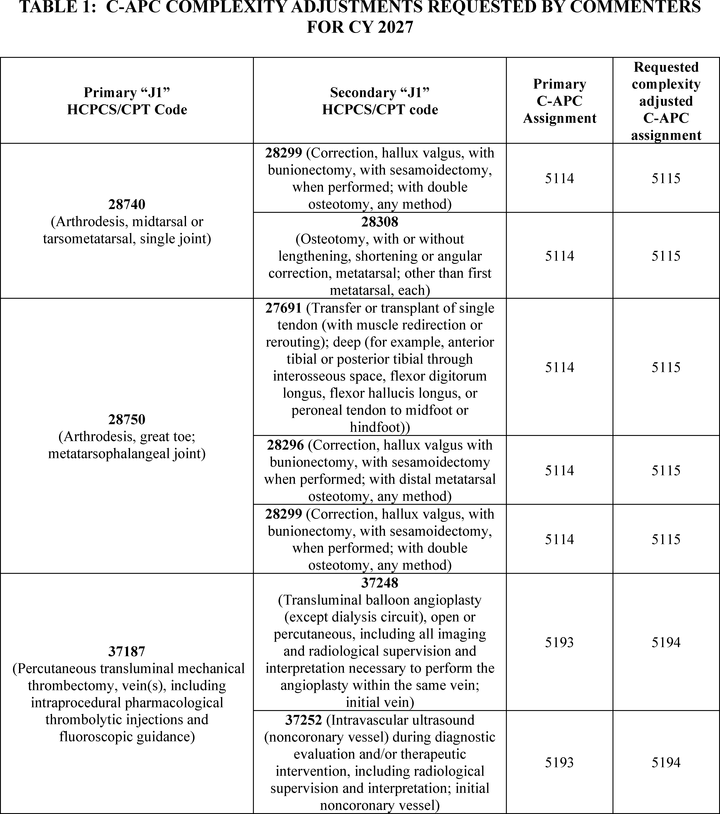
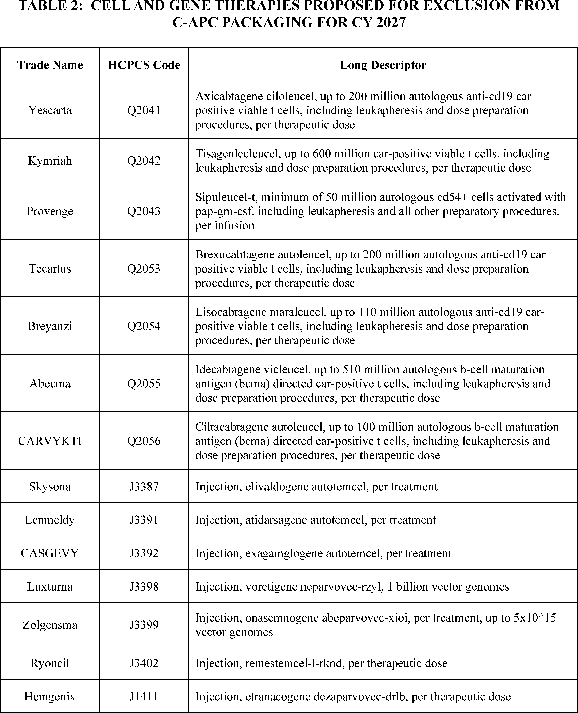
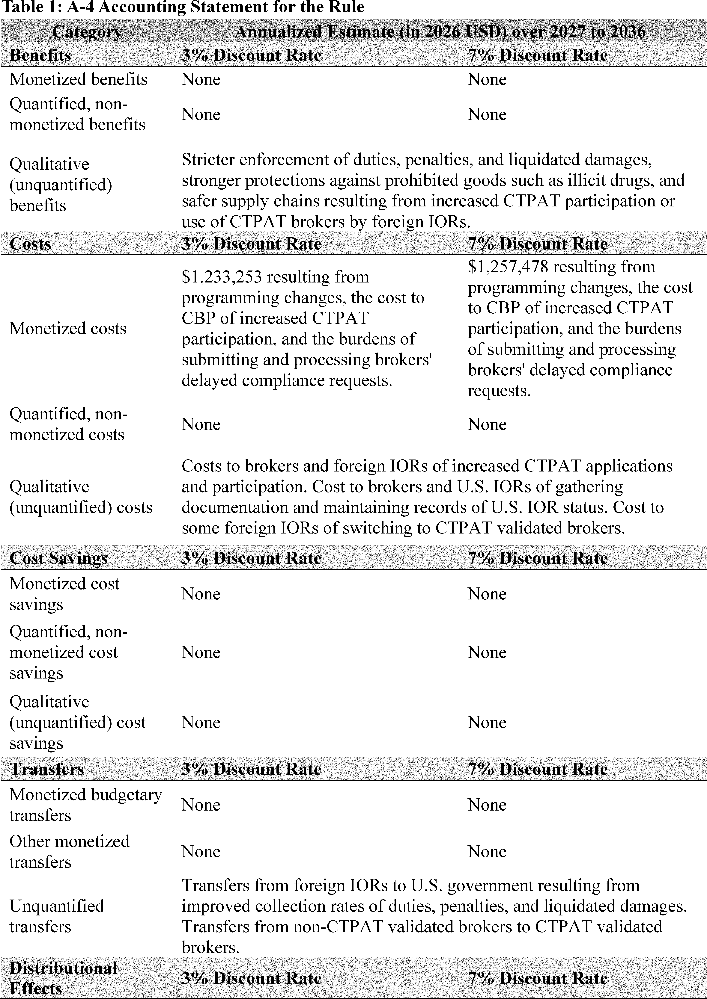
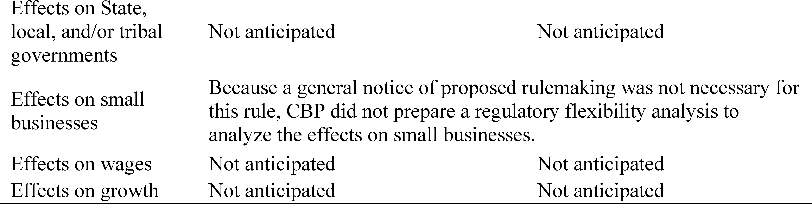
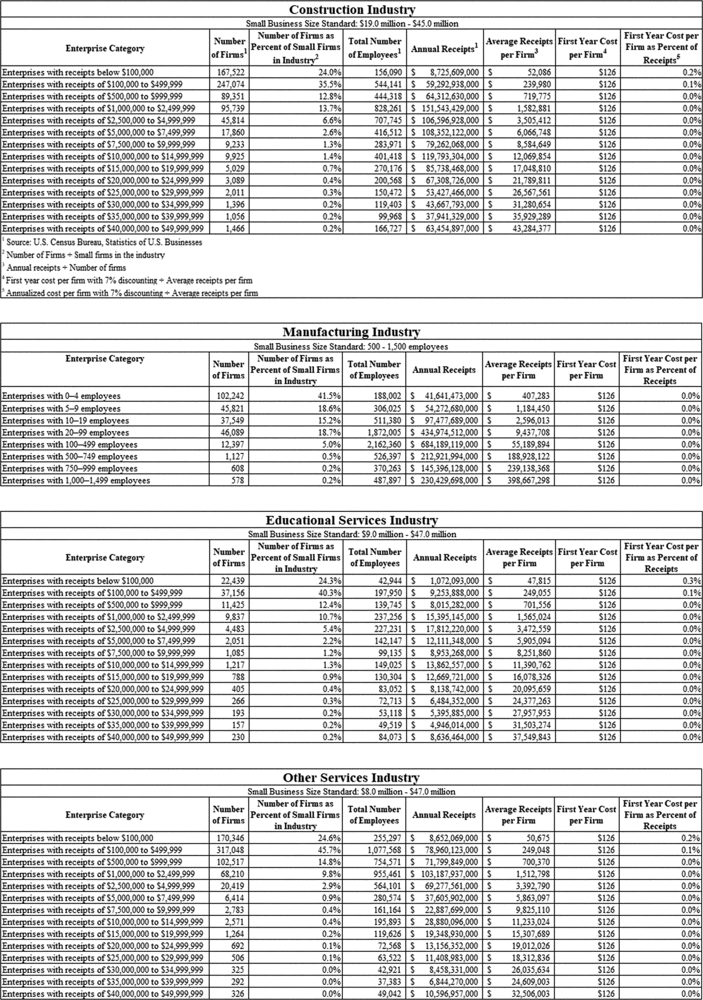
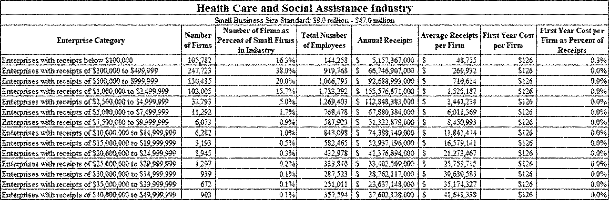
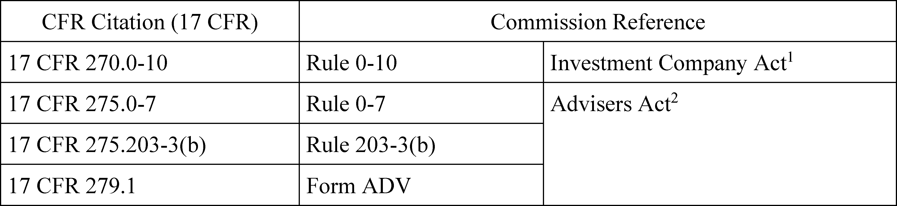
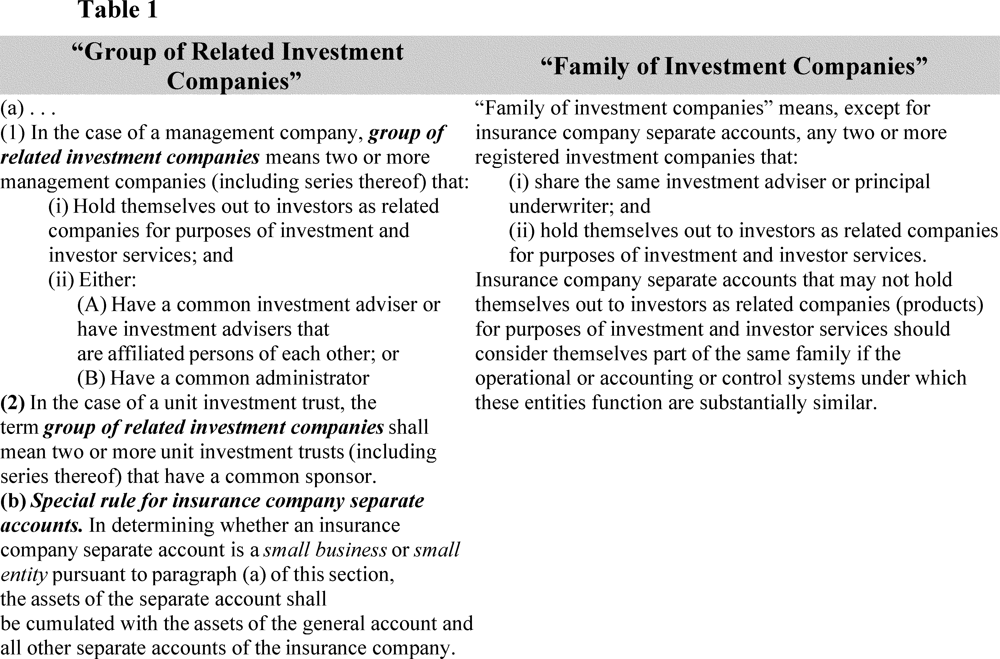

# Daily Digest — 2026-11-06

| | |
|---|---|
| **Digest date** | 2026-11-06 |
| **Data date range** | 2026-11-06 to 2026-11-06 |
| **Generated at** | 2026-11-07T05:06:46Z (UTC) |
| **Pipeline version** | 5b8cfdcb |
| **Inference** | model layers ran — cli/haiku, opus |
| **Source watermarks** | CREC: 2026-11-06T16:07:38Z · BILLS: 2026-11-07T03:57:27Z · FR: 2026-11-06T21:53:37Z · USCOURTS: 2026-11-06T23:48:00Z · PLAW: 2026-11-05T17:09:33Z |

[Full observed listing for this day](day/2026-11-06.html) — the items our collectors observed for this publication day, mechanical rules applied, frozen at end of day; releases their publishers date on other days are counted there, not listed. This digest is the canonical record.

All items below cite the govinfo package (and granule, where applicable) they
summarize. Selection is mechanical; each item states the rule that included
it. See the Coverage Statement at the end for a full accounting of what was
published, what was summarized, and what was excluded and why.

---

## Contents

- [Day in Review](#day-in-review)
- [1. Congressional Floor Activity](#1-congressional-floor-activity)
- [2. Legislation](#2-legislation)
- [3. Federal Register](#3-federal-register)
- [4. Enacted Laws](#4-enacted-laws)
- [5. Judicial Activity](#5-judicial-activity)
- [6. Agency Announcements](#6-agency-announcements)
- [7. Recorded Votes](#7-recorded-votes)
- [8. Bill Actions](#8-bill-actions)
- [9. Presidential Actions](#9-presidential-actions)
- [Terms Used Today](#terms-used-today)
- [Coverage Statement](#coverage-statement)
- [Methodology](#methodology)

---

## Day in Review

On the congressional side, the digest carries nine House bills reported and seven introduced. Six of the reported bills, reported November 5, 2026, amend the Atomic Energy Act of 1954 or address nuclear licensing and oversight. Others concern VA disability exam fraud and foreign medical accreditation. Congressional Record excerpts in the digest carry earlier dates of their own, including May 23, 2019 and March 5, 2021. Recorded House votes in them include two Journal approvals (Roll Nos. 652 and 229) and a 200–222 rejection of a motion to recommit H.R. 1994 (Roll No. 230). Senate excerpts record two 48–52 votes rejecting motions to commit H.R. 1, the Tax Cuts and Jobs Act, and an 85–8 vote passing the supplemental appropriations bill H.R. 2157.

The Federal Register portion includes 11 final rules, five proposed rules and two presidential documents. The documents are Proclamations 11078 and 11079, dated November 3, 2026, which designate Anti-Communism Week and set out the American Declaration of Freedom in Space. Final rules include a Labor Department rule removing affirmative action requirements for Registered Apprenticeship sponsors, new CBP requirements for foreign importers of record, and Medicare outpatient payment revisions for 2027.

The digest carries 54 appellate opinions. The Federal Circuit affirmed Patent Trial and Appeal Board decisions finding that Google had not proved certain DDC Technology patent claims unpatentable. The Eleventh Circuit vacated summary judgment for Progressive on a bad-faith claim. The Third Circuit vacated a late-notice summary judgment for insurers and granted an immigration petition for review. The Tenth, Fourth, Fifth, Sixth and Seventh Circuits issued mostly affirmances. The digest also carries 1,014 district court opinions and 12 bankruptcy court opinions.

*Composed from the summarized items below and the day's mechanical
counts; all specifics are cited in their sections.*

---

## 1. Congressional Floor Activity

Source: Congressional Record (CREC), issue observed 2026-11-06, covering proceedings of 2017-12-01. Published by govinfo 2026-11-06T15:54:49Z; observed by our collector 2026-11-06T15:59:05Z. Total issue size: 1020 granule(s).
Source: Congressional Record (CREC), issue observed 2026-11-06, covering proceedings of 2019-05-23. Published by govinfo 2026-11-06T15:49:49Z; observed by our collector 2026-11-06T12:16:12Z. Total issue size: 1020 granule(s).
Source: Congressional Record (CREC), issue observed 2026-11-06, covering proceedings of 2021-03-05. Published by govinfo 2026-11-06T16:07:38Z; observed by our collector 2026-11-06T12:16:12Z. Total issue size: 1020 granule(s).
Source: Congressional Record (CREC), issue observed 2026-11-06, covering proceedings of 2026-11-05. Published by govinfo 2026-11-06T09:56:50Z; observed by our collector 2026-11-06T10:02:10Z. Total issue size: 1020 granule(s).

### 1.1 Senate

Tags: legislative · model keys: covid relief · robocall enforcement · tax reconciliation

*In plain terms: 39 Senate Record entries, led by amendments to H.R. 1 tax reconciliation and H.R. 1319 COVID relief, many of them SA 891 amendments; the rest cover S. 151 robocalls, nominations, and bill introductions.*

- **Tax Cuts and Jobs Act** — The Senate resumed consideration of H.R. 1, the Tax Cuts and Jobs Act, a bill providing for reconciliation under the fiscal year 2018 budget resolution, with a McConnell amendment and motions to commit by Senators Baldwin and Wyden (for Nelson) pending. Senator Schumer addressed a possible government shutdown and stated that a Joint Committee on Taxation estimate showed the bill adding roughly $1 trillion to the deficit, and Senator Baldwin offered a motion to commit the bill to the Finance Committee concerning the carried interest provision. The excerpt is truncated in the source text.
  - *In plain terms:* The Senate resumed H.R. 1, the Tax Cuts and Jobs Act, with pending amendments and motions to commit; Senator Schumer cited a Joint Committee on Taxation estimate of roughly $1 trillion added to the deficit.
  - Included because: CREC-SEL-01 — floor item ≥ threshold floor time (17,321 characters) (document dated 2017-12-01)
  - Source: [CREC-2017-12-01 / CREC-2017-12-01-pt1-PgS7653-6](https://www.govinfo.gov/app/details/CREC-2017-12-01/CREC-2017-12-01-pt1-PgS7653-6)
- **Tax Cuts and Jobs Act--Continued** — Senator Nelson offered a motion to commit H.R. 1 to the Finance Committee to make the middle-class tax provisions permanent and offset the cost with corporate rate revenue, and Senator Klobuchar spoke in support. The Senate rejected the Nelson motion by a vote of 48 yeas to 52 nays (Rollcall Vote No. 290), then rejected the Baldwin motion to commit by a vote of 48 yeas to 52 nays (Rollcall Vote No. 291). Senator Cardin then offered a motion to commit the bill with instructions to designate the revenue from the deemed repatriation provisions for infrastructure improvements, and a vote on that motion was scheduled for 2 p.m.
  - *In plain terms:* The Senate rejected Senator Nelson's motion to commit H.R. 1 to the Finance Committee, 48 in favor to 52 opposed (Roll Call No. 290), then Senator Baldwin's motion, 48 to 52 (No. 291).
  - Included because: CREC-SEL-01 — floor item ≥ threshold floor time (498,052 characters) (document dated 2017-12-01)
  - Source: [CREC-2017-12-01 / CREC-2017-12-01-pt1-PgS7655-2](https://www.govinfo.gov/app/details/CREC-2017-12-01/CREC-2017-12-01-pt1-PgS7655-2)
- **Text of Amendments** — The Congressional Record text of Senate amendments to H.R. 1 (reconciliation pursuant to the fiscal year 2018 budget resolution), each ordered to lie on the table. SA 1811 by Senator Blunt would add a subsection (g) treating an electing insurance, banking, and financing branch as a specified 10-percent owned foreign corporation; SA 1812 and SA 1813 by Senator Murkowski, with identical text, would extend the American Samoa economic development credit under section 119 of the Tax Relief and Health Care Act of 2006 through January 1, 2023; and SA 1814 by Senator Daines would replace text on pages 26 through 30 with a franchise exception and revised qualified business income provisions. The source text of SA 1811 and SA 1814 is truncated.
  - *In plain terms:* Senate amendments to H.R. 1 were placed on file without immediate action, including SA 1812 and SA 1813 by Senator Murkowski, which would extend the American Samoa economic development credit through January 1, 2023.
  - Included because: CREC-SEL-01 — floor item ≥ threshold floor time (936,027 characters) (document dated 2017-12-01)
  - Source: [CREC-2017-12-01 / CREC-2017-12-01-pt1-PgS7721](https://www.govinfo.gov/app/details/CREC-2017-12-01/CREC-2017-12-01-pt1-PgS7721)
- **Text of Senate Amendment 1833** — SA 1833, submitted by Senator Scott for himself and Senator Portman, would strike section 13823 of H.R. 1 and insert a new subchapter Z, 'Opportunity Zones,' into chapter 1 of the Internal Revenue Code. The inserted text describes how governors nominate low-income census tracts for designation as qualified opportunity zones, caps designations at 25 percent of a state's low-income communities, and permits contiguous tracts with median family income up to 125 percent of the adjacent low-income community's. It also provides an election to defer capital gains invested in qualified opportunity funds, with basis adjustments for investments held 5, 7, and 10 years, and the source text is truncated.
  - *In plain terms:* Senator Scott's amendment SA 1833, with Senator Portman, would strike section 13823 of H.R. 1 and add an 'Opportunity Zones' subchapter letting governors nominate low-income census tracts and allow deferral of capital gains invested in qualified opportunity funds.
  - Included because: CREC-SEL-01 — floor item ≥ threshold floor time (15,921 characters) (document dated 2017-12-01)
  - Source: [CREC-2017-12-01 / CREC-2017-12-01-pt1-PgS7727-2](https://www.govinfo.gov/app/details/CREC-2017-12-01/CREC-2017-12-01-pt1-PgS7727-2)
- **Text of Senate Amendment 1842** — SA 1842, submitted by Senator Rubio for himself and Senator Lee, would strike the text of H.R. 1 from page 1, line 1 through page 123, line 22, and insert a replacement Title I titled 'Tax Cuts and Jobs Act.' The replacement sets revised income tax rate tables under section 1 for taxable years 2018 through 2025, including bracket thresholds for joint, head of household, unmarried, married filing separately, and estate and trust filers, along with rules for children with unearned income and capital gains bracket amounts. The source text is truncated before the due diligence tax preparer provision.
  - *In plain terms:* Senators Rubio and Lee's amendment SA 1842 would replace H.R. 1's opening text, through page 123, line 22, with a new Title I, 'Tax Cuts and Jobs Act,' setting revised income tax rates for 2018 through 2025.
  - Included because: CREC-SEL-01 — floor item ≥ threshold floor time (134,695 characters) (document dated 2017-12-01)
  - Source: [CREC-2017-12-01 / CREC-2017-12-01-pt1-PgS7731-2](https://www.govinfo.gov/app/details/CREC-2017-12-01/CREC-2017-12-01-pt1-PgS7731-2)
- **Text of Senate Amendment 1843** — SA 1843, submitted by Senator Rubio for himself and Senator Lee, contains replacement Title I text substantially the same as SA 1842, with the same striking instruction for page 1, line 1 through page 123, line 22. Its individual rate reform provisions under section 1 for taxable years 2018 through 2025 include the same rate tables, rules for children with unearned income, and capital gains bracket amounts. The source text is truncated before the due diligence tax preparer provision.
  - *In plain terms:* Senators Rubio and Lee's amendment SA 1843 contains replacement Title I text substantially the same as SA 1842, with the same rate tables for 2018 through 2025.
  - Included because: CREC-SEL-01 — floor item ≥ threshold floor time (132,303 characters) (document dated 2017-12-01)
  - Source: [CREC-2017-12-01 / CREC-2017-12-01-pt1-PgS7743](https://www.govinfo.gov/app/details/CREC-2017-12-01/CREC-2017-12-01-pt1-PgS7743)
- **Text of Senate Amendment 1855** — Senator McConnell, for Senator Hatch (for himself and Senator Murkowski), proposed SA 1855 as an amendment to SA 1618, striking all after the first word of H.R. 1 and inserting a replacement Title I titled 'Tax Cuts and Jobs Act.' The replacement presents income tax rate tables under section 1 for taxable years 2018 through 2025 in tabular form, revises the adjustment rules for 2018 and later years, and includes rules for children with unearned income and capital gains bracket amounts. The source text is truncated during the maximum zero rate amount provisions for other individuals.
  - *In plain terms:* Senator McConnell, for Senator Hatch and Senator Murkowski, proposed SA 1855 to amend SA 1618 by replacing H.R. 1's text after its first word with a new 'Tax Cuts and Jobs Act' Title I, including 2018-2025 income tax rate tables.
  - Included because: CREC-SEL-01 — floor item ≥ threshold floor time (520,605 characters) (document dated 2017-12-01)
  - Source: [CREC-2017-12-01 / CREC-2017-12-01-pt1-PgS7758](https://www.govinfo.gov/app/details/CREC-2017-12-01/CREC-2017-12-01-pt1-PgS7758)
- **S. 151** — Senators Wicker, Markey, and Thune spoke on the Senate floor about S. 151, the Telephone Robocall Abuse Criminal Enforcement and Deterrence Act (TRACED Act), before its final passage vote. Wicker stated that the bill would give the FCC tools to address robocall violators, require phone companies to authenticate calls, and involve the Attorney General in prosecuting robocall violations. Markey cited an estimated 48 billion robocalls received by consumers in 2018 and described the bill's three elements as call authentication, call blocking, and extending the FCC's penalty window from 1 year to 3 years.
  - *In plain terms:* Senators Wicker, Markey, and Thune spoke before final passage of S. 151, the TRACED Act, with Markey citing an estimated 48 billion robocalls received in 2018.
  - Included because: CREC-SEL-01 — floor item ≥ threshold floor time (16,183 characters) (document dated 2019-05-23)
  - Source: [CREC-2019-05-23 / CREC-2019-05-23-pt1-PgS3073](https://www.govinfo.gov/app/details/CREC-2019-05-23/CREC-2019-05-23-pt1-PgS3073)
- **Telephone Robocall Abuse Criminal Enforcement and Deterrence Act** — The Senate considered S. 151 with a committee amendment that would amend Section 227 of the Communications Act of 1934 to add civil forfeiture penalties for robocall violations, including an additional penalty of up to $10,000 for violations committed with intent. The text sets limitation periods of 1 year for general violations and 3 years for intentional violations, requires an annual FCC report to Congress on robocall and spoofed-call enforcement, and requires providers to implement the STIR/SHAKEN call authentication framework within 18 months of enactment unless the FCC makes specified determinations. The excerpt is truncated before the full text of the remaining sections, including the rulemaking on unauthenticated numbers and the safe harbor provisions, is shown.
  - *In plain terms:* S. 151 adds civil penalties for robocall violations, including up to $10,000 more for intentional ones, and requires providers to implement STIR/SHAKEN call authentication within 18 months of enactment unless the FCC makes specified determinations.
  - Included because: CREC-SEL-01 — floor item ≥ threshold floor time (21,611 characters) (document dated 2019-05-23)
  - Source: [CREC-2019-05-23 / CREC-2019-05-23-pt1-PgS3075-2](https://www.govinfo.gov/app/details/CREC-2019-05-23/CREC-2019-05-23-pt1-PgS3075-2)
- **The Arctic** — Senator Murkowski's floor statement addresses Arctic policy, including the Arctic Council Ministerial Meeting held May 6 and 7, 2019, in Rovaniemi, Finland, which ended without a signed ministerial declaration but with a joint ministerial statement by all eight Arctic nations reaffirming cooperation, sustainable development, and the rights of indigenous peoples. The statement describes U.S. icebreaker capacity, including a contract awarded for the design and construction of a polar-class icebreaker and $20 million provided for long-lead materials for a second polar security cutter. It also summarizes remarks by Secretary of State Pompeo on Russian and Chinese activity in the Arctic and notes that the Arctic Council was established in 1996 with military and national security issues excluded from its activities.
  - *In plain terms:* Senator Murkowski's statement on Arctic policy describes the May 6 and 7, 2019 Arctic Council Ministerial in Rovaniemi, Finland, which ended with a joint statement by all eight Arctic nations but no signed declaration.
  - Included because: CREC-SEL-01 — floor item ≥ threshold floor time (15,261 characters) (document dated 2019-05-23)
  - Source: [CREC-2019-05-23 / CREC-2019-05-23-pt1-PgS3079-2](https://www.govinfo.gov/app/details/CREC-2019-05-23/CREC-2019-05-23-pt1-PgS3079-2)
- **Executive Calendar** — By unanimous consent, the Senate confirmed nominations on the Executive Calendar, Calendar Nos. 247 through 251 and 253 through 286, and nominations on the Secretary's Desk in the Army, Navy, Marine Corps, and Air Force. The confirmed nominations include Gen. James C. McConville as Chief of Staff of the Army, Adm. William F. Moran as Chief of Naval Operations, and Vice Adm. Robert P. Burke as Vice Chief of Naval Operations, along with appointments to lieutenant general, vice admiral, and brigadier and major general grades. The excerpt lists officers by grade under title 10 of the U.S. Code and ends partway through the list of Army National Guard brigadier general nominations.
  - *In plain terms:* By unanimous consent, the Senate confirmed Calendar Nos. 247-251 and 253-286 and military nominations, including Gen. James C. McConville as Army Chief of Staff and Adm. William F. Moran as Chief of Naval Operations.
  - Included because: CREC-SEL-01 — floor item ≥ threshold floor time (29,321 characters) (document dated 2019-05-23)
  - Source: [CREC-2019-05-23 / CREC-2019-05-23-pt1-PgS3088-4](https://www.govinfo.gov/app/details/CREC-2019-05-23/CREC-2019-05-23-pt1-PgS3088-4)
- **Executive and Other Communications** — This section lists executive communications EC-1361 through EC-1388, received in the Senate on May 22, 2019, and referred to Senate committees. The communications include Department of Defense vacancy reports referred to the Committee on Armed Services, a Commerce Department rule on Entity List additions and revisions referred to the Committee on Banking, Housing, and Urban Affairs, and a Centers for Medicare and Medicaid Services rule on Part D and Medicare Advantage referred to the Committee on Finance. Other items include State Department reports on Taiwan and Cuba, Department of Justice views on H.R. 9, the Climate Action Now Act, and several National Marine Fisheries Service rules referred to the Committee on Commerce, Science, and Transportation, and the excerpt is truncated after EC-1388.
  - *In plain terms:* The excerpt lists executive communications EC-1361 through EC-1388, received May 22, 2019 and referred to Senate committees, including a Commerce Department Entity List rule, and is cut off after EC-1388.
  - Included because: CREC-SEL-01 — floor item ≥ threshold floor time (21,923 characters) (document dated 2019-05-23)
  - Source: [CREC-2019-05-23 / CREC-2019-05-23-pt1-PgS3102-7](https://www.govinfo.gov/app/details/CREC-2019-05-23/CREC-2019-05-23-pt1-PgS3102-7)
- **Introduction of Bills and Joint Resolutions** — The Senate section lists bills S. 1627 through S. 1661 introduced on May 23, 2019, each read the first and second times and referred to a committee. Introduced measures include S. 1627, to extend the section 45 credit for refined coal from steel industry fuel; S. 1634, to impose sanctions with respect to the People's Republic of China in relation to activities in the South China Sea and the East China Sea; and S. 1645, to protect a woman's ability to determine whether and when to bear a child or end a pregnancy. The list is truncated in the source after S. 1661.
  - *In plain terms:* The excerpt lists bills S. 1627 through S. 1661 introduced May 23, 2019 and referred to committees, and is cut off after S. 1661.
  - Included because: CREC-SEL-01 — floor item ≥ threshold floor time (22,485 characters) (document dated 2019-05-23)
  - Source: [CREC-2019-05-23 / CREC-2019-05-23-pt1-PgS3104-3](https://www.govinfo.gov/app/details/CREC-2019-05-23/CREC-2019-05-23-pt1-PgS3104-3)
- **Additional Cosponsors** — This section lists additional cosponsors added at the request of individual Senators to bills including S. 91, S. 133, S. 178, and S. 1126, among others in the S. 91 through S. 1201 range. Each entry identifies the Senators added and the stated purpose of the bill. The source text is truncated at S. 1201.
  - *In plain terms:* The excerpt lists additional cosponsors added at Senators' request to bills S. 91 through S. 1201, including S. 133, S. 178, and S. 1126, and is cut off at S. 1201.
  - Included because: CREC-SEL-01 — floor item ≥ threshold floor time (20,783 characters) (document dated 2019-05-23)
  - Source: [CREC-2019-05-23 / CREC-2019-05-23-pt1-PgS3107](https://www.govinfo.gov/app/details/CREC-2019-05-23/CREC-2019-05-23-pt1-PgS3107)
- **Statements on Introduced Bills and Joint Resolutions** — Senator Wyden's statements introduce S. 1643, the Forest Management for Rural Stability Act, which would replace the Secure Rural Schools and Community Self-Determination Act with a Natural Resources Permanent Fund and a federally chartered Forest and Refuge County Foundation to make payments to rural forested counties. The statements also introduce S. 1649, the Protection of Social Security Benefits Restoration Act, which would restore protections for Social Security, Railroad retirement, and Black Lung benefits from administrative offset. The text of S. 1649 and a May 15, 2019 letter from the National Committee to Preserve Social Security and Medicare endorsing the bill are printed in the Record.
  - *In plain terms:* Senator Wyden introduces S. 1643, the Forest Management for Rural Stability Act, and S. 1649, which would restore Social Security, Railroad retirement, and Black Lung benefit protections from administrative offset.
  - Included because: CREC-SEL-01 — floor item ≥ threshold floor time (34,474 characters) (document dated 2019-05-23)
  - Source: [CREC-2019-05-23 / CREC-2019-05-23-pt1-PgS3109](https://www.govinfo.gov/app/details/CREC-2019-05-23/CREC-2019-05-23-pt1-PgS3109)
- **Introductory Statement on S. 1657** — Senator Collins introduced S. 1657, the TICK Act (Ticks: Identify, Control, and Knockout Act), to provide assistance for Lyme disease and other tick and vector-borne diseases, with Senators Smith and King as cosponsors. The bill would establish an HHS office of oversight and coordination for vector-borne diseases, reauthorize the Regional Centers for Excellence in Vector-Borne Disease for five years at $10 million per year, and establish CDC grants to State health departments. Letters from more than two dozen organizations supporting the bill are printed in the Record.
  - *In plain terms:* Senator Collins introduced S. 1657, the TICK Act, to provide assistance for Lyme disease and other tick and vector-borne diseases, with Senators Smith and King as cosponsors.
  - Included because: CREC-SEL-01 — floor item ≥ threshold floor time (17,425 characters) (document dated 2019-05-23)
  - Source: [CREC-2019-05-23 / CREC-2019-05-23-pt1-PgS3111](https://www.govinfo.gov/app/details/CREC-2019-05-23/CREC-2019-05-23-pt1-PgS3111)
- **Text of Senate Amendment 250** — Senate amendment SA 250, proposed by Senator McConnell for Senator Shelby and Senator Leahy, would strike all text after the enacting clause of H.R. 2157, a supplemental appropriations bill for the fiscal year ending September 30, 2019, and insert new provisions. The amendment provides appropriations for agricultural and disaster-related programs, including $3,005,442,000 for the Office of the Secretary for crop and tree losses, $480,000,000 for the Emergency Forest Restoration Program, $558,000,000 for the Emergency Conservation Program, $435,000,000 for watershed and flood prevention operations, and $150,000,000 for rural community facilities grants. Section 103 makes persons or legal entities with average adjusted gross income above $900,000 ineligible for Market Facilitation Program payments, unless at least 75 percent of their adjusted gross income is derived from farming, ranching, or forestry related activities.
  - *In plain terms:* Senator McConnell's SA 250 would replace H.R. 2157 text with farm and disaster funding and bar Market Facilitation Program payments to those with average adjusted gross income above $900,000 unless 75% comes from farming, ranching, or forestry.
  - Included because: CREC-SEL-01 — floor item ≥ threshold floor time (101,654 characters) (document dated 2019-05-23)
  - Source: [CREC-2019-05-23 / CREC-2019-05-23-pt1-PgS3118-3](https://www.govinfo.gov/app/details/CREC-2019-05-23/CREC-2019-05-23-pt1-PgS3118-3)
- **Nominations** — The Nominations section lists executive and military nominations received by the Senate, including Lajuana S. Wilcher to be a member of the Board of Directors of the Federal Agricultural Mortgage Corporation, Brian Callanan to be General Counsel of the Department of the Treasury, and Brent James McIntosh to be an Under Secretary of the Treasury. It also includes Erin Elizabeth McKee to be Ambassador Extraordinary and Plenipotentiary to Papua New Guinea, concurrently to the Solomon Islands and the Republic of Vanuatu, Stephen R. Bough to the Board of Trustees of the Harry S Truman Scholarship Foundation, and Elizabeth J. Shapiro to be an Associate Judge of the Superior Court of the District of Columbia. The section also lists promotion nominations for officers in the Air Force, Army, and Navy.
  - *In plain terms:* The section lists nominees including Brian Callanan for Treasury General Counsel, Erin Elizabeth McKee as Ambassador to Papua New Guinea, and Elizabeth J. Shapiro as a D.C. Superior Court Associate Judge, along with military promotions.
  - Included because: CREC-SEL-01 — floor item ≥ threshold floor time (44,710 characters) (document dated 2019-05-23)
  - Source: [CREC-2019-05-23 / CREC-2019-05-23-pt1-PgS3128-6](https://www.govinfo.gov/app/details/CREC-2019-05-23/CREC-2019-05-23-pt1-PgS3128-6)
- **Confirmations** — The Congressional Record entry lists executive nominations confirmed by the Senate on May 23, 2019, including posts at the Department of Energy, the Department of State, and the United States Agency for International Development. It also lists Department of Justice nominees for United States Attorney and United States Marshal, and military appointments such as Gen. James C. McConville as Chief of Staff of the Army. Named nominees include William Bookless as Principal Deputy Administrator of the National Nuclear Security Administration and Michael J. Fitzpatrick as Ambassador to the Republic of Ecuador.
  - *In plain terms:* This entry lists executive nominations confirmed May 23, 2019, including Energy Department, State Department, and USAID posts, Justice Department U.S. Attorney and Marshal nominees, and Gen. James C. McConville as Army Chief of Staff.
  - Included because: CREC-SEL-01 — floor item ≥ threshold floor time (27,298 characters) (document dated 2019-05-23)
  - Source: [CREC-2019-05-23 / CREC-2019-05-23-pt1-PgS3135](https://www.govinfo.gov/app/details/CREC-2019-05-23/CREC-2019-05-23-pt1-PgS3135)
- **Legislative Session** — The Senate Record of March 5, 2021 shows the Senate resuming consideration of H.R. 1319, the American Rescue Plan Act of 2021, with Schumer amendment No. 891 pending. Senator Sanders called up amendment No. 972, which would raise the federal minimum wage from $7.25 to $15 per hour over five years, and delivered floor remarks on the bill. The entry also records unanimous consent agreements permitting the majority and Republican managers to use wireless devices at the managers' desks and permitting calculators on the floor during consideration of the bill.
  - *In plain terms:* The Senate returned to H.R. 1319, the American Rescue Plan Act of 2021, as Senator Sanders called up amendment No. 972 to raise federal minimum wage from $7.25 to $15 per hour over five years.
  - Included because: CREC-SEL-01 — floor item ≥ threshold floor time (449,151 characters) (document dated 2021-03-05)
  - Source: [CREC-2021-03-05 / CREC-2021-03-05-pt1-PgS1219-2](https://www.govinfo.gov/app/details/CREC-2021-03-05/CREC-2021-03-05-pt1-PgS1219-2)
- **Amendments Submitted and Proposed** — The Senate Record of March 5, 2021 lists amendments submitted or proposed to Schumer amendment No. 891 to H.R. 1319, numbered SA 1001 through at least SA 1030, from senators including Moran, Blackburn, Toomey, Paul, Tillis, Lankford, Sullivan, Rubio, and Scott. Most listed amendments were ordered to lie on the table, while SA 1010, SA 1014, SA 1026, and SA 1030 were recorded as proposed. The listing is truncated in the source after SA 1030.
  - *In plain terms:* The Senate Record lists amendments SA 1001 through at least SA 1030 to Schumer amendment No. 891, most set aside without action, and SA 1010, 1014, 1026, and 1030 recorded as proposed.
  - Included because: CREC-SEL-01 — floor item ≥ threshold floor time (158,225 characters) (document dated 2021-03-05)
  - Source: [CREC-2021-03-05 / CREC-2021-03-05-pt1-PgS1276](https://www.govinfo.gov/app/details/CREC-2021-03-05/CREC-2021-03-05-pt1-PgS1276)
- **Text of Amendments** — The Senate Record of March 5, 2021 prints the text of amendments SA 1001 through SA 1007 to amendment SA 891 to H.R. 1319, all ordered to lie on the table. The texts include an appropriation of $78,755,412,000 for IDEA Part B state grants, a $50,000,000 appropriation for youth suicide prevention, premium assistance percentage tables under section 36B of the Internal Revenue Code for taxable years 2021 and 2022 (SA 1004) and for 2021 (SA 1005), and a proposal to strike section 9816 (SA 1006). SA 1007 would cap certain unemployment compensation weekly benefits at the individual's average weekly wages for weeks ending after March 14, 2021 and on or before August 29, 2021, and the text is truncated in the source.
  - *In plain terms:* The Senate Record prints amendments SA 1001 through SA 1007 to H.R. 1319, all set aside without action, including a $78,755,412,000 appropriation for IDEA Part B special education state grants and $50,000,000 for youth suicide prevention.
  - Included because: CREC-SEL-01 — floor item ≥ threshold floor time (1,242,225 characters) (document dated 2021-03-05)
  - Source: [CREC-2021-03-05 / CREC-2021-03-05-pt1-PgS1291](https://www.govinfo.gov/app/details/CREC-2021-03-05/CREC-2021-03-05-pt1-PgS1291)
- **Text of Senate Amendment 1031** — The Senate Record of March 5, 2021 prints SA 1031, proposed by Senator Lankford and Senator Daines, which would strike section 2204 through the end of subtitle H of title II of H.R. 1319 and insert new provisions. The inserted text appropriates funds under the Family Violence Prevention and Services Act, including $198,000,000 for grants supporting survivors of sexual assault and $49,500,000 for grants to culturally specific populations, and adds sections 2205 and 2206 providing $250,000,000 and $100,000,000 for child abuse prevention and treatment and $852,000,000 for the Corporation for National and Community Service. The amendment also adds section 2301 relating to the Public Health Service Act, and the text is truncated in the source.
  - *In plain terms:* The Senate Record prints SA 1031, proposed by Senators Lankford and Daines, to strike section 2204 through the end of subtitle H of title II of H.R. 1319 and insert new provisions.
  - Included because: CREC-SEL-01 — floor item ≥ threshold floor time (48,799 characters) (document dated 2021-03-05)
  - Source: [CREC-2021-03-05 / CREC-2021-03-05-pt1-PgS1295-5](https://www.govinfo.gov/app/details/CREC-2021-03-05/CREC-2021-03-05-pt1-PgS1295-5)
- **Text of Senate Amendment 1117** — The Senate Record of March 5, 2021 prints SA 1117, submitted by Senator Daines and Senator Lankford, which would strike section 9901 through title X of H.R. 1319 and insert provisions establishing Coronavirus State and Local Fiscal Recovery Funds under title VI of the Social Security Act. The proposed text appropriates $219,800,000,000 for payments to states, territories, and Tribal governments, reserving $4,500,000,000 for territories, $20,000,000,000 for Tribal governments, and $195,300,000,000 for the 50 states and the District of Columbia, with allocation and minimum-payment rules. It also restricts the use of the funds, including offsetting net tax revenue reductions and deposits into pension funds, and sets certification, reporting, and recoupment requirements, with the source text truncated.
  - *In plain terms:* The Senate Record prints SA 1117, from Senators Daines and Lankford, which would strike section 9901 through title X of H.R. 1319 and appropriate $219,800,000,000 for Coronavirus State and Local Fiscal Recovery Funds.
  - Included because: CREC-SEL-01 — floor item ≥ threshold floor time (47,190 characters) (document dated 2021-03-05)
  - Source: [CREC-2021-03-05 / CREC-2021-03-05-pt1-PgS1306-9](https://www.govinfo.gov/app/details/CREC-2021-03-05/CREC-2021-03-05-pt1-PgS1306-9)
- **Text of Senate Amendment 1119** — Mr. Lee submitted amendment SA 1119, intended to be proposed to amendment SA 891 to H.R. 1319 and ordered to lie on the table, which would strike section 9901 and insert a new Section 602 into Title VI of the Social Security Act establishing a Coronavirus State Fiscal Recovery Fund. The text appropriates $219.8 billion for fiscal year 2021, available through December 31, 2024, with reserved amounts of $4.5 billion for territories, $20 billion for Tribal governments, and $195.3 billion for the 50 states and the District of Columbia, and limits fund uses to COVID-19 response, related economic impacts, and government services affected by revenue reductions. It also sets certification, reporting, recoupment, and regulatory authority provisions, and the excerpt is marked as truncated in the source.
  - *In plain terms:* Senator Lee's SA 1119, to amendment SA 891 of H.R. 1319, would strike section 9901 and create a Coronavirus State Fiscal Recovery Fund appropriating $219.8 billion for fiscal year 2021, available through December 31, 2024.
  - Included because: CREC-SEL-01 — floor item ≥ threshold floor time (33,961 characters) (document dated 2021-03-05)
  - Source: [CREC-2021-03-05 / CREC-2021-03-05-pt1-PgS1311](https://www.govinfo.gov/app/details/CREC-2021-03-05/CREC-2021-03-05-pt1-PgS1311)
- **Text of Senate Amendment 1123** — Mr. Lee submitted amendment SA 1124, intended to be proposed to amendment SA 891 to H.R. 1319 and ordered to lie on the table, which would strike section 9901 and insert the same Coronavirus State Fiscal Recovery Fund structure as the preceding version. The text appropriates $219.8 billion for fiscal year 2021, available through July 31, 2021, with the same reservations and allocation formulas, and adds water, sewer, and broadband infrastructure investments as an authorized use. The excerpt is truncated in the source.
  - *In plain terms:* Mr. Lee submitted amendment SA 1124, set aside on the table, which would replace section 9901 with a $219.8 billion Coronavirus State Fiscal Recovery Fund for fiscal year 2021, available through July 31, 2021.
  - Included because: CREC-SEL-01 — floor item ≥ threshold floor time (1,101 characters) (document dated 2021-03-05)
  - Source: [CREC-2021-03-05 / CREC-2021-03-05-pt1-PgS1314-4](https://www.govinfo.gov/app/details/CREC-2021-03-05/CREC-2021-03-05-pt1-PgS1314-4)
- **Text of Senate Amendment 1124** — Senate amendment SA 1124, submitted by Mr. Lee on March 5, 2021, proposes to strike section 9901 of H.R. 1319 and insert a new provision adding section 602 to Title VI of the Social Security Act, which establishes a Coronavirus State Fiscal Recovery Fund. The text appropriates $219.8 billion for fiscal year 2021 for payments to states, territories, and Tribal governments, reserving $4.5 billion for territories, $20 billion for Tribal governments, and $195.3 billion for the 50 states and the District of Columbia, along with allocation formulas and a $50 million administrative appropriation. The amendment limits permitted uses of funds, bars use of funds to offset tax reductions or for pension fund deposits, and sets certification, reporting, and recoupment requirements; the source text is truncated before its regulations provision.
  - *In plain terms:* Amendment SA 1124, submitted by Mr. Lee on March 5, 2021, proposes replacing section 9901 of H.R. 1319 with a fund for states, territories, and Tribal governments appropriating $219.8 billion for fiscal year 2021.
  - Included because: CREC-SEL-01 — floor item ≥ threshold floor time (34,483 characters) (document dated 2021-03-05)
  - Source: [CREC-2021-03-05 / CREC-2021-03-05-pt1-PgS1314-5](https://www.govinfo.gov/app/details/CREC-2021-03-05/CREC-2021-03-05-pt1-PgS1314-5)
- **Text of Senate Amendment 1125** — Mr. Lee submitted amendment SA 1125, intended to be proposed to amendment SA 891 to H.R. 1319 and ordered to lie on the table, which contains the same fund structure, allocations, and July 31, 2021 use deadline as SA 1124. It adds a provision barring payments to a State, territory, or Tribal government that has not obligated all funds previously provided under any coronavirus response law, extends that requirement to localities under section 603, and requires a certification that prior funds from the CARES Act and divisions M and N of the Consolidated Appropriations Act, 2021 have been obligated. The excerpt is truncated in the source.
  - *In plain terms:* Lee's amendment SA 1125, set aside on the table, repeats SA 1124's fund terms and July 31, 2021 deadline and bars payments to State, territory, or Tribal governments that have not committed all earlier coronavirus funds.
  - Included because: CREC-SEL-01 — floor item ≥ threshold floor time (36,734 characters) (document dated 2021-03-05)
  - Source: [CREC-2021-03-05 / CREC-2021-03-05-pt1-PgS1317](https://www.govinfo.gov/app/details/CREC-2021-03-05/CREC-2021-03-05-pt1-PgS1317)
- **Text of Senate Amendment 1151** — Ms. Collins and cosponsors submitted amendment SA 1151, intended to be proposed to amendment SA 891 to H.R. 1319 and ordered to lie on the table, which proposes a substitute in lieu of the matter to be inserted. Its table of contents lists provisions across Titles I through VI for the Committees on Agriculture, Banking, Finance, Health, Education, Labor, and Pensions, Homeland Security and Governmental Affairs, and Small Business and Entrepreneurship. The text includes extending SNAP benefit values from June 30, 2021 to September 30, 2021 with $1.15 billion in administrative funding, $25 million for SNAP online purchasing, $1 billion for nutrition grants to the Commonwealth of the Northern Mariana Islands, Puerto Rico, and American Samoa, and a WIC cash-value voucher increase up to $35 with $490 million, along with vaccine, testing, stockpile, mental health, school, child care, and paycheck protection program provisions, and the excerpt ends partway through the text.
  - *In plain terms:* Collins and cosponsors submitted amendment SA 1151, set aside on the table, proposing replacement text covering Titles I through VI, extending SNAP benefits to September 30, 2021 and raising WIC cash-value vouchers by up to $35.
  - Included because: CREC-SEL-01 — floor item ≥ threshold floor time (83,191 characters) (document dated 2021-03-05)
  - Source: [CREC-2021-03-05 / CREC-2021-03-05-pt1-PgS1325](https://www.govinfo.gov/app/details/CREC-2021-03-05/CREC-2021-03-05-pt1-PgS1325)
- **Text of Senate Amendment 1242** — Ms. Collins and cosponsors proposed amendment SA 1242 to amendment SA 891 to H.R. 1319 as a substitute in lieu of the matter to be inserted. Its table of contents reduces Title IV to three sections, covering public health programs (Sec. 4001), schools (Sec. 4101), and child care (Sec. 4201), while retaining the agriculture, finance, small business, and homeland security titles. The Title I text matches the SNAP, WIC, and nutrition provisions described in SA 1151, including the SNAP benefit extension to September 30, 2021, $1.15 billion for SNAP administrative expenses, and a WIC cash-value voucher increase up to $35 with $490 million, and the excerpt is truncated in the source.
  - *In plain terms:* Collins and cosponsors proposed SA 1242, a replacement for SA 891 to H.R. 1319, reducing Title IV to three sections on public health, schools, and child care and keeping SNAP extension to September 30, 2021.
  - Included because: CREC-SEL-01 — floor item ≥ threshold floor time (80,443 characters) (document dated 2021-03-05)
  - Source: [CREC-2021-03-05 / CREC-2021-03-05-pt1-PgS1347-4](https://www.govinfo.gov/app/details/CREC-2021-03-05/CREC-2021-03-05-pt1-PgS1347-4)
- **Text of Senate Amendment 1296** — Mr. Rubio submitted amendment SA 1296, intended to be proposed to amendment SA 891 to H.R. 1319 and ordered to lie on the table, which would add a section titled Medical Manufacturing Economic Development and Sustainability at the end of subtitle G of title IX. The proposed Internal Revenue Code Subchapter AA would allow a credit of 40 percent (60 percent for qualified repatriated pharmaceutical manufacturing facilities) of certain wages, employee fringe benefit expenses, and depreciation for medical product manufacturing facilities in economically distressed zones, and a credit of 30 percent (5 percent for related persons) for qualified products and services acquired from those zones. The provision also allows an election to expense certain facility property and defines economically distressed zones as census tracts with a poverty rate of at least 35 percent for each of the five most recent calendar years or meeting alternative criteria, and the excerpt is truncated in the source.
  - *In plain terms:* Rubio's amendment SA 1296, set aside on the table, adds a 40 percent credit (60 percent for qualified repatriated pharmaceutical facilities) on wages, fringe benefit expenses, and depreciation for medical product manufacturing in economically distressed zones.
  - Included because: CREC-SEL-01 — floor item ≥ threshold floor time (16,667 characters) (document dated 2021-03-05)
  - Source: [CREC-2021-03-05 / CREC-2021-03-05-pt1-PgS1359](https://www.govinfo.gov/app/details/CREC-2021-03-05/CREC-2021-03-05-pt1-PgS1359)
- **Text of Senate Amendment 1313** — Senate amendment SA 1313, submitted by Ms. Murkowski to amendment SA 891 to H.R. 1319, would strike section 9901 and insert a new Title VI provision of the Social Security Act establishing a Coronavirus State Fiscal Recovery Fund. It appropriates $219,300,000,000 for fiscal year 2021, available through December 31, 2024, for payments to States, territories, and Tribal governments, plus $50,000,000 for administrative costs. The text reserves $4,500,000,000 for territories, $19,500,000,000 for Tribal governments, and $195,300,000,000 for the 50 States and the District of Columbia, and restricts use of the funds, including prohibiting deposits into pension funds.
  - *In plain terms:* Murkowski's amendment SA 1313 would replace section 9901 with a Coronavirus State Fiscal Recovery Fund appropriating $219.3 billion for fiscal year 2021, available through December 31, 2024.
  - Included because: CREC-SEL-01 — floor item ≥ threshold floor time (37,752 characters) (document dated 2021-03-05)
  - Source: [CREC-2021-03-05 / CREC-2021-03-05-pt1-PgS1363-5](https://www.govinfo.gov/app/details/CREC-2021-03-05/CREC-2021-03-05-pt1-PgS1363-5)
- **Text of Senate Amendment 1336** — Senate amendment SA 1336, submitted by Mr. Moran to amendment SA 891 to H.R. 1319, proposes replacing section 2 with a table of contents and inserting provisions under Title I (Committee on Health, Education, Labor, and Pensions), Title II (Committee on Banking, Housing, and Urban Affairs), and Title III (Committee on Finance). The Title I provisions appropriate $7,500,000,000 to the CDC for COVID-19 vaccine activities, $1,000,000,000 for vaccine confidence activities, $6,050,000,000 for vaccine supply chain activities, $500,000,000 for FDA activities, and $47,800,000,000 for COVID-19 testing, contact tracing, and mitigation. The amendment also amends the Patient Protection and Affordable Care Act to treat individuals receiving unemployment compensation during 2021 as meeting certain requirements and to disregard household income above 133 percent of the poverty line for that purpose.
  - *In plain terms:* Moran's amendment SA 1336 to H.R. 1319 would replace section 2 and add Title I provisions, including $7.5 billion for CDC COVID-19 vaccine activities and $47.8 billion for testing, contact tracing, and mitigation.
  - Included because: CREC-SEL-01 — floor item ≥ threshold floor time (26,012 characters) (document dated 2021-03-05)
  - Source: [CREC-2021-03-05 / CREC-2021-03-05-pt1-PgS1370](https://www.govinfo.gov/app/details/CREC-2021-03-05/CREC-2021-03-05-pt1-PgS1370)
- **Text of Senate Amendment 1339** — Senate amendment SA 1339, submitted by Mr. Rubio and Mr. Lee to amendment SA 891 to H.R. 1319, would strike part 2 of subtitle G of title IX and insert Child Tax Credit provisions for 2021. The text amends Internal Revenue Code section 24 to set the credit at $3,500 per qualifying child ($4,500 for children under age 6), treat 17-year-olds as qualifying children, and reduce the credit by $50 for each $1,000 of modified adjusted gross income above $150,000 for joint returns, $112,500 for heads of household, and $75,000 for other filers. It also adds Internal Revenue Code section 7527A, directing the Secretary to establish periodic advance payments of the credit and an online portal for electing out of payments and updating eligibility information.
  - *In plain terms:* Rubio and Lee's amendment SA 1339 would replace part 2 with 2021 Child Tax Credit provisions: $3,500 per qualifying child ($4,500 under age 6), reduced by $50 per $1,000 of income above set thresholds.
  - Included because: CREC-SEL-01 — floor item ≥ threshold floor time (23,565 characters) (document dated 2021-03-05)
  - Source: [CREC-2021-03-05 / CREC-2021-03-05-pt1-PgS1373](https://www.govinfo.gov/app/details/CREC-2021-03-05/CREC-2021-03-05-pt1-PgS1373)
- **Text of Senate Amendment 1362** — Senate amendment SA 1362, submitted by Mr. Romney to amendment SA 891 to H.R. 1319, would strike subtitle M of title IX and insert a Coronavirus State and Local Fiscal Recovery Funds provision adding section 602 to Title VI of the Social Security Act. It appropriates $125,600,000,000 for fiscal year 2021, available through December 31, 2024, with reserved amounts of $2,571,428,571 for territories, $11,428,571,429 for Tribal governments, and $111,600,000,000 for the 50 States and the District of Columbia, plus $50,000,000 for administration. The text limits use of the funds to COVID-19 response, government services to the extent of revenue reductions, and water, sewer, or broadband investments, and prohibits using the funds to offset tax reductions or for deposit into pension funds.
  - *In plain terms:* Romney's amendment SA 1362 to H.R. 1319 would replace subtitle M of title IX with a State and Local Fiscal Recovery Funds provision appropriating $125.6 billion for fiscal year 2021, available through December 31, 2024.
  - Included because: CREC-SEL-01 — floor item ≥ threshold floor time (34,197 characters) (document dated 2021-03-05)
  - Source: [CREC-2021-03-05 / CREC-2021-03-05-pt1-PgS1382-2](https://www.govinfo.gov/app/details/CREC-2021-03-05/CREC-2021-03-05-pt1-PgS1382-2)
- **Text of Senate Amendment 1378** — Senate amendment SA 1378, proposed by Mr. Wyden to amendment SA 891 to H.R. 1319, would strike part 1 of subtitle A of title IX and insert Crisis Support for Unemployed Workers provisions. It extends CARES Act pandemic unemployment provisions to weeks ending on or before September 6, 2021, including increasing the maximum number of Pandemic Unemployment Assistance weeks from 50 to 79 and Pandemic Emergency Unemployment Compensation weeks from 24 to 53. Part 3 of the amendment appropriates $8,000,000 for Department of Labor administration and $2,000,000,000 for fraud prevention, equitable access, and timely payment under a new CARES Act section 2118.
  - *In plain terms:* Wyden's amendment SA 1378 would replace part 1 of subtitle A of title IX with Crisis Support for Unemployed Workers provisions, extending CARES Act unemployment provisions to weeks ending on or before September 6, 2021.
  - Included because: CREC-SEL-01 — floor item ≥ threshold floor time (15,004 characters) (document dated 2021-03-05)
  - Source: [CREC-2021-03-05 / CREC-2021-03-05-pt1-PgS1388-9](https://www.govinfo.gov/app/details/CREC-2021-03-05/CREC-2021-03-05-pt1-PgS1388-9)
- **Text of Senate Amendment 1380** — Senate amendment SA 1380, submitted by Mr. Lee and Mr. Rubio to amendment SA 891 to H.R. 1319, would strike part 2 of subtitle G of title IX through the end of part 4 and insert Child Tax Credit provisions for 2021. This version sets the credit at $3,300 per qualifying child ($4,100 for children under age 6), with the same age, income phaseout, and $50-per-$1,000 reduction provisions as amendment SA 1339. It also establishes the advance payment program under Internal Revenue Code section 7527A, including periodic payments, an online portal, and written notice of payments to taxpayers by January 31 of the following year.
  - *In plain terms:* Lee and Rubio's amendment SA 1380 would replace parts 2 through 4 with 2021 Child Tax Credit provisions of $3,300 per qualifying child ($4,100 under age 6), including advance payments and an online portal.
  - Included because: CREC-SEL-01 — floor item ≥ threshold floor time (43,178 characters) (document dated 2021-03-05)
  - Source: [CREC-2021-03-05 / CREC-2021-03-05-pt1-PgS1390-2](https://www.govinfo.gov/app/details/CREC-2021-03-05/CREC-2021-03-05-pt1-PgS1390-2)
- **Text of Senate Amendment 1381** — Amendment SA 1381, proposed by Lee and Rubio to amendment SA 891 to H.R. 1319, would strike parts 2 through 4 of subtitle G of title IX and insert a new Part 2 on the child tax credit. The inserted text adds special rules for 2021 taxable years to Section 24 of the Internal Revenue Code, including a $3,300 credit amount ($4,200 for children under age 6), a reduction based on modified adjusted gross income with threshold amounts of $150,000, $112,500, and $75,000, and treatment of 17-year-olds as qualifying children. It also adds Section 7527A, which directs the Secretary to establish periodic advance payments of the credit and an online portal for electing out of payments and submitting updated information.
  - *In plain terms:* Lee and Rubio's amendment SA 1381 would replace parts 2 through 4 with a new child tax credit Part 2 for 2021, setting the credit at $3,300 per child ($4,200 under age 6).
  - Included because: CREC-SEL-01 — floor item ≥ threshold floor time (43,169 characters) (document dated 2021-03-05)
  - Source: [CREC-2021-03-05 / CREC-2021-03-05-pt1-PgS1394](https://www.govinfo.gov/app/details/CREC-2021-03-05/CREC-2021-03-05-pt1-PgS1394)
- **Text of Senate Amendment 1398** — Amendment SA 1398, proposed by Schumer to amendment SA 891 to H.R. 1319, revises that amendment by setting minimum funding percentages for listed purposes, reducing a dollar figure on page 33 from $125,804,800,000 to $122,774,800,000, and adding Section 2014 to appropriate $2,580,000,000 for part B grants, $200,000,000 for preschool grants, and $250,000,000 for infants and toddlers under the Individuals with Disabilities Education Act. It also amends the Railroad Unemployment Insurance Act and Section 2112 of the CARES Act to replace the March 14, 2021 dates with September 6, 2021, and extends certain railroad unemployment benefit durations. The amendment further adds Section 4015, which deems covered Federal employees diagnosed with COVID-19 between January 27, 2020 and January 27, 2023 to have an injury caused by exposure to the novel coronavirus for workers' compensation claims under subchapter I of chapter 81 of title 5, United States Code, excluding employees who are exclusively teleworking during a covered exposure period.
  - *In plain terms:* Schumer's amendment SA 1398 revises SA 891 to H.R. 1319 by reducing a figure on page 33 from $125,804,800,000 to $122,774,800,000 and replacing March 14, 2021 dates with September 6, 2021.
  - Included because: CREC-SEL-01 — floor item ≥ threshold floor time (62,342 characters) (document dated 2021-03-05)
  - Source: [CREC-2021-03-05 / CREC-2021-03-05-pt1-PgS1401-3](https://www.govinfo.gov/app/details/CREC-2021-03-05/CREC-2021-03-05-pt1-PgS1401-3)

### 1.2 House of Representatives

Tags: legislative · model keys: district of columbia statehood · manufactured housing · retirement legislation

*In plain terms: 8 House Record entries, led by H.R. 1699 called up by Representative Hensarling and H.R. 1994 under a motion to recommit; the rest are special orders, statehood remarks, and lists of bills introduced May 23, 2019.*

- **Preserving Access to Manufactured Housing Act of 2017** — Representative Hensarling called up H.R. 1699, the 'Preserving Access to Manufactured Housing Act of 2017', which amends the Truth in Lending Act and the Secure and Fair Enforcement for Mortgage Licensing Act of 2008 to modify the definitions of mortgage originator, loan originator, and high-cost mortgage, including provisions addressing retailers of manufactured or modular homes and revised dollar thresholds for high-cost transactions. The House considered the bill under House Resolution 635 with one hour of debate, in which Representative Hensarling spoke in support and Representative Maxine Waters spoke in opposition, stating that the bill would weaken consumer protections. The excerpt is truncated in the source text.
  - *In plain terms:* Representative Hensarling brought up H.R. 1699, the Preserving Access to Manufactured Housing Act of 2017, which changes mortgage lending definitions, and the House debated it for one hour under House Resolution 635.
  - Included because: CREC-SEL-01 — floor item ≥ threshold floor time (115,461 characters) (document dated 2017-12-01)
  - Source: [CREC-2017-12-01 / CREC-2017-12-01-pt1-PgH9573-2](https://www.govinfo.gov/app/details/CREC-2017-12-01/CREC-2017-12-01-pt1-PgH9573-2)
- **Issues of the Week** — Representative Gohmert addressed the House during a 60-minute special order, in which he called for a Department of Justice investigation into the Uranium One matter and criticized the handling of the Russia investigation and related sealing of documents. He also cited a Daily Caller report about a Department of Defense Inspector General preliminary investigation into alleged retaliation against a whistleblower, and he discussed the outcome of the Kate Steinle murder trial, in which the defendant was acquitted of murder and manslaughter and convicted of being a felon in possession of a firearm. The speech presents these matters as Representative Gohmert's own views and quotes from the cited news articles.
  - *In plain terms:* Representative Gohmert called for Justice Department investigation of the Uranium One matter and discussed Kate Steinle's trial, in which the defendant was acquitted of murder and manslaughter but convicted of firearm possession as a felon.
  - Included because: CREC-SEL-01 — floor item ≥ threshold floor time (36,450 characters) (document dated 2017-12-01)
  - Source: [CREC-2017-12-01 / CREC-2017-12-01-pt1-PgH9588-7](https://www.govinfo.gov/app/details/CREC-2017-12-01/CREC-2017-12-01-pt1-PgH9588-7)
- **Reasons Why President Donald J. Trump Should Be Impeached** — Representative Al Green used a 60-minute special order to argue that a President may be impeached for offenses that are not crimes, citing Article II, Section 4 of the Constitution and the 1868 impeachment of Andrew Johnson. He quoted from published articles on impeachment and on the President's retweets of material from Britain First, and he stated his opinion that a President who brings shame upon the Presidency or sows discord should be impeached. The excerpt is truncated in the source text.
  - *In plain terms:* Representative Al Green, in a 60-minute special order, argued that a President may be impeached for offenses that are not crimes, citing Article II, Section 4 and Andrew Johnson's 1868 impeachment.
  - Included because: CREC-SEL-01 — floor item ≥ threshold floor time (24,886 characters) (document dated 2017-12-01)
  - Source: [CREC-2017-12-01 / CREC-2017-12-01-pt1-PgH9593-2](https://www.govinfo.gov/app/details/CREC-2017-12-01/CREC-2017-12-01-pt1-PgH9593-2)
- **Setting Every Community Up for Retirement Enhancement Act of 2019** — The excerpt reproduces the text of H.R. 1994, the Setting Every Community Up for Retirement Enhancement Act of 2019, as amended by the Committee on Ways and Means and considered by the House on May 23, 2019. The visible text includes a table of contents listing Titles I through IV, covering retirement savings, administrative improvements, other benefits, and revenue provisions. Section 101 adds a new subsection (e) to Internal Revenue Code section 413 on multiple employer plans and pooled employer plans, and the excerpt is truncated before the full text.
  - *In plain terms:* The excerpt reproduces H.R. 1994, the Setting Every Community Up for Retirement Enhancement Act of 2019, as amended by the Ways and Means Committee, and stops before the full text.
  - Included because: CREC-SEL-01 — floor item ≥ threshold floor time (221,946 characters) (document dated 2019-05-23)
  - Source: [CREC-2019-05-23 / CREC-2019-05-23-pt1-PgH4124-5](https://www.govinfo.gov/app/details/CREC-2019-05-23/CREC-2019-05-23-pt1-PgH4124-5)
- **Setting Every Community Up for Retirement Enhancement Act of 2019** — Representative McHenry offered a motion to recommit H.R. 1994 to the Committee on Ways and Means with an added Section 405, which would amend Internal Revenue Code section 999 to require reports by taxpayers engaged in boycotts affecting Israel. Representative Neal spoke in opposition, and the motion was rejected by a recorded vote of 200 ayes to 222 noes, with 9 not voting (Roll No. 230).
  - *In plain terms:* Representative McHenry's motion to send H.R. 1994 back to the Ways and Means Committee with a new Section 405 on reports from taxpayers in boycotts affecting Israel was rejected 200 to 222 (Roll No. 230).
  - Included because: CREC-SEL-01 — floor item ≥ threshold floor time (22,145 characters) (document dated 2019-05-23)
  - Source: [CREC-2019-05-23 / CREC-2019-05-23-pt1-PgH4146-2](https://www.govinfo.gov/app/details/CREC-2019-05-23/CREC-2019-05-23-pt1-PgH4146-2)
- **Our Singular American Revolution** — Representative Gohmert, designated by the minority leader for a 60-minute special order, delivered remarks on the American and French revolutions, the distinction between a democracy and a republic, and infrastructure. He also criticized the conduct of former FBI Director Robert Mueller and the Special Counsel's investigation, citing the cases of Ted Stevens, Steven Hatfill, and Curt Weldon. He stated his view that no crime was committed in connection with the investigation's findings regarding Russian contacts with the Trump campaign.
  - *In plain terms:* During a 60-minute special order, Representative Gohmert discussed the American and French revolutions and infrastructure, and criticized former FBI Director Robert Mueller and the Special Counsel's investigation, saying he believed no crime was committed.
  - Included because: CREC-SEL-01 — floor item ≥ threshold floor time (40,555 characters) (document dated 2019-05-23)
  - Source: [CREC-2019-05-23 / CREC-2019-05-23-pt1-PgH4153](https://www.govinfo.gov/app/details/CREC-2019-05-23/CREC-2019-05-23-pt1-PgH4153)
- **Statehood for the District of Columbia** — Ms. Norton, the gentlewoman from the District of Columbia, spoke for 30 minutes on statehood for the District of Columbia in advance of Memorial Day. She stated that District residents have served in every war and do not have full voting representation, and she noted that the House passed H.R. 1 in March, which includes findings and provisions on D.C. statehood. She also stated that the statehood bill had 204 cosponsors and cited endorsements from national organizations.
  - *In plain terms:* Ms. Norton spoke for 30 minutes on statehood for the District of Columbia, noting that the House passed H.R. 1 in March with D.C. statehood provisions and that the statehood bill has 204 cosponsors.
  - Included because: CREC-SEL-01 — floor item ≥ threshold floor time (19,433 characters) (document dated 2019-05-23)
  - Source: [CREC-2019-05-23 / CREC-2019-05-23-pt1-PgH4158](https://www.govinfo.gov/app/details/CREC-2019-05-23/CREC-2019-05-23-pt1-PgH4158)
- **Public Bills and Resolutions** — The excerpt lists public bills introduced on May 23, 2019, beginning with H.R. 2938 and continuing through H.R. 2967, each with its sponsor and committee referral. Examples include H.R. 2938, which would exempt certain Department of Veterans Affairs and Department of Defense benefits from the calculation of monthly income and was referred to the Committee on the Judiciary, and H.R. 2957, which would prevent prisoners convicted of terrorism-related offenses from being eligible for early release, also referred to the Committee on the Judiciary. The excerpt is truncated after H.R. 2967.
  - *In plain terms:* The excerpt lists public bills introduced May 23, 2019, from H.R. 2938 through H.R. 2967, with sponsors and committee referrals, and is cut off after H.R. 2967.
  - Included because: CREC-SEL-01 — floor item ≥ threshold floor time (49,202 characters) (document dated 2019-05-23)
  - Source: [CREC-2019-05-23 / CREC-2019-05-23-pt1-PgH4160-4](https://www.govinfo.gov/app/details/CREC-2019-05-23/CREC-2019-05-23-pt1-PgH4160-4)

### 1.3 Recorded Votes

- **The Journal** — The House voted on the Speaker's approval of the Journal, with 209 yeas, 169 nays, 2 answering 'present', and 53 not voting (Roll No. 652), and the Journal was approved. The record also includes personal explanations from Representative Taylor, who was absent for a funeral and stated how he would have voted on Roll Nos. 650 through 652, and from Representative Renacci, who stated how he would have voted on Roll Nos. 650 through 652.
  - *In plain terms:* The House approved the Journal, 209 in favor to 169 opposed (Roll No. 652), with 2 present and 53 not voting; Representatives Taylor and Renacci said how they would have voted on Roll Nos. 650-652.
  - Included because: CREC-SEL-02 — recorded vote (all recorded votes are listed) (document dated 2017-12-01)
  - Source: [CREC-2017-12-01 / CREC-2017-12-01-pt1-PgH9585](https://www.govinfo.gov/app/details/CREC-2017-12-01/CREC-2017-12-01-pt1-PgH9585)
- **The Journal** — The record shows the roll call vote on the Speaker's approval of the Journal, Roll No. 229, with 223 yeas, 194 nays, 2 answered present, and 12 not voting. The Journal was approved, and the record notes that several Members changed their votes before the result was announced.
  - *In plain terms:* The House recorded Roll No. 229 on approving the Journal, with 223 yeas, 194 nays, 2 answered present, and 12 not voting, and the Journal was approved after some Members changed their votes.
  - Included because: CREC-SEL-02 — recorded vote (all recorded votes are listed) (document dated 2019-05-23)
  - Source: [CREC-2019-05-23 / CREC-2019-05-23-pt1-PgH4146](https://www.govinfo.gov/app/details/CREC-2019-05-23/CREC-2019-05-23-pt1-PgH4146)
- **Supplemental Appropriations Act, 2019** — The Senate agreed to the motion to proceed to H.R. 2157, a supplemental appropriations act for the fiscal year ending September 30, 2019, and adopted Amendment No. 250, a Shelby-Leahy substitute. The Senate voted 84 to 9 to waive budget points of order (Roll Call Vote No. 128) and then passed the bill, as amended, 85 to 8 (Roll Call Vote No. 129). Senator Leahy's statement describes provisions including $19.1 billion to help communities in listed States and territories rebuild, $605 million for the Nutrition Assistance Program in Puerto Rico, and a separate $4.5 billion presidential request for southern border humanitarian assistance that the statement describes as still under negotiation.
  - *In plain terms:* The Senate agreed to proceed to H.R. 2157, a supplemental appropriations act for the fiscal year ending September 30, 2019, adopted Amendment No. 250, and passed the bill 85 to 8.
  - Included because: CREC-SEL-02 — recorded vote (all recorded votes are listed) (document dated 2019-05-23)
  - Source: [CREC-2019-05-23 / CREC-2019-05-23-pt1-PgS3084](https://www.govinfo.gov/app/details/CREC-2019-05-23/CREC-2019-05-23-pt1-PgS3084)

---

## 2. Legislation

Source: Congressional Bills (BILLS), text versions published 2026-11-06 to 2026-11-06.

### 2.1 Counts by Stage

| Stage (bill text version) | Count |
|---|---|
| Introduced (ih/is) | 7 |
| Reported (rh/rs) | 9 |
| Engrossed (eh/es) | 0 |
| Enrolled (enr) | 0 |
| Other versions | 0 |
| **Total bill texts published** | **16** |

### 2.2 Bills Listed by Mechanical Rule

Tags: legislative · model keys: foreign medical accreditation · nuclear licensing · va disability exams

*In plain terms: 9 reported or committee-stage bills, led by H.R. 3100 (CHILD Act of 2026) and H.R. 3978 (Nuclear REFUEL Act); the rest concern nuclear licensing, VA disability exams, and foreign medical accreditation.*

Bills below are listed because they matched at least one listing rule; the
matching rule is stated per item. All other bill texts are counted above and
accounted for in the Coverage Statement.

- **H. R. 3100 (rh) — 119 HR 3100 RH: Comprehensive Health and Integrity in Licensing and Documentation Act of 2026** — The reported bill, titled the Comprehensive Health and Integrity in Licensing and Documentation Act of 2026 (CHILD Act of 2026), amends Section 5(9)(B) of the National Child Protection Act of 1993 to expand the definition of covered individual. The amended definition would include persons employed by, contracting with, or volunteering with an entity under contract with a qualified entity, as well as persons who are or seek to be licensed or certified by a qualified entity. The bill was reported with an amendment and committed to the Committee of the Whole House on November 5, 2026.
  - *In plain terms:* The House-reported Comprehensive Health and Integrity in Licensing and Documentation Act of 2026 broadens the National Child Protection Act of 1993's definition of covered individual and was committed to the Committee of the Whole House on November 5, 2026.
  - Included because: BILLS-SEL-01 — reached stage: reported/enrolled/calendar (document dated 2026-11-05)
  - Source: [BILLS-119hr3100rh](https://www.govinfo.gov/app/details/BILLS-119hr3100rh)
- **H. R. 3978 (rh) — 119 HR 3978 RH: Nuclear REFUEL (Recycling Efficient Fuels Utilizing Expedited Licensing) Act** — The reported bill, the Nuclear REFUEL (Recycling Efficient Fuels Utilizing Expedited Licensing) Act, amends the definition of production facility in Section 11 v. of the Atomic Energy Act of 1954. The amendment adds reprocessing of spent nuclear fuel in a manner that does not isolate plutonium to the activities listed in that definition, and it inserts the word reprocessing into the existing text on uranium enrichment. The bill was reported with an amendment and committed to the Committee of the Whole House on November 5, 2026.
  - *In plain terms:* The Nuclear REFUEL Act adds recycling of spent nuclear fuel that does not separate out plutonium to the Atomic Energy Act's definition of production facility and was committed to the Committee of the Whole House on November 5, 2026.
  - Included because: BILLS-SEL-01 — reached stage: reported/enrolled/calendar (document dated 2026-11-05)
  - Source: [BILLS-119hr3978rh](https://www.govinfo.gov/app/details/BILLS-119hr3978rh)
- **H. R. 5549 (rh) — 119 HR 5549 RH: Efficient Nuclear Licensing Hearings Act** — The bill, titled the Efficient Nuclear Licensing Hearings Act, amends the Atomic Energy Act of 1954 to change hearing procedures for nuclear facility licensing. It allows the Nuclear Regulatory Commission to issue construction permits, operating licenses, and related amendments without a hearing when no affected person requests one, after thirty days notice and Federal Register publication. The bill also requires informal adjudicatory procedures for any hearing held, conditions uranium enrichment facility hearings on a request from an affected person, and applies to pending applications on enactment.
  - *In plain terms:* The Efficient Nuclear Licensing Hearings Act lets the Nuclear Regulatory Commission issue construction permits and operating licenses without a hearing if no affected person requests one, after thirty days' notice and Federal Register publication.
  - Included because: BILLS-SEL-01 — reached stage: reported/enrolled/calendar (document dated 2026-11-05)
  - Source: [BILLS-119hr5549rh](https://www.govinfo.gov/app/details/BILLS-119hr5549rh)
- **H. R. 5723 (rh) — 119 HR 5723 RH: Fraud Reduction And Uncovering Deception in VA Disability Exams Act** — The reported bill, the Fraud Reduction And Uncovering Deception in VA Disability Exams Act (FRAUD in VA Disability Exams Act), adds Section 5322 to chapter 53 of title 38, United States Code. That section directs the Secretary of Veterans Affairs to identify fraud in disability benefit questionnaire forms, establish a process for claims processors to report suspected fraud to the Office of Inspector General, direct routine audits, and inform claimants when information is insufficient to assign a rating, with an annual report to the Veterans' Affairs committees. The bill also amends Section 312 of title 38 to authorize the Inspector General to deposit funds from undercover investigations in designated accounts or financial institutions, requires quarterly audits and an annual report by November 30, and takes effect 90 days after enactment.
  - *In plain terms:* The FRAUD in VA Disability Exams Act directs the Veterans Affairs Secretary to identify fraud in disability questionnaire forms, requires quarterly audits and an annual report by November 30, and takes effect 90 days after enactment.
  - Included because: BILLS-SEL-01 — reached stage: reported/enrolled/calendar (document dated 2026-11-05)
  - Source: [BILLS-119hr5723rh](https://www.govinfo.gov/app/details/BILLS-119hr5723rh)
- **H. R. 9084 (rh) — 119 HR 9084 RH: Department of Energy Nuclear Transparency Act** — The reported bill, the Department of Energy Nuclear Transparency Act, requires the Secretary of Energy to post public announcements on a Department of Energy website within 72 hours of specified actions regarding covered DOE nuclear facilities of Hazard Category 1, 2, and 3. The required announcements cover alterations to directives and safety standards, issuance of preliminary documented safety analyses or documented safety analyses (which may be modified to remove commercially sensitive, classified, or controlled information), and agreements to authorize such facilities, including any applicable conditions. The bill also requires the Secretary to submit an annual report by January 31 to the House Committee on Energy and Commerce and the Senate Committee on Energy and Natural Resources detailing authorization activities from the previous calendar year.
  - *In plain terms:* The Department of Energy Nuclear Transparency Act requires the Energy Secretary to post public announcements on a Department of Energy website within 72 hours of specified actions on Hazard Category 1, 2, and 3 covered nuclear facilities, plus an annual report by January 31.
  - Included because: BILLS-SEL-01 — reached stage: reported/enrolled/calendar (document dated 2026-11-05)
  - Source: [BILLS-119hr9084rh](https://www.govinfo.gov/app/details/BILLS-119hr9084rh)
- **H. R. 9605 (rh) — 119 HR 9605 RH: Less Bureaucracy, Better Foreign Medical Accreditation Act** — The reported bill, the Less Bureaucracy, Better Foreign Medical Accreditation Act, transfers from the Secretary of Education to the Secretary of Health and Human Services all functions related to the National Committee on Foreign Medical Education and Accreditation. The bill also transfers related personnel, assets, contracts, records, and unexpended appropriations, directs the Director of the Office of Management and Budget to ensure no net increase in full-time equivalent employees, and sets out savings, continuation of suits, and reference-substitution provisions. The transfer takes effect six months after enactment, with early implementation permitted, and the bill was committed to the Committee of the Whole House on November 5, 2026.
  - *In plain terms:* The Less Bureaucracy, Better Foreign Medical Accreditation Act transfers functions of the National Committee on Foreign Medical Education and Accreditation from the Secretary of Education to the Secretary of Health and Human Services, effective six months after enactment.
  - Included because: BILLS-SEL-01 — reached stage: reported/enrolled/calendar (document dated 2026-11-05)
  - Source: [BILLS-119hr9605rh](https://www.govinfo.gov/app/details/BILLS-119hr9605rh)
- **H. R. 9612 (rh) — 119 HR 9612 RH: American Enrichment Deployment Act** — H.R. 9612, the American Enrichment Deployment Act, was introduced on July 9, 2026, referred to the Committee on Energy and Commerce, and reported with an amendment on November 5, 2026 (Report No. 119-875). The bill amends Section 193 of the Atomic Energy Act of 1954 to permit construction of a uranium enrichment facility before a license is issued under sections 53 and 63, under the same terms applicable to other licensed fuel cycle facilities, while stating that this does not limit the Nuclear Regulatory Commission's authority to deny a license application. It directs the Commission to issue or revise implementing regulations within 180 days of enactment and provides that the National Environmental Policy Act, hearing rights under section 189, and Commission inspection authority are not affected.
  - *In plain terms:* The American Enrichment Deployment Act, reported with an amendment on November 5, 2026, permits construction of a uranium enrichment facility before a license is issued and directs the Nuclear Regulatory Commission to issue or revise implementing regulations within 180 days of enactment.
  - Included because: BILLS-SEL-01 — reached stage: reported/enrolled/calendar (document dated 2026-11-05)
  - Source: [BILLS-119hr9612rh](https://www.govinfo.gov/app/details/BILLS-119hr9612rh)
- **H. R. 9613 (rh) — 119 HR 9613 RH: Nuclear Advisory Committee Reform Act** — H.R. 9613, the Nuclear Advisory Committee Reform Act, was introduced on July 9, 2026 by Representative Harshbarger, referred to the Committee on Energy and Commerce, and reported with an amendment on November 5, 2026 (Report No. 119-877). The bill amends Section 29 of the Atomic Energy Act of 1954 to set the Advisory Committee on Reactor Safeguards at a maximum of 15 members appointed by the Commission, limit members to two four-year terms unless the Commission determines there is a compelling need for continued service, and specify the Committee's review duties and areas of focus. It also permits the Committee to decline review of certain license applications under section 182(b) and makes conforming amendments to sections 163 and 192 of the Act.
  - *In plain terms:* The Nuclear Advisory Committee Reform Act, introduced July 9, 2026, caps the Advisory Committee on Reactor Safeguards at 15 members and limits members to two four-year terms unless the Commission finds a compelling need for continued service.
  - Included because: BILLS-SEL-01 — reached stage: reported/enrolled/calendar (document dated 2026-11-05)
  - Source: [BILLS-119hr9613rh](https://www.govinfo.gov/app/details/BILLS-119hr9613rh)
- **H. R. 9614 (rh) — 119 HR 9614 RH: NRC Staff Pay Alignment Act** — H.R. 9614, the NRC Staff Pay Alignment Act, was introduced on July 9, 2026 by Representative Menendez, referred to the Committee on Energy and Commerce, and committed to the Committee of the Whole House on November 5, 2026 (Report No. 119-876). The bill amends Section 161B of the Atomic Energy Act of 1954 to authorize the Chairman to fix the compensation of career appointees at a rate not greater than 110 percent of the maximum basic pay for Senior Executive Service positions within the Commission. It also adds the number of career appointees with compensation fixed under this authority to the required reporting, and makes a conforming amendment to the Government Accountability Office report provision in section 502(b) of the ADVANCE Act of 2024.
  - *In plain terms:* The NRC Staff Pay Alignment Act, introduced July 9, 2026, lets the Chairman set pay for career appointees at no more than 110 percent of the maximum Senior Executive Service basic pay within the Commission.
  - Included because: BILLS-SEL-01 — reached stage: reported/enrolled/calendar (document dated 2026-11-05)
  - Source: [BILLS-119hr9614rh](https://www.govinfo.gov/app/details/BILLS-119hr9614rh)

---

## 3. Federal Register

Source: Federal Register (FR), issue of 2026-11-06.

### 3.1 Counts by Document Type

| Document type | Count |
|---|---|
| Rules | 11 |
| Proposed rules | 5 |
| Notices | 62 |
| Presidential documents | 2 |
| **Total FR documents** | **80** |

### 3.2 Rules Published

Tags: department of commerce · department of homeland security · executive · model keys: cbp importer requirements · fda regulations · medicare outpatient payments

*In plain terms: 11 final rules, led by a CBP rule on heightened requirements for foreign importers of record and a Medicare hospital outpatient payment update for 2027; the rest are FDA, EPA, Coast Guard, and other agency actions.*

#### DEPARTMENT OF AGRICULTURE

- **Special Supplemental Nutrition Program for Women, Infants, and Children (WIC): Online Ordering and Transactions and Food Delivery Revisions To Meet the Needs of a Modern, Data-Driven Program** (2026-22679; 7 CFR Part 246) — This final rule considers public comments submitted in response to the proposed rule to remove barriers to online ordering and internet-based transactions in the Special Supplemental Nutrition Program for Women, Infants, and Children (WIC) published on February 23, 2023. USDA FNA is issuing this regulatory action to support State innovation and develop and implement modernized systems, while underscoring program integrity. It allows for the use of new technologies to improve the WIC shopping experience while increasing access to healthy foods for WIC participants. This final rule also complements the Program's complete transition to electronic benefit transfer (EBT) by streamlining and modernizing certain WIC food delivery regulations to support current technology and future innovation, and introduces measures to support a modern, data-driven program that uses new technologies for food delivery. Action: Final rule with request for comment. Dates: Effective Date: This rule is effective December 7, 2026. Online comments submitted through the Federal eRulemaking Portal must be received on or before January 5, 2027 to be assured of consideration. Implementation Dates: See section VI of the SUPPLEMENTARY INFORMATION . Compliance Dates: This rulemaking consists of multiple provisions. Compliance for each provision is referenced in section VI of the SUPPLEMENTARY INFORMATION section of this final rule and detailed in the section-by-section analysis. • Severability. If any provision of such section promulgated through this final rule, “Special Supplemental Nutrition Program for Women, Infants, and Children (WIC): Online Ordering and Transactions and Food Delivery Revisions to Meet the Needs of a Modern, Data-Driven Program” (FNA-2026-0595; RIN 0854-AE85) is held to be invalid or unenforceable by its terms, or as applied to any person or circumstances, it shall be severable and not affect the remainder thereof.
  - *In plain terms:* This final rule responds to comments on the February 23, 2023 proposal to remove barriers to online WIC ordering and transactions, allowing new technologies, streamlining food delivery rules, and supporting the shift to electronic benefit transfer.
  - Included because: FR-SEL-01 — document type: final rule (all listed)
  - Source: [FR-2026-11-06 / 2026-22679](https://www.govinfo.gov/app/details/FR-2026-11-06/2026-22679)

#### DEPARTMENT OF HEALTH AND HUMAN SERVICES

- **Medical Devices; Ear, Nose, and Throat Devices; Classification of the External Mechanical Stimulator for the Relief of Congestion** (2026-22657; 21 CFR Part 874) — The Food and Drug Administration (FDA) is classifying the external mechanical stimulator for the relief of congestion into class II (special controls). The special controls that apply to the device type are identified in this order and will be part of the codified language for classification of the external mechanical stimulator for the relief of congestion. We are taking this action because we have determined that classifying the device into class II will provide a reasonable assurance of the safety and effectiveness of the device. We believe this action will also enhance patients' access to beneficial innovative devices, in part by reducing regulatory burdens. Action: Final amendment; final order. Dates: This order is effective November 6, 2026. The classification was applicable on December 4, 2023.
  - *In plain terms:* The FDA is classifying the external mechanical stimulator for relief of congestion as Class II (special controls), having determined this provides reasonable assurance of its safety and effectiveness.
  - Included because: FR-SEL-01 — document type: final rule (all listed)
  - Source: [FR-2026-11-06 / 2026-22657](https://www.govinfo.gov/app/details/FR-2026-11-06/2026-22657)
- **Food Additive Petitions; Change of Address** (2026-22663; 21 CFR Part 571) — The Food and Drug Administration (FDA or the Agency) is amending the regulations for food additive petitions (FAPs) to update addresses and simplify notification procedures. These technical amendments are being made to improve the accuracy of the Agency's regulations and are non-substantive. Action: Final rule; technical amendment. Dates: This technical amendment is effective November 6, 2026.
  - *In plain terms:* The FDA is making technical, non-substantive edits to its food additive petition rules to update addresses and simplify notification procedures.
  - Included because: FR-SEL-01 — document type: final rule (all listed)
  - Source: [FR-2026-11-06 / 2026-22663](https://www.govinfo.gov/app/details/FR-2026-11-06/2026-22663)
- **Medicare Program: Hospital Outpatient Prospective Payment and Ambulatory Surgical Center Payment Systems; and Quality Reporting Programs; including the Hospital Outpatient Quality Reporting Program and Ambulatory Surgical Center Quality Program; Request for Information on Strengthening the Standardization and Comparability of Hospital Price Transparency (HPT) Data; Prior Authorization; Accrediting Organization (AO) Deeming for Emergency Medical Treatment and Labor Act (EMTALA); and Notices of Closure of Teaching Hospitals and Opportunities To Apply for Available Slots** (2026-22739; 42 CFR Parts 413, 416, 419, 427, and 488) — This final rule with comment period revises the Medicare Hospital Outpatient Prospective Payment System (OPPS) and the Medicare Ambulatory Surgical Center (ASC) payment system for calendar year 2027 based on our continuing experience with these systems. We also describe the changes to the amounts and factors used to determine the payment rates for Medicare services paid under the OPPS and those paid under the ASC payment systems. In addition, this final rule with comment period updates and refines the requirements for the Hospital Outpatient Quality Reporting Program and the Ambulatory Surgical Center Quality Reporting Program. There are no changes to the Rural Emergency Hospital Quality Reporting Program. We finalized the expansion of the prior authorization requirement to include additional Botulinum Toxin Injection services. We also finalized implementation of certain provisions of the Consolidated Appropriations Act, 2026, for off-campus outpatient departments of a provider. In addition, this final rule with comment period announces notices of closure of teaching hospitals and opportunities to apply for available slots. [official summary truncated; see source] Action: Final rule with comment period. Dates: Effective Date: The provisions of this rule are effective January 1, 2027. Comment period: To be assured consideration, comments must be received at one of the addresses provided below, by [January 4, 2027.
  - *In plain terms:* This Medicare final rule updates calendar year 2027 hospital outpatient and ambulatory surgical center payment systems, expands the prior authorization requirement to additional Botulinum Toxin Injection services, and announces teaching hospital closure notices and slot application opportunities.
  - Included because: FR-SEL-01 — document type: final rule (all listed)
  - Source: [FR-2026-11-06 / 2026-22739](https://www.govinfo.gov/app/details/FR-2026-11-06/2026-22739)
  -  *Source graphic 1 of 184 from 2026-22739.*
  -  *Source graphic 2 of 184 from 2026-22739.*
  - *Graphics not rendered here: 182 of 184 — see the [source PDF](https://www.govinfo.gov/content/pkg/FR-2026-11-06/pdf/FR-2026-11-06.pdf).*

#### DEPARTMENT OF HOMELAND SECURITY

- **Drawbridge Operation Regulation; Wishkah River, Aberdeen, WA** (2026-22677; 33 CFR Part 117) — The Coast Guard is changing the operating schedule that governs the Puget Sound and Pacific railroad bridge (PS&P) across the Wishkah River, mile 0.1 in Aberdeen, WA. This rule will change the PS&P railroad bridge draw position to the fully closed-to-navigation position. Furthermore, this rule requires 24-hour notice for all drawbridge openings and a bridge operator will no longer be required to be on site. Action: Final rule. Dates: This rule is effective December 7, 2026.
  - *In plain terms:* The Coast Guard is changing the Puget Sound and Pacific railroad bridge over the Wishkah River in Aberdeen, WA, to a fully closed-to-navigation draw position, requiring 24-hour notice for all openings and no longer requiring an on-site operator.
  - Included because: FR-SEL-01 — document type: final rule (all listed)
  - Source: [FR-2026-11-06 / 2026-22677](https://www.govinfo.gov/app/details/FR-2026-11-06/2026-22677)
- **Heightened Requirements for Foreign Importers of Record** (2026-22735; 19 CFR Parts 110, 111, 141, 142 and 171) — This document amends the U.S. Customs and Border Protection (CBP) regulations, consistent with Section 2 of Executive Order 14411, “Strengthening Customs Enforcement,” by establishing new requirements for foreign importers of record (IORs) when making entry, and corresponding responsibilities for licensed customs brokers with regard to their clients. The new regulations also set forth consequences for foreign IORs and customs brokers who fail to comply with the new requirements. Action: Interim final rule; request for comments. Dates: This interim final rule is effective on January 5, 2027. As explained in Section VII, licensed customs brokers may submit requests for delayed compliance with the changes in § 111.29 of title 19 of the Code of Federal Regulations (19 CFR 111.29) prior to January 5, 2027. All customs brokers are expected to be in full compliance with the requirements of this rule no later than May 6, 2027. Comment date: Comments on the rule must be received on or before January 5, 2027.
  - *In plain terms:* Customs and Border Protection is amending its regulations under Section 2 of Executive Order 14411, adding requirements for foreign importers of record at entry, responsibilities for licensed customs brokers regarding their clients, and consequences for noncompliance.
  - Included because: FR-SEL-01 — document type: final rule (all listed)
  - Source: [FR-2026-11-06 / 2026-22735](https://www.govinfo.gov/app/details/FR-2026-11-06/2026-22735)
  -  *Source graphic 1 of 25 from 2026-22735.*
  -  *Source graphic 2 of 25 from 2026-22735.*
  - *Graphics not rendered here: 23 of 25 — see the [source PDF](https://www.govinfo.gov/content/pkg/FR-2026-11-06/pdf/FR-2026-11-06.pdf).*

#### DEPARTMENT OF JUSTICE

- **Specific Listing for 3-Chloromethcathinone, A Currently Controlled Schedule I Substance** (2026-22717; 21 CFR Part 1308) — The Drug Enforcement Administration (DEA) is establishing a specific listing and DEA Controlled Substances Code Number (drug code) for 1-(3-chlorophenyl)-2-(methylamino)propan-1-one (3-chloromethcathinone; 3-CMC) in schedule I of the Controlled Substances Act (CSA). Although 3-chloromethcathinone is not specifically listed in schedule I of the CSA with its own unique drug code, it is a schedule I controlled substances in the United States because it is a positional isomer of 4-chloromethcathinone, which is a schedule I hallucinogen. Therefore, DEA is simply amending the schedule I hallucinogenic substances list in its regulations to separately include 3-chloromethcathinone. Action: Final rule. Dates: Effective November 6, 2026.
  - *In plain terms:* The DEA is listing 3-chloromethcathinone (3-CMC) separately, with its own drug code, in Schedule I of the Controlled Substances Act, since it is already Schedule I as a positional isomer of 4-chloromethcathinone.
  - Included because: FR-SEL-01 — document type: final rule (all listed)
  - Source: [FR-2026-11-06 / 2026-22717](https://www.govinfo.gov/app/details/FR-2026-11-06/2026-22717)

#### DEPARTMENT OF LABOR

- **Prohibiting Illegal Discrimination in Registered Apprenticeship Programs** (2026-22680; 29 CFR Parts 29 and 30) — The Department of Labor (DOL or the Department) is issuing this final rule to remove the onerous and legally questionable affirmative action requirements that were previously imposed by the Department on Registered Apprenticeship program sponsors. This final rule also streamlines and simplifies nondiscrimination obligations for all program sponsors, while clarifying that sponsors are accountable for compliance with Federal and State nondiscrimination protections. It also makes conforming, technical changes to the Department's regulation that addresses Labor Standards for the Registration of Apprenticeship Programs. Action: Final rule. Dates: This final rule is effective January 5, 2027.
  - *In plain terms:* The Department of Labor is issuing a final rule removing affirmative action requirements it had imposed on Registered Apprenticeship program sponsors, simplifying nondiscrimination duties for all sponsors, and clarifying they must comply with federal and state nondiscrimination protections.
  - Included because: FR-SEL-01 — document type: final rule (all listed)
  - Source: [FR-2026-11-06 / 2026-22680](https://www.govinfo.gov/app/details/FR-2026-11-06/2026-22680)
  -  *Source graphic 1 of 2 from 2026-22680.*
  -  *Source graphic 2 of 2 from 2026-22680.*

#### DEPARTMENT OF THE INTERIOR

- **Endangered and Threatened Wildlife and Plants; Technical Corrections for 43 Wildlife and Plant Species on the Lists of Endangered and Threatened Wildlife and Plants** (2026-22682; 50 CFR Part 17) — We, the U.S. Fish and Wildlife Service (Service), announce technical corrections for 43 wildlife and plant species under the Endangered Species Act of 1973, as amended (Act). For 7 wildlife species and 30 plant species that predominately occur in California and Nevada, we are revising the List of Endangered and Threatened Wildlife and the List of Endangered and Threatened Plants (“the Lists”) to reflect the current scientifically accepted taxonomy and nomenclature of these species. We are also making commensurate revisions to the applicable critical habitat sections. Further, for six wildlife species occurring within the United States and territories, we are correcting errors in the Lists made in previous publications. The taxonomic, nomenclatural, and orthographic revisions and the corrections of publication errors are editorial in nature and involve no substantive changes to the Lists or any applicable regulations. Action: Direct final rule. Dates: This rule is effective February 4, 2027 without further action unless significant adverse comment is received by December 7, 2026. If significant adverse comment is received regarding taxonomic changes for any of these species, we will publish a timely withdrawal of the relevant portions of the rule in the Federal Register .
  - *In plain terms:* The Fish and Wildlife Service is making editorial corrections to 43 species under the Endangered Species Act, updating scientific names for 37 mostly California and Nevada species and fixing publication errors for six wildlife species.
  - Included because: FR-SEL-01 — document type: final rule (all listed)
  - Source: [FR-2026-11-06 / 2026-22682](https://www.govinfo.gov/app/details/FR-2026-11-06/2026-22682)

#### ENVIRONMENTAL PROTECTION AGENCY

- **Air Plan Approval; California; Revised Format for Materials Incorporated by Reference** (2026-22671; 40 CFR Part 52) — The U.S. Environmental Protection Agency (EPA) is revising the format for materials submitted by the State of California that are incorporated by reference into the California State Implementation Plan (SIP). The regulations and other materials affected by this format change have all been previously submitted by the State of California and approved by the EPA. This format revision will primarily affect the “Identification of plan—in part” sections, as well as the format of the SIP materials that will be available for public inspection at the EPA Regional Office and the National Archives and Records Administration (NARA). This action, which only relates to rules applicable within six California air districts, is the fifth and final of a series of actions intended to change the format for the entire California SIP. Action: Final rule; administrative change. Dates: This rule is effective on November 6, 2026.
  - *In plain terms:* The EPA is changing the format of previously approved California air-plan materials that apply to rules in six air districts; this is the fifth and final step in a series covering the entire state plan.
  - Included because: FR-SEL-01 — document type: final rule (all listed)
  - Source: [FR-2026-11-06 / 2026-22671](https://www.govinfo.gov/app/details/FR-2026-11-06/2026-22671)

#### SECURITIES AND EXCHANGE COMMISSION

- **Amendments to the “Small Business” and “Small Organization” Definitions for Investment Companies and Investment Advisers for Purposes of the Regulatory Flexibility Act** (2026-22741; 17 CFR Parts 270, 275, and 279) — The Securities and Exchange Commission (the “Commission” or the “SEC”) is amending the definitions of “small business” and “small organization” (collectively, “small entities”) that are used in connection with Commission rulemaking under the Investment Company Act of 1940 (the “Investment Company Act”) and the Investment Advisers Act of 1940 (the “Advisers Act”). These definitions concern regulatory requirements applicable to registered investment companies and business development companies (collectively, “funds”) as well as investment advisers. The definitions are used specifically for purposes of the Regulatory Flexibility Act (the “RFA”), which requires the Commission to consider the impact of its regulations on small entities. The amendments are designed to modernize the definitions, by increasing certain asset-based thresholds, including a mechanism for periodic future inflation adjustments, and eliminating the threshold based on total assets for advisers. [official summary truncated; see source] Action: Final rule. Dates: This final rule was published in the Federal Register on November 6, 2026. • Final amendments to 17 CFR 270.0-10 (“rule 0-10”) and 17 CFR 275.0-7 (“rule 0-7”) are effective February 4, 2027. • Final amendments to 17 CFR 275.203-3 (“rule 203-3”) and 17 CFR 279.1 (“Form ADV”) are effective, and have a compliance date of, February 4, 2027.
  - *In plain terms:* The SEC is amending Regulatory Flexibility Act definitions of small business and small organization for investment companies and advisers, raising certain asset thresholds, adding periodic future inflation adjustments, and removing the total-assets threshold for advisers.
  - Included because: FR-SEL-01 — document type: final rule (all listed)
  - Source: [FR-2026-11-06 / 2026-22741](https://www.govinfo.gov/app/details/FR-2026-11-06/2026-22741)
  -  *Source graphic 1 of 6 from 2026-22741.*
  -  *Source graphic 2 of 6 from 2026-22741.*
  - *Graphics not rendered here: 4 of 6 — see the [source PDF](https://www.govinfo.gov/content/pkg/FR-2026-11-06/pdf/FR-2026-11-06.pdf).*

### 3.3 Proposed Rules Published

Tags: department of commerce · department of homeland security · executive · model keys: airspace designation · faa airworthiness directives · groundfish fisheries

*In plain terms: 5 proposed rules, including FAA airworthiness directives for Dassault Falcon 7X and Airbus A350 airplanes; the rest cover a Shelter Cove, CA airspace change, Alaska groundfish amendments, and a Harlem River drawbridge change.*

#### DEPARTMENT OF COMMERCE

- **Fisheries of the Exclusive Economic Zone Off Alaska; Amendment 128 to the FMP for Groundfish of the Bering Sea and Aleutian Islands Management Area and Amendment 116 to the FMP for the Groundfish Fisheries of the Gulf of Alaska; Small Sablefish Release** (2026-22695; 50 CFR Part 679) — The North Pacific Fishery Management Council (Council) submitted amendment 128 to the Fishery Management Plan (FMP) for Groundfish of the Bering Sea and Aleutian Islands Management Area (BSAI FMP) and amendment 116 to the FMP for Groundfish fisheries of the Gulf of Alaska (GOA FMP) to the Secretary of Commerce for review. If approved, these amendments would increase operational flexibility to allow vessels fishing for sablefish with fixed gear under the Individual Fishing Quota (IFQ) Program or Western Alaska Community Development (CDQ) Program to release sablefish and would revise the annual allocation process to account for sablefish discards. This action is intended to promote the goals and objectives of the Magnuson-Stevens Fishery Conservation and Management Act (Magnuson-Stevens Act), the BSAI and GOA FMPs, and other applicable laws. Action: Notice of availability; request for comments. Dates: Submit comments on or before January 5, 2027.
  - *In plain terms:* The North Pacific Fishery Management Council submitted Amendments 128 and 116 to the Commerce Secretary; if approved, they would let fixed-gear sablefish vessels in certain quota programs release sablefish and revise annual allocations for discards.
  - Included because: FR-SEL-02 — document type: proposed rule (all listed)
  - Source: [FR-2026-11-06 / 2026-22695](https://www.govinfo.gov/app/details/FR-2026-11-06/2026-22695)

#### DEPARTMENT OF HOMELAND SECURITY

- **Drawbridge Operation Regulation; Harlem River, Between the Boroughs of Manhattan and the Bronx, New York City, New York** (2026-22734; 33 CFR Part 117) — The Coast Guard proposes to temporarily modify the operating regulation that governs the Macombs Dam Bridge across the Harlem River, mile 3.2, between the Boroughs of Manhattan and the Bronx, New York City, New York. The bridge owner, New York City Department of Transportation (NYCDOT), submitted a request on August 31, 2026, to allow the bridge to remain in the closed position from February 1, 2027, through November 30, 2027, and facilitate rehabilitation of the bridge structure. We invite your comments on this proposed rulemaking. Action: Notice of proposed rulemaking. Dates: Comments and related material must be received by the Coast Guard on or before December 7, 2026. The Coast Guard anticipates that this proposed rule will be effective from 12:01 a.m. on February 1, 2027, through 11:59 p.m. on November 30, 2027.
  - *In plain terms:* The Coast Guard proposes temporarily keeping the Macombs Dam Bridge on the Harlem River in New York City in the closed position from February 1, 2027 through November 30, 2027 for rehabilitation, and invites comments.
  - Included because: FR-SEL-02 — document type: proposed rule (all listed)
  - Source: [FR-2026-11-06 / 2026-22734](https://www.govinfo.gov/app/details/FR-2026-11-06/2026-22734)

#### DEPARTMENT OF TRANSPORTATION

- **Airworthiness Directives; Dassault Aviation Airplanes** (2026-22664; 14 CFR Part 39) — The FAA proposes to supersede Airworthiness Directive (AD) 2024-15-04, which applies to certain Dassault Aviation Model FALCON 7X airplanes. AD 2024-15-04 requires revising the existing maintenance or inspection program, as applicable, to incorporate new or more restrictive airworthiness limitations. Since the FAA issued AD 2024-15-04, the FAA has determined that new or more restrictive airworthiness limitations are necessary. This proposed AD would continue to require certain actions in AD 2024-15-04 and would require revising the existing maintenance or inspection program, as applicable, to incorporate new or more restrictive airworthiness limitations. The FAA is proposing this AD to address the unsafe condition on these products. Action: Notice of proposed rulemaking (NPRM). Dates: The FAA must receive comments on this proposed AD by December 21, 2026.
  - *In plain terms:* The FAA proposes replacing safety order 2024-15-04 for certain Dassault Falcon 7X airplanes, keeping its current requirements and requiring revisions to maintenance or inspection programs to add new or stricter airworthiness limits the FAA found necessary.
  - Included because: FR-SEL-02 — document type: proposed rule (all listed)
  - Source: [FR-2026-11-06 / 2026-22664](https://www.govinfo.gov/app/details/FR-2026-11-06/2026-22664)
- **Airworthiness Directives; Airbus SAS Airplanes** (2026-22665; 14 CFR Part 39) — The FAA proposes to supersede Airworthiness Directive (AD) 2024-19-03, which applies to certain Airbus SAS Model A350-941 and -1041 airplanes. AD 2024-19-03 requires revising the existing maintenance or inspection program, as applicable, to incorporate new or more restrictive airworthiness limitations. Since the FAA issued AD 2024-19-03, the FAA has determined that new or more restrictive airworthiness limitations are necessary. This proposed AD would continue to require certain actions in AD 2024-19-03 and would require revising the existing maintenance or inspection program, as applicable, to incorporate new or more restrictive airworthiness limitations. The FAA is proposing this AD to address the unsafe condition on these products. Action: Notice of proposed rulemaking (NPRM). Dates: The FAA must receive comments on this proposed AD by December 21, 2026.
  - *In plain terms:* The FAA proposes replacing safety order 2024-19-03 for certain Airbus A350-941 and -1041 airplanes, keeping its current requirements and requiring revisions to maintenance or inspection programs to add new or stricter airworthiness limits the FAA found necessary.
  - Included because: FR-SEL-02 — document type: proposed rule (all listed)
  - Source: [FR-2026-11-06 / 2026-22665](https://www.govinfo.gov/app/details/FR-2026-11-06/2026-22665)
- **Establishment of Class E Airspace, Shelter Cove Airport, Shelter Cove, CA** (2026-22667; 14 CFR Part 71) — This action proposes to establish a Class E airspace area extending upwards from 700 feet above the surface of the earth at Shelter Cove Airport (K0Q5), Shelter Cove, CA. K0Q5 is transitioning from a visual flight rules (VFR) to an instrument flight rules (IFR) airport. Additionally, this action would establish a controlled airspace area for the airport, providing coverage to arriving IFR aircraft descending below 1,500 feet above the surface and departing IFR aircraft until reaching 1,200 feet above the surface. Action: Notice of proposed rulemaking (NPRM). Dates: Comments must be received on or before December 21, 2026.
  - *In plain terms:* The FAA proposes Class E airspace from 700 feet above the surface at Shelter Cove Airport (K0Q5), California, which is changing from visual to instrument flight rules, covering arrivals below 1,500 feet and departures up to 1,200 feet.
  - Included because: FR-SEL-02 — document type: proposed rule (all listed)
  - Source: [FR-2026-11-06 / 2026-22667](https://www.govinfo.gov/app/details/FR-2026-11-06/2026-22667)

### 3.4 Notices and Presidential Documents

Tags: department of commerce · department of homeland security · executive · model keys: anti-communism week · presidential proclamations · space declaration

*In plain terms: 2 proclamations: Proclamation 11078 designating November 1 through 7, 2026 as Anti-Communism Week, and Proclamation 11079, 'The American Declaration of Freedom in Space.'*

Notices are summarized only when they match a listing rule; all are counted
in 3.1 and in the Coverage Statement. Presidential documents in the FR are
always listed.

- **Anti-Communism Week, 2026** (2026-22787) — Proclamation 11078, dated November 3, 2026, designates the week of November 1 through November 7, 2026 as Anti-Communism Week. The proclamation describes communist and socialist ideologies as threats to individual liberty, and it references the effects of state control over thought, creativity, and political expression. It calls on Americans to defend the Constitution and the nation's founding principles against those ideologies during the observance.
  - *In plain terms:* Proclamation 11078, dated November 3, 2026, designates November 1-7, 2026 as Anti-Communism Week, describes communist and socialist ideologies as threats to individual liberty, and calls on Americans to defend the Constitution and founding principles against them.
  - Included because: FR-SEL-03 — presidential document (all listed)
  - Source: [FR-2026-11-06 / 2026-22787](https://www.govinfo.gov/app/details/FR-2026-11-06/2026-22787)
  - Corroborated across time: the same document was first published by the White House on [2026-11-03](https://www.whitehouse.gov/presidential-actions/2026/11/anti-communism-week-2026/), days before the Federal Register compiled it. Listed here as the official record of this day — the earlier publication is referenced, not suppressed; both observations are preserved and counted.
- **The American Declaration of Freedom in Space** (2026-22789) — Proclamation 11079, dated November 3, 2026, is titled "The American Declaration of Freedom in Space." It proclaims that the solar system and all of outer space beyond Earth are open to exploration, development, use, and the establishment of a permanent presence by American citizens, consistent with United States law and the country's international obligations. The document also references the Artemis II mission's April flight around the Moon, the planned Artemis III test campaign next summer, and a goal of returning to the Moon by 2028.
  - *In plain terms:* Proclamation 11079, dated November 3, 2026, declares outer space and the solar system open to exploration, development, use, and permanent presence by American citizens, consistent with U.S. law and international obligations.
  - Included because: FR-SEL-03 — presidential document (all listed)
  - Source: [FR-2026-11-06 / 2026-22789](https://www.govinfo.gov/app/details/FR-2026-11-06/2026-22789)
  - Corroborated across time: the same document was first published by the White House on [2026-11-03](https://www.whitehouse.gov/presidential-actions/2026/11/the-american-declaration-of-freedom-in-space/), days before the Federal Register compiled it. Listed here as the official record of this day — the earlier publication is referenced, not suppressed; both observations are preserved and counted.

---

## 4. Enacted Laws

Source: Public and Private Laws (PLAW) published 2026-11-06.

No laws were published in this range.

---

## 5. Judicial Activity

Source: United States Courts Opinions (USCOURTS): opinions observed 2026-11-06
by our collector; each opinion states its own issue date beside its
listing ([how our clocks work](faq.html#fapds-three-clocks)).

Completeness disclosure (standing): USCOURTS carries opinions from
approximately 140 participating appellate, district, bankruptcy, and
national federal courts. Unlike the Congressional Record and the Federal
Register, which are the complete official record of their branches,
USCOURTS is participation-based and is NOT the complete federal judicial
record. Courts post opinions with delay — typically over several days —
so a day's digest carries the opinions that became available that day,
whatever date each was issued.

### 5.1 Appellate and National Court Opinions

Tags: judicial · model keys: criminal appeals · prison litigation · tenth circuit appeals

*In plain terms: 54 appellate entries, led by Tenth Circuit affirmances in United States v. Bindues and United States v. Morgan; the rest span several circuits, many unpublished or Anders-related, with repeated Google LLC v. DDC Technology entries.*

Appellate and national court opinions are summarized; district and
bankruptcy opinions are counted in 5.2 and in the Coverage Statement.

#### United States Court of Appeals for the Eighth Circuit

- **United States v. CJ Carruthers** (No. 25-02069; filed 2026-11-05) — On November 5, 2026, the Clerk of the U.S. Court of Appeals for the Eighth Circuit notified counsel in United States v. CJ Carruthers (No. 25-2069, appeal from the District of North Dakota, No. 3:21-cr-00096-PDW-1) that the court had issued an opinion and that judgment had been entered. The letter states that petitions for rehearing or rehearing en banc must be received within 14 days of the entry of judgment, must be filed electronically in CM/ECF, and are subject to denial as untimely if not received within that period, except as provided by FRAP 25(a)(2)(iii).
  - *In plain terms:* On November 5, 2026, the Eighth Circuit notified counsel in United States v. CJ Carruthers that judgment was entered; rehearing requests must arrive within 14 days of judgment, be filed electronically, or be denied as late.
  - Included because: USCOURTS-SEL-01 — appellate court opinion (all listed) (document dated 2026-11-05)
  - Source: [USCOURTS-ca8-25-02069 / USCOURTS-ca8-25-02069-0](https://www.govinfo.gov/app/details/USCOURTS-ca8-25-02069/USCOURTS-ca8-25-02069-0)
- **United States v. Clinton Rongey** (No. 25-02673; filed 2026-11-05) — On November 5, 2026, the Clerk of the U.S. Court of Appeals for the Eighth Circuit notified counsel in United States v. Clinton Rongey (No. 25-2673, appeal from the Eastern District of Missouri, No. 1:24-cr-00062-SEP-1) that the court had issued an opinion and that judgment had been entered. The letter states that petitions for rehearing or rehearing en banc must be received within 14 days of the entry of judgment, must be filed electronically in CM/ECF, and are subject to denial as untimely if not received within that period, except as provided by FRAP 25(a)(2)(iii).
  - *In plain terms:* On November 5, 2026, the Eighth Circuit notified counsel in United States v. Clinton Rongey that judgment was entered; rehearing requests must arrive within 14 days of judgment, be filed electronically, or be denied as late.
  - Included because: USCOURTS-SEL-01 — appellate court opinion (all listed) (document dated 2026-11-05)
  - Source: [USCOURTS-ca8-25-02673 / USCOURTS-ca8-25-02673-0](https://www.govinfo.gov/app/details/USCOURTS-ca8-25-02673/USCOURTS-ca8-25-02673-0)
- **United States v. Patrick Robinson** (No. 25-02745; filed 2026-11-05) — On November 5, 2026, the Clerk of the U.S. Court of Appeals for the Eighth Circuit notified counsel in United States v. Patrick Robinson (No. 25-2745, appeal from the Eastern District of Arkansas, No. 4:23-cr-00233-LPR-1) that the court had issued an opinion and that judgment had been entered. The letter states that petitions for rehearing or rehearing en banc must be received within 14 days of the entry of judgment, must be filed electronically in CM/ECF, and are subject to denial as untimely if not received within that period, except as provided by FRAP 25(a)(2)(iii).
  - *In plain terms:* On November 5, 2026, the Eighth Circuit notified counsel in United States v. Patrick Robinson that judgment was entered; rehearing requests must arrive within 14 days of judgment, be filed electronically, or be denied as late.
  - Included because: USCOURTS-SEL-01 — appellate court opinion (all listed) (document dated 2026-11-05)
  - Source: [USCOURTS-ca8-25-02745 / USCOURTS-ca8-25-02745-0](https://www.govinfo.gov/app/details/USCOURTS-ca8-25-02745/USCOURTS-ca8-25-02745-0)
- **Angela Parato v. City of Omaha, et al** (No. 25-03380; filed 2026-11-05) — On November 5, 2026, the Clerk of the U.S. Court of Appeals for the Eighth Circuit sent a letter addressed to the pro se party Angela Parato in Parato v. City of Omaha, et al. (No. 25-3380, appeal from the District of Nebraska, No. 8:23-cv-00391-BCB) stating that the court had issued an opinion and that judgment had been entered. The letter states that petitions for rehearing or rehearing en banc must be received within 14 days of the entry of judgment, must be filed electronically in CM/ECF, and are subject to denial as untimely if not received within that period, except as provided by FRAP 25(a)(2)(iii).
  - *In plain terms:* On November 5, 2026, Eighth Circuit told self-represented Angela Parato in Parato v. City of Omaha that judgment was entered; rehearing requests must arrive within 14 days of judgment, be filed electronically, or be denied as late.
  - Included because: USCOURTS-SEL-01 — appellate court opinion (all listed) (document dated 2026-11-05)
  - Source: [USCOURTS-ca8-25-03380 / USCOURTS-ca8-25-03380-0](https://www.govinfo.gov/app/details/USCOURTS-ca8-25-03380/USCOURTS-ca8-25-03380-0)
- **Bryce LaNear v. Phelps County Jail, et al** (No. 26-01263; filed 2026-11-05) — On November 5, 2026, the Clerk of the U.S. Court of Appeals for the Eighth Circuit sent a letter addressed to the pro se party Bryce LaNear in LaNear v. Phelps County Jail, et al. (No. 26-1263, appeal from the Eastern District of Missouri, No. 4:24-cv-00629-JMB) stating that the court had issued an opinion and that judgment had been entered. The letter states that petitions for rehearing or rehearing en banc must be received within 14 days of the entry of judgment, must be filed electronically in CM/ECF, and are subject to denial as untimely if not received within that period, except as provided by FRAP 25(a)(2)(iii).
  - *In plain terms:* On November 5, 2026, Eighth Circuit told self-represented Bryce LaNear in LaNear v. Phelps County Jail that judgment was entered; rehearing requests must arrive within 14 days of judgment, be filed electronically, or be denied as late.
  - Included because: USCOURTS-SEL-01 — appellate court opinion (all listed) (document dated 2026-11-05)
  - Source: [USCOURTS-ca8-26-01263 / USCOURTS-ca8-26-01263-0](https://www.govinfo.gov/app/details/USCOURTS-ca8-26-01263/USCOURTS-ca8-26-01263-0)

#### United States Court of Appeals for the Eleventh Circuit

- **Charbel Consul v. Progressive American Insurance Company** (No. 23-11458; filed 2026-11-05) — The Eleventh Circuit published an opinion in Charbel Consul v. Progressive American Insurance Company, appeal No. 23-11458, from the Middle District of Florida. The court held that Progressive was not entitled to summary judgment on whether it acted in bad faith during settlement negotiations with the claimant in an underlying automobile accident case, and it vacated the district court's judgment and remanded for further proceedings.
  - *In plain terms:* The Eleventh Circuit held that Progressive was not entitled to win without trial (summary judgment) on whether it acted in bad faith during settlement talks, then vacated the judgment and remanded.
  - Included because: USCOURTS-SEL-01 — appellate court opinion (all listed) (document dated 2026-11-05)
  - Source: [USCOURTS-ca11-23-11458 / USCOURTS-ca11-23-11458-0](https://www.govinfo.gov/app/details/USCOURTS-ca11-23-11458/USCOURTS-ca11-23-11458-0)
- **USA v. Andre Adams, Jr.** (No. 24-14034; filed 2026-11-05) — The Eleventh Circuit published an opinion in United States v. Andre Adams, Jr., appeal No. 24-14034, from the Middle District of Florida. The court affirmed Adams's convictions for possession with intent to distribute drugs, possession of a firearm in furtherance of a drug trafficking crime, and possession of a firearm as a convicted felon, and it affirmed his 228-month sentence, finding that the denial of a Franks hearing, the evidentiary rulings, the refusal of a requested jury instruction, and the denial of a judgment of acquittal were not erroneous.
  - *In plain terms:* The Eleventh Circuit affirmed Andre Adams Jr.'s convictions for possession with intent to distribute drugs, firearm offenses including felon possession, and his 228-month sentence, finding the challenged rulings were not erroneous.
  - Included because: USCOURTS-SEL-01 — appellate court opinion (all listed) (document dated 2026-11-05)
  - Source: [USCOURTS-ca11-24-14034 / USCOURTS-ca11-24-14034-0](https://www.govinfo.gov/app/details/USCOURTS-ca11-24-14034/USCOURTS-ca11-24-14034-0)
- **USA v. Demario Fenton** (No. 25-10747; filed 2026-11-05) — The Eleventh Circuit issued an unpublished per curiam opinion in United States v. Demario Fenton, appeal No. 25-10747, from the Middle District of Florida. Fenton, who pleaded guilty to producing child pornography, received a 15-year sentence to run consecutively to a pending Florida state sentence, and the court affirmed, rejecting his argument that the district court procedurally erred by not considering the Sentencing Guidelines' recommendation that the federal sentence run concurrently.
  - *In plain terms:* The Eleventh Circuit affirmed Demario Fenton's 15-year federal sentence for producing child pornography, to run consecutively to a pending Florida state sentence, rejecting his argument that the court did not consider the Guidelines' recommendation of concurrent terms.
  - Included because: USCOURTS-SEL-01 — appellate court opinion (all listed) (document dated 2026-11-05)
  - Source: [USCOURTS-ca11-25-10747 / USCOURTS-ca11-25-10747-0](https://www.govinfo.gov/app/details/USCOURTS-ca11-25-10747/USCOURTS-ca11-25-10747-0)
- **Progressive Express Insurance Company v. Yvette Rivera** (No. 25-13457; filed 2026-11-05) — The Eleventh Circuit issued an unpublished per curiam opinion in Progressive Express Insurance Company v. Yvette Rivera, appeal No. 25-13457, from the Southern District of Florida. The district court had granted summary judgment to Progressive on its claim that it owed its insureds no duty to defend a wrongful death lawsuit, and the court dismissed Rivera's appeal because she lacked appellate standing, relying on Nationwide Mutual Insurance Company v. Barrow.
  - *In plain terms:* The Eleventh Circuit dismissed Yvette Rivera's appeal, finding she lacked standing to appeal the Southern District of Florida's ruling that Progressive owed no duty to defend a wrongful death suit.
  - Included because: USCOURTS-SEL-01 — appellate court opinion (all listed) (document dated 2026-11-05)
  - Source: [USCOURTS-ca11-25-13457 / USCOURTS-ca11-25-13457-0](https://www.govinfo.gov/app/details/USCOURTS-ca11-25-13457/USCOURTS-ca11-25-13457-0)
- **USA v. Latchman Singh** (No. 25-13474; filed 2026-11-05) — The Eleventh Circuit issued an unpublished per curiam opinion in United States v. Latchman Singh, appeal No. 25-13474, from the Middle District of Florida. Appointed counsel filed an Anders brief and moved to withdraw, and after independent review of the record the court granted the motion and affirmed Singh's conviction and sentence for possessing a firearm and ammunition as a convicted felon.
  - *In plain terms:* After counsel filed a brief stating no non-frivolous issues and moved to withdraw, the Eleventh Circuit granted the motion, reviewed the record independently, and affirmed Latchman Singh's felon firearm and ammunition conviction and sentence.
  - Included because: USCOURTS-SEL-01 — appellate court opinion (all listed) (document dated 2026-11-05)
  - Source: [USCOURTS-ca11-25-13474 / USCOURTS-ca11-25-13474-0](https://www.govinfo.gov/app/details/USCOURTS-ca11-25-13474/USCOURTS-ca11-25-13474-0)
- **Saundra Rasberry v. Secretary of the Navy** (No. 25-14381; filed 2026-11-05) — The Eleventh Circuit issued an unpublished per curiam opinion in Saundra Rasberry v. Secretary of the Navy, appeal No. 25-14381, from the Northern District of Florida. The court affirmed summary judgment for the Navy on Rasberry's Title VII retaliation claim, concluding that the decisionmakers did not know of her protected activity and that the record showed her arrest, suspension, debarment, and termination were based on misconduct unrelated to that activity.
  - *In plain terms:* The Eleventh Circuit affirmed judgment for the Navy on Saundra Rasberry's Title VII retaliation claim, finding decision-makers unaware of her protected activity and her arrest, suspension, debarment, and termination based on unrelated misconduct.
  - Included because: USCOURTS-SEL-01 — appellate court opinion (all listed) (document dated 2026-11-05)
  - Source: [USCOURTS-ca11-25-14381 / USCOURTS-ca11-25-14381-0](https://www.govinfo.gov/app/details/USCOURTS-ca11-25-14381/USCOURTS-ca11-25-14381-0)
- **USA v. Junior Baptiste** (No. 26-11563; filed 2026-11-05) — In a nonprecedential per curiam opinion filed November 5, 2026, the Eleventh Circuit affirmed the Southern District of Florida's denial of pro se appellant Junior Jean Baptiste's motion to reduce his sentence under 18 U.S.C. § 3582(c)(2) based on Amendment 821. The court held that U.S.S.G. § 4C1.1 does not apply to defendants who received an adjustment under § 3A1.1, and that Baptiste received two such adjustments. The court also found that any error from ruling before receipt of his reply brief was harmless.
  - *In plain terms:* In a nonprecedential opinion filed November 5, 2026, the Eleventh Circuit affirmed the denial of self-represented Junior Jean Baptiste's motion to reduce his sentence under Amendment 821, holding §4C1.1 inapplicable to defendants with §3A1.1 adjustments.
  - Included because: USCOURTS-SEL-01 — appellate court opinion (all listed) (document dated 2026-11-05)
  - Source: [USCOURTS-ca11-26-11563 / USCOURTS-ca11-26-11563-0](https://www.govinfo.gov/app/details/USCOURTS-ca11-26-11563/USCOURTS-ca11-26-11563-0)

#### United States Court of Appeals for the Federal Circuit

- **Google LLC v. DDC Technology, LLC** (No. 25-01315; filed 2026-11-05) — On November 5, 2026, the Federal Circuit affirmed three final written decisions of the Patent Trial and Appeal Board in IPR2023-00707, IPR2023-00709, and IPR2023-00711. The Board had found that Google LLC did not prove that certain claims of U.S. Patent Nos. 9,420,075, 10,528,199, and 11,093,001, assigned to DDC Technology, LLC, were unpatentable as obvious over the Kondo and Chu references. The opinion addresses claim construction disputes, the Board's weighing of copying and industry praise as objective indicia of nonobviousness, and the Board's finding that Google did not establish obviousness of claim 20 of the '075 patent and claim 27 of the '001 patent.
  - *In plain terms:* On November 5, 2026, the Federal Circuit affirmed three Patent Trial and Appeal Board decisions finding Google had not proven certain DDC Technology patent claims invalid as obvious over Kondo and Chu references.
  - Included because: USCOURTS-SEL-01 — appellate court opinion (all listed) (document dated 2026-11-05)
  - Source: [USCOURTS-ca13-25-01315 / USCOURTS-ca13-25-01315-0](https://www.govinfo.gov/app/details/USCOURTS-ca13-25-01315/USCOURTS-ca13-25-01315-0)
- **Google LLC v. DDC Technology, LLC** (No. 25-01316; filed 2026-11-05) — On November 5, 2026, the Federal Circuit affirmed three final written decisions of the Patent Trial and Appeal Board in IPR2023-00707, IPR2023-00709, and IPR2023-00711. The Board had found that Google LLC did not prove that certain claims of U.S. Patent Nos. 9,420,075, 10,528,199, and 11,093,001, assigned to DDC Technology, LLC, were unpatentable as obvious over the Kondo and Chu references. The opinion addresses claim construction disputes, the Board's weighing of copying and industry praise as objective indicia of nonobviousness, and the Board's finding that Google did not establish obviousness of claim 20 of the '075 patent and claim 27 of the '001 patent.
  - *In plain terms:* On November 5, 2026, the Federal Circuit affirmed three Patent Trial and Appeal Board decisions finding Google had not proven certain DDC Technology patent claims invalid as obvious over Kondo and Chu references.
  - Included because: USCOURTS-SEL-01 — appellate court opinion (all listed) (document dated 2026-11-05)
  - Source: [USCOURTS-ca13-25-01316 / USCOURTS-ca13-25-01316-0](https://www.govinfo.gov/app/details/USCOURTS-ca13-25-01316/USCOURTS-ca13-25-01316-0)
- **Google LLC v. DDC Technology, LLC** (No. 25-01330; filed 2026-11-05) — On November 5, 2026, the Federal Circuit affirmed three final written decisions of the Patent Trial and Appeal Board in IPR2023-00707, IPR2023-00709, and IPR2023-00711. The Board had found that Google LLC did not prove that certain claims of U.S. Patent Nos. 9,420,075, 10,528,199, and 11,093,001, assigned to DDC Technology, LLC, were unpatentable as obvious over the Kondo and Chu references. The opinion addresses claim construction disputes, the Board's weighing of copying and industry praise as objective indicia of nonobviousness, and the Board's finding that Google did not establish obviousness of claim 20 of the '075 patent and claim 27 of the '001 patent.
  - *In plain terms:* On November 5, 2026, the Federal Circuit affirmed three Patent Trial and Appeal Board decisions finding Google had not proven certain DDC Technology patent claims invalid as obvious over Kondo and Chu references.
  - Included because: USCOURTS-SEL-01 — appellate court opinion (all listed) (document dated 2026-11-05)
  - Source: [USCOURTS-ca13-25-01330 / USCOURTS-ca13-25-01330-0](https://www.govinfo.gov/app/details/USCOURTS-ca13-25-01330/USCOURTS-ca13-25-01330-0)
- **Brandenburg v. US** (No. 26-01222; filed 2026-11-05) — In a nonprecedential per curiam decision issued November 5, 2026, the Federal Circuit affirmed the Court of Federal Claims' dismissal of Leopold Roman Brandenburg, Sr.'s complaint seeking waiver of a $103,321 salary overpayment under 5 U.S.C. § 5584. The court held that § 5584 is not a money-mandating statute, so the Court of Federal Claims lacked Tucker Act jurisdiction over the waiver and reimbursement claims. The court also held that the complaint did not plausibly state an illegal-exaction claim.
  - *In plain terms:* A nonprecedential Federal Circuit decision of November 5, 2026 affirmed dismissal of Leopold Roman Brandenburg Sr.'s complaint seeking waiver of a $103,321 salary overpayment, holding the Court of Federal Claims lacked jurisdiction over the waiver and reimbursement claims.
  - Included because: USCOURTS-SEL-01 — appellate court opinion (all listed) (document dated 2026-11-05)
  - Source: [USCOURTS-ca13-26-01222 / USCOURTS-ca13-26-01222-0](https://www.govinfo.gov/app/details/USCOURTS-ca13-26-01222/USCOURTS-ca13-26-01222-0)
- **May v. DOJ** (No. 26-01742; filed 2026-11-05) — In a nonprecedential per curiam decision issued November 5, 2026, the Federal Circuit denied Peter J. May's petition for review of a Merit Systems Protection Board final order denying corrective action under the Whistleblower Protection Act and Whistleblower Protection Enhancement Act. The court found that substantial evidence supported the Board's determination that May's protected disclosure was not a contributing factor in his 2013 demotion and non-selection, and that the Board did not abuse its discretion in finding laches based on a delay of about ten years before May filed an OSC complaint. The court also declined May's request to treat the appeal as a mixed case and transfer it to a New York district court.
  - *In plain terms:* A nonprecedential Federal Circuit decision of November 5, 2026 denied Peter J. May's petition for review of a Merit Systems Protection Board order denying whistleblower relief, finding his protected disclosure did not contribute to his 2013 demotion and non-selection.
  - Included because: USCOURTS-SEL-01 — appellate court opinion (all listed) (document dated 2026-11-05)
  - Source: [USCOURTS-ca13-26-01742 / USCOURTS-ca13-26-01742-0](https://www.govinfo.gov/app/details/USCOURTS-ca13-26-01742/USCOURTS-ca13-26-01742-0)
- **Simpson v. DVA** (No. 26-01800; filed 2026-11-05) — The U.S. Court of Appeals for the Federal Circuit issued a nonprecedential per curiam decision in Simpson v. Department of Veterans Affairs, No. 2026-1800, affirming the Merit Systems Protection Board's decision upholding the removal of Valerie Simpson from her position as an Advanced Medical Support Assistant for conduct unbecoming a federal employee. The court found that substantial evidence supported the misconduct charge, that the deciding official's use of the substantial-evidence standard was not harmful error, and that the whistleblower-retaliation defense was properly rejected and the Douglas factors properly considered. The court affirmed the Board's decision, with no costs awarded.
  - *In plain terms:* The Federal Circuit affirmed, in a nonprecedential decision, the Merit Systems Protection Board's upholding of Valerie Simpson's removal from her Advanced Medical Support Assistant position for conduct unbecoming a federal employee, with no costs awarded.
  - Included because: USCOURTS-SEL-01 — appellate court opinion (all listed) (document dated 2026-11-05)
  - Source: [USCOURTS-ca13-26-01800 / USCOURTS-ca13-26-01800-0](https://www.govinfo.gov/app/details/USCOURTS-ca13-26-01800/USCOURTS-ca13-26-01800-0)

#### United States Court of Appeals for the Fifth Circuit

- **USA v. Wall** (No. 25-30060; filed 2026-11-05) — The U.S. Court of Appeals for the Fifth Circuit issued an unpublished per curiam opinion in United States v. Bobby Glenn Wall, No. 25-30060, after Wall pleaded guilty to receipt of child pornography and aiding and abetting. The court affirmed a supervised release condition barring computer, device, and internet access without the probation officer's prior written approval, with the instruction that the condition does not require individual approval for each use, because the parties agreed the condition as worded was overly restrictive. The court enforced Wall's appeal waiver as to the Guidelines enhancement issue and denied the government's motion for summary disposition.
  - *In plain terms:* An unpublished Fifth Circuit opinion affirmed a supervised release condition barring Bobby Glenn Wall's computer, device, and internet access without prior written probation officer approval, clarifying it does not require approval for each use.
  - Included because: USCOURTS-SEL-01 — appellate court opinion (all listed) (document dated 2026-11-05)
  - Source: [USCOURTS-ca5-25-30060 / USCOURTS-ca5-25-30060-0](https://www.govinfo.gov/app/details/USCOURTS-ca5-25-30060/USCOURTS-ca5-25-30060-0)
- **Lott v. Guerrero** (No. 25-40212; filed 2026-11-05) — In an unpublished per curiam opinion filed November 5, 2026, the Fifth Circuit affirmed the Eastern District of Texas's denial of habeas relief to David Lott, who was sentenced to life imprisonment under Texas Penal Code § 12.42(c)(2) for a 2014 sexual assault conviction. The court held that the 1984 Colorado misdemeanor conviction could support the enhancement, so Lott could not show prejudice from counsel's failure to challenge the Colorado deferred sentence as an ex post facto violation. The opinion also addresses Lott's second ineffective assistance claim, which concerns defense counsel's statements about Lott's prior record during voir dire.
  - *In plain terms:* An unpublished Fifth Circuit opinion filed November 5, 2026 affirmed the denial of habeas relief to David Lott, whose life sentence for a 2014 sexual assault conviction was enhanced, holding a 1984 Colorado misdemeanor could support the enhancement.
  - Included because: USCOURTS-SEL-01 — appellate court opinion (all listed) (document dated 2026-11-05)
  - Source: [USCOURTS-ca5-25-40212 / USCOURTS-ca5-25-40212-0](https://www.govinfo.gov/app/details/USCOURTS-ca5-25-40212/USCOURTS-ca5-25-40212-0)
- **Hartt v. Evadale ISD** (No. 25-40832; filed 2026-11-05) — In an unpublished opinion filed November 5, 2026, the Fifth Circuit affirmed the Eastern District of Texas's dismissal of the claims of Pamela and Shane Hartt, as next friends of minor J.H., against Evadale Independent School District and Steve Hyden. The court held that the complaint did not plausibly allege associational disability discrimination under Section 504 of the Rehabilitation Act, because it suggested that the adverse action followed Hartt's complaint to the Texas Education Agency rather than her daughter's disability. The court also affirmed the denial of the Rule 59(e) motion and the denial of leave to amend.
  - *In plain terms:* An unpublished Fifth Circuit opinion filed November 5, 2026 affirmed dismissal of claims by Pamela and Shane Hartt, for minor J.H., against Evadale Independent School District, holding the complaint did not plausibly allege associational disability discrimination under Section 504.
  - Included because: USCOURTS-SEL-01 — appellate court opinion (all listed) (document dated 2026-11-05)
  - Source: [USCOURTS-ca5-25-40832 / USCOURTS-ca5-25-40832-0](https://www.govinfo.gov/app/details/USCOURTS-ca5-25-40832/USCOURTS-ca5-25-40832-0)
- **Eleazer v. Oracle America** (No. 25-50975; filed 2026-11-05) — In an unpublished per curiam opinion filed November 5, 2026, the Fifth Circuit affirmed the Western District of Texas's grant of summary judgment to Oracle America, Inc. on Jameka Eleazer's Title VII claims of racial discrimination and retaliation following her 2023 termination. The district court had held that Eleazer did not identify a non-Black comparator treated more favorably under nearly identical circumstances and that she had not exhausted administrative remedies for her retaliation claim. The excerpt provided ends before the opinion's full analysis of these holdings.
  - *In plain terms:* An unpublished Fifth Circuit opinion filed November 5, 2026 affirmed summary judgment for Oracle America, rejecting Jameka Eleazer's Title VII race discrimination and retaliation claims over her 2023 termination.
  - Included because: USCOURTS-SEL-01 — appellate court opinion (all listed) (document dated 2026-11-05)
  - Source: [USCOURTS-ca5-25-50975 / USCOURTS-ca5-25-50975-0](https://www.govinfo.gov/app/details/USCOURTS-ca5-25-50975/USCOURTS-ca5-25-50975-0)
- **USA v. Castaneda** (No. 26-10145; filed 2026-11-05) — In an unpublished per curiam order filed November 5, 2026, the Fifth Circuit reviewed a brief filed under Anders v. California, 386 U.S. 738 (1967), by appointed counsel for Pedro Pablo Castaneda in his appeal from the Northern District of Texas. The court concurred that the appeal presented no nonfrivolous issue, granted counsel's motion for leave to withdraw, and dismissed the appeal under 5th Cir. R. 42.2. Castaneda did not file a response.
  - *In plain terms:* An unpublished Fifth Circuit order filed November 5, 2026 agreed that appointed counsel's Anders brief for Pedro Pablo Castaneda's Northern District of Texas appeal raised no non-frivolous issue, granted counsel's withdrawal, and dismissed the appeal.
  - Included because: USCOURTS-SEL-01 — appellate court opinion (all listed) (document dated 2026-11-05)
  - Source: [USCOURTS-ca5-26-10145 / USCOURTS-ca5-26-10145-0](https://www.govinfo.gov/app/details/USCOURTS-ca5-26-10145/USCOURTS-ca5-26-10145-0)
- **USA v. Saucedo** (No. 26-10225; filed 2026-11-05) — In an unpublished per curiam order filed November 5, 2026, the Fifth Circuit reviewed a brief filed under Anders v. California, 386 U.S. 738 (1967), and United States v. Flores, 632 F.3d 229 (5th Cir. 2011), by appointed counsel for Raymundo Bernal Saucedo in his appeal from the Northern District of Texas. The court concurred that the appeal presented no nonfrivolous issue, granted counsel's motion for leave to withdraw, and dismissed the appeal under 5th Cir. R. 42.2. Saucedo did not file a response.
  - *In plain terms:* An unpublished Fifth Circuit order filed November 5, 2026 agreed that appointed counsel's Anders brief for Raymundo Bernal Saucedo's Northern District of Texas appeal raised no non-frivolous issue, granted counsel's withdrawal, and dismissed the appeal.
  - Included because: USCOURTS-SEL-01 — appellate court opinion (all listed) (document dated 2026-11-05)
  - Source: [USCOURTS-ca5-26-10225 / USCOURTS-ca5-26-10225-0](https://www.govinfo.gov/app/details/USCOURTS-ca5-26-10225/USCOURTS-ca5-26-10225-0)
- **Woods v. LA Special School Dist** (No. 26-30020; filed 2026-11-05) — In an unpublished per curiam opinion filed November 5, 2026, the Fifth Circuit vacated and remanded the Middle District of Louisiana's summary judgment on Toshei Woods's Title VII race, color, and sex discrimination claim against the Louisiana Special School District, and affirmed the judgment on her remaining claims. The court held that Dr. Ernest Garrett's comments did not constitute direct evidence of discrimination and analyzed the claim under the McDonnell Douglas framework. The opinion also addresses Woods's retaliation, hostile work environment, and due process arguments concerning the magistrate judge's Report and Recommendation.
  - *In plain terms:* An unpublished Fifth Circuit opinion filed November 5, 2026 vacated and remanded summary judgment on Toshei Woods's Title VII race, color, and sex discrimination claim against Louisiana Special School District, and affirmed judgment on her remaining claims.
  - Included because: USCOURTS-SEL-01 — appellate court opinion (all listed) (document dated 2026-11-05)
  - Source: [USCOURTS-ca5-26-30020 / USCOURTS-ca5-26-30020-0](https://www.govinfo.gov/app/details/USCOURTS-ca5-26-30020/USCOURTS-ca5-26-30020-0)
- **USA v. Marshall** (No. 26-30158; filed 2026-11-05) — The Fifth Circuit affirmed, in an unpublished per curiam opinion dated November 5, 2026, the revocation of supervised release imposed on Raymond Marshall and the resulting sentence. The court held that the district court did not commit clear or obvious error by failing to conduct a sua sponte good-cause balancing before relying on hearsay testimony, and that any error in relying on a stolen-truck violation was harmless given the other violations. It also found that Marshall's challenge to the Grade B classification was unpreserved and did not satisfy plain error review.
  - *In plain terms:* In an unpublished opinion dated November 5, 2026, the Fifth Circuit affirmed the revocation of Raymond Marshall's supervised release and resulting sentence, holding any error from relying on a stolen-truck violation was harmless given the other violations.
  - Included because: USCOURTS-SEL-01 — appellate court opinion (all listed) (document dated 2026-11-05)
  - Source: [USCOURTS-ca5-26-30158 / USCOURTS-ca5-26-30158-0](https://www.govinfo.gov/app/details/USCOURTS-ca5-26-30158/USCOURTS-ca5-26-30158-0)
- **USA v. Romero-Romero** (No. 26-50145; filed 2026-11-05) — The Fifth Circuit affirmed, in an unpublished per curiam opinion dated November 5, 2026, the 54-month sentence imposed on Edwin Antonio Romero-Romero after his guilty plea to illegal reentry. The court found that the record supported the district court's upward variance based on the factors in 18 U.S.C. § 3553(a)(2)(A)-(C). The court concluded that Romero-Romero did not establish that the sentence was substantively unreasonable.
  - *In plain terms:* The Fifth Circuit upheld, in a non-binding ruling dated November 5, 2026, a 54-month sentence for Edwin Antonio Romero-Romero, who pleaded guilty to illegal reentry, finding the record supported a sentence above the guideline range.
  - Included because: USCOURTS-SEL-01 — appellate court opinion (all listed) (document dated 2026-11-05)
  - Source: [USCOURTS-ca5-26-50145 / USCOURTS-ca5-26-50145-0](https://www.govinfo.gov/app/details/USCOURTS-ca5-26-50145/USCOURTS-ca5-26-50145-0)
- **De Los Santos v. Mattress By Appointment** (No. 26-50156; filed 2026-11-05) — The Fifth Circuit affirmed, in an unpublished per curiam opinion dated November 5, 2026, the district court's dismissal of James De Los Santos's suit against Mattress By Appointment, L.L.C. under the claim-splitting doctrine. The court held that the second suit involved the same parties and the same nucleus of operative facts as an earlier pending suit, and that the earlier suit's lack of adjudication did not bar dismissal. The court stated that it had no authority to review the district court's sanctions warning, which it described as a warning rather than an order of sanctions.
  - *In plain terms:* The Fifth Circuit upheld, in a ruling dated November 5, 2026, the dismissal of James De Los Santos's suit against Mattress By Appointment, L.L.C. for splitting one dispute across two suits.
  - Included because: USCOURTS-SEL-01 — appellate court opinion (all listed) (document dated 2026-11-05)
  - Source: [USCOURTS-ca5-26-50156 / USCOURTS-ca5-26-50156-0](https://www.govinfo.gov/app/details/USCOURTS-ca5-26-50156/USCOURTS-ca5-26-50156-0)
- **Yalda v. El Paso County Cmty College** (No. 26-50227; filed 2026-11-05) — The Fifth Circuit affirmed, in an unpublished per curiam opinion dated November 5, 2026, the district court's denial of default judgment and dismissal of Jacqueline Yalda's complaint against El Paso County Community College District. The complaint alleged sex discrimination and retaliation under Title VII of the Civil Rights Act of 1964. The court held that the complaint did not comply with the Rule 8 pleading standard, so the defendant's default did not entitle the plaintiff to judgment, and the defendant urged affirmance on appeal after its summons was inadvertently misfiled.
  - *In plain terms:* The Fifth Circuit upheld, in a ruling dated November 5, 2026, the dismissal of Jacqueline Yalda's sex discrimination and retaliation complaint against El Paso County Community College District, finding it did not meet pleading standards.
  - Included because: USCOURTS-SEL-01 — appellate court opinion (all listed) (document dated 2026-11-05)
  - Source: [USCOURTS-ca5-26-50227 / USCOURTS-ca5-26-50227-0](https://www.govinfo.gov/app/details/USCOURTS-ca5-26-50227/USCOURTS-ca5-26-50227-0)
- **USA v. Tepaz-Perez** (No. 26-50330; filed 2026-11-05) — The Fifth Circuit granted appointed counsel's motion for leave to withdraw and dismissed the appeal of Serbelio Tepaz-Perez in an unpublished per curiam opinion dated November 5, 2026. The court filed the decision after counsel submitted an Anders brief and the defendant did not file a response. The court concurred with counsel's assessment that the appeal presents no nonfrivolous issue for appellate review.
  - *In plain terms:* In a ruling dated November 5, 2026, the Fifth Circuit allowed appointed lawyers to withdraw and dismissed Serbelio Tepaz-Perez's appeal after counsel filed a brief saying no non-frivolous issues existed and the defendant did not respond.
  - Included because: USCOURTS-SEL-01 — appellate court opinion (all listed) (document dated 2026-11-05)
  - Source: [USCOURTS-ca5-26-50330 / USCOURTS-ca5-26-50330-0](https://www.govinfo.gov/app/details/USCOURTS-ca5-26-50330/USCOURTS-ca5-26-50330-0)
- **Ananga v. Blanche** (No. 26-60140; filed 2026-11-05) — The Fifth Circuit dismissed in part and denied in part Nyome Nzang Kome Ananga's petition for review of a Board of Immigration Appeals decision denying his motion to reopen and declining to reopen sua sponte. The court held that it lacked jurisdiction over the refusal to reopen sua sponte, and it applied its precedent in Djie v. Garland to conclude that the number bar governed the changed-country-conditions motion. The court also rejected the argument for equitable tolling and the request to reconsider Djie in light of Loper Bright, and the opinion is unpublished and dated November 5, 2026.
  - *In plain terms:* In a ruling dated November 5, 2026, the Fifth Circuit partly dismissed and partly denied Nyome Nzang Kome Ananga's petition challenging the Board of Immigration Appeals' refusal to reopen his case, applying a filing limit.
  - Included because: USCOURTS-SEL-01 — appellate court opinion (all listed) (document dated 2026-11-05)
  - Source: [USCOURTS-ca5-26-60140 / USCOURTS-ca5-26-60140-0](https://www.govinfo.gov/app/details/USCOURTS-ca5-26-60140/USCOURTS-ca5-26-60140-0)

#### United States Court of Appeals for the Fourth Circuit

- **Juanisha Brooks v. Commonwealth of Virginia** (No. 24-01506; filed 2026-11-05) — The U.S. Court of Appeals for the Fourth Circuit issued an unpublished per curiam opinion in Brooks v. Commonwealth of Virginia, No. 24-1506, affirming the Eastern District of Virginia's order that granted summary judgment to the defendants on qualified immunity grounds, resolving Juanisha Cherie Brooks's remaining excessive force claim, and dismissed the case as to all defendants. The court stated that it reviewed the record and found no reversible error. The court decided the appeal without oral argument.
  - *In plain terms:* In an unpublished opinion decided without oral argument, the Fourth Circuit affirmed a ruling granting summary judgment for the defendants on qualified immunity grounds, which resolved Juanisha Brooks's remaining excessive force claim and dismissed the case.
  - Included because: USCOURTS-SEL-01 — appellate court opinion (all listed) (document dated 2026-11-05)
  - Source: [USCOURTS-ca4-24-01506 / USCOURTS-ca4-24-01506-0](https://www.govinfo.gov/app/details/USCOURTS-ca4-24-01506/USCOURTS-ca4-24-01506-0)
- **US v. Julian Gill** (No. 25-04255; filed 2026-11-05) — The U.S. Court of Appeals for the Fourth Circuit issued an unpublished per curiam opinion in United States v. Julian Jared Gill, No. 25-4255, affirming the Western District of North Carolina judgments on Gill's 111-month sentence for one conviction of possession of a firearm by a felon and two convictions of assault toward a federal law enforcement officer. The court held that Gill forfeited his challenge to the district court's decision to hold two separate sentencing hearings and enter two separate judgments, because he did not raise the plain error standard in his opening brief. The court declined to consider the unpreserved arguments and affirmed.
  - *In plain terms:* An unpublished Fourth Circuit opinion affirmed Julian Jared Gill's 111-month sentence, holding he forfeited his challenge to the use of two separate sentencing hearings and judgments by not raising plain error review in his opening brief.
  - Included because: USCOURTS-SEL-01 — appellate court opinion (all listed) (document dated 2026-11-05)
  - Source: [USCOURTS-ca4-25-04255 / USCOURTS-ca4-25-04255-0](https://www.govinfo.gov/app/details/USCOURTS-ca4-25-04255/USCOURTS-ca4-25-04255-0)
- **US v. Julian Gill** (No. 25-04256; filed 2026-11-05) — The U.S. Court of Appeals for the Fourth Circuit issued an unpublished per curiam opinion in United States v. Julian Jared Gill, No. 25-4256, a companion appeal captioned together with No. 25-4255, affirming the Western District of North Carolina judgments in case numbers 3:22-cr-00210 and 3:23-cr-00061. The court held that Gill forfeited his challenge to the district court's decision to hold two separate sentencing hearings and enter two separate judgments, because he did not raise the plain error standard in his opening brief. The court declined to consider the unpreserved arguments and affirmed.
  - *In plain terms:* A companion unpublished Fourth Circuit opinion affirmed Julian Jared Gill's Western District of North Carolina judgments (3:22-cr-00210, 3:23-cr-00061), holding he forfeited his challenge to two separate sentencing hearings and judgments by not raising plain error in his opening brief.
  - Included because: USCOURTS-SEL-01 — appellate court opinion (all listed) (document dated 2026-11-05)
  - Source: [USCOURTS-ca4-25-04256 / USCOURTS-ca4-25-04256-0](https://www.govinfo.gov/app/details/USCOURTS-ca4-25-04256/USCOURTS-ca4-25-04256-0)
- **US v. Randel Hoggard** (No. 25-04520; filed 2026-11-05) — The U.S. Court of Appeals for the Fourth Circuit issued an unpublished opinion by Chief Judge Diaz in United States v. Randel Douglas Hoggard, No. 25-4520, affirming the Eastern District of Virginia judgment entered after a jury convicted Hoggard of two counts of possession of a firearm as a felon under 18 U.S.C. § 922(g)(1) and sentenced him to 180 months' imprisonment. The portion of the opinion available states that the court rejected Hoggard's facial and as-applied challenges to § 922(g)(1) under the Second Amendment, citing United States v. Canada and United States v. Hunt. The source text is truncated, so the summary does not describe the court's conclusions on the remaining issues, which include sufficiency of the evidence, evidentiary rulings, joinder, and sentencing enhancements.
  - *In plain terms:* An unpublished opinion by Chief Judge Diaz affirmed Randel Douglas Hoggard's jury convictions for two counts of possessing a firearm as a felon and his 180-month sentence, rejecting his Second Amendment challenges to that statute.
  - Included because: USCOURTS-SEL-01 — appellate court opinion (all listed) (document dated 2026-11-05)
  - Source: [USCOURTS-ca4-25-04520 / USCOURTS-ca4-25-04520-0](https://www.govinfo.gov/app/details/USCOURTS-ca4-25-04520/USCOURTS-ca4-25-04520-0)

#### United States Court of Appeals for the Seventh Circuit

- **Deandre Cherry v. USA** (No. 21-02231; filed 2026-11-05) — In this opinion, decided November 5, 2026, the Seventh Circuit considered DeAndre Cherry's motion under 28 U.S.C. § 2255, which raised ineffective-assistance-of-counsel claims under Strickland v. Washington regarding sentencing enhancements and the testimony of Special Agent David Brazao. The court held that counsel's failure to object to the statutory enhancement under 21 U.S.C. § 841(b)(1)(B) prejudiced Cherry, but that the career-offender claim was foreclosed by United States v. Ruth and the testimony claim did not prejudice the defense. The court vacated the sentence and remanded for resentencing.
  - *In plain terms:* In a ruling decided November 5, 2026, the Seventh Circuit vacated DeAndre Cherry's sentence and remanded for resentencing, finding his lawyer's failure to object to a statutory enhancement harmed him.
  - Included because: USCOURTS-SEL-01 — appellate court opinion (all listed) (document dated 2026-11-05)
  - Source: [USCOURTS-ca7-21-02231 / USCOURTS-ca7-21-02231-0](https://www.govinfo.gov/app/details/USCOURTS-ca7-21-02231/USCOURTS-ca7-21-02231-0)
- **USA v. Joseph Perkins** (No. 25-02522; filed 2026-11-05) — In this nonprecedential order, the Seventh Circuit affirmed a 120-month sentence imposed on Joseph Perkins after a jury convicted him of attempted enticement of a minor under 18 U.S.C. § 2422(b). Perkins had contended that the district judge should have given the jury an entrapment instruction, and the panel agreed with the district judge that the evidence did not support either governmental inducement or lack of predisposition. The order states that the sexual messages were initiated and repeated by Perkins, and that the FBI agent's posing account's communications were innocent in nature.
  - *In plain terms:* In a non-binding order, the Seventh Circuit upheld Joseph Perkins's 120-month sentence for attempted enticement of a minor, rejecting an entrapment argument and stating that the sexual messages were initiated and repeated by Perkins.
  - Included because: USCOURTS-SEL-01 — appellate court opinion (all listed) (document dated 2026-11-05)
  - Source: [USCOURTS-ca7-25-02522 / USCOURTS-ca7-25-02522-0](https://www.govinfo.gov/app/details/USCOURTS-ca7-25-02522/USCOURTS-ca7-25-02522-0)
- **USA v. Joseph Perkins** (No. 25-02756; filed 2026-11-05) — This nonprecedential order, filed under docket No. 25-2756 with the companion appeal No. 25-2522, contains the same text as the order in that appeal and affirms the conviction and 120-month sentence of Joseph Perkins for attempted enticement of a minor under 18 U.S.C. § 2422(b). The court held that the district judge correctly declined to give an entrapment instruction because the evidence did not support inducement by the FBI or a lack of predisposition on Perkins's part. The court affirmed the judgment.
  - *In plain terms:* In a non-binding order filed under docket number 25-2756 alongside appeal 25-2522, the Seventh Circuit upheld Joseph Perkins's conviction and 120-month sentence for attempted enticement of a minor, rejecting an entrapment claim.
  - Included because: USCOURTS-SEL-01 — appellate court opinion (all listed) (document dated 2026-11-05)
  - Source: [USCOURTS-ca7-25-02756 / USCOURTS-ca7-25-02756-0](https://www.govinfo.gov/app/details/USCOURTS-ca7-25-02756/USCOURTS-ca7-25-02756-0)

#### United States Court of Appeals for the Sixth Circuit

- **USA v. Jamill McDonald** (No. 25-03344; filed 2026-11-05) — In this per curiam opinion, not recommended for publication, the U.S. Court of Appeals for the Sixth Circuit affirmed the drug convictions of Jamill McDonald, who had argued that his trial violated the Speedy Trial Act and that evidence from a search of his apartment should have been suppressed. The opinion recounts that officers responding to a reported burglary found a brick of cocaine in plain view during a safety sweep, after which they obtained a warrant and recovered additional narcotics, cash, scales, and phones. The court rejected both challenges and affirmed the judgment, and Judge Hermandorfer filed a separate opinion concurring in part and concurring in the judgment.
  - *In plain terms:* In a non-binding ruling, the Sixth Circuit upheld Jamill McDonald's drug convictions, rejecting his claims that his trial violated the Speedy Trial Act and that evidence from his apartment search should have been suppressed.
  - Included because: USCOURTS-SEL-01 — appellate court opinion (all listed) (document dated 2026-11-05)
  - Source: [USCOURTS-ca6-25-03344 / USCOURTS-ca6-25-03344-0](https://www.govinfo.gov/app/details/USCOURTS-ca6-25-03344/USCOURTS-ca6-25-03344-0)
- **USA v. Marcell Tillman** (No. 26-01195; filed 2026-11-05) — In this opinion, not recommended for publication, the Sixth Circuit affirmed a 24-month prison term imposed on Marcell Tillman after a second revocation of his supervised release, an upward variance above the Guidelines range of 4 to 10 months. Tillman had admitted to a state assault and battery violation arising from an incident that preceded a fatal shooting, and he challenged the sentence as procedurally and substantively unreasonable. The panel held that the district court adequately explained its reasons, did not rely on clearly erroneous facts, and imposed a substantively reasonable sentence.
  - *In plain terms:* In a non-binding ruling, the Sixth Circuit upheld Marcell Tillman's 24-month prison term after his supervised release was revoked a second time, a sentence above the 4-to-10-month guideline range, finding the sentence reasonable.
  - Included because: USCOURTS-SEL-01 — appellate court opinion (all listed) (document dated 2026-11-05)
  - Source: [USCOURTS-ca6-26-01195 / USCOURTS-ca6-26-01195-0](https://www.govinfo.gov/app/details/USCOURTS-ca6-26-01195/USCOURTS-ca6-26-01195-0)

#### United States Court of Appeals for the Tenth Circuit

- **Linares-Recendiz v. Bondi** (No. 23-09575; filed 2026-11-05) — The Tenth Circuit denied the petition for review by Juan Linares-Recendiz of a Board of Immigration Appeals decision that reversed an immigration judge's grant of cancellation of removal. The BIA found the petitioner ineligible because the petitioner's U.S. citizen daughter turned 21 before the immigration judge issued a decision, a result the court said was consistent with Rangel-Fuentes v. Bondi. The court found that the remaining challenge to how the agency distributes cap grants between detained and non-detained applicants was not adequately exhausted before the BIA.
  - *In plain terms:* The Tenth Circuit denied Juan Linares-Recendiz's petition, upholding a Board of Immigration Appeals ruling that he was ineligible for cancellation of removal because his U.S. citizen daughter turned 21 before the judge's decision.
  - Included because: USCOURTS-SEL-01 — appellate court opinion (all listed) (document dated 2026-11-05)
  - Source: [USCOURTS-ca10-23-09575 / USCOURTS-ca10-23-09575-0](https://www.govinfo.gov/app/details/USCOURTS-ca10-23-09575/USCOURTS-ca10-23-09575-0)
- **United States v. Bindues** (No. 24-02117; filed 2026-11-05) — The Tenth Circuit affirmed the convictions of Johnathon Bindues, a former high school athletic coach, for coercing and enticing a fourteen-year-old to engage in sexual activity under 18 U.S.C. § 2422(b) and for enticing the minor to produce child pornography under 18 U.S.C. § 2251. The District of New Mexico had imposed a 276-month prison term and ten years of supervised release. The appellate court held that the record contained sufficient evidence to support the § 2251 conviction and that the district court did not abuse its discretion in admitting the government's expert testimony.
  - *In plain terms:* The Tenth Circuit affirmed the convictions of Johnathon Bindues for enticing a fourteen-year-old to engage in sexual activity and to produce child pornography; the district court had imposed a 276-month prison term.
  - Included because: USCOURTS-SEL-01 — appellate court opinion (all listed) (document dated 2026-11-05)
  - Source: [USCOURTS-ca10-24-02117 / USCOURTS-ca10-24-02117-0](https://www.govinfo.gov/app/details/USCOURTS-ca10-24-02117/USCOURTS-ca10-24-02117-0)
- **United States v. Morgan** (No. 24-03186; filed 2026-11-05) — The Tenth Circuit affirmed the convictions of Brett Morgan, entered by a jury in the District of Kansas, on three counts of production of child pornography, six counts of attempted production, and one count of possession, along with the eighty-year prison term imposed. The case involved secretly recorded images of five minors in the defendant's care. The opinion, designated for publication, addressed the meaning of lascivious exhibition under 18 U.S.C. § 2256(2)(A)(v), agreed with the government's position on that standard, and rejected the defendant's other challenges.
  - *In plain terms:* The Tenth Circuit affirmed Brett Morgan's jury convictions, including production, attempted production, and possession of child pornography, and his eighty-year sentence; its published opinion agreed with the government's position on 'lascivious exhibition' under 18 U.S.C. § 2256(2)(A)(v).
  - Included because: USCOURTS-SEL-01 — appellate court opinion (all listed) (document dated 2026-11-05)
  - Source: [USCOURTS-ca10-24-03186 / USCOURTS-ca10-24-03186-0](https://www.govinfo.gov/app/details/USCOURTS-ca10-24-03186/USCOURTS-ca10-24-03186-0)
- **Jensen v. Bank of New York Mellon, et al** (No. 25-01430; filed 2026-11-05) — The Tenth Circuit affirmed a district court order that upheld a bankruptcy court ruling allowing Bank of New York Mellon's proof of claim on real property owned by the appellant, Linn W. Jensen, and overruled her statute-of-limitations objection. Applying Colorado law, the court held that the lender's withdrawal of notices of election and demand for sale in 2011, 2013, and 2015 manifested abandonment of acceleration, which restored the note's original maturity date for limitations purposes. The court also treated the appellant's undeveloped challenge to a Zoom-conducted bankruptcy trial as waived.
  - *In plain terms:* The Tenth Circuit affirmed the allowance of Bank of New York Mellon's claim on Linn W. Jensen's property, holding under Colorado law that the lender's 2011, 2013, and 2015 withdrawals of its sale notices abandoned acceleration (calling the full loan due early).
  - Included because: USCOURTS-SEL-01 — appellate court opinion (all listed) (document dated 2026-11-05)
  - Source: [USCOURTS-ca10-25-01430 / USCOURTS-ca10-25-01430-0](https://www.govinfo.gov/app/details/USCOURTS-ca10-25-01430/USCOURTS-ca10-25-01430-0)
- **United States v. Lickers** (No. 26-01099; filed 2026-11-05) — The Tenth Circuit granted defense counsel's Anders motion to withdraw and dismissed the appeal of Jacob Daniel Lickers from a six-month prison sentence and reimposed lifetime supervised release following revocation of supervised release. Counsel's brief identified four potential issues, including the facts underlying the violation, the revocation hearing, the reasonableness of the sentence, and the lifetime supervised release term. The court reviewed the record and concluded that none of the issues was nonfrivolous.
  - *In plain terms:* The Tenth Circuit let defense counsel withdraw and dismissed Jacob Daniel Lickers's appeal of a six-month prison sentence and reimposed lifetime supervised release, finding no issue arguable on appeal.
  - Included because: USCOURTS-SEL-01 — appellate court opinion (all listed) (document dated 2026-11-05)
  - Source: [USCOURTS-ca10-26-01099 / USCOURTS-ca10-26-01099-0](https://www.govinfo.gov/app/details/USCOURTS-ca10-26-01099/USCOURTS-ca10-26-01099-0)
- **Samuelson v. Begano, et al** (No. 26-01395; filed 2026-11-05) — The Tenth Circuit dismissed the appeal of Leah Samuelson, f/k/a Lee Allen Samuelson, against several defendants, including correctional officers, Correctional Health Partners, and St. Mary-Corwin Hospital, for lack of prosecution under Tenth Circuit Rule 42.1. The clerk entered the order on November 5, 2026, and stated that it stands as the court's mandate.
  - *In plain terms:* On November 5, 2026, the Tenth Circuit dismissed Leah Samuelson's appeal against correctional officers, Correctional Health Partners, and St. Mary-Corwin Hospital for lack of prosecution; the order serves as the court's mandate.
  - Included because: USCOURTS-SEL-01 — appellate court opinion (all listed) (document dated 2026-11-05)
  - Source: [USCOURTS-ca10-26-01395 / USCOURTS-ca10-26-01395-0](https://www.govinfo.gov/app/details/USCOURTS-ca10-26-01395/USCOURTS-ca10-26-01395-0)
- **Neill v. United States, et al** (No. 26-03176; filed 2026-11-05) — The Tenth Circuit's November 5, 2026 order in Neill v. United States, et al. (No. 26-3176) states that the Prison Litigation Reform Act, 28 U.S.C. § 1915(g), applies to the appeal and had required appellant Chase Neill to pay the $605.00 appellate filing fee by October 26, 2026. Because the fee was not paid to the district court, the court dismissed the appeal for failure to prosecute, denied all pending motions as moot, and stated that the order serves as the mandate of the court.
  - *In plain terms:* On November 5, 2026, the Tenth Circuit dismissed Chase Neill's appeal for failure to prosecute because the $605.00 filing fee, due October 26, 2026, was not paid to the district court.
  - Included because: USCOURTS-SEL-01 — appellate court opinion (all listed) (document dated 2026-11-05)
  - Source: [USCOURTS-ca10-26-03176 / USCOURTS-ca10-26-03176-0](https://www.govinfo.gov/app/details/USCOURTS-ca10-26-03176/USCOURTS-ca10-26-03176-0)
- **In re: Tiger** (No. 26-03220; filed 2026-11-05) — The Tenth Circuit's November 5, 2026 order in In re: Tiger (No. 26-3220) denies Pidy T. Tiger's motion for authorization to file a second or successive 28 U.S.C. § 2254 habeas petition. The court found that the third claim did not meet the due diligence requirement of 28 U.S.C. § 2244(b)(2)(B)(i), because Tiger raised the underlying issue on direct appeal before filing his first petition, and that his first and second claims, even if proven, would not meet the standard of § 2244(b)(2)(B)(ii). Under § 2244(b)(3)(E), the denial is not appealable and is not subject to rehearing or certiorari.
  - *In plain terms:* On November 5, 2026, the Tenth Circuit denied Pidy T. Tiger's request to file a second habeas petition, finding that his third claim lacked due diligence and his other claims did not meet the statutory standard; the denial is not appealable.
  - Included because: USCOURTS-SEL-01 — appellate court opinion (all listed) (document dated 2026-11-05)
  - Source: [USCOURTS-ca10-26-03220 / USCOURTS-ca10-26-03220-0](https://www.govinfo.gov/app/details/USCOURTS-ca10-26-03220/USCOURTS-ca10-26-03220-0)
- **Iwasaki v. Breeze Aviation Group** (No. 26-04103; filed 2026-11-05) — The Tenth Circuit's November 5, 2026 order in Iwasaki v. Breeze Aviation Group (No. 26-4103) dismisses the appeal under Fed. R. App. P. 42(b)(1) in accordance with the parties' stipulation to voluntarily dismiss it. Each party will bear its own costs on appeal. The order stands as the mandate of the court.
  - *In plain terms:* On November 5, 2026, the Tenth Circuit dismissed Iwasaki's appeal against Breeze Aviation Group under the parties' agreement to drop it voluntarily, with each party paying its own appeal costs; the order serves as the court's mandate.
  - Included because: USCOURTS-SEL-01 — appellate court opinion (all listed) (document dated 2026-11-05)
  - Source: [USCOURTS-ca10-26-04103 / USCOURTS-ca10-26-04103-0](https://www.govinfo.gov/app/details/USCOURTS-ca10-26-04103/USCOURTS-ca10-26-04103-0)
- **Williams v. City of Gillette, Wyoming, et al** (No. 26-08001; filed 2026-11-05) — The Tenth Circuit's November 5, 2026 order and judgment in Williams v. City of Gillette, Wyoming, et al. (No. 26-8001) affirms the District of Wyoming's dismissal of pro se plaintiff Bruce Williams's civil rights complaint against the City of Gillette and its mayor. The court held that claims based on the Wyoming Constitution or Wyoming state law are not cognizable under 42 U.S.C. § 1983 and affirmed their dismissal with prejudice, and it affirmed the dismissal of claims based on violations occurring more than four years before suit, the applicable limitations period in Wyoming. The order and judgment is not binding precedent, except under the doctrines of law of the case, res judicata, and collateral estoppel.
  - *In plain terms:* On November 5, 2026, the Tenth Circuit affirmed dismissal of Bruce Williams's pro se civil rights complaint against the City of Gillette and its mayor; the order is not binding precedent except under law-of-the-case, res judicata, and collateral estoppel.
  - Included because: USCOURTS-SEL-01 — appellate court opinion (all listed) (document dated 2026-11-05)
  - Source: [USCOURTS-ca10-26-08001 / USCOURTS-ca10-26-08001-0](https://www.govinfo.gov/app/details/USCOURTS-ca10-26-08001/USCOURTS-ca10-26-08001-0)

#### United States Court of Appeals for the Third Circuit

- **GEA Mechanical Equipment US Inc v. First State Insurance Co, et al** (No. 25-02395; filed 2026-11-05) — The Third Circuit's nonprecedential opinion filed November 5, 2026 in GEA Mechanical Equipment US, Inc. v. First State Insurance Co. (No. 25-2395) vacates the District of New Jersey's summary judgment order in favor of the insurers on a late-notice defense and remands the case for further proceedings. The court concluded that under New Jersey law the insurer had not met its burden of showing appreciable prejudice, because it had not shown a likelihood of achieving a better settlement result. The court states that the disposition is not an opinion of the full court and is not binding precedent under I.O.P. 5.7.
  - *In plain terms:* On November 5, 2026, the Third Circuit vacated summary judgment for the insurers on a late-notice defense and sent the case back, finding under New Jersey law that the insurer had not shown significant prejudice (harm to its position); the opinion is not binding precedent.
  - Included because: USCOURTS-SEL-01 — appellate court opinion (all listed) (document dated 2026-11-05)
  - Source: [USCOURTS-ca3-25-02395 / USCOURTS-ca3-25-02395-0](https://www.govinfo.gov/app/details/USCOURTS-ca3-25-02395/USCOURTS-ca3-25-02395-0)
- **Kong Xiong v. Attorney General United States of America** (No. 25-03366; filed 2026-11-05) — The Third Circuit's nonprecedential per curiam opinion filed November 5, 2026 in Kong Meng Xiong v. Attorney General (No. 25-3366) grants Xiong's petition for review of a Board of Immigration Appeals order that summarily dismissed his appeal as untimely. The court concluded that the EOIR letter mailed September 10, 2025 described the decision as the written decision and stated a 30-day appeal deadline from mailing, and that the Board received Xiong's notice of appeal on October 9, 2025, so the appeal should have been deemed timely filed. The court remanded the case for the Board to consider the substance of the appeal.
  - *In plain terms:* On November 5, 2026, the Third Circuit granted Kong Meng Xiong's petition, ruling his appeal to the Board of Immigration Appeals timely because the Board received his notice on October 9, 2025, and sent the case back for review of the appeal's substance.
  - Included because: USCOURTS-SEL-01 — appellate court opinion (all listed) (document dated 2026-11-05)
  - Source: [USCOURTS-ca3-25-03366 / USCOURTS-ca3-25-03366-0](https://www.govinfo.gov/app/details/USCOURTS-ca3-25-03366/USCOURTS-ca3-25-03366-0)
- **Joseph Pilchesky v. Office of Attorney General Pennsylvania, et al** (No. 26-01642; filed 2026-11-05) — On November 5, 2026, the U.S. Court of Appeals for the Third Circuit issued a non-precedential per curiam opinion affirming the Middle District of Pennsylvania's dismissal of pro se appellant Joseph Pilchesky's amended complaint against the Pennsylvania Office of the Attorney General and several of its officials. The court held that the Office and the officials in their official capacities were immune under the Eleventh Amendment, that Deputy Attorneys General McCarthy and Mahler were entitled to prosecutorial immunity on the individual-capacity claims, and that the remaining issues were forfeited or unsupported by the record. The court also found that the District Court had independently reviewed the Magistrate Judge's report before adopting it.
  - *In plain terms:* On November 5, 2026, the Third Circuit affirmed dismissal of Joseph Pilchesky's amended complaint against Pennsylvania's Office of the Attorney General and its officials, finding Eleventh Amendment immunity and prosecutorial immunity for two deputy attorneys general, with other issues forfeited.
  - Included because: USCOURTS-SEL-01 — appellate court opinion (all listed) (document dated 2026-11-05)
  - Source: [USCOURTS-ca3-26-01642 / USCOURTS-ca3-26-01642-0](https://www.govinfo.gov/app/details/USCOURTS-ca3-26-01642/USCOURTS-ca3-26-01642-0)
- **Abrahim Fata v. Edwin Arcelly, et al** (No. 26-02661; filed 2026-11-05) — On November 5, 2026, the U.S. Court of Appeals for the Third Circuit issued a non-precedential per curiam opinion affirming the Eastern District of Pennsylvania's screening dismissal under 28 U.S.C. § 1915(e)(2)(B) of pro se appellant Abrahim Fata's complaint. The court held that Fata did not plead the elements of a RICO claim or a TVPA forced-labor claim, did not state an equal protection class-of-one claim, and did not identify a protected liberty interest supporting a procedural due process claim. The court further held that leave to amend would be futile.
  - *In plain terms:* On November 5, 2026, the Third Circuit affirmed the early screening dismissal of Abrahim Fata's complaint, finding he did not plead RICO, TVPA forced-labor, equal protection class-of-one, or procedural due process claims, and that amendment would be futile.
  - Included because: USCOURTS-SEL-01 — appellate court opinion (all listed) (document dated 2026-11-05)
  - Source: [USCOURTS-ca3-26-02661 / USCOURTS-ca3-26-02661-0](https://www.govinfo.gov/app/details/USCOURTS-ca3-26-02661/USCOURTS-ca3-26-02661-0)

### 5.2 Counts by Court Category

| Court category | Opinions |
|---|---|
| Appellate | 54 |
| District | 1014 |
| Bankruptcy | 12 |
| National | 0 |
| **Total opinions extracted** | **1080** |

Archive-window disclosure (rule USCOURTS-FETCH-01): 34493 USCOURTS package(s) have been listed in delta syncs but fell outside the 7-day archive window and were not fetched (global running count across all syncs, not limited to this date).

---

## 6. Agency Announcements

Official press releases and statements the agencies themselves date
on 2026-11-06 (sources listed in the source guide). These are the
agencies' own announcements — official advocacy, quoted and
attributed, not findings of this digest. Agency web content can be
edited or removed without notice; captures and hashes are preserved
per the provenance policy.

#### Alcohol and Tobacco Tax and Trade Bureau (email)

- **TTB Newsletter for November 6, 2026** — dated 2026-11-06 by the agency
  - Included because: AGENCYPR-SEL-01 — official agency release dated this day by the agency (all such releases from active sources are listed; titles only in the pilot)
  - Source: agency email bulletin to this project's subscription, captured and DKIM-verified (the bulletin named no canonical page)

#### Census Bureau (email)

- **[Stats for Stories: National STEM Day 🚀](https://www.census.gov/newsroom/stories/stem-day.html?utm_campaign=20261106sfs&utm_medium=email&utm_source=govdelivery)** — dated 2026-11-06 by the agency
  - Included because: AGENCYPR-SEL-01 — official agency release dated this day by the agency (all such releases from active sources are listed; titles only in the pilot)
  - Source: agency email bulletin to this project's subscription, captured and DKIM-verified

#### CISA Cybersecurity Advisories

- **[CISA Adds One Known Exploited Vulnerability to Catalog](https://www.cisa.gov/news-events/alerts/2026/11/06/cisa-adds-one-known-exploited-vulnerability-catalog)** — dated 2026-11-06 by the agency
  - Included because: AGENCYPR-SEL-01 — official agency release dated this day by the agency (all such releases from active sources are listed; titles only in the pilot)

#### CMS Newsroom (email)

- **Submission of Responses to the Drug Selection Information Collection Request for Initial Price Applicability Year 2029** — dated 2026-11-06 by the agency
  - Included because: AGENCYPR-SEL-01 — official agency release dated this day by the agency (all such releases from active sources are listed; titles only in the pilot)
  - Source: agency email bulletin to this project's subscription, captured and DKIM-verified (the bulletin named no canonical page)

#### CPSC Recalls and News (email)

- **[RECALLED: Millions of Little Giant Ladders, Bose Battery Packs, Gourmia Air Fryer Ovens and more . . .](https://www.cpsc.gov/Recalls/2027/Little-Giant-Recalls-Ladders-with-Rapid-Locks-Due-to-Risk-of-Serious-Injury-from-Fall-Hazard?utm_campaign=&utm_content=&utm_medium=email&utm_source=govdelivery&utm_term=20261106)** — dated 2026-11-06 by the agency
  - Included because: AGENCYPR-SEL-01 — official agency release dated this day by the agency (all such releases from active sources are listed; titles only in the pilot)
  - Source: agency email bulletin to this project's subscription, captured and DKIM-verified

#### Defense News Releases

- **[Acting Navy Secretary Visits Blount Island, Observes How It Equips Marines Worldwide](https://www.war.gov/News/News-Stories/Article/Article/4643614/acting-navy-secretary-visits-blount-island-observes-how-it-equips-marines-world/)** — dated 2026-11-06 by the agency
  - Included because: AGENCYPR-SEL-01 — official agency release dated this day by the agency (all such releases from active sources are listed; titles only in the pilot)
- **[Army, Partner Forces Begin Simulated Combat in Hawaii](https://www.war.gov/News/News-Stories/Article/Article/4643631/army-partner-forces-begin-simulated-combat-in-hawaii/)** — dated 2026-11-06 by the agency
  - Included because: AGENCYPR-SEL-01 — official agency release dated this day by the agency (all such releases from active sources are listed; titles only in the pilot)
- **[Defense Logistics Agency Adds $2 Billion in Critical Material Support to National Defense Stockpile](https://www.war.gov/News/News-Stories/Article/Article/4643775/defense-logistics-agency-adds-2-billion-in-critical-material-support-to-nationa/)** — dated 2026-11-06 by the agency
  - Included because: AGENCYPR-SEL-01 — official agency release dated this day by the agency (all such releases from active sources are listed; titles only in the pilot)

#### DHS News Releases

- **[SANCTUARY INSANITY: New York Sanctuary Politicians Release Illegal Alien Convicted of Robbery and Assault](https://www.dhs.gov/news/2026/11/06/sanctuary-insanity-new-york-sanctuary-politicians-release-illegal-alien-convicted)** — dated 2026-11-06 by the agency
  - Included because: AGENCYPR-SEL-01 — official agency release dated this day by the agency (all such releases from active sources are listed; titles only in the pilot)
- **[U.S. Secret Service Arrests Illegal Alien with Guns in Vehicle Near the White House](https://www.dhs.gov/news/2026/11/06/us-secret-service-arrests-illegal-alien-guns-vehicle-near-white-house)** — dated 2026-11-06 by the agency
  - Included because: AGENCYPR-SEL-01 — official agency release dated this day by the agency (all such releases from active sources are listed; titles only in the pilot)
- **[WORST OF THE WORST: ICE Arrests Pedophiles, Sexual Assailants, and Drug Traffickers](https://www.dhs.gov/news/2026/11/06/worst-worst-ice-arrests-pedophiles-sexual-assailants-and-drug-traffickers)** — dated 2026-11-06 by the agency
  - Included because: AGENCYPR-SEL-01 — official agency release dated this day by the agency (all such releases from active sources are listed; titles only in the pilot)

#### EEOC Newsroom

- **[Anthony Roofing to Pay $700,000 in EEOC Race and Sex Harassment Lawsuit](https://www.eeoc.gov/newsroom/anthony-roofing-pay-700000-eeoc-race-and-sex-harassment-lawsuit)** — dated 2026-11-06 by the agency
  - Included because: AGENCYPR-SEL-01 — official agency release dated this day by the agency (all such releases from active sources are listed; titles only in the pilot)

#### FAA Updates (email)

- **FAA Orders & Notices Update Notification** — dated 2026-11-06 by the agency
  - Included because: AGENCYPR-SEL-01 — official agency release dated this day by the agency (all such releases from active sources are listed; titles only in the pilot)
  - Source: agency email bulletin to this project's subscription, captured and DKIM-verified (the bulletin named no canonical page)

#### FDA Email Updates (email)

- **FDA MedWatch - FDA Investigating Serious Risk of Malignancy Linked to Zolgensma Gene Therapy** — dated 2026-11-06 by the agency
  - Included because: AGENCYPR-SEL-01 — official agency release dated this day by the agency (all such releases from active sources are listed; titles only in the pilot)
  - Source: agency email bulletin to this project's subscription, captured and DKIM-verified (the bulletin named no canonical page)

#### FEC Press Releases

- **[Week of November 2 – 6, 2026](https://www.fec.gov/updates/week-of-november-2-6-2026/)** — dated 2026-11-06 by the agency
  - Included because: AGENCYPR-SEL-01 — official agency release dated this day by the agency (all such releases from active sources are listed; titles only in the pilot)

#### FEMA Press Releases

- **[Guam: Watch Out for Disaster Scams](https://www.fema.gov/press-release/20261106/guam-watch-out-disaster-scams)** — dated 2026-11-06 by the agency
  - Included because: AGENCYPR-SEL-01 — official agency release dated this day by the agency (all such releases from active sources are listed; titles only in the pilot)

#### FinCEN Updates (email)

- **[FinCEN Updates: FinCEN Announces Withdrawal of Proposed Rule Related to Recordkeeping and Travel Rule Obligations](https://www.federalregister.gov/public-inspection/2026-22809/threshold-for-the-requirement-to-collect-retain-and-transmit-information-on-funds-transfers-and)** — dated 2026-11-06 by the agency
  - Included because: AGENCYPR-SEL-01 — official agency release dated this day by the agency (all such releases from active sources are listed; titles only in the pilot)
  - Source: agency email bulletin to this project's subscription, captured and DKIM-verified
- **FinCEN Updates: Operation Economic Outcast Severs MEXC Global’s Access to the U.S. Financial System** — dated 2026-11-06 by the agency
  - Included because: AGENCYPR-SEL-01 — official agency release dated this day by the agency (all such releases from active sources are listed; titles only in the pilot)
  - Source: agency email bulletin to this project's subscription, captured and DKIM-verified (the bulletin named no canonical page)

#### FSIS Recalls and Public Health Alerts (email)

- **Constituent Update - November 6, 2026** — dated 2026-11-06 by the agency
  - Included because: AGENCYPR-SEL-01 — official agency release dated this day by the agency (all such releases from active sources are listed; titles only in the pilot)
  - Source: agency email bulletin to this project's subscription, captured and DKIM-verified (the bulletin named no canonical page)
- **[FSIS Issues Public Health Alert for Meat and Poultry Products Due to Misbranding and Undeclared Allergens](https://www.fsis.usda.gov/recalls-alerts/fsis-issues-public-health-alert-meat-and-poultry-products-due-misbranding-and)** — dated 2026-11-06 by the agency
  - Included because: AGENCYPR-SEL-01 — official agency release dated this day by the agency (all such releases from active sources are listed; titles only in the pilot)
  - Source: agency email bulletin to this project's subscription, captured and DKIM-verified

#### FTC Press Releases

- **[Progress Residential and Owner Pretium Partners to Pay $49.75 Million to Settle FTC and States’ Charges Over Deceptive Rental Pricing Practices and Other Unlawful Conduct](https://www.ftc.gov/news-events/news/press-releases/2026/11/progress-residential-owner-pretium-partners-pay-4975-million-settle-ftc-states-charges-over)** — dated 2026-11-06 by the agency
  - Included because: AGENCYPR-SEL-01 — official agency release dated this day by the agency (all such releases from active sources are listed; titles only in the pilot)

#### GAO Reports & Testimonies

- **[Democracy Assistance: State Department Should Improve Congressional Notification of Its Use of Certain Legal Authorities](https://www.gao.gov/products/gao-27-107900)** — dated 2026-11-06 by the agency
  - Included because: AGENCYPR-SEL-01 — official agency release dated this day by the agency (all such releases from active sources are listed; titles only in the pilot)

#### ICE Newsroom

- **[HSI Hattiesburg seizes over 6,000 kg of narcotics worth $80.5M during Operation Iron Current](https://www.ice.gov/news/releases/hsi-hattiesburg-seizes-over-6000-kg-narcotics-worth-805m-during-operation-iron)** — dated 2026-11-06 by the agency
  - Included because: AGENCYPR-SEL-01 — official agency release dated this day by the agency (all such releases from active sources are listed; titles only in the pilot)
- **[ICE captures 14 illegal aliens during Operation Fresh Catch in Northern Michigan](https://www.ice.gov/news/releases/ice-captures-14-illegal-aliens-during-operation-fresh-catch-northern-michigan)** — dated 2026-11-06 by the agency
  - Included because: AGENCYPR-SEL-01 — official agency release dated this day by the agency (all such releases from active sources are listed; titles only in the pilot)

#### IRS Newsroom

- **[IRS expands Tax Pro Account for business client payments](https://www.irs.gov/newsroom/irs-expands-tax-pro-account-for-business-client-payments)** — dated 2026-11-06 by the agency
  - Included because: AGENCYPR-SEL-01 — official agency release dated this day by the agency (all such releases from active sources are listed; titles only in the pilot)

#### IRS Newswire (email)

- **IR-2026-134: IRS expands Tax Pro Account for business client payments** — dated 2026-11-06 by the agency
  - Included because: AGENCYPR-SEL-01 — official agency release dated this day by the agency (all such releases from active sources are listed; titles only in the pilot)
  - Source: agency email bulletin to this project's subscription, captured and DKIM-verified (the bulletin named no canonical page)

#### Justice Department News (email)

- **[AG Blanche and Florida Officials Announce Jacksonville as Winner of the Model Cities Initiative](https://www.justice.gov/opa/video/ag-blanche-and-florida-officials-announce-jacksonville-winner-model-cities-initiative)** — dated 2026-11-06 by the agency
  - Included because: AGENCYPR-SEL-01 — official agency release dated this day by the agency (all such releases from active sources are listed; titles only in the pilot)
  - Source: agency email bulletin to this project's subscription, captured and DKIM-verified
- **[California Laboratory and Its Owner Pay $1.25M to Settle Allegations of Kickbacks to Marketers](https://www.justice.gov/opa/pr/california-laboratory-and-its-owner-pay-125m-settle-allegations-kickbacks-marketers)** — dated 2026-11-06 by the agency
  - Included because: AGENCYPR-SEL-01 — official agency release dated this day by the agency (all such releases from active sources are listed; titles only in the pilot)
  - Source: agency email bulletin to this project's subscription, captured and DKIM-verified
- **EOIR OCAHO Decisions - Nov. 6, 2026** — dated 2026-11-06 by the agency
  - Included because: AGENCYPR-SEL-01 — official agency release dated this day by the agency (all such releases from active sources are listed; titles only in the pilot)
  - Source: agency email bulletin to this project's subscription, captured and DKIM-verified (the bulletin named no canonical page)
- **[Statement of the Department of Justice Antitrust Division on the Closing of Its Investigation of the Merger of FOX and Roku](https://www.justice.gov/opa/pr/statement-department-justice-antitrust-division-closing-its-investigation-merger-fox-and)** — dated 2026-11-06 by the agency
  - Included because: AGENCYPR-SEL-01 — official agency release dated this day by the agency (all such releases from active sources are listed; titles only in the pilot)
  - Source: agency email bulletin to this project's subscription, captured and DKIM-verified

#### Justice Press Releases

- **[Hamden Woman Pleads Guilty to Pandemic Relief Program Fraud Offense](https://www.justice.gov/usao-ct/pr/hamden-woman-pleads-guilty-pandemic-relief-program-fraud-offense)** — dated 2026-11-06 by the agency
  - Included because: AGENCYPR-SEL-01 — official agency release dated this day by the agency (all such releases from active sources are listed; titles only in the pilot)
  - Corroborated: the same release (same canonical URL) also arrived via the agency's email bulletin to this project's subscription, DKIM-verified — one document received through two ingestion channels; listed once, both captures preserved.
- **[Justice Department Awards Jacksonville More Than $73M to Combat Violent Crime and Restore Law and Order Through Model Cities Initiative](https://www.justice.gov/opa/pr/justice-department-awards-jacksonville-more-73m-combat-violent-crime-and-restore-law-and)** — dated 2026-11-06 by the agency
  - Included because: AGENCYPR-SEL-01 — official agency release dated this day by the agency (all such releases from active sources are listed; titles only in the pilot)
  - Corroborated: the same release (same canonical URL) also arrived via the agency's email bulletin to this project's subscription, DKIM-verified — one document received through two ingestion channels; listed once, both captures preserved.
- **[Maryland Brothers Sentenced for Tax Evasion](https://www.justice.gov/usao-md/pr/maryland-brothers-sentenced-tax-evasion)** — dated 2026-11-06 by the agency
  - Included because: AGENCYPR-SEL-01 — official agency release dated this day by the agency (all such releases from active sources are listed; titles only in the pilot)
  - Corroborated: the same release (same canonical URL) also arrived via the agency's email bulletin to this project's subscription, DKIM-verified — one document received through two ingestion channels; listed once, both captures preserved.
- **[Alabama Man Charged with Arson of Senatobia Police Department](https://www.justice.gov/usao-ndms/pr/alabama-man-charged-arson-senatobia-police-department)** — dated 2026-11-06 by the agency
  - Included because: AGENCYPR-SEL-01 — official agency release dated this day by the agency (all such releases from active sources are listed; titles only in the pilot)
- **[Alleged Guatemalan Drug Trafficking Organization Member Extradited to South Florida to Face Federal Cocaine Charges as Part of Homeland Security Task Force Initiative](https://www.justice.gov/usao-sdfl/pr/alleged-guatemalan-drug-trafficking-organization-member-extradited-south-florida-0)** — dated 2026-11-06 by the agency
  - Included because: AGENCYPR-SEL-01 — official agency release dated this day by the agency (all such releases from active sources are listed; titles only in the pilot)
  - Corroborated: the same release (same canonical URL) also arrived via the agency's email bulletin to this project's subscription, DKIM-verified — one document received through two ingestion channels; listed once, both captures preserved.
- **[Anchorage Man Sentenced to 10 Years for Distributing Controlled Substances](https://www.justice.gov/usao-ak/pr/anchorage-man-sentenced-10-years-distributing-controlled-substances)** — dated 2026-11-06 by the agency
  - Included because: AGENCYPR-SEL-01 — official agency release dated this day by the agency (all such releases from active sources are listed; titles only in the pilot)
- **[Annapolis Drug-Trafficking Organization Co-Conspirators Sentenced in HSTF Drug Case](https://www.justice.gov/usao-md/pr/annapolis-drug-trafficking-organization-co-conspirators-sentenced-hstf-drug-case)** — dated 2026-11-06 by the agency
  - Included because: AGENCYPR-SEL-01 — official agency release dated this day by the agency (all such releases from active sources are listed; titles only in the pilot)
  - Corroborated: the same release (same canonical URL) also arrived via the agency's email bulletin to this project's subscription, DKIM-verified — one document received through two ingestion channels; listed once, both captures preserved.
- **[Baltimore Man Facing Federal Indictment for Attempted Bribery of Port Official](https://www.justice.gov/usao-md/pr/baltimore-man-facing-federal-indictment-attempted-bribery-port-official)** — dated 2026-11-06 by the agency
  - Included because: AGENCYPR-SEL-01 — official agency release dated this day by the agency (all such releases from active sources are listed; titles only in the pilot)
- **[Billings man sentenced to 12 years in prison for trafficking meth](https://www.justice.gov/usao-mt/pr/billings-man-sentenced-12-years-prison-trafficking-meth)** — dated 2026-11-06 by the agency
  - Included because: AGENCYPR-SEL-01 — official agency release dated this day by the agency (all such releases from active sources are listed; titles only in the pilot)
  - Corroborated: the same release (same canonical URL) also arrived via the agency's email bulletin to this project's subscription, DKIM-verified — one document received through two ingestion channels; listed once, both captures preserved.
- **[Bloomington Man Sentenced to 25 Years in Prison for Attempted Sexual Exploitation of a Minor](https://www.justice.gov/usao-cdil/pr/bloomington-man-sentenced-25-years-prison-attempted-sexual-exploitation-minor)** — dated 2026-11-06 by the agency
  - Included because: AGENCYPR-SEL-01 — official agency release dated this day by the agency (all such releases from active sources are listed; titles only in the pilot)
  - Corroborated: the same release (same canonical URL) also arrived via the agency's email bulletin to this project's subscription, DKIM-verified — one document received through two ingestion channels; listed once, both captures preserved.
- **[Blue Ash man who placed hidden cameras in minor victims’ home sentenced to more than 16 years in prison for sexual exploitation of a child](https://www.justice.gov/usao-sdoh/pr/blue-ash-man-who-placed-hidden-cameras-minor-victims-home-sentenced-more-16-years)** — dated 2026-11-06 by the agency
  - Included because: AGENCYPR-SEL-01 — official agency release dated this day by the agency (all such releases from active sources are listed; titles only in the pilot)
- **[Bluefield Man Charged with Introducing Misbranded Drugs into Marketplace](https://www.justice.gov/usao-wdva/pr/bluefield-man-charged-introducing-misbranded-drugs-marketplace)** — dated 2026-11-06 by the agency
  - Included because: AGENCYPR-SEL-01 — official agency release dated this day by the agency (all such releases from active sources are listed; titles only in the pilot)
- **[Boise Man Sentenced To 15 Years in Federal Prison for Producing Child Sexual Abuse Material](https://www.justice.gov/usao-id/pr/boise-man-sentenced-15-years-federal-prison-producing-child-sexual-abuse-material)** — dated 2026-11-06 by the agency
  - Included because: AGENCYPR-SEL-01 — official agency release dated this day by the agency (all such releases from active sources are listed; titles only in the pilot)
- **[Brooklyn Park Man Sentenced to 71 Months’ Imprisonment for Being a Felon in Possession of a Firearm](https://www.justice.gov/usao-mn/pr/brooklyn-park-man-sentenced-71-months-imprisonment-being-felon-possession-firearm)** — dated 2026-11-06 by the agency
  - Included because: AGENCYPR-SEL-01 — official agency release dated this day by the agency (all such releases from active sources are listed; titles only in the pilot)
- **[California Laboratory and Its Owner Pay $1.25M to Settle Allegations of Kickbacks to Marketers](https://www.justice.gov/usao-edca/pr/california-laboratory-and-its-owner-pay-125m-settle-allegations-kickbacks-marketers)** — dated 2026-11-06 by the agency
  - Included because: AGENCYPR-SEL-01 — official agency release dated this day by the agency (all such releases from active sources are listed; titles only in the pilot)
- **[Charter Oak Man Pleads Guilty to Meth Conspiracy](https://www.justice.gov/usao-ndia/pr/charter-oak-man-pleads-guilty-meth-conspiracy)** — dated 2026-11-06 by the agency
  - Included because: AGENCYPR-SEL-01 — official agency release dated this day by the agency (all such releases from active sources are listed; titles only in the pilot)
  - Corroborated: the same release (same canonical URL) also arrived via the agency's email bulletin to this project's subscription, DKIM-verified — one document received through two ingestion channels; listed once, both captures preserved.
- **[Cyber Tips Lead to Sentence for Hedgesville Man Distributing Child Sexual Abuse Material](https://www.justice.gov/usao-ndwv/pr/cyber-tips-lead-sentence-hedgesville-man-distributing-child-sexual-abuse-material)** — dated 2026-11-06 by the agency
  - Included because: AGENCYPR-SEL-01 — official agency release dated this day by the agency (all such releases from active sources are listed; titles only in the pilot)
  - Corroborated: the same release (same canonical URL) also arrived via the agency's email bulletin to this project's subscription, DKIM-verified — one document received through two ingestion channels; listed once, both captures preserved.
- **[D.C. Father Indicted for 2023 Murder of His Infant Son](https://www.justice.gov/usao-dc/pr/dc-father-indicted-2023-murder-his-infant-son)** — dated 2026-11-06 by the agency
  - Included because: AGENCYPR-SEL-01 — official agency release dated this day by the agency (all such releases from active sources are listed; titles only in the pilot)
- **[D.C. Man Sentenced for Violently Abusing Two Dogs in the Presence of Children](https://www.justice.gov/usao-dc/pr/dc-man-sentenced-violently-abusing-two-dogs-presence-children)** — dated 2026-11-06 by the agency
  - Included because: AGENCYPR-SEL-01 — official agency release dated this day by the agency (all such releases from active sources are listed; titles only in the pilot)
- **[Dominican Republic Woman Sentenced in D.C. for $1 Million Unemployment Benefits Fraud Scheme](https://www.justice.gov/usao-dc/pr/dominican-republic-woman-sentenced-dc-1-million-unemployment-benefits-fraud-scheme)** — dated 2026-11-06 by the agency
  - Included because: AGENCYPR-SEL-01 — official agency release dated this day by the agency (all such releases from active sources are listed; titles only in the pilot)
- **[Downtown Seattle drug dealer sentenced to five years in prison for having a gun while dealing crack cocaine](https://www.justice.gov/usao-wdwa/pr/downtown-seattle-drug-dealer-sentenced-five-years-prison-having-gun-while-dealing)** — dated 2026-11-06 by the agency
  - Included because: AGENCYPR-SEL-01 — official agency release dated this day by the agency (all such releases from active sources are listed; titles only in the pilot)
  - Corroborated: the same release (same canonical URL) also arrived via the agency's email bulletin to this project's subscription, DKIM-verified — one document received through two ingestion channels; listed once, both captures preserved.
- **[Ferndale man sentenced to 121 months for distributing child pornography](https://www.justice.gov/usao-edmi/pr/ferndale-man-sentenced-121-months-distributing-child-pornography)** — dated 2026-11-06 by the agency
  - Included because: AGENCYPR-SEL-01 — official agency release dated this day by the agency (all such releases from active sources are listed; titles only in the pilot)
- **[Folsom man sentenced to 15 years in prison for sexual exploitation of a child](https://www.justice.gov/usao-edca/pr/folsom-man-sentenced-15-years-prison-sexual-exploitation-child)** — dated 2026-11-06 by the agency
  - Included because: AGENCYPR-SEL-01 — official agency release dated this day by the agency (all such releases from active sources are listed; titles only in the pilot)
  - Corroborated: the same release (same canonical URL) also arrived via the agency's email bulletin to this project's subscription, DKIM-verified — one document received through two ingestion channels; listed once, both captures preserved.
- **[Former Commercial Real Estate Vice President Sentenced To 11 Years In Prison For Defrauding His Employer Of Over $9.5 Million](https://www.justice.gov/usao-sdny/pr/former-commercial-real-estate-vice-president-sentenced-11-years-prison-defrauding-his)** — dated 2026-11-06 by the agency
  - Included because: AGENCYPR-SEL-01 — official agency release dated this day by the agency (all such releases from active sources are listed; titles only in the pilot)
  - Corroborated: the same release (same canonical URL) also arrived via the agency's email bulletin to this project's subscription, DKIM-verified — one document received through two ingestion channels; listed once, both captures preserved.
- **[Fort Walton Beach Man Sentenced to Federal Prison for Fraud Crimes](https://www.justice.gov/usao-ndfl/pr/fort-walton-beach-man-sentenced-federal-prison-fraud-crimes)** — dated 2026-11-06 by the agency
  - Included because: AGENCYPR-SEL-01 — official agency release dated this day by the agency (all such releases from active sources are listed; titles only in the pilot)
  - Corroborated: the same release (same canonical URL) also arrived via the agency's email bulletin to this project's subscription, DKIM-verified — one document received through two ingestion channels; listed once, both captures preserved.
- **[Grand jury indicts illegal alien from Mexico who has prior drug conviction for illegally reentering United States](https://www.justice.gov/usao-sdoh/pr/grand-jury-indicts-illegal-alien-mexico-who-has-prior-drug-conviction-illegally)** — dated 2026-11-06 by the agency
  - Included because: AGENCYPR-SEL-01 — official agency release dated this day by the agency (all such releases from active sources are listed; titles only in the pilot)
  - Corroborated: the same release (same canonical URL) also arrived via the agency's email bulletin to this project's subscription, DKIM-verified — one document received through two ingestion channels; listed once, both captures preserved.
- **[Homeland Security Task Force Announces Cartel-Linked Drug Trafficking Cases](https://www.justice.gov/usao-mdga/pr/homeland-security-task-force-announces-cartel-linked-drug-trafficking-cases)** — dated 2026-11-06 by the agency
  - Included because: AGENCYPR-SEL-01 — official agency release dated this day by the agency (all such releases from active sources are listed; titles only in the pilot)
- **[Housing Management Resources Pays $2.5 Million to Resolve False Claims Act Matter Involving Section 8 Housing Assistance Payments](https://www.justice.gov/usao-ndny/pr/housing-management-resources-pays-25-million-resolve-false-claims-act-matter-involving)** — dated 2026-11-06 by the agency
  - Included because: AGENCYPR-SEL-01 — official agency release dated this day by the agency (all such releases from active sources are listed; titles only in the pilot)
- **[Illegal Immigrant Sentenced for Attempting to Have Sex with a Minor](https://www.justice.gov/usao-ndny/pr/illegal-immigrant-sentenced-attempting-have-sex-minor)** — dated 2026-11-06 by the agency
  - Included because: AGENCYPR-SEL-01 — official agency release dated this day by the agency (all such releases from active sources are listed; titles only in the pilot)
- **[Indian and Afghan Nationals Charged with Voter Fraud](https://www.justice.gov/usao-ndny/pr/indian-and-afghan-nationals-charged-voter-fraud)** — dated 2026-11-06 by the agency
  - Included because: AGENCYPR-SEL-01 — official agency release dated this day by the agency (all such releases from active sources are listed; titles only in the pilot)
- **[Inmate Charged with Murder at Federal Prison](https://www.justice.gov/usao-nj/pr/inmate-charged-murder-federal-prison)** — dated 2026-11-06 by the agency
  - Included because: AGENCYPR-SEL-01 — official agency release dated this day by the agency (all such releases from active sources are listed; titles only in the pilot)
  - Corroborated: the same release (same canonical URL) also arrived via the agency's email bulletin to this project's subscription, DKIM-verified — one document received through two ingestion channels; listed once, both captures preserved.
- **[Iowa Man Pleads Guilty to Meth Conspiracy](https://www.justice.gov/usao-ndia/pr/iowa-man-pleads-guilty-meth-conspiracy-0)** — dated 2026-11-06 by the agency
  - Included because: AGENCYPR-SEL-01 — official agency release dated this day by the agency (all such releases from active sources are listed; titles only in the pilot)
  - Corroborated: the same release (same canonical URL) also arrived via the agency's email bulletin to this project's subscription, DKIM-verified — one document received through two ingestion channels; listed once, both captures preserved.
- **[Johnson City Man Indicted for Multiple Counts in $109,000 Social Security Fraud Loss](https://www.justice.gov/usao-ndny/pr/johnson-city-man-indicted-multiple-counts-109000-social-security-fraud-loss)** — dated 2026-11-06 by the agency
  - Included because: AGENCYPR-SEL-01 — official agency release dated this day by the agency (all such releases from active sources are listed; titles only in the pilot)
- **[Lincoln Man Sentenced to 70 Months for Being a Felon in Possession of a Firearm](https://www.justice.gov/usao-ne/pr/lincoln-man-sentenced-70-months-being-felon-possession-firearm)** — dated 2026-11-06 by the agency
  - Included because: AGENCYPR-SEL-01 — official agency release dated this day by the agency (all such releases from active sources are listed; titles only in the pilot)
- **[Man Who Stole Cedar Falls ATM and Led Officers on High Speed Chase Sentenced to Federal Prison](https://www.justice.gov/usao-ndia/pr/man-who-stole-cedar-falls-atm-and-led-officers-high-speed-chase-sentenced-federal)** — dated 2026-11-06 by the agency
  - Included because: AGENCYPR-SEL-01 — official agency release dated this day by the agency (all such releases from active sources are listed; titles only in the pilot)
  - Corroborated: the same release (same canonical URL) also arrived via the agency's email bulletin to this project's subscription, DKIM-verified — one document received through two ingestion channels; listed once, both captures preserved.
- **[Man with Long Criminal History Sentenced to More Than 8 Years in Prison for Armed Robbery of Mall Store](https://www.justice.gov/usao-ct/pr/man-long-criminal-history-sentenced-more-8-years-prison-armed-robbery-mall-store)** — dated 2026-11-06 by the agency
  - Included because: AGENCYPR-SEL-01 — official agency release dated this day by the agency (all such releases from active sources are listed; titles only in the pilot)
- **[Maryland Woman Pleads Guilty to Wire-Fraud Charges Connected to Payroll Embezzlement Scheme](https://www.justice.gov/usao-md/pr/maryland-woman-pleads-guilty-wire-fraud-charges-connected-payroll-embezzlement-scheme)** — dated 2026-11-06 by the agency
  - Included because: AGENCYPR-SEL-01 — official agency release dated this day by the agency (all such releases from active sources are listed; titles only in the pilot)
- **[Mescalero Woman Charged with Assault by Strangulation](https://www.justice.gov/usao-nm/pr/mescalero-woman-charged-assault-strangulation)** — dated 2026-11-06 by the agency
  - Included because: AGENCYPR-SEL-01 — official agency release dated this day by the agency (all such releases from active sources are listed; titles only in the pilot)
  - Corroborated: the same release (same canonical URL) also arrived via the agency's email bulletin to this project's subscription, DKIM-verified — one document received through two ingestion channels; listed once, both captures preserved.
- **[Minneapolis Man Sentenced to 15 Years in Federal Prison for Abusive Sexual Contact With a Minor Child](https://www.justice.gov/usao-sd/pr/minneapolis-man-sentenced-15-years-federal-prison-abusive-sexual-contact-minor-child)** — dated 2026-11-06 by the agency
  - Included because: AGENCYPR-SEL-01 — official agency release dated this day by the agency (all such releases from active sources are listed; titles only in the pilot)
  - Corroborated: the same release (same canonical URL) also arrived via the agency's email bulletin to this project's subscription, DKIM-verified — one document received through two ingestion channels; listed once, both captures preserved.
- **[New Jersey Man Sentenced to 63 Months for Stealing more than $1 Million in Investment Fraud Scheme Involving Elderly Victims](https://www.justice.gov/usao-nj/pr/new-jersey-man-sentenced-63-months-stealing-more-1-million-investment-fraud-scheme)** — dated 2026-11-06 by the agency
  - Included because: AGENCYPR-SEL-01 — official agency release dated this day by the agency (all such releases from active sources are listed; titles only in the pilot)
- **[New Jersey and Florida Men Sentenced to Prison for Involvement in Multimillion-Dollar Bank Fraud and Identity Theft Scheme](https://www.justice.gov/usao-sdal/pr/new-jersey-and-florida-men-sentenced-prison-involvement-multimillion-dollar-bank-fraud)** — dated 2026-11-06 by the agency
  - Included because: AGENCYPR-SEL-01 — official agency release dated this day by the agency (all such releases from active sources are listed; titles only in the pilot)
  - Corroborated: the same release (same canonical URL) also arrived via the agency's email bulletin to this project's subscription, DKIM-verified — one document received through two ingestion channels; listed once, both captures preserved.
- **[Omaha Man Sentenced to 18 Years in Prison for Conspiring to Distribute Methamphetamine](https://www.justice.gov/usao-ne/pr/omaha-man-sentenced-18-years-prison-conspiring-distribute-methamphetamine)** — dated 2026-11-06 by the agency
  - Included because: AGENCYPR-SEL-01 — official agency release dated this day by the agency (all such releases from active sources are listed; titles only in the pilot)
- **[Omaha Man Sentenced to 50 Years for Production and Possession of Child Pornography](https://www.justice.gov/usao-ne/pr/omaha-man-sentenced-50-years-production-and-possession-child-pornography)** — dated 2026-11-06 by the agency
  - Included because: AGENCYPR-SEL-01 — official agency release dated this day by the agency (all such releases from active sources are listed; titles only in the pilot)
- **[Oswego County Man Sentenced to 37 Months’ Imprisonment for Possessing Child Pornography](https://www.justice.gov/usao-ndny/pr/oswego-county-man-sentenced-37-months-imprisonment-possessing-child-pornography)** — dated 2026-11-06 by the agency
  - Included because: AGENCYPR-SEL-01 — official agency release dated this day by the agency (all such releases from active sources are listed; titles only in the pilot)
- **[Pair Plead Guilty in Federal Unemployment Scheme that Defrauded U.S. Taxpayers](https://www.justice.gov/usao-wdva/pr/pair-plead-guilty-federal-unemployment-scheme-defrauded-us-taxpayers)** — dated 2026-11-06 by the agency
  - Included because: AGENCYPR-SEL-01 — official agency release dated this day by the agency (all such releases from active sources are listed; titles only in the pilot)
- **[Passaic County Felon Convicted of Unlawfully Possessing Ammunition](https://www.justice.gov/usao-nj/pr/passaic-county-felon-convicted-unlawfully-possessing-ammunition)** — dated 2026-11-06 by the agency
  - Included because: AGENCYPR-SEL-01 — official agency release dated this day by the agency (all such releases from active sources are listed; titles only in the pilot)
- **[Peoria Man Sentenced to 42 Months in Prison for Possession of a Firearm](https://www.justice.gov/usao-cdil/pr/peoria-man-sentenced-42-months-prison-possession-firearm)** — dated 2026-11-06 by the agency
  - Included because: AGENCYPR-SEL-01 — official agency release dated this day by the agency (all such releases from active sources are listed; titles only in the pilot)
- **[Políticos, Empresarios Y Narcotraficantes Ecuatorianos Detenidos Por Delitos De Importación De Estupefacientes Y Armas](https://www.justice.gov/usao-sdny/pr/politicos-empresarios-y-narcotraficantes-ecuatorianos-detenidos-por-delitos-de)** — dated 2026-11-06 by the agency
  - Included because: AGENCYPR-SEL-01 — official agency release dated this day by the agency (all such releases from active sources are listed; titles only in the pilot)
- **[Red Lake Woman Sentenced to Life in Prison for Murder of Her Two Children](https://www.justice.gov/usao-mn/pr/red-lake-woman-sentenced-life-prison-murder-her-two-children)** — dated 2026-11-06 by the agency
  - Included because: AGENCYPR-SEL-01 — official agency release dated this day by the agency (all such releases from active sources are listed; titles only in the pilot)
- **[Rocky Mount Rocky Mount Man Sentenced for Illegal Possession of a Firearm](https://www.justice.gov/usao-wdva/pr/rocky-mount-rocky-mount-man-sentenced-illegal-possession-firearm)** — dated 2026-11-06 by the agency
  - Included because: AGENCYPR-SEL-01 — official agency release dated this day by the agency (all such releases from active sources are listed; titles only in the pilot)
- **[Rosebud Man Convicted in Federal Court of Assault With a Dangerous Weapon](https://www.justice.gov/usao-sd/pr/rosebud-man-convicted-federal-court-assault-dangerous-weapon)** — dated 2026-11-06 by the agency
  - Included because: AGENCYPR-SEL-01 — official agency release dated this day by the agency (all such releases from active sources are listed; titles only in the pilot)
  - Corroborated: the same release (same canonical URL) also arrived via the agency's email bulletin to this project's subscription, DKIM-verified — one document received through two ingestion channels; listed once, both captures preserved.
- **[Sacramento resident charged with receiving and distributing child sexual abuse material](https://www.justice.gov/usao-edca/pr/sacramento-resident-charged-receiving-and-distributing-child-sexual-abuse-material)** — dated 2026-11-06 by the agency
  - Included because: AGENCYPR-SEL-01 — official agency release dated this day by the agency (all such releases from active sources are listed; titles only in the pilot)
- **[Saratoga County Man Charged With Possessing Child Pornography](https://www.justice.gov/usao-ndny/pr/saratoga-county-man-charged-possessing-child-pornography)** — dated 2026-11-06 by the agency
  - Included because: AGENCYPR-SEL-01 — official agency release dated this day by the agency (all such releases from active sources are listed; titles only in the pilot)
- **[Six Men Indicted for Lowcountry Drug Conspiracy](https://www.justice.gov/usao-sc/pr/six-men-indicted-lowcountry-drug-conspiracy)** — dated 2026-11-06 by the agency
  - Included because: AGENCYPR-SEL-01 — official agency release dated this day by the agency (all such releases from active sources are listed; titles only in the pilot)
- **[Springfield, Illinois, Man Sentenced to 180 Months for Drug Trafficking](https://www.justice.gov/usao-cdil/pr/springfield-illinois-man-sentenced-180-months-drug-trafficking)** — dated 2026-11-06 by the agency
  - Included because: AGENCYPR-SEL-01 — official agency release dated this day by the agency (all such releases from active sources are listed; titles only in the pilot)
  - Corroborated: the same release (same canonical URL) also arrived via the agency's email bulletin to this project's subscription, DKIM-verified — one document received through two ingestion channels; listed once, both captures preserved.
- **[Stamford Man Charged with Recording Sexual Activity with 3 Minors, Other Child Exploitation Offenses](https://www.justice.gov/usao-ct/pr/stamford-man-charged-recording-sexual-activity-3-minors-other-child-exploitation)** — dated 2026-11-06 by the agency
  - Included because: AGENCYPR-SEL-01 — official agency release dated this day by the agency (all such releases from active sources are listed; titles only in the pilot)
- **[Tallahassee Man Pleads Guilty to Interstate Stalking](https://www.justice.gov/usao-ndfl/pr/tallahassee-man-pleads-guilty-interstate-stalking)** — dated 2026-11-06 by the agency
  - Included because: AGENCYPR-SEL-01 — official agency release dated this day by the agency (all such releases from active sources are listed; titles only in the pilot)
  - Corroborated: the same release (same canonical URL) also arrived via the agency's email bulletin to this project's subscription, DKIM-verified — one document received through two ingestion channels; listed once, both captures preserved.
- **[Tallahassee Man Sentenced to Federal Prison for Distribution of Child Pornography](https://www.justice.gov/usao-ndfl/pr/tallahassee-man-sentenced-federal-prison-distribution-child-pornography)** — dated 2026-11-06 by the agency
  - Included because: AGENCYPR-SEL-01 — official agency release dated this day by the agency (all such releases from active sources are listed; titles only in the pilot)
  - Corroborated: the same release (same canonical URL) also arrived via the agency's email bulletin to this project's subscription, DKIM-verified — one document received through two ingestion channels; listed once, both captures preserved.
- **[Tampa Woman Sentenced to Prison for Wire Fraud](https://www.justice.gov/usao-mdfl/pr/tampa-woman-sentenced-prison-wire-fraud)** — dated 2026-11-06 by the agency
  - Included because: AGENCYPR-SEL-01 — official agency release dated this day by the agency (all such releases from active sources are listed; titles only in the pilot)
  - Corroborated: the same release (same canonical URL) also arrived via the agency's email bulletin to this project's subscription, DKIM-verified — one document received through two ingestion channels; listed once, both captures preserved.
- **[Three Pensacola Men Face Federal Fentanyl Distribution Conspiracy Charges](https://www.justice.gov/usao-ndfl/pr/three-pensacola-men-face-federal-fentanyl-distribution-conspiracy-charges)** — dated 2026-11-06 by the agency
  - Included because: AGENCYPR-SEL-01 — official agency release dated this day by the agency (all such releases from active sources are listed; titles only in the pilot)
  - Corroborated: the same release (same canonical URL) also arrived via the agency's email bulletin to this project's subscription, DKIM-verified — one document received through two ingestion channels; listed once, both captures preserved.
- **[Two Columbia Men Charged with Possession of Ammunition After Saturday Morning Shooting](https://www.justice.gov/usao-wdmo/pr/two-columbia-men-charged-possession-ammunition-after-saturday-morning-shooting)** — dated 2026-11-06 by the agency
  - Included because: AGENCYPR-SEL-01 — official agency release dated this day by the agency (all such releases from active sources are listed; titles only in the pilot)
- **[U.S. Attorney’s Office Filed 93 Border-Related Cases This Week](https://www.justice.gov/usao-sdca/pr/us-attorneys-office-filed-93-border-related-cases-week)** — dated 2026-11-06 by the agency
  - Included because: AGENCYPR-SEL-01 — official agency release dated this day by the agency (all such releases from active sources are listed; titles only in the pilot)
- **[U.S. Attorney’s Office Restores Federal Prosecutorial Presence in Roswell](https://www.justice.gov/usao-nm/pr/us-attorneys-office-restores-federal-prosecutorial-presence-roswell)** — dated 2026-11-06 by the agency
  - Included because: AGENCYPR-SEL-01 — official agency release dated this day by the agency (all such releases from active sources are listed; titles only in the pilot)
- **[Warm Springs Man Charged with Aggravated Sexual Abuse of Two Young Children](https://www.justice.gov/usao-or/pr/warm-springs-man-charged-aggravated-sexual-abuse-two-young-children)** — dated 2026-11-06 by the agency
  - Included because: AGENCYPR-SEL-01 — official agency release dated this day by the agency (all such releases from active sources are listed; titles only in the pilot)
  - Corroborated: the same release (same canonical URL) also arrived via the agency's email bulletin to this project's subscription, DKIM-verified — one document received through two ingestion channels; listed once, both captures preserved.
- **[Watervliet Fentanyl Dealer Sentenced to 120 Months](https://www.justice.gov/usao-ndny/pr/watervliet-fentanyl-dealer-sentenced-120-months)** — dated 2026-11-06 by the agency
  - Included because: AGENCYPR-SEL-01 — official agency release dated this day by the agency (all such releases from active sources are listed; titles only in the pilot)
- **[West Monroe Man Convicted of Federal Methamphetamine Distribution Charge Following Jury Trial](https://www.justice.gov/usao-wdla/pr/west-monroe-man-convicted-federal-methamphetamine-distribution-charge-following-jury)** — dated 2026-11-06 by the agency
  - Included because: AGENCYPR-SEL-01 — official agency release dated this day by the agency (all such releases from active sources are listed; titles only in the pilot)
  - Corroborated: the same release (same canonical URL) also arrived via the agency's email bulletin to this project's subscription, DKIM-verified — one document received through two ingestion channels; listed once, both captures preserved.
- **[“Operation Sign Off”](https://www.justice.gov/usao-wdmo/pr/operation-sign)** — dated 2026-11-06 by the agency
  - Included because: AGENCYPR-SEL-01 — official agency release dated this day by the agency (all such releases from active sources are listed; titles only in the pilot)

#### Labor News Releases

- **[Secretary Sonderling statement on October jobs report](http://www.dol.gov/newsroom/releases/osec/osec20261106)** — dated 2026-11-06 by the agency
  - Included because: AGENCYPR-SEL-01 — official agency release dated this day by the agency (all such releases from active sources are listed; titles only in the pilot)
- **[US secures labor victory in Alimentos Grole case in Mexico, advancing fair competition for American workers](http://www.dol.gov/newsroom/releases/ilab/ilab20261106)** — dated 2026-11-06 by the agency
  - Included because: AGENCYPR-SEL-01 — official agency release dated this day by the agency (all such releases from active sources are listed; titles only in the pilot)

#### Medicare (email)

- **How does your plan stack up to others?** — dated 2026-11-06 by the agency
  - Included because: AGENCYPR-SEL-01 — official agency release dated this day by the agency (all such releases from active sources are listed; titles only in the pilot)
  - Source: agency email bulletin to this project's subscription, captured and DKIM-verified (the bulletin named no canonical page)

#### NASA News Releases

- **[APOD: 2026 November 6 – A Farewell to Swift](https://science.nasa.gov/image-article/apod-2026-november-6-a-farewell-to-swift/)** — dated 2026-11-06 by the agency
  - Included because: AGENCYPR-SEL-01 — official agency release dated this day by the agency (all such releases from active sources are listed; titles only in the pilot)
- **[M30’s Sparkling Stars](https://www.nasa.gov/image-article/m30s-sparkling-stars/)** — dated 2026-11-06 by the agency
  - Included because: AGENCYPR-SEL-01 — official agency release dated this day by the agency (all such releases from active sources are listed; titles only in the pilot)
- **[Supercomputing Tech Demo Schedule](https://science.nasa.gov/earth/supercomputing-tech-demo-schedule/)** — dated 2026-11-06 by the agency
  - Included because: AGENCYPR-SEL-01 — official agency release dated this day by the agency (all such releases from active sources are listed; titles only in the pilot)
- **[Taking a Gander at Utah’s Goosenecks](https://science.nasa.gov/earth/earth-observatory/taking-a-gander-at-utahs-goosenecks/)** — dated 2026-11-06 by the agency
  - Included because: AGENCYPR-SEL-01 — official agency release dated this day by the agency (all such releases from active sources are listed; titles only in the pilot)

#### NHTSA (email)

- **[Upcoming | Thanksgiving Traffic Safety Campaign Assets](https://www.trafficsafetymarketing.gov/)** — dated 2026-11-06 by the agency
  - Included because: AGENCYPR-SEL-01 — official agency release dated this day by the agency (all such releases from active sources are listed; titles only in the pilot)
  - Source: agency email bulletin to this project's subscription, captured and DKIM-verified

#### NLRB News Releases

- **[Eric R. Schechter Named Regional Director for Region 22–Newark](https://www.nlrb.gov/news-outreach/news-story/eric-r-schechter-named-regional-director-for-region-22-newark)** — dated 2026-11-06 by the agency
  - Included because: AGENCYPR-SEL-01 — official agency release dated this day by the agency (all such releases from active sources are listed; titles only in the pilot)

#### NOAA News Releases

- **[The 60th Annual Oral History Association Meeting](https://www.noaa.gov/news/60th-annual-oral-history-association-meeting-ext)** — dated 2026-11-06 by the agency
  - Included because: AGENCYPR-SEL-01 — official agency release dated this day by the agency (all such releases from active sources are listed; titles only in the pilot)
- **[University of Alaska Fairbanks Oral History Program's Project Jukebox](https://www.noaa.gov/news/project-jukebox-ext)** — dated 2026-11-06 by the agency
  - Included because: AGENCYPR-SEL-01 — official agency release dated this day by the agency (all such releases from active sources are listed; titles only in the pilot)

#### OCC Bulletins

- **[Homeownership Counseling: Revised Comptroller’s Handbook Booklet](https://www.occ.gov/news-issuances/bulletins/2026/bulletin-2026-55.html)** — dated 2026-11-06 by the agency
  - Included because: AGENCYPR-SEL-01 — official agency release dated this day by the agency (all such releases from active sources are listed; titles only in the pilot)

#### OFAC Recent Actions

- **[Iran-related Designations](https://ofac.treasury.gov/recent-actions/20261106)** — dated 2026-11-06 by the agency
  - Included because: AGENCYPR-SEL-01 — official agency release dated this day by the agency (all such releases from active sources are listed; titles only in the pilot)

#### Sentencing Commission News (email)

- **Notice of Public Meeting - November 13 at 11 a.m. (ET)** — dated 2026-11-06 by the agency
  - Included because: AGENCYPR-SEL-01 — official agency release dated this day by the agency (all such releases from active sources are listed; titles only in the pilot)
  - Source: agency email bulletin to this project's subscription, captured and DKIM-verified (the bulletin named no canonical page)

#### SSA Press Releases (email)

- **More Time for What Matters: How We’re Delivering Better Service** — dated 2026-11-06 by the agency
  - Included because: AGENCYPR-SEL-01 — official agency release dated this day by the agency (all such releases from active sources are listed; titles only in the pilot)
  - Source: agency email bulletin to this project's subscription, captured and DKIM-verified (the bulletin named no canonical page)
- **SSA Program Policy Updates** — dated 2026-11-06 by the agency
  - Included because: AGENCYPR-SEL-01 — official agency release dated this day by the agency (all such releases from active sources are listed; titles only in the pilot)
  - Source: agency email bulletin to this project's subscription, captured and DKIM-verified (the bulletin named no canonical page)

#### Transportation Press Releases (email)

- **TRANSPORTATION TICKET NOV, 6** — dated 2026-11-06 by the agency
  - Included because: AGENCYPR-SEL-01 — official agency release dated this day by the agency (all such releases from active sources are listed; titles only in the pilot)
  - Source: agency email bulletin to this project's subscription, captured and DKIM-verified (the bulletin named no canonical page)

#### Treasury Press Releases (email)

- **IRS Auctions** — dated 2026-11-06 by the agency
  - Included because: AGENCYPR-SEL-01 — official agency release dated this day by the agency (all such releases from active sources are listed; titles only in the pilot)
  - Source: agency email bulletin to this project's subscription, captured and DKIM-verified (the bulletin named no canonical page)
- **OFAC SDN List Update: Iran-related Designations** — dated 2026-11-06 by the agency
  - Included because: AGENCYPR-SEL-01 — official agency release dated this day by the agency (all such releases from active sources are listed; titles only in the pilot)
  - Source: agency email bulletin to this project's subscription, captured and DKIM-verified (the bulletin named no canonical page)
- **READOUT: Secretary of the Treasury Scott Bessent’s Call with China’s Vice Premier He Lifeng** — dated 2026-11-06 by the agency
  - Included because: AGENCYPR-SEL-01 — official agency release dated this day by the agency (all such releases from active sources are listed; titles only in the pilot)
  - Source: agency email bulletin to this project's subscription, captured and DKIM-verified (the bulletin named no canonical page)
- **U.S. Department of the Treasury Daily Treasury Bill Rates Update** — dated 2026-11-06 by the agency
  - Included because: AGENCYPR-SEL-01 — official agency release dated this day by the agency (all such releases from active sources are listed; titles only in the pilot)
  - Source: agency email bulletin to this project's subscription, captured and DKIM-verified (the bulletin named no canonical page)
- **U.S. Department of the Treasury Daily Treasury Long-Term Rates Update** — dated 2026-11-06 by the agency
  - Included because: AGENCYPR-SEL-01 — official agency release dated this day by the agency (all such releases from active sources are listed; titles only in the pilot)
  - Source: agency email bulletin to this project's subscription, captured and DKIM-verified (the bulletin named no canonical page)
- **U.S. Department of the Treasury Daily Treasury Real Long-Term Rates Update** — dated 2026-11-06 by the agency
  - Included because: AGENCYPR-SEL-01 — official agency release dated this day by the agency (all such releases from active sources are listed; titles only in the pilot)
  - Source: agency email bulletin to this project's subscription, captured and DKIM-verified (the bulletin named no canonical page)
- **U.S. Department of the Treasury Daily Treasury Real Yield Curve Rates Update** — dated 2026-11-06 by the agency
  - Included because: AGENCYPR-SEL-01 — official agency release dated this day by the agency (all such releases from active sources are listed; titles only in the pilot)
  - Source: agency email bulletin to this project's subscription, captured and DKIM-verified (the bulletin named no canonical page)
- **U.S. Department of the Treasury Daily Treasury Yield Curve Rates Update** — dated 2026-11-06 by the agency
  - Included because: AGENCYPR-SEL-01 — official agency release dated this day by the agency (all such releases from active sources are listed; titles only in the pilot)
  - Source: agency email bulletin to this project's subscription, captured and DKIM-verified (the bulletin named no canonical page)

#### U.S. Attorneys News (email)

- **[Armed Schenectady Drug Dealer Sentenced to 180 Months](https://www.justice.gov/usao-ndny/pr/armed-schenectady-drug-dealer-sentenced-180-months)** — dated 2026-11-06 by the agency
  - Included because: AGENCYPR-SEL-01 — official agency release dated this day by the agency (all such releases from active sources are listed; titles only in the pilot)
  - Source: agency email bulletin to this project's subscription, captured and DKIM-verified
- **[Attorney General Blanche Honors District of New Hampshire Special Assistant United States Attorney Christopher Marin with 2026 EOUSA Director’s Award](https://www.justice.gov/usao-nh/pr/attorney-general-blanche-honors-district-new-hampshire-special-assistant-united-states)** — dated 2026-11-06 by the agency
  - Included because: AGENCYPR-SEL-01 — official agency release dated this day by the agency (all such releases from active sources are listed; titles only in the pilot)
  - Source: agency email bulletin to this project's subscription, captured and DKIM-verified
- **[Attorney General Todd Blanche Honors Southern District of Florida Senior Litigation Counsel Christopher J. Clark at 2026 Director’s Awards](https://www.justice.gov/usao-sdfl/pr/attorney-general-todd-blanche-honors-southern-district-florida-senior-litigation)** — dated 2026-11-06 by the agency
  - Included because: AGENCYPR-SEL-01 — official agency release dated this day by the agency (all such releases from active sources are listed; titles only in the pilot)
  - Source: agency email bulletin to this project's subscription, captured and DKIM-verified
- **[Cincinnati man involved in spring music venue mass shooting pleads guilty to illegally possessing ammunition as previously convicted felon](https://www.justice.gov/usao-sdoh/pr/cincinnati-man-involved-spring-music-venue-mass-shooting-pleads-guilty-illegally)** — dated 2026-11-06 by the agency
  - Included because: AGENCYPR-SEL-01 — official agency release dated this day by the agency (all such releases from active sources are listed; titles only in the pilot)
  - Source: agency email bulletin to this project's subscription, captured and DKIM-verified
- **[Man Posing as Combat Veteran Sentenced to Federal Prison for Stolen Valor and Possession of Child Sexual Abuse Material](https://www.justice.gov/usao-sc/pr/man-posing-combat-veteran-sentenced-federal-prison-stolen-valor-and-possession-child)** — dated 2026-11-06 by the agency
  - Included because: AGENCYPR-SEL-01 — official agency release dated this day by the agency (all such releases from active sources are listed; titles only in the pilot)
  - Source: agency email bulletin to this project's subscription, captured and DKIM-verified
- **[Man Sentenced to 21 Years for Recruiting, Prostituting and Repeatedly Beating and Whipping 18-Year-Old Girl](https://www.justice.gov/usao-sdca/pr/man-sentenced-21-years-recruiting-prostituting-and-repeatedly-beating-and-whipping-18)** — dated 2026-11-06 by the agency
  - Included because: AGENCYPR-SEL-01 — official agency release dated this day by the agency (all such releases from active sources are listed; titles only in the pilot)
  - Source: agency email bulletin to this project's subscription, captured and DKIM-verified
- **[Millbrae Man Sentenced to Five Years in Prison for Purchasing and Receiving Child Sexual Abuse Material](https://www.justice.gov/usao-ndca/pr/millbrae-man-sentenced-five-years-prison-purchasing-and-receiving-child-sexual-abuse)** — dated 2026-11-06 by the agency
  - Included because: AGENCYPR-SEL-01 — official agency release dated this day by the agency (all such releases from active sources are listed; titles only in the pilot)
  - Source: agency email bulletin to this project's subscription, captured and DKIM-verified
- **[Missouri woman sentenced to prison for cyberstalking](https://www.justice.gov/usao-ks/pr/missouri-woman-sentenced-prison-cyberstalking)** — dated 2026-11-06 by the agency
  - Included because: AGENCYPR-SEL-01 — official agency release dated this day by the agency (all such releases from active sources are listed; titles only in the pilot)
  - Source: agency email bulletin to this project's subscription, captured and DKIM-verified
- **[Noble Man Pleads Guilty to Using Sham Farm Stand to Process More Than $212,000 in Fraudulent SNAP Benefits](https://www.justice.gov/usao-wdok/pr/noble-man-pleads-guilty-using-sham-farm-stand-process-more-212000-fraudulent-snap)** — dated 2026-11-06 by the agency
  - Included because: AGENCYPR-SEL-01 — official agency release dated this day by the agency (all such releases from active sources are listed; titles only in the pilot)
  - Source: agency email bulletin to this project's subscription, captured and DKIM-verified
- **[Over 235 New Federal Immigration Cases Filed in Western District of Texas](https://www.justice.gov/usao-wdtx/pr/over-235-new-federal-immigration-cases-filed-western-district-texas)** — dated 2026-11-06 by the agency
  - Included because: AGENCYPR-SEL-01 — official agency release dated this day by the agency (all such releases from active sources are listed; titles only in the pilot)
  - Source: agency email bulletin to this project's subscription, captured and DKIM-verified
- **[Sacramento parolee charged with sexual exploitation of a minor](https://www.justice.gov/usao-edca/pr/sacramento-parolee-charged-sexual-exploitation-minor)** — dated 2026-11-06 by the agency
  - Included because: AGENCYPR-SEL-01 — official agency release dated this day by the agency (all such releases from active sources are listed; titles only in the pilot)
  - Source: agency email bulletin to this project's subscription, captured and DKIM-verified
- **[Santa Clara Man Indicted for Making False Statements to Acquire Firearms After Prior Commitment to Mental Institution Related to School Shooting Plans](https://www.justice.gov/usao-ndca/pr/santa-clara-man-indicted-making-false-statements-acquire-firearms-after-prior)** — dated 2026-11-06 by the agency
  - Included because: AGENCYPR-SEL-01 — official agency release dated this day by the agency (all such releases from active sources are listed; titles only in the pilot)
  - Source: agency email bulletin to this project's subscription, captured and DKIM-verified
- **[Thomas Wayne Markle Arrested on Federal Complaint Charging Him with Possessing Sexually Explicit Images of Himself with Minor Girls](https://www.justice.gov/usao-cdca/pr/thomas-wayne-markle-arrested-federal-complaint-charging-him-possessing-sexually)** — dated 2026-11-06 by the agency
  - Included because: AGENCYPR-SEL-01 — official agency release dated this day by the agency (all such releases from active sources are listed; titles only in the pilot)
  - Source: agency email bulletin to this project's subscription, captured and DKIM-verified
- **[Two Newark Bloods Street Gang Members Convicted for Racketeering Conspiracy and Gang-Related Murder](https://www.justice.gov/usao-nj/pr/two-newark-bloods-street-gang-members-convicted-racketeering-conspiracy-and-gang-related)** — dated 2026-11-06 by the agency
  - Included because: AGENCYPR-SEL-01 — official agency release dated this day by the agency (all such releases from active sources are listed; titles only in the pilot)
  - Source: agency email bulletin to this project's subscription, captured and DKIM-verified
- **[Wyola man sentenced to 10 years in prison for harassing teen with sexual images, texts](https://www.justice.gov/usao-mt/pr/wyola-man-sentenced-10-years-prison-harassing-teen-sexual-images-texts)** — dated 2026-11-06 by the agency
  - Included because: AGENCYPR-SEL-01 — official agency release dated this day by the agency (all such releases from active sources are listed; titles only in the pilot)
  - Source: agency email bulletin to this project's subscription, captured and DKIM-verified

#### USCIS Newsroom

- **[Cuban Aliens and Florida Man Sentenced for Their Roles in an International Alien Smuggling, Asylum Fraud, and Money Laundering Conspiracy](https://www.uscis.gov/newsroom/news-releases/cuban-aliens-and-florida-man-sentenced-for-their-roles-in-an-international-alien-smuggling-asylum)** — dated 2026-11-06 by the agency
  - Included because: AGENCYPR-SEL-01 — official agency release dated this day by the agency (all such releases from active sources are listed; titles only in the pilot)

#### USDA News (email)

- **USDA Announces the Great American Christmas Market** — dated 2026-11-06 by the agency
  - Included because: AGENCYPR-SEL-01 — official agency release dated this day by the agency (all such releases from active sources are listed; titles only in the pilot)
  - Source: agency email bulletin to this project's subscription, captured and DKIM-verified (the bulletin named no canonical page)
- **USDA Daily Radio Newsline - 11/06/2026** — dated 2026-11-06 by the agency
  - Included because: AGENCYPR-SEL-01 — official agency release dated this day by the agency (all such releases from active sources are listed; titles only in the pilot)
  - Source: agency email bulletin to this project's subscription, captured and DKIM-verified (the bulletin named no canonical page)

#### USPS Inspector General (email)

- **[Entry Level Technical Operations Officer - TSOFO/TOO West (External)](https://www.uspsoig.gov/work-for-us/entry-level-technical-operations-officer-tsofotoo-west-external)** — dated 2026-11-06 by the agency
  - Included because: AGENCYPR-SEL-01 — official agency release dated this day by the agency (all such releases from active sources are listed; titles only in the pilot)
  - Source: agency email bulletin to this project's subscription, captured and DKIM-verified
- **[Entry Level Technical Operations Officer - TSOFO/TOO West (Internal)](https://www.uspsoig.gov/work-for-us/entry-level-technical-operations-officer-tsofotoo-west-internal)** — dated 2026-11-06 by the agency
  - Included because: AGENCYPR-SEL-01 — official agency release dated this day by the agency (all such releases from active sources are listed; titles only in the pilot)
  - Source: agency email bulletin to this project's subscription, captured and DKIM-verified
- **[Student Cooperative (PAID) - Southern Area Field Office (SAFO) (External)](https://www.uspsoig.gov/work-for-us/student-cooperative-paid-southern-area-field-office-safo-external-0)** — dated 2026-11-06 by the agency
  - Included because: AGENCYPR-SEL-01 — official agency release dated this day by the agency (all such releases from active sources are listed; titles only in the pilot)
  - Source: agency email bulletin to this project's subscription, captured and DKIM-verified

#### USTR Press Releases

- **[Readout of Ambassador Greer’s Call with China’s Vice Premier He Lifeng](https://ustr.gov/about/policy-offices/press-office/press-releases/2026/november/readout-ambassador-greers-call-chinas-vice-premier-he-lifeng)** — dated 2026-11-06 by the agency
  - Included because: AGENCYPR-SEL-01 — official agency release dated this day by the agency (all such releases from active sources are listed; titles only in the pilot)

#### VA News Releases

- **[More than new skills: How Tech4Vets builds confidence and connection](https://news.va.gov/150761/how-tech4vets-builds-confidence-and-connection/)** — dated 2026-11-06 by the agency
  - Included because: AGENCYPR-SEL-01 — official agency release dated this day by the agency (all such releases from active sources are listed; titles only in the pilot)
- **[VA Research Wrap Up: New findings on brain aging, Huntington’s disease and cardiac rehab](https://news.va.gov/150727/va-research-brain-aging-huntingtons-disease/)** — dated 2026-11-06 by the agency
  - Included because: AGENCYPR-SEL-01 — official agency release dated this day by the agency (all such releases from active sources are listed; titles only in the pilot)
- **[VA recruiters are on the road this November and December](https://news.va.gov/150719/va-recruiters-on-road-november-december/)** — dated 2026-11-06 by the agency
  - Included because: AGENCYPR-SEL-01 — official agency release dated this day by the agency (all such releases from active sources are listed; titles only in the pilot)

#### VA Updates (email)

- **Veterans Benefits Newsletter | November 2026** — dated 2026-11-06 by the agency
  - Included because: AGENCYPR-SEL-01 — official agency release dated this day by the agency (all such releases from active sources are listed; titles only in the pilot)
  - Source: agency email bulletin to this project's subscription, captured and DKIM-verified (the bulletin named no canonical page)

#### White House Briefing Room

- **[President Trump Names Stephen Miller as 33rd White House Chief of Staff](https://www.whitehouse.gov/releases/2026/11/president-trump-names-stephen-miller-as-33rd-white-house-chief-of-staff/)** — dated 2026-11-06 by the agency
  - Included because: AGENCYPR-SEL-01 — official agency release dated this day by the agency (all such releases from active sources are listed; titles only in the pilot)
- **[President Trump Was Right: Tariffs and Tax Cuts Are Reshoring Manufacturing, Creating Jobs](https://www.whitehouse.gov/releases/2026/11/president-trump-was-right-tariffs-and-tax-cuts-are-reshoring-manufacturing-creating-jobs/)** — dated 2026-11-06 by the agency
  - Included because: AGENCYPR-SEL-01 — official agency release dated this day by the agency (all such releases from active sources are listed; titles only in the pilot)
- **[What They Are Saying: Blowout October Jobs Report Smashes Expectations](https://www.whitehouse.gov/releases/2026/11/what-they-are-saying-blowout-october-jobs-report-smashes-expectations/)** — dated 2026-11-06 by the agency
  - Included because: AGENCYPR-SEL-01 — official agency release dated this day by the agency (all such releases from active sources are listed; titles only in the pilot)

28 release(s) above arrived through more than one ingestion channel and are each listed once, marked "Corroborated" in place. Every arrival is captured, hashed, and counted in the Coverage Statement — the merge is presentation, not omission.

Also observed this day, not listed above: 23 release(s) the agencies date on other days (feed backfill from newly activated sources). Excluded under AGENCYPR-EX-01; counted in the Coverage Statement; captures preserved.

---

## 7. Recorded Votes

Roll-call votes the chambers themselves record on 2026-11-06, in
vote-number order. Every recorded vote in the window is listed:
selection is by existence, not by importance, and no rule here
prefers one question over another. Tallies and member positions
come from the chamber's own published vote record, captured and
hashed like every other source. This is the chambers' vote record
itself; section 1.3 lists the Congressional Record granules in
which votes were printed.

No recorded votes dated this day were observed.

---

## 8. Bill Actions

What the chambers did with individual measures on 2026-11-06, as the
Library of Congress's own bill-status record states it. Every action
in the ingestion window is listed, in bill-designation order:
selection is by existence, not by importance, and no rule here
prefers one measure over another. Section 2 lists the text of bills
published this day; this section lists what happened to them.

Publication lag: the record dates an action by the day the chamber took it and publishes it the following morning, so this section fills in after the day it describes has ended — the same lag the judicial section carries, and it is restated under Known gaps.

No bill actions dated this day were observed.

---

## 9. Presidential Actions

Source: the Executive Office of the President, as published on
whitehouse.gov and observed 2026-11-06. These are the President's own
instruments — executive orders, proclamations, memoranda — carried
here as the White House published them, days before the Federal
Register compiles them into section 3.

Register (GUIDE §2): titles are the publisher's words and appear verbatim; any prose of ours about them is attributed, exactly as it is for agency releases. This section states what the White House published, never whether it was significant.

No presidential actions dated this day were observed. The White House publishes on its own schedule; an action taken today may appear in a later digest, and one dated earlier is counted under PRESACT-EX-01 rather than listed as today's news.

---

## Terms Used Today

- *direct final rule* — a rule that takes effect automatically unless significant objections arrive
- *engrossed* — the official text of a bill as passed by one chamber
- *enrolled* — the final text of a bill passed by both chambers, sent to the President
- *interim final rule* — a rule that takes effect without waiting for public comment, though comments are still accepted
- *motion to proceed* — a Senate vote on whether to start considering a bill
- *notice of proposed rulemaking* — the formal announcement of a draft regulation
- *proposed rule* — a draft regulation published for public comment before adoption
- *state implementation plan* — a state's federally-approved plan for meeting national air quality standards

---

## Coverage Statement

*This section is mandatory and appears in every digest, including days with
no publications. It accounts for every package observed on this digest day
(GUIDE §3, observation-day filing); each package's own date may differ
and is stated where it does. "Excluded" always names the mechanical rule;
there are no unexplained omissions.*

**Sync summary:** BILLS: completed 2026-11-07T05:00:09Z · CREC: completed 2026-11-07T05:00:08Z · FR: completed 2026-11-07T05:00:11Z · PLAW: completed 2026-11-07T05:00:24Z · USCOURTS: completed 2026-11-07T05:00:12Z; last watermarks as listed in the header.

| Collection | Packages observed | Granules/documents | Summarized | Counted only | Excluded by rule |
|---|---|---|---|---|---|
| CREC | 4 | 1020 | 50 | 145 | 825 |
| BILLS | 16 | — | 9 | 7 | 0 |
| FR | 1 | 80 | 18 | 62 | 0 |
| USCOURTS | 554 | 1080 | 54 | 1026 | 0 |
| PLAW | 0 | 0 | 0 | 0 | 0 |
| AGENCYPR | 202 | 202 | 0 | 179 | 23 |
| VOTES | 0 | 0 | 0 | 0 | 0 |
| BILLACTIONS | 0 | 0 | 0 | 0 | 0 |
| PRESACT | 0 | 0 | 0 | 0 | 0 |

**Exclusion rules applied today:**

- CREC-EX-01: floor granule below floor-time threshold — 825 item(s)
- CREC-EX-02: extensions/daily-digest sections (counted) — 145 item(s)
- FR-EX-01: notices counted, not individually summarized — 62 item(s)
- USCOURTS-EX-01: district court opinions counted, not individually summarized — 1014 item(s)
- USCOURTS-EX-02: bankruptcy court opinions counted, not individually summarized — 12 item(s)
- AGENCYPR-EX-01: release dated outside this day by the agency (feed backfill / newly activated source) — counted, not listed — 23 item(s)

**Source graphics:** 221 graphic(s) flagged across today's documents: 219 content graphic(s) (equations, forms, maps, annex pages) and 2 boilerplate (signatures/seals, excluded by rule FR-GPH-01). Of the content graphics, 0 were analyzed via vision pass (vision pass not yet implemented) and 8 embedded above; the remainder are viewable in the cited source PDFs.

**Known gaps:** 7 package(s) were not fetched and are not covered above; courts post opinions with delay; opinions filed on this date may appear in later syncs.

*Verification: any item above can be checked against its source in one click
via its govinfo link. Totals in this table are reproducible from the stored
extraction records for 2026-11-06.*

---

## Methodology

Selection rules, summarization prompts, and thresholds are versioned in this
repository and identified by the pipeline version in the header (5b8cfdcb).
Editorial principles — primary sources only, opinion-agnostic prose, mechanical
party-blind selection, full coverage accounting — are defined in
[GUIDE.md](../GUIDE.md) §2. Ruleset in effect: prompt version 2; plain-language version 2. To reproduce this digest: re-run the
report stage against the extracted records for 2026-11-06; no upstream re-fetch
is required (GUIDE.md §5).

*Inference (GUIDE §6 r15, standing): The pipeline finalizes every
publication day with or without an inference provider. Model layers
are additive. When no inference was available for a day, the digest
states that fact in its own prose and nothing more; the cause is
operational detail recorded in the day's provenance and operations
report, not in the published digest. The Coverage Statement's
arithmetic reconciles regardless. Items are listed with their
citations whether or not they were summarized. A day finalized
without model layers is frozen like any other day; prose is not
backfilled into a frozen digest.*

*Filing note (2026-08-06, standing): digests from 2026-08-06 file
govinfo packages under their day of first observation — FAPD's three
clocks are explained in the [FAQ](faq.html#fapds-three-clocks). The
Federal Register files under its cover date, on which it is legally
published. Digests before 2026-08-06 filed by each document's own
date; the two Congressional Record issues observed 2026-08-04/05
(proceedings of 08-03/08-04) fell between the freeze and this change
and appear in no digest — disclosed here, not backfilled.*

*"In plain terms" lines are model-generated restatements of the stored
summaries, derived only from the summary text shown beside them; items
without one had no usable restatement. ALL-CAPS source headings are
case-normalized for display; original casing is preserved at the source
link. Term definitions above are static, repo-versioned prose.*

License: this digest's compilation and prose are
[CC BY 4.0](https://creativecommons.org/licenses/by/4.0/) (credit
"FAPD — Free Agentic Publication Digester"); quoted official
government text is public domain (17 U.S.C. § 105).
