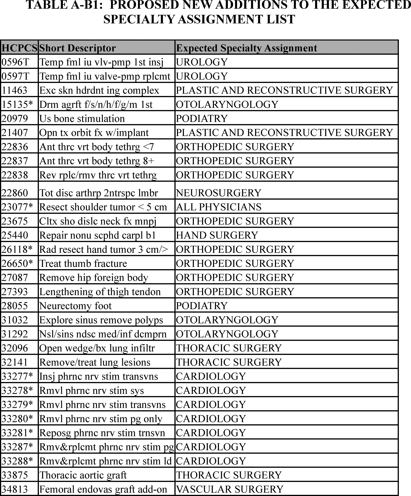
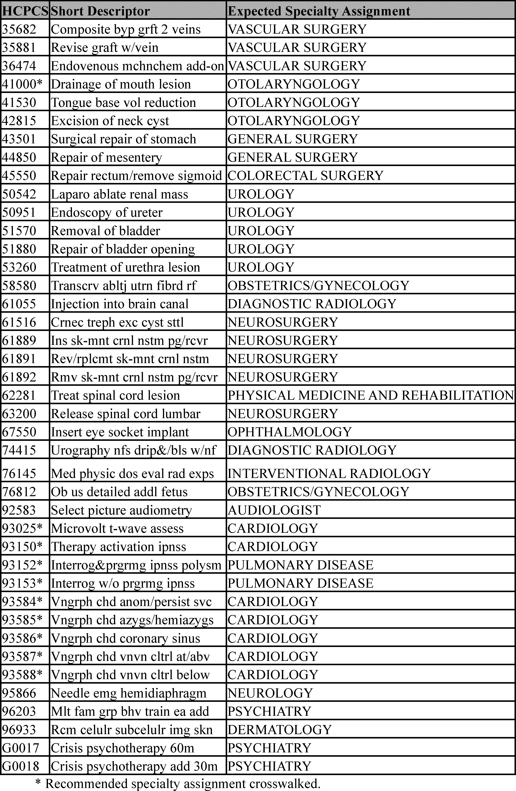
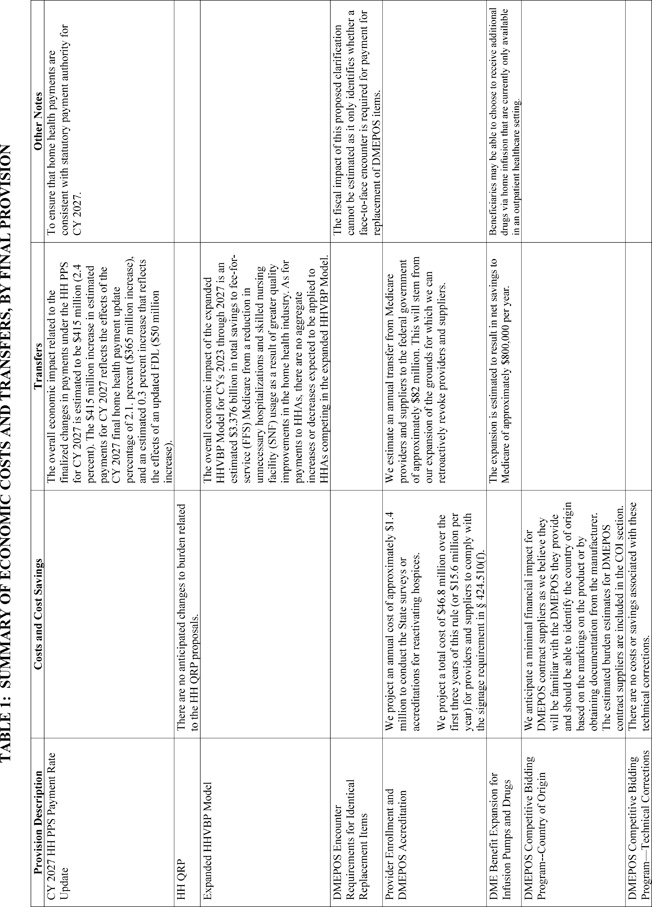
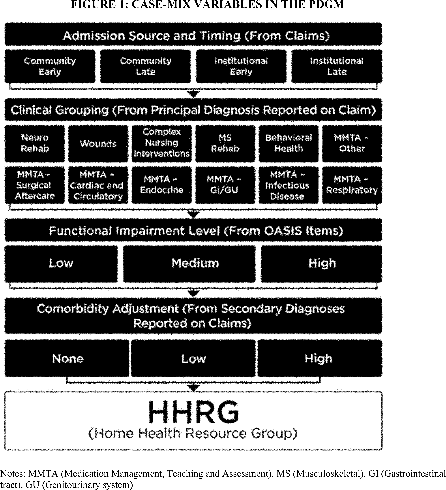
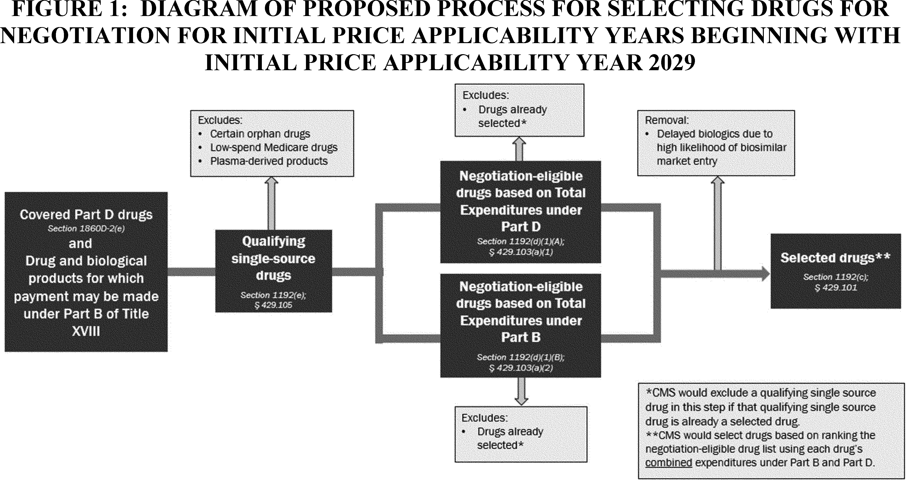
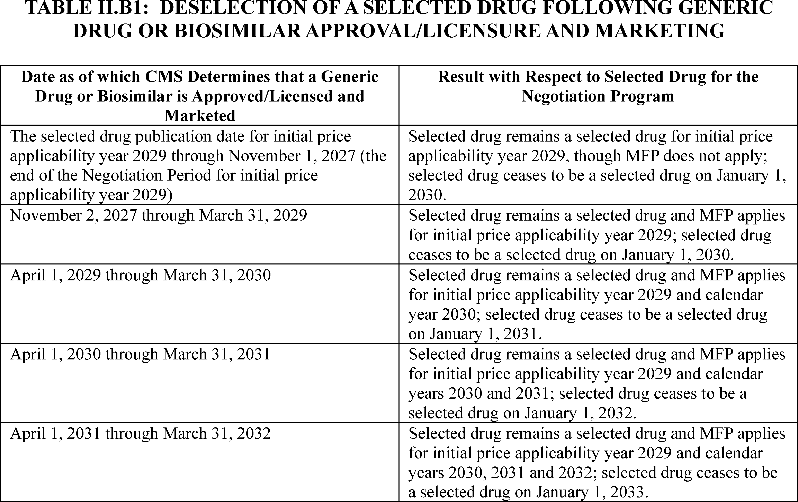
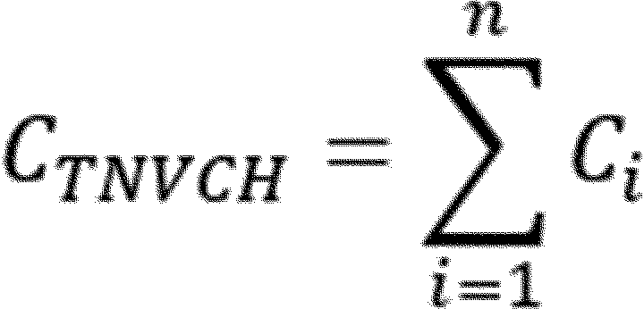

# Daily Digest — 2026-11-09

| | |
|---|---|
| **Digest date** | 2026-11-09 |
| **Data date range** | 2026-11-09 to 2026-11-09 |
| **Generated at** | 2026-11-10T05:06:24Z (UTC) |
| **Pipeline version** | 5190eab0 |
| **Inference** | model layers ran — gemini/gemini-2.5-flash |
| **Source watermarks** | CREC: 2026-11-06T16:07:38Z · BILLS: 2026-11-09T16:48:04Z · FR: 2026-11-10T00:56:50Z · USCOURTS: 2026-11-09T22:50:26Z · PLAW: 2026-11-09T15:10:06Z |

[Full observed listing for this day](day/2026-11-09.html) — the items our collectors observed for this publication day, mechanical rules applied, frozen at end of day; releases their publishers date on other days are counted there, not listed. This digest is the canonical record.

All items below cite the govinfo package (and granule, where applicable) they
summarize. Selection is mechanical; each item states the rule that included
it. See the Coverage Statement at the end for a full accounting of what was
published, what was summarized, and what was excluded and why.

---

## Contents

- [Day in Review](#day-in-review)
- [1. Congressional Floor Activity](#1-congressional-floor-activity)
- [2. Legislation](#2-legislation)
- [3. Federal Register](#3-federal-register)
- [4. Enacted Laws](#4-enacted-laws)
- [5. Judicial Activity](#5-judicial-activity)
- [6. Agency Announcements](#6-agency-announcements)
- [7. Recorded Votes](#7-recorded-votes)
- [8. Bill Actions](#8-bill-actions)
- [9. Presidential Actions](#9-presidential-actions)
- [Terms Used Today](#terms-used-today)
- [Coverage Statement](#coverage-statement)
- [Methodology](#methodology)

---

## Day in Review

The digest carries two public laws. Public Law 119–137, approved November 3, 2026, reauthorizes appropriations for the United States Commission on International Religious Freedom through December 31, 2028. Public Law 119–138, also approved on November 3, 2026, extends provisions of the Accelerating Access to Critical Therapies for ALS Act through 2031 and adds requirements for research grants related to ALS therapies. The Senate agreed to one bill.

Federal agencies issued 15 final rules and eight proposed rules. Final rules included a Department of Labor requirement for electronic filing in administrative hearings, and several from the FAA, including airworthiness directives and technical corrections to commercial space transportation regulations. The Environmental Protection Agency finalized amendments to national emission standards for hazardous air pollutants for Polyvinyl Chloride and Copolymer Production. The Centers for Medicare & Medicaid Services finalized various payment policies under the Physician Fee Schedule and Home Health Prospective Payment System, and established new policies for the Medicare Drug Price Negotiation Program. Proposed rules included several from the FAA concerning commercial space launch and reentry licensing, and amendments to commercial fishing regulations in the Pacific Remote Islands Marine National Monument Expansion by NMFS. The White House published one list of nominations sent to the Senate, including federal judges and ambassadors. The digest also carries 75 Federal Register notices.

The digest carries 27 district court opinions.

*Composed from the summarized items below and the day's mechanical
counts; all specifics are cited in their sections.*

---

## 1. Congressional Floor Activity

No Congressional Record issue was observed on this day. The Record for a day's proceedings is typically published by govinfo the following morning; it appears in the digest for the day it is observed ([how our clocks work](faq.html#fapds-three-clocks)).

### 1.1 Senate

No Senate floor items met the selection thresholds. 0 floor granule(s) are accounted for in the Coverage Statement.

### 1.2 House of Representatives

No House floor items met the selection thresholds. 0 floor granule(s) are accounted for in the Coverage Statement.

### 1.3 Recorded Votes

No recorded votes were published in this issue of the Congressional Record.

---

## 2. Legislation

Source: Congressional Bills (BILLS), text versions published 2026-11-09 to 2026-11-09.

### 2.1 Counts by Stage

| Stage (bill text version) | Count |
|---|---|
| Introduced (ih/is) | 0 |
| Reported (rh/rs) | 0 |
| Engrossed (eh/es) | 0 |
| Enrolled (enr) | 0 |
| Other versions | 1 |
| **Total bill texts published** | **1** |

### 2.2 Bills Listed by Mechanical Rule

Bills below are listed because they matched at least one listing rule; the
matching rule is stated per item. All other bill texts are counted above and
accounted for in the Coverage Statement.

No bill texts published in this range matched a listing rule; all 1 are
accounted for in the Coverage Statement.

---

## 3. Federal Register

Source: Federal Register (FR), issue of 2026-11-09.

### 3.1 Counts by Document Type

| Document type | Count |
|---|---|
| Rules | 15 |
| Proposed rules | 8 |
| Notices | 75 |
| Presidential documents | 0 |
| **Total FR documents** | **98** |

### 3.2 Rules Published

Tags: department of transportation · executive · securities and exchange commission · model keys: airworthiness directives · e-filing · medicare policies

*In plain terms: The 15 final rules update Medicare payment policies, establish the Medicare Drug Price Negotiation Program, 5 airworthiness directives, e-filing, and hazardous air pollutants.*

#### DEPARTMENT OF AGRICULTURE

- **Single Family Housing Guaranteed Loan Program-Limited Party Concessions** (2026-22772; 7 CFR Part 3555) — Rural Housing Service (RHS or the Agency), a Rural Development (RD) agency of the United States Department of Agriculture (USDA), amends the Single Family Housing Guaranteed Loan Program (SFHGLP) regulation to clarify real estate commission fees are not included in the limit on interested party concessions. Action: Final rule. Dates: This final rule is effective November 9, 2026.
  - *In plain terms:* The Rural Housing Service, part of the U.S. Department of Agriculture, amends the Single Family Housing Guaranteed Loan Program rule to clarify that real estate commission fees are not counted toward the limit on interested party concessions.
  - Included because: FR-SEL-01 — document type: final rule (all listed)
  - Source: [FR-2026-11-09 / 2026-22772](https://www.govinfo.gov/app/details/FR-2026-11-09/2026-22772)

#### DEPARTMENT OF COMMERCE

- **Extension of the Suspension of Expansion of End-User Controls for Affiliates of Certain Listed Entities** (2026-22793; 15 CFR Parts 732, 734, 736, 744, and 748) — The Bureau of Industry and Security (BIS) is extending the suspension of the interim final rule (IFR), “Expansion of End-User Controls to Cover Affiliates of Certain Listed Entities.” The suspension was set to end November 9, 2026. This final rule extends the suspension through January 10, 2027. Action: Final rule; stay. Dates: Effective November 9, 2026, the amendments to 15 CFR parts 732, 734, 736, 744, and 748 in the interim final rule published at 90 FR 47201, on September 30, 2025, and stayed on November 10, 2025, at 90 FR 50857, are further stayed until January 10, 2027.
  - *In plain terms:* The Bureau of Industry and Security extends through January 10, 2027 the suspension of its expanded end-user controls rule for affiliates of certain listed entities, which was set to end November 9, 2026.
  - Included because: FR-SEL-01 — document type: final rule (all listed)
  - Source: [FR-2026-11-09 / 2026-22793](https://www.govinfo.gov/app/details/FR-2026-11-09/2026-22793)

#### DEPARTMENT OF HEALTH AND HUMAN SERVICES

- **Medicare and Medicaid Programs; CY 2027 Payment Policies Under the Physician Fee Schedule and Other Changes to Part B Payment and Coverage Policies; Medicare Shared Savings Program Requirements; and Medicare Prescription Drug Inflation Rebate Program** (2026-22743; 42 CFR Parts 400, 405, 406, 407, 410, 414, 415, 417, 422, 423, 424, 425, 427, 428, and 512) — This final rule addresses: changes to the physician fee schedule (PFS); other changes to Medicare Part B payment policies to ensure that payment systems are updated to reflect changes in medical practice, relative value of services, and changes in the statute; codification of establishment of new policies for: the Medicare Prescription Drug Inflation Rebate Program under the Inflation Reduction Act of 2022; limiting Medicare coverage of certain individuals; the Ambulatory Specialty Model; updates to drugs and biological products paid under Part B; Medicare Shared Savings Program requirements; updates to the Quality Payment Program; updates to policies for Rural Health Clinics and Federally Qualified Health Centers; update to the Ambulance Fee Schedule regulations; codification of the Inflation Reduction Act and Consolidated Appropriations Act, 2026 provisions; updates to Clinical Laboratory Fee Schedule regulations; updates to the Medicare Promoting Interoperability Program. Action: Final rule. Dates: These regulations are effective on January 1, 2027.
  - *In plain terms:* This final rule updates Medicare physician fee schedule and other Part B payment policies, and writes into regulations new policies for drug inflation rebates, Medicare coverage limits for certain individuals, the Ambulatory Specialty Model, and several other programs.
  - Included because: FR-SEL-01 — document type: final rule (all listed)
  - Source: [FR-2026-11-09 / 2026-22743](https://www.govinfo.gov/app/details/FR-2026-11-09/2026-22743)
  -  *Source graphic 1 of 499 from 2026-22743.*
  -  *Source graphic 2 of 499 from 2026-22743.*
  - *Graphics not rendered here: 497 of 499 — see the [source PDF](https://www.govinfo.gov/content/pkg/FR-2026-11-09/pdf/FR-2026-11-09.pdf).*
- **Calendar Year 2027 Home Health Prospective Payment System (HH PPS) Rate Update; Requirements for the HH Quality Reporting Program and the Expanded HH Value-Based Purchasing Model; Medicare Provider Enrollment, Durable Medical Equipment (DME), and DME, Prosthetics, Orthotics, and Supplies (DMEPOS) Policies** (2026-22750; 42 CFR Parts 405, 410, 414, 422, 423, 424, 484, and 498) — This final rule sets forth routine updates to the Medicare home health payment rates in accordance with existing statutory and regulatory requirements. In addition, this final rule discusses the behavior adjustments and finalizes a temporary behavior adjustment. It also finalizes the recalibrated case-mix weights and updated functional impairment levels; comorbidity subgroups; and low-utilization payment adjustment (LUPA) thresholds for CY 2027. Additionally, this final rule discusses and responds to comments on the provision of home health palliative care services and includes a summary of comments received on the request for information (RFI) on a home health specific wage index included in the proposed rule. This rule also finalizes changes to the Home Health Quality Reporting Program (HH QRP) and summarizes potential initiatives to improve alignment between the HH QRP and expanded Home Health Value-Based Purchasing (HHVBP) Model. [official summary truncated; see source] Action: Final rule. Dates: With the exception of the HH PPS and HH QRP provisions specified in sections II. and III. of this final rule and the regulatory changes at 42 CFR 484.245, these regulations are effective on January 4, 2026. The HH PPS and HH QRP provisions specified in sections II. and III. of this final rule and the regulatory changes at 42 CFR 484.245 are effective January 1, 2027.
  - *In plain terms:* This final rule sets routine calendar-year 2027 updates to Medicare home health payment rates, finalizes a temporary behavior adjustment, and updates case-mix weights, functional impairment levels, comorbidity subgroups, and low-utilization payment adjustment thresholds.
  - Included because: FR-SEL-01 — document type: final rule (all listed)
  - Source: [FR-2026-11-09 / 2026-22750](https://www.govinfo.gov/app/details/FR-2026-11-09/2026-22750)
  -  *Source graphic 1 of 44 from 2026-22750.*
  -  *Source graphic 2 of 44 from 2026-22750.*
  - *Graphics not rendered here: 42 of 44 — see the [source PDF](https://www.govinfo.gov/content/pkg/FR-2026-11-09/pdf/FR-2026-11-09.pdf).*
- **Medicare Drug Price Negotiation Program and Medicare Prescription Drug Benefit Program** (2026-22792; 42 CFR Parts 423 and 429) — This rule finalizes and codifies the Medicare Drug Price Negotiation Program (“Negotiation Program”) and establishes certain new policies for the Negotiation Program and the Medicare Prescription Drug Benefit Program (“Part D Program”) as required by the Inflation Reduction Act of 2022. This final rule also finalizes a proposed policy for specific fixed combination drugs that are new formulations. Action: Final rule. Dates: Effective date: These regulations are effective on December 5, 2026. Applicability date: These regulations are applicable to the Negotiation Program beginning with respect to initial price applicability year 2029 and to Part D Program coverage beginning January 1, 2029.
  - *In plain terms:* This rule finalizes the Medicare Drug Price Negotiation Program and related new policies under the Inflation Reduction Act of 2022, and finalizes a proposed policy for certain fixed combination drugs that are new formulations.
  - Included because: FR-SEL-01 — document type: final rule (all listed)
  - Source: [FR-2026-11-09 / 2026-22792](https://www.govinfo.gov/app/details/FR-2026-11-09/2026-22792)
  -  *Source graphic 1 of 25 from 2026-22792.*
  -  *Source graphic 2 of 25 from 2026-22792.*
  - *Graphics not rendered here: 23 of 25 — see the [source PDF](https://www.govinfo.gov/content/pkg/FR-2026-11-09/pdf/FR-2026-11-09.pdf).*

#### DEPARTMENT OF HOMELAND SECURITY

- **Security Zones; Protection of Military Cargo, Captain of the Port Zone Puget Sound, WA** (2026-22831; 33 CFR Part 165) — The Coast Guard will enforce security zones for the Protection of Military Cargo from November 8 through November 12, 2026, to provide for the security of life and vessels on navigable waterways during this event. Our regulation for Protection of Military Cargo within the Captain of the Port Zone Puget Sound, WA identifies the security zones for this event in the Blair Waterway and Sitcum Waterway in Commencement Bay, WA. During the enforcement periods, the operator of any vessel in the regulated area must comply with directions from the Captain of the Port or a designated representative. Action: Notification of enforcement of regulation. Dates: The regulations in 33 CFR 165.1321 will be enforced for the security zones identified in the SUPPLEMENTARY INFORMATION section below for the dates and times specified.
  - *In plain terms:* The Coast Guard will enforce Protection of Military Cargo security zones in Commencement Bay, WA, from November 8 through November 12, 2026, and vessel operators must follow Captain of the Port directions.
  - Included because: FR-SEL-01 — document type: final rule (all listed)
  - Source: [FR-2026-11-09 / 2026-22831](https://www.govinfo.gov/app/details/FR-2026-11-09/2026-22831)

#### DEPARTMENT OF LABOR

- **Rules of Practice and Procedure for Administrative Hearings Before the Office of Administrative Law Judges** (2026-22761; 29 CFR Part 18) — This action finalizes the Department of Labor's (DOL or Department) proposal to require electronic filing (e-filing) in proceedings before the Office of Administrative Law Judges (OALJ), published on January 11, 2021. The Department has reviewed the comments received in response to the proposal and is now implementing the rule as described in the proposed rule of January 11, 2021, with appropriate exceptions for good cause shown and self-represented parties. Action: Final rule. Dates: This final rule is effective on December 9, 2026.
  - *In plain terms:* The Department of Labor is finalizing its January 11, 2021 proposal to require electronic filing in Office of Administrative Law Judges proceedings, with exceptions for good cause shown and self-represented parties.
  - Included because: FR-SEL-01 — document type: final rule (all listed)
  - Source: [FR-2026-11-09 / 2026-22761](https://www.govinfo.gov/app/details/FR-2026-11-09/2026-22761)

#### DEPARTMENT OF TRANSPORTATION

- **Airworthiness Directives; Rolls-Royce Deutschland Ltd & Co KG Engines** (2026-22774; 14 CFR Part 39) — The FAA is adopting a new airworthiness directive (AD) for all Rolls-Royce Deutschland Ltd & Co KG (RRD) Model BR700-725A1-12 engines. This AD was prompted by the manufacturer revising the airworthiness limitations section (ALS) of the existing time limits manual (TLM) to introduce new or more restrictive airworthiness limitations and associated thresholds and intervals for life-limited parts. This AD requires revising the ALS of the operator's existing approved engine maintenance or inspection program, as applicable, to incorporate new or more restrictive instructions and associated thresholds and intervals for life-limited parts. The FAA is issuing this AD to address the unsafe condition on these products. Action: Final rule. Dates: This AD is effective December 14, 2026. The Director of the Federal Register approved the incorporation by reference of a certain publication listed in this AD as of December 14, 2026.
  - *In plain terms:* The FAA is issuing a new airworthiness directive, a mandatory safety order, for all Rolls-Royce Deutschland BR700-725A1-12 engines, requiring operators to add new or more restrictive life-limited part instructions to their maintenance or inspection programs.
  - Included because: FR-SEL-01 — document type: final rule (all listed)
  - Source: [FR-2026-11-09 / 2026-22774](https://www.govinfo.gov/app/details/FR-2026-11-09/2026-22774)
- **Airworthiness Directives; Airbus Helicopters Deutschland GmbH (AHD) Helicopters** (2026-22776; 14 CFR Part 39) — The FAA is superseding Airworthiness Directive (AD) 2024-04-10 which applied to all Airbus Helicopters Deutschland GmbH (AHD) Model EC135P1, EC135P2, EC135P2+, EC135P3, EC135T1, EC135T2, EC135T2+, EC135T3, and EC635T2+ helicopters. AD 2024-04-10 required repetitively inspecting certain part-numbered tail rotor (T/R) blades for a crack and, depending on the results, removing any cracked T/R blade from service. AD 2024-04-10 also prohibits installing certain T/R blades on any helicopter unless certain requirements are met. Since AD 2024-04-10 was issued, it was determined that inspection Method A should be discontinued and that additional limitations shall be provided. This AD retains the actions of AD 2024-04-10 and requires repetitively inspecting a certain tail rotor blade (TRB) assembly for cracks and, depending on the results, removing any cracked TRB assembly from service and replacing an affected part as terminating action for the repetitive inspections. This AD also prohibits installing an affected TRB assembly on any helicopter unless certain requirements are met. The FAA is issuing this AD to address the unsafe condition on these products. Action: Final rule. Dates: This AD is effective December 14, 2026. The Director of the Federal Register approved the incorporation by reference of a certain publication listed in this AD as of December 14, 2026.
  - *In plain terms:* The FAA is replacing AD 2024-04-10, a safety order on tail rotor blade cracks, for Airbus Helicopters Deutschland EC135 and EC635 helicopters, keeping inspection and removal requirements, discontinuing inspection Method A, and adding installation limits.
  - Included because: FR-SEL-01 — document type: final rule (all listed)
  - Source: [FR-2026-11-09 / 2026-22776](https://www.govinfo.gov/app/details/FR-2026-11-09/2026-22776)
- **Airworthiness Directives; Airbus Helicopters** (2026-22780; 14 CFR Part 39) — The FAA is adopting a new airworthiness directive (AD) for all Airbus Helicopters (AH) Model EC130B4 helicopters. This AD was prompted by reports of weaknesses in the locking mechanisms on the left-hand side swinging and sliding door. This AD requires modifying the swing door star support and sliding door star support stringer. This AD also prohibits installing an affected composite door on any helicopter unless certain requirements are met. The FAA is issuing this AD to address the unsafe condition on these products. Action: Final rule. Dates: This AD is effective December 14, 2026. The Director of the Federal Register approved the incorporation by reference of a certain publication listed in this AD as of December 14, 2026.
  - *In plain terms:* The FAA is issuing a mandatory safety order for Airbus Helicopters EC130B4 helicopters after reports of weak left-hand door locks, requiring door support modifications and barring installation of affected composite doors unless requirements are met.
  - Included because: FR-SEL-01 — document type: final rule (all listed)
  - Source: [FR-2026-11-09 / 2026-22780](https://www.govinfo.gov/app/details/FR-2026-11-09/2026-22780)
- **Technical Corrections of Commercial Space Transportation Regulations** (2026-22781; 14 CFR Parts 413, 414, 450, and 460) — This final rule contains technical corrections in FAA regulations. Action: Final rule; technical amendment. Dates: Effective November 9, 2026.
  - *In plain terms:* This final rule makes technical corrections to FAA commercial space transportation regulations.
  - Included because: FR-SEL-01 — document type: final rule (all listed)
  - Source: [FR-2026-11-09 / 2026-22781](https://www.govinfo.gov/app/details/FR-2026-11-09/2026-22781)
- **Airworthiness Directives; Lycoming Engines** (2026-22785; 14 CFR Part 39) — The FAA is superseding Airworthiness Directive (AD) 2026-17-10, which applied to Lycoming Engines (Lycoming) Model O-235, O-540, and IO-540 engines with a certain piston pin installed. AD 2026-17-10 required replacement of the affected piston pin with a part eligible for installation and, for certain engines, oil change and visual inspection of the engine oil filter, oil pressure screen, and oil suction screen for metal particulates. AD 2026-17-10 also prohibited the installation of an affected piston pin on any engine. Since the FAA issued AD 2026-17-10, the manufacturer has identified additional Lycoming Model engines that are subject to the unsafe condition, and the FAA determined the need to clarify the definition for an “affected piston pin,” and include corrective action for engine models that were not listed in the manufacturer's service material. This AD requires replacement of the affected piston pin with a part eligible for installation and, for certain engines, oil change and visual inspection of the engine oil filter, oil pressure screen, and oil suction screen for metal particulates. This AD also prohibits the installation of an affected piston pin on any engine. [official summary truncated; see source] Action: Final rule; request for comments. Dates: This AD is effective November 24, 2026. The Director of the Federal Register approved the incorporation by reference of a certain publication listed in this AD as of November 24, 2026. The Director of the Federal Register approved the incorporation by reference of a certain other publication listed in this AD as of September 14, 2026 (91 FR 55451, August 28, 2026). The FAA must receive comments on this AD by December 24, 2026.
  - *In plain terms:* The FAA is superseding AD 2026-17-10 for Lycoming O-235, O-540, and IO-540 engines, clarifying the piston pin definition, adding unlisted models, and requiring piston pin replacement and, on some engines, an oil change and inspections.
  - Included because: FR-SEL-01 — document type: final rule (all listed)
  - Source: [FR-2026-11-09 / 2026-22785](https://www.govinfo.gov/app/details/FR-2026-11-09/2026-22785)
- **Airworthiness Directives; The Boeing Company Airplanes** (2026-22817; 14 CFR Part 39) — The FAA is adopting a new airworthiness directive (AD) for certain The Boeing Company Model 787-8, 787-9, and 787-10 airplanes. This AD was prompted by reports that the low range radio altimeter (LRRA) system has an increased rate of non-computed data (NCD) outputs at low altitudes during approach and landing, which could cause unreliable altimeter function. This AD requires replacing the left and right LRRA transmit and receive coaxial cables with larger gauge coaxial cables. The FAA is issuing this AD to address the unsafe condition on these products. Action: Final rule. Dates: This AD is effective December 14, 2026. The Director of the Federal Register approved the incorporation by reference of a certain publication listed in this AD as of December 14, 2026.
  - *In plain terms:* The FAA is issuing a new airworthiness directive, a mandatory safety order, for certain Boeing 787-8, 787-9, and 787-10 airplanes, requiring replacement of left and right low range radio altimeter coaxial cables with larger gauge cables.
  - Included because: FR-SEL-01 — document type: final rule (all listed)
  - Source: [FR-2026-11-09 / 2026-22817](https://www.govinfo.gov/app/details/FR-2026-11-09/2026-22817)
- **Amendment of Class D and Establishment of Class E Airspace; Chandler and Phoenix, AZ** (2026-22830; 14 CFR Part 71) — This action corrects a final rule published by the FAA in the Federal Register on October 30, 2026, amending the Class D airspace and establishing Class E airspace at Chandler and Phoenix, AZ. Specifically, this action corrects a statement in the preamble of the rule for greater clarity. Action: Final rule; correction. Dates: The effective date of the final rule published in the Federal Register on October 30, 2026, remains 0901 UTC, February 18, 2027. The Director of the Federal Register approves this incorporation by reference action under 1 CFR part 51, subject to the annual revision of FAA Order JO 7400.11 and publication of conforming amendments.
  - *In plain terms:* This action corrects an FAA final rule published October 30, 2026, which amended Class D airspace and established Class E airspace at Chandler and Phoenix, Arizona, by fixing a preamble statement for greater clarity.
  - Included because: FR-SEL-01 — document type: final rule (all listed)
  - Source: [FR-2026-11-09 / 2026-22830](https://www.govinfo.gov/app/details/FR-2026-11-09/2026-22830)

#### ENVIRONMENTAL PROTECTION AGENCY

- **National Emission Standards for Hazardous Air Pollutants: Polyvinyl Chloride and Copolymer Production Reconsideration; New Major Source Process Wastewater Standards** (2026-22788; 40 CFR Part 63) — The U.S. Environmental Protection Agency (EPA) is finalizing amendments to the national emission standards for hazardous air pollutants (NESHAP) for the Polyvinyl Chloride (PVC) and Copolymer Production source category (“PVC NESHAP”) under Clean Air Act (CAA) section 112. For new major sources, the EPA is finalizing the removal of the total non-vinyl chloride organic hazardous air pollutant (HAP) process wastewater emission limit and the associated testing, monitoring, recordkeeping, and reporting requirements. The EPA is also finalizing that the new major source vinyl chloride emission limit acts as a surrogate for non-vinyl chloride organic HAP emissions from process wastewater. The EPA is not taking final action on other aspects of the reconsideration proposal at this time. Action: Final rule. Dates: This final rule is effective on November 9, 2026.
  - *In plain terms:* EPA is finalizing amendments to air toxics rules for polyvinyl chloride and copolymer production, removing a non-vinyl chloride process wastewater limit and related requirements for new major sources, and not finalizing other proposed changes for now.
  - Included because: FR-SEL-01 — document type: final rule (all listed)
  - Source: [FR-2026-11-09 / 2026-22788](https://www.govinfo.gov/app/details/FR-2026-11-09/2026-22788)
  -  *Source graphic 1 of 1 from 2026-22788.*

### 3.3 Proposed Rules Published

Tags: department of transportation · executive · securities and exchange commission · model keys: fishing regulations · funds transfer · space launch

*In plain terms: Three proposals for commercial space launch lead the 8 proposed rules; others include withdrawing a funds transfer threshold rule, and amending Pacific Island commercial fishing.*

#### DEPARTMENT OF AGRICULTURE

- **Pecans Grown in the States of Alabama, Arkansas, Arizona, California, Florida, Georgia, Kansas, Louisiana, Missouri, Mississippi, North Carolina, New Mexico, Oklahoma, South Carolina, and Texas; Changes to Membership and Handling Requirements** (2026-22826; 7 CFR Part 986) — This proposed rule would implement recommendations from the American Pecan Council (Council) to eliminate regional and size designations for sheller members, modify the nomination process for sheller members, adjust the requirements of the inter-handler transfer report form, and establish a late fee and interest charges for unpaid assessments. The rule will also propose two technical corrections. Action: Proposed rule. Dates: Comments must be received by December 9, 2026.
  - *In plain terms:* This proposed rule would implement American Pecan Council recommendations by removing regional and size designations for sheller members, changing their nomination process, and adding late fees and interest on unpaid assessments.
  - Included because: FR-SEL-02 — document type: proposed rule (all listed)
  - Source: [FR-2026-11-09 / 2026-22826](https://www.govinfo.gov/app/details/FR-2026-11-09/2026-22826)

#### DEPARTMENT OF COMMERCE

- **Pacific Island Fisheries; Commercial Fishing in the Pacific Remote Islands Marine National Monument Expansion** (2026-22815; 50 CFR Part 665) — NMFS proposes to amend regulations that prohibit commercial fishing in the Pacific Remote Islands Marine National Monument Expansion (PRIMNM Expansion), which comprises waters of the U.S. exclusive economic zone (EEZ) between 50 to 200 nautical miles (nmi; 93 to 370 kilometers (km)) around Johnston Atoll and Wake and Jarvis Islands. This action is necessary to conform fishing regulations with Presidential Proclamation 10918 of April 17, 2025—Unleashing American Commercial Fishing in the Pacific, as amended by Presidential Proclamation 11035 of June 11, 2026—Restoring American Commercial Fishing in the Pacific, and in light of a court order. Fisheries in the PRIMNM Expansion would be regulated pursuant to existing fishing regulations under the Magnuson-Stevens Fishery Conservation and Management Act (Magnuson-Stevens Act), the Western and Central Pacific Fisheries Convention Implementation Act (WCPFCIA), the South Pacific Tuna Act (SPTA), and other applicable laws, that apply to all U.S. commercial fishing vessels but were superseded and made inapplicable when the commercial fishing prohibition for the PRIMNM Expansion was established. [official summary truncated; see source] Action: Proposed rule, request for comments. Dates: NMFS must receive comments by December 9, 2026.
  - *In plain terms:* NMFS proposes amending regulations banning commercial fishing in the Pacific Remote Islands Marine National Monument Expansion to conform with Presidential Proclamation 10918 of April 17, 2025, as amended June 11, 2026, and a court order.
  - Included because: FR-SEL-02 — document type: proposed rule (all listed)
  - Source: [FR-2026-11-09 / 2026-22815](https://www.govinfo.gov/app/details/FR-2026-11-09/2026-22815)

#### DEPARTMENT OF HEALTH AND HUMAN SERVICES

- **Medicare Program; Implementation of Sections 6219, 6220, and 6224 of the Consolidated Appropriations Act, 2026; Correction** (2026-22807; 42 CFR Parts 422 and 423) — This document corrects a typographical error in the proposed rule that appeared in the October 20, 2026 Federal Register titled “Medicare Program; Implementation of Sections 6219, 6220, and 6224 of the Consolidated Appropriations Act, 2026”. Action: Proposed rule; correction.
  - *In plain terms:* This document corrects a typographical error in the proposed rule 'Medicare Program; Implementation of Sections 6219, 6220, and 6224 of the Consolidated Appropriations Act, 2026,' published in the October 20, 2026 Federal Register.
  - Included because: FR-SEL-02 — document type: proposed rule (all listed)
  - Source: [FR-2026-11-09 / 2026-22807](https://www.govinfo.gov/app/details/FR-2026-11-09/2026-22807)

#### DEPARTMENT OF THE TREASURY

- **Threshold for the Requirement To Collect, Retain, and Transmit Information on Funds Transfers and Transmittals of Funds That Begin or End Outside the United States, and Clarification of the Requirement To Collect, Retain, and Transmit Information on Transactions Involving Convertible Virtual Currencies and Digital Assets With Legal Tender Status; Withdrawal** (2026-22809; 31 CFR Parts 1010 and 1020) — FinCEN and the Board (collectively, the “Agencies”) are withdrawing the joint notice of proposed rulemaking (NPRM) published on October 27, 2020, that proposed modifying the threshold in the Agencies' rules implementing the Bank Secrecy Act (BSA) requiring financial institutions to collect and retain information on certain funds transfers and transmittals of funds. The NPRM would have reduced this threshold from $3,000 to $250 for funds transfers and transmittals of funds that begin or end outside the United States. FinCEN additionally proposed reducing from $3,000 to $250 the threshold in FinCEN's rule requiring financial institutions to transmit to other financial institutions in the payment chain information on funds transfers and transmittals of funds that begin or end outside the United States. The NPRM also would have clarified the meaning of “money” as used in the Agencies' rules to specify that the rules apply to domestic and cross-border transactions involving convertible virtual currency (CVC) and digital assets that have legal tender status to a recipient. The Agencies will not take further action on this NPRM. Action: Proposed rule; withdrawal. Dates: FinCEN and the Board are withdrawing the NPRM published at 85 FR 68005 (October 27, 2020), as of November 9, 2026.
  - *In plain terms:* FinCEN and the Board are withdrawing their October 27, 2020 proposal to lower the $3,000 threshold for certain cross-border funds transfer information to $250, taking no further action on it.
  - Included because: FR-SEL-02 — document type: proposed rule (all listed)
  - Source: [FR-2026-11-09 / 2026-22809](https://www.govinfo.gov/app/details/FR-2026-11-09/2026-22809)

#### DEPARTMENT OF TRANSPORTATION

- **Flight Abort Burden Reducing Clarification on End of Flight Safety Limits** (2026-22782; 14 CFR Part 450) — FAA proposes to amend its commercial space launch and reentry licensing regulations to streamline the licensing process and reduce regulatory burden for license applicants. Specifically, FAA proposes to clarify the conditions under which a vehicle operator is not required to abort a flight. Action: Notice of proposed rulemaking (NPRM). Dates: Send comments on or before December 9, 2026.
  - *In plain terms:* The FAA proposes amending commercial space launch and reentry licensing rules to streamline licensing and reduce regulatory burden on applicants by clarifying when a vehicle operator is not required to abort a flight.
  - Included because: FR-SEL-02 — document type: proposed rule (all listed)
  - Source: [FR-2026-11-09 / 2026-22782](https://www.govinfo.gov/app/details/FR-2026-11-09/2026-22782)
- **Flight Safety Limits Objectives Burden Reducing Clarification** (2026-22783; 14 CFR Part 450) — FAA proposes to amend its commercial space launch and reentry licensing regulations to streamline the licensing process and reduce regulatory burden for license applicants. Specifically, FAA proposes to clarify the requirements for establishing flight safety limits that define when a vehicle operator must initiate flight abort. Action: Notice of proposed rulemaking (NPRM). Dates: Send comments on or before December 9, 2026.
  - *In plain terms:* The FAA proposes changing commercial space licensing rules to clarify requirements for flight safety limits that define when a vehicle operator must start a flight abort.
  - Included because: FR-SEL-02 — document type: proposed rule (all listed)
  - Source: [FR-2026-11-09 / 2026-22783](https://www.govinfo.gov/app/details/FR-2026-11-09/2026-22783)
- **Conditional Expected Casualty Exception for Failures Resulting in an Uncontrolled Atmospheric Return** (2026-22784; 14 CFR Parts 401 and 450) — FAA proposes to amend its commercial space launch and reentry licensing regulations to streamline the licensing process and reduce regulatory burden for license applicants. Specifically, FAA proposes to allow a launch and reentry vehicle operator to protect against high consequence events during an uncontrolled atmospheric return by showing that there would be sufficient breakup of the vehicle to ensure protection against a single event expected to produce multiple casualties. Action: Notice of proposed rulemaking (NPRM). Dates: Send comments on or before December 9, 2026.
  - *In plain terms:* The FAA proposes letting launch and reentry operators protect against high-consequence events in uncontrolled atmospheric returns by showing enough vehicle breakup to guard against a single event expected to cause multiple casualties.
  - Included because: FR-SEL-02 — document type: proposed rule (all listed)
  - Source: [FR-2026-11-09 / 2026-22784](https://www.govinfo.gov/app/details/FR-2026-11-09/2026-22784)

#### FEDERAL COMMUNICATIONS COMMISSION

- **Television Broadcasting Services Odessa, Texas** (2026-22833; 47 CFR Part 73) — This document proposes to amend the Table of TV Allotments (Table) of the Federal Communications Commission's (Commission) rules in response to a petition for rulemaking filed by Gray Television Licensee, LLC (Gray), the licensee of KOSA-TV (KOSA-TV), Odessa, Texas (Odessa). Gray held a construction permit to construct a facility on UHF channel 31 at Odessa, and now requests that the Bureau substitute VHF channel 7 for UHF channel 31 in the Table, with the technical parameters as set forth in KOSA-TV's current license. The Media Bureau previously granted a petition for rulemaking submitted by Gray to substitute UHF channel 31 for VHF channel 7 at Odessa. Gray states that it is unable to complete construction of its new channel within the time specified on the construction permit, and therefore requests amendment of the Table to allow it to continue to operate on VHF channel 7 at its currently licensed technical parameters to provide uninterrupted service to viewers. [official summary truncated; see source] Action: Proposed rule. Dates: Comments must be filed on or before December 9, 2026 and reply comments on or before December 24, 2026.
  - *In plain terms:* FCC proposes amending the TV allotment table to substitute VHF channel 7 for UHF channel 31 at Odessa, Texas, because Gray Television says it cannot finish building UHF channel 31 within its permit's time limit.
  - Included because: FR-SEL-02 — document type: proposed rule (all listed)
  - Source: [FR-2026-11-09 / 2026-22833](https://www.govinfo.gov/app/details/FR-2026-11-09/2026-22833)

### 3.4 Notices and Presidential Documents

Notices are summarized only when they match a listing rule; all are counted
in 3.1 and in the Coverage Statement. Presidential documents in the FR are
always listed.

No notices or presidential documents matched a listing rule.

---

## 4. Enacted Laws

Tags: legislative · model keys: als therapies · religious freedom

*In plain terms: The 2 new public laws reauthorize the United States Commission on International Religious Freedom and extend the Accelerating Access to Critical Therapies for ALS Act.*

Source: Public and Private Laws (PLAW) published 2026-11-09.

- **Public Law 119–137 — Public Law 119–137: To extend and authorize annual appropriations for the United States Commission on International Religious Freedom through December 31, 2028.** — Public Law 119–137 (H.R. 1744), approved November 3, 2026, is cited as the "United States Commission on International Religious Freedom Reauthorization Act of 2026." It amends Section 207(a) of the International Religious Freedom Act of 1998 to authorize appropriations for fiscal years 2027 and 2028 and for the period from October 1, 2028, through December 31, 2028. It also amends Section 209 of that Act to change the authorization end date from September 30, 2026, to December 31, 2028. Approved: 2026-11-03.
  - *In plain terms:* Public Law 119–137 (H.R. 1744), approved November 3, 2026, extends the authorization for funding the U.S. Commission on International Religious Freedom through December 31, 2028.
  - Included because: PLAW-SEL-01 — enacted into law (all public and private laws are listed) (document dated 2026-11-03)
  - Source: [PLAW-119publ137](https://www.govinfo.gov/app/details/PLAW-119publ137)
- **Public Law 119–138 — Public Law 119–138: To amend the Accelerating Access to Critical Therapies for ALS Act to reauthorize the provisions of such Act through fiscal year 2031, and for other purposes.** — Public Law 119–138 (H.R. 8205), approved November 3, 2026, is cited as the "Accelerating Access to Critical Therapies for ALS Reauthorization Act of 2026." It extends the provisions of the Accelerating Access to Critical Therapies for ALS Act through 2031 and adds requirements for grants for research on therapies for ALS, including a review of renewal applications for investigational drugs, reporting of serious adverse events for phase 3 trials, and a definition of phase 3 that includes certain phase 2/3 combined trials. It also amends Section 4 of that Act to retitle the action plan as the "FDA Rare Neurodegenerative Disease Action Plan" and requires the Food and Drug Administration to publish an action plan within 18 months of enactment and a report within 5 years of enactment. Approved: 2026-11-03.
  - *In plain terms:* Public Law 119–138 (November 3, 2026) extends the ALS Act through 2031, adds grant requirements for ALS research, and requires FDA to publish an action plan within 18 months and a report within 5 years of enactment.
  - Included because: PLAW-SEL-01 — enacted into law (all public and private laws are listed) (document dated 2026-11-03)
  - Source: [PLAW-119publ138](https://www.govinfo.gov/app/details/PLAW-119publ138)

---

## 5. Judicial Activity

Source: United States Courts Opinions (USCOURTS): opinions observed 2026-11-09
by our collector; each opinion states its own issue date beside its
listing ([how our clocks work](faq.html#fapds-three-clocks)).

Completeness disclosure (standing): USCOURTS carries opinions from
approximately 140 participating appellate, district, bankruptcy, and
national federal courts. Unlike the Congressional Record and the Federal
Register, which are the complete official record of their branches,
USCOURTS is participation-based and is NOT the complete federal judicial
record. Courts post opinions with delay — typically over several days —
so a day's digest carries the opinions that became available that day,
whatever date each was issued.

### 5.1 Appellate and National Court Opinions

Appellate and national court opinions are summarized; district and
bankruptcy opinions are counted in 5.2 and in the Coverage Statement.

No appellate or national court opinions matched a listing rule for this
date; all opinions are counted in 5.2 and accounted for in the Coverage
Statement.

### 5.2 Counts by Court Category

| Court category | Opinions |
|---|---|
| Appellate | 0 |
| District | 27 |
| Bankruptcy | 0 |
| National | 0 |
| **Total opinions extracted** | **27** |

Archive-window disclosure (rule USCOURTS-FETCH-01): 34464 USCOURTS package(s) have been listed in delta syncs but fell outside the 7-day archive window and were not fetched (global running count across all syncs, not limited to this date).

---

## 6. Agency Announcements

Official press releases and statements the agencies themselves date
on 2026-11-09 (sources listed in the source guide). These are the
agencies' own announcements — official advocacy, quoted and
attributed, not findings of this digest. Agency web content can be
edited or removed without notice; captures and hashes are preserved
per the provenance policy.

#### Bureau of Transportation Statistics (email)

- **U.S. Cargo and Passenger Airlines Gained 8,212 Jobs in September 2026** — dated 2026-11-09 by the agency
  - Included because: AGENCYPR-SEL-01 — official agency release dated this day by the agency (all such releases from active sources are listed; titles only in the pilot)
  - Source: agency email bulletin to this project's subscription, captured and DKIM-verified (the bulletin named no canonical page)

#### Census Bureau (email)

- **📅 This Week: Veterans Day 🎖️** — dated 2026-11-09 by the agency
  - Included because: AGENCYPR-SEL-01 — official agency release dated this day by the agency (all such releases from active sources are listed; titles only in the pilot)
  - Source: agency email bulletin to this project's subscription, captured and DKIM-verified (the bulletin named no canonical page)
- **🗓️ Reminder: Updates to Current Population Survey Modernization Efforts** — dated 2026-11-09 by the agency
  - Included because: AGENCYPR-SEL-01 — official agency release dated this day by the agency (all such releases from active sources are listed; titles only in the pilot)
  - Source: agency email bulletin to this project's subscription, captured and DKIM-verified (the bulletin named no canonical page)

#### CFTC Press Releases

- **[CFTC Sanctions Eight Individuals for Acting as Unregistered Associated Persons of Foreign Introducing Brokers](https://www.cftc.gov/PressRoom/PressReleases/9324-26)** — dated 2026-11-09 by the agency
  - Included because: AGENCYPR-SEL-01 — official agency release dated this day by the agency (all such releases from active sources are listed; titles only in the pilot)

#### CISA Cybersecurity Advisories

- **[CISA Adds Four Known Exploited Vulnerabilities to Catalog](https://www.cisa.gov/news-events/alerts/2026/11/09/cisa-adds-four-known-exploited-vulnerabilities-catalog)** — dated 2026-11-09 by the agency
  - Included because: AGENCYPR-SEL-01 — official agency release dated this day by the agency (all such releases from active sources are listed; titles only in the pilot)

#### DEA Updates (email)

- **Building Youth Resilience: An Earlier and Broader Approach** — dated 2026-11-09 by the agency
  - Included because: AGENCYPR-SEL-01 — official agency release dated this day by the agency (all such releases from active sources are listed; titles only in the pilot)
  - Source: agency email bulletin to this project's subscription, captured and DKIM-verified (the bulletin named no canonical page)

#### Defense News Releases

- **[Hegseth Mandates Military Education Reform](https://www.war.gov/News/News-Stories/Article/Article/4645001/hegseth-mandates-military-education-reform/)** — dated 2026-11-09 by the agency
  - Included because: AGENCYPR-SEL-01 — official agency release dated this day by the agency (all such releases from active sources are listed; titles only in the pilot)
- **[Navy Command Builds on Training Partnership During South Korean Visit](https://www.war.gov/News/News-Stories/Article/Article/4645097/navy-command-builds-on-training-partnership-during-south-korean-visit/)** — dated 2026-11-09 by the agency
  - Included because: AGENCYPR-SEL-01 — official agency release dated this day by the agency (all such releases from active sources are listed; titles only in the pilot)

#### DHS News Releases

- **[Meet One of the Media’s ‘Non-Criminals’: ICE Arrests MS-13 Member in Idaho Charged with Terrorism in El Salvador](https://www.dhs.gov/news/2026/11/09/meet-one-medias-non-criminals-ice-arrests-ms-13-member-idaho-charged-terrorism-el)** — dated 2026-11-09 by the agency
  - Included because: AGENCYPR-SEL-01 — official agency release dated this day by the agency (all such releases from active sources are listed; titles only in the pilot)
- **[Trump Administration Deepens Interagency Collaboration to Protect the Nation’s Skies From Unmanned Threats](https://www.dhs.gov/news/2026/11/09/trump-administration-deepens-interagency-collaboration-protect-nations-skies)** — dated 2026-11-09 by the agency
  - Included because: AGENCYPR-SEL-01 — official agency release dated this day by the agency (all such releases from active sources are listed; titles only in the pilot)
- **[WORST OF THE WORST: ICE Arrests Murderers, Pedophiles, and Sexual Predators](https://www.dhs.gov/news/2026/11/09/worst-worst-ice-arrests-murderers-pedophiles-and-sexual-predators)** — dated 2026-11-09 by the agency
  - Included because: AGENCYPR-SEL-01 — official agency release dated this day by the agency (all such releases from active sources are listed; titles only in the pilot)

#### DOJ COPS Office (email)

- **DEADLINE ON WEDNESDAY! Submit Your Entry to the 2027 Highlighting Heroes Photo Contest by November 11** — dated 2026-11-09 by the agency
  - Included because: AGENCYPR-SEL-01 — official agency release dated this day by the agency (all such releases from active sources are listed; titles only in the pilot)
  - Source: agency email bulletin to this project's subscription, captured and DKIM-verified (the bulletin named no canonical page)

#### Election Assistance Commission (email)

- **November 2026 Newsletter: EAC Updates and Events** — dated 2026-11-09 by the agency
  - Included because: AGENCYPR-SEL-01 — official agency release dated this day by the agency (all such releases from active sources are listed; titles only in the pilot)
  - Source: agency email bulletin to this project's subscription, captured and DKIM-verified (the bulletin named no canonical page)

#### FAA Updates (email)

- **FAA Orders & Notices Update Notification** — dated 2026-11-09 by the agency
  - Included because: AGENCYPR-SEL-01 — official agency release dated this day by the agency (all such releases from active sources are listed; titles only in the pilot)
  - Source: agency email bulletin to this project's subscription, captured and DKIM-verified (the bulletin named no canonical page)
- **FAA Orders & Notices Update Notification** — dated 2026-11-09 by the agency
  - Included because: AGENCYPR-SEL-01 — official agency release dated this day by the agency (all such releases from active sources are listed; titles only in the pilot)
  - Source: agency email bulletin to this project's subscription, captured and DKIM-verified (the bulletin named no canonical page)

#### FDA Email Updates (email)

- **[Eugia US LLC (f/k/a Auro Medics Pharma LLC) Issues Voluntary Nationwide Recall of Vancomycin Hydrochloride for Injection USP 1.25g/Vial-30mL (Single Dose Vial) Due to Presence of Particulate Matter](https://www.fda.gov/safety/recalls-market-withdrawals-safety-alerts/eugia-us-llc-fka-auro-medics-pharma-llc-issues-voluntary-nationwide-recall-vancomycin-hydrochloride?utm_medium=email&utm_source=govdelivery)** — dated 2026-11-09 by the agency
  - Included because: AGENCYPR-SEL-01 — official agency release dated this day by the agency (all such releases from active sources are listed; titles only in the pilot)
  - Source: agency email bulletin to this project's subscription, captured and DKIM-verified
- **FDA MedWatch - FDA Requires Safety Labeling Changes for Glucagon-Like Peptide-1 Receptor Agonists (GLP-1 RAs) Due to Potential Increased Risk of Rare but Serious Eye Condition** — dated 2026-11-09 by the agency
  - Included because: AGENCYPR-SEL-01 — official agency release dated this day by the agency (all such releases from active sources are listed; titles only in the pilot)
  - Source: agency email bulletin to this project's subscription, captured and DKIM-verified (the bulletin named no canonical page)
- **FDA MedWatch - Vancomycin Hydrochloride for Injection USP 1.25 g/ Vial-30 mL (Single Dose Vial) by Eugia US (f/k/a Auro Medics Pharma)** — dated 2026-11-09 by the agency
  - Included because: AGENCYPR-SEL-01 — official agency release dated this day by the agency (all such releases from active sources are listed; titles only in the pilot)
  - Source: agency email bulletin to this project's subscription, captured and DKIM-verified (the bulletin named no canonical page)
- **[Fresh & Ready Foods LLC Recalls Fresh To You Brand Sausage, Egg & Cheese Biscuit Sandwich due to Possible Health Risk](https://www.fda.gov/safety/recalls-market-withdrawals-safety-alerts/fresh-ready-foods-llc-recalls-fresh-you-brand-sausage-egg-cheese-biscuit-sandwich-due-possible?utm_medium=email&utm_source=govdelivery)** — dated 2026-11-09 by the agency
  - Included because: AGENCYPR-SEL-01 — official agency release dated this day by the agency (all such releases from active sources are listed; titles only in the pilot)
  - Source: agency email bulletin to this project's subscription, captured and DKIM-verified

#### FDA Press Announcements

- **[FDA Approves First Factor Xla Inhibitor to Help Prevent Stroke in Certain Adults at High Risk](http://www.fda.gov/news-events/press-announcements/fda-approves-first-factor-xla-inhibitor-help-prevent-stroke-certain-adults-high-risk)** — dated 2026-11-09 by the agency
  - Included because: AGENCYPR-SEL-01 — official agency release dated this day by the agency (all such releases from active sources are listed; titles only in the pilot)
  - Corroborated: the same release (same canonical URL) also arrived via the agency's email bulletin to this project's subscription, DKIM-verified — one document received through two ingestion channels; listed once, both captures preserved.

#### FEC Press Releases

- **[Winding Down the Campaign & Post-General Reporting Webinar](https://www.fec.gov/updates/winding-down-the-campaign-post-general-reporting-webinar/)** — dated 2026-11-09 by the agency
  - Included because: AGENCYPR-SEL-01 — official agency release dated this day by the agency (all such releases from active sources are listed; titles only in the pilot)

#### Federal Reserve Press Releases

- **[Federal Reserve Board announces approval of two applications by Mutual Federal Bancorp, MHC, and MFB Bancorp, Inc.](https://www.federalreserve.gov/newsevents/pressreleases/orders20261109a.htm)** — dated 2026-11-09 by the agency
  - Included because: AGENCYPR-SEL-01 — official agency release dated this day by the agency (all such releases from active sources are listed; titles only in the pilot)

#### FinCEN Updates (email)

- **FinCEN Updates: READOUT: FinCEN Hosts Exchange Event to Combat Overseas Scam Centers** — dated 2026-11-09 by the agency
  - Included because: AGENCYPR-SEL-01 — official agency release dated this day by the agency (all such releases from active sources are listed; titles only in the pilot)
  - Source: agency email bulletin to this project's subscription, captured and DKIM-verified (the bulletin named no canonical page)

#### FTC Press Releases

- **[FTC Action Results in Court Issuing Temporary Restraining Order Halting Phantom Debt Collection Operation](https://www.ftc.gov/news-events/news/press-releases/2026/11/ftc-action-results-court-issuing-temporary-restraining-order-halting-phantom-debt-collection)** — dated 2026-11-09 by the agency
  - Included because: AGENCYPR-SEL-01 — official agency release dated this day by the agency (all such releases from active sources are listed; titles only in the pilot)
- **[FTC Secures Settlement with Stream Auto Outlet, Advancing Price Transparency for Auto-Buying Consumers](https://www.ftc.gov/news-events/news/press-releases/2026/11/ftc-secures-settlement-stream-auto-outlet-advancing-price-transparency-auto-buying-consumers)** — dated 2026-11-09 by the agency
  - Included because: AGENCYPR-SEL-01 — official agency release dated this day by the agency (all such releases from active sources are listed; titles only in the pilot)

#### GAO Reports & Testimonies

- **[Department of Agriculture: Little Transparency on Whether Key Issues Were Analyzed Before Reorganization Decision](https://www.gao.gov/products/gao-27-108734)** — dated 2026-11-09 by the agency
  - Included because: AGENCYPR-SEL-01 — official agency release dated this day by the agency (all such releases from active sources are listed; titles only in the pilot)
- **[F-35 Program: DOD Needs to Strengthen Oversight of Tens of Billions of Dollars in Parts](https://www.gao.gov/products/gao-27-108713)** — dated 2026-11-09 by the agency
  - Included because: AGENCYPR-SEL-01 — official agency release dated this day by the agency (all such releases from active sources are listed; titles only in the pilot)
- **[Financial Audit: Bureau of the Fiscal Service’s FY 2026 and FY 2025 Schedules of Federal Debt](https://www.gao.gov/products/gao-27-108795)** — dated 2026-11-09 by the agency
  - Included because: AGENCYPR-SEL-01 — official agency release dated this day by the agency (all such releases from active sources are listed; titles only in the pilot)
- **[Opioid Overdose Reversal Medications: Medicare and Medicaid Enrollees Generally Had Coverage in Selected Recent Years](https://www.gao.gov/products/gao-27-108163)** — dated 2026-11-09 by the agency
  - Included because: AGENCYPR-SEL-01 — official agency release dated this day by the agency (all such releases from active sources are listed; titles only in the pilot)
- **[Small Business Administration: Opportunities Exist to Improve Improper Payment Estimation and Recovery Processes](https://www.gao.gov/products/gao-27-107701)** — dated 2026-11-09 by the agency
  - Included because: AGENCYPR-SEL-01 — official agency release dated this day by the agency (all such releases from active sources are listed; titles only in the pilot)
- **[Social Security Administration: Actions Needed to Improve Data Exchanges for Beneficiaries in Foster Care](https://www.gao.gov/products/gao-27-108035)** — dated 2026-11-09 by the agency
  - Included because: AGENCYPR-SEL-01 — official agency release dated this day by the agency (all such releases from active sources are listed; titles only in the pilot)

#### HHS Office on Women's Health (email)

- **New CME/CE Activity: Screening Smarter for Breast Cancer** — dated 2026-11-09 by the agency
  - Included because: AGENCYPR-SEL-01 — official agency release dated this day by the agency (all such releases from active sources are listed; titles only in the pilot)
  - Source: agency email bulletin to this project's subscription, captured and DKIM-verified (the bulletin named no canonical page)

#### ICE Newsroom

- **[ICE Buffalo lodges detainer for illegal alien charged with rape in New York](https://www.ice.gov/news/releases/ice-buffalo-lodges-detainer-illegal-alien-charged-rape-new-york)** — dated 2026-11-09 by the agency
  - Included because: AGENCYPR-SEL-01 — official agency release dated this day by the agency (all such releases from active sources are listed; titles only in the pilot)
- **[ICE Los Angeles arrests Iranian ‘King of Instagram’](https://www.ice.gov/news/releases/ice-los-angeles-arrests-iranian-king-instagram)** — dated 2026-11-09 by the agency
  - Included because: AGENCYPR-SEL-01 — official agency release dated this day by the agency (all such releases from active sources are listed; titles only in the pilot)
- **[ICE New York City arrests internationally wanted killer](https://www.ice.gov/news/releases/ice-new-york-city-arrests-internationally-wanted-killer)** — dated 2026-11-09 by the agency
  - Included because: AGENCYPR-SEL-01 — official agency release dated this day by the agency (all such releases from active sources are listed; titles only in the pilot)

#### Justice Department News (email)

- **[14 Charged in Deadly Human Smuggling Scheme That Killed 7 Aliens Earlier This Year](https://www.justice.gov/opa/pr/14-charged-deadly-human-smuggling-scheme-killed-7-aliens-earlier-year)** — dated 2026-11-09 by the agency
  - Included because: AGENCYPR-SEL-01 — official agency release dated this day by the agency (all such releases from active sources are listed; titles only in the pilot)
  - Source: agency email bulletin to this project's subscription, captured and DKIM-verified
- **Antitrust Division Employment Page Update** — dated 2026-11-09 by the agency
  - Included because: AGENCYPR-SEL-01 — official agency release dated this day by the agency (all such releases from active sources are listed; titles only in the pilot)
  - Source: agency email bulletin to this project's subscription, captured and DKIM-verified (the bulletin named no canonical page)
- **[Former Employee of Maryland State Contractor Sentenced for Unemployment Benefits Fraud](https://www.justice.gov/usao-md/pr/former-employee-maryland-state-contractor-sentenced-unemployment-benefits-fraud)** — dated 2026-11-09 by the agency
  - Included because: AGENCYPR-SEL-01 — official agency release dated this day by the agency (all such releases from active sources are listed; titles only in the pilot)
  - Source: agency email bulletin to this project's subscription, captured and DKIM-verified
- **[Two Philadelphia Tax Preparers and Seven “Clients” Plead Guilty in COVID-19 Tax Credit Schemes](https://www.justice.gov/usao-edpa/pr/two-philadelphia-tax-preparers-and-seven-clients-plead-guilty-covid-19-tax-credit)** — dated 2026-11-09 by the agency
  - Included because: AGENCYPR-SEL-01 — official agency release dated this day by the agency (all such releases from active sources are listed; titles only in the pilot)
  - Source: agency email bulletin to this project's subscription, captured and DKIM-verified

#### Justice Press Releases

- **[AG Blanche and Missouri Officials Announce St. Louis as Winner of the Model Cities Initiative](https://www.justice.gov/opa/video/ag-blanche-and-missouri-officials-announce-st-louis-winner-model-cities-initiative)** — dated 2026-11-09 by the agency
  - Included because: AGENCYPR-SEL-01 — official agency release dated this day by the agency (all such releases from active sources are listed; titles only in the pilot)
  - Corroborated: the same release (same canonical URL) also arrived via the agency's email bulletin to this project's subscription, DKIM-verified — one document received through two ingestion channels; listed once, both captures preserved.
- **[Former USAID Employee Sentenced for CARES Act Fraud](https://www.justice.gov/usao-md/pr/former-usaid-employee-sentenced-cares-act-fraud)** — dated 2026-11-09 by the agency
  - Included because: AGENCYPR-SEL-01 — official agency release dated this day by the agency (all such releases from active sources are listed; titles only in the pilot)
  - Corroborated: the same release (same canonical URL) also arrived via the agency's email bulletin to this project's subscription, DKIM-verified — one document received through two ingestion channels; listed once, both captures preserved.
- **[Justice Department Awards Jackson, Mississippi, more than $63M to Combat Violent Crime and Restore Law and Order Through Model Cities Initiative](https://www.justice.gov/opa/pr/justice-department-awards-jackson-mississippi-more-63m-combat-violent-crime-and-restore-law)** — dated 2026-11-09 by the agency
  - Included because: AGENCYPR-SEL-01 — official agency release dated this day by the agency (all such releases from active sources are listed; titles only in the pilot)
  - Corroborated: the same release (same canonical URL) also arrived via the agency's email bulletin to this project's subscription, DKIM-verified — one document received through two ingestion channels; listed once, both captures preserved.
- **[Justice Department Awards St. Louis more than $68M to Combat Violent Crime and Restore Law and Order Through Model Cities Initiative](https://www.justice.gov/opa/pr/justice-department-awards-st-louis-more-68m-combat-violent-crime-and-restore-law-and-order)** — dated 2026-11-09 by the agency
  - Included because: AGENCYPR-SEL-01 — official agency release dated this day by the agency (all such releases from active sources are listed; titles only in the pilot)
  - Corroborated: the same release (same canonical URL) also arrived via the agency's email bulletin to this project's subscription, DKIM-verified — one document received through two ingestion channels; listed once, both captures preserved.
- **[Justice Department Sues Lyft for Denying Rides to Passengers with Service Dogs, Wheelchairs](https://www.justice.gov/opa/pr/justice-department-sues-lyft-denying-rides-passengers-service-dogs-wheelchairs)** — dated 2026-11-09 by the agency
  - Included because: AGENCYPR-SEL-01 — official agency release dated this day by the agency (all such releases from active sources are listed; titles only in the pilot)
  - Corroborated: the same release (same canonical URL) also arrived via the agency's email bulletin to this project's subscription, DKIM-verified — one document received through two ingestion channels; listed once, both captures preserved.
- **[AG Blanche and Mississippi Officials Announce Jackson as Winner of the Model Cities Initiative](https://www.justice.gov/opa/video/ag-blanche-and-mississippi-officials-announce-jackson-winner-model-cities-initiative)** — dated 2026-11-09 by the agency
  - Included because: AGENCYPR-SEL-01 — official agency release dated this day by the agency (all such releases from active sources are listed; titles only in the pilot)
- **[Akron Drug and Firearms Trafficker Sentenced to 8 Years in Prison](https://www.justice.gov/usao-ndoh/pr/akron-drug-and-firearms-trafficker-sentenced-8-years-prison)** — dated 2026-11-09 by the agency
  - Included because: AGENCYPR-SEL-01 — official agency release dated this day by the agency (all such releases from active sources are listed; titles only in the pilot)
- **[Baltimore Man Pleads Guilty to Drug-and-Firearms Charges After Attempting to Conceal Drugs in Underwear](https://www.justice.gov/usao-md/pr/baltimore-man-pleads-guilty-drug-and-firearms-charges-after-attempting-conceal-drugs)** — dated 2026-11-09 by the agency
  - Included because: AGENCYPR-SEL-01 — official agency release dated this day by the agency (all such releases from active sources are listed; titles only in the pilot)
- **[Baltimore Man Sentenced for Drug and Firearm Charges in Connection With Drug-Trafficking Activities](https://www.justice.gov/usao-md/pr/baltimore-man-sentenced-drug-and-firearm-charges-connection-drug-trafficking-activities)** — dated 2026-11-09 by the agency
  - Included because: AGENCYPR-SEL-01 — official agency release dated this day by the agency (all such releases from active sources are listed; titles only in the pilot)
  - Corroborated: the same release (same canonical URL) also arrived via the agency's email bulletin to this project's subscription, DKIM-verified — one document received through two ingestion channels; listed once, both captures preserved.
- **[Buffalo man sentenced for gun possession](https://www.justice.gov/usao-wdny/pr/buffalo-man-sentenced-gun-possession)** — dated 2026-11-09 by the agency
  - Included because: AGENCYPR-SEL-01 — official agency release dated this day by the agency (all such releases from active sources are listed; titles only in the pilot)
  - Corroborated: the same release (same canonical URL) also arrived via the agency's email bulletin to this project's subscription, DKIM-verified — one document received through two ingestion channels; listed once, both captures preserved.
- **[Chinese National Charged with Attempted Sex Trafficking of a 15-Year-Old Girl](https://www.justice.gov/usao-sdfl/pr/chinese-national-charged-attempted-sex-trafficking-15-year-old-girl)** — dated 2026-11-09 by the agency
  - Included because: AGENCYPR-SEL-01 — official agency release dated this day by the agency (all such releases from active sources are listed; titles only in the pilot)
- **[Cleveland Man Investigated for Plotting Domestic Terrorism Sentenced to 15 Years in Prison for Child Pornography Charges](https://www.justice.gov/usao-ndoh/pr/cleveland-man-investigated-plotting-domestic-terrorism-sentenced-15-years-prison-child)** — dated 2026-11-09 by the agency
  - Included because: AGENCYPR-SEL-01 — official agency release dated this day by the agency (all such releases from active sources are listed; titles only in the pilot)
  - Corroborated: the same release (same canonical URL) also arrived via the agency's email bulletin to this project's subscription, DKIM-verified — one document received through two ingestion channels; listed once, both captures preserved.
- **[Columbia County Man Pleads Guilty to Unlawful Firearm Dealing to Mexico](https://www.justice.gov/usao-ndfl/pr/columbia-county-man-pleads-guilty-unlawful-firearm-dealing-mexico)** — dated 2026-11-09 by the agency
  - Included because: AGENCYPR-SEL-01 — official agency release dated this day by the agency (all such releases from active sources are listed; titles only in the pilot)
  - Corroborated: the same release (same canonical URL) also arrived via the agency's email bulletin to this project's subscription, DKIM-verified — one document received through two ingestion channels; listed once, both captures preserved.
- **[Conesus man pleads guilty to production of child pornography](https://www.justice.gov/usao-wdny/pr/conesus-man-pleads-guilty-production-child-pornography)** — dated 2026-11-09 by the agency
  - Included because: AGENCYPR-SEL-01 — official agency release dated this day by the agency (all such releases from active sources are listed; titles only in the pilot)
  - Corroborated: the same release (same canonical URL) also arrived via the agency's email bulletin to this project's subscription, DKIM-verified — one document received through two ingestion channels; listed once, both captures preserved.
- **[Convicted Double-Murderer Sentenced to Prison for Federal Gun Crime](https://www.justice.gov/usao-sdwv/pr/convicted-double-murderer-sentenced-prison-federal-gun-crime)** — dated 2026-11-09 by the agency
  - Included because: AGENCYPR-SEL-01 — official agency release dated this day by the agency (all such releases from active sources are listed; titles only in the pilot)
  - Corroborated: the same release (same canonical URL) also arrived via the agency's email bulletin to this project's subscription, DKIM-verified — one document received through two ingestion channels; listed once, both captures preserved.
- **[D.C. Man Sentenced for Possession of Child Pornography](https://www.justice.gov/usao-dc/pr/dc-man-sentenced-possession-child-pornography)** — dated 2026-11-09 by the agency
  - Included because: AGENCYPR-SEL-01 — official agency release dated this day by the agency (all such releases from active sources are listed; titles only in the pilot)
  - Corroborated: the same release (same canonical URL) also arrived via the agency's email bulletin to this project's subscription, DKIM-verified — one document received through two ingestion channels; listed once, both captures preserved.
- **[DEFENDANTS SENTENCED TO FEDERAL PRISON FOR CONSPIRACY TO COMMIT THEFTS FROM ATMS](https://www.justice.gov/usao-mdla/pr/defendants-sentenced-federal-prison-conspiracy-commit-thefts-atms)** — dated 2026-11-09 by the agency
  - Included because: AGENCYPR-SEL-01 — official agency release dated this day by the agency (all such releases from active sources are listed; titles only in the pilot)
  - Corroborated: the same release (same canonical URL) also arrived via the agency's email bulletin to this project's subscription, DKIM-verified — one document received through two ingestion channels; listed once, both captures preserved.
- **[Denver Man Sentenced To 63 Months For Bank Robbery](https://www.justice.gov/usao-co/pr/denver-man-sentenced-63-months-bank-robbery)** — dated 2026-11-09 by the agency
  - Included because: AGENCYPR-SEL-01 — official agency release dated this day by the agency (all such releases from active sources are listed; titles only in the pilot)
- **[Denver Man Sentenced To 89 Months After Pleading Guilty to Drug and Firearms Charges](https://www.justice.gov/usao-co/pr/denver-man-sentenced-89-months-after-pleading-guilty-drug-and-firearms-charges)** — dated 2026-11-09 by the agency
  - Included because: AGENCYPR-SEL-01 — official agency release dated this day by the agency (all such releases from active sources are listed; titles only in the pilot)
- **[Department of Justice Recognizes Three U.S. Attorney's Office Employees With Director's Award](https://www.justice.gov/usao-ma/pr/department-justice-recognizes-three-us-attorneys-office-employees-directors-award)** — dated 2026-11-09 by the agency
  - Included because: AGENCYPR-SEL-01 — official agency release dated this day by the agency (all such releases from active sources are listed; titles only in the pilot)
- **[Federal Inmate Sentenced for Conspiring to Smuggle Synthetic Drugs into Wyatt Detention Facility](https://www.justice.gov/usao-ri/pr/federal-inmate-sentenced-conspiring-smuggle-synthetic-drugs-wyatt-detention-facility)** — dated 2026-11-09 by the agency
  - Included because: AGENCYPR-SEL-01 — official agency release dated this day by the agency (all such releases from active sources are listed; titles only in the pilot)
  - Corroborated: the same release (same canonical URL) also arrived via the agency's email bulletin to this project's subscription, DKIM-verified — one document received through two ingestion channels; listed once, both captures preserved.
- **[Gates County Repeat Offender Convicted on Child Porn Charges](https://www.justice.gov/usao-ednc/pr/gates-county-repeat-offender-convicted-child-porn-charges)** — dated 2026-11-09 by the agency
  - Included because: AGENCYPR-SEL-01 — official agency release dated this day by the agency (all such releases from active sources are listed; titles only in the pilot)
  - Corroborated: the same release (same canonical URL) also arrived via the agency's email bulletin to this project's subscription, DKIM-verified — one document received through two ingestion channels; listed once, both captures preserved.
- **[Geneva man pleads guilty to possession of child pornography](https://www.justice.gov/usao-wdny/pr/geneva-man-pleads-guilty-possession-child-pornography)** — dated 2026-11-09 by the agency
  - Included because: AGENCYPR-SEL-01 — official agency release dated this day by the agency (all such releases from active sources are listed; titles only in the pilot)
  - Corroborated: the same release (same canonical URL) also arrived via the agency's email bulletin to this project's subscription, DKIM-verified — one document received through two ingestion channels; listed once, both captures preserved.
- **[Harvey Man Sentenced to 120 Months Imprisonment For Drug and Gun Charges](https://www.justice.gov/usao-edla/pr/harvey-man-sentenced-120-months-imprisonment-drug-and-gun-charges)** — dated 2026-11-09 by the agency
  - Included because: AGENCYPR-SEL-01 — official agency release dated this day by the agency (all such releases from active sources are listed; titles only in the pilot)
  - Corroborated: the same release (same canonical URL) also arrived via the agency's email bulletin to this project's subscription, DKIM-verified — one document received through two ingestion channels; listed once, both captures preserved.
- **[Homeland Security Task Force Investigation Leads to Indictment of Multiple Defendants in Fentanyl-Related Death Case](https://www.justice.gov/usao-ut/pr/homeland-security-task-force-investigation-leads-indictment-multiple-defendants-fentanyl)** — dated 2026-11-09 by the agency
  - Included because: AGENCYPR-SEL-01 — official agency release dated this day by the agency (all such releases from active sources are listed; titles only in the pilot)
- **[Illegal possession of a firearm and machinegun leads to federal prison for two defendants in separate cases](https://www.justice.gov/usao-sdga/pr/illegal-possession-firearm-and-machinegun-leads-federal-prison-two-defendants-separate)** — dated 2026-11-09 by the agency
  - Included because: AGENCYPR-SEL-01 — official agency release dated this day by the agency (all such releases from active sources are listed; titles only in the pilot)
  - Corroborated: the same release (same canonical URL) also arrived via the agency's email bulletin to this project's subscription, DKIM-verified — one document received through two ingestion channels; listed once, both captures preserved.
- **[Johnston Man Pleads Guilty to Federal Firearms Charges](https://www.justice.gov/usao-ri/pr/johnston-man-pleads-guilty-federal-firearms-charges)** — dated 2026-11-09 by the agency
  - Included because: AGENCYPR-SEL-01 — official agency release dated this day by the agency (all such releases from active sources are listed; titles only in the pilot)
  - Corroborated: the same release (same canonical URL) also arrived via the agency's email bulletin to this project's subscription, DKIM-verified — one document received through two ingestion channels; listed once, both captures preserved.
- **[Justice Department Sues the City of Glendale, California for Violating Citizens’ Second Amendment Rights Through Unreasonable Fees and Processes for Legal Firearm Permitting](https://www.justice.gov/opa/pr/justice-department-sues-city-glendale-california-violating-citizens-second-amendment-rights)** — dated 2026-11-09 by the agency
  - Included because: AGENCYPR-SEL-01 — official agency release dated this day by the agency (all such releases from active sources are listed; titles only in the pilot)
- **[LEAD Awards Again Honor Outstanding Performance of Numerous District Law Enforcement Officers and Agencies, Federal Prosecutors](https://www.justice.gov/usao-wdpa/pr/lead-awards-again-honor-outstanding-performance-numerous-district-law-enforcement)** — dated 2026-11-09 by the agency
  - Included because: AGENCYPR-SEL-01 — official agency release dated this day by the agency (all such releases from active sources are listed; titles only in the pilot)
- **[Las Vegas Man Sentenced to Seven Years in Prison for Trafficking Methamphetamine and Fentanyl, and Money Laundering](https://www.justice.gov/usao-nv/pr/las-vegas-man-sentenced-seven-years-prison-trafficking-methamphetamine-and-fentanyl-and)** — dated 2026-11-09 by the agency
  - Included because: AGENCYPR-SEL-01 — official agency release dated this day by the agency (all such releases from active sources are listed; titles only in the pilot)
  - Corroborated: the same release (same canonical URL) also arrived via the agency's email bulletin to this project's subscription, DKIM-verified — one document received through two ingestion channels; listed once, both captures preserved.
- **[Lebanon Man Sentenced to 25 Years for Sexual Exploitation of a Minor](https://www.justice.gov/usao-sdin/pr/lebanon-man-sentenced-25-years-sexual-exploitation-minor)** — dated 2026-11-09 by the agency
  - Included because: AGENCYPR-SEL-01 — official agency release dated this day by the agency (all such releases from active sources are listed; titles only in the pilot)
  - Corroborated: the same release (same canonical URL) also arrived via the agency's email bulletin to this project's subscription, DKIM-verified — one document received through two ingestion channels; listed once, both captures preserved.
- **[Lucas County Man Sentenced to 14 Years in Prison for Coercion, Enticement, and Child Pornography Charges](https://www.justice.gov/usao-ndoh/pr/lucas-county-man-sentenced-14-years-prison-coercion-enticement-and-child-pornography)** — dated 2026-11-09 by the agency
  - Included because: AGENCYPR-SEL-01 — official agency release dated this day by the agency (all such releases from active sources are listed; titles only in the pilot)
- **[Man Sentenced to 14 Years for Attempting to Coerce a 15-year-old to Engage in Prostitution](https://www.justice.gov/usao-sdca/pr/man-sentenced-14-years-attempting-coerce-15-year-old-engage-prostitution)** — dated 2026-11-09 by the agency
  - Included because: AGENCYPR-SEL-01 — official agency release dated this day by the agency (all such releases from active sources are listed; titles only in the pilot)
- **[Martin, KY Man Sentenced for Trafficking in Methamphetamine and Possession of a Firearm in Furtherance of Drug Trafficking](https://www.justice.gov/usao-edky/pr/martin-ky-man-sentenced-trafficking-methamphetamine-and-possession-firearm-furtherance)** — dated 2026-11-09 by the agency
  - Included because: AGENCYPR-SEL-01 — official agency release dated this day by the agency (all such releases from active sources are listed; titles only in the pilot)
- **[Medina County Man Sentenced to 13 Years in Prison for Child Pornography Charges](https://www.justice.gov/usao-ndoh/pr/medina-county-man-sentenced-13-years-prison-child-pornography-charges)** — dated 2026-11-09 by the agency
  - Included because: AGENCYPR-SEL-01 — official agency release dated this day by the agency (all such releases from active sources are listed; titles only in the pilot)
  - Corroborated: the same release (same canonical URL) also arrived via the agency's email bulletin to this project's subscription, DKIM-verified — one document received through two ingestion channels; listed once, both captures preserved.
- **[Merced County teacher indicted for distribution of child sexual abuse material (CSAM)](https://www.justice.gov/usao-edca/pr/merced-county-teacher-indicted-distribution-child-sexual-abuse-material-csam)** — dated 2026-11-09 by the agency
  - Included because: AGENCYPR-SEL-01 — official agency release dated this day by the agency (all such releases from active sources are listed; titles only in the pilot)
  - Corroborated: the same release (same canonical URL) also arrived via the agency's email bulletin to this project's subscription, DKIM-verified — one document received through two ingestion channels; listed once, both captures preserved.
- **[Miramar Beach Man Forfeits Foreign Antiquities to United States](https://www.justice.gov/usao-ndfl/pr/miramar-beach-man-forfeits-foreign-antiquities-united-states)** — dated 2026-11-09 by the agency
  - Included because: AGENCYPR-SEL-01 — official agency release dated this day by the agency (all such releases from active sources are listed; titles only in the pilot)
  - Corroborated: the same release (same canonical URL) also arrived via the agency's email bulletin to this project's subscription, DKIM-verified — one document received through two ingestion channels; listed once, both captures preserved.
- **[New Orleans Man Guilty of Federal Fentanyl and Firearm Charges](https://www.justice.gov/usao-edla/pr/new-orleans-man-guilty-federal-fentanyl-and-firearm-charges)** — dated 2026-11-09 by the agency
  - Included because: AGENCYPR-SEL-01 — official agency release dated this day by the agency (all such releases from active sources are listed; titles only in the pilot)
  - Corroborated: the same release (same canonical URL) also arrived via the agency's email bulletin to this project's subscription, DKIM-verified — one document received through two ingestion channels; listed once, both captures preserved.
- **[New Orleans Man Indicted for Violating Federal Controlled Substances Act](https://www.justice.gov/usao-edla/pr/new-orleans-man-indicted-violating-federal-controlled-substances-act-2)** — dated 2026-11-09 by the agency
  - Included because: AGENCYPR-SEL-01 — official agency release dated this day by the agency (all such releases from active sources are listed; titles only in the pilot)
  - Corroborated: the same release (same canonical URL) also arrived via the agency's email bulletin to this project's subscription, DKIM-verified — one document received through two ingestion channels; listed once, both captures preserved.
- **[New York woman sentenced to 3 years in prison for selling diet pills laced with meth](https://www.justice.gov/usao-mt/pr/new-york-woman-sentenced-3-years-prison-selling-diet-pills-laced-meth)** — dated 2026-11-09 by the agency
  - Included because: AGENCYPR-SEL-01 — official agency release dated this day by the agency (all such releases from active sources are listed; titles only in the pilot)
  - Corroborated: the same release (same canonical URL) also arrived via the agency's email bulletin to this project's subscription, DKIM-verified — one document received through two ingestion channels; listed once, both captures preserved.
- **[North Carolina Man Indicted for Mailing Antisemitic Threats to Jewish Organizations and Secret Service Protectees in South Florida](https://www.justice.gov/usao-sdfl/pr/north-carolina-man-indicted-mailing-antisemitic-threats-jewish-organizations-and)** — dated 2026-11-09 by the agency
  - Included because: AGENCYPR-SEL-01 — official agency release dated this day by the agency (all such releases from active sources are listed; titles only in the pilot)
  - Corroborated: the same release (same canonical URL) also arrived via the agency's email bulletin to this project's subscription, DKIM-verified — one document received through two ingestion channels; listed once, both captures preserved.
- **[North Carolina Tax Return Cheater Sentenced for Almost $24 Million Covid Fraud Scheme](https://www.justice.gov/usao-ednc/pr/north-carolina-tax-return-cheater-sentenced-almost-24-million-covid-fraud-scheme)** — dated 2026-11-09 by the agency
  - Included because: AGENCYPR-SEL-01 — official agency release dated this day by the agency (all such releases from active sources are listed; titles only in the pilot)
  - Corroborated: the same release (same canonical URL) also arrived via the agency's email bulletin to this project's subscription, DKIM-verified — one document received through two ingestion channels; listed once, both captures preserved.
- **[OPERATION TAKE BACK AMERICA: Previously Removed Illegal Alien Sentenced to Prison for Immigration and Firearm Offenses](https://www.justice.gov/usao-ndal/pr/operation-take-back-america-previously-removed-illegal-alien-sentenced-prison)** — dated 2026-11-09 by the agency
  - Included because: AGENCYPR-SEL-01 — official agency release dated this day by the agency (all such releases from active sources are listed; titles only in the pilot)
  - Corroborated: the same release (same canonical URL) also arrived via the agency's email bulletin to this project's subscription, DKIM-verified — one document received through two ingestion channels; listed once, both captures preserved.
- **[Ohio Woman Sentenced for Not Paying Employment Taxes](https://www.justice.gov/usao-ndoh/pr/ohio-woman-sentenced-not-paying-employment-taxes)** — dated 2026-11-09 by the agency
  - Included because: AGENCYPR-SEL-01 — official agency release dated this day by the agency (all such releases from active sources are listed; titles only in the pilot)
  - Corroborated: the same release (same canonical URL) also arrived via the agency's email bulletin to this project's subscription, DKIM-verified — one document received through two ingestion channels; listed once, both captures preserved.
- **[Panga Boat Pilots Sentenced in Maritime Smuggling Event that Killed Four in Homeland Security Task Force Case](https://www.justice.gov/usao-sdca/pr/panga-boat-pilots-sentenced-maritime-smuggling-event-killed-four-homeland-security)** — dated 2026-11-09 by the agency
  - Included because: AGENCYPR-SEL-01 — official agency release dated this day by the agency (all such releases from active sources are listed; titles only in the pilot)
- **[Pecos Woman Pleads Guilty to IRS Fraud Scheme](https://www.justice.gov/usao-nm/pr/pecos-woman-pleads-guilty-irs-fraud-scheme)** — dated 2026-11-09 by the agency
  - Included because: AGENCYPR-SEL-01 — official agency release dated this day by the agency (all such releases from active sources are listed; titles only in the pilot)
- **[Pensacola Felon Indicted on Federal Firearm Charge](https://www.justice.gov/usao-ndfl/pr/pensacola-felon-indicted-federal-firearm-charge)** — dated 2026-11-09 by the agency
  - Included because: AGENCYPR-SEL-01 — official agency release dated this day by the agency (all such releases from active sources are listed; titles only in the pilot)
  - Corroborated: the same release (same canonical URL) also arrived via the agency's email bulletin to this project's subscription, DKIM-verified — one document received through two ingestion channels; listed once, both captures preserved.
- **[Prolific Human Smuggler Extradited from Brazil Pleads Guilty to Smuggling Aliens into the United States](https://www.justice.gov/opa/pr/prolific-human-smuggler-extradited-brazil-pleads-guilty-smuggling-aliens-united-states)** — dated 2026-11-09 by the agency
  - Included because: AGENCYPR-SEL-01 — official agency release dated this day by the agency (all such releases from active sources are listed; titles only in the pilot)
- **[Quincy Felon Pleads Guilty to Gun Possession](https://www.justice.gov/usao-ndfl/pr/quincy-felon-pleads-guilty-gun-possession)** — dated 2026-11-09 by the agency
  - Included because: AGENCYPR-SEL-01 — official agency release dated this day by the agency (all such releases from active sources are listed; titles only in the pilot)
  - Corroborated: the same release (same canonical URL) also arrived via the agency's email bulletin to this project's subscription, DKIM-verified — one document received through two ingestion channels; listed once, both captures preserved.
- **[Rice Lake Man Sentenced to 5 Years for Distributing Child Pornography](https://www.justice.gov/usao-wdwi/pr/rice-lake-man-sentenced-5-years-distributing-child-pornography)** — dated 2026-11-09 by the agency
  - Included because: AGENCYPR-SEL-01 — official agency release dated this day by the agency (all such releases from active sources are listed; titles only in the pilot)
  - Corroborated: the same release (same canonical URL) also arrived via the agency's email bulletin to this project's subscription, DKIM-verified — one document received through two ingestion channels; listed once, both captures preserved.
- **[Rutland Man Sentenced to 89 Months for Distribution and Possession of Child Sexual Abuse Material](https://www.justice.gov/usao-vt/pr/rutland-man-sentenced-89-months-distribution-and-possession-child-sexual-abuse-material)** — dated 2026-11-09 by the agency
  - Included because: AGENCYPR-SEL-01 — official agency release dated this day by the agency (all such releases from active sources are listed; titles only in the pilot)
  - Corroborated: the same release (same canonical URL) also arrived via the agency's email bulletin to this project's subscription, DKIM-verified — one document received through two ingestion channels; listed once, both captures preserved.
- **[Sex Offender Sentenced to Prison for Violating the Federal Sex Offender Registration and Notification Act](https://www.justice.gov/usao-sdwv/pr/sex-offender-sentenced-prison-violating-federal-sex-offender-registration-and-0)** — dated 2026-11-09 by the agency
  - Included because: AGENCYPR-SEL-01 — official agency release dated this day by the agency (all such releases from active sources are listed; titles only in the pilot)
- **[Springfield, Massachusetts Man Sentenced to 60 Months for Drug Trafficking and Maintaining a Drug Stash House](https://www.justice.gov/usao-vt/pr/springfield-massachusetts-man-sentenced-60-months-drug-trafficking-and-maintaining-drug)** — dated 2026-11-09 by the agency
  - Included because: AGENCYPR-SEL-01 — official agency release dated this day by the agency (all such releases from active sources are listed; titles only in the pilot)
- **[St. Mark Arson Suspects Arraigned On Firearm and Ammunition Charges](https://www.justice.gov/usao-edmi/pr/st-mark-arson-suspects-arraigned-firearm-and-ammunition-charges)** — dated 2026-11-09 by the agency
  - Included because: AGENCYPR-SEL-01 — official agency release dated this day by the agency (all such releases from active sources are listed; titles only in the pilot)
- **[Tennessee man sentenced for conspiracy to defraud Fresno County](https://www.justice.gov/usao-edca/pr/tennessee-man-sentenced-conspiracy-defraud-fresno-county)** — dated 2026-11-09 by the agency
  - Included because: AGENCYPR-SEL-01 — official agency release dated this day by the agency (all such releases from active sources are listed; titles only in the pilot)
  - Corroborated: the same release (same canonical URL) also arrived via the agency's email bulletin to this project's subscription, DKIM-verified — one document received through two ingestion channels; listed once, both captures preserved.
- **[Toledo Man Sentenced for Pointing a Laser at a Flying Aircraft](https://www.justice.gov/usao-ndoh/pr/toledo-man-sentenced-pointing-laser-flying-aircraft)** — dated 2026-11-09 by the agency
  - Included because: AGENCYPR-SEL-01 — official agency release dated this day by the agency (all such releases from active sources are listed; titles only in the pilot)
  - Corroborated: the same release (same canonical URL) also arrived via the agency's email bulletin to this project's subscription, DKIM-verified — one document received through two ingestion channels; listed once, both captures preserved.
- **[Two Men Charged With Cocaine Trafficking For Operating Queens Stash Apartment](https://www.justice.gov/usao-sdny/pr/two-men-charged-cocaine-trafficking-operating-queens-stash-apartment)** — dated 2026-11-09 by the agency
  - Included because: AGENCYPR-SEL-01 — official agency release dated this day by the agency (all such releases from active sources are listed; titles only in the pilot)
- **[U.S. Attorney Recognizes Law Enforcement, Public Servants in Clarksburg with Awards](https://www.justice.gov/usao-ndwv/pr/us-attorney-recognizes-law-enforcement-public-servants-clarksburg-awards)** — dated 2026-11-09 by the agency
  - Included because: AGENCYPR-SEL-01 — official agency release dated this day by the agency (all such releases from active sources are listed; titles only in the pilot)
- **[Ulster County Sex Offender Pleads Guilty to Failing to Register Email Address](https://www.justice.gov/usao-ndny/pr/ulster-county-sex-offender-pleads-guilty-failing-register-email-address-0)** — dated 2026-11-09 by the agency
  - Included because: AGENCYPR-SEL-01 — official agency release dated this day by the agency (all such releases from active sources are listed; titles only in the pilot)
  - Corroborated: the same release (same canonical URL) also arrived via the agency's email bulletin to this project's subscription, DKIM-verified — one document received through two ingestion channels; listed once, both captures preserved.
- **[Uniontown Felon Pleads Guilty to Unlawful Possession of Firearm and Ammunition](https://www.justice.gov/usao-wdpa/pr/uniontown-felon-pleads-guilty-unlawful-possession-firearm-and-ammunition)** — dated 2026-11-09 by the agency
  - Included because: AGENCYPR-SEL-01 — official agency release dated this day by the agency (all such releases from active sources are listed; titles only in the pilot)
- **[United States Attorney's Office Files Civil Forfeiture Action to Recover Cryptocurrency Involved in Romance Fraud Schemes](https://www.justice.gov/usao-ma/pr/united-states-attorneys-office-files-civil-forfeiture-action-recover-cryptocurrency-1)** — dated 2026-11-09 by the agency
  - Included because: AGENCYPR-SEL-01 — official agency release dated this day by the agency (all such releases from active sources are listed; titles only in the pilot)
- **[Virginia Beach men sentenced to prison for armed robbery](https://www.justice.gov/usao-edva/pr/virginia-beach-men-sentenced-prison-armed-robbery)** — dated 2026-11-09 by the agency
  - Included because: AGENCYPR-SEL-01 — official agency release dated this day by the agency (all such releases from active sources are listed; titles only in the pilot)
- **[We stand in support and solidarity with the Spokane County Sheriff’s Office and our law enforcement partners who risk their lives very day for our communities.](https://www.justice.gov/usao-edwa/pr/we-stand-support-and-solidarity-spokane-county-sheriffs-office-and-our-law-enforcement)** — dated 2026-11-09 by the agency
  - Included because: AGENCYPR-SEL-01 — official agency release dated this day by the agency (all such releases from active sources are listed; titles only in the pilot)
- **[Wood County Man Sentenced to Prison for $510,465.19 Fraud Scheme](https://www.justice.gov/usao-sdwv/pr/wood-county-man-sentenced-prison-51046519-fraud-scheme)** — dated 2026-11-09 by the agency
  - Included because: AGENCYPR-SEL-01 — official agency release dated this day by the agency (all such releases from active sources are listed; titles only in the pilot)
  - Corroborated: the same release (same canonical URL) also arrived via the agency's email bulletin to this project's subscription, DKIM-verified — one document received through two ingestion channels; listed once, both captures preserved.

#### Labor News Releases

- **[US Department of Labor publishes proposed rule setting national minimum weekly work search requirement for unemployment insurance](http://www.dol.gov/newsroom/releases/eta/eta20261109)** — dated 2026-11-09 by the agency
  - Included because: AGENCYPR-SEL-01 — official agency release dated this day by the agency (all such releases from active sources are listed; titles only in the pilot)

#### NASA News Releases

- **[APOD: 2026 November 9 – Rigel and the Witch Head Nebula](https://science.nasa.gov/image-article/apod-2026-november-9-rigel-and-the-witch-head-nebula/)** — dated 2026-11-09 by the agency
  - Included because: AGENCYPR-SEL-01 — official agency release dated this day by the agency (all such releases from active sources are listed; titles only in the pilot)
- **[Astronauts Across Generations Share the Stage](https://www.nasa.gov/image-article/astronauts-across-generations-share-the-stage/)** — dated 2026-11-09 by the agency
  - Included because: AGENCYPR-SEL-01 — official agency release dated this day by the agency (all such releases from active sources are listed; titles only in the pilot)
- **[CHAPEA Mission 2 Crew Reflects After 378 Days on Simulated Mars](https://www.nasa.gov/centers-and-facilities/johnson/chapea-mission-2-crew-reflects-after-378-days-on-simulated-mars/)** — dated 2026-11-09 by the agency
  - Included because: AGENCYPR-SEL-01 — official agency release dated this day by the agency (all such releases from active sources are listed; titles only in the pilot)
- **[Curiosity Blog, Sols 5050-5055: It’s Nazca, Our 49th Drill Hole](https://science.nasa.gov/blog/curiosity-blog-sols-5050-5055-its-nazca-our-49th-drill-hole/)** — dated 2026-11-09 by the agency
  - Included because: AGENCYPR-SEL-01 — official agency release dated this day by the agency (all such releases from active sources are listed; titles only in the pilot)
- **[Curiosity Blog, Sols 5056-5062: Charging Back Up!](https://science.nasa.gov/blog/curiosity-blog-sols-5056-5062-charging-back-up/)** — dated 2026-11-09 by the agency
  - Included because: AGENCYPR-SEL-01 — official agency release dated this day by the agency (all such releases from active sources are listed; titles only in the pilot)
- **[La NASA busca a la próxima generación de astronautas](https://www.nasa.gov/news-release/la-nasa-busca-a-la-proxima-generacion-de-astronautas/)** — dated 2026-11-09 by the agency
  - Included because: AGENCYPR-SEL-01 — official agency release dated this day by the agency (all such releases from active sources are listed; titles only in the pilot)
- **[La NASA destina un millón de dólares al reto estudiantil Base Lunar](https://www.nasa.gov/news-release/la-nasa-destina-un-millon-de-dolares-al-reto-estudiantil-base-lunar/)** — dated 2026-11-09 by the agency
  - Included because: AGENCYPR-SEL-01 — official agency release dated this day by the agency (all such releases from active sources are listed; titles only in the pilot)
- **[MAX POWER: NASA’s Inaugural Aerospace Expo Ignites America’s Future](https://www.nasa.gov/general/max-power-nasas-inaugural-aerospace-expo-ignites-americas-future/)** — dated 2026-11-09 by the agency
  - Included because: AGENCYPR-SEL-01 — official agency release dated this day by the agency (all such releases from active sources are listed; titles only in the pilot)
- **[NASA Advanced Mid-Power Electric Rocket Challenge](https://www.nasa.gov/directorates/stmd/prizes-challenges-crowdsourcing-program/center-of-excellence-for-collaborative-innovation-coeci/nasa-advanced-mid-power-electric-rocket-challenge/)** — dated 2026-11-09 by the agency
  - Included because: AGENCYPR-SEL-01 — official agency release dated this day by the agency (all such releases from active sources are listed; titles only in the pilot)
- **[NASA’s Chandra Finds Source of Star’s Mysterious Outbursts](https://science.nasa.gov/missions/chandra/nasas-chandra-finds-source-of-stars-mysterious-outbursts/)** — dated 2026-11-09 by the agency
  - Included because: AGENCYPR-SEL-01 — official agency release dated this day by the agency (all such releases from active sources are listed; titles only in the pilot)
- **[NASA’s ESCAPADE Completes Powered Earth Flybys, Now En Route to Mars](https://science.nasa.gov/science-research/heliophysics/nasas-escapade-completes-powered-earth-flybys-now-en-route-to-mars/)** — dated 2026-11-09 by the agency
  - Included because: AGENCYPR-SEL-01 — official agency release dated this day by the agency (all such releases from active sources are listed; titles only in the pilot)
- **[Newest Sample, Oldest Rock?](https://science.nasa.gov/blog/newest-sample-oldest-rock/)** — dated 2026-11-09 by the agency
  - Included because: AGENCYPR-SEL-01 — official agency release dated this day by the agency (all such releases from active sources are listed; titles only in the pilot)
- **[Ozone Hole Reaches Its 2026 Maximum](https://science.nasa.gov/earth/earth-observatory/ozone-hole-reaches-its-2026-maximum/)** — dated 2026-11-09 by the agency
  - Included because: AGENCYPR-SEL-01 — official agency release dated this day by the agency (all such releases from active sources are listed; titles only in the pilot)
- **[Rubies on Mars?](https://science.nasa.gov/blog/rubies-on-mars/)** — dated 2026-11-09 by the agency
  - Included because: AGENCYPR-SEL-01 — official agency release dated this day by the agency (all such releases from active sources are listed; titles only in the pilot)

#### NHTSA (email)

- **Webinar Series | The Campaign Lifecycle for the Highway Safety Communicator** — dated 2026-11-09 by the agency
  - Included because: AGENCYPR-SEL-01 — official agency release dated this day by the agency (all such releases from active sources are listed; titles only in the pilot)
  - Source: agency email bulletin to this project's subscription, captured and DKIM-verified (the bulletin named no canonical page)

#### OFAC Recent Actions

- **[Iran Designation Update](https://ofac.treasury.gov/recent-actions/20261109)** — dated 2026-11-09 by the agency
  - Included because: AGENCYPR-SEL-01 — official agency release dated this day by the agency (all such releases from active sources are listed; titles only in the pilot)

#### OMB Statements of Administration Policy

- **[S.5653 – Bipartisan American Affordability and Jobs Act of 2026 (November 9, 2026)](https://www.whitehouse.gov/wp-content/uploads/2026/11/SAP-S5653.pdf)** — dated 2026-11-09 by the agency
  - Included because: AGENCYPR-SEL-01 — official agency release dated this day by the agency (all such releases from active sources are listed; titles only in the pilot)

#### PHMSA (email)

- **Registration is open: Live Webinar for Hazmat Shipping Papers – A Vital Step in the Transportation Process** — dated 2026-11-09 by the agency
  - Included because: AGENCYPR-SEL-01 — official agency release dated this day by the agency (all such releases from active sources are listed; titles only in the pilot)
  - Source: agency email bulletin to this project's subscription, captured and DKIM-verified (the bulletin named no canonical page)

#### SSA Press Releases (email)

- **[Social Security Resources for Veterans and Military Families](https://govlinks.ssa.gov/CL0/http:%2F%2Fwww.socialsecurity.gov%2Fmyaccount%2F%3Futm_medium=email%26utm_source=govdelivery/1/010001a1c19aec6a-cf14df5c-5baa-470f-a1b8-c3e0e4a8bc15-000000/sFVtkMAMDMuBQbK-Loqhk5Ek1auWnrKRQQ1uoegjgKQ=452)** — dated 2026-11-09 by the agency
  - Included because: AGENCYPR-SEL-01 — official agency release dated this day by the agency (all such releases from active sources are listed; titles only in the pilot)
  - Source: agency email bulletin to this project's subscription, captured and DKIM-verified

#### Treasury Press Releases (email)

- **OFAC SDN List Update: Iran Designation Update** — dated 2026-11-09 by the agency
  - Included because: AGENCYPR-SEL-01 — official agency release dated this day by the agency (all such releases from active sources are listed; titles only in the pilot)
  - Source: agency email bulletin to this project's subscription, captured and DKIM-verified (the bulletin named no canonical page)
- **Office of Tribal and Native Affairs Broadcast - November 9, 2026** — dated 2026-11-09 by the agency
  - Included because: AGENCYPR-SEL-01 — official agency release dated this day by the agency (all such releases from active sources are listed; titles only in the pilot)
  - Source: agency email bulletin to this project's subscription, captured and DKIM-verified (the bulletin named no canonical page)
- **U.S. Department of the Treasury Daily Treasury Bill Rates Update** — dated 2026-11-09 by the agency
  - Included because: AGENCYPR-SEL-01 — official agency release dated this day by the agency (all such releases from active sources are listed; titles only in the pilot)
  - Source: agency email bulletin to this project's subscription, captured and DKIM-verified (the bulletin named no canonical page)
- **U.S. Department of the Treasury Daily Treasury Long-Term Rates Update** — dated 2026-11-09 by the agency
  - Included because: AGENCYPR-SEL-01 — official agency release dated this day by the agency (all such releases from active sources are listed; titles only in the pilot)
  - Source: agency email bulletin to this project's subscription, captured and DKIM-verified (the bulletin named no canonical page)
- **U.S. Department of the Treasury Daily Treasury Real Long-Term Rates Update** — dated 2026-11-09 by the agency
  - Included because: AGENCYPR-SEL-01 — official agency release dated this day by the agency (all such releases from active sources are listed; titles only in the pilot)
  - Source: agency email bulletin to this project's subscription, captured and DKIM-verified (the bulletin named no canonical page)
- **U.S. Department of the Treasury Daily Treasury Real Yield Curve Rates Update** — dated 2026-11-09 by the agency
  - Included because: AGENCYPR-SEL-01 — official agency release dated this day by the agency (all such releases from active sources are listed; titles only in the pilot)
  - Source: agency email bulletin to this project's subscription, captured and DKIM-verified (the bulletin named no canonical page)
- **U.S. Department of the Treasury Daily Treasury Yield Curve Rates Update** — dated 2026-11-09 by the agency
  - Included because: AGENCYPR-SEL-01 — official agency release dated this day by the agency (all such releases from active sources are listed; titles only in the pilot)
  - Source: agency email bulletin to this project's subscription, captured and DKIM-verified (the bulletin named no canonical page)

#### U.S. Attorneys News (email)

- **[Austin Man Sentenced for Role in Online Drug Conspiracy](https://www.justice.gov/usao-edky/pr/austin-man-sentenced-role-online-drug-conspiracy)** — dated 2026-11-09 by the agency
  - Included because: AGENCYPR-SEL-01 — official agency release dated this day by the agency (all such releases from active sources are listed; titles only in the pilot)
  - Source: agency email bulletin to this project's subscription, captured and DKIM-verified
- **[Derry Man Pleads Guilty to Distributing Child Sexual Abuse Materials Through Encrypted Online Network](https://www.justice.gov/usao-nh/pr/derry-man-pleads-guilty-distributing-child-sexual-abuse-materials-through-encrypted)** — dated 2026-11-09 by the agency
  - Included because: AGENCYPR-SEL-01 — official agency release dated this day by the agency (all such releases from active sources are listed; titles only in the pilot)
  - Source: agency email bulletin to this project's subscription, captured and DKIM-verified
- **[Finance Director Pleads Guilty To Insider Trading](https://www.justice.gov/usao-sdny/pr/finance-director-pleads-guilty-insider-trading)** — dated 2026-11-09 by the agency
  - Included because: AGENCYPR-SEL-01 — official agency release dated this day by the agency (all such releases from active sources are listed; titles only in the pilot)
  - Source: agency email bulletin to this project's subscription, captured and DKIM-verified
- **[Harrisburg Woman Pleads Guilty to Laundering Proceeds of Business Email Compromise Fraud Scheme](https://www.justice.gov/usao-edpa/pr/harrisburg-woman-pleads-guilty-laundering-proceeds-business-email-compromise-fraud)** — dated 2026-11-09 by the agency
  - Included because: AGENCYPR-SEL-01 — official agency release dated this day by the agency (all such releases from active sources are listed; titles only in the pilot)
  - Source: agency email bulletin to this project's subscription, captured and DKIM-verified
- **[Hawaii Man Sentenced to More Than 10 Years in Federal Prison for Attempting to Smuggle Methamphetamine, Fentanyl, and Other Drugs from Hawaii to Alaska](https://www.justice.gov/usao-hi/pr/hawaii-man-sentenced-more-10-years-federal-prison-attempting-smuggle-methamphetamine)** — dated 2026-11-09 by the agency
  - Included because: AGENCYPR-SEL-01 — official agency release dated this day by the agency (all such releases from active sources are listed; titles only in the pilot)
  - Source: agency email bulletin to this project's subscription, captured and DKIM-verified
- **[Illegal Alien from Mexico Sentenced to Prison for Drug Trafficking in the District of Utah](https://www.justice.gov/usao-ut/pr/illegal-alien-mexico-sentenced-prison-drug-trafficking-district-utah)** — dated 2026-11-09 by the agency
  - Included because: AGENCYPR-SEL-01 — official agency release dated this day by the agency (all such releases from active sources are listed; titles only in the pilot)
  - Source: agency email bulletin to this project's subscription, captured and DKIM-verified
- **[Mescalero Man Sentenced for Assaulting Federal Officer](https://www.justice.gov/usao-nm/pr/mescalero-man-sentenced-assaulting-federal-officer)** — dated 2026-11-09 by the agency
  - Included because: AGENCYPR-SEL-01 — official agency release dated this day by the agency (all such releases from active sources are listed; titles only in the pilot)
  - Source: agency email bulletin to this project's subscription, captured and DKIM-verified
- **[Mississippi Man Sentenced to 25 Years in Prison for Drug-Trafficking Conspiracy Involving Fentanyl Pills](https://www.justice.gov/usao-ndal/pr/mississippi-man-sentenced-25-years-prison-drug-trafficking-conspiracy-involving)** — dated 2026-11-09 by the agency
  - Included because: AGENCYPR-SEL-01 — official agency release dated this day by the agency (all such releases from active sources are listed; titles only in the pilot)
  - Source: agency email bulletin to this project's subscription, captured and DKIM-verified
- **[Operation New Day concludes with 141 defendants federally charged in Fort Worth public safety push](https://www.justice.gov/usao-ndtx/pr/operation-new-day-concludes-141-defendants-federally-charged-fort-worth-public-safety)** — dated 2026-11-09 by the agency
  - Included because: AGENCYPR-SEL-01 — official agency release dated this day by the agency (all such releases from active sources are listed; titles only in the pilot)
  - Source: agency email bulletin to this project's subscription, captured and DKIM-verified
- **[West Point Man Sentenced for Distributing Meth and Being a Felon in Possession of a Firearm](https://www.justice.gov/usao-ndms/pr/west-point-man-sentenced-distributing-meth-and-being-felon-possession-firearm)** — dated 2026-11-09 by the agency
  - Included because: AGENCYPR-SEL-01 — official agency release dated this day by the agency (all such releases from active sources are listed; titles only in the pilot)
  - Source: agency email bulletin to this project's subscription, captured and DKIM-verified

#### USDA News (email)

- **MEDIA ADVISORY: Secretary Rollins Hosts a Press Conference at USDA’s Headquarters on Grazing Initiatives and an Event Honoring Our Veterans** — dated 2026-11-09 by the agency
  - Included because: AGENCYPR-SEL-01 — official agency release dated this day by the agency (all such releases from active sources are listed; titles only in the pilot)
  - Source: agency email bulletin to this project's subscription, captured and DKIM-verified (the bulletin named no canonical page)
- **USDA Daily Radio Newsline - 11/09/2026** — dated 2026-11-09 by the agency
  - Included because: AGENCYPR-SEL-01 — official agency release dated this day by the agency (all such releases from active sources are listed; titles only in the pilot)
  - Source: agency email bulletin to this project's subscription, captured and DKIM-verified (the bulletin named no canonical page)

#### USDA NRCS (email)

- **Ask the Expert: Crop Insurance for Aquaculture Operations** — dated 2026-11-09 by the agency
  - Included because: AGENCYPR-SEL-01 — official agency release dated this day by the agency (all such releases from active sources are listed; titles only in the pilot)
  - Source: agency email bulletin to this project's subscription, captured and DKIM-verified (the bulletin named no canonical page)
- **USDA Encourages Farmers and Ranchers to Participate in 2026 County Committee Elections** — dated 2026-11-09 by the agency
  - Included because: AGENCYPR-SEL-01 — official agency release dated this day by the agency (all such releases from active sources are listed; titles only in the pilot)
  - Source: agency email bulletin to this project's subscription, captured and DKIM-verified (the bulletin named no canonical page)

#### USPS Newsroom

- **[USPS announces stamp subjects for 2027](https://about.usps.com/newsroom/rssrequest.htm?nr=national-releases/2026/1109-usps-announces-stamp-subjects-for-2027.htm)** — dated 2026-11-09 by the agency
  - Included because: AGENCYPR-SEL-01 — official agency release dated this day by the agency (all such releases from active sources are listed; titles only in the pilot)

#### VA News Releases

- **[Department of Interior careers give Veterans a mission far beyond the parks](https://news.va.gov/150938/department-of-interior-careers-beyond-parks/)** — dated 2026-11-09 by the agency
  - Included because: AGENCYPR-SEL-01 — official agency release dated this day by the agency (all such releases from active sources are listed; titles only in the pilot)
- **[Hiring Veterans: Jobs of the week for Nov. 9, 2026](https://news.va.gov/150920/hiring-veterans-jobs-week-nov-9-2026/)** — dated 2026-11-09 by the agency
  - Included because: AGENCYPR-SEL-01 — official agency release dated this day by the agency (all such releases from active sources are listed; titles only in the pilot)
- **[Introducing MilitaryRx: Another way for Veterans and military families to save on prescriptions](https://news.va.gov/150859/militaryrx-way-veterans-save-on-prescriptions/)** — dated 2026-11-09 by the agency
  - Included because: AGENCYPR-SEL-01 — official agency release dated this day by the agency (all such releases from active sources are listed; titles only in the pilot)
- **[LiveWholeHealth #342: Managing stress is at your fingertips](https://news.va.gov/150879/livewholehealth-342-managing-stress-fingertips/)** — dated 2026-11-09 by the agency
  - Included because: AGENCYPR-SEL-01 — official agency release dated this day by the agency (all such releases from active sources are listed; titles only in the pilot)
- **[Quit smoking step-by-step with VA support](https://news.va.gov/150801/quit-smoking-step-by-step-with-va-support/)** — dated 2026-11-09 by the agency
  - Included because: AGENCYPR-SEL-01 — official agency release dated this day by the agency (all such releases from active sources are listed; titles only in the pilot)

#### White House Briefing Room

- **[ICYMI: President Trump on 60 Minutes: “We Have Historically Good Numbers”](https://www.whitehouse.gov/releases/2026/11/icymi-president-trump-on-60-minutes-we-have-historically-good-numbers/)** — dated 2026-11-09 by the agency
  - Included because: AGENCYPR-SEL-01 — official agency release dated this day by the agency (all such releases from active sources are listed; titles only in the pilot)
- **[Presidential Message on National American History and Founders Month](https://www.whitehouse.gov/briefings-statements/2026/11/presidential-message-on-national-american-history-and-founders-month/)** — dated 2026-11-09 by the agency
  - Included because: AGENCYPR-SEL-01 — official agency release dated this day by the agency (all such releases from active sources are listed; titles only in the pilot)

40 release(s) above arrived through more than one ingestion channel and are each listed once, marked "Corroborated" in place. Every arrival is captured, hashed, and counted in the Coverage Statement — the merge is presentation, not omission.

Also observed this day, not listed above: 13 release(s) the agencies date on other days (feed backfill from newly activated sources). Excluded under AGENCYPR-EX-01; counted in the Coverage Statement; captures preserved.

---

## 7. Recorded Votes

Roll-call votes the chambers themselves record on 2026-11-09, in
vote-number order. Every recorded vote in the window is listed:
selection is by existence, not by importance, and no rule here
prefers one question over another. Tallies and member positions
come from the chamber's own published vote record, captured and
hashed like every other source. This is the chambers' vote record
itself; section 1.3 lists the Congressional Record granules in
which votes were printed.

Coverage note: this section has no active source. The Senate's machine-readable vote record has not been available to this project's automated client since 2026-10-23, and House votes are not yet ingested here, so an empty listing does not mean that no votes were held. Votes printed in the Congressional Record still appear in section 1.3.

No recorded votes dated this day were observed.

---

## 8. Bill Actions

What the chambers did with individual measures on 2026-11-09, as the
Library of Congress's own bill-status record states it. Every action
in the ingestion window is listed, in bill-designation order:
selection is by existence, not by importance, and no rule here
prefers one measure over another. Section 2 lists the text of bills
published this day; this section lists what happened to them.

Publication lag: the record dates an action by the day the chamber took it and publishes it the following morning, so this section fills in after the day it describes has ended — the same lag the judicial section carries, and it is restated under Known gaps.

No bill actions dated this day were observed.

---

## 9. Presidential Actions

Source: the Executive Office of the President, as published on
whitehouse.gov and observed 2026-11-09. These are the President's own
instruments — executive orders, proclamations, memoranda — carried
here as the White House published them, days before the Federal
Register compiles them into section 3.

Register (GUIDE §2): titles are the publisher's words and appear verbatim; any prose of ours about them is attributed, exactly as it is for agency releases. This section states what the White House published, never whether it was significant.

### 9.1 Executive Orders

No executive orders were observed this day.

### 9.2 Proclamations

No proclamations were observed this day.

### 9.3 Presidential Memoranda

No presidential memoranda were observed this day.

### 9.4 Other Presidential Actions

No other presidential actions were observed this day.

### 9.5 Nominations and Appointments

- **[Nominations and Withdrawals Sent to the Senate](https://www.whitehouse.gov/presidential-actions/2026/11/nominations-and-withdrawals-sent-to-the-senate-ba2b/)** — The White House published a November 9, 2026 list of nominations sent to the Senate. The nominees include federal district and circuit judges, ambassadors to several countries, Associate Judges of the Superior Court of the District of Columbia, and officials for the Department of Energy, the Department of Justice, the Department of Homeland Security, the Office of the Director of National Intelligence, and the Department of Transportation. The document also records a withdrawal of David MacNeil's nomination to be a Federal Trade Commissioner, which had been sent to the Senate on January 13, 2026.
  - *In plain terms:* A White House list dated November 9, 2026 proposes nominees for Senate confirmation, including federal judges, ambassadors, and department officials, and withdraws David MacNeil's nomination as a Federal Trade Commissioner, sent January 13, 2026.
  - Published by the White House 2026-11-09
  - Included because: PRESACT-SEL-04 — other presidential action published by the White House (all listed)

---

## Terms Used Today

- *engrossed* — the official text of a bill as passed by one chamber
- *enrolled* — the final text of a bill passed by both chambers, sent to the President
- *incorporation by reference* — making an outside document legally part of a rule without reprinting it
- *interim final rule* — a rule that takes effect without waiting for public comment, though comments are still accepted
- *notice of proposed rulemaking* — the formal announcement of a draft regulation
- *proposed rule* — a draft regulation published for public comment before adoption

---

## Coverage Statement

*This section is mandatory and appears in every digest, including days with
no publications. It accounts for every package observed on this digest day
(GUIDE §3, observation-day filing); each package's own date may differ
and is stated where it does. "Excluded" always names the mechanical rule;
there are no unexplained omissions.*

**Sync summary:** BILLS: completed 2026-11-10T05:00:05Z · CREC: completed 2026-11-10T05:00:04Z · FR: completed 2026-11-10T05:00:06Z · PLAW: completed 2026-11-10T05:00:11Z · USCOURTS: completed 2026-11-10T05:00:07Z; last watermarks as listed in the header.

| Collection | Packages observed | Granules/documents | Summarized | Counted only | Excluded by rule |
|---|---|---|---|---|---|
| CREC | 0 | 0 | 0 | 0 | 0 |
| BILLS | 1 | — | 0 | 1 | 0 |
| FR | 1 | 98 | 23 | 75 | 0 |
| USCOURTS | 17 | 27 | 0 | 27 | 0 |
| PLAW | 2 | 2 | 2 | 0 | 0 |
| AGENCYPR | 205 | 205 | 0 | 192 | 13 |
| VOTES | 0 | 0 | 0 | 0 | 0 |
| BILLACTIONS | 0 | 0 | 0 | 0 | 0 |
| PRESACT | 1 | 1 | 1 | 0 | 0 |

**Exclusion rules applied today:**

- FR-EX-01: notices counted, not individually summarized — 75 item(s)
- USCOURTS-EX-01: district court opinions counted, not individually summarized — 27 item(s)
- AGENCYPR-EX-01: release dated outside this day by the agency (feed backfill / newly activated source) — counted, not listed — 13 item(s)

**Source graphics:** 569 graphic(s) flagged across today's documents: 569 content graphic(s) (equations, forms, maps, annex pages) and 0 boilerplate (signatures/seals, excluded by rule FR-GPH-01). Of the content graphics, 0 were analyzed via vision pass (vision pass not yet implemented) and 7 embedded above; the remainder are viewable in the cited source PDFs.

**Known gaps:** courts post opinions with delay; opinions filed on this date may appear in later syncs.

*Verification: any item above can be checked against its source in one click
via its govinfo link. Totals in this table are reproducible from the stored
extraction records for 2026-11-09.*

---

## Methodology

Selection rules, summarization prompts, and thresholds are versioned in this
repository and identified by the pipeline version in the header (5190eab0).
Editorial principles — primary sources only, opinion-agnostic prose, mechanical
party-blind selection, full coverage accounting — are defined in
[GUIDE.md](../GUIDE.md) §2. Ruleset in effect: prompt version 2; plain-language version 2. To reproduce this digest: re-run the
report stage against the extracted records for 2026-11-09; no upstream re-fetch
is required (GUIDE.md §5).

*Inference (GUIDE §6 r15, standing): The pipeline finalizes every
publication day with or without an inference provider. Model layers
are additive. When no inference was available for a day, the digest
states that fact in its own prose and nothing more; the cause is
operational detail recorded in the day's provenance and operations
report, not in the published digest. The Coverage Statement's
arithmetic reconciles regardless. Items are listed with their
citations whether or not they were summarized. A day finalized
without model layers is frozen like any other day; prose is not
backfilled into a frozen digest.*

*Filing note (2026-08-06, standing): digests from 2026-08-06 file
govinfo packages under their day of first observation — FAPD's three
clocks are explained in the [FAQ](faq.html#fapds-three-clocks). The
Federal Register files under its cover date, on which it is legally
published. Digests before 2026-08-06 filed by each document's own
date; the two Congressional Record issues observed 2026-08-04/05
(proceedings of 08-03/08-04) fell between the freeze and this change
and appear in no digest — disclosed here, not backfilled.*

*"In plain terms" lines are model-generated restatements of the stored
summaries, derived only from the summary text shown beside them; items
without one had no usable restatement. ALL-CAPS source headings are
case-normalized for display; original casing is preserved at the source
link. Term definitions above are static, repo-versioned prose.*

License: this digest's compilation and prose are
[CC BY 4.0](https://creativecommons.org/licenses/by/4.0/) (credit
"FAPD — Free Agentic Publication Digester"); quoted official
government text is public domain (17 U.S.C. § 105).
