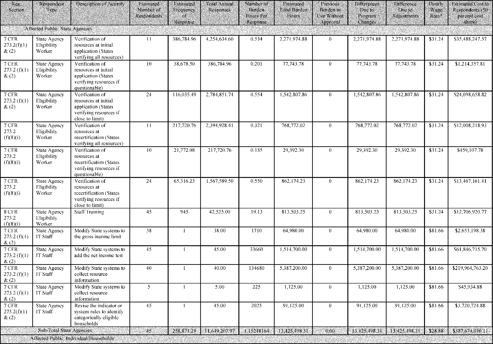
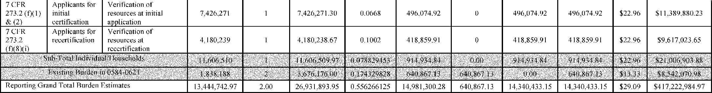
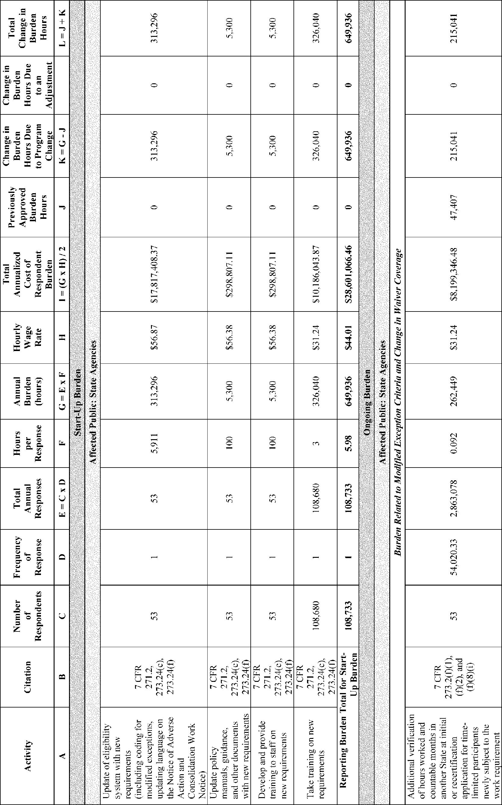
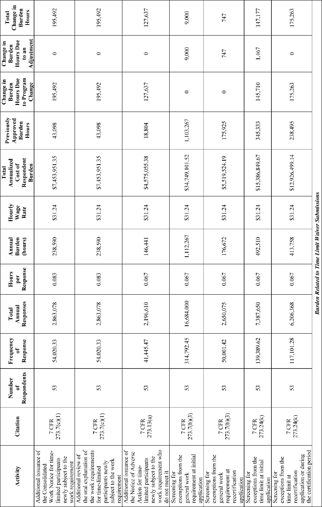
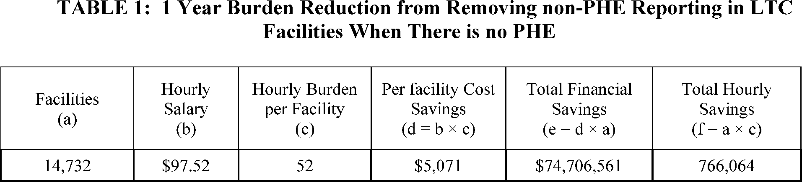
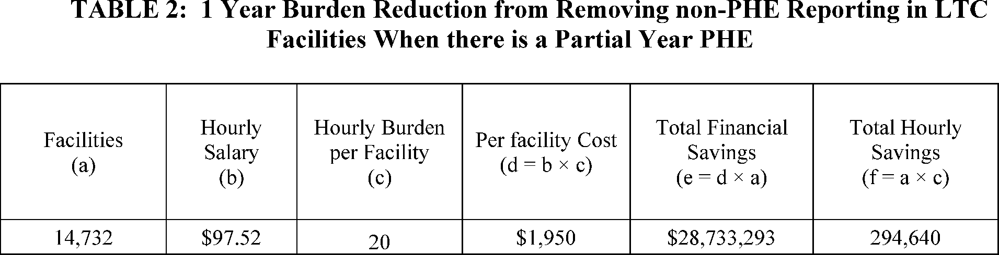

# Daily Digest — 2026-11-10

| | |
|---|---|
| **Digest date** | 2026-11-10 |
| **Data date range** | 2026-11-10 to 2026-11-10 |
| **Generated at** | 2026-11-11T05:04:30Z (UTC) |
| **Pipeline version** | 37cc3bf9 |
| **Inference** | model layers ran — cli/haiku, opus |
| **Source watermarks** | CREC: 2026-11-10T17:16:25Z · BILLS: 2026-11-11T04:34:58Z · FR: 2026-11-10T20:02:54Z · USCOURTS: 2026-11-10T23:20:19Z · PLAW: 2026-11-09T15:10:06Z |

[Full observed listing for this day](day/2026-11-10.html) — the items our collectors observed for this publication day, mechanical rules applied, frozen at end of day; releases their publishers date on other days are counted there, not listed. This digest is the canonical record.

All items below cite the govinfo package (and granule, where applicable) they
summarize. Selection is mechanical; each item states the rule that included
it. See the Coverage Statement at the end for a full accounting of what was
published, what was summarized, and what was excluded and why.

---

## Contents

- [Day in Review](#day-in-review)
- [1. Congressional Floor Activity](#1-congressional-floor-activity)
- [2. Legislation](#2-legislation)
- [3. Federal Register](#3-federal-register)
- [4. Enacted Laws](#4-enacted-laws)
- [5. Judicial Activity](#5-judicial-activity)
- [6. Agency Announcements](#6-agency-announcements)
- [7. Recorded Votes](#7-recorded-votes)
- [8. Bill Actions](#8-bill-actions)
- [9. Presidential Actions](#9-presidential-actions)
- [Terms Used Today](#terms-used-today)
- [Coverage Statement](#coverage-statement)
- [Methodology](#methodology)

---

## Day in Review

On the House floor, the digest records two roll-call votes: Roll Call No. 315 passed H.R. 3978, which amends the Atomic Energy Act's definition of production facility, by 397 to 2, and Roll Call No. 316 passed H.R. 9612, the American Enrichment Deployment Act, by 394 to 3, both under suspension of the rules. The House also considered H.R. 5549 on Nuclear Regulatory Commission hearings, and Rep. Massie gave notice of a privileged resolution to impeach Secretary of Defense Peter Hegseth. The Rules Committee reported H.Res. 1650 providing for consideration of H.R. 1013. In the Senate, the record shows a motion to proceed to H.R. 2347 and receipt of executive nominations. Five bills appear as reported in the Senate.

The digest carries 11 final rules, 9 proposed rules and 88 notices. Proposed rules include USDA changes to SNAP categorical eligibility and work requirements, a Labor Department national minimum work search standard for unemployment insurance, and BLM land use planning revisions. Final actions include a FinCEN order barring fund transmittals involving MEXC Global and an EPA ozone attainment determination for Detroit. Presidential documents include a memorandum exempting wildfire suppression activities from water pollution control requirements, a Veterans Day proclamation, and nominations including James Cody Hiland for the Eighth Circuit.

The digest carries 21 appellate opinions. The Tenth Circuit affirmed summary judgment for the City of Ada on a failure-to-train claim, the Third Circuit upheld a finding that Travelodge breached a franchise agreement, the Federal Circuit affirmed three dismissals, and the Fifth Circuit issued most of the remaining rulings.

*Composed from the summarized items below and the day's mechanical
counts; all specifics are cited in their sections.*

---

## 1. Congressional Floor Activity

Source: Congressional Record (CREC), issue observed 2026-11-10, covering proceedings of 2026-11-09. Published by govinfo 2026-11-10T17:16:25Z; observed by our collector 2026-11-10T17:23:09Z. Total issue size: 168 granule(s).

### 1.1 Senate

Tags: legislative · model keys: executive communications · executive nominations · foreign travel expenses

*In plain terms: Five items, led by nominations for CISA director and FTC commissioner; the rest are 27 executive communications, added cosponsors, and a foreign travel expense report.*

- **Legislative Session** — The Senate Congressional Record for November 9, 2026 records the motion to proceed to H.R. 2347, a bill to amend the Internal Revenue Code of 1986 to exclude from gross income damages other than punitive damages received on account of sexual acts or sexual contact. It also contains floor remarks by Majority Leader Thune and Minority Leader Schumer on the 2026 midterm elections and on pending permitting reform legislation. Senator Schumer's floor statement calls for a Senate trial of Defense Secretary Pete Hegseth and criticizes the appointment of Stephen Miller as White House Chief of Staff.
  - *In plain terms:* The record notes a motion to proceed to H.R. 2347, which excludes from gross income damages other than punitive damages received for sexual acts or contact, and Schumer calls for a Senate trial of Defense Secretary Pete Hegseth.
  - Included because: CREC-SEL-01 — floor item ≥ threshold floor time (61,043 characters) (document dated 2026-11-09)
  - Source: [CREC-2026-11-09 / CREC-2026-11-09-pt1-PgS5337-7](https://www.govinfo.gov/app/details/CREC-2026-11-09/CREC-2026-11-09-pt1-PgS5337-7)
- **Executive and Other Communications** — The Senate received executive communications EC-4965 through EC-4991 and related items, referred to committees including Appropriations, Foreign Relations, Health, Education, Labor, and Pensions, and the Judiciary. Items include a GAO report reviewing the President's September 25, 2026 Impoundment Control Act special message, Arms Export Control Act notifications of proposed defense sales to the United Arab Emirates ($1.041 billion), Egypt ($832 million), and Kuwait ($400 million), and a State Department rule revising the International Traffic in Arms Regulations' Syria country policy. Other communications include HHS, CMS, and DHS rules, a Judicial Conference report on the E-Government Act of 2002 rules, and a Treasury periodic report on the national emergency concerning South Sudan.
  - *In plain terms:* The Senate received EC-4965 through EC-4991, including a GAO report on the September 25, 2026 message under the Impoundment Control Act and proposed arms sales to the UAE ($1.041 billion), Egypt ($832 million), and Kuwait ($400 million).
  - Included because: CREC-SEL-01 — floor item ≥ threshold floor time (40,935 characters) (document dated 2026-11-09)
  - Source: [CREC-2026-11-09 / CREC-2026-11-09-pt1-PgS5351-3](https://www.govinfo.gov/app/details/CREC-2026-11-09/CREC-2026-11-09-pt1-PgS5351-3)
- **Additional Cosponsors** — The Senate record lists additional cosponsors added at the request of individual senators to numerous bills. Examples include S. 537 on lead ammunition and tackle on certain federal lands, S. 605 on CHAMPVA eligibility for children, and S. 4429 on prohibiting connected vehicles and related software associated with foreign adversaries. Other entries add cosponsors to bills on veterans' health care, Medicare pharmacy payment, TRICARE Young Adult coverage, and the Commodity Exchange Act.
  - *In plain terms:* Additional senators were added as cosponsors to numerous bills, including S. 537 on lead ammunition and tackle on certain federal lands, S. 605 on CHAMPVA eligibility for children, and S. 4429 on prohibiting connected vehicles and related software linked to foreign adversaries.
  - Included because: CREC-SEL-01 — floor item ≥ threshold floor time (16,935 characters) (document dated 2026-11-09)
  - Source: [CREC-2026-11-09 / CREC-2026-11-09-pt1-PgS5356](https://www.govinfo.gov/app/details/CREC-2026-11-09/CREC-2026-11-09-pt1-PgS5356)
- **Foreign Travel Financial Reports** — The Secretary of the Senate submitted the consolidated report of expenditures for foreign travel by Senate Committee on Appropriations members and staff from July 1 to September 30, 2026, under 22 U.S.C. 1754(b). The report itemizes per diem, transportation, and miscellaneous expenses by traveler and country, covering trips to destinations including Ecuador, Panama, Trinidad and Tobago, Guyana, the United Kingdom, China, Japan, Taiwan, Australia, the Philippines, Thailand, and South Korea, along with domestic United States travel. Delegation expenses are listed separately for each country visited.
  - *In plain terms:* The Secretary of the Senate submitted the consolidated report of Senate Appropriations Committee foreign travel expenses from July 1 to September 30, 2026, itemizing per diem, transportation, and miscellaneous costs by traveler and country.
  - Included because: CREC-SEL-01 — floor item ≥ threshold floor time (199,119 characters) (document dated 2026-11-09)
  - Source: [CREC-2026-11-09 / CREC-2026-11-09-pt1-PgS5360](https://www.govinfo.gov/app/details/CREC-2026-11-09/CREC-2026-11-09-pt1-PgS5360)
- **Nominations** — The Senate received executive nominations including Christopher Mufarrige to be a Federal Trade Commissioner for a seven-year term, Michael Losapio to be Director of the Cybersecurity and Infrastructure Security Agency, and Gary Lawkowski to be General Counsel of the Office of the Director of National Intelligence. Additional nominations include Arthur Kleinschmidt as Assistant Attorney General, federal district and circuit judges, Superior Court of the District of Columbia associate judges, ambassadors to Pakistan, the United Arab Emirates, Burundi, Senegal, Guinea-Bissau, Mali, and North Macedonia, and an Assistant Secretary of Energy. The nominations also include Army Reserve and Army National Guard promotions to brigadier general and colonel, and Army and Coast Guard appointments.
  - *In plain terms:* The Senate received nominations for Christopher Mufarrige (Federal Trade Commissioner, seven-year term), Michael Losapio (Cybersecurity and Infrastructure Security Agency Director), and Gary Lawkowski (General Counsel, Office of the Director of National Intelligence).
  - Included because: CREC-SEL-01 — floor item ≥ threshold floor time (41,517 characters) (document dated 2026-11-09)
  - Source: [CREC-2026-11-09 / CREC-2026-11-09-pt1-PgS5378](https://www.govinfo.gov/app/details/CREC-2026-11-09/CREC-2026-11-09-pt1-PgS5378)

### 1.2 House of Representatives

Tags: legislative · model keys: impeachment resolution · nuclear licensing · public hunting lands

*In plain terms: Four items, led by Rep. Massie's notice of intent to offer an impeachment resolution against Defense Secretary Peter Brian Hegseth; the rest are a nonprofit tribute and two nuclear licensing bills.*

- **Recognizing the Public Timber Project** — Rep. Hill of Arkansas addressed the House to recognize the Public Timber Project, a nonprofit supporting public hunting lands, which reported over 2,000 volunteer hours, 28 site cleanups, and more than 100 boat ramp cleanups. The statement also honors the late Lowell Baier, a conservationist and former Boone and Crockett Club president, and recognizes broadcaster Dave Woodman's 56 years of service in Arkansas media. It further enters into the Record an excerpt from the wartime memoir of the late Gus 'Buddy' Blass II, a World War II reconnaissance soldier and Little Rock civic leader.
  - *In plain terms:* The statement recognizes the Public Timber Project, a nonprofit supporting public hunting lands, honors the late Lowell Baier, and recognizes Dave Woodman's 56 years in Arkansas media.
  - Included because: CREC-SEL-01 — floor item ≥ threshold floor time (19,019 characters) (document dated 2026-11-09)
  - Source: [CREC-2026-11-09 / CREC-2026-11-09-pt1-PgH6082-2](https://www.govinfo.gov/app/details/CREC-2026-11-09/CREC-2026-11-09-pt1-PgH6082-2)
- **Notice of Intention to Offer Resolution Raising a Question of the Privileges of the House** — Rep. Massie gave notice of his intent to raise a question of the privileges of the House by offering a resolution to impeach Peter Brian Hegseth, Secretary of Defense. The draft articles of impeachment allege that Hegseth directed U.S. Armed Forces into hostilities against Iran beginning February 28, 2026, without a declaration of war, specific statutory authorization, or a national emergency as described in the War Powers Resolution of 1973. The articles further allege that hostilities continued after H. Con. Res. 86, a concurrent resolution directing removal of the forces, was agreed to by the House on June 3, 2026, and by the Senate on June 23, 2026.
  - *In plain terms:* Rep. Massie gives notice of a resolution to impeach Defense Secretary Peter Brian Hegseth, alleging he directed forces into hostilities against Iran from February 28, 2026 without authorization and kept them there after Congress agreed to a resolution directing their removal.
  - Included because: CREC-SEL-01 — floor item ≥ threshold floor time (68,391 characters) (document dated 2026-11-09)
  - Source: [CREC-2026-11-09 / CREC-2026-11-09-pt1-PgH6088-5](https://www.govinfo.gov/app/details/CREC-2026-11-09/CREC-2026-11-09-pt1-PgH6088-5)
- **Efficient Nuclear Licensing Hearings Act** — The House considered H.R. 5549, the Efficient Nuclear Licensing Hearings Act, under suspension of the rules. The bill amends the Atomic Energy Act of 1954 to remove the requirement that the Nuclear Regulatory Commission hold a hearing on a construction permit or operating license application when no person requests one, allowing issuance after 30 days' notice and Federal Register publication, while preserving hearings requested by affected persons and applying the amendments to pending proceedings. The floor debate includes statements from Representatives Latta, Pallone, and Griffith on the bill's provisions and on the estimated cost of uncontested hearings to applicants.
  - *In plain terms:* H.R. 5549, the Efficient Nuclear Licensing Hearings Act, was considered under a fast-track procedure and would remove the required NRC hearing when no one requests one, allowing issuance after 30 days' notice and Federal Register publication.
  - Included because: CREC-SEL-01 — floor item ≥ threshold floor time (16,179 characters) (document dated 2026-11-09)
  - Source: [CREC-2026-11-09 / CREC-2026-11-09-pt1-PgH6097](https://www.govinfo.gov/app/details/CREC-2026-11-09/CREC-2026-11-09-pt1-PgH6097)
- **American Enrichment Deployment Act** — The House considered H.R. 9612, the American Enrichment Deployment Act, under suspension of the rules, as amended. The bill amends section 193 of the Atomic Energy Act of 1954 to permit construction of uranium enrichment facilities before a license is issued, under the same terms that apply to other fuel cycle facilities, and directs the Nuclear Regulatory Commission to issue or revise implementing regulations within 180 days of enactment. The text states that the National Environmental Policy Act, the right to a hearing under section 189, and NRC inspection authority are not affected, and the debate includes statements from Representatives Latta, Pallone, and Fry.
  - *In plain terms:* H.R. 9612, the American Enrichment Deployment Act, was considered under a fast-track procedure to allow uranium enrichment facilities to be built before licensing and directs NRC to issue or revise rules within 180 days of enactment.
  - Included because: CREC-SEL-01 — floor item ≥ threshold floor time (16,422 characters) (document dated 2026-11-09)
  - Source: [CREC-2026-11-09 / CREC-2026-11-09-pt1-PgH6100](https://www.govinfo.gov/app/details/CREC-2026-11-09/CREC-2026-11-09-pt1-PgH6100)

### 1.3 Recorded Votes

- **Nuclear Refuel (Recycling Efficient Fuels Utilizing Expedited Licensing) Act** — Roll Call No. 315 records the House vote on the motion to suspend the rules and pass H.R. 3978, as amended, which amends the definition of production facility in the Atomic Energy Act of 1954 to exclude equipment or devices capable of reprocessing spent nuclear fuel without separating plutonium from other transuranic elements. The motion passed by a vote of 397 yeas to 2 nays, with 34 not voting. Representative Min changed his vote from nay to yea before the result was announced, and a motion to reconsider was laid on the table.
  - *In plain terms:* Roll Call No. 315 records passage of H.R. 3978 by 397 yeas to 2 nays with 34 not voting; the bill excludes from the Atomic Energy Act's production facility definition devices capable of reprocessing spent fuel without separating plutonium.
  - Included because: CREC-SEL-02 — recorded vote (all recorded votes are listed) (document dated 2026-11-09)
  - Source: [CREC-2026-11-09 / CREC-2026-11-09-pt1-PgH6107-3](https://www.govinfo.gov/app/details/CREC-2026-11-09/CREC-2026-11-09-pt1-PgH6107-3)
- **American Enrichment Deployment Act** — Roll Call No. 316 records the House vote on the motion to suspend the rules and pass H.R. 9612, the American Enrichment Deployment Act, as amended. The motion passed by a vote of 394 yeas to 3 nays, with 36 not voting. The Speaker Pro Tempore announced two minutes remaining during the vote, and a motion to reconsider was laid on the table.
  - *In plain terms:* Roll Call No. 316 records passage of H.R. 9612, the American Enrichment Deployment Act, as amended, by 394 yeas to 3 nays with 36 not voting.
  - Included because: CREC-SEL-02 — recorded vote (all recorded votes are listed) (document dated 2026-11-09)
  - Source: [CREC-2026-11-09 / CREC-2026-11-09-pt1-PgH6108](https://www.govinfo.gov/app/details/CREC-2026-11-09/CREC-2026-11-09-pt1-PgH6108)

---

## 2. Legislation

Source: Congressional Bills (BILLS), text versions published 2026-11-10 to 2026-11-10.

### 2.1 Counts by Stage

| Stage (bill text version) | Count |
|---|---|
| Introduced (ih/is) | 15 |
| Reported (rh/rs) | 6 |
| Engrossed (eh/es) | 6 |
| Enrolled (enr) | 0 |
| Other versions | 1 |
| **Total bill texts published** | **28** |

### 2.2 Bills Listed by Mechanical Rule

Tags: legislative · model keys: aviation security funds · broadband permits · nasa authorization

*In plain terms: Six items, led by the SAFEGUARDS Act on aviation security funds and a NASA bill authorizing $25.5 billion; the rest cover broadband permits, disaster communications, and missing-personnel records.*

Bills below are listed because they matched at least one listing rule; the
matching rule is stated per item. All other bill texts are counted above and
accounted for in the Coverage Statement.

- **H. RES. 1650 (rh) — 119 HRES 1650 RH: Providing for consideration of the bill (H.R. 1013) to amend the Federal securities laws to enhance 403(b) plans, and for other purposes.** — House Resolution 1650 (119th Congress, 2nd Session), reported by the House Committee on Rules on November 9, 2026, provides for House consideration of H.R. 1013, a bill to amend the Federal securities laws to enhance 403(b) plans, and for other purposes. Upon adoption of the resolution, consideration of the bill is in order, all points of order against the bill and its provisions are waived, and the substitute recommended by the Committee on Financial Services is considered as adopted. The resolution provides for one hour of debate equally divided and controlled by the chair and ranking minority member of the Committee on Financial Services, and one motion to recommit, with the previous question ordered to final passage.
  - *In plain terms:* House Resolution 1650, reported November 9, 2026, sets House debate terms for H.R. 1013, which amends federal securities laws to enhance 403(b) plans, and waives procedural objections to the bill.
  - Included because: BILLS-SEL-01 — reached stage: reported/enrolled/calendar (document dated 2026-11-09)
  - Source: [BILLS-119hres1650rh](https://www.govinfo.gov/app/details/BILLS-119hres1650rh)
- **S. 2378 (rs) — 119 S2378 RS: Spending Aviation Fees for Equipment, Guaranteeing Upgraded and Advanced Risk Detection and Safety Act of 2025** — S. 2378, the SAFEGUARDS Act of 2025 as reported by the Senate Committee on Commerce, Science, and Transportation, amends 49 U.S.C. 44923 to revise the Aviation Security Capital Fund and establish an Aviation Security Checkpoint Technology Fund. For fiscal years 2026 through 2036, it directs the TSA Administrator to collect at least $400,000,000 annually for the capital fund and at least $250,000,000 annually for the checkpoint technology fund from fees under 49 U.S.C. 44940(a)(1). The bill also requires briefings and reports to Congress, biennial Inspector General audits through fiscal year 2036, and includes a sense of Congress on the use of the 9/11 Security Fee.
  - *In plain terms:* The SAFEGUARDS Act would revise an aviation security capital fund, create a checkpoint technology fund, and require TSA to collect at least $400,000,000 and $250,000,000 yearly for them in fiscal years 2026 through 2036.
  - Included because: BILLS-SEL-01 — reached stage: reported/enrolled/calendar (document dated 2026-11-09)
  - Source: [BILLS-119s2378rs](https://www.govinfo.gov/app/details/BILLS-119s2378rs)
- **S. 3226 (rs) — 119 S3226 RS: Bring Our Heroes Home Act** — S. 3226, the Bring Our Heroes Home Act, as reported by the Senate Committee on Homeland Security and Governmental Affairs, directs the Archivist of the United States to create a Missing Armed Forces and Civilian Personnel Records Collection at the National Archives. It requires Government offices to identify, copy, and transmit to the Archivist records relating to missing Armed Forces and civilian personnel from December 7, 1941 onward, prohibits their destruction or alteration, and requires certifications under penalty of perjury. The bill also establishes a Missing Armed Forces and Civilian Personnel Records Review Board and sets requirements for reports justifying any substantial redaction or withholding of records; the source text is truncated, and this summary covers only the sections shown.
  - *In plain terms:* The Bring Our Heroes Home Act would create a National Archives collection of records on missing Armed Forces and civilian personnel, require agencies to send them from December 7, 1941 onward, and bar their destruction.
  - Included because: BILLS-SEL-01 — reached stage: reported/enrolled/calendar (document dated 2026-11-09)
  - Source: [BILLS-119s3226rs](https://www.govinfo.gov/app/details/BILLS-119s3226rs)
- **S. 4448 (rs) — 119 S4448 RS: Accelerating Broadband Permits Act of 2026** — S. 4448, the Accelerating Broadband Permits Act of 2026, as reported by the Senate Committee on Commerce, Science, and Transportation, directs the Assistant Secretary of Commerce for Communications and Information to publish a public dashboard tracking Broadband Equity, Access, and Deployment (BEAD) grant recipients' expenditures and broadband service locations. It requires the Assistant Secretary to publish semiannual reports on BEAD grant progress, create a permit-tracking tool for eligible entities and subgrantees, develop data controls for communications use application processing times within 120 days, and establish an alert method for applications at risk of missing the 270-day deadline. The bill also amends the FAST Act definition of minimum broadband project cost to include NEPA-subject broadband infrastructure projects likely to require more than $5,000,000 in total investment.
  - *In plain terms:* The Accelerating Broadband Permits Act of 2026 would require a public dashboard tracking Broadband Equity, Access, and Deployment grant spending and service locations, semiannual progress reports, and alerts for permit applications at risk of missing a 270-day deadline.
  - Included because: BILLS-SEL-01 — reached stage: reported/enrolled/calendar (document dated 2026-11-09)
  - Source: [BILLS-119s4448rs](https://www.govinfo.gov/app/details/BILLS-119s4448rs)
- **S. 4691 (rs) — 119 S4691 RS: Disaster Communications Coordination and Preparedness Act** — S. 4691, the Disaster Communications Coordination and Preparedness Act, as reported without amendment by the Senate Committee on Commerce, Science, and Transportation, directs the Federal Communications Commission to review its procedures for Disaster Information Reporting System (DIRS) activation and deactivation notices within 180 days. It requires the Commission to evaluate, within 18 months, the feasibility of enhancing its public safety liaison functions as a point of entry for State, local, Tribal, and territorial officials, and to develop plain-language awareness materials within one year. The bill states that it does not require the Commission to adopt new regulations or impose new reporting requirements on communications providers.
  - *In plain terms:* The Disaster Communications Coordination and Preparedness Act directs the Federal Communications Commission to review its disaster reporting system notice procedures within 180 days and to assess, within 18 months, strengthening its public safety liaison role.
  - Included because: BILLS-SEL-01 — reached stage: reported/enrolled/calendar (document dated 2026-11-09)
  - Source: [BILLS-119s4691rs](https://www.govinfo.gov/app/details/BILLS-119s4691rs)
- **S. 933 (rs) — 85 S933 RS: NASA Transition Authorization Act of 2025** — S. 933, the NASA Transition Authorization Act of 2025, as reported by the Senate Committee on Commerce, Science, and Transportation, authorizes $25,507,540,000 in appropriations for the National Aeronautics and Space Administration for fiscal year 2025, allocated across NASA mission directorates and offices. The bill's table of contents lists titles on exploration, space operations, space technology, aeronautics, science, STEM education, and NASA policy. The sections shown in the source text include a reaffirmation of continuity of purpose for space exploration, findings and requirements for the Artemis program, and reaffirmation of the Space Launch System; the source text is truncated, and this summary covers only the sections shown.
  - *In plain terms:* The NASA Transition Authorization Act of 2025 authorizes $25,507,540,000 in funding for the National Aeronautics and Space Administration in fiscal year 2025, divided among its mission directorates and offices.
  - Included because: BILLS-SEL-01 — reached stage: reported/enrolled/calendar (document dated 2026-11-09)
  - Source: [BILLS-119s933rs](https://www.govinfo.gov/app/details/BILLS-119s933rs)

---

## 3. Federal Register

Source: Federal Register (FR), issue of 2026-11-10.

### 3.1 Counts by Document Type

| Document type | Count |
|---|---|
| Rules | 11 |
| Proposed rules | 9 |
| Notices | 88 |
| Presidential documents | 0 |
| **Total FR documents** | **108** |

### 3.2 Rules Published

Tags: department of health and human services · department of justice · executive · model keys: aircraft inspection · color additives · fund transfer prohibition

*In plain terms: Eleven items, led by a final rule on inspection requirements for single-engine turbine airplanes and unmanned aircraft and a FinCEN order prohibiting fund transfers involving MEXC Global; the rest are FDA, EPA, FAA, CFTC, and NLRB actions.*

#### COMMODITY FUTURES TRADING COMMISSION

- **DCM Impartial Access Requirements** (2026-22863; 17 CFR Part 38) — The Commodity Futures Trading Commission (“Commission” or “CFTC”) is issuing an interpretation of the requirement that designated contract markets (“DCMs”) provide competitive, open, fair, and impartial access to their members and persons with trading privileges under Commission Regulation 38.151(b) (“Impartial Access Requirements”). Specifically, this final interpretive guidance is being issued to inform the public of the Commission's views on the Impartial Access Requirements that should be guiding exchanges' selections of access criteria. The Commission issues this interpretive guidance after a significant amount of time and effort overseeing the listing and trading of event contracts and other financial assets, as well as monitoring DCM access requirements. Action: Interpretation. Dates: Effective November 10, 2026.
  - *In plain terms:* The Commodity Futures Trading Commission is issuing final guidance on its views about the fair, open, and impartial access designated contract markets must provide to members and traders, to guide exchanges in choosing access criteria.
  - Included because: FR-SEL-01 — document type: final rule (all listed)
  - Source: [FR-2026-11-10 / 2026-22863](https://www.govinfo.gov/app/details/FR-2026-11-10/2026-22863)

#### DEPARTMENT OF HEALTH AND HUMAN SERVICES

- **Color Additive Petition From Environmental Defense Fund et al.; Request To Amend the Color Additive Regulations To Remove the Solvents Ethylene Dichloride, Methylene Chloride, and Trichloroethylene** (2026-22865; 21 CFR Part 73) — The Food and Drug Administration (FDA or we) is partially granting a color additive petition submitted by Environmental Defense Fund et al. (petitioners), by amending our color additive regulations, on the basis of the Delaney Clause, to remove the authorized use of methylene chloride as a diluent in color additive mixtures in inks for marking fruit and vegetables. The petitioners provided data demonstrating that this additive induces cancer in laboratory animals. We are denying the remaining petition requests to remove ethylene dichloride, methylene chloride, and trichloroethylene from the list of authorized extraction solvents for annatto extract, paprika oleoresin, and turmeric oleoresin, because any residue of the solvent would be an impurity in the color additive and such impurities are not subject to the Delaney Clause. Action: Final amendment; order; notification of partial denial of petition. Dates: This order is effective January 11, 2027. If any provisions are delayed or stayed by the filing of proper objections, FDA will publish such notification in the Federal Register . Submit either electronic or written objections and requests for a hearing on the order by December 10, 2026. See section X for further information on the filing of objections.
  - *In plain terms:* The FDA partly grants a petition from Environmental Defense Fund et al. to remove the authorized use of methylene chloride as a diluent in inks for marking fruit and vegetables, citing data that it induces cancer in lab animals, and denies the rest.
  - Included because: FR-SEL-01 — document type: final rule (all listed)
  - Source: [FR-2026-11-10 / 2026-22865](https://www.govinfo.gov/app/details/FR-2026-11-10/2026-22865)
- **Color Additive Petition From the International Association of Color Manufacturers; Request To Amend the Color Additive Regulations To Remove the Solvents Methylene Chloride, Trichloroethylene, and Ethylene Dichloride** (2026-22866; 21 CFR Part 73) — The Food and Drug Administration (FDA or we) is partially granting a color additive petition submitted by the International Association of Color Manufacturers (IACM or petitioner), by amending our color additive regulations, on the basis of abandonment, to remove the authorized uses of methylene chloride, trichloroethylene, and ethylene dichloride from the list of authorized extraction solvents for annatto extract, paprika oleoresin, and turmeric oleoresin. The petitioner provided data demonstrating that these uses have been permanently abandoned. FDA is denying as moot the portion of the petition proposing that the color additive regulations be amended, on the basis of abandonment, to no longer authorize the use of methylene chloride as a diluent in color additive mixtures in inks for marking fruit and vegetables. This request is moot because the authorization for this use has been removed, on the basis of the Delaney Clause, in response to a separate petition. Action: Final amendment; order; notification of partial denial of petition. Dates: This order is effective January 11, 2027. If any provisions are delayed or stayed by the filing of proper objections, FDA will publish such notification in the Federal Register . Submit either electronic or written objections and requests for a hearing on the order by December 10, 2026. See section IX for further information on the filing of objections.
  - *In plain terms:* The FDA partly grants an International Association of Color Manufacturers petition to remove authorized solvent uses for annatto, paprika, and turmeric oleoresin because they are permanently abandoned, and denies the remaining request as moot.
  - Included because: FR-SEL-01 — document type: final rule (all listed)
  - Source: [FR-2026-11-10 / 2026-22866](https://www.govinfo.gov/app/details/FR-2026-11-10/2026-22866)

#### DEPARTMENT OF THE TREASURY

- **Imposition of Special Measure Prohibiting the Transmittal of Funds Involving MEXC Global** (2026-22962; 31 CFR Part 1010) — FinCEN is issuing notice of an order, pursuant to section 9714(a) of the Combating Russian Money Laundering Act (Pub. L. 116-283), as amended by section 6106(b) of the National Defense Authorization Act for Fiscal Year 2022 (Pub. L. 117-81), finding that MEXC Global—including any of its subsidiaries, branches, and offices, as well as any successor entities, operating in any jurisdiction outside of the United States—is a financial institution operating outside of the United States of primary money laundering concern in connection with Russian illicit finance and prohibiting certain transmittals of funds involving MEXC Global. Action: Order. Dates: This action is effective December 10, 2026.
  - *In plain terms:* The Financial Crimes Enforcement Network finds MEXC Global, including its subsidiaries and successors operating outside the United States, to be a primary money laundering concern in Russian illicit finance and prohibits certain fund transmittals involving it.
  - Included because: FR-SEL-01 — document type: final rule (all listed)
  - Source: [FR-2026-11-10 / 2026-22962](https://www.govinfo.gov/app/details/FR-2026-11-10/2026-22962)

#### DEPARTMENT OF TRANSPORTATION

- **Airworthiness Directives; Airbus SAS Airplanes** (2026-22897; 14 CFR Part 39) — The FAA is adopting a new airworthiness directive (AD) for certain Airbus SAS Model A350-941 airplanes. This AD was prompted by a report of a missing main landing gear (MLG) brake rod center pin nut sub-assembly detected during an inspection. This AD requires, depending on airplane configuration, inspection of the MLG brake rod center pin nut, lock ring, and end plate, inspection of the MLG brake rod center pin and nut, and applicable corrective actions. This AD also requires additional work for certain airplanes. The FAA is issuing this AD to address the unsafe condition on these products. Action: Final rule. Dates: This AD is effective December 15, 2026. The Director of the Federal Register approved the incorporation by reference of a certain publication listed in this AD as of December 15, 2026.
  - *In plain terms:* The FAA adopts a new airworthiness directive for certain Airbus SAS A350-941 airplanes, prompted by a missing main landing gear brake rod center pin nut sub-assembly found during an inspection, requiring inspections and corrective actions.
  - Included because: FR-SEL-01 — document type: final rule (all listed)
  - Source: [FR-2026-11-10 / 2026-22897](https://www.govinfo.gov/app/details/FR-2026-11-10/2026-22897)
- **Airworthiness Directives; Airbus SAS Airplanes; Correction** (2026-22907; 14 CFR Part 39) — The FAA is correcting an airworthiness directive (AD) that was published in the Federal Register . That AD applies to all Airbus SAS Model A330-243, A330-243F, A330-341, A330-342, A330-343, A330-841, and A330-941 airplanes; and Model A340-211, A340-212, A340-213, A340-311, A340-312, A340-313, A340-541, and A340-642 airplanes. As published, a paragraph reference specified in the regulatory text is incorrect. This document corrects that error. In all other respects, the original document remains the same. Action: Final rule; correction. Dates: This correction is effective November 23, 2026. The effective date of AD 2026-21-03 remains November 23, 2026. The Director of the Federal Register approved the incorporation by reference of a certain publication listed in this AD as of November 23, 2026 (91 FR 65952, October 19, 2026).
  - *In plain terms:* The FAA corrects an airworthiness directive published in the Federal Register that applies to certain Airbus SAS A330 and A340 airplanes, fixing an incorrect paragraph reference in the regulatory text; all other provisions remain the same.
  - Included because: FR-SEL-01 — document type: final rule (all listed)
  - Source: [FR-2026-11-10 / 2026-22907](https://www.govinfo.gov/app/details/FR-2026-11-10/2026-22907)
- **Special Conditions: Gulfstream Aerospace Corporation, Model GVII-G400 Airplane; Flight Envelope Protection: Takeoff Stall Protection** (2026-22951; 14 CFR Part 25) — These special conditions are issued for the Gulfstream Aerospace Corporation (Gulfstream) Model GVII-G400 airplane. This airplane will have a novel or unusual design feature when compared to the state of technology envisioned in the airworthiness standards for transport category airplanes. This design feature is an envelope protection function to protect the airplane from over- and rapid-rotation on takeoff. The applicable airworthiness regulations do not contain adequate or appropriate safety standards for this design feature. These special conditions contain the additional safety standards that the Administrator considers necessary to establish a level of safety equivalent to that established by the existing airworthiness standards. Action: Final special conditions; request for comments. Dates: This action is effective on Gulfstream on November 10, 2026. Send comments on or before December 28, 2026.
  - *In plain terms:* Special conditions (additional safety standards) are issued for the Gulfstream Model GVII-G400 airplane's takeoff stall protection feature, which protects against over- and rapid rotation on takeoff, since existing regulations do not contain adequate standards for it.
  - Included because: FR-SEL-01 — document type: final rule (all listed)
  - Source: [FR-2026-11-10 / 2026-22951](https://www.govinfo.gov/app/details/FR-2026-11-10/2026-22951)
- **Inspection Programs for Single-Engine Turbine-Powered Airplanes and Unmanned Aircraft; and Miscellaneous Maintenance-Related Updates** (2026-22953; 14 CFR Parts 91, 125, 135, 137, and 145) — The final rule updates the maintenance inspection requirements for single-engine turbine-powered airplanes and unmanned aircraft. Aircraft owners and operators now have more inspection program options to choose from and more relaxed mechanical reliability reporting requirements. It also clarifies various maintenance-related regulations. This final rule relieves aircraft owners, operators, maintenance providers, and FAA of certain workload burdens by facilitating a more efficient workload for these individuals without compromising aviation safety. Action: Final rule. Dates: Effective January 11, 2027.
  - *In plain terms:* The final rule updates maintenance inspection requirements for single-engine turbine-powered airplanes and unmanned aircraft, giving owners and operators more inspection program options, relaxing mechanical reliability reporting, and clarifying other maintenance regulations.
  - Included because: FR-SEL-01 — document type: final rule (all listed)
  - Source: [FR-2026-11-10 / 2026-22953](https://www.govinfo.gov/app/details/FR-2026-11-10/2026-22953)

#### ENVIRONMENTAL PROTECTION AGENCY

- **Air Plan Approval; Michigan; Determination of Attainment by the Attainment Date for the 2015 Ozone Standards** (2026-22887; 40 CFR Part 52) — The U.S. Environmental Protection Agency (EPA) is determining under the Clean Air Act (CAA) that the Detroit, Michigan Moderate nonattainment area (“Detroit area” or “area”) attained the 2015 ozone National Ambient Air Quality Standards (NAAQS) by the applicable attainment date. This determination relies on the EPA's concurrence on an exceptional events request submitted by the Michigan Department of Environment, Great Lakes, and Energy (EGLE) on February 19, 2026, and concurred on by the EPA on March 24, 2026. Therefore, the EPA is taking final agency action on Michigan's exceptional events request. This action fulfills the EPA's statutory obligation to determine whether the Detroit area attained the 2015 ozone NAAQS by the Moderate attainment date of August 3, 2024. Action: Final rule. Dates: This final rule is effective on November 10, 2026.
  - *In plain terms:* The EPA determines the Detroit, Michigan area attained the 2015 ozone standards by its August 3, 2024 attainment date, based on an exceptional events request Michigan submitted February 19, 2026.
  - Included because: FR-SEL-01 — document type: final rule (all listed)
  - Source: [FR-2026-11-10 / 2026-22887](https://www.govinfo.gov/app/details/FR-2026-11-10/2026-22887)
- **Modification of Significant New Uses of Certain Chemical Substances (23-1.M)** (2026-22888; 40 CFR Parts 721 and 725) — EPA is amending significant new use rules (SNURs) issued under section 5(a)(2) of the Toxic Substances Control Act (TSCA) for certain chemical substances identified herein, which were the subject of premanufacture notices (PMNs) and significant new use notices (SNUNs). This action amends the SNURs by allowing certain new uses reported in the SNUNs or PMNs without additional notification requirements, modifying the significant new use notification requirements based on the actions and determinations for the SNUN or PMN submissions or based on the examination of new test data or other information, and making technical amendments to several SNURs. EPA is issuing these amendments based on review of new and existing data for the chemical substances. Action: Final rule. Dates: This rule is effective on January 11, 2027. For purposes of judicial review, this rule shall be promulgated at 1 p.m. (EST) on November 24, 2026.
  - *In plain terms:* The EPA amends its rules requiring notice before new uses of certain chemicals under the Toxic Substances Control Act, allowing some reported new uses without added notification and making technical changes based on new and existing data.
  - Included because: FR-SEL-01 — document type: final rule (all listed)
  - Source: [FR-2026-11-10 / 2026-22888](https://www.govinfo.gov/app/details/FR-2026-11-10/2026-22888)

#### NATIONAL LABOR RELATIONS BOARD

- **Rules and Regulations, Series 8** (2026-22891; 29 CFR Part 102) — This National Labor Relations Board rule, published by the Office of the Federal Register, corrects an editorial or technical error in the July 1, 2026 annual revision of 29 CFR Parts 100 to 499. It revises § 102.101 on responses to petitions, which allows 14 days for a response that must be filed with the Board in Washington, DC and served on all parties, and it reinstates §§ 102.102 on motions for intervention and 102.103 on Board determinations of jurisdiction through advisory opinions, under which no briefs may be filed without special Board permission. The document is FR Doc. 2026-22891, filed November 10, 2026.
  - *In plain terms:* The National Labor Relations Board corrects an error in its July 1, 2026 annual revision of 29 CFR Parts 100 to 499, revising section 102.101 to allow 14 days for petition responses and reinstating sections 102.102 and 102.103.
  - Included because: FR-SEL-01 — document type: final rule (all listed)
  - Source: [FR-2026-11-10 / 2026-22891](https://www.govinfo.gov/app/details/FR-2026-11-10/2026-22891)

### 3.3 Proposed Rules Published

Tags: department of health and human services · department of justice · executive · model keys: airworthiness directives · medicare medicaid · snap eligibility

*In plain terms: Nine proposed rules, led by Medicare and Medicaid administrative cuts and two SNAP changes; the rest are three FAA airworthiness directives, plus BLM planning, Opportunity Zone, and unemployment items.*

#### DEPARTMENT OF AGRICULTURE

- **Supplemental Nutrition Assistance Program: Reforming Categorical Eligibility** (2026-22936; 7 CFR Part 273) — Under section 5(a) of the Food and Nutrition Act of 2008, households in which each member receives benefits under a State program funded by Temporary Assistance for Needy Families (TANF) are categorically eligible for the Supplemental Nutrition Assistance Program (SNAP). Current SNAP regulations consider TANF benefits to include both cash assistance and non-cash or in-kind benefits or services from TANF-funded programs. This proposal would limit categorical eligibility to only households that receive TANF assistance, as defined at 45 CFR 260.31. These revisions would ensure that SNAP benefits are targeted to needy households that have qualified for TANF assistance while still aligning categorical eligibility's statutory purpose of simplifying program administration. A 100-word summary of this rule has been posted to www.regulations.gov and can be found here. Action: Proposed rule. Dates: Written comments must be received on or before December 10, 2026 to be assured of consideration.
  - *In plain terms:* This proposal would limit SNAP categorical eligibility to households receiving TANF assistance as defined at 45 CFR 260.31, instead of counting non-cash or in-kind TANF-funded benefits or services.
  - Included because: FR-SEL-02 — document type: proposed rule (all listed)
  - Source: [FR-2026-11-10 / 2026-22936](https://www.govinfo.gov/app/details/FR-2026-11-10/2026-22936)
  -  *Source graphic 1 of 2 from 2026-22936.*
  -  *Source graphic 2 of 2 from 2026-22936.*
- **Modification to Work Requirements for Able-Bodied Adults** (2026-22944; 7 CFR Parts 271 and 273) — The proposed rule would codify USDA's regulatory implementation of provisions of the One Big Beautiful Bill Act of 2025 (OBBB) changing the three-month time limit for certain participants subject to work requirements in the Supplemental Nutrition Assistance Program (SNAP). These changes include modifying the list of exceptions from the time limit for certain populations; updating requirements for areas to qualify for waivers of the time limit; and adding the temporary good faith exemptions in Alaska and Hawaii. Additionally, this rule proposes to strengthen requirements for requesting waivers of the time limit and revise the SNAP definition of a homeless individual. Action: Proposed rule. Dates: Written comments must be received on or before December 10, 2026.
  - *In plain terms:* A proposed USDA rule would codify changes from the One Big Beautiful Bill Act of 2025 to the three-month time limit for certain SNAP work-requirement participants, including exceptions, waiver rules, and Alaska and Hawaii good-faith exemptions.
  - Included because: FR-SEL-02 — document type: proposed rule (all listed)
  - Source: [FR-2026-11-10 / 2026-22944](https://www.govinfo.gov/app/details/FR-2026-11-10/2026-22944)
  -  *Source graphic 1 of 4 from 2026-22944.*
  -  *Source graphic 2 of 4 from 2026-22944.*
  - *Graphics not rendered here: 2 of 4 — see the [source PDF](https://www.govinfo.gov/content/pkg/FR-2026-11-10/pdf/FR-2026-11-10.pdf).*

#### DEPARTMENT OF HEALTH AND HUMAN SERVICES

- **Medicare and Medicaid Programs; Cutting Administrative Requirements for Excellence in Patient Care** (2026-22812; 42 CFR Parts 403, 416, 418, 438, 442, 460, 482, 483, 485, and 494) — This proposed rule would reform Medicare and Medicaid regulations deemed obsolete or excessively burdensome on healthcare providers and suppliers, with the objective of reducing costs, enhancing flexibility in delivering innovative care, and streamlining existing regulations. This reform seeks to enable healthcare professionals to devote more resources to improving patient care by eliminating or minimizing requirements that impede quality patient care or that divert resources away from furnishing high quality patient care. Action: Proposed rule. Dates: To be assured consideration, comments must be received at one of the addresses provided below, by January 11, 2027.
  - *In plain terms:* A proposed rule would revise Medicare and Medicaid regulations considered outdated or overly burdensome for healthcare providers and suppliers, with the stated goals of reducing costs, adding flexibility, and streamlining existing rules.
  - Included because: FR-SEL-02 — document type: proposed rule (all listed)
  - Source: [FR-2026-11-10 / 2026-22812](https://www.govinfo.gov/app/details/FR-2026-11-10/2026-22812)
  -  *Source graphic 1 of 67 from 2026-22812.*
  -  *Source graphic 2 of 67 from 2026-22812.*
  - *Graphics not rendered here: 65 of 67 — see the [source PDF](https://www.govinfo.gov/content/pkg/FR-2026-11-10/pdf/FR-2026-11-10.pdf).*

#### DEPARTMENT OF LABOR

- **Unemployment Insurance Program National Minimum Weekly Work Search Requirements** (2026-22903; 20 CFR Part 604) — The U.S. Department of Labor (Department), through the Employment and Training Administration (ETA), is proposing to amend 20 CFR part 604 both to reflect a 2012 update in Federal law in which Congress, by amending section 303(a) of the Social Security Act (SSA), established a Federal work search requirement; and to establish a national minimum weekly work search requirement standard for the Federal-State unemployment compensation (UC) program. This proposed rule would mandate, among other things, that States require individuals claiming UC to complete at least five qualifying work search activities or, where applicable, meet State-adopted points-based system requirements amounting to five qualifying activities or satisfy equivalent labor force attachment criteria, each week for which UC is claimed; that individuals report their work search activities as part of their certification process prior to payment being issued; and that State law allow for certain qualifying work search activities beyond simply employer contacts. This action is necessary to reduce inconsistencies beyond those created by local labor markets in State-level requirements for individuals to actively seek work. [official summary truncated; see source] Action: Proposed rule, request for comment. Dates: Interested persons are invited to submit written comments on this notice of proposed rulemaking (NPRM or proposed rule) on or before January 11, 2027.
  - *In plain terms:* The Department of Labor proposes requiring States to set a national minimum of five qualifying work search activities each week for unemployment claims, reflecting a 2012 federal law change and requiring claimants to report activities before payment.
  - Included because: FR-SEL-02 — document type: proposed rule (all listed)
  - Source: [FR-2026-11-10 / 2026-22903](https://www.govinfo.gov/app/details/FR-2026-11-10/2026-22903)

#### DEPARTMENT OF THE INTERIOR

- **Revision of Regulations for Planning, Programming, Budgeting** (2026-22860; 43 CFR Part 1600) — The BLM proposes to amend existing regulations that establish the procedures to prepare, revise, or amend land use plans pursuant to the Federal Land Policy and Management Act, as amended (FLPMA). We solicit comment on all aspects of this proposed rule. Action: Notice of proposed rulemaking. Dates: Send your comments on this proposed rule to the BLM on or before January 11, 2027. The BLM is not obligated to consider any comments received after this date in making its decision on the final rule. If you wish to comment on the information-collection requirements in this proposed rule, please note that the Office of Management and Budget (OMB) is required to make a decision concerning the information-collections contained in this proposed rule between 30 and 60 days after publication of this proposed rule in the Federal Register . Therefore, comments should be submitted to OMB by December 10, 2026.
  - *In plain terms:* The Bureau of Land Management proposes amending its rules for preparing, revising, or amending land use plans under the Federal Land Policy and Management Act, and is requesting public comment on all aspects of the proposal.
  - Included because: FR-SEL-02 — document type: proposed rule (all listed)
  - Source: [FR-2026-11-10 / 2026-22860](https://www.govinfo.gov/app/details/FR-2026-11-10/2026-22860)

#### DEPARTMENT OF THE TREASURY

- **Information Reporting Regarding Qualified Opportunity Zones and Updated Qualified Opportunity Fund Certification and Decertification Procedures; Correction** (2026-22859; 26 CFR Parts 1 and 301) — This document contains corrections to the proposed regulations (REG-116506-25), published in the Federal Register on September 11, 2026. These proposed regulations would implement new statutory requirements for qualified opportunity funds to file information returns with the IRS and furnish statements to investors who dispose of investments in those entities and for qualified opportunity zone businesses to furnish statements to qualified opportunity funds that hold interests in them. Action: Notice of proposed rulemaking and notice of public hearing; correction. Dates: The deadline for submitting written or electronic comments on the proposed rule was October 26, 2026.
  - *In plain terms:* This correction fixes errors in proposed rules REG-116506-25 (published September 11, 2026) that would require qualified opportunity funds to file information returns with the IRS and furnish statements to investors who dispose of investments.
  - Included because: FR-SEL-02 — document type: proposed rule (all listed)
  - Source: [FR-2026-11-10 / 2026-22859](https://www.govinfo.gov/app/details/FR-2026-11-10/2026-22859)

#### DEPARTMENT OF TRANSPORTATION

- **Airworthiness Directives; Bombardier, Inc., Airplanes** (2026-22899; 14 CFR Part 39) — The FAA proposes to adopt a new airworthiness directive (AD) for certain Bombardier, Inc., Model CL-600-2B16 (604 Variants) airplanes. This proposed AD was prompted by reports of cracks being found on the lower wing plank at the rear spar wing station (WS) 59 to WS 65 web and/or flange. This proposed AD would require inspecting the lower wing plank rear spar web and lower flange, the forward surface of the pressure bulkhead frame under the stiffeners, and the vertical stabilizer front spar to frame attachment fitting lower legs for cracks, and repair or rectification if applicable. The FAA is proposing this AD to address the unsafe condition on these products. Action: Notice of proposed rulemaking (NPRM). Dates: The FAA must receive comments on this proposed AD by December 28, 2026.
  - *In plain terms:* The FAA proposes a new airworthiness directive for certain Bombardier CL-600-2B16 (604 Variants) airplanes after reports of cracks on the lower wing plank at wing stations 59 to 65, requiring inspections and repairs as applicable.
  - Included because: FR-SEL-02 — document type: proposed rule (all listed)
  - Source: [FR-2026-11-10 / 2026-22899](https://www.govinfo.gov/app/details/FR-2026-11-10/2026-22899)
- **Airworthiness Directives; Airbus Canada Limited Partnership (Type Certificate Previously Held by C Series Aircraft Limited Partnership (CSALP); Bombardier, Inc.) Airplanes** (2026-22919; 14 CFR Part 39) — The FAA proposes to supersede Airworthiness Directive (AD) 2021-13-20, which applies to certain Airbus Canada Limited Partnership Model BD-500-1A10 and BD-500-1A11 airplanes. AD 2021-13-20 requires inspecting the waste box, waste access doubler, and waste service door for corrosion, and doing applicable on-condition actions. Since the FAA issued AD 2021-13-20, the FAA has determined that a full secondary fuel vapor barrier must be applied. This proposed AD would retain all requirements of AD 2021-13-20 and would also require, for certain airplanes, an additional inspection of the waste box, waste access doubler, and waste service door for corrosion, and applicable on-condition actions. The FAA is proposing this AD to address the unsafe condition on these products. Action: Notice of proposed rulemaking (NPRM). Dates: The FAA must receive comments on this proposed AD by December 28, 2026.
  - *In plain terms:* The FAA proposes replacing airworthiness directive 2021-13-20 for certain Airbus Canada BD-500 airplanes, keeping its corrosion inspections and adding an inspection for certain airplanes, since a full secondary fuel vapor barrier must now be applied.
  - Included because: FR-SEL-02 — document type: proposed rule (all listed)
  - Source: [FR-2026-11-10 / 2026-22919](https://www.govinfo.gov/app/details/FR-2026-11-10/2026-22919)
- **Airworthiness Directives; Leonardo S.p.a. Helicopters** (2026-22928; 14 CFR Part 39) — The FAA proposes to supersede Airworthiness Directive (AD) 2024-05-07, which applies to all Leonardo S.p.a. Model AW189 helicopters. AD 2024-05-07 requires revising the airworthiness limitations section (ALS) of the existing helicopter maintenance manual or instructions for continued airworthiness (ICA) and the existing approved maintenance or inspection program, as applicable. Since the FAA issued AD 2024-05-07, it was determined that new or more restrictive airworthiness limitations are necessary. This proposed AD would require revising the ALS of the existing maintenance manual or ICA and the existing approved maintenance or inspection program, as applicable. The FAA is proposing this AD to address the unsafe condition on these products. Action: Notice of proposed rulemaking (NPRM). Dates: The FAA must receive comments on this NPRM by December 28, 2026.
  - *In plain terms:* The FAA proposes replacing airworthiness directive 2024-05-07 for Leonardo AW189 helicopters, requiring revisions to their airworthiness limitations sections because new or more restrictive limitations are necessary.
  - Included because: FR-SEL-02 — document type: proposed rule (all listed)
  - Source: [FR-2026-11-10 / 2026-22928](https://www.govinfo.gov/app/details/FR-2026-11-10/2026-22928)

### 3.4 Notices and Presidential Documents

Notices are summarized only when they match a listing rule; all are counted
in 3.1 and in the Coverage Statement. Presidential documents in the FR are
always listed.

No notices or presidential documents matched a listing rule.

---

## 4. Enacted Laws

Source: Public and Private Laws (PLAW) published 2026-11-10.

No laws were published in this range.

---

## 5. Judicial Activity

Source: United States Courts Opinions (USCOURTS): opinions observed 2026-11-10
by our collector; each opinion states its own issue date beside its
listing ([how our clocks work](faq.html#fapds-three-clocks)).

Completeness disclosure (standing): USCOURTS carries opinions from
approximately 140 participating appellate, district, bankruptcy, and
national federal courts. Unlike the Congressional Record and the Federal
Register, which are the complete official record of their branches,
USCOURTS is participation-based and is NOT the complete federal judicial
record. Courts post opinions with delay — typically over several days —
so a day's digest carries the opinions that became available that day,
whatever date each was issued.

### 5.1 Appellate and National Court Opinions

Tags: judicial · model keys: appellate opinions · nonprecedential rulings · qualified immunity

*In plain terms: Twenty-one items, led by a published Tenth Circuit opinion on qualified immunity for Emporia State University personnel; the rest are mostly nonprecedential rulings, largely from the Fifth Circuit.*

Appellate and national court opinions are summarized; district and
bankruptcy opinions are counted in 5.2 and in the Coverage Statement.

#### United States Court of Appeals for the Eighth Circuit

- **Brianda Genchi Garcia v. Todd Blanche** (No. 26-01501; filed 2026-11-09) — On November 9, 2026, the Clerk of the U.S. Court of Appeals for the Eighth Circuit sent a letter to Brianda Genchi Garcia regarding Case No. 26-1501, Brianda Genchi Garcia v. Todd Blanche, stating that the court issued an opinion and entered judgment that day. The letter advises that petitions for rehearing and petitions for rehearing en banc must be received within 45 days of the entry of judgment, that counsel-filed petitions must be filed electronically in CM/ECF, and that no mailing grace period applies except under FRAP 25(a)(2)(iii). The letter states that a petition not received within the FRAP 40 period may be denied as untimely.
  - *In plain terms:* On November 9, 2026, the Eighth Circuit issued an opinion and judgment; requests for rehearing must be received within 45 days of judgment, filed electronically by lawyers, or they may be denied as late.
  - Included because: USCOURTS-SEL-01 — appellate court opinion (all listed) (document dated 2026-11-09)
  - Source: [USCOURTS-ca8-26-01501 / USCOURTS-ca8-26-01501-0](https://www.govinfo.gov/app/details/USCOURTS-ca8-26-01501/USCOURTS-ca8-26-01501-0)

#### United States Court of Appeals for the Eleventh Circuit

- **Todd Conley v. Daniel Vacanti, et al** (No. 26-11956; filed 2026-11-09) — The Eleventh Circuit issued a nonprecedential per curiam order in Conley v. Vacanti, No. 26-11956, dismissing for lack of jurisdiction Todd Conley's appeal of district court orders dated March 31, 2026 and April 6, 2026 that awarded attorney's fees to the defendants. The court held that the orders were not final under 28 U.S.C. § 1291 because the district court had not addressed Daniel Vacanti's counterclaim, and that they were not appealable under the collateral order doctrine.
  - *In plain terms:* The Eleventh Circuit dismissed Todd Conley's appeal of attorney's-fee orders dated March 31, 2026 and April 6, 2026, finding them not final because the district court had not yet ruled on Daniel Vacanti's counterclaim.
  - Included because: USCOURTS-SEL-01 — appellate court opinion (all listed) (document dated 2026-11-09)
  - Source: [USCOURTS-ca11-26-11956 / USCOURTS-ca11-26-11956-0](https://www.govinfo.gov/app/details/USCOURTS-ca11-26-11956/USCOURTS-ca11-26-11956-0)

#### United States Court of Appeals for the Federal Circuit

- **Weber v. MSPB** (No. 26-01564; filed 2026-11-09) — The Federal Circuit issued a nonprecedential per curiam decision in Weber v. MSPB, No. 2026-1564, affirming the Merit Systems Protection Board's dismissal for failure to prosecute of William D. Weber's appeal of an Office of Personnel Management determination that he was ineligible for a FERS deferred annuity. The court noted that Weber did not challenge the failure-to-prosecute determination on review. It also found that the Board did not act arbitrarily or abuse its discretion in concluding that his failure to join two status conferences and respond to a show-cause order indicated an intent to abandon the appeal.
  - *In plain terms:* The Federal Circuit upheld the Merit Systems Protection Board's dismissal of William D. Weber's appeal for failure to prosecute, finding he showed intent to abandon it by missing two status conferences and not responding to a show-cause order.
  - Included because: USCOURTS-SEL-01 — appellate court opinion (all listed) (document dated 2026-11-09)
  - Source: [USCOURTS-ca13-26-01564 / USCOURTS-ca13-26-01564-0](https://www.govinfo.gov/app/details/USCOURTS-ca13-26-01564/USCOURTS-ca13-26-01564-0)
- **Bruzzese v. MSPB** (No. 26-01704; filed 2026-11-09) — The Federal Circuit issued a nonprecedential per curiam decision in Bruzzese v. MSPB, No. 2026-1704, affirming the Board's dismissal of Adam Bruzzese's Individual Right of Action whistleblower appeal on collateral estoppel grounds. The court found that his 2024 claims, which challenged a 2009 reassignment at the Bureau of Alcohol, Tobacco, and Firearms as retaliatory and as a denial of due process, were identical to claims raised and decided in a 2020 Board appeal. It further found that the 2020 issues were actually litigated, were necessary to that decision, and that Bruzzese had represented himself in that proceeding.
  - *In plain terms:* The Federal Circuit upheld dismissal of Adam Bruzzese's whistleblower appeal, finding claims about a 2009 Bureau of Alcohol, Tobacco, and Firearms reassignment were already decided in a 2020 Board appeal he filed without a lawyer.
  - Included because: USCOURTS-SEL-01 — appellate court opinion (all listed) (document dated 2026-11-09)
  - Source: [USCOURTS-ca13-26-01704 / USCOURTS-ca13-26-01704-0](https://www.govinfo.gov/app/details/USCOURTS-ca13-26-01704/USCOURTS-ca13-26-01704-0)
- **Banks v. US** (No. 26-01774; filed 2026-11-09) — The Federal Circuit issued a nonprecedential per curiam decision in Banks v. United States, No. 2026-1774, affirming the Court of Federal Claims' dismissal under Rule 41(b) of Louis A. Banks' amended complaint, which sought $100 million in damages. The court found no abuse of discretion because the trial court had twice ordered Banks to file an amended complaint containing specified information about the alleged non-procurement contract, the responsible federal agency or official, and the conduct at issue, and his filings omitted most of that information.
  - *In plain terms:* The Federal Circuit upheld the Court of Federal Claims' Rule 41(b) dismissal of Louis A. Banks' $100 million amended complaint, finding the trial court acted within its discretion because it had twice ordered specified details and his filings omitted most of them.
  - Included because: USCOURTS-SEL-01 — appellate court opinion (all listed) (document dated 2026-11-09)
  - Source: [USCOURTS-ca13-26-01774 / USCOURTS-ca13-26-01774-0](https://www.govinfo.gov/app/details/USCOURTS-ca13-26-01774/USCOURTS-ca13-26-01774-0)

#### United States Court of Appeals for the Fifth Circuit

- **Forrest v. Guerrero** (No. 25-11310; filed 2026-11-09) — The Fifth Circuit issued an unpublished per curiam opinion in Forrest v. Guerrero, No. 25-11310, dismissing for lack of appellate jurisdiction Jeffrey Forrest's appeal of a Northern District of Texas order that denied his motion to strike the respondent's answer in his 28 U.S.C. § 2254 proceeding and granted the respondent leave to exceed the 25-page limit. The court held that the order did not fall within any category of appealable orders. It denied Forrest's motion to proceed in forma pauperis as moot.
  - *In plain terms:* The Fifth Circuit dismissed Jeffrey Forrest's appeal for lack of jurisdiction, finding a Northern District of Texas order denying his motion to strike the respondent's answer and allowing it to exceed 25 pages was not appealable.
  - Included because: USCOURTS-SEL-01 — appellate court opinion (all listed) (document dated 2026-11-09)
  - Source: [USCOURTS-ca5-25-11310 / USCOURTS-ca5-25-11310-0](https://www.govinfo.gov/app/details/USCOURTS-ca5-25-11310/USCOURTS-ca5-25-11310-0)
- **USA v. Macias** (No. 26-10210; filed 2026-11-09) — The Fifth Circuit issued an unpublished per curiam opinion in United States v. Macias, No. 26-10210, granting appointed counsel's motion to withdraw and dismissing Jeremiah Eziekel Macias's appeal. The court concurred with counsel's Anders v. California brief that the appeal presented no nonfrivolous issue for appellate review. Macias did not file a response.
  - *In plain terms:* The Fifth Circuit allowed appointed counsel to withdraw and dismissed Jeremiah Eziekel Macias's appeal, agreeing with counsel's Anders v. California brief that it presented no non-frivolous issue; Macias did not respond.
  - Included because: USCOURTS-SEL-01 — appellate court opinion (all listed) (document dated 2026-11-09)
  - Source: [USCOURTS-ca5-26-10210 / USCOURTS-ca5-26-10210-0](https://www.govinfo.gov/app/details/USCOURTS-ca5-26-10210/USCOURTS-ca5-26-10210-0)
- **USA v. Ontiveros** (No. 26-10327; filed 2026-11-09) — On November 9, 2026, the U.S. Court of Appeals for the Fifth Circuit issued an unpublished per curiam order in United States v. Ontiveros, No. 26-10327, on appeal from the Northern District of Texas. Appointed counsel moved to withdraw and filed a brief under Anders v. California, and the defendant did not file a response. The court concluded the appeal presents no nonfrivolous issue, granted the motion to withdraw, and dismissed the appeal under 5th Cir. R. 42.2.
  - *In plain terms:* On November 9, 2026, the Fifth Circuit dismissed the appeal in United States v. Ontiveros after granting appointed counsel's request to withdraw and finding no non-frivolous issue; the defendant did not respond.
  - Included because: USCOURTS-SEL-01 — appellate court opinion (all listed) (document dated 2026-11-09)
  - Source: [USCOURTS-ca5-26-10327 / USCOURTS-ca5-26-10327-0](https://www.govinfo.gov/app/details/USCOURTS-ca5-26-10327/USCOURTS-ca5-26-10327-0)
- **USA v. Ramirez-Noria** (No. 26-20117; filed 2026-11-09) — On November 9, 2026, the U.S. Court of Appeals for the Fifth Circuit issued an unpublished per curiam order in United States v. Ramirez-Noria, No. 26-20117, on appeal from the Southern District of Texas. Appointed counsel moved for leave to withdraw and filed a brief under Anders v. California, and the defendant did not file a response. The court found no nonfrivolous issue for review, granted the motion, and dismissed the appeal under 5th Cir. R. 42.2.
  - *In plain terms:* On November 9, 2026, the Fifth Circuit dismissed the appeal in United States v. Ramirez-Noria after granting appointed counsel's request to withdraw and finding no non-frivolous issue; the defendant did not respond.
  - Included because: USCOURTS-SEL-01 — appellate court opinion (all listed) (document dated 2026-11-09)
  - Source: [USCOURTS-ca5-26-20117 / USCOURTS-ca5-26-20117-0](https://www.govinfo.gov/app/details/USCOURTS-ca5-26-20117/USCOURTS-ca5-26-20117-0)
- **Carroll v. Turner Industries Group** (No. 26-30230; filed 2026-11-09) — On November 9, 2026, the Fifth Circuit issued an unpublished per curiam opinion in Carroll v. Turner Industries Group, No. 26-30230, affirming the Western District of Louisiana's denial of a motion to vacate an arbitration award. The arbitrator, applying the parties' Dispute Resolution Agreement and the AAA Employment Rules, dismissed the plaintiff's Americans with Disabilities Act and Texas law claims as unexhausted with the EEOC or TWC and time-barred. The court held that the ruling fell within the arbitrator's contractually delegated authority under 9 U.S.C. § 10(a)(4), so vacatur was not warranted.
  - *In plain terms:* On November 9, 2026, the Fifth Circuit upheld a Western District of Louisiana ruling refusing to vacate an arbitration award, finding the arbitrator's dismissal of Carroll's disability and state-law claims was within the parties' delegated authority.
  - Included because: USCOURTS-SEL-01 — appellate court opinion (all listed) (document dated 2026-11-09)
  - Source: [USCOURTS-ca5-26-30230 / USCOURTS-ca5-26-30230-0](https://www.govinfo.gov/app/details/USCOURTS-ca5-26-30230/USCOURTS-ca5-26-30230-0)
- **Alcala v. Unity One Credit Union** (No. 26-40030; filed 2026-11-09) — On November 9, 2026, the Fifth Circuit issued an unpublished per curiam opinion in Alcala v. Unity One Credit Union, No. 26-40030, affirming the Eastern District of Texas's dismissal of the plaintiff's claims against Unity One Credit Union. A magistrate judge, acting by consent, granted Rule 12(b)(6) motions by Unity and Bosco Auto Group and dismissed the claims with prejudice. The court held that the plaintiff did not plead sufficient facts to state claims under the Truth in Lending Act, the Fair Debt Collection Practices Act, the Texas Deceptive Trade Practices Act, or Texas repossession law, and that the consolidation and with-prejudice dismissal were not abuses of discretion.
  - *In plain terms:* On November 9, 2026, the Fifth Circuit upheld the Eastern District of Texas's dismissal with prejudice of Alcala's claims against Unity One Credit Union, finding the claims lacked sufficient pleaded facts.
  - Included because: USCOURTS-SEL-01 — appellate court opinion (all listed) (document dated 2026-11-09)
  - Source: [USCOURTS-ca5-26-40030 / USCOURTS-ca5-26-40030-0](https://www.govinfo.gov/app/details/USCOURTS-ca5-26-40030/USCOURTS-ca5-26-40030-0)
- **USA v. Marquez-Cisneros** (No. 26-50037; filed 2026-11-09) — On November 9, 2026, the Fifth Circuit issued an unpublished per curiam opinion in United States v. Marquez-Cisneros, No. 26-50037, on appeal from the Western District of Texas. The defendant, who pleaded guilty to illegal reentry after removal, challenged the substantive reasonableness of a 36-month above-guidelines sentence. The court held that the district court did not abuse its discretion, citing its criminal history and risk of recidivism, and affirmed the sentence.
  - *In plain terms:* On November 9, 2026, the Fifth Circuit upheld a 36-month sentence above the sentencing guidelines range imposed on a defendant who pleaded guilty to illegal reentry, finding the district court did not abuse its discretion.
  - Included because: USCOURTS-SEL-01 — appellate court opinion (all listed) (document dated 2026-11-09)
  - Source: [USCOURTS-ca5-26-50037 / USCOURTS-ca5-26-50037-0](https://www.govinfo.gov/app/details/USCOURTS-ca5-26-50037/USCOURTS-ca5-26-50037-0)
- **USA v. Reed** (No. 26-50113; filed 2026-11-09) — On November 9, 2026, the Fifth Circuit Deputy Clerk entered an order in a criminal appeal from the Northern District of Texas, in which the appellant is Kurtney Bernard Jones. The order grants in part a motion by Jerry Van Beard for leave to submit an interim voucher for his Criminal Justice Act representation of Jones. Counsel may submit an interim voucher for fees and expenses after the brief is filed, and a final voucher is due at the conclusion of the representation.
  - *In plain terms:* On November 9, 2026, a Fifth Circuit Deputy Clerk granted in part Jerry Van Beard's request to submit an interim fee voucher for representing Kurtney Bernard Jones, with a final voucher due when the representation ends.
  - Included because: USCOURTS-SEL-01 — appellate court opinion (all listed) (document dated 2026-11-09)
  - Source: [USCOURTS-ca5-26-50113 / USCOURTS-ca5-26-50113-0](https://www.govinfo.gov/app/details/USCOURTS-ca5-26-50113/USCOURTS-ca5-26-50113-0)
- **Bowen v. Bowen** (No. 26-50249; filed 2026-11-09) — In an unpublished per curiam opinion filed November 9, 2026, the Fifth Circuit affirmed a district court order remanding to state court a divorce action that Mary Ellen Bowen had removed to federal court under 28 U.S.C. §§ 1441 and 1443. The court held that the State of Texas had standing to move for remand and that Mary Ellen Bowen did not meet the requirements for removal under those statutes. Citing Caterpillar Inc. v. Williams and Johnson v. Mississippi, the panel concluded that the district court did not err in remanding the case.
  - *In plain terms:* On November 9, 2026, the Fifth Circuit upheld an order returning Mary Ellen Bowen's divorce case to Texas state court after she had moved it to federal court.
  - Included because: USCOURTS-SEL-01 — appellate court opinion (all listed) (document dated 2026-11-09)
  - Source: [USCOURTS-ca5-26-50249 / USCOURTS-ca5-26-50249-0](https://www.govinfo.gov/app/details/USCOURTS-ca5-26-50249/USCOURTS-ca5-26-50249-0)
- **Montanez Berrios v. Samaniego** (No. 26-50320; filed 2026-11-09) — In an unpublished per curiam opinion filed November 9, 2026, the Fifth Circuit affirmed the district court's denial of Deliris Montanez Berrios's second Rule 60(b) motion to reopen her suit against El Paso County Judge Ricardo Samaniego and Texas Secretary of State Robert S. Howden, and denied her motion for an injunction pending appeal. The court held that the motions to reopen were filed after the 28-day Rule 59 period and therefore did not toll the time to appeal, and that the appellate briefing did not identify a Rule 60(b) ground for relief. The panel also held that the injunction factors were not established, because the election records at issue were not shown to be at risk of loss.
  - *In plain terms:* On November 9, 2026, the Fifth Circuit upheld the denial of Deliris Montanez Berrios's motion to reopen her suit against Ricardo Samaniego and Robert S. Howden, finding it was filed after the 28-day Rule 59 deadline.
  - Included because: USCOURTS-SEL-01 — appellate court opinion (all listed) (document dated 2026-11-09)
  - Source: [USCOURTS-ca5-26-50320 / USCOURTS-ca5-26-50320-0](https://www.govinfo.gov/app/details/USCOURTS-ca5-26-50320/USCOURTS-ca5-26-50320-0)
- **Ibrahim v. Blanche** (No. 26-60122; filed 2026-11-09) — In an unpublished per curiam opinion filed November 9, 2026, the Fifth Circuit denied the petition for review filed by Joul Ghasan Ibrahim, a native and citizen of Syria, of a Board of Immigration Appeals decision affirming the denial of asylum, withholding of removal, and relief under the Convention Against Torture. The court held that the petitioner forfeited challenges to the BIA's determination that the petitioner had waived challenges under the Circumvention of Lawful Pathways rule, and that the petitioner did not show that no reasonable factfinder could make the adverse credibility determination. The court also found that the BIA had considered the country conditions evidence, and that general country conditions evidence did not establish an individualized risk of torture.
  - *In plain terms:* On November 9, 2026, the Fifth Circuit denied Joul Ghasan Ibrahim's petition for review of a Board of Immigration Appeals decision upholding the denial of asylum, withholding of removal, and Convention Against Torture relief.
  - Included because: USCOURTS-SEL-01 — appellate court opinion (all listed) (document dated 2026-11-09)
  - Source: [USCOURTS-ca5-26-60122 / USCOURTS-ca5-26-60122-0](https://www.govinfo.gov/app/details/USCOURTS-ca5-26-60122/USCOURTS-ca5-26-60122-0)

#### United States Court of Appeals for the Tenth Circuit

- **Miracle, et al v. Hush, et al** (No. 25-03032; filed 2026-11-09) — The Tenth Circuit issued a published opinion on November 9, 2026, in Miracle v. Hush, No. 25-3032, on an interlocutory appeal concerning whether qualified immunity extends to Emporia State University personnel and Kansas Board of Regents members regarding the termination of nine tenured professors. The court addressed the case at the motion-to-dismiss stage, based on the allegations of the complaint, and stated that it affirms in part and reverses in part. The opinion recites that plaintiffs allege they were terminated under a temporary 2021 amendment to the Board of Regents' Workforce Management Plan because of their political beliefs and activities.
  - *In plain terms:* On November 9, 2026, the Tenth Circuit published an opinion in Miracle v. Hush on whether Emporia State University and Kansas Board of Regents personnel are shielded from suit over firing nine tenured professors.
  - Included because: USCOURTS-SEL-01 — appellate court opinion (all listed) (document dated 2026-11-09)
  - Source: [USCOURTS-ca10-25-03032 / USCOURTS-ca10-25-03032-0](https://www.govinfo.gov/app/details/USCOURTS-ca10-25-03032/USCOURTS-ca10-25-03032-0)
- **Bailey v. City of Ada, et al** (No. 25-07088; filed 2026-11-09) — The Tenth Circuit issued an unpublished order and judgment on November 9, 2026, in Bailey v. City of Ada, No. 25-7088, arising from a police shooting in which an officer shot Jeffrey Peterson after entering his apartment without a warrant. The court affirmed the district court's grant of summary judgment to the City of Ada on plaintiff's failure-to-train claim under 42 U.S.C. § 1983, concluding that plaintiff did not show the city's training was inadequate. The order states that it is not binding precedent except under the doctrines of law of the case, res judicata, and collateral estoppel.
  - *In plain terms:* On November 9, 2026, the Tenth Circuit issued an unpublished ruling in Bailey v. City of Ada (No. 25-7088) upholding a ruling for the city, without trial, on a failure-to-train claim over a police shooting.
  - Included because: USCOURTS-SEL-01 — appellate court opinion (all listed) (document dated 2026-11-09)
  - Source: [USCOURTS-ca10-25-07088 / USCOURTS-ca10-25-07088-0](https://www.govinfo.gov/app/details/USCOURTS-ca10-25-07088/USCOURTS-ca10-25-07088-0)

#### United States Court of Appeals for the Third Circuit

- **Travelodge Hotels Inc v. Huber Hotels LLC, et al** (No. 25-02808; filed 2026-11-09) — The Third Circuit issued a nonprecedential opinion on November 9, 2026, in Travelodge Hotels, Inc. v. Huber Hotels, LLC, No. 25-2808, on appeal from a bench-trial judgment of the District of New Jersey. The court held that the district court did not clearly err in finding that Travelodge materially breached a November 17, 2017 franchising agreement by failing to integrate a hotel in Hurley, Wisconsin into its reservation system within a reasonable time. The court affirmed the judgment in favor of Huber Hotels, LLC, Robert Huber, and Janette Huber.
  - *In plain terms:* On November 9, 2026, the Third Circuit affirmed a judgment finding Travelodge breached its November 17, 2017 franchise agreement by not connecting a Hurley, Wisconsin hotel to its reservation system within a reasonable time.
  - Included because: USCOURTS-SEL-01 — appellate court opinion (all listed) (document dated 2026-11-09)
  - Source: [USCOURTS-ca3-25-02808 / USCOURTS-ca3-25-02808-0](https://www.govinfo.gov/app/details/USCOURTS-ca3-25-02808/USCOURTS-ca3-25-02808-0)
- **Jennifer McDowell v. Pennsylvania Department of Human Services, et al** (No. 26-01586; filed 2026-11-09) — The Third Circuit issued a nonprecedential per curiam opinion on November 9, 2026, in McDowell v. Pennsylvania Department of Human Services, No. 26-1586, affirming the Middle District of Pennsylvania's dismissal with prejudice of pro se plaintiff Jennifer E. McDowell's amended complaint. The court found that the complaint's allegations of a statewide conspiracy by the Department of Human Services' Child Welfare Department were conclusory and did not state a plausible claim under Ashcroft v. Iqbal, and that further amendment would be futile. The court also denied McDowell's request to supplement the appellate record with extra-record allegations.
  - *In plain terms:* On November 9, 2026, the Third Circuit affirmed the permanent dismissal of Jennifer McDowell's amended complaint, finding its statewide conspiracy claims against the Pennsylvania Department of Human Services too conclusory and that further amendment would not help.
  - Included because: USCOURTS-SEL-01 — appellate court opinion (all listed) (document dated 2026-11-09)
  - Source: [USCOURTS-ca3-26-01586 / USCOURTS-ca3-26-01586-0](https://www.govinfo.gov/app/details/USCOURTS-ca3-26-01586/USCOURTS-ca3-26-01586-0)
- **John Gomez v. City of Pittsburgh, et al** (No. 26-01735; filed 2026-11-09) — The Third Circuit issued a nonprecedential per curiam opinion on November 9, 2026, in Gomez v. City of Pittsburgh, No. 26-1735, affirming the Western District of Pennsylvania's Rule 12(b)(6) dismissal of John Paul Gomez's amended complaint under 42 U.S.C. § 1983. The court held that Gomez identified no source for a duty to notify him of his ex-wife's 2019 arrest, and that his claims regarding the search and arrest of his adult son either could not be asserted by him or rested on conclusory allegations. The court did not reach the district court's alternative statute-of-limitations ruling.
  - *In plain terms:* On November 9, 2026, the Third Circuit affirmed dismissal of John Paul Gomez's amended complaint, finding no duty to notify him of his ex-wife's 2019 arrest and insufficient claims about his adult son's search and arrest.
  - Included because: USCOURTS-SEL-01 — appellate court opinion (all listed) (document dated 2026-11-09)
  - Source: [USCOURTS-ca3-26-01735 / USCOURTS-ca3-26-01735-0](https://www.govinfo.gov/app/details/USCOURTS-ca3-26-01735/USCOURTS-ca3-26-01735-0)

### 5.2 Counts by Court Category

| Court category | Opinions |
|---|---|
| Appellate | 21 |
| District | 1019 |
| Bankruptcy | 4 |
| National | 0 |
| **Total opinions extracted** | **1044** |

Archive-window disclosure (rule USCOURTS-FETCH-01): 34438 USCOURTS package(s) have been listed in delta syncs but fell outside the 7-day archive window and were not fetched (global running count across all syncs, not limited to this date).

---

## 6. Agency Announcements

Official press releases and statements the agencies themselves date
on 2026-11-10 (sources listed in the source guide). These are the
agencies' own announcements — official advocacy, quoted and
attributed, not findings of this digest. Agency web content can be
edited or removed without notice; captures and hashes are preserved
per the provenance policy.

#### Animal and Plant Health Inspection Service (email)

- **APHIS Seeks Comment on Updated Pest Risk Assessment for the Importation of Fresh Fig Fruit From Mexico** — dated 2026-11-10 by the agency
  - Included because: AGENCYPR-SEL-01 — official agency release dated this day by the agency (all such releases from active sources are listed; titles only in the pilot)
  - Source: agency email bulletin to this project's subscription, captured and DKIM-verified (the bulletin named no canonical page)
- **USDA Begins Hiring for Nation’s Largest Facility to Combat New World Screwworm** — dated 2026-11-10 by the agency
  - Included because: AGENCYPR-SEL-01 — official agency release dated this day by the agency (all such releases from active sources are listed; titles only in the pilot)
  - Source: agency email bulletin to this project's subscription, captured and DKIM-verified (the bulletin named no canonical page)
- **USDA Confirms Highly Pathogenic Avian Influenza in a Dairy Herd in Oregon** — dated 2026-11-10 by the agency
  - Included because: AGENCYPR-SEL-01 — official agency release dated this day by the agency (all such releases from active sources are listed; titles only in the pilot)
  - Source: agency email bulletin to this project's subscription, captured and DKIM-verified (the bulletin named no canonical page)
- **USDA Seeks Public Comment on Petition To Deregulate MF 1786-1 Soybean Producing Mammalian Milk Proteins Developed Using Genetic Engineering** — dated 2026-11-10 by the agency
  - Included because: AGENCYPR-SEL-01 — official agency release dated this day by the agency (all such releases from active sources are listed; titles only in the pilot)
  - Source: agency email bulletin to this project's subscription, captured and DKIM-verified (the bulletin named no canonical page)

#### Bureau of Transportation Statistics (email)

- **Transportation Consumer Price Index – October 2026** — dated 2026-11-10 by the agency
  - Included because: AGENCYPR-SEL-01 — official agency release dated this day by the agency (all such releases from active sources are listed; titles only in the pilot)
  - Source: agency email bulletin to this project's subscription, captured and DKIM-verified (the bulletin named no canonical page)

#### Census Bureau (email)

- **▶️ Explore Census Bureau Data Videos** — dated 2026-11-10 by the agency
  - Included because: AGENCYPR-SEL-01 — official agency release dated this day by the agency (all such releases from active sources are listed; titles only in the pilot)
  - Source: agency email bulletin to this project's subscription, captured and DKIM-verified (the bulletin named no canonical page)

#### CISA Cybersecurity Advisories

- **[CISA Adds Six Known Exploited Vulnerabilities to Catalog](https://www.cisa.gov/news-events/alerts/2026/11/10/cisa-adds-six-known-exploited-vulnerabilities-catalog)** — dated 2026-11-10 by the agency
  - Included because: AGENCYPR-SEL-01 — official agency release dated this day by the agency (all such releases from active sources are listed; titles only in the pilot)

#### Defense News Releases

- **[Hegseth, Polish Counterpart Announce Intent to Boost Military Cooperation](https://www.war.gov/News/News-Stories/Article/Article/4646088/hegseth-polish-counterpart-announce-intent-to-boost-military-cooperation/)** — dated 2026-11-10 by the agency
  - Included because: AGENCYPR-SEL-01 — official agency release dated this day by the agency (all such releases from active sources are listed; titles only in the pilot)
- **[Hegseth: Impeachment Over Policy Disagreement Sends Wrong Signal to Adversaries](https://www.war.gov/News/News-Stories/Article/Article/4645996/hegseth-impeachment-over-policy-disagreement-sends-wrong-signal-to-adversaries/)** — dated 2026-11-10 by the agency
  - Included because: AGENCYPR-SEL-01 — official agency release dated this day by the agency (all such releases from active sources are listed; titles only in the pilot)
- **[USS Nimitz Trains New, Returning Naval Aviators](https://www.war.gov/News/News-Stories/Article/Article/4646092/uss-nimitz-trains-new-returning-naval-aviators/)** — dated 2026-11-10 by the agency
  - Included because: AGENCYPR-SEL-01 — official agency release dated this day by the agency (all such releases from active sources are listed; titles only in the pilot)

#### DHS News Releases

- **[DHS Calls on Sanctuary Politicians in Mecklenburg County, North Carolina to Honor ICE Detainer and Not Release a Previously-Deported Rapist](https://www.dhs.gov/news/2026/11/10/dhs-calls-sanctuary-politicians-mecklenburg-county-north-carolina-honor-ice)** — dated 2026-11-10 by the agency
  - Included because: AGENCYPR-SEL-01 — official agency release dated this day by the agency (all such releases from active sources are listed; titles only in the pilot)
- **[DHS Highlights Worst Illegal Aliens Arrested in Austin, Texas](https://www.dhs.gov/news/2026/11/10/dhs-highlights-worst-illegal-aliens-arrested-austin-texas)** — dated 2026-11-10 by the agency
  - Included because: AGENCYPR-SEL-01 — official agency release dated this day by the agency (all such releases from active sources are listed; titles only in the pilot)
- **[DHS is Taking Down Asylum Fraudsters](https://www.dhs.gov/news/2026/11/10/dhs-taking-down-asylum-fraudsters)** — dated 2026-11-10 by the agency
  - Included because: AGENCYPR-SEL-01 — official agency release dated this day by the agency (all such releases from active sources are listed; titles only in the pilot)
- **[SANCTUARY INSANITY: DHS Condemns Sanctuary Politicians in Illinois for Releasing a Violent Criminal Rather Than Honoring ICE Detainer](https://www.dhs.gov/news/2026/11/10/sanctuary-insanity-dhs-condemns-sanctuary-politicians-illinois-releasing-violent)** — dated 2026-11-10 by the agency
  - Included because: AGENCYPR-SEL-01 — official agency release dated this day by the agency (all such releases from active sources are listed; titles only in the pilot)
- **[Secretary Mullin Joins White House Task Force at Drone Security Forum to Protect the Homeland From Unauthorized Drone Threats](https://www.dhs.gov/news/2026/11/10/secretary-mullin-joins-white-house-task-force-drone-security-forum-protect-homeland)** — dated 2026-11-10 by the agency
  - Included because: AGENCYPR-SEL-01 — official agency release dated this day by the agency (all such releases from active sources are listed; titles only in the pilot)
- **[WORST OF THE WORST: ICE Arrests Murderers, Sexual Predators, and Drug Traffickers](https://www.dhs.gov/news/2026/11/10/worst-worst-ice-arrests-murderers-sexual-predators-and-drug-traffickers)** — dated 2026-11-10 by the agency
  - Included because: AGENCYPR-SEL-01 — official agency release dated this day by the agency (all such releases from active sources are listed; titles only in the pilot)

#### DOE Office of Indian Energy (email)

- **[Historic Investment in Tribal Energy Development, Announcing Tribal Energy Forum in March 2027](https://www.energy.gov/indianenergy/technical-assistance-tribal-energy-projects)** — dated 2026-11-10 by the agency
  - Included because: AGENCYPR-SEL-01 — official agency release dated this day by the agency (all such releases from active sources are listed; titles only in the pilot)
  - Source: agency email bulletin to this project's subscription, captured and DKIM-verified

#### EEOC Newsroom

- **[A.W. Farrell & Son to Pay $270,000 in EEOC Sex Discrimination Lawsuit](https://www.eeoc.gov/newsroom/aw-farrell-son-pay-270000-eeoc-sex-discrimination-lawsuit)** — dated 2026-11-10 by the agency
  - Included because: AGENCYPR-SEL-01 — official agency release dated this day by the agency (all such releases from active sources are listed; titles only in the pilot)

#### Energy Press Releases

- **[Energy Department Closes $480 Million Loan to Expand American Energy Production and Strengthen Offshore Infrastructure in the Gulf of America](https://www.energy.gov/articles/energy-department-closes-480-million-loan-expand-american-energy-production-and-strengthen)** — dated 2026-11-10 by the agency
  - Included because: AGENCYPR-SEL-01 — official agency release dated this day by the agency (all such releases from active sources are listed; titles only in the pilot)

#### EPA News Releases (email)

- **EPA Hosts First-Ever Public Demonstration of Emerging Technologies to Identify Lead Service Lines** — dated 2026-11-10 by the agency
  - Included because: AGENCYPR-SEL-01 — official agency release dated this day by the agency (all such releases from active sources are listed; titles only in the pilot)
  - Source: agency email bulletin to this project's subscription, captured and DKIM-verified (the bulletin named no canonical page)

#### FAA Updates (email)

- **FAA Advisory Circulars Update Notification** — dated 2026-11-10 by the agency
  - Included because: AGENCYPR-SEL-01 — official agency release dated this day by the agency (all such releases from active sources are listed; titles only in the pilot)
  - Source: agency email bulletin to this project's subscription, captured and DKIM-verified (the bulletin named no canonical page)
- **FAA Advisory Circulars Update Notification** — dated 2026-11-10 by the agency
  - Included because: AGENCYPR-SEL-01 — official agency release dated this day by the agency (all such releases from active sources are listed; titles only in the pilot)
  - Source: agency email bulletin to this project's subscription, captured and DKIM-verified (the bulletin named no canonical page)
- **FAA Advisory Circulars Update Notification** — dated 2026-11-10 by the agency
  - Included because: AGENCYPR-SEL-01 — official agency release dated this day by the agency (all such releases from active sources are listed; titles only in the pilot)
  - Source: agency email bulletin to this project's subscription, captured and DKIM-verified (the bulletin named no canonical page)
- **FAA Orders & Notices Update Notification** — dated 2026-11-10 by the agency
  - Included because: AGENCYPR-SEL-01 — official agency release dated this day by the agency (all such releases from active sources are listed; titles only in the pilot)
  - Source: agency email bulletin to this project's subscription, captured and DKIM-verified (the bulletin named no canonical page)
- **FAA Orders & Notices Update Notification** — dated 2026-11-10 by the agency
  - Included because: AGENCYPR-SEL-01 — official agency release dated this day by the agency (all such releases from active sources are listed; titles only in the pilot)
  - Source: agency email bulletin to this project's subscription, captured and DKIM-verified (the bulletin named no canonical page)
- **FAA Orders & Notices Update Notification** — dated 2026-11-10 by the agency
  - Included because: AGENCYPR-SEL-01 — official agency release dated this day by the agency (all such releases from active sources are listed; titles only in the pilot)
  - Source: agency email bulletin to this project's subscription, captured and DKIM-verified (the bulletin named no canonical page)
- **FAA Orders & Notices Update Notification** — dated 2026-11-10 by the agency
  - Included because: AGENCYPR-SEL-01 — official agency release dated this day by the agency (all such releases from active sources are listed; titles only in the pilot)
  - Source: agency email bulletin to this project's subscription, captured and DKIM-verified (the bulletin named no canonical page)
- **FAA Orders & Notices Update Notification** — dated 2026-11-10 by the agency
  - Included because: AGENCYPR-SEL-01 — official agency release dated this day by the agency (all such releases from active sources are listed; titles only in the pilot)
  - Source: agency email bulletin to this project's subscription, captured and DKIM-verified (the bulletin named no canonical page)
- **FAA Orders & Notices Update Notification** — dated 2026-11-10 by the agency
  - Included because: AGENCYPR-SEL-01 — official agency release dated this day by the agency (all such releases from active sources are listed; titles only in the pilot)
  - Source: agency email bulletin to this project's subscription, captured and DKIM-verified (the bulletin named no canonical page)
- **FAA Orders & Notices Update Notification** — dated 2026-11-10 by the agency
  - Included because: AGENCYPR-SEL-01 — official agency release dated this day by the agency (all such releases from active sources are listed; titles only in the pilot)
  - Source: agency email bulletin to this project's subscription, captured and DKIM-verified (the bulletin named no canonical page)
- **FAA Orders & Notices Update Notification** — dated 2026-11-10 by the agency
  - Included because: AGENCYPR-SEL-01 — official agency release dated this day by the agency (all such releases from active sources are listed; titles only in the pilot)
  - Source: agency email bulletin to this project's subscription, captured and DKIM-verified (the bulletin named no canonical page)

#### FDA Email Updates (email)

- **FDA MedWatch - Arrow International Removes Products Containing Spring Wire Guide** — dated 2026-11-10 by the agency
  - Included because: AGENCYPR-SEL-01 — official agency release dated this day by the agency (all such releases from active sources are listed; titles only in the pilot)
  - Source: agency email bulletin to this project's subscription, captured and DKIM-verified (the bulletin named no canonical page)
- **FDA MedWatch - Intersurgical Removes 22mm Smoothbore Breathing Tubes and Systems** — dated 2026-11-10 by the agency
  - Included because: AGENCYPR-SEL-01 — official agency release dated this day by the agency (all such releases from active sources are listed; titles only in the pilot)
  - Source: agency email bulletin to this project's subscription, captured and DKIM-verified (the bulletin named no canonical page)

#### FDIC Press Releases (email)

- **Financial Institution Letter: Supervisory Relief to Help Financial Institutions and Facilitate Recovery in Areas of Hawaii Affected by an Earthquake** — dated 2026-11-10 by the agency
  - Included because: AGENCYPR-SEL-01 — official agency release dated this day by the agency (all such releases from active sources are listed; titles only in the pilot)
  - Source: agency email bulletin to this project's subscription, captured and DKIM-verified (the bulletin named no canonical page)

#### Federal Reserve Board Announcements (email)

- **[Speech by Governor Waller on the economic outlook](https://www.federalreserve.gov/newsevents/speech/waller20261110a.htm)** — dated 2026-11-10 by the agency
  - Included because: AGENCYPR-SEL-01 — official agency release dated this day by the agency (all such releases from active sources are listed; titles only in the pilot)
  - Source: agency email bulletin to this project's subscription, captured and DKIM-verified
- **[Speech by Vice Chair for Supervision Bowman on the U.S. economy and considerations for monetary policy](https://www.federalreserve.gov/newsevents/speech/bowman20261110a.htm)** — dated 2026-11-10 by the agency
  - Included because: AGENCYPR-SEL-01 — official agency release dated this day by the agency (all such releases from active sources are listed; titles only in the pilot)
  - Source: agency email bulletin to this project's subscription, captured and DKIM-verified

#### FTC Press Releases

- **[Five States Join FTC Lawsuit Alleging Hims and Hers Engaged in Deceptive and Unlawful Privacy Practices](https://www.ftc.gov/news-events/news/press-releases/2026/11/five-states-join-ftc-lawsuit-alleging-hims-hers-engaged-deceptive-unlawful-privacy-practices)** — dated 2026-11-10 by the agency
  - Included because: AGENCYPR-SEL-01 — official agency release dated this day by the agency (all such releases from active sources are listed; titles only in the pilot)

#### GAO Reports & Testimonies

- **[401(k) Plan Investments: DOL Can Take Steps to Prepare for Expected Private Equity Growth](https://www.gao.gov/products/gao-27-106779)** — dated 2026-11-10 by the agency
  - Included because: AGENCYPR-SEL-01 — official agency release dated this day by the agency (all such releases from active sources are listed; titles only in the pilot)
- **[Grants Management: GAO's Fraud Risk Framework Could Provide Roadmap for Enhancing States' Subrecipient Oversight](https://www.gao.gov/products/gao-27-108450)** — dated 2026-11-10 by the agency
  - Included because: AGENCYPR-SEL-01 — official agency release dated this day by the agency (all such releases from active sources are listed; titles only in the pilot)
- **[Housing Construction Innovations: Technologies and Policy Options to Help Increase Supply and Affordability](https://www.gao.gov/products/gao-27-108037)** — dated 2026-11-10 by the agency
  - Included because: AGENCYPR-SEL-01 — official agency release dated this day by the agency (all such releases from active sources are listed; titles only in the pilot)
- **[IRS Taxpayer Services: Challenges in Measuring the Benefits of Customer Service Investments](https://www.gao.gov/products/gao-27-108701)** — dated 2026-11-10 by the agency
  - Included because: AGENCYPR-SEL-01 — official agency release dated this day by the agency (all such releases from active sources are listed; titles only in the pilot)
- **[Multilateral Banks: Treasury Should Improve Consistency and Transparency of Decisions on Projects Affecting U.S. Producers](https://www.gao.gov/products/gao-27-108667)** — dated 2026-11-10 by the agency
  - Included because: AGENCYPR-SEL-01 — official agency release dated this day by the agency (all such releases from active sources are listed; titles only in the pilot)
- **[Veteran Lending: Early Planning Is Critical to Assessing VA’s New Foreclosure Avoidance Program](https://www.gao.gov/products/gao-27-108908)** — dated 2026-11-10 by the agency
  - Included because: AGENCYPR-SEL-01 — official agency release dated this day by the agency (all such releases from active sources are listed; titles only in the pilot)

#### IRS Newsroom

- **[IRS reminder: Permanent charitable contribution deduction begins for returns filed next year for taxpayers who do not itemize](https://www.irs.gov/newsroom/irs-reminder-permanent-charitable-contribution-deduction-begins-for-returns-filed-next-year-for-taxpayers-who-do-not-itemize)** — dated 2026-11-10 by the agency
  - Included because: AGENCYPR-SEL-01 — official agency release dated this day by the agency (all such releases from active sources are listed; titles only in the pilot)

#### IRS Newswire (email)

- **[IR-2026-135: IRS reminder: Permanent charitable contribution deduction begins for returns filed next year for taxpayers who do not itemize](https://www.irs.gov/pub/irs-pdf/p6196.pdf)** — dated 2026-11-10 by the agency
  - Included because: AGENCYPR-SEL-01 — official agency release dated this day by the agency (all such releases from active sources are listed; titles only in the pilot)
  - Source: agency email bulletin to this project's subscription, captured and DKIM-verified
- **Tax Tip 2026-81: What veterans should know about tax-free benefits** — dated 2026-11-10 by the agency
  - Included because: AGENCYPR-SEL-01 — official agency release dated this day by the agency (all such releases from active sources are listed; titles only in the pilot)
  - Source: agency email bulletin to this project's subscription, captured and DKIM-verified (the bulletin named no canonical page)

#### Justice Department News (email)

- **[Coeur d’Alene Man Sentenced to 18 Years For Attempting to Provide Material Support to ISIS](https://www.justice.gov/usao-id/pr/coeur-dalene-man-sentenced-18-years-attempting-provide-material-support-isis)** — dated 2026-11-10 by the agency
  - Included because: AGENCYPR-SEL-01 — official agency release dated this day by the agency (all such releases from active sources are listed; titles only in the pilot)
  - Source: agency email bulletin to this project's subscription, captured and DKIM-verified
- **DOJ OIG Releases Compendium Highlighting Oversight of Crime Victims Programs** — dated 2026-11-10 by the agency
  - Included because: AGENCYPR-SEL-01 — official agency release dated this day by the agency (all such releases from active sources are listed; titles only in the pilot)
  - Source: agency email bulletin to this project's subscription, captured and DKIM-verified (the bulletin named no canonical page)
- **EOIR BIA Decision - Nov. 10, 2026** — dated 2026-11-10 by the agency
  - Included because: AGENCYPR-SEL-01 — official agency release dated this day by the agency (all such releases from active sources are listed; titles only in the pilot)
  - Source: agency email bulletin to this project's subscription, captured and DKIM-verified (the bulletin named no canonical page)
- **[Sligo Creek v. Department of Health and Human Services](https://www.justice.gov/osg/brief/sligo-creek-v-department-health-and-human-services)** — dated 2026-11-10 by the agency
  - Included because: AGENCYPR-SEL-01 — official agency release dated this day by the agency (all such releases from active sources are listed; titles only in the pilot)
  - Source: agency email bulletin to this project's subscription, captured and DKIM-verified

#### Justice Press Releases

- **[Arizona Federal Court Denies Request to Halt Hermosa Critical Minerals Project](https://www.justice.gov/opa/pr/arizona-federal-court-denies-request-halt-hermosa-critical-minerals-project)** — dated 2026-11-10 by the agency
  - Included because: AGENCYPR-SEL-01 — official agency release dated this day by the agency (all such releases from active sources are listed; titles only in the pilot)
  - Corroborated: the same release (same canonical URL) also arrived via the agency's email bulletin to this project's subscription, DKIM-verified — one document received through two ingestion channels; listed once, both captures preserved.
- **[Court Permanently Bars Florida Tax Return Preparer and Tax Preparation Business and Orders Disgorgement of More Than $550,000](https://www.justice.gov/opa/pr/court-permanently-bars-florida-tax-return-preparer-and-tax-preparation-business-and-orders)** — dated 2026-11-10 by the agency
  - Included because: AGENCYPR-SEL-01 — official agency release dated this day by the agency (all such releases from active sources are listed; titles only in the pilot)
  - Corroborated: the same release (same canonical URL) also arrived via the agency's email bulletin to this project's subscription, DKIM-verified — one document received through two ingestion channels; listed once, both captures preserved.
- **[Idaho Man Sentenced to 18 Years in Prison for Attempting to Provide Material Support to ISIS in Plot to Attack Churches](https://www.justice.gov/opa/pr/idaho-man-sentenced-18-years-prison-attempting-provide-material-support-isis-plot-attack)** — dated 2026-11-10 by the agency
  - Included because: AGENCYPR-SEL-01 — official agency release dated this day by the agency (all such releases from active sources are listed; titles only in the pilot)
  - Corroborated: the same release (same canonical URL) also arrived via the agency's email bulletin to this project's subscription, DKIM-verified — one document received through two ingestion channels; listed once, both captures preserved.
- **[Illinois Tax Preparer Sentenced for Stealing More than $11M from Taxpayers in COVID-19 Assistance Fraud Scheme](https://www.justice.gov/opa/pr/illinois-tax-preparer-sentenced-stealing-more-11m-taxpayers-covid-19-assistance-fraud-scheme)** — dated 2026-11-10 by the agency
  - Included because: AGENCYPR-SEL-01 — official agency release dated this day by the agency (all such releases from active sources are listed; titles only in the pilot)
  - Corroborated: the same release (same canonical URL) also arrived via the agency's email bulletin to this project's subscription, DKIM-verified — one document received through two ingestion channels; listed once, both captures preserved.
- **[Multi-State Homeland Security Task Force Investigation Leads to 36 Indicted for Drug Trafficking and Money Laundering](https://www.justice.gov/opa/pr/multi-state-homeland-security-task-force-investigation-leads-36-indicted-drug-trafficking)** — dated 2026-11-10 by the agency
  - Included because: AGENCYPR-SEL-01 — official agency release dated this day by the agency (all such releases from active sources are listed; titles only in the pilot)
  - Corroborated: the same release (same canonical URL) also arrived via the agency's email bulletin to this project's subscription, DKIM-verified — one document received through two ingestion channels; listed once, both captures preserved.
- **[2 Billings men sentenced to prison for trafficking meth](https://www.justice.gov/usao-mt/pr/2-billings-men-sentenced-prison-trafficking-meth)** — dated 2026-11-10 by the agency
  - Included because: AGENCYPR-SEL-01 — official agency release dated this day by the agency (all such releases from active sources are listed; titles only in the pilot)
- **[ALABAMA MAN PLEADS GUILTY TO THEFT FROM AN INTERSTATE SHIPMENT AND POSSESSION OF GOODS STOLEN FROM AN INTERSTATE SHIPMENT](https://www.justice.gov/usao-mdla/pr/alabama-man-pleads-guilty-theft-interstate-shipment-and-possession-goods-stolen)** — dated 2026-11-10 by the agency
  - Included because: AGENCYPR-SEL-01 — official agency release dated this day by the agency (all such releases from active sources are listed; titles only in the pilot)
- **[Albuquerque Man Faces Federal Child Pornography Charge Following FBI Investigation](https://www.justice.gov/usao-nm/pr/albuquerque-man-faces-federal-child-pornography-charge-following-fbi-investigation)** — dated 2026-11-10 by the agency
  - Included because: AGENCYPR-SEL-01 — official agency release dated this day by the agency (all such releases from active sources are listed; titles only in the pilot)
- **[Baltimore Man With Active Arrest Warrant Pleads Guilty to Federal Charges After Going Live On Social Media](https://www.justice.gov/usao-md/pr/baltimore-man-active-arrest-warrant-pleads-guilty-federal-charges-after-going-live)** — dated 2026-11-10 by the agency
  - Included because: AGENCYPR-SEL-01 — official agency release dated this day by the agency (all such releases from active sources are listed; titles only in the pilot)
- **[Bangor Man Pleads Guilty to Distributing and Possessing Child Pornography](https://www.justice.gov/usao-me/pr/bangor-man-pleads-guilty-distributing-and-possessing-child-pornography)** — dated 2026-11-10 by the agency
  - Included because: AGENCYPR-SEL-01 — official agency release dated this day by the agency (all such releases from active sources are listed; titles only in the pilot)
  - Corroborated: the same release (same canonical URL) also arrived via the agency's email bulletin to this project's subscription, DKIM-verified — one document received through two ingestion channels; listed once, both captures preserved.
- **[Bergen County Orthopedic Surgeon Pleads Guilty to Employment Tax Crime](https://www.justice.gov/opa/pr/bergen-county-orthopedic-surgeon-pleads-guilty-employment-tax-crime)** — dated 2026-11-10 by the agency
  - Included because: AGENCYPR-SEL-01 — official agency release dated this day by the agency (all such releases from active sources are listed; titles only in the pilot)
- **[Bozeman man sentenced to 2 years in prison for unlawfully possessing firearm](https://www.justice.gov/usao-mt/pr/bozeman-man-sentenced-2-years-prison-unlawfully-possessing-firearm)** — dated 2026-11-10 by the agency
  - Included because: AGENCYPR-SEL-01 — official agency release dated this day by the agency (all such releases from active sources are listed; titles only in the pilot)
  - Corroborated: the same release (same canonical URL) also arrived via the agency's email bulletin to this project's subscription, DKIM-verified — one document received through two ingestion channels; listed once, both captures preserved.
- **[Bridgeport Man Involved in Armed Robbery Spree Sentenced to More Than 7 Years in Federal Prison](https://www.justice.gov/usao-ct/pr/bridgeport-man-involved-armed-robbery-spree-sentenced-more-7-years-federal-prison)** — dated 2026-11-10 by the agency
  - Included because: AGENCYPR-SEL-01 — official agency release dated this day by the agency (all such releases from active sources are listed; titles only in the pilot)
- **[California Man Pleads Guilty to Fentanyl Crime](https://www.justice.gov/usao-sdwv/pr/california-man-pleads-guilty-fentanyl-crime)** — dated 2026-11-10 by the agency
  - Included because: AGENCYPR-SEL-01 — official agency release dated this day by the agency (all such releases from active sources are listed; titles only in the pilot)
- **[Colombian-Based Cocaine Importers Indicted in Drug Conspiracy and Conspiracy to Provide Material Support to the FARC](https://www.justice.gov/usao-edla/pr/colombian-based-cocaine-importers-indicted-drug-conspiracy-and-conspiracy-provide)** — dated 2026-11-10 by the agency
  - Included because: AGENCYPR-SEL-01 — official agency release dated this day by the agency (all such releases from active sources are listed; titles only in the pilot)
- **[Columbian National Pleads Guilty to Distributing Fentanyl Pills](https://www.justice.gov/usao-nv/pr/columbian-national-pleads-guilty-distributing-fentanyl-pills)** — dated 2026-11-10 by the agency
  - Included because: AGENCYPR-SEL-01 — official agency release dated this day by the agency (all such releases from active sources are listed; titles only in the pilot)
  - Corroborated: the same release (same canonical URL) also arrived via the agency's email bulletin to this project's subscription, DKIM-verified — one document received through two ingestion channels; listed once, both captures preserved.
- **[Connecticut Man Charged With Three Counts of Arson](https://www.justice.gov/usao-ma/pr/connecticut-man-charged-three-counts-arson)** — dated 2026-11-10 by the agency
  - Included because: AGENCYPR-SEL-01 — official agency release dated this day by the agency (all such releases from active sources are listed; titles only in the pilot)
- **[Convicted felon indicted for illegally possessing firearm during downtown shooting, high-speed chase](https://www.justice.gov/usao-sdoh/pr/convicted-felon-indicted-illegally-possessing-firearm-during-downtown-shooting-high)** — dated 2026-11-10 by the agency
  - Included because: AGENCYPR-SEL-01 — official agency release dated this day by the agency (all such releases from active sources are listed; titles only in the pilot)
  - Corroborated: the same release (same canonical URL) also arrived via the agency's email bulletin to this project's subscription, DKIM-verified — one document received through two ingestion channels; listed once, both captures preserved.
- **[Court Orders Atlanta Area Tax Return Preparer to Permanently Shut Down Tax Preparation Business](https://www.justice.gov/opa/pr/court-orders-atlanta-area-tax-return-preparer-permanently-shut-down-tax-preparation-business)** — dated 2026-11-10 by the agency
  - Included because: AGENCYPR-SEL-01 — official agency release dated this day by the agency (all such releases from active sources are listed; titles only in the pilot)
- **[Crestview Man Pleads Guilty to Distributing Methamphetamine](https://www.justice.gov/usao-ndfl/pr/crestview-man-pleads-guilty-distributing-methamphetamine)** — dated 2026-11-10 by the agency
  - Included because: AGENCYPR-SEL-01 — official agency release dated this day by the agency (all such releases from active sources are listed; titles only in the pilot)
  - Corroborated: the same release (same canonical URL) also arrived via the agency's email bulletin to this project's subscription, DKIM-verified — one document received through two ingestion channels; listed once, both captures preserved.
- **[Detroit Man Sentenced to 14+ Years in Prison for Coercion, Enticement, and Child Pornography Charges](https://www.justice.gov/usao-ndoh/pr/detroit-man-sentenced-14-years-prison-coercion-enticement-and-child-pornography)** — dated 2026-11-10 by the agency
  - Included because: AGENCYPR-SEL-01 — official agency release dated this day by the agency (all such releases from active sources are listed; titles only in the pilot)
  - Corroborated: the same release (same canonical URL) also arrived via the agency's email bulletin to this project's subscription, DKIM-verified — one document received through two ingestion channels; listed once, both captures preserved.
- **[El Dorado Drug Dealer Sentenced to More than 12 Years in Federal Prison for Cocaine Trafficking and Firearms Possession](https://www.justice.gov/usao-wdar/pr/el-dorado-drug-dealer-sentenced-more-12-years-federal-prison-cocaine-trafficking-and-0)** — dated 2026-11-10 by the agency
  - Included because: AGENCYPR-SEL-01 — official agency release dated this day by the agency (all such releases from active sources are listed; titles only in the pilot)
- **[Ex-Fayette County Legislator and Teacher Pleads Guilty to Child Pornography Crime](https://www.justice.gov/usao-sdwv/pr/ex-fayette-county-legislator-and-teacher-pleads-guilty-child-pornography-crime)** — dated 2026-11-10 by the agency
  - Included because: AGENCYPR-SEL-01 — official agency release dated this day by the agency (all such releases from active sources are listed; titles only in the pilot)
  - Corroborated: the same release (same canonical URL) also arrived via the agency's email bulletin to this project's subscription, DKIM-verified — one document received through two ingestion channels; listed once, both captures preserved.
- **[Farrell Felon Sentenced to Nearly Six Years in Prison for Unlawful Possession of Firearm](https://www.justice.gov/usao-wdpa/pr/farrell-felon-sentenced-nearly-six-years-prison-unlawful-possession-firearm)** — dated 2026-11-10 by the agency
  - Included because: AGENCYPR-SEL-01 — official agency release dated this day by the agency (all such releases from active sources are listed; titles only in the pilot)
  - Corroborated: the same release (same canonical URL) also arrived via the agency's email bulletin to this project's subscription, DKIM-verified — one document received through two ingestion channels; listed once, both captures preserved.
- **[Federal Judge in Del Rio Sentences PRM General to 25 Years in Federal Prison for Drug Trafficking](https://www.justice.gov/usao-wdtx/pr/federal-judge-del-rio-sentences-prm-general-25-years-federal-prison-drug-trafficking)** — dated 2026-11-10 by the agency
  - Included because: AGENCYPR-SEL-01 — official agency release dated this day by the agency (all such releases from active sources are listed; titles only in the pilot)
- **[Federal Jury Finds Man Guilty of All 16 Counts of Animal Crushing](https://www.justice.gov/usao-mn/pr/federal-jury-finds-man-guilty-all-16-counts-animal-crushing)** — dated 2026-11-10 by the agency
  - Included because: AGENCYPR-SEL-01 — official agency release dated this day by the agency (all such releases from active sources are listed; titles only in the pilot)
  - Corroborated: the same release (same canonical URL) also arrived via the agency's email bulletin to this project's subscription, DKIM-verified — one document received through two ingestion channels; listed once, both captures preserved.
- **[Felon Caught with a Firearm in St. Charles Sentenced to 15 Years in Prison](https://www.justice.gov/usao-edmo/pr/felon-caught-firearm-st-charles-sentenced-15-years-prison)** — dated 2026-11-10 by the agency
  - Included because: AGENCYPR-SEL-01 — official agency release dated this day by the agency (all such releases from active sources are listed; titles only in the pilot)
- **[First defendant in Homeland Security Taskforce Investigation of gun and drug trafficking organization sentenced to five years in prison](https://www.justice.gov/usao-wdwa/pr/first-defendant-homeland-security-taskforce-investigation-gun-and-drug-trafficking)** — dated 2026-11-10 by the agency
  - Included because: AGENCYPR-SEL-01 — official agency release dated this day by the agency (all such releases from active sources are listed; titles only in the pilot)
  - Corroborated: the same release (same canonical URL) also arrived via the agency's email bulletin to this project's subscription, DKIM-verified — one document received through two ingestion channels; listed once, both captures preserved.
- **[Florida Woman Pleads Guilty to Multi-Million-Dollar COVID Fraud Scheme](https://www.justice.gov/usao-ma/pr/florida-woman-pleads-guilty-multi-million-dollar-covid-fraud-scheme)** — dated 2026-11-10 by the agency
  - Included because: AGENCYPR-SEL-01 — official agency release dated this day by the agency (all such releases from active sources are listed; titles only in the pilot)
- **[Foreign National Sentenced to 7 Years in Defrauding American Taxpayers Out of Millions in Covid-Era Emergency Aid](https://www.justice.gov/usao-dc/pr/foreign-national-sentenced-7-years-defrauding-american-taxpayers-out-millions-covid-era)** — dated 2026-11-10 by the agency
  - Included because: AGENCYPR-SEL-01 — official agency release dated this day by the agency (all such releases from active sources are listed; titles only in the pilot)
- **[Former Philadelphia Housing Development Corporation Employee Sentenced for Housing Assistance Fraud Scheme](https://www.justice.gov/usao-edpa/pr/former-philadelphia-housing-development-corporation-employee-sentenced-housing)** — dated 2026-11-10 by the agency
  - Included because: AGENCYPR-SEL-01 — official agency release dated this day by the agency (all such releases from active sources are listed; titles only in the pilot)
- **[Fugitive South L.A. Gang Member Living in Mexico and Cartel Plaza Boss Charged with Using Political Ties to Help Canadian Olympian Traffic Drugs and Evade Capture](https://www.justice.gov/usao-cdca/pr/fugitive-south-la-gang-member-living-mexico-and-cartel-plaza-boss-charged-using)** — dated 2026-11-10 by the agency
  - Included because: AGENCYPR-SEL-01 — official agency release dated this day by the agency (all such releases from active sources are listed; titles only in the pilot)
  - Corroborated: the same release (same canonical URL) also arrived via the agency's email bulletin to this project's subscription, DKIM-verified — one document received through two ingestion channels; listed once, both captures preserved.
- **[Gainesville Man Pleads Guilty to Federal Child Exploitation Charges After Video Recording in Public Restrooms](https://www.justice.gov/usao-ndfl/pr/gainesville-man-pleads-guilty-federal-child-exploitation-charges-after-video-recording)** — dated 2026-11-10 by the agency
  - Included because: AGENCYPR-SEL-01 — official agency release dated this day by the agency (all such releases from active sources are listed; titles only in the pilot)
  - Corroborated: the same release (same canonical URL) also arrived via the agency's email bulletin to this project's subscription, DKIM-verified — one document received through two ingestion channels; listed once, both captures preserved.
- **[Hinsdale Man Sentenced to Prison for Stealing $345,000 From His Employer](https://www.justice.gov/usao-nh/pr/hinsdale-man-sentenced-prison-stealing-345000-his-employer)** — dated 2026-11-10 by the agency
  - Included because: AGENCYPR-SEL-01 — official agency release dated this day by the agency (all such releases from active sources are listed; titles only in the pilot)
  - Corroborated: the same release (same canonical URL) also arrived via the agency's email bulletin to this project's subscription, DKIM-verified — one document received through two ingestion channels; listed once, both captures preserved.
- **[Houston Man Sentenced for Exploiting Eight Children in Maryland](https://www.justice.gov/usao-md/pr/houston-man-sentenced-exploiting-eight-children-maryland)** — dated 2026-11-10 by the agency
  - Included because: AGENCYPR-SEL-01 — official agency release dated this day by the agency (all such releases from active sources are listed; titles only in the pilot)
- **[Hulbert Resident Pleads Guilty To Making False Declarations Before Grand Jury](https://www.justice.gov/usao-edok/pr/hulbert-resident-pleads-guilty-making-false-declarations-grand-jury-0)** — dated 2026-11-10 by the agency
  - Included because: AGENCYPR-SEL-01 — official agency release dated this day by the agency (all such releases from active sources are listed; titles only in the pilot)
  - Corroborated: the same release (same canonical URL) also arrived via the agency's email bulletin to this project's subscription, DKIM-verified — one document received through two ingestion channels; listed once, both captures preserved.
- **[Illegal Alien Arrested Near White House Charged in Making Threats to President Trump, Illegal Firearms Possession in a Stolen F-150](https://www.justice.gov/usao-dc/pr/illegal-alien-arrested-near-white-house-charged-making-threats-president-trump-illegal)** — dated 2026-11-10 by the agency
  - Included because: AGENCYPR-SEL-01 — official agency release dated this day by the agency (all such releases from active sources are listed; titles only in the pilot)
  - Corroborated: the same release (same canonical URL) also arrived via the agency's email bulletin to this project's subscription, DKIM-verified — one document received through two ingestion channels; listed once, both captures preserved.
- **[Jackson Man Granted Early Release from Prison Indicted on New Drug Charges](https://www.justice.gov/usao-edmi/pr/jackson-man-granted-early-release-prison-indicted-new-drug-charges)** — dated 2026-11-10 by the agency
  - Included because: AGENCYPR-SEL-01 — official agency release dated this day by the agency (all such releases from active sources are listed; titles only in the pilot)
- **[Kanawha County Woman Pleads Guilty to Child Pornography Crime](https://www.justice.gov/usao-sdwv/pr/kanawha-county-woman-pleads-guilty-child-pornography-crime)** — dated 2026-11-10 by the agency
  - Included because: AGENCYPR-SEL-01 — official agency release dated this day by the agency (all such releases from active sources are listed; titles only in the pilot)
- **[LOUISIANA UNITED: THREE DISTRICTS, ONE MISSION CONFERENCE & CLE BRINGS FEDERAL AND STATE PARTNERS TOGETHER IN NEW ORLEANS](https://www.justice.gov/usao-mdla/pr/louisiana-united-three-districts-one-mission-conference-cle-brings-federal-and-state)** — dated 2026-11-10 by the agency
  - Included because: AGENCYPR-SEL-01 — official agency release dated this day by the agency (all such releases from active sources are listed; titles only in the pilot)
- **[Leake County Man Found Guilty of Attempted Coercion of Minor](https://www.justice.gov/usao-sdms/pr/leake-county-man-found-guilty-attempted-coercion-minor-0)** — dated 2026-11-10 by the agency
  - Included because: AGENCYPR-SEL-01 — official agency release dated this day by the agency (all such releases from active sources are listed; titles only in the pilot)
- **[Leake County Man Pleads Guilty to Sexual Abuse of a Minor](https://www.justice.gov/usao-sdms/pr/leake-county-man-pleads-guilty-sexual-abuse-minor)** — dated 2026-11-10 by the agency
  - Included because: AGENCYPR-SEL-01 — official agency release dated this day by the agency (all such releases from active sources are listed; titles only in the pilot)
- **[Louisiana United: Three Districts, One Mission Conference & CLE Brings Federal and State Partners Together in New Orleans](https://www.justice.gov/usao-wdla/pr/louisiana-united-three-districts-one-mission-conference-cle-brings-federal-and-state)** — dated 2026-11-10 by the agency
  - Included because: AGENCYPR-SEL-01 — official agency release dated this day by the agency (all such releases from active sources are listed; titles only in the pilot)
- **[Massachusetts Man Indicted for Conspiring to Distribute 20 Kilograms of Cocaine](https://www.justice.gov/usao-ma/pr/massachusetts-man-indicted-conspiring-distribute-20-kilograms-cocaine)** — dated 2026-11-10 by the agency
  - Included because: AGENCYPR-SEL-01 — official agency release dated this day by the agency (all such releases from active sources are listed; titles only in the pilot)
- **[Massachusetts Man Pleads Guilty to Trafficking Fentanyl](https://www.justice.gov/usao-me/pr/massachusetts-man-pleads-guilty-trafficking-fentanyl)** — dated 2026-11-10 by the agency
  - Included because: AGENCYPR-SEL-01 — official agency release dated this day by the agency (all such releases from active sources are listed; titles only in the pilot)
- **[Matthew Farwell Convicted of Murdering Sandra Birchmore and Causing the Death of Her Unborn Baby](https://www.justice.gov/usao-ma/pr/matthew-farwell-convicted-murdering-sandra-birchmore-and-causing-death-her-unborn-baby)** — dated 2026-11-10 by the agency
  - Included because: AGENCYPR-SEL-01 — official agency release dated this day by the agency (all such releases from active sources are listed; titles only in the pilot)
- **[McCurtain County Resident Pleads Guilty To 2022 New Year's Eve Shooting](https://www.justice.gov/usao-edok/pr/mccurtain-county-resident-pleads-guilty-2022-new-years-eve-shooting)** — dated 2026-11-10 by the agency
  - Included because: AGENCYPR-SEL-01 — official agency release dated this day by the agency (all such releases from active sources are listed; titles only in the pilot)
- **[Member of Chicago-based drug ring sentenced to 18 months in prison for trafficking oxycodone](https://www.justice.gov/usao-mt/pr/member-chicago-based-drug-ring-sentenced-18-months-prison-trafficking-oxycodone)** — dated 2026-11-10 by the agency
  - Included because: AGENCYPR-SEL-01 — official agency release dated this day by the agency (all such releases from active sources are listed; titles only in the pilot)
- **[Mexican illegal alien with prior heroin conviction sentenced to 11 years in prison for new drug, immigration crimes](https://www.justice.gov/usao-sdoh/pr/mexican-illegal-alien-prior-heroin-conviction-sentenced-11-years-prison-new-drug)** — dated 2026-11-10 by the agency
  - Included because: AGENCYPR-SEL-01 — official agency release dated this day by the agency (all such releases from active sources are listed; titles only in the pilot)
- **[Miramar-Based Government Contractor Charged in Aviation Parts Fraud Scheme Involving Forged FAA Certificates](https://www.justice.gov/usao-sdfl/pr/miramar-based-government-contractor-charged-aviation-parts-fraud-scheme-involving)** — dated 2026-11-10 by the agency
  - Included because: AGENCYPR-SEL-01 — official agency release dated this day by the agency (all such releases from active sources are listed; titles only in the pilot)
- **[Murder on the high seas: alleged cruise ship killer gets federal charges](https://www.justice.gov/usao-sdtx/pr/alleged-murder-aboard-cruise-ship-lands-federal-charges-texas-passenger)** — dated 2026-11-10 by the agency
  - Included because: AGENCYPR-SEL-01 — official agency release dated this day by the agency (all such releases from active sources are listed; titles only in the pilot)
- **[New Jersey Tax Preparer Pleads Guilty to Filing False Tax Returns for Clients](https://www.justice.gov/opa/pr/new-jersey-tax-preparer-pleads-guilty-filing-false-tax-returns-clients)** — dated 2026-11-10 by the agency
  - Included because: AGENCYPR-SEL-01 — official agency release dated this day by the agency (all such releases from active sources are listed; titles only in the pilot)
- **[New York Man Charged In Multimillion-Dollar Real Estate Fraud Scheme](https://www.justice.gov/usao-sdny/pr/new-york-man-charged-multimillion-dollar-real-estate-fraud-scheme)** — dated 2026-11-10 by the agency
  - Included because: AGENCYPR-SEL-01 — official agency release dated this day by the agency (all such releases from active sources are listed; titles only in the pilot)
- **[North Carolina Man Pleads Guilty to Attempted Enticement of Oregon Minor](https://www.justice.gov/usao-or/pr/north-carolina-man-pleads-guilty-attempted-enticement-oregon-minor)** — dated 2026-11-10 by the agency
  - Included because: AGENCYPR-SEL-01 — official agency release dated this day by the agency (all such releases from active sources are listed; titles only in the pilot)
  - Corroborated: the same release (same canonical URL) also arrived via the agency's email bulletin to this project's subscription, DKIM-verified — one document received through two ingestion channels; listed once, both captures preserved.
- **[North Smithfield Man Charged with Multiple Child Exploitation Offenses Involving Surreptitious Filming of a Minor and Creating AI-Generated Child Sexual Abuse Material with Images of Minors Known to](https://www.justice.gov/usao-ri/pr/north-smithfield-man-charged-multiple-child-exploitation-offenses-involving)** — dated 2026-11-10 by the agency
  - Included because: AGENCYPR-SEL-01 — official agency release dated this day by the agency (all such releases from active sources are listed; titles only in the pilot)
- **[Norwalk Man Sentenced to 46 Months in Federal Prison for Firearm Offense](https://www.justice.gov/usao-ct/pr/norwalk-man-sentenced-46-months-federal-prison-firearm-offense)** — dated 2026-11-10 by the agency
  - Included because: AGENCYPR-SEL-01 — official agency release dated this day by the agency (all such releases from active sources are listed; titles only in the pilot)
- **[Oakdale Visa Fraud Scheme Ringleader Sentenced to 10 Years in Federal Prison; Four Co-Conspirators Also Sentenced to Five Years Each](https://www.justice.gov/usao-wdla/pr/oakdale-visa-fraud-scheme-ringleader-sentenced-10-years-federal-prison-four-co)** — dated 2026-11-10 by the agency
  - Included because: AGENCYPR-SEL-01 — official agency release dated this day by the agency (all such releases from active sources are listed; titles only in the pilot)
- **[Pushmataha County Resident Pleads Guilty To Two Counts Of Assault With Intent To Do Bodily Harm](https://www.justice.gov/usao-edok/pr/pushmataha-county-resident-pleads-guilty-two-counts-assault-intent-do-bodily-harm)** — dated 2026-11-10 by the agency
  - Included because: AGENCYPR-SEL-01 — official agency release dated this day by the agency (all such releases from active sources are listed; titles only in the pilot)
  - Corroborated: the same release (same canonical URL) also arrived via the agency's email bulletin to this project's subscription, DKIM-verified — one document received through two ingestion channels; listed once, both captures preserved.
- **[Richmond couple sentenced for overbilling Medicaid by nearly $1M](https://www.justice.gov/usao-edva/pr/richmond-couple-sentenced-overbilling-medicaid-nearly-1m)** — dated 2026-11-10 by the agency
  - Included because: AGENCYPR-SEL-01 — official agency release dated this day by the agency (all such releases from active sources are listed; titles only in the pilot)
- **[Sequoyah County Resident Pleads Guilty To Illegally Possessing Firearm](https://www.justice.gov/usao-edok/pr/sequoyah-county-resident-pleads-guilty-illegally-possessing-firearm)** — dated 2026-11-10 by the agency
  - Included because: AGENCYPR-SEL-01 — official agency release dated this day by the agency (all such releases from active sources are listed; titles only in the pilot)
- **[Sioux Falls Man and Woman Sentenced to Lengthy Terms in Federal Prison for Conspiracy to Distribute a Controlled Substance](https://www.justice.gov/usao-sd/pr/sioux-falls-man-and-woman-sentenced-lengthy-terms-federal-prison-conspiracy-distribute)** — dated 2026-11-10 by the agency
  - Included because: AGENCYPR-SEL-01 — official agency release dated this day by the agency (all such releases from active sources are listed; titles only in the pilot)
- **[Social Adult Day Care Program Director Pleads Guilty to $127M Medicare and Medicaid Fraud Scheme](https://www.justice.gov/opa/pr/social-adult-day-care-program-director-pleads-guilty-127m-medicare-and-medicaid-fraud-scheme)** — dated 2026-11-10 by the agency
  - Included because: AGENCYPR-SEL-01 — official agency release dated this day by the agency (all such releases from active sources are listed; titles only in the pilot)
- **[South Carolina Man Pleads Guilty to Hate Crime Charge for Defacing Multiple Buildings at Charlotte Jewish Complex](https://www.justice.gov/usao-wdnc/pr/south-carolina-man-pleads-guilty-hate-crime-charge-defacing-multiple-buildings)** — dated 2026-11-10 by the agency
  - Included because: AGENCYPR-SEL-01 — official agency release dated this day by the agency (all such releases from active sources are listed; titles only in the pilot)
- **[Southwest Kansas Task Force to strengthen federal prosecutions in rural Kansas](https://www.justice.gov/usao-ks/pr/southwest-kansas-task-force-strengthen-federal-prosecutions-rural-kansas)** — dated 2026-11-10 by the agency
  - Included because: AGENCYPR-SEL-01 — official agency release dated this day by the agency (all such releases from active sources are listed; titles only in the pilot)
- **[St. Louis Man Admits Transporting Minor Across State Lines for Sex](https://www.justice.gov/usao-edmo/pr/st-louis-man-admits-transporting-minor-across-state-lines-sex)** — dated 2026-11-10 by the agency
  - Included because: AGENCYPR-SEL-01 — official agency release dated this day by the agency (all such releases from active sources are listed; titles only in the pilot)
- **[Tallahassee Armed Drug Trafficker Sentenced to 25 Years in Federal Prison](https://www.justice.gov/usao-ndfl/pr/tallahassee-armed-drug-trafficker-sentenced-25-years-federal-prison)** — dated 2026-11-10 by the agency
  - Included because: AGENCYPR-SEL-01 — official agency release dated this day by the agency (all such releases from active sources are listed; titles only in the pilot)
  - Corroborated: the same release (same canonical URL) also arrived via the agency's email bulletin to this project's subscription, DKIM-verified — one document received through two ingestion channels; listed once, both captures preserved.
- **[Tax preparer pleads guilty in fraudulent tax return and COVID credit scheme](https://www.justice.gov/usao-sdtx/pr/tax-preparer-pleads-guilty-fraudulent-tax-return-and-covid-credit-scheme)** — dated 2026-11-10 by the agency
  - Included because: AGENCYPR-SEL-01 — official agency release dated this day by the agency (all such releases from active sources are listed; titles only in the pilot)
  - Corroborated: the same release (same canonical URL) also arrived via the agency's email bulletin to this project's subscription, DKIM-verified — one document received through two ingestion channels; listed once, both captures preserved.
- **[Three Iranian-Backed Operatives Indicted For Their Roles In Nearly 20 Terrorist Attacks And Attempted Attacks Across Europe And The United States](https://www.justice.gov/usao-sdny/pr/three-iranian-backed-operatives-indicted-their-roles-nearly-20-terrorist-attacks-and-0)** — dated 2026-11-10 by the agency
  - Included because: AGENCYPR-SEL-01 — official agency release dated this day by the agency (all such releases from active sources are listed; titles only in the pilot)
- **[Three Iranian-Backed Operatives Indicted for Their Roles in Nearly 20 Terrorist Attacks and Attempted Attacks Across Europe and the United States](https://www.justice.gov/opa/pr/three-iranian-backed-operatives-indicted-their-roles-nearly-20-terrorist-attacks-and)** — dated 2026-11-10 by the agency
  - Included because: AGENCYPR-SEL-01 — official agency release dated this day by the agency (all such releases from active sources are listed; titles only in the pilot)
- **[Twice-Deported Illegal Alien Faces Federal Drug and Immigration Charges after Massive Conyers Meth Bust](https://www.justice.gov/usao-ndga/pr/twice-deported-illegal-alien-faces-federal-drug-and-immigration-charges-after-massive)** — dated 2026-11-10 by the agency
  - Included because: AGENCYPR-SEL-01 — official agency release dated this day by the agency (all such releases from active sources are listed; titles only in the pilot)
- **[Two New York Men Indicted For Controlled Substances Conspiracy That Involved Death Of A Minor](https://www.justice.gov/usao-sdny/pr/two-new-york-men-indicted-controlled-substances-conspiracy-involved-death-minor)** — dated 2026-11-10 by the agency
  - Included because: AGENCYPR-SEL-01 — official agency release dated this day by the agency (all such releases from active sources are listed; titles only in the pilot)
- **[U.S. Attorney, ATF, State and Local Law Enforcement Partners announce results of Operation Summit City Sweep](https://www.justice.gov/usao-ndin/pr/us-attorney-atf-state-and-local-law-enforcement-partners-announce-results-operation)** — dated 2026-11-10 by the agency
  - Included because: AGENCYPR-SEL-01 — official agency release dated this day by the agency (all such releases from active sources are listed; titles only in the pilot)
- **[West Virginia’s U.S. Attorneys Create Task Force to Combat Fraud](https://www.justice.gov/usao-sdwv/pr/west-virginias-us-attorneys-create-task-force-combat-fraud)** — dated 2026-11-10 by the agency
  - Included because: AGENCYPR-SEL-01 — official agency release dated this day by the agency (all such releases from active sources are listed; titles only in the pilot)

#### Labor News Releases

- **[US Department of Labor announces plans to update employment resources for service members transitioning to civilian life](http://www.dol.gov/newsroom/releases/vets/vets20261110)** — dated 2026-11-10 by the agency
  - Included because: AGENCYPR-SEL-01 — official agency release dated this day by the agency (all such releases from active sources are listed; titles only in the pilot)
- **[US Department of Labor continues to implement President Trump’s deregulatory agenda, announces 5 final rules related to mine safety, health](http://www.dol.gov/newsroom/releases/msha/msha20261110-0)** — dated 2026-11-10 by the agency
  - Included because: AGENCYPR-SEL-01 — official agency release dated this day by the agency (all such releases from active sources are listed; titles only in the pilot)
- **[US Department of Labor unveils updated proposed rule designed to protect miners’ health from silica dust exposures](http://www.dol.gov/newsroom/releases/msha/msha20261110)** — dated 2026-11-10 by the agency
  - Included because: AGENCYPR-SEL-01 — official agency release dated this day by the agency (all such releases from active sources are listed; titles only in the pilot)

#### Library of Congress (email)

- **[2027 Innovators in Residence Focus on Transformative Audio and Printmaking Experiences](https://newsroom.loc.gov/news/2027-innovators-in-residence-focus-on-transformative-audio-and-printmaking-experiences/s/ee099e88-910c-4ad4-9fc4-ded7b3970f5b)** — dated 2026-11-10 by the agency
  - Included because: AGENCYPR-SEL-01 — official agency release dated this day by the agency (all such releases from active sources are listed; titles only in the pilot)
  - Source: agency email bulletin to this project's subscription, captured and DKIM-verified
- **[My Job: Naomi Coquillon](https://blogs.loc.gov/loc/2026/11/my-job-naomi-coquillon/?loclr=ealocb)** — dated 2026-11-10 by the agency
  - Included because: AGENCYPR-SEL-01 — official agency release dated this day by the agency (all such releases from active sources are listed; titles only in the pilot)
  - Source: agency email bulletin to this project's subscription, captured and DKIM-verified

#### NASA News Releases

- **[APOD: 2026 November 10 – Saturn Behind the Moon](https://science.nasa.gov/image-article/apod-2026-november-10-saturn-behind-the-moon/)** — dated 2026-11-10 by the agency
  - Included because: AGENCYPR-SEL-01 — official agency release dated this day by the agency (all such releases from active sources are listed; titles only in the pilot)
- **[Autumn Mornings Bring Valley Fog](https://science.nasa.gov/earth/earth-observatory/autumn-mornings-bring-valley-fog/)** — dated 2026-11-10 by the agency
  - Included because: AGENCYPR-SEL-01 — official agency release dated this day by the agency (all such releases from active sources are listed; titles only in the pilot)
- **[CHAPEA Crew Leaves a Mark](https://www.nasa.gov/image-article/chapea-crew-leaves-a-mark/)** — dated 2026-11-10 by the agency
  - Included because: AGENCYPR-SEL-01 — official agency release dated this day by the agency (all such releases from active sources are listed; titles only in the pilot)
- **[NASA Invites Media, Public to Join Voyager 1 One-Light Day Activities](https://www.nasa.gov/news-release/nasa-invites-media-public-to-join-voyager-1-one-light-day-activities/)** — dated 2026-11-10 by the agency
  - Included because: AGENCYPR-SEL-01 — official agency release dated this day by the agency (all such releases from active sources are listed; titles only in the pilot)
- **[NASA Scientists Show How Gravitational Waves Can Reveal New Worlds](https://science.nasa.gov/missions/lisa/gravitational-waves-can-reveal-new-worlds/)** — dated 2026-11-10 by the agency
  - Included because: AGENCYPR-SEL-01 — official agency release dated this day by the agency (all such releases from active sources are listed; titles only in the pilot)
- **[NASA to Welcome Expedition 74 Astronauts Home at Space Center Houston](https://www.nasa.gov/news-release/nasa-to-welcome-expedition-74-astronauts-home-at-space-center-houston/)** — dated 2026-11-10 by the agency
  - Included because: AGENCYPR-SEL-01 — official agency release dated this day by the agency (all such releases from active sources are listed; titles only in the pilot)

#### NCUA Press Releases

- **[NCUA Board to Hold Public Hearing on 2027-2028 Staff Draft Budget](https://ncua.gov/newsroom/press-release/2026/ncua-board-hold-public-hearing-2027-2028-staff-draft-budget)** — dated 2026-11-10 by the agency
  - Included because: AGENCYPR-SEL-01 — official agency release dated this day by the agency (all such releases from active sources are listed; titles only in the pilot)

#### OCC Bulletins

- **[Credit Risk: Effect of Guarantor Support on Commercial Credit Risk Ratings](https://www.occ.gov/news-issuances/bulletins/2026/bulletin-2026-56.html)** — dated 2026-11-10 by the agency
  - Included because: AGENCYPR-SEL-01 — official agency release dated this day by the agency (all such releases from active sources are listed; titles only in the pilot)

#### SEC Press Releases

- **[SEC Announces Enforcement Annual Results for Fiscal Year 2026](https://www.sec.gov/newsroom/press-releases/2026-113-sec-announces-enforcement-annual-results-fiscal-year-2026)** — dated 2026-11-10 by the agency
  - Included because: AGENCYPR-SEL-01 — official agency release dated this day by the agency (all such releases from active sources are listed; titles only in the pilot)

#### SSA Press Releases (email)

- **More Time for What Matters: How We’re Delivering Better Service** — dated 2026-11-10 by the agency
  - Included because: AGENCYPR-SEL-01 — official agency release dated this day by the agency (all such releases from active sources are listed; titles only in the pilot)
  - Source: agency email bulletin to this project's subscription, captured and DKIM-verified (the bulletin named no canonical page)
- **[Social Security Administration Actuarial Publications Update](https://govlinks.ssa.gov/CL0/http:%2F%2Fwww.socialsecurity.gov%2Fmyaccount%2F%3Futm_medium=email%26utm_source=govdelivery/1/010001a1c715b0e1-a99e1e38-18dc-4323-a907-6ea1e41ceacd-000000/oQCGOjmIGeBQF6o9VihymcJR6lWCG6lPmQbwSyGzGWI=452)** — dated 2026-11-10 by the agency
  - Included because: AGENCYPR-SEL-01 — official agency release dated this day by the agency (all such releases from active sources are listed; titles only in the pilot)
  - Source: agency email bulletin to this project's subscription, captured and DKIM-verified
- **UPDATED: Career Opportunities and Resources for Veterans** — dated 2026-11-10 by the agency
  - Included because: AGENCYPR-SEL-01 — official agency release dated this day by the agency (all such releases from active sources are listed; titles only in the pilot)
  - Source: agency email bulletin to this project's subscription, captured and DKIM-verified (the bulletin named no canonical page)

#### Treasury Press Releases (email)

- **Remarks from Secretary of the Treasury Scott Bessent at the National Committee on U.S.-China Relations Gala** — dated 2026-11-10 by the agency
  - Included because: AGENCYPR-SEL-01 — official agency release dated this day by the agency (all such releases from active sources are listed; titles only in the pilot)
  - Source: agency email bulletin to this project's subscription, captured and DKIM-verified (the bulletin named no canonical page)
- **STARTING SOON: U.S. Secretary of the Treasury Scott Bessent to Deliver Remarks at National Committee on U.S.-China Relations Gala** — dated 2026-11-10 by the agency
  - Included because: AGENCYPR-SEL-01 — official agency release dated this day by the agency (all such releases from active sources are listed; titles only in the pilot)
  - Source: agency email bulletin to this project's subscription, captured and DKIM-verified (the bulletin named no canonical page)
- **U.S. Department of the Treasury Daily Treasury Bill Rates Update** — dated 2026-11-10 by the agency
  - Included because: AGENCYPR-SEL-01 — official agency release dated this day by the agency (all such releases from active sources are listed; titles only in the pilot)
  - Source: agency email bulletin to this project's subscription, captured and DKIM-verified (the bulletin named no canonical page)
- **U.S. Department of the Treasury Daily Treasury Long-Term Rates Update** — dated 2026-11-10 by the agency
  - Included because: AGENCYPR-SEL-01 — official agency release dated this day by the agency (all such releases from active sources are listed; titles only in the pilot)
  - Source: agency email bulletin to this project's subscription, captured and DKIM-verified (the bulletin named no canonical page)
- **U.S. Department of the Treasury Daily Treasury Real Long-Term Rates Update** — dated 2026-11-10 by the agency
  - Included because: AGENCYPR-SEL-01 — official agency release dated this day by the agency (all such releases from active sources are listed; titles only in the pilot)
  - Source: agency email bulletin to this project's subscription, captured and DKIM-verified (the bulletin named no canonical page)
- **U.S. Department of the Treasury Daily Treasury Real Yield Curve Rates Update** — dated 2026-11-10 by the agency
  - Included because: AGENCYPR-SEL-01 — official agency release dated this day by the agency (all such releases from active sources are listed; titles only in the pilot)
  - Source: agency email bulletin to this project's subscription, captured and DKIM-verified (the bulletin named no canonical page)
- **U.S. Department of the Treasury Daily Treasury Yield Curve Rates Update** — dated 2026-11-10 by the agency
  - Included because: AGENCYPR-SEL-01 — official agency release dated this day by the agency (all such releases from active sources are listed; titles only in the pilot)
  - Source: agency email bulletin to this project's subscription, captured and DKIM-verified (the bulletin named no canonical page)

#### U.S. Attorneys News (email)

- **[Anchorage Woman Sentenced to 5 Years in Prison for Wire Fraud and Aggravated Identity Theft](https://www.justice.gov/usao-ak/pr/anchorage-woman-sentenced-5-years-prison-wire-fraud-and-aggravated-identity-theft)** — dated 2026-11-10 by the agency
  - Included because: AGENCYPR-SEL-01 — official agency release dated this day by the agency (all such releases from active sources are listed; titles only in the pilot)
  - Source: agency email bulletin to this project's subscription, captured and DKIM-verified
- **[Armed Felon Admits Leading Police on Chase from Missouri to Arkansas](https://www.justice.gov/usao-edmo/pr/armed-felon-admits-leading-police-chase-missouri-arkansas)** — dated 2026-11-10 by the agency
  - Included because: AGENCYPR-SEL-01 — official agency release dated this day by the agency (all such releases from active sources are listed; titles only in the pilot)
  - Source: agency email bulletin to this project's subscription, captured and DKIM-verified
- **[Career offender sentenced to 15 years in prison for trafficking fentanyl](https://www.justice.gov/usao-edva/pr/career-offender-sentenced-15-years-prison-trafficking-fentanyl)** — dated 2026-11-10 by the agency
  - Included because: AGENCYPR-SEL-01 — official agency release dated this day by the agency (all such releases from active sources are listed; titles only in the pilot)
  - Source: agency email bulletin to this project's subscription, captured and DKIM-verified
- **[Cheektowaga man arrested, charged with production of child pornography](https://www.justice.gov/usao-wdny/pr/cheektowaga-man-arrested-charged-production-child-pornography)** — dated 2026-11-10 by the agency
  - Included because: AGENCYPR-SEL-01 — official agency release dated this day by the agency (all such releases from active sources are listed; titles only in the pilot)
  - Source: agency email bulletin to this project's subscription, captured and DKIM-verified
- **[Columbia Man Charged with Illegal Possession of a Machine Gun](https://www.justice.gov/usao-wdmo/pr/columbia-man-charged-illegal-possession-machine-gun)** — dated 2026-11-10 by the agency
  - Included because: AGENCYPR-SEL-01 — official agency release dated this day by the agency (all such releases from active sources are listed; titles only in the pilot)
  - Source: agency email bulletin to this project's subscription, captured and DKIM-verified
- **[Corpus Christi resident gets 30 years for producing child sexual child abuse material involving toddler](https://www.justice.gov/usao-sdtx/pr/corpus-christi-resident-gets-30-years-producing-child-sexual-child-abuse-material)** — dated 2026-11-10 by the agency
  - Included because: AGENCYPR-SEL-01 — official agency release dated this day by the agency (all such releases from active sources are listed; titles only in the pilot)
  - Source: agency email bulletin to this project's subscription, captured and DKIM-verified
- **[Dual Kazakhstani-Tajikistani Citizen Extradited from Egypt for Role in Alien Smuggling Conspiracy](https://www.justice.gov/opa/pr/dual-kazakhstani-tajikistani-citizen-extradited-egypt-role-alien-smuggling-conspiracy)** — dated 2026-11-10 by the agency
  - Included because: AGENCYPR-SEL-01 — official agency release dated this day by the agency (all such releases from active sources are listed; titles only in the pilot)
  - Source: agency email bulletin to this project's subscription, captured and DKIM-verified
- **[Federal Inmate Sentenced to Three Years in Prison for Threatening Federal Court Employee in Massachusetts](https://www.justice.gov/usao-ma/pr/federal-inmate-sentenced-three-years-prison-threatening-federal-court-employee)** — dated 2026-11-10 by the agency
  - Included because: AGENCYPR-SEL-01 — official agency release dated this day by the agency (all such releases from active sources are listed; titles only in the pilot)
  - Source: agency email bulletin to this project's subscription, captured and DKIM-verified
- **[Felon sentenced after selling firearm via social media](https://www.justice.gov/usao-sdtx/pr/felon-sentenced-after-selling-firearm-social-media)** — dated 2026-11-10 by the agency
  - Included because: AGENCYPR-SEL-01 — official agency release dated this day by the agency (all such releases from active sources are listed; titles only in the pilot)
  - Source: agency email bulletin to this project's subscription, captured and DKIM-verified
- **[Former Afghan immigrant, who became U.S. citizen after working for defense contractor under special program, indicted for fraud in connection with visa applications](https://www.justice.gov/usao-wdwa/pr/former-afghan-immigrant-who-became-us-citizen-after-working-defense-contractor-under)** — dated 2026-11-10 by the agency
  - Included because: AGENCYPR-SEL-01 — official agency release dated this day by the agency (all such releases from active sources are listed; titles only in the pilot)
  - Source: agency email bulletin to this project's subscription, captured and DKIM-verified
- **[Former Mexican soccer player charged in $5.4M international counterfeit watch trafficking scheme](https://www.justice.gov/usao-sdtx/pr/former-mexican-soccer-player-charged-54m-international-counterfeit-watch-trafficking)** — dated 2026-11-10 by the agency
  - Included because: AGENCYPR-SEL-01 — official agency release dated this day by the agency (all such releases from active sources are listed; titles only in the pilot)
  - Source: agency email bulletin to this project's subscription, captured and DKIM-verified
- **[Former Pemiscot County School Employee Admits Embezzling $1.46 Million](https://www.justice.gov/usao-edmo/pr/former-pemiscot-county-school-employee-admits-embezzling-146-million)** — dated 2026-11-10 by the agency
  - Included because: AGENCYPR-SEL-01 — official agency release dated this day by the agency (all such releases from active sources are listed; titles only in the pilot)
  - Source: agency email bulletin to this project's subscription, captured and DKIM-verified
- **[Honduran National Unlawfully Residing in the United States Pleads Guilty to Fentanyl Trafficking and Firearm Charges](https://www.justice.gov/usao-or/pr/honduran-national-unlawfully-residing-united-states-pleads-guilty-fentanyl-trafficking-0)** — dated 2026-11-10 by the agency
  - Included because: AGENCYPR-SEL-01 — official agency release dated this day by the agency (all such releases from active sources are listed; titles only in the pilot)
  - Source: agency email bulletin to this project's subscription, captured and DKIM-verified
- **[Illegal alien charged after striking federal agents with vehicle](https://www.justice.gov/usao-sdtx/pr/illegal-alien-charged-after-striking-federal-agents-vehicle)** — dated 2026-11-10 by the agency
  - Included because: AGENCYPR-SEL-01 — official agency release dated this day by the agency (all such releases from active sources are listed; titles only in the pilot)
  - Source: agency email bulletin to this project's subscription, captured and DKIM-verified
- **[Kalihi Man Sentenced to Over Nine Years in Prison for Gunpoint Game Room Robbery](https://www.justice.gov/usao-hi/pr/kalihi-man-sentenced-over-nine-years-prison-gunpoint-game-room-robbery)** — dated 2026-11-10 by the agency
  - Included because: AGENCYPR-SEL-01 — official agency release dated this day by the agency (all such releases from active sources are listed; titles only in the pilot)
  - Source: agency email bulletin to this project's subscription, captured and DKIM-verified
- **[Kansas City Sex Offender Sentenced to 30 Years for Child Pornography](https://www.justice.gov/usao-wdmo/pr/kansas-city-sex-offender-sentenced-30-years-child-pornography)** — dated 2026-11-10 by the agency
  - Included because: AGENCYPR-SEL-01 — official agency release dated this day by the agency (all such releases from active sources are listed; titles only in the pilot)
  - Source: agency email bulletin to this project's subscription, captured and DKIM-verified
- **[Lima Woman Pleads Guilty to Extorting Money from Family of a Peer Support Client](https://www.justice.gov/usao-ndoh/pr/lima-woman-pleads-guilty-extorting-money-family-peer-support-client)** — dated 2026-11-10 by the agency
  - Included because: AGENCYPR-SEL-01 — official agency release dated this day by the agency (all such releases from active sources are listed; titles only in the pilot)
  - Source: agency email bulletin to this project's subscription, captured and DKIM-verified
- **[Man Sentenced to 11 Years in Prison for Selling Drugs to the Missouri State Highway Patrol](https://www.justice.gov/usao-edmo/pr/man-sentenced-11-years-prison-selling-drugs-missouri-state-highway-patrol)** — dated 2026-11-10 by the agency
  - Included because: AGENCYPR-SEL-01 — official agency release dated this day by the agency (all such releases from active sources are listed; titles only in the pilot)
  - Source: agency email bulletin to this project's subscription, captured and DKIM-verified
- **[Mexican National Pleads Guilty to Possession With Intent to Distribute Heroin](https://www.justice.gov/usao-nv/pr/mexican-national-pleads-guilty-possession-intent-distribute-heroin)** — dated 2026-11-10 by the agency
  - Included because: AGENCYPR-SEL-01 — official agency release dated this day by the agency (all such releases from active sources are listed; titles only in the pilot)
  - Source: agency email bulletin to this project's subscription, captured and DKIM-verified
- **[Montana Man Sentenced for Assaulting a Federal Officer](https://www.justice.gov/usao-sd/pr/montana-man-sentenced-assaulting-federal-officer-0)** — dated 2026-11-10 by the agency
  - Included because: AGENCYPR-SEL-01 — official agency release dated this day by the agency (all such releases from active sources are listed; titles only in the pilot)
  - Source: agency email bulletin to this project's subscription, captured and DKIM-verified
- **[Moving company agrees to settle allegations of providing payments and gifts to military members to influence surveys and obtain additional business](https://www.justice.gov/usao-sdil/pr/moving-company-agrees-settle-allegations-providing-payments-and-gifts-military-members)** — dated 2026-11-10 by the agency
  - Included because: AGENCYPR-SEL-01 — official agency release dated this day by the agency (all such releases from active sources are listed; titles only in the pilot)
  - Source: agency email bulletin to this project's subscription, captured and DKIM-verified
- **[Multi-State Homeland Security Task Force Investigation Leads to 36 Indicted for Drug Trafficking and Money Laundering](https://www.justice.gov/usao-sc/pr/multi-state-homeland-security-task-force-investigation-leads-36-indicted-drug)** — dated 2026-11-10 by the agency
  - Included because: AGENCYPR-SEL-01 — official agency release dated this day by the agency (all such releases from active sources are listed; titles only in the pilot)
  - Source: agency email bulletin to this project's subscription, captured and DKIM-verified
- **[New York Man Sentenced to Over 10 Years in Prison for Laundering Proceeds for Elder Fraud Scam Network](https://www.justice.gov/usao-az/pr/new-york-man-sentenced-over-10-years-prison-laundering-proceeds-elder-fraud-scam-network)** — dated 2026-11-10 by the agency
  - Included because: AGENCYPR-SEL-01 — official agency release dated this day by the agency (all such releases from active sources are listed; titles only in the pilot)
  - Source: agency email bulletin to this project's subscription, captured and DKIM-verified
- **[Pine Ridge Man Sentenced to 20 Years in Federal Prison for Sexual Exploitation of a Minor and Escape](https://www.justice.gov/usao-sd/pr/pine-ridge-man-sentenced-20-years-federal-prison-sexual-exploitation-minor-and-escape)** — dated 2026-11-10 by the agency
  - Included because: AGENCYPR-SEL-01 — official agency release dated this day by the agency (all such releases from active sources are listed; titles only in the pilot)
  - Source: agency email bulletin to this project's subscription, captured and DKIM-verified
- **[Porter woman sentenced for fraud, threats, and assault of an officer after fraudulently receiving $435,000 new home](https://www.justice.gov/usao-sdtx/pr/porter-woman-sentenced-fraud-threats-and-assault-officer-after-fraudulently-receiving)** — dated 2026-11-10 by the agency
  - Included because: AGENCYPR-SEL-01 — official agency release dated this day by the agency (all such releases from active sources are listed; titles only in the pilot)
  - Source: agency email bulletin to this project's subscription, captured and DKIM-verified
- **[Portland Man Sentenced to 55 Months in Federal Prison for Mail Theft, Identity Theft Scheme](https://www.justice.gov/usao-or/pr/portland-man-sentenced-55-months-federal-prison-mail-theft-identity-theft-scheme)** — dated 2026-11-10 by the agency
  - Included because: AGENCYPR-SEL-01 — official agency release dated this day by the agency (all such releases from active sources are listed; titles only in the pilot)
  - Source: agency email bulletin to this project's subscription, captured and DKIM-verified
- **[Previously Convicted Mexican National Unlawfully Residing in the United States Sentenced to Five Years in Federal Prison for Distributing Methamphetamine in Oregon](https://www.justice.gov/usao-or/pr/previously-convicted-mexican-national-unlawfully-residing-united-states-sentenced-five)** — dated 2026-11-10 by the agency
  - Included because: AGENCYPR-SEL-01 — official agency release dated this day by the agency (all such releases from active sources are listed; titles only in the pilot)
  - Source: agency email bulletin to this project's subscription, captured and DKIM-verified
- **[Rapid City Man Sentenced to Federal Prison for Escape](https://www.justice.gov/usao-sd/pr/rapid-city-man-sentenced-federal-prison-escape)** — dated 2026-11-10 by the agency
  - Included because: AGENCYPR-SEL-01 — official agency release dated this day by the agency (all such releases from active sources are listed; titles only in the pilot)
  - Source: agency email bulletin to this project's subscription, captured and DKIM-verified
- **[Rapid City Man Sentenced to Federal Prison for Possessing a Firearm by a Prohibited Person](https://www.justice.gov/usao-sd/pr/rapid-city-man-sentenced-federal-prison-possessing-firearm-prohibited-person)** — dated 2026-11-10 by the agency
  - Included because: AGENCYPR-SEL-01 — official agency release dated this day by the agency (all such releases from active sources are listed; titles only in the pilot)
  - Source: agency email bulletin to this project's subscription, captured and DKIM-verified
- **[Romanian National Admits Nationwide Sleight-of-Hand Fraud](https://www.justice.gov/usao-edmo/pr/romanian-national-admits-nationwide-sleight-hand-fraud)** — dated 2026-11-10 by the agency
  - Included because: AGENCYPR-SEL-01 — official agency release dated this day by the agency (all such releases from active sources are listed; titles only in the pilot)
  - Source: agency email bulletin to this project's subscription, captured and DKIM-verified
- **[Southern District of Texas employees honored at 2026 Director’s Awards](https://www.justice.gov/usao-sdtx/pr/southern-district-texas-employees-honored-2026-directors-awards)** — dated 2026-11-10 by the agency
  - Included because: AGENCYPR-SEL-01 — official agency release dated this day by the agency (all such releases from active sources are listed; titles only in the pilot)
  - Source: agency email bulletin to this project's subscription, captured and DKIM-verified
- **[Trucking company owner charged in labor scheme involving unauthorized non-citizen drivers](https://www.justice.gov/usao-sdtx/pr/trucking-company-owner-charged-labor-scheme-involving-unauthorized-non-citizen-drivers)** — dated 2026-11-10 by the agency
  - Included because: AGENCYPR-SEL-01 — official agency release dated this day by the agency (all such releases from active sources are listed; titles only in the pilot)
  - Source: agency email bulletin to this project's subscription, captured and DKIM-verified
- **[Turnersville Man Charged with Defrauding a Bank and School Districts](https://www.justice.gov/usao-nj/pr/turnersville-man-charged-defrauding-bank-and-school-districts)** — dated 2026-11-10 by the agency
  - Included because: AGENCYPR-SEL-01 — official agency release dated this day by the agency (all such releases from active sources are listed; titles only in the pilot)
  - Source: agency email bulletin to this project's subscription, captured and DKIM-verified
- **[Two Defendants Charged In Fraudulent Payment And Identity Theft Scheme](https://www.justice.gov/usao-sdny/pr/two-defendants-charged-fraudulent-payment-and-identity-theft-scheme)** — dated 2026-11-10 by the agency
  - Included because: AGENCYPR-SEL-01 — official agency release dated this day by the agency (all such releases from active sources are listed; titles only in the pilot)
  - Source: agency email bulletin to this project's subscription, captured and DKIM-verified
- **[U.S. Attorneys Create Task Force to Combat Fraud](https://www.justice.gov/usao-ndwv/pr/us-attorneys-create-task-force-combat-fraud)** — dated 2026-11-10 by the agency
  - Included because: AGENCYPR-SEL-01 — official agency release dated this day by the agency (all such releases from active sources are listed; titles only in the pilot)
  - Source: agency email bulletin to this project's subscription, captured and DKIM-verified
- **[Umatilla Man Sentenced to Seven Years in Federal Prison for Distributing Child Sexual Abuse Material and Making Hoax Abuse Reports](https://www.justice.gov/usao-or/pr/umatilla-man-sentenced-seven-years-federal-prison-distributing-child-sexual-abuse)** — dated 2026-11-10 by the agency
  - Included because: AGENCYPR-SEL-01 — official agency release dated this day by the agency (all such releases from active sources are listed; titles only in the pilot)
  - Source: agency email bulletin to this project's subscription, captured and DKIM-verified

#### USDA News (email)

- **MEDIA ADVISORY: Secretary Rollins Hosts a Press Conference at USDA’s Headquarters on Grazing Initiatives and an Event Honoring Our Veterans** — dated 2026-11-10 by the agency
  - Included because: AGENCYPR-SEL-01 — official agency release dated this day by the agency (all such releases from active sources are listed; titles only in the pilot)
  - Source: agency email bulletin to this project's subscription, captured and DKIM-verified (the bulletin named no canonical page)
- **Secretary Rollins Honors Veterans with Various Announcements at USDA** — dated 2026-11-10 by the agency
  - Included because: AGENCYPR-SEL-01 — official agency release dated this day by the agency (all such releases from active sources are listed; titles only in the pilot)
  - Source: agency email bulletin to this project's subscription, captured and DKIM-verified (the bulletin named no canonical page)
- **USDA Begins Hiring for Nation’s Largest Facility to Combat New World Screwworm** — dated 2026-11-10 by the agency
  - Included because: AGENCYPR-SEL-01 — official agency release dated this day by the agency (all such releases from active sources are listed; titles only in the pilot)
  - Source: agency email bulletin to this project's subscription, captured and DKIM-verified (the bulletin named no canonical page)
- **USDA Daily Radio Newsline - 11/10/2026** — dated 2026-11-10 by the agency
  - Included because: AGENCYPR-SEL-01 — official agency release dated this day by the agency (all such releases from active sources are listed; titles only in the pilot)
  - Source: agency email bulletin to this project's subscription, captured and DKIM-verified (the bulletin named no canonical page)
- **USDA Proposes Federal Rule to Expand Access to Grazing Allotments for American Ranchers** — dated 2026-11-10 by the agency
  - Included because: AGENCYPR-SEL-01 — official agency release dated this day by the agency (all such releases from active sources are listed; titles only in the pilot)
  - Source: agency email bulletin to this project's subscription, captured and DKIM-verified (the bulletin named no canonical page)
- **USDA Weekly Radio Features - 11/10/2026** — dated 2026-11-10 by the agency
  - Included because: AGENCYPR-SEL-01 — official agency release dated this day by the agency (all such releases from active sources are listed; titles only in the pilot)
  - Source: agency email bulletin to this project's subscription, captured and DKIM-verified (the bulletin named no canonical page)

#### USPS Inspector General (email)

- **[Catch Up with Our Fall 2026 Semiannual Report to Congress](https://www.uspsoig.gov/reports/semiannual-reports-to-congress/fall-2026-semiannual-report-congress)** — dated 2026-11-10 by the agency
  - Included because: AGENCYPR-SEL-01 — official agency release dated this day by the agency (all such releases from active sources are listed; titles only in the pilot)
  - Source: agency email bulletin to this project's subscription, captured and DKIM-verified

#### USPS Newsroom

- **[U.S. Postal Service Reports Fiscal Year 2026 Results](https://about.usps.com/newsroom/rssrequest.htm?nr=national-releases/2026/1110-usps-reports-fiscal-year-2026-results.htm)** — dated 2026-11-10 by the agency
  - Included because: AGENCYPR-SEL-01 — official agency release dated this day by the agency (all such releases from active sources are listed; titles only in the pilot)

#### VA News Releases

- **[Department of Energy and industry resources help Veterans power their next career](https://news.va.gov/150939/department-of-energy-resources-next-career/)** — dated 2026-11-10 by the agency
  - Included because: AGENCYPR-SEL-01 — official agency release dated this day by the agency (all such releases from active sources are listed; titles only in the pilot)
- **[Handesthesia: One VA nurse spends vacation restoring sight abroad](https://news.va.gov/150808/handesthesia-nurse-vacation-restoring-sight/)** — dated 2026-11-10 by the agency
  - Included because: AGENCYPR-SEL-01 — official agency release dated this day by the agency (all such releases from active sources are listed; titles only in the pilot)
- **[Happy 251st Birthday, Marine Corps](https://news.va.gov/150982/happy-251st-birthday-marine-corps/)** — dated 2026-11-10 by the agency
  - Included because: AGENCYPR-SEL-01 — official agency release dated this day by the agency (all such releases from active sources are listed; titles only in the pilot)
- **[Meet a VA ophthalmologist with a clear vision for Veteran care](https://news.va.gov/150872/meet-va-ophthalmologist-clear-vision-care/)** — dated 2026-11-10 by the agency
  - Included because: AGENCYPR-SEL-01 — official agency release dated this day by the agency (all such releases from active sources are listed; titles only in the pilot)
- **[Sidekick Platform: Trusted Veteran resources are one conversation away](https://news.va.gov/150847/sidekick-platform-trusted-veteran-resources/)** — dated 2026-11-10 by the agency
  - Included because: AGENCYPR-SEL-01 — official agency release dated this day by the agency (all such releases from active sources are listed; titles only in the pilot)
- **[This Veterans Day, get moving with Team Red, White & Blue](https://news.va.gov/150941/veterans-day-get-moving-team-red-white-blue/)** — dated 2026-11-10 by the agency
  - Included because: AGENCYPR-SEL-01 — official agency release dated this day by the agency (all such releases from active sources are listed; titles only in the pilot)

#### VA Updates (email)

- **In Case You Missed It: Veterans Benefits Newsletter | November 2026** — dated 2026-11-10 by the agency
  - Included because: AGENCYPR-SEL-01 — official agency release dated this day by the agency (all such releases from active sources are listed; titles only in the pilot)
  - Source: agency email bulletin to this project's subscription, captured and DKIM-verified (the bulletin named no canonical page)
- **November 2026 GI Bill Student Newsletter** — dated 2026-11-10 by the agency
  - Included because: AGENCYPR-SEL-01 — official agency release dated this day by the agency (all such releases from active sources are listed; titles only in the pilot)
  - Source: agency email bulletin to this project's subscription, captured and DKIM-verified (the bulletin named no canonical page)
- **Veterans Day events and discounts** — dated 2026-11-10 by the agency
  - Included because: AGENCYPR-SEL-01 — official agency release dated this day by the agency (all such releases from active sources are listed; titles only in the pilot)
  - Source: agency email bulletin to this project's subscription, captured and DKIM-verified (the bulletin named no canonical page)

#### White House Briefing Room

- **[Congressional Bills H.R. 997, H.R. 1703, H.R. 1945, and H.R. 7730 Signed into Law](https://www.whitehouse.gov/briefings-statements/2026/11/congressional-bills-h-r-997-h-r-1703-h-r-1945-and-h-r-7730-signed-into-law/)** — dated 2026-11-10 by the agency
  - Included because: AGENCYPR-SEL-01 — official agency release dated this day by the agency (all such releases from active sources are listed; titles only in the pilot)
- **[Fact Sheet: President Donald J. Trump Advances Wildfire Suppression](https://www.whitehouse.gov/fact-sheets/2026/11/fact-sheet-president-donald-j-trump-advances-wildfire-suppression/)** — dated 2026-11-10 by the agency
  - Included because: AGENCYPR-SEL-01 — official agency release dated this day by the agency (all such releases from active sources are listed; titles only in the pilot)
- **[First Lady Melania Trump’s Fostering the Future Together Grows Its International Momentum Across the United States, Asia, Europe, and the Caribbean](https://www.whitehouse.gov/briefings-statements/2026/11/first-lady-melania-trumps-fostering-the-future-together-grows-its-international-momentum-across-the-united-states-asia-europe-and-the-caribbean/)** — dated 2026-11-10 by the agency
  - Included because: AGENCYPR-SEL-01 — official agency release dated this day by the agency (all such releases from active sources are listed; titles only in the pilot)
- **[Presidential Message on Critical Infrastructure Security and Resilience Month](https://www.whitehouse.gov/briefings-statements/2026/11/presidential-message-on-critical-infrastructure-security-and-resilience-month-aa39/)** — dated 2026-11-10 by the agency
  - Included because: AGENCYPR-SEL-01 — official agency release dated this day by the agency (all such releases from active sources are listed; titles only in the pilot)
- **[Presidential Message on National Alzheimer’s Disease Awareness Month](https://www.whitehouse.gov/briefings-statements/2026/11/presidential-message-on-national-alzheimers-disease-awareness-month-59dc/)** — dated 2026-11-10 by the agency
  - Included because: AGENCYPR-SEL-01 — official agency release dated this day by the agency (all such releases from active sources are listed; titles only in the pilot)
- **[Presidential Message on National Diabetes Month](https://www.whitehouse.gov/briefings-statements/2026/11/presidential-message-on-national-diabetes-month-a726/)** — dated 2026-11-10 by the agency
  - Included because: AGENCYPR-SEL-01 — official agency release dated this day by the agency (all such releases from active sources are listed; titles only in the pilot)
- **[Presidential Message on the Birthday of the United States Marine Corps](https://www.whitehouse.gov/briefings-statements/2026/11/presidential-message-on-the-birthday-of-the-united-states-marine-corps/)** — dated 2026-11-10 by the agency
  - Included because: AGENCYPR-SEL-01 — official agency release dated this day by the agency (all such releases from active sources are listed; titles only in the pilot)
- **[Secretary Hegseth Torches Baseless Impeachment Stunt: “This Is Not Patriotism; This Is Sabotage”](https://www.whitehouse.gov/releases/2026/11/secretary-hegseth-torches-baseless-impeachment-stunt-this-is-not-patriotism-this-is-sabotage/)** — dated 2026-11-10 by the agency
  - Included because: AGENCYPR-SEL-01 — official agency release dated this day by the agency (all such releases from active sources are listed; titles only in the pilot)

24 release(s) above arrived through more than one ingestion channel and are each listed once, marked "Corroborated" in place. Every arrival is captured, hashed, and counted in the Coverage Statement — the merge is presentation, not omission.

Also observed this day, not listed above: 14 release(s) the agencies date on other days (feed backfill from newly activated sources). Excluded under AGENCYPR-EX-01; counted in the Coverage Statement; captures preserved.

---

## 7. Recorded Votes

Roll-call votes the chambers themselves record on 2026-11-10, in
vote-number order. Every recorded vote in the window is listed:
selection is by existence, not by importance, and no rule here
prefers one question over another. Tallies and member positions
come from the chamber's own published vote record, captured and
hashed like every other source. This is the chambers' vote record
itself; section 1.3 lists the Congressional Record granules in
which votes were printed.

Coverage note: this section has no active source. The Senate's machine-readable vote record has not been available to this project's automated client since 2026-10-23, and House votes are not yet ingested here, so an empty listing does not mean that no votes were held. Votes printed in the Congressional Record still appear in section 1.3.

No recorded votes dated this day were observed.

---

## 8. Bill Actions

What the chambers did with individual measures on 2026-11-10, as the
Library of Congress's own bill-status record states it. Every action
in the ingestion window is listed, in bill-designation order:
selection is by existence, not by importance, and no rule here
prefers one measure over another. Section 2 lists the text of bills
published this day; this section lists what happened to them.

Publication lag: the record dates an action by the day the chamber took it and publishes it the following morning, so this section fills in after the day it describes has ended — the same lag the judicial section carries, and it is restated under Known gaps.

No bill actions dated this day were observed.

---

## 9. Presidential Actions

Source: the Executive Office of the President, as published on
whitehouse.gov and observed 2026-11-10. These are the President's own
instruments — executive orders, proclamations, memoranda — carried
here as the White House published them, days before the Federal
Register compiles them into section 3.

Register (GUIDE §2): titles are the publisher's words and appear verbatim; any prose of ours about them is attributed, exactly as it is for agency releases. This section states what the White House published, never whether it was significant.

### 9.1 Executive Orders

No executive orders were observed this day.

### 9.2 Proclamations

- **[VETERANS DAY, 2026](https://www.whitehouse.gov/presidential-actions/2026/11/veterans-day-2026/)** — A proclamation dated November 10, 2026, designates November 11, 2026, as Veterans Day and encourages public ceremonies and flag display by Federal, State, and local officials. It states that the Department of Veterans Affairs processed 3.1 million disability claims in the year, reports that the National Center for Warrior Independence housed nearly 52,000 homeless veterans last year, and references a September Executive Order on modernized data sharing between the VA and the Department of War.
  - *In plain terms:* A November 10, 2026 proclamation designates November 11, 2026 as Veterans Day, encourages ceremonies and flag display, and reports 3.1 million VA disability claims processed and nearly 52,000 homeless veterans housed last year.
  - Published by the White House 2026-11-10
  - Included because: PRESACT-SEL-02 — presidential proclamation published by the White House (all listed)

### 9.3 Presidential Memoranda

- **[Presidential Determination Concerning Wildfire Suppression Activities in the United States](https://www.whitehouse.gov/presidential-actions/2026/11/presidential-determination-concerning-wildfire-suppression-activities-in-the-united-states/)** — A memorandum dated November 10, 2026, from the President to the Secretaries of the Interior and Agriculture and the EPA Administrator determines that firefighting activities, including aerial use of fire retardants by the Forest Service, the Department of the Interior, other agencies, and their contractors, are exempt from Federal, State, interstate, and local water pollution control requirements under section 313 of the Federal Water Pollution Control Act, except for requirements under 33 U.S.C. 1316 and 1317. The exemption covers the one-year period from November 10, 2026, to November 10, 2027, and the memorandum directs the Secretary of Agriculture to publish it in the Federal Register.
  - *In plain terms:* A November 10, 2026 presidential memo exempts wildfire-fighting activities, including aerial fire retardant use, from water pollution control requirements except two named provisions, for one year through November 10, 2027.
  - Published by the White House 2026-11-10
  - Included because: PRESACT-SEL-03 — presidential memorandum or determination published by the White House (all listed)

### 9.4 Other Presidential Actions

No other presidential actions were observed this day.

### 9.5 Nominations and Appointments

- **[Nominations and Withdrawals Sent to the Senate](https://www.whitehouse.gov/presidential-actions/2026/11/nominations-and-withdrawals-sent-to-the-senate-b6a4/)** — A White House release dated November 10, 2026, lists nominations sent to the Senate, including Mark Aesch for Federal Transit Administrator, Joseph Weirsky for Director of the National Counterterrorism Center, and James Cody Hiland for United States Circuit Judge for the Eighth Circuit, along with ambassadorial, commission, and assistant secretary nominations. It also records the withdrawal of Lee Philip Rudofsky's nomination to the Eighth Circuit, which had been sent to the Senate on September 14, 2026.
  - *In plain terms:* A November 10, 2026 White House release lists nominees sent to the Senate, including Mark Aesch for Federal Transit Administrator, and withdraws Lee Philip Rudofsky's Eighth Circuit nomination, which was sent September 14, 2026.
  - Published by the White House 2026-11-10
  - Included because: PRESACT-SEL-04 — other presidential action published by the White House (all listed)

---

## Terms Used Today

- *concurrent resolution* — a measure passed by both chambers that does not go to the President and does not have the force of law
- *engrossed* — the official text of a bill as passed by one chamber
- *enrolled* — the final text of a bill passed by both chambers, sent to the President
- *incorporation by reference* — making an outside document legally part of a rule without reprinting it
- *motion to proceed* — a Senate vote on whether to start considering a bill
- *notice of proposed rulemaking* — the formal announcement of a draft regulation
- *proposed rule* — a draft regulation published for public comment before adoption

---

## Coverage Statement

*This section is mandatory and appears in every digest, including days with
no publications. It accounts for every package observed on this digest day
(GUIDE §3, observation-day filing); each package's own date may differ
and is stated where it does. "Excluded" always names the mechanical rule;
there are no unexplained omissions.*

**Sync summary:** BILLS: completed 2026-11-11T05:00:08Z · CREC: completed 2026-11-11T05:00:07Z · FR: completed 2026-11-11T05:00:09Z · PLAW: completed 2026-11-11T05:00:13Z · USCOURTS: completed 2026-11-11T05:00:10Z; last watermarks as listed in the header.

| Collection | Packages observed | Granules/documents | Summarized | Counted only | Excluded by rule |
|---|---|---|---|---|---|
| CREC | 1 | 168 | 11 | 53 | 104 |
| BILLS | 28 | — | 6 | 22 | 0 |
| FR | 1 | 108 | 20 | 88 | 0 |
| USCOURTS | 526 | 1044 | 21 | 1023 | 0 |
| PLAW | 0 | 0 | 0 | 0 | 0 |
| AGENCYPR | 246 | 246 | 0 | 232 | 14 |
| VOTES | 0 | 0 | 0 | 0 | 0 |
| BILLACTIONS | 0 | 0 | 0 | 0 | 0 |
| PRESACT | 3 | 3 | 3 | 0 | 0 |

**Exclusion rules applied today:**

- CREC-EX-01: floor granule below floor-time threshold — 104 item(s)
- CREC-EX-02: extensions/daily-digest sections (counted) — 53 item(s)
- FR-EX-01: notices counted, not individually summarized — 88 item(s)
- USCOURTS-EX-01: district court opinions counted, not individually summarized — 1019 item(s)
- USCOURTS-EX-02: bankruptcy court opinions counted, not individually summarized — 4 item(s)
- AGENCYPR-EX-01: release dated outside this day by the agency (feed backfill / newly activated source) — counted, not listed — 14 item(s)

**Source graphics:** 86 graphic(s) flagged across today's documents: 86 content graphic(s) (equations, forms, maps, annex pages) and 0 boilerplate (signatures/seals, excluded by rule FR-GPH-01). Of the content graphics, 0 were analyzed via vision pass (vision pass not yet implemented) and 6 embedded above; the remainder are viewable in the cited source PDFs.

**Known gaps:** 19 package(s) were not fetched and are not covered above; courts post opinions with delay; opinions filed on this date may appear in later syncs.

*Verification: any item above can be checked against its source in one click
via its govinfo link. Totals in this table are reproducible from the stored
extraction records for 2026-11-10.*

---

## Methodology

Selection rules, summarization prompts, and thresholds are versioned in this
repository and identified by the pipeline version in the header (37cc3bf9).
Editorial principles — primary sources only, opinion-agnostic prose, mechanical
party-blind selection, full coverage accounting — are defined in
[GUIDE.md](../GUIDE.md) §2. Ruleset in effect: prompt version 2; plain-language version 2. To reproduce this digest: re-run the
report stage against the extracted records for 2026-11-10; no upstream re-fetch
is required (GUIDE.md §5).

*Inference (GUIDE §6 r15, standing): The pipeline finalizes every
publication day with or without an inference provider. Model layers
are additive. When no inference was available for a day, the digest
states that fact in its own prose and nothing more; the cause is
operational detail recorded in the day's provenance and operations
report, not in the published digest. The Coverage Statement's
arithmetic reconciles regardless. Items are listed with their
citations whether or not they were summarized. A day finalized
without model layers is frozen like any other day; prose is not
backfilled into a frozen digest.*

*Filing note (2026-08-06, standing): digests from 2026-08-06 file
govinfo packages under their day of first observation — FAPD's three
clocks are explained in the [FAQ](faq.html#fapds-three-clocks). The
Federal Register files under its cover date, on which it is legally
published. Digests before 2026-08-06 filed by each document's own
date; the two Congressional Record issues observed 2026-08-04/05
(proceedings of 08-03/08-04) fell between the freeze and this change
and appear in no digest — disclosed here, not backfilled.*

*"In plain terms" lines are model-generated restatements of the stored
summaries, derived only from the summary text shown beside them; items
without one had no usable restatement. ALL-CAPS source headings are
case-normalized for display; original casing is preserved at the source
link. Term definitions above are static, repo-versioned prose.*

License: this digest's compilation and prose are
[CC BY 4.0](https://creativecommons.org/licenses/by/4.0/) (credit
"FAPD — Free Agentic Publication Digester"); quoted official
government text is public domain (17 U.S.C. § 105).
