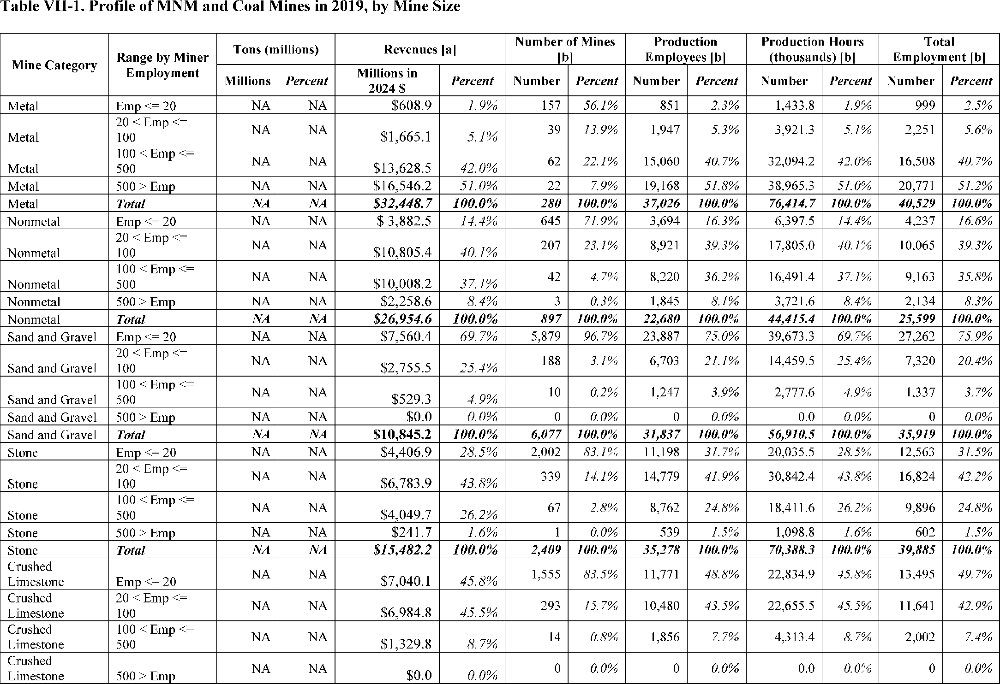
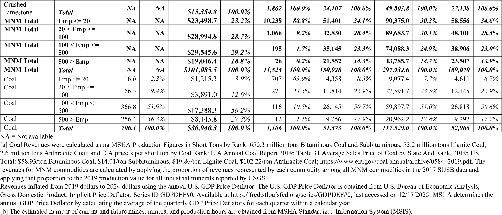

# Daily Digest — 2026-11-12

| | |
|---|---|
| **Digest date** | 2026-11-12 |
| **Data date range** | 2026-11-12 to 2026-11-12 |
| **Generated at** | 2026-11-13T05:02:13Z (UTC) |
| **Pipeline version** | 966484eb |
| **Inference** | model layers ran — cli/haiku, opus |
| **Source watermarks** | CREC: 2026-11-12T11:23:34Z · BILLS: 2026-11-12T09:34:53Z · FR: 2026-11-11T08:36:08Z · USCOURTS: 2026-11-12T22:49:23Z · PLAW: 2026-11-09T15:10:06Z |

[Full observed listing for this day](day/2026-11-12.html) — the items our collectors observed for this publication day, mechanical rules applied, frozen at end of day; releases their publishers date on other days are counted there, not listed. This digest is the canonical record.

All items below cite the govinfo package (and granule, where applicable) they
summarize. Selection is mechanical; each item states the rule that included
it. See the Coverage Statement at the end for a full accounting of what was
published, what was summarized, and what was excluded and why.

---

## Contents

- [Day in Review](#day-in-review)
- [1. Congressional Floor Activity](#1-congressional-floor-activity)
- [2. Legislation](#2-legislation)
- [3. Federal Register](#3-federal-register)
- [4. Enacted Laws](#4-enacted-laws)
- [5. Judicial Activity](#5-judicial-activity)
- [6. Agency Announcements](#6-agency-announcements)
- [7. Recorded Votes](#7-recorded-votes)
- [8. Bill Actions](#8-bill-actions)
- [9. Presidential Actions](#9-presidential-actions)
- [Terms Used Today](#terms-used-today)
- [Coverage Statement](#coverage-statement)
- [Methodology](#methodology)

---

## Day in Review

The digest carries 77 House and 43 Senate entries from the Congressional Record. The House agreed to a motion to discharge the Committee on Rules from further consideration of House Resolution 1247 by a recorded vote of 245 yeas, 175 nays, and 13 not voting, then considered the resolution providing for consideration of H.R. 2102, the Major Richard Star Act. The House also took up H.R. 10375 under suspension of the rules and H.R. 1013 under House Resolution 1650. In the Senate, members submitted amendments to H.R. 2347, including alternative Clean Water Act Section 401 language, and Senator Moran delivered Veterans Day remarks.

The digest carries 17 final rules, 10 proposed rules, and one presidential document. Proclamation 11080 establishes the Oval Office National Monument under the Antiquities Act. The FCC repealed its national television multiple ownership rule. HUD now requires verification of citizenship or eligible immigration status for all applicants for covered assistance, regardless of age. MSHA removed several mining provisions it described as outdated or duplicative, and DEA placed oveporexton in Schedule IV. Proposed rules include an FDA reclassification of certain immunohistochemistry test systems and USDA amendments to rangeland grazing regulations. A nominations message lists nominees to the CFTC and SEC.

The digest carries 69 district court opinions and one bankruptcy opinion. In two unpublished per curiam opinions, the Fifth Circuit dismissed a pro se employment discrimination appeal as frivolous and dismissed a criminal appeal after granting counsel's Anders motion to withdraw. The Court of International Trade sustained Commerce's remand redetermination in American Brass Rod Fair Trade Coalition v. United States. The digest also carries that court's July 1 opinion ordering the remand.

*Composed from the summarized items below and the day's mechanical
counts; all specifics are cited in their sections.*

---

## 1. Congressional Floor Activity

Source: Congressional Record (CREC), issue observed 2026-11-12, covering proceedings of 2026-11-11. Published by govinfo 2026-11-12T11:23:34Z; observed by our collector 2026-11-12T11:51:31Z. Total issue size: 157 granule(s).

### 1.1 Senate

Tags: legislative · model keys: executive communications · h.r. 2347 amendments · veterans day remarks

*In plain terms: Five items, led by amendments to H.R. 2347 including SA 6891, which would add the GOOD Act; the rest are Veterans Day remarks by Senator Moran and executive communications EC-5135 through EC-5159.*

- **Veterans Day (Executive Session)** — Senator Moran delivered Veterans Day remarks on the Senate floor, describing the holiday's origin as Armistice Day, its renaming to Veterans Day in 1953 and establishment in 1954, and the World War II Memorial. He stated that the U.S. House was voting on the Take Care of America's Veterans Act, which includes the Major Richard Star Act to allow combat-disabled veterans to receive both earned retirement pay and VA disability benefits, and that the package addresses mental health and addiction care, caregiver support, and survivor benefits. He said he would seek unanimous consent in the Senate for a cost-of-living increase for military members and veterans, and Senator Kennedy also gave remarks honoring veterans.
  - *In plain terms:* Senator Moran's Veterans Day remarks covered the holiday's Armistice Day origin, its 1953 renaming to Veterans Day and establishment in 1954, and the World War II Memorial.
  - Included because: CREC-SEL-01 — floor item ≥ threshold floor time (20,261 characters) (document dated 2026-11-11)
  - Source: [CREC-2026-11-11 / CREC-2026-11-11-pt1-PgS5569-11](https://www.govinfo.gov/app/details/CREC-2026-11-11/CREC-2026-11-11-pt1-PgS5569-11)
- **Executive and Other Communications** — This Congressional Record section lists executive communications laid before the Senate and referred to committees, including entries EC-5135 through EC-5159 in the excerpt provided. The communications transmit rules and reports from the Department of the Interior, the Department of Agriculture and its Forest Service, the Environmental Protection Agency, the Nuclear Regulatory Commission, the National Park Service, the Commodity Futures Trading Commission, and the Farm Credit Administration. Each rule or report is recorded as received during Senate adjournment in the Office of the President of the Senate, with dates ranging from October to November 2026, and is referred to either the Committee on Agriculture, Nutrition, and Forestry or the Committee on Environment and Public Works.
  - *In plain terms:* Executive communications EC-5135 through EC-5159, received during the Senate's adjournment in October and November 2026, transmit rules and reports from several agencies and go to the Agriculture or Environment and Public Works committees.
  - Included because: CREC-SEL-01 — floor item ≥ threshold floor time (22,332 characters) (document dated 2026-11-11)
  - Source: [CREC-2026-11-11 / CREC-2026-11-11-pt1-PgS5573-2](https://www.govinfo.gov/app/details/CREC-2026-11-11/CREC-2026-11-11-pt1-PgS5573-2)
- **Text of Amendments** — This section lists amendments submitted to H.R. 2347 and ordered to lie on the table. SA 6891, submitted by Mr. Johnson, would add the Guidance Out Of Darkness Act (GOOD Act), which requires agencies to publish designated guidance documents on a single OMB-designated internet website within specified deadlines and to maintain rescinded guidance with notations of the rescission. SA 6892, submitted by Mr. Kennedy for himself and Mr. Cassidy, would amend the definition of 'coastal political subdivision' in Section 102(10)(A) of the Gulf of Mexico Energy Security Act of 2006, and SA 6893, submitted by Ms. Smith for herself and Ms. Klobuchar, would amend Section 216(e) of the Federal Power Act concerning rights-of-way and state landowner protections. SA 6894, submitted by Ms. Smith, would revise a provision on page 239 so that an action depends on a state commission determining that an application is complete, and SA 6895, submitted by Mrs. Shaheen, would replace pages 110 through 133 with a new Section 1202 amending Section 401 of the Federal Water Pollution Control Act.
  - *In plain terms:* SA 6891 through SA 6895 to H.R. 2347 were submitted and ordered to lie on the table; SA 6891 would add the GOOD Act, requiring agencies to post designated guidance on one OMB-designated website.
  - Included because: CREC-SEL-01 — floor item ≥ threshold floor time (66,876 characters) (document dated 2026-11-11)
  - Source: [CREC-2026-11-11 / CREC-2026-11-11-pt1-PgS5576-3](https://www.govinfo.gov/app/details/CREC-2026-11-11/CREC-2026-11-11-pt1-PgS5576-3)
- **Text of Senate Amendment 6895** — SA 6895, submitted by Mrs. Shaheen to H.R. 2347, would strike text from page 110, line 1 through page 133, line 3 and insert a new Section 1202 amending Section 401 of the Federal Water Pollution Control Act concerning state water quality certification. The inserted text provides that a federal licensing or permitting agency considers water quality requirements satisfied when a certifying authority grants, waives, or conditionally grants a certification, limits the scope of certification to water quality, and requires state certifying authorities to establish public notice, prefiling meeting, complete-application, and 90-day completeness notification procedures, with a judicial petition process for alleged failures to act. The excerpt provided is truncated before the text ends.
  - *In plain terms:* SA 6895 by Mrs. Shaheen would replace pages 110–133 of H.R. 2347 with a new Section 1202 amending Section 401 of the Federal Water Pollution Control Act on state water quality certification.
  - Included because: CREC-SEL-01 — floor item ≥ threshold floor time (22,455 characters) (document dated 2026-11-11)
  - Source: [CREC-2026-11-11 / CREC-2026-11-11-pt1-PgS5577-4](https://www.govinfo.gov/app/details/CREC-2026-11-11/CREC-2026-11-11-pt1-PgS5577-4)
- **Text of Senate Amendment 6896** — SA 6896, submitted by Ms. Alsobrooks for herself and several cosponsors, is an amendment to SA 6883 proposed by Mr. Thune for Mrs. Capito and others to H.R. 2347. It would strike text from page 111, line 8 through page 130, line 15 and insert revised Clean Water Act Section 401 language that limits certification scope to ensuring that a Federal license or permit applicant complies with water quality requirements for the activity as a whole. The inserted text limits when a certifying authority may deny certification or grant it with conditions, retains prefiling meeting, complete-application, 90-day notification, and judicial petition procedures, and the excerpt provided is truncated.
  - *In plain terms:* SA 6896 by Ms. Alsobrooks would amend SA 6883 to H.R. 2347, replacing pages 111–130 with Section 401 language limiting certification to whether a permit applicant meets water quality requirements for the activity as a whole.
  - Included because: CREC-SEL-01 — floor item ≥ threshold floor time (22,310 characters) (document dated 2026-11-11)
  - Source: [CREC-2026-11-11 / CREC-2026-11-11-pt1-PgS5579](https://www.govinfo.gov/app/details/CREC-2026-11-11/CREC-2026-11-11-pt1-PgS5579)

### 1.2 House of Representatives

Tags: legislative · model keys: 504 modernization act · retirement fairness act · veterans day special orders

*In plain terms: Six items, led by H.R. 10375, the 504 Modernization and Small Manufacturer Enhancement Act, and H.R. 1013, the Retirement Fairness for Charities and Educational Institutions Act; the rest are Veterans Day special orders and travel expense reports.*

- **504 Modernization and Small Manufacturer Enhancement Act of 2026** — Mr. Williams of Texas moved to suspend the rules and pass H.R. 10375, the 504 Modernization and Small Manufacturer Enhancement Act of 2026, which amends the Small Business Investment Act of 1958. The bill adds workforce development, disaster-area revitalization, and expansion of concerns with 10 or fewer employees as policy goals for the 504 development company program, and sets out 504 loan closing procedures, designated attorney requirements, and an SBA marketing and outreach plan. It also revises leasing limits for new facilities and existing buildings, with a 20 percent limit on leasing new facilities and a 50 percent limit for small manufacturers' occupancy requirements, and requires a report to Congress within five years of enactment. The text provided is truncated before Section 6, which amends Section 7(a)(1)(A) of the Small Business Act.
  - *In plain terms:* A bill, H.R. 10375, the 504 Modernization and Small Manufacturer Enhancement Act of 2026, amends the Small Business Investment Act of 1958 and requires a report to Congress within five years of enactment.
  - Included because: CREC-SEL-01 — floor item ≥ threshold floor time (20,979 characters) (document dated 2026-11-11)
  - Source: [CREC-2026-11-11 / CREC-2026-11-11-pt1-PgH6160](https://www.govinfo.gov/app/details/CREC-2026-11-11/CREC-2026-11-11-pt1-PgH6160)
- **Providing for Consideration of H.R. 2102, Major Richard Star Act** — The House agreed to a motion to discharge the Committee on Rules from further consideration of House Resolution 1247, by a recorded vote of 245 yeas, 175 nays, and 13 not voting. Following the vote, the House considered the resolution providing for consideration of H.R. 2102, the Major Richard Star Act, which concerns compensation for combat-wounded veterans. Representative Takano spoke in favor of the bill and in opposition to H.R. 9237, the Take Care of America's Veterans Act, and quoted statements from veterans service organizations on that bill.
  - *In plain terms:* The House voted 245 to 175, with 13 not voting, to release House Resolution 1247 from the Rules Committee, then considered the rule for H.R. 2102, the Major Richard Star Act, on combat-wounded veterans' pay.
  - Included because: CREC-SEL-01 — floor item ≥ threshold floor time (30,592 characters) (document dated 2026-11-11)
  - Source: [CREC-2026-11-11 / CREC-2026-11-11-pt1-PgH6162](https://www.govinfo.gov/app/details/CREC-2026-11-11/CREC-2026-11-11-pt1-PgH6162)
- **Retirement Fairness for Charities and Educational Institutions Act of 2025** — H.R. 1013, the Retirement Fairness for Charities and Educational Institutions Act of 2025, was called up under House Resolution 1650 with a Financial Services Committee amendment in the nature of a substitute. The bill amends the Investment Company Act of 1940, the Securities Act of 1933, and the Securities Exchange Act of 1934 to extend registration exemptions to certain 403(b) plans and to collective trust funds and separate accounts that hold assets of those plans, where the plans are subject to ERISA title I, have an employer fiduciary for investment selection, or are governmental plans. Debate was allotted one hour, with Representative Wagner and Representative Lynch each controlling 30 minutes, and Representative Wagner described the bill as allowing 403(b) plans to use the same investment options available to 401(k) plans.
  - *In plain terms:* Under House Resolution 1650, H.R. 1013, the Retirement Fairness for Charities and Educational Institutions Act of 2025, extends registration exemptions for certain 403(b) plans and their trust funds and accounts, with one hour of debate.
  - Included because: CREC-SEL-01 — floor item ≥ threshold floor time (46,043 characters) (document dated 2026-11-11)
  - Source: [CREC-2026-11-11 / CREC-2026-11-11-pt1-PgH6166](https://www.govinfo.gov/app/details/CREC-2026-11-11/CREC-2026-11-11-pt1-PgH6166)
- **Saluting Our Veterans** — Representative Moore of Utah led a Special Order of 60 minutes on Veterans Day in honor of U.S. military veterans, with the time yielded to other Members. Representatives Harris of North Carolina, Meuser of Pennsylvania, Joyce of Pennsylvania, and Downing of Montana spoke about veterans in their districts and about legislation including the Veterans Housing Opportunity Act and the Major Richard Star Act. Representative Meuser also described the Tunnel to Towers Veterans Village, a 64-unit housing facility in Harrisburg, Pennsylvania, that offers housing and support services for veterans.
  - *In plain terms:* Representative Moore of Utah led a one-hour Veterans Day session honoring U.S. military veterans, and other members spoke about veterans' housing, the Veterans Housing Opportunity Act, and the Major Richard Star Act.
  - Included because: CREC-SEL-01 — floor item ≥ threshold floor time (28,083 characters) (document dated 2026-11-11)
  - Source: [CREC-2026-11-11 / CREC-2026-11-11-pt1-PgH6173](https://www.govinfo.gov/app/details/CREC-2026-11-11/CREC-2026-11-11-pt1-PgH6173)
- **Honoring Our Veterans** — Representative Takano led a Special Order of 60 minutes on veterans, during which he and Representative Cisneros spoke in opposition to H.R. 9237, the Take Care of America's Veterans Act, which the House had passed by voice vote. Representative Takano stated that the Republican majority had not held a recorded vote on the bill, and he read a Veterans of Foreign Wars statement that described the bill as the largest net benefit cut since the Great Depression. The speakers also referred to the Major Richard Star Act and stated that it had more than 330 cosponsors.
  - *In plain terms:* Representative Takano led a one-hour session on veterans in which he and Representative Cisneros opposed H.R. 9237, the Take Care of America's Veterans Act, which the House passed by voice vote.
  - Included because: CREC-SEL-01 — floor item ≥ threshold floor time (27,786 characters) (document dated 2026-11-11)
  - Source: [CREC-2026-11-11 / CREC-2026-11-11-pt1-PgH6176](https://www.govinfo.gov/app/details/CREC-2026-11-11/CREC-2026-11-11-pt1-PgH6176)
- **Expenditure Reports Concerning Official Foreign Travel** — This section of the Congressional Record contains expenditure reports for official foreign travel in the third and fourth quarters of 2026, submitted under Public Law 95-384 and signed by Hon. Mike Johnson on October 13 and October 27, 2026. The reports list per diem, transportation, and other expenditures for delegations to Taiwan (September 6 to 10, 2026, total $1,179.96), France (September 10 to 13, 2026, total $7,112.00), and Hungary and Germany (September 21 to 27, 2026, total $91,795.51). The report for the delegation to Sweden, Albania, Italy, and France (October 1 to 10, 2026) is truncated in the source text and its totals are not shown.
  - *In plain terms:* Expense reports signed by Mike Johnson on October 13 and 27, 2026 list trips to Taiwan ($1,179.96), France ($7,112.00), and Hungary and Germany ($91,795.51) in September 2026; the Sweden delegation report is truncated.
  - Included because: CREC-SEL-01 — floor item ≥ threshold floor time (175,055 characters) (document dated 2026-11-11)
  - Source: [CREC-2026-11-11 / CREC-2026-11-11-pt1-PgH6181-4](https://www.govinfo.gov/app/details/CREC-2026-11-11/CREC-2026-11-11-pt1-PgH6181-4)

### 1.3 Recorded Votes

No recorded votes were published in this issue of the Congressional Record.

---

## 2. Legislation

Source: Congressional Bills (BILLS), text versions published 2026-11-12 to 2026-11-12.

### 2.1 Counts by Stage

| Stage (bill text version) | Count |
|---|---|
| Introduced (ih/is) | 19 |
| Reported (rh/rs) | 0 |
| Engrossed (eh/es) | 1 |
| Enrolled (enr) | 0 |
| Other versions | 0 |
| **Total bill texts published** | **20** |

### 2.2 Bills Listed by Mechanical Rule

Bills below are listed because they matched at least one listing rule; the
matching rule is stated per item. All other bill texts are counted above and
accounted for in the Coverage Statement.

No bill texts published in this range matched a listing rule; all 20 are
accounted for in the Coverage Statement.

---

## 3. Federal Register

Source: Federal Register (FR), issue of 2026-11-12.

### 3.1 Counts by Document Type

| Document type | Count |
|---|---|
| Rules | 17 |
| Proposed rules | 10 |
| Notices | 96 |
| Presidential documents | 1 |
| **Total FR documents** | **124** |

### 3.2 Rules Published

Tags: department of the interior · department of transportation · executive · model keys: msha regulation removals · section 214 verification · television ownership cap

*In plain terms: 17 rules, led by an FCC action repealing the national television multiple ownership cap and a HUD rule requiring citizenship or eligible-status verification for Section 214 assistance; the rest are mostly MSHA regulation removals, safety zones, and aviation procedure updates.*

#### DEPARTMENT OF COMMERCE

- **Fisheries of the Exclusive Economic Zone Off Alaska; Reallocation of Pacific Cod in the Bering Sea and Aleutian Islands Management Area** (2026-23002; 50 CFR Part 679) — NMFS is reallocating the projected unused amounts of Pacific cod from catcher vessels using trawl gear to Amendment 80 (A80) trawl catcher/ processors in the Bering Sea and Aleutian Islands management area (BSAI). This action is necessary to allow the 2026 total allowable catch (TAC) of Pacific cod in the BSAI to be harvested. Action: Temporary rule; reallocation. Dates: Effective 1200 hours, Alaska local time (A.l.t.), November 12, 2026, through 2400 hours, A.l.t., December 31, 2026.
  - *In plain terms:* NMFS is reallocating unused projected Pacific cod from trawl catcher vessels to Amendment 80 trawl catcher/processors in the Bering Sea and Aleutian Islands so the 2026 catch limit can be harvested.
  - Included because: FR-SEL-01 — document type: final rule (all listed)
  - Source: [FR-2026-11-12 / 2026-23002](https://www.govinfo.gov/app/details/FR-2026-11-12/2026-23002)

#### DEPARTMENT OF HOMELAND SECURITY

- **Safety Zone; Sector Mobile Captain of the Port Zone, Mobile, AL** (2026-23027; 33 CFR Part 165) — The Coast Guard is establishing two temporary fixed safety zones to support the arrival and dismantling of the EX ENTERPRISE, formerly the USS ENTERPRISE (CVN-65), in the Sector Mobile Captain of the Port Zone. This rulemaking would prohibit persons and vessels from entering these zones unless authorized by the Captain of the Port, Sector Mobile. Action: Temporary final rule. Dates: This rule is effective from November 11, 2026, through May 11, 2030.
  - *In plain terms:* The Coast Guard is setting up two temporary fixed safety zones in the Sector Mobile zone for the arrival and dismantling of the EX ENTERPRISE, formerly USS ENTERPRISE (CVN-65), barring entry without Captain of the Port authorization.
  - Included because: FR-SEL-01 — document type: final rule (all listed)
  - Source: [FR-2026-11-12 / 2026-23027](https://www.govinfo.gov/app/details/FR-2026-11-12/2026-23027)
- **Special Local Regulation; Southern California Annual Marine Events for the San Diego Captain of the Port Zone, San Diego Fleet Week Veterans Day Boat Parade, San Diego Bay, San Diego, CA** (2026-23047; 33 CFR Part 100) — The Coast Guard will enforce a special local regulation for the San Diego Fleet Week Veterans Day Boat Parade on November 11, 2026, to provide for the safety of life on navigable waterways during this event. Our regulation for marine events within the Southwest Coast Guard District identifies the regulated area for this event in San Diego, CA. During the enforcement periods, the operator of any vessel in the regulated area must comply with directions from the Patrol Commander or any Official Patrol displaying a Coast Guard ensign. Action: Notification of enforcement of regulation. Dates: The regulation in 33 CFR 100.1101, Table 1 to § 100.1101, Item No. 17, will be enforced from 10:45 a.m. until 1 p.m., on November 11, 2026.
  - *In plain terms:* The Coast Guard will enforce a special local regulation for the San Diego Fleet Week Veterans Day Boat Parade on November 11, 2026, in San Diego Bay, requiring vessels to follow Patrol Commander directions.
  - Included because: FR-SEL-01 — document type: final rule (all listed)
  - Source: [FR-2026-11-12 / 2026-23047](https://www.govinfo.gov/app/details/FR-2026-11-12/2026-23047)

#### DEPARTMENT OF HOUSING AND URBAN DEVELOPMENT

- **Housing and Community Development Act of 1980: Verification of Eligible Status** (2026-23003; 24 CFR Part 5) — This final rule revises HUD's Section 214 regulations to require the verification of U.S. citizenship or the eligible immigration status of all applicants and recipients of assistance under a covered program regardless of age. The rule will also make prorated assistance a temporary condition pending verification of eligible status of all family members, where permitted by statute, as opposed to under HUD's current regulations where prorated assistance could continue indefinitely. These amendments bring HUD's regulations into greater alignment with the wording and purpose of Section 214 and align with the current Administration's priorities and regulatory reform efforts. Action: Final rule. Dates: Effective date: December 14, 2026.
  - *In plain terms:* HUD's final rule requires proof of U.S. citizenship or eligible immigration status from all applicants and recipients in covered programs, regardless of age; partial assistance becomes temporary pending verification where statute permits.
  - Included because: FR-SEL-01 — document type: final rule (all listed)
  - Source: [FR-2026-11-12 / 2026-23003](https://www.govinfo.gov/app/details/FR-2026-11-12/2026-23003)

#### DEPARTMENT OF JUSTICE

- **Schedules of Controlled Substances: Placement of Oveporexton in Schedule IV** (2026-23075; 21 CFR Part 1308) — On August 5, 2026, the United States Food and Drug Administration (FDA) approved a new drug application for Orzeyful (oveporexton) for the treatment of narcolepsy type 1 in adults. The Department of Health and Human Services (HHS) provided the Drug Enforcement Administration (DEA) with a scheduling recommendation to place oveporexton, chemically known as N -\[(2 S, 3 R )-2-\[\[3-(3,5-difluorophenyl)-2-fluorophenyl\]methyl\]-4,4-difluoro-1-(2-hydroxy-2-methylpropanoyl)pyrrolidin-3-yl\]ethanesulfonamide, in schedule IV of the Controlled Substances Act (CSA). In accordance with the CSA, as amended by the Improving Regulatory Transparency for New Medical Therapies Act, DEA is hereby issuing an interim final rule placing oveporexton, including its salts, isomers and salts of isomers whenever the existence of such salts, isomers, and salts of isomers is possible, in schedule IV of the CSA. Action: Interim final rule; request for comments. Dates: This rule is effective November 12, 2026. Comments must be submitted electronically or postmarked on or before December 14, 2026. The electronic Federal Docket Management System will not accept comments after 11:59 p.m. Eastern Time on the last day of the comment period. Requests for hearing and waivers of an opportunity for a hearing or to participate in a hearing, together with a written statement of position on the matters of fact and law asserted in the hearing, must be received on or before December 14, 2026.
  - *In plain terms:* The DEA is placing oveporexton, the drug FDA approved as Orzeyful for adult narcolepsy type 1, in schedule IV of the Controlled Substances Act via a rule that takes effect immediately while comments are accepted.
  - Included because: FR-SEL-01 — document type: final rule (all listed)
  - Source: [FR-2026-11-12 / 2026-23075](https://www.govinfo.gov/app/details/FR-2026-11-12/2026-23075)

#### DEPARTMENT OF LABOR

- **Improving and Eliminating Regulations; Permissible Lamps in Underground Coal Mines** (2026-23049; 30 CFR Part 75) — MSHA is removing duplicative requirements for electric cap lamps and other electric lamps in underground coal mines. This provision is being removed from MSHA's regulations because it is a duplicative provision and its removal will not reduce the protections afforded to miners. Action: Final rule. Dates: Effective date: December 14, 2026.
  - *In plain terms:* MSHA is removing a duplicative provision on electric cap lamps and other electric lamps in underground coal mines, which it states will not reduce miner protections.
  - Included because: FR-SEL-01 — document type: final rule (all listed)
  - Source: [FR-2026-11-12 / 2026-23049](https://www.govinfo.gov/app/details/FR-2026-11-12/2026-23049)
- **Improving and Eliminating Regulations; Limit on Exposure to Diesel Particulate Matter in Underground Metal and Nonmetal Mines** (2026-23050; 30 CFR Part 57) — MSHA is eliminating outdated requirements for diesel particulate matter (DPM) personal exposure limits for underground metal and nonmetal (MNM) mines. These requirements are being removed from MSHA's regulations because they contain outdated effective dates and exposure limits that are no longer applicable. Action: Final rule. Dates: Effective date: December 14, 2026.
  - *In plain terms:* MSHA is removing diesel particulate matter personal exposure requirements for underground metal and nonmetal mines because they contain outdated effective dates and limits that no longer apply.
  - Included because: FR-SEL-01 — document type: final rule (all listed)
  - Source: [FR-2026-11-12 / 2026-23050](https://www.govinfo.gov/app/details/FR-2026-11-12/2026-23050)
- **Improving and Eliminating Regulations; Installation of Foam Generator Systems in Underground Coal Mines** (2026-23051; 30 CFR Part 75) — MSHA is removing outdated requirements regarding the installation of foam generator systems located in underground coal mines. These requirements are being removed from MSHA's regulations because they are no longer applicable. Action: Final rule. Dates: Effective December 14, 2026.
  - *In plain terms:* MSHA is removing outdated requirements for installing foam generator systems in underground coal mines because they no longer apply.
  - Included because: FR-SEL-01 — document type: final rule (all listed)
  - Source: [FR-2026-11-12 / 2026-23051](https://www.govinfo.gov/app/details/FR-2026-11-12/2026-23051)
- **Electrical Equipment for Coal Seams Above the Water Table** (2026-23052; 30 CFR Part 75) — MSHA is removing requirements for the use of permissible electric face equipment in coal seams above the water table. These requirements are being removed from MSHA's regulations because all coal mines are now considered gassy, regardless of location relative to the water table. Action: Final rule. Dates: Effective date: December 14, 2026.
  - *In plain terms:* MSHA is removing requirements for permissible electric face equipment in coal seams above the water table, because all coal mines are now considered gassy regardless of location relative to the water table.
  - Included because: FR-SEL-01 — document type: final rule (all listed)
  - Source: [FR-2026-11-12 / 2026-23052](https://www.govinfo.gov/app/details/FR-2026-11-12/2026-23052)
- **Mining of Pillars** (2026-23053; 30 CFR Part 75) — MSHA is eliminating outdated requirements for the final mining of pillars from MSHA's regulations. These requirements are being removed because the practice of final mining of pillars with one mine opening is no longer used in the mining industry due to safety concerns. Action: Final rule. Dates: Effective date: December 14, 2026.
  - *In plain terms:* MSHA is eliminating outdated requirements for final mining of pillars, because the practice of final mining of pillars with one mine opening is no longer used in industry due to safety concerns.
  - Included because: FR-SEL-01 — document type: final rule (all listed)
  - Source: [FR-2026-11-12 / 2026-23053](https://www.govinfo.gov/app/details/FR-2026-11-12/2026-23053)

#### DEPARTMENT OF TRANSPORTATION

- **Airworthiness Directives; Bell Textron Canada Limited Helicopters** (2026-23007; 14 CFR Part 39) — The FAA is superseding Airworthiness Directive (AD) 2022-20-11, which applied to certain Bell Textron Canada Limited Model 429 helicopters. AD 2022-20-11 required visually inspecting the external surface of the tail rotor (TR) gearbox support assembly, borescope inspecting or visually inspecting the inside of the tail boom, and performing a tactile inspection. Depending on the results of the inspections, AD 2022-20-11 required removing certain rivets from service or repairing gaps in accordance with an approved method. Since the FAA issued AD 2022-20-11, the manufacturer determined the repetitive inspection interval needs to be reduced. This AD requires the same actions as AD 2022-20-11 and reduces the inspection interval. The FAA is issuing this AD to address the unsafe condition on these products. Action: Final rule. Dates: This AD is effective December 17, 2026. The Director of the Federal Register approved the incorporation by reference of a certain publication listed in this AD as of December 17, 2026.
  - *In plain terms:* The FAA is replacing Airworthiness Directive 2022-20-11 for certain Bell Textron Canada Model 429 helicopters, keeping its inspection and repair requirements but shortening the repetitive inspection interval the manufacturer determined was needed.
  - Included because: FR-SEL-01 — document type: final rule (all listed)
  - Source: [FR-2026-11-12 / 2026-23007](https://www.govinfo.gov/app/details/FR-2026-11-12/2026-23007)
- **Standard Instrument Approach Procedures, and Takeoff Minimums and Obstacle Departure Procedures; Miscellaneous Amendments** (2026-23072; 14 CFR Part 97) — This rule establishes, amends, suspends, or removes Standard Instrument Approach Procedures (SIAPS) and associated Takeoff Minimums and Obstacle Departure procedures (ODPs) for operations at certain airports. These regulatory actions are needed because of the adoption of new or revised criteria, or because of changes occurring in the National Airspace System, such as the commissioning of new navigational facilities, adding new obstacles, or changing air traffic requirements. These changes are designed to provide safe and efficient use of the navigable airspace and to promote safe flight operations under instrument flight rules at the affected airports. Action: Final rule. Dates: This rule is effective November 12, 2026. The compliance date for each SIAP, associated Takeoff Minimums, and ODP is specified in the amendatory provisions. The incorporation by reference of certain publications listed in the regulations is approved by the Director of the Federal Register as of November 12, 2026.
  - *In plain terms:* This rule establishes, amends, suspends, or removes instrument approach, takeoff minimum, and obstacle departure procedures at certain airports, due to new or revised criteria or changes like new navigational facilities, new obstacles.
  - Included because: FR-SEL-01 — document type: final rule (all listed)
  - Source: [FR-2026-11-12 / 2026-23072](https://www.govinfo.gov/app/details/FR-2026-11-12/2026-23072)
- **Standard Instrument Approach Procedures, and Takeoff Minimums and Obstacle Departure Procedures; Miscellaneous Amendments** (2026-23073; 14 CFR Part 97) — This rule amends, suspends, or removes Standard Instrument Approach Procedures (SIAPs) and associated Takeoff Minimums and Obstacle Departure Procedures for operations at certain airports. These regulatory actions are needed because of the adoption of new or revised criteria, or because of changes occurring in the National Airspace System, such as the commissioning of new navigational facilities, adding new obstacles, or changing air traffic requirements. These changes are designed to provide for the safe and efficient use of the navigable airspace and to promote safe flight operations under instrument flight rules at the affected airports. Action: Final rule. Dates: This rule is effective November 12, 2026. The compliance date for each SIAP, associated Takeoff Minimums, and ODP is specified in the amendatory provisions. The incorporation by reference of certain publications listed in the regulations is approved by the Director of the Federal Register as of November 12, 2026.
  - *In plain terms:* This rule amends, suspends, or removes instrument approach and takeoff procedures at certain airports, because of new or revised criteria or airspace changes such as new navigational facilities or obstacles.
  - Included because: FR-SEL-01 — document type: final rule (all listed)
  - Source: [FR-2026-11-12 / 2026-23073](https://www.govinfo.gov/app/details/FR-2026-11-12/2026-23073)

#### FEDERAL COMMUNICATIONS COMMISSION

- **National Television Multiple Ownership Rule** (2026-23040; 47 CFR Part 73) — In this document, the Federal Communications Commission (Commission) repeals the national television multiple ownership rule (national cap), which prohibits a commercial television licensee from having a cognizable interest in television stations that have an aggregate national audience reach above 39%. The Commission finds, given seismic changes in the modern media marketplace, that the rule's repeal will help empower local broadcast television stations to operate in the public interest and to better serve the needs and interests of their local communities. The Commission will review on a case-by-case basis proposed transactions that would have been prohibited under the national cap to determine whether a proposed transaction would serve the Commission's media ownership goals of localism, competition, and viewpoint diversity. Action: Final rule. Dates: The repeal of 47 CFR 73.3555(e) is effective January 11, 2027.
  - *In plain terms:* The FCC is repealing its national television multiple ownership rule, which barred a licensee from holding stations reaching above 39% of national audiences; such deals will be reviewed case by case.
  - Included because: FR-SEL-01 — document type: final rule (all listed)
  - Source: [FR-2026-11-12 / 2026-23040](https://www.govinfo.gov/app/details/FR-2026-11-12/2026-23040)
- **Television Broadcasting Services, St. George, Utah** (2026-23041; 47 CFR Part 73) — This document amends the Table of TV Allotments (Table) of the Federal Communications Commission's (Commission) rules by substituting VHF channel 9 for UHF channel 21 at St. George, Utah in response to a petition for rulemaking filed by KUTV Licensee, LLC (Licensee), licensee of full power television station KMYU(TV) (KMYU or Station), St. George, Utah. The Media Bureau (Bureau) previously granted a petition for rulemaking submitted by the Licensee to substitute UHF channel 21 for VHF channel 9 at St. George, Utah in the Table. The Licensee subsequently filed an application for a construction permit for its new channel, which remains pending due to certain unresolved engineering matters. The Licensee now states that upon further consideration and restraints, it wishes to abandon its plans to modify its license for KMYU to operate on channel 21. The Licensee filed the instant petition to amend the Table to substitute VHF channel 9 for UHF channel 21 and allow KMYU to continue to operate on channel 9 at its licensed parameters. \[official summary truncated; see source\] Action: Final rule. Dates: Effective November 12, 2026.
  - *In plain terms:* The FCC is substituting VHF channel 9 for UHF channel 21 at St. George, Utah, on KUTV Licensee, LLC's petition, letting station KMYU keep operating on channel 9 at its licensed parameters.
  - Included because: FR-SEL-01 — document type: final rule (all listed)
  - Source: [FR-2026-11-12 / 2026-23041](https://www.govinfo.gov/app/details/FR-2026-11-12/2026-23041)

#### FEDERAL RESERVE SYSTEM

- **Federal Reserve Bank Capital Stock** (2026-23060; 12 CFR Part 209) — The Board of Governors (Board) is publishing a final rule that applies an inflation adjustment to the threshold for total consolidated assets in Regulation I. Federal Reserve Bank (Reserve Bank) stockholders that have total consolidated assets above the threshold receive a different dividend rate on their Reserve Bank stock than stockholders with total consolidated assets at or below the threshold. The Federal Reserve Act requires that the Board annually adjust the total consolidated asset threshold to reflect the change in the Gross Domestic Product Price Index, published by the Bureau of Economic Analysis (BEA). Based on the change in the Gross Domestic Product Price Index as of September 30, 2026, the total consolidated asset threshold will be $13,712,000,000 through December 31, 2027. Action: Final rule. Dates: Effective date: December 14, 2026. Applicability date: The adjusted threshold for total consolidated assets will apply beginning on January 1, 2027.
  - *In plain terms:* The Federal Reserve Board's final rule sets the Regulation I asset threshold for Reserve Bank stock dividend rates at $13,712,000,000 through December 31, 2027, inflation-adjusted as of September 30, 2026.
  - Included because: FR-SEL-01 — document type: final rule (all listed)
  - Source: [FR-2026-11-12 / 2026-23060](https://www.govinfo.gov/app/details/FR-2026-11-12/2026-23060)

#### NUCLEAR REGULATORY COMMISSION

- **AP1000 Design Certification Renewal** (C1-2026-21030; 10 CFR Part 52) — A correction notice from the Nuclear Regulatory Commission, filed November 11, 2026, amends rule document 2026-21030, AP1000 Design Certification Renewal (Docket NRC-2026-2377, RIN 3150-AL70), which was published in the October 14, 2026 issue beginning at page 65091. The correction changes the designation of paragraph V.A on page 65100, in the first column under V. Applicable Regulations, to read V.A.1.
  - *In plain terms:* The Nuclear Regulatory Commission's November 11, 2026 correction notice amends its October 14, 2026 AP1000 Design Certification Renewal rule, changing paragraph V.A on page 65100 to read V.A.1.
  - Included because: FR-SEL-01 — document type: final rule (all listed)
  - Source: [FR-2026-11-12 / C1-2026-21030](https://www.govinfo.gov/app/details/FR-2026-11-12/C1-2026-21030)

### 3.3 Proposed Rules Published

Tags: department of the interior · department of transportation · executive · model keys: air quality implementation · rangeland grazing management

*In plain terms: 10 proposed rules, led by FDA's proposed reclassification of immunohistochemistry test systems and USDA's proposed Rangeland Management grazing changes; the rest cover aviation, fisheries, air quality, MSHA, Postal Service, and hearing notices.*

#### DEPARTMENT OF AGRICULTURE

- **Rangeland Management** (2026-23033; 36 CFR Part 222) — The U.S. Department of Agriculture (USDA or Department) proposes to amend the regulations governing grazing and livestock use on the National Forest System to modernize grazing administration, improve clarity, codify existing policy, and expand opportunities for stewardship and access. The proposed amendments would update permit issuance, eligibility, and qualification provisions; establish a framework for adaptive response to drought, wildfire, and similar disturbance events; and expand authorities for stewardship-oriented livestock use, including adding the ability to implement stewardship projects (such as outcome-based grazing or targeted grazing) under a temporary grazing permit or livestock use permit. The proposed rule would revise grazing fee provisions to ensure consistent fee-setting across the national forests in the 16 contiguous Western States and the national grasslands, and establish a surcharge for authorized leasing of livestock by permittees. It would consolidate and renumber existing sections in subpart A for clarity and make conforming, technical, and administrative updates throughout part 222. \[official summary truncated; see source\] Action: Proposed rule; request for public comment. Dates: Comments must be received in writing by December 14, 2026.
  - *In plain terms:* USDA proposes revising National Forest System grazing rules to update permit provisions, set a framework for responding to drought and wildfire, allow stewardship grazing under temporary permits, and add a livestock leasing surcharge.
  - Included because: FR-SEL-02 — document type: proposed rule (all listed)
  - Source: [FR-2026-11-12 / 2026-23033](https://www.govinfo.gov/app/details/FR-2026-11-12/2026-23033)

#### DEPARTMENT OF COMMERCE

- **Coral, Coral Reefs, and Live/Hardbottom Habitats of the South Atlantic and the Shrimp Fishery of the South Atlantic Region; Amendments 11/12** (2026-23020; 50 CFR Part 622) — NMFS issues this proposed rule to implement Amendment 11 to the Fishery Management Plan for Coral, Coral Reefs, and Live/Hardbottom Habitats of the South Atlantic (Coral FMP) and to implement Amendment 12 to the Fishery Management Plan for the Shrimp Fishery of the South Atlantic Region (Shrimp FMP) (jointly Amendments 11/12), as prepared and submitted by the South Atlantic Fishery Management Council (Council). If implemented, this proposed rule would establish a shrimp fishery access area (SFAA) along the eastern boundary of the northern extension of the Oculina Bank Habitat Area of Particular Concern (OHAPC) where trawling for rock shrimp is currently prohibited. The purpose of this proposed rule is to reinstate access to historic rock shrimp fishing grounds, achieve optimum yield (OY) in the rock shrimp fishery, while minimizing impacts to deep-water corals in the OHAPC. Action: Proposed rule; request for comments. Dates: Written comments on the proposed rule must be received on or before December 14, 2026.
  - *In plain terms:* NMFS proposes implementing Amendments 11/12 to South Atlantic coral and shrimp plans, creating a shrimp access area where trawling is prohibited to restore access to former rock shrimp grounds while minimizing deep-water coral impacts.
  - Included because: FR-SEL-02 — document type: proposed rule (all listed)
  - Source: [FR-2026-11-12 / 2026-23020](https://www.govinfo.gov/app/details/FR-2026-11-12/2026-23020)

#### DEPARTMENT OF HEALTH AND HUMAN SERVICES

- **Hematology and Pathology Devices; Reclassification of Immunohistochemistry Test Systems for Use With a Corresponding Approved Oncology Therapeutic Product** (2026-23005; 21 CFR Part 864) — The Food and Drug Administration (FDA) is proposing to reclassify immunohistochemistry (IHC) test systems indicated for use with a corresponding approved oncology therapeutic product (product codes MVC, NKF, QQT, NQF, PLS, PKW, QUL, QNH, QZJ, SBL, SER, and SHF), which are postamendments class III devices, from class III (premarket approval) into class II (special controls), subject to premarket notification. FDA is proposing minor revisions to an existing classification regulation and also proposing a new device classification regulation, along with the special controls that FDA believes are necessary to provide a reasonable assurance of safety and effectiveness for these devices. Action: Proposed amendment; proposed order; request for comments. Dates: Either electronic or written comments on the proposed order must be submitted by January 11, 2027. Please see section X of this document for the proposed effective date when the new requirements would apply and for the proposed effective date of a final order based on this proposed order.
  - *In plain terms:* FDA proposes moving certain immunohistochemistry test systems used with approved cancer drugs from class III, which requires premarket approval, to class II with special controls, subject to premarket notification.
  - Included because: FR-SEL-02 — document type: proposed rule (all listed)
  - Source: [FR-2026-11-12 / 2026-23005](https://www.govinfo.gov/app/details/FR-2026-11-12/2026-23005)

#### DEPARTMENT OF LABOR

- **Respirable Crystalline Silica and Respiratory Protection** (2026-23048; 30 CFR Parts 56, 57, 60, 71, and 72) — This proposed rule clarifies and modifies provisions of the respirable crystalline silica and respiratory protection standards that were established in MSHA's 2024 final rule titled “ Lowering Miners' Exposure to Respirable Crystalline Silica and Improving Respiratory Protection.” The changes provide clarity and make improvements to the requirements for methods of compliance, exposure monitoring, respiratory protection, medical surveillance, and recordkeeping while maintaining strong protection of miners. The proposal also includes related conforming amendments. Action: Proposed rule, request for comments; notice of public hearing. Dates: Written Comments. Written comments must be received or postmarked by midnight Eastern Time on January 11, 2027. Public Hearing. MSHA will hold a virtual-only public hearing on December 15, 2026. For more information on the public hearing, see SUPPLEMENTARY INFORMATION .
  - *In plain terms:* MSHA proposes clarifying and changing its 2024 silica and respiratory protection rule for miners, covering compliance methods, exposure monitoring, respirators, medical surveillance, and recordkeeping.
  - Included because: FR-SEL-02 — document type: proposed rule (all listed)
  - Source: [FR-2026-11-12 / 2026-23048](https://www.govinfo.gov/app/details/FR-2026-11-12/2026-23048)
  -  *Source graphic 1 of 38 from 2026-23048.*
  -  *Source graphic 2 of 38 from 2026-23048.*
  - *Graphics not rendered here: 36 of 38 — see the [source PDF](https://www.govinfo.gov/content/pkg/FR-2026-11-12/pdf/FR-2026-11-12.pdf).*

#### DEPARTMENT OF THE TREASURY

- **Federal Scholarship Tax Credit; Hearing** (2026-23032; 26 CFR Part 1) — This document announces that the public hearing scheduled for December 15, 2026, at 10 a.m. ET, for the notice of proposed rulemaking and notice of public hearing (REG-117199-25) published in the Federal Register on October 2, 2026, has been changed to a telephonic-only hearing. These proposed regulations would provide guidance regarding the non-refundable Federal tax credit for qualified contributions to scholarship granting organizations to fund qualified elementary and secondary school education scholarships. Action: Notification of change to telephonic-only public hearing on a proposed rulemaking. Dates: The public hearing scheduled to be held on December 15, 2026, at 10 a.m. ET, has been changed to a telephonic-only hearing.
  - *In plain terms:* The public hearing set for December 15, 2026, at 10 a.m. ET on proposed rule REG-117199-25, a federal scholarship tax credit rule published October 2, 2026, is now telephone-only.
  - Included because: FR-SEL-02 — document type: proposed rule (all listed)
  - Source: [FR-2026-11-12 / 2026-23032](https://www.govinfo.gov/app/details/FR-2026-11-12/2026-23032)

#### DEPARTMENT OF TRANSPORTATION

- **Amendment of Jet Route J-21 in the Vicinity of Laredo, TX** (2026-23017; 14 CFR Part 71) — This action proposes to amend Jet Route J-21 to eliminate an unnecessary 1.47-degree turn in the airway in the vicinity of Laredo, TX. The FAA proposes this action to improve efficiency by straightening the ground track of J-21, eliminating a 1.47-degree turn. Action: Notice of proposed rulemaking (NPRM). Dates: Comments must be received on or before December 28, 2026.
  - *In plain terms:* The FAA proposes amending Jet Route J-21 near Laredo, TX to remove an unnecessary 1.47-degree turn, straightening the airway's ground track for efficiency.
  - Included because: FR-SEL-02 — document type: proposed rule (all listed)
  - Source: [FR-2026-11-12 / 2026-23017](https://www.govinfo.gov/app/details/FR-2026-11-12/2026-23017)
- **Airworthiness Directives; Diamond Aircraft Industries GmbH Airplanes** (2026-23068; 14 CFR Part 39) — The FAA proposes to adopt a new airworthiness directive (AD) for all Diamond Aircraft Industries GmbH (DAI) Model DA 50 C airplanes. This proposed AD was prompted by reports of flap actuator failures. This proposed AD would require inspecting for displacement of the black slide grommet and inspecting the rod end bearing for a tight fit of the flap actuator. This proposed AD would also require modification of the flap actuator followed by repetitive inspections for a broken actuator torque seal on the jam nuts at the attachment of the rod end bearing of the flap actuator with applicable corrective action. This proposed AD would also prohibit the installation of unmodified flap actuators on any airplane. The FAA is proposing this AD to address the unsafe condition on these products. Action: Notice of proposed rulemaking (NPRM). Dates: The FAA must receive comments on this NPRM by December 28, 2026.
  - *In plain terms:* The FAA proposes an airworthiness directive for Diamond Aircraft DA 50 C airplanes after flap actuator failure reports, requiring inspections, actuator modification, repeated inspections for broken torque seals, and barring unmodified actuator installation.
  - Included because: FR-SEL-02 — document type: proposed rule (all listed)
  - Source: [FR-2026-11-12 / 2026-23068](https://www.govinfo.gov/app/details/FR-2026-11-12/2026-23068)
- **Airworthiness Directives; Dassault Aviation Airplanes** (2026-23074; 14 CFR Part 39) — The FAA proposes to adopt a new airworthiness directive (AD) for all Dassault Aviation Model MYSTERE-FALCON 50, FALCON 2000, and FALCON 2000EX airplanes. This proposed AD was prompted by a reported quality escape and a determination that high-temperature oxidation of main landing gear (MLG) upper and lower torque links may have occurred during manufacturing. This proposed AD would require replacing any affected MLG with a serviceable MLG. This proposed AD would also limit the installation of affected parts under certain conditions. The FAA is proposing this AD to address the unsafe condition on these products. Action: Notice of proposed rulemaking (NPRM). Dates: The FAA must receive comments on this proposed AD by December 28, 2026.
  - *In plain terms:* The FAA proposes an airworthiness directive for Dassault MYSTERE-FALCON 50, FALCON 2000, and FALCON 2000EX airplanes after a reported quality escape, requiring replacement of affected main landing gear and limiting installation of affected parts.
  - Included because: FR-SEL-02 — document type: proposed rule (all listed)
  - Source: [FR-2026-11-12 / 2026-23074](https://www.govinfo.gov/app/details/FR-2026-11-12/2026-23074)

#### ENVIRONMENTAL PROTECTION AGENCY

- **Approval and Promulgation of Air Quality Implementation Plans; Michigan; Withdrawal of the Federal Implementation Plan for the Detroit Sulfur Dioxide Area** (2026-23026; 40 CFR Part 52) — The U.S. Environmental Protection Agency (EPA) is proposing to withdraw the Federal Implementation Plan (FIP), promulgated on October 12, 2022 (the “2022 FIP”), for attaining the 2010 1-hour primary sulfur dioxide (SO 2 ) National Ambient Air Quality Standard (NAAQS) in the Detroit area. On May 19, 2025, the EPA approved a revision to Michigan's State Implementation Plan (SIP) for attaining the 2010 1-hour primary SO 2 NAAQS in the Detroit area, rendering the 2022 FIP duplicative. The EPA is proposing this action pursuant to Clean Air Act (CAA) section 110. Action: Proposed rule. Dates: Comments must be received on or before December 28, 2026. Virtual Public Hearing. If anyone contacts the EPA requesting to present at a virtual public hearing on or before November 27, 2026, the Agency will hold a virtual public hearing on December 14, 2026. To request to present at a virtual public hearing, or to pre-register to attend the hearing, if one is held, please use the online registration form available at https://www.epa.gov/mi/detroit-so2-federal-implementation-plan or contact Abigail Teener at (312) 353-7314 or by email at teener.abigail@epa.gov. The EPA is asking all hearing attendees to register, even those who do not intend to present. The last day to request to present at the hearing will be November 27, 2026. If no request to present at the virtual public hearing is received by 11:59 p.m. Central Time (CT) on November 27, 2026, the EPA will not hold the hearing. If a virtual hearing is held, the EPA will accept registration until the start of the hearing. The EPA will announce the status of the hearing on November 30, 2026 on the public hearing website at https://www.epa.gov/mi/detroit-so2-federal-implementation-plan. Alternatively, interested parties may contact Abigail Teener at (312) 353-7314 or by email at teener.abigail@epa.gov to find out if the hearing is being held. If a request to present at the virtual public hearing is received by November 27, 2026, the EPA will hold a virtual public hearing on December 14, 2026. The EPA will post a general agenda for the hearing on December 10, 2026. The agenda will be available at https://www.epa.gov/mi/detroit-so2-federal-implementation-plan and will list pre-registered presenters in approximate order. The hearing will convene at 9:00 a.m. CT and will conclude at 1:00 p.m. CT, or 15 minutes after the last pre-registered presenter in attendance has presented if there are no additional presenters. The EPA will announce further details on the virtual public hearing website at https://www.epa.gov/mi/detroit-so2-federal-implementation-plan. The EPA will make every effort to follow the schedule as closely as possible on the day of the hearing; however, please plan for the hearing to run either ahead of schedule or behind schedule. Each commenter will have five minutes to provide oral testimony. The EPA encourages commenters to provide the Agency with a written copy of their oral testimony electronically by including it in the registration form or emailing it to teener.abigail@epa.gov. The EPA may ask clarifying questions during the oral presentations but will not respond to the presentations at that time. Written statements and supporting information submitted during the comment period will be considered with the same weight as oral comments and supporting information presented at the virtual public hearing. Please note that any updates made to any aspect of the hearing will be posted online at https://www.epa.gov/mi/detroit-so2-federal-implementation-plan. Please monitor our website or contact Abigail Teener at (312) 353-7314 or teener.abigail@epa.gov to determine if there are any updates. The EPA does not intend to publish a document in the Federal Register announcing updates concerning the virtual public hearing. If you require the services of a translator or a special accommodation such as audio description/closed captioning, please pre-register for the hearing with Abigail Teener at (312) 353-7314 or teener.abigail@epa.gov and describe your needs by November 27, 2026. The EPA may not be able to arrange accommodations without advance notice.
  - *In plain terms:* EPA proposes withdrawing its October 12, 2022 Detroit sulfur dioxide Federal Implementation Plan (FIP), which is duplicative since Michigan's state plan revision approved May 19, 2025 covers the same 2010 1-hour standard.
  - Included because: FR-SEL-02 — document type: proposed rule (all listed)
  - Source: [FR-2026-11-12 / 2026-23026](https://www.govinfo.gov/app/details/FR-2026-11-12/2026-23026)

#### POSTAL SERVICE

- **Authorization To Manufacture and Distribute Postage Evidencing Systems** (2026-23064; 39 CFR Part 501) — The Postal Service is amending its Postage Evidencing Systems regulations to align with existing practices and operational realities to better address circumstances where advances by a resetting company on any given day exceed the daily average funds advanced amount maintained on deposit with the Postal Service. The regulations currently allow resetting companies to advance postage to customers by a process where the resetting company maintains a daily average advance balance with the Postal Service. The current regulation contemplates that the amount on deposit will always cover amounts advanced and does not permit a resetting company to advance funds to customers in excess of the amount maintained on deposit. Operational realities will create circumstances where it is necessary to advance funds in excess of the amount on deposit and the average daily balance rule represents a practical and fair method to address circumstances where excess advances occur. Action: Proposed rule. Dates: Comments must be received on or before December 14, 2026.
  - *In plain terms:* The Postal Service is amending Postage Evidencing Systems rules to allow resetting companies to advance postage in amounts above their daily average deposit balance, using a daily average balance method for such excess advances.
  - Included because: FR-SEL-02 — document type: proposed rule (all listed)
  - Source: [FR-2026-11-12 / 2026-23064](https://www.govinfo.gov/app/details/FR-2026-11-12/2026-23064)

### 3.4 Notices and Presidential Documents

Tags: department of the interior · department of transportation · executive · model keys: antiquities act proclamation · oval office monument

*In plain terms: One proclamation, Proclamation 11080, dated November 5, 2026, establishes the Oval Office National Monument under the Antiquities Act, covering the Oval Office and Outer Oval Office rooms.*

Notices are summarized only when they match a listing rule; all are counted
in 3.1 and in the Coverage Statement. Presidential documents in the FR are
always listed.

- **Establishment of the Oval Office National Monument** (2026-23113) — Proclamation 11080, dated November 5, 2026, establishes the Oval Office National Monument under the authority of 54 U.S.C. 320301 (the Antiquities Act). The monument consists of the Oval Office (Room 110), the Outer Oval Office (Rooms 106 and 108), and the Cabinet Room (Room 105), and the Secretary of the Interior, through the National Park Service, is directed to manage it to protect its architectural integrity and its association with the Presidency. The proclamation requires a management plan developed in consultation with the White House Office of Administration, requires documentation and review of alternatives before substantial alterations or demolition, and states that it does not restrict the President's authority to redecorate, select furnishings, or make ordinary operational and security modifications or alter existing exemptions under the National Historic Preservation Act.
  - *In plain terms:* Proclamation 11080, dated November 5, 2026, establishes the Oval Office National Monument covering the Oval Office, Outer Oval Office, and Cabinet Room, managed by the National Park Service without restricting the President's redecorating or furnishing.
  - Included because: FR-SEL-03 — presidential document (all listed)
  - Source: [FR-2026-11-12 / 2026-23113](https://www.govinfo.gov/app/details/FR-2026-11-12/2026-23113)
  - Corroborated across time: the same document was first published by the White House on [2026-11-05](https://www.whitehouse.gov/presidential-actions/2026/11/establishment-of-the-oval-office-national-monument/), days before the Federal Register compiled it. Listed here as the official record of this day — the earlier publication is referenced, not suppressed; both observations are preserved and counted.

---

## 4. Enacted Laws

Source: Public and Private Laws (PLAW) published 2026-11-12.

No laws were published in this range.

---

## 5. Judicial Activity

Source: United States Courts Opinions (USCOURTS): opinions observed 2026-11-12
by our collector; each opinion states its own issue date beside its
listing ([how our clocks work](faq.html#fapds-three-clocks)).

Completeness disclosure (standing): USCOURTS carries opinions from
approximately 140 participating appellate, district, bankruptcy, and
national federal courts. Unlike the Congressional Record and the Federal
Register, which are the complete official record of their branches,
USCOURTS is participation-based and is NOT the complete federal judicial
record. Courts post opinions with delay — typically over several days —
so a day's digest carries the opinions that became available that day,
whatever date each was issued.

### 5.1 Appellate and National Court Opinions

Tags: judicial · model keys: commerce remand redetermination · court of international trade · fifth circuit opinions

*In plain terms: Four items: two unpublished Fifth Circuit opinions, in Donaldson v. Hiland Dairy and USA v. Vallejo-Navarro, and two Court of International Trade rulings in American Brass Rod Fair Trade Coalition v. United States, including a judgment sustaining Commerce's remand redetermination.*

Appellate and national court opinions are summarized; district and
bankruptcy opinions are counted in 5.2 and in the Coverage Statement.

#### United States Court of Appeals for the Fifth Circuit

- **Donaldson v. Hiland Dairy** (No. 26-10352; filed 2026-11-11) — In an unpublished per curiam opinion filed November 11, 2026, the U.S. Court of Appeals for the Fifth Circuit denied pro se appellant Robert Leon Donaldson's motion to proceed in forma pauperis and dismissed his appeal as frivolous. The district court had dismissed Donaldson's employment discrimination complaint, construed as Title VII claims, with prejudice as time-barred for failure to timely file an EEOC charge, and had found no basis for tolling. The appellate court held that Donaldson abandoned his tolling, equitable estoppel, and fraudulent concealment arguments by failing to meaningfully brief them.
  - *In plain terms:* On November 11, 2026, the Fifth Circuit dismissed Donaldson's appeal as lacking merit and denied his request to proceed without paying fees, after a lower court ruled his employment discrimination claim was filed too late.
  - Included because: USCOURTS-SEL-01 — appellate court opinion (all listed) (document dated 2026-11-11)
  - Source: [USCOURTS-ca5-26-10352 / USCOURTS-ca5-26-10352-0](https://www.govinfo.gov/app/details/USCOURTS-ca5-26-10352/USCOURTS-ca5-26-10352-0)
- **USA v. Vallejo-Navarro** (No. 26-40174; filed 2026-11-11) — In an unpublished per curiam opinion filed November 11, 2026, the U.S. Court of Appeals for the Fifth Circuit granted court-appointed counsel's motion to withdraw and dismissed the appeal of defendant Bruno Vallejo-Navarro. Counsel had filed a brief under Anders v. California and United States v. Flores stating that the appeal presented no nonfrivolous issue for review. The defendant did not file a response, and the court concurred with counsel's assessment after reviewing the brief and relevant portions of the record.
  - *In plain terms:* On November 11, 2026, the Fifth Circuit granted appointed counsel's request to withdraw and dismissed Bruno Vallejo-Navarro's appeal, agreeing with counsel that it had no issues with legal merit.
  - Included because: USCOURTS-SEL-01 — appellate court opinion (all listed) (document dated 2026-11-11)
  - Source: [USCOURTS-ca5-26-40174 / USCOURTS-ca5-26-40174-0](https://www.govinfo.gov/app/details/USCOURTS-ca5-26-40174/USCOURTS-ca5-26-40174-0)

#### United States Court of International Trade

- **American Brass Rod Fair Trade Coalition et al v. United States** (No. 1:24-cv-00119; filed 2026-07-01) — In Slip Op. 26-70 (Court No. 24-00119, filed July 1, 2026), Judge Joseph A. Laroski of the U.S. Court of International Trade granted the plaintiffs' motion for judgment on the agency record in a challenge by the American Brass Rod Fair Trade Coalition and its Individual Members. The court remanded the U.S. Department of Commerce's final affirmative determination in the less-than-fair-value investigation of brass rod from India, published at 89 Fed. Reg. 29,300, for further consideration and explanation of cost-of-manufacturing adjustments for respondent Rajhans Metals Private Limited, including work-in-progress inventory and scrap offsets. The opinion states that the court agrees with the plaintiffs on these issues.
  - *In plain terms:* On July 1, 2026, the Court of International Trade ruled for the plaintiffs and sent back the Commerce Department's brass rod from India determination for further review of Rajhans Metals' cost adjustments.
  - Included because: USCOURTS-SEL-02 — national court opinion (all listed) (document dated 2026-11-10)
  - Source: [USCOURTS-cit-1_24-cv-00119 / USCOURTS-cit-1_24-cv-00119-0](https://www.govinfo.gov/app/details/USCOURTS-cit-1_24-cv-00119/USCOURTS-cit-1_24-cv-00119-0)
- **American Brass Rod Fair Trade Coalition et al v. United States** (No. 1:24-cv-00119; filed 2026-11-10) — In a judgment dated November 10, 2026, the U.S. Court of International Trade sustained the Final Results of Redetermination Pursuant to Court Remand that the U.S. Department of Commerce filed on September 29, 2026 (ECF No. 51), in response to the court's July 1, 2026 remand order. The court noted that the plaintiffs had filed comments contending that the remand results comply with the order, are supported by substantial evidence, and are in accordance with law. Having received no objections, the court ordered that the Remand Results be sustained.
  - *In plain terms:* On November 10, 2026, the Court of International Trade upheld the Commerce Department's revised determination filed September 29, 2026, after no objections were raised to plaintiffs' comments supporting it.
  - Included because: USCOURTS-SEL-02 — national court opinion (all listed) (document dated 2026-11-10)
  - Source: [USCOURTS-cit-1_24-cv-00119 / USCOURTS-cit-1_24-cv-00119-1](https://www.govinfo.gov/app/details/USCOURTS-cit-1_24-cv-00119/USCOURTS-cit-1_24-cv-00119-1)

### 5.2 Counts by Court Category

| Court category | Opinions |
|---|---|
| Appellate | 2 |
| District | 69 |
| Bankruptcy | 1 |
| National | 2 |
| **Total opinions extracted** | **74** |

Archive-window disclosure (rule USCOURTS-FETCH-01): 34396 USCOURTS package(s) have been listed in delta syncs but fell outside the 7-day archive window and were not fetched (global running count across all syncs, not limited to this date).

---

## 6. Agency Announcements

Official press releases and statements the agencies themselves date
on 2026-11-12 (sources listed in the source guide). These are the
agencies' own announcements — official advocacy, quoted and
attributed, not findings of this digest. Agency web content can be
edited or removed without notice; captures and hashes are preserved
per the provenance policy.

#### Bureau of Justice Statistics (email)

- **Now Available: How to Use the BJS LEARCAT and NIBRS Extracts to Answer Your Questions About Crime Workshop Recording** — dated 2026-11-12 by the agency
  - Included because: AGENCYPR-SEL-01 — official agency release dated this day by the agency (all such releases from active sources are listed; titles only in the pilot)
  - Source: agency email bulletin to this project's subscription, captured and DKIM-verified (the bulletin named no canonical page)
- **Recording Now Available for Research on Small Area Estimation for the National Crime Victimization Survey Webinar** — dated 2026-11-12 by the agency
  - Included because: AGENCYPR-SEL-01 — official agency release dated this day by the agency (all such releases from active sources are listed; titles only in the pilot)
  - Source: agency email bulletin to this project's subscription, captured and DKIM-verified (the bulletin named no canonical page)

#### Bureau of Transportation Statistics (email)

- **August 2026 U.S. Airline Traffic Data Down 3.7% from the Same Month Last Year** — dated 2026-11-12 by the agency
  - Included because: AGENCYPR-SEL-01 — official agency release dated this day by the agency (all such releases from active sources are listed; titles only in the pilot)
  - Source: agency email bulletin to this project's subscription, captured and DKIM-verified (the bulletin named no canonical page)

#### Census Bureau (email)

- **[New Data Released From Household Trends and Outlook Pulse Survey](https://www.census.gov/programs-surveys/htops.html?utm_campaign=20261112pios2&utm_medium=email&utm_source=govdelivery)** — dated 2026-11-12 by the agency
  - Included because: AGENCYPR-SEL-01 — official agency release dated this day by the agency (all such releases from active sources are listed; titles only in the pilot)
  - Source: agency email bulletin to this project's subscription, captured and DKIM-verified

#### CISA Cybersecurity Advisories

- **[Siemens Building Automation and Energy Products](https://www.cisa.gov/news-events/ics-advisories/icsa-26-316-01)** — dated 2026-11-12 by the agency
  - Included because: AGENCYPR-SEL-01 — official agency release dated this day by the agency (all such releases from active sources are listed; titles only in the pilot)
- **[Siemens Desigo, Gridscale](https://www.cisa.gov/news-events/ics-advisories/icsa-26-316-02)** — dated 2026-11-12 by the agency
  - Included because: AGENCYPR-SEL-01 — official agency release dated this day by the agency (all such releases from active sources are listed; titles only in the pilot)
- **[Siemens Industrial Edge Management](https://www.cisa.gov/news-events/ics-advisories/icsa-26-316-03)** — dated 2026-11-12 by the agency
  - Included because: AGENCYPR-SEL-01 — official agency release dated this day by the agency (all such releases from active sources are listed; titles only in the pilot)
- **[Siemens RUGGEDCOM APE1808](https://www.cisa.gov/news-events/ics-advisories/icsa-26-316-04)** — dated 2026-11-12 by the agency
  - Included because: AGENCYPR-SEL-01 — official agency release dated this day by the agency (all such releases from active sources are listed; titles only in the pilot)
- **[Siemens RUGGEDCOM APE1808](https://www.cisa.gov/news-events/ics-advisories/icsa-26-316-05)** — dated 2026-11-12 by the agency
  - Included because: AGENCYPR-SEL-01 — official agency release dated this day by the agency (all such releases from active sources are listed; titles only in the pilot)

#### CMS Newsroom (email)

- **In This Edition: Drug Savings | Annual Medicare Participation | ACCESS Model** — dated 2026-11-12 by the agency
  - Included because: AGENCYPR-SEL-01 — official agency release dated this day by the agency (all such releases from active sources are listed; titles only in the pilot)
  - Source: agency email bulletin to this project's subscription, captured and DKIM-verified (the bulletin named no canonical page)

#### CPSC Recalls and News (email)

- **RECALLS AND WARNINGS: Allstar Sharper Image Tabletop and Infinity Fire Pits, Cummins Portable Generators, Huffy Buzz Bicycles Cerana Trikes, and more . . .** — dated 2026-11-12 by the agency
  - Included because: AGENCYPR-SEL-01 — official agency release dated this day by the agency (all such releases from active sources are listed; titles only in the pilot)
  - Source: agency email bulletin to this project's subscription, captured and DKIM-verified (the bulletin named no canonical page)

#### Defense News Releases

- **[Army, Allies Prepare for Long-Range Air Assault in Hawaii](https://www.war.gov/News/News-Stories/Article/Article/4647175/army-allies-prepare-for-long-range-air-assault-in-hawaii/)** — dated 2026-11-12 by the agency
  - Included because: AGENCYPR-SEL-01 — official agency release dated this day by the agency (all such releases from active sources are listed; titles only in the pilot)
- **[Sentinel at Tomb of the Unknown Soldier Receives Award](https://www.war.gov/News/News-Stories/Article/Article/4647270/sentinel-at-tomb-of-the-unknown-soldier-receives-award/)** — dated 2026-11-12 by the agency
  - Included because: AGENCYPR-SEL-01 — official agency release dated this day by the agency (all such releases from active sources are listed; titles only in the pilot)
- **[Tomb of the Unknowns Sentinel Awarded After Ceremony Warning](https://www.war.gov/News/News-Stories/Article/Article/4647270/tomb-of-the-unknowns-sentinel-awarded-after-ceremony-warning/)** — dated 2026-11-12 by the agency
  - Included because: AGENCYPR-SEL-01 — official agency release dated this day by the agency (all such releases from active sources are listed; titles only in the pilot)
- **[War Department Expands Childcare Assistance](https://www.war.gov/News/News-Stories/Article/Article/4647456/war-department-expands-childcare-assistance/)** — dated 2026-11-12 by the agency
  - Included because: AGENCYPR-SEL-01 — official agency release dated this day by the agency (all such releases from active sources are listed; titles only in the pilot)

#### DHS News Releases

- **[DHS Highlights Worst Illegal Aliens Arrested in Houston, Texas](https://www.dhs.gov/news/2026/11/12/dhs-highlights-worst-illegal-aliens-arrested-houston-texas)** — dated 2026-11-12 by the agency
  - Included because: AGENCYPR-SEL-01 — official agency release dated this day by the agency (all such releases from active sources are listed; titles only in the pilot)
- **[ICE Arrests Illegal Alien Who Intentionally Ran Over and Dragged Officer with Vehicle in Chicago](https://www.dhs.gov/news/2026/11/12/ice-arrests-illegal-alien-who-intentionally-ran-over-and-dragged-officer-vehicle)** — dated 2026-11-12 by the agency
  - Included because: AGENCYPR-SEL-01 — official agency release dated this day by the agency (all such releases from active sources are listed; titles only in the pilot)
- **[ICE Breaks Records in Fiscal Year 2026, With Most Arrests and Deportations in Agency’s History](https://www.dhs.gov/news/2026/11/12/ice-breaks-records-fiscal-year-2026-most-arrests-and-deportations-agencys-history)** — dated 2026-11-12 by the agency
  - Included because: AGENCYPR-SEL-01 — official agency release dated this day by the agency (all such releases from active sources are listed; titles only in the pilot)
- **[ICE Requests Local Authorities Not Release Criminal Illegal Alien Who Attempted To Hijack a Plane](https://www.dhs.gov/news/2026/11/12/ice-requests-local-authorities-not-release-criminal-illegal-alien-who-attempted)** — dated 2026-11-12 by the agency
  - Included because: AGENCYPR-SEL-01 — official agency release dated this day by the agency (all such releases from active sources are listed; titles only in the pilot)
- **[WORST OF THE WORST: ICE Arrests Murderers, Pedophiles, and Drug Traffickers](https://www.dhs.gov/news/2026/11/12/worst-worst-ice-arrests-murderers-pedophiles-and-drug-traffickers)** — dated 2026-11-12 by the agency
  - Included because: AGENCYPR-SEL-01 — official agency release dated this day by the agency (all such releases from active sources are listed; titles only in the pilot)

#### DOE Office of Indian Energy (email)

- **IE Staff Out and About: Connecting with Tribes in Michigan** — dated 2026-11-12 by the agency
  - Included because: AGENCYPR-SEL-01 — official agency release dated this day by the agency (all such releases from active sources are listed; titles only in the pilot)
  - Source: agency email bulletin to this project's subscription, captured and DKIM-verified (the bulletin named no canonical page)

#### E-Verify (email)

- **Reminder: There's Still Time to Register for FREE November E-Verify & Form I-9 Trainings!** — dated 2026-11-12 by the agency
  - Included because: AGENCYPR-SEL-01 — official agency release dated this day by the agency (all such releases from active sources are listed; titles only in the pilot)
  - Source: agency email bulletin to this project's subscription, captured and DKIM-verified (the bulletin named no canonical page)

#### FAA Updates (email)

- **FAA Advisory Circulars Update Notification** — dated 2026-11-12 by the agency
  - Included because: AGENCYPR-SEL-01 — official agency release dated this day by the agency (all such releases from active sources are listed; titles only in the pilot)
  - Source: agency email bulletin to this project's subscription, captured and DKIM-verified (the bulletin named no canonical page)

#### Federal Reserve Board Announcements (email)

- **[Speech by Governor Barr on artificial intelligence and inequality](https://www.federalreserve.gov/newsevents/speech/barr20261112a.htm)** — dated 2026-11-12 by the agency
  - Included because: AGENCYPR-SEL-01 — official agency release dated this day by the agency (all such releases from active sources are listed; titles only in the pilot)
  - Source: agency email bulletin to this project's subscription, captured and DKIM-verified

#### Federal Reserve Press Releases

- **[Federal Reserve Board announces pricing, effective January 1, 2027, for payment services the Federal Reserve Banks provide to banks and credit unions, and changes to streamline and adjust their check](https://www.federalreserve.gov/newsevents/pressreleases/other20261112a.htm)** — dated 2026-11-12 by the agency
  - Included because: AGENCYPR-SEL-01 — official agency release dated this day by the agency (all such releases from active sources are listed; titles only in the pilot)
  - Corroborated: the same release (same canonical URL) also arrived via the agency's email bulletin to this project's subscription, DKIM-verified — one document received through two ingestion channels; listed once, both captures preserved.
- **[Federal Reserve Board issues enforcement action with former employee of United Community Bank](https://www.federalreserve.gov/newsevents/pressreleases/enforcement20261112a.htm)** — dated 2026-11-12 by the agency
  - Included because: AGENCYPR-SEL-01 — official agency release dated this day by the agency (all such releases from active sources are listed; titles only in the pilot)
  - Corroborated: the same release (same canonical URL) also arrived via the agency's email bulletin to this project's subscription, DKIM-verified — one document received through two ingestion channels; listed once, both captures preserved.
- **[Federal Reserve announces revised tentative schedule of Federal Open Market Committee meetings in 2027](https://www.federalreserve.gov/newsevents/pressreleases/monetary20261112a.htm)** — dated 2026-11-12 by the agency
  - Included because: AGENCYPR-SEL-01 — official agency release dated this day by the agency (all such releases from active sources are listed; titles only in the pilot)

#### FTC Press Releases

- **[FTC and 17 States Secure $63 Million Settlement with Family Dollar Stores in Price Transparency Win for Consumers](https://www.ftc.gov/news-events/news/press-releases/2026/11/ftc-17-states-secure-63-million-settlement-family-dollar-stores-price-transparency-win-consumers)** — dated 2026-11-12 by the agency
  - Included because: AGENCYPR-SEL-01 — official agency release dated this day by the agency (all such releases from active sources are listed; titles only in the pilot)

#### GAO Reports & Testimonies

- **[Coal Mine Reclamation: Additional Actions Needed to Return Mined Lands to Beneficial Uses](https://www.gao.gov/products/gao-27-107499)** — dated 2026-11-12 by the agency
  - Included because: AGENCYPR-SEL-01 — official agency release dated this day by the agency (all such releases from active sources are listed; titles only in the pilot)
- **[Fall 2026 Semiannual Report to Congress](https://www.gao.gov/products/oig-27-1sp)** — dated 2026-11-12 by the agency
  - Included because: AGENCYPR-SEL-01 — official agency release dated this day by the agency (all such releases from active sources are listed; titles only in the pilot)
- **[Financial Audit: IRS’s FY 2026 and FY 2025 Financial Statements](https://www.gao.gov/products/gao-27-108909)** — dated 2026-11-12 by the agency
  - Included because: AGENCYPR-SEL-01 — official agency release dated this day by the agency (all such releases from active sources are listed; titles only in the pilot)
- **[K-12 Education: Data Show That Less than Half of Students Were Ready for Kindergarten in Selected States](https://www.gao.gov/products/gao-27-108796)** — dated 2026-11-12 by the agency
  - Included because: AGENCYPR-SEL-01 — official agency release dated this day by the agency (all such releases from active sources are listed; titles only in the pilot)
- **[Preparedness Grants: Improved Transparency and Communication Needed](https://www.gao.gov/products/gao-27-109434)** — dated 2026-11-12 by the agency
  - Included because: AGENCYPR-SEL-01 — official agency release dated this day by the agency (all such releases from active sources are listed; titles only in the pilot)

#### ICE Newsroom

- **[ICE arrests illegal alien who intentionally ran over and dragged officer with vehicle in Chicago](https://www.ice.gov/news/releases/ice-arrests-illegal-alien-who-intentionally-ran-over-and-dragged-officer-vehicle)** — dated 2026-11-12 by the agency
  - Included because: AGENCYPR-SEL-01 — official agency release dated this day by the agency (all such releases from active sources are listed; titles only in the pilot)
- **[ICE breaks records in fiscal year 2026, with most arrests and deportations in Agency’s history](https://www.ice.gov/news/releases/ice-breaks-records-fiscal-year-2026-most-arrests-and-deportations-agencys-history)** — dated 2026-11-12 by the agency
  - Included because: AGENCYPR-SEL-01 — official agency release dated this day by the agency (all such releases from active sources are listed; titles only in the pilot)
- **[ICE requests local authorities not release criminal illegal alien who attempted to hijack a plane](https://www.ice.gov/news/releases/ice-requests-local-authorities-not-release-criminal-illegal-alien-who-attempted)** — dated 2026-11-12 by the agency
  - Included because: AGENCYPR-SEL-01 — official agency release dated this day by the agency (all such releases from active sources are listed; titles only in the pilot)

#### IRS Newsroom

- **[401(k) limit increases to $25,500 for 2027, IRA limit remains $7,500](https://www.irs.gov/newsroom/401k-limit-increases-to-25500-for-2027-ira-limit-remains-7500)** — dated 2026-11-12 by the agency
  - Included because: AGENCYPR-SEL-01 — official agency release dated this day by the agency (all such releases from active sources are listed; titles only in the pilot)
- **[IRS shares Agency Financial Report for fiscal year 2026](https://www.irs.gov/newsroom/irs-shares-agency-financial-report-for-fiscal-year-2026)** — dated 2026-11-12 by the agency
  - Included because: AGENCYPR-SEL-01 — official agency release dated this day by the agency (all such releases from active sources are listed; titles only in the pilot)

#### IRS Newswire (email)

- **IR-2026-136: 401(k) limit increases to $25,500 for 2027, IRA limit remains $7,500.** — dated 2026-11-12 by the agency
  - Included because: AGENCYPR-SEL-01 — official agency release dated this day by the agency (all such releases from active sources are listed; titles only in the pilot)
  - Source: agency email bulletin to this project's subscription, captured and DKIM-verified (the bulletin named no canonical page)
- **[IR-2026-137: IRS shares Agency Financial Report for fiscal year 2026.](https://www.irs.gov/pub/irs-pdf/p5456.pdf)** — dated 2026-11-12 by the agency
  - Included because: AGENCYPR-SEL-01 — official agency release dated this day by the agency (all such releases from active sources are listed; titles only in the pilot)
  - Source: agency email bulletin to this project's subscription, captured and DKIM-verified
- **Notice 2026-66 2027 pension limitation** — dated 2026-11-12 by the agency
  - Included because: AGENCYPR-SEL-01 — official agency release dated this day by the agency (all such releases from active sources are listed; titles only in the pilot)
  - Source: agency email bulletin to this project's subscription, captured and DKIM-verified (the bulletin named no canonical page)
- **Tax Tip 2026-82: What to know about filing a final tax return for someone who passed away** — dated 2026-11-12 by the agency
  - Included because: AGENCYPR-SEL-01 — official agency release dated this day by the agency (all such releases from active sources are listed; titles only in the pilot)
  - Source: agency email bulletin to this project's subscription, captured and DKIM-verified (the bulletin named no canonical page)

#### Justice Department News (email)

- **EOIR BIA Decision - Nov. 12, 2026** — dated 2026-11-12 by the agency
  - Included because: AGENCYPR-SEL-01 — official agency release dated this day by the agency (all such releases from active sources are listed; titles only in the pilot)
  - Source: agency email bulletin to this project's subscription, captured and DKIM-verified (the bulletin named no canonical page)
- **EOIR OCAHO Decisions - Nov. 12, 2026** — dated 2026-11-12 by the agency
  - Included because: AGENCYPR-SEL-01 — official agency release dated this day by the agency (all such releases from active sources are listed; titles only in the pilot)
  - Source: agency email bulletin to this project's subscription, captured and DKIM-verified (the bulletin named no canonical page)

#### Justice Press Releases

- **[A Homeland Security Task Force Investigation Results in Brookland Man Being Sentenced to 12 Years in Federal Prison for Trafficking Methamphetamine](https://www.justice.gov/usao-edar/pr/homeland-security-task-force-investigation-results-brookland-man-being-sentenced-12)** — dated 2026-11-12 by the agency
  - Included because: AGENCYPR-SEL-01 — official agency release dated this day by the agency (all such releases from active sources are listed; titles only in the pilot)
  - Corroborated: the same release (same canonical URL) also arrived via the agency's email bulletin to this project's subscription, DKIM-verified — one document received through two ingestion channels; listed once, both captures preserved.
- **[Arizona Man Sentenced to 14 Years in Federal Prison for Conspiracy to Distribute Controlled Substances into South Dakota](https://www.justice.gov/usao-sd/pr/arizona-man-sentenced-14-years-federal-prison-conspiracy-distribute-controlled)** — dated 2026-11-12 by the agency
  - Included because: AGENCYPR-SEL-01 — official agency release dated this day by the agency (all such releases from active sources are listed; titles only in the pilot)
  - Corroborated: the same release (same canonical URL) also arrived via the agency's email bulletin to this project's subscription, DKIM-verified — one document received through two ingestion channels; listed once, both captures preserved.
- **[Arizona man sentenced to 10 years in federal prison in the Eastern District of Texas for various fraudulent schemes](https://www.justice.gov/usao-edtx/pr/arizona-man-sentenced-10-years-federal-prison-eastern-district-texas-various)** — dated 2026-11-12 by the agency
  - Included because: AGENCYPR-SEL-01 — official agency release dated this day by the agency (all such releases from active sources are listed; titles only in the pilot)
- **[Austin Man Pleads Guilty to Making Violent Threats Against FBI Director and Employees](https://www.justice.gov/usao-wdtx/pr/austin-man-pleads-guilty-making-violent-threats-against-fbi-director-and-employees)** — dated 2026-11-12 by the agency
  - Included because: AGENCYPR-SEL-01 — official agency release dated this day by the agency (all such releases from active sources are listed; titles only in the pilot)
- **[Big Stone Gap Man Pleads Guilty to Illegal Possession of a Firearm](https://www.justice.gov/usao-wdva/pr/big-stone-gap-man-pleads-guilty-illegal-possession-firearm)** — dated 2026-11-12 by the agency
  - Included because: AGENCYPR-SEL-01 — official agency release dated this day by the agency (all such releases from active sources are listed; titles only in the pilot)
  - Corroborated: the same release (same canonical URL) also arrived via the agency's email bulletin to this project's subscription, DKIM-verified — one document received through two ingestion channels; listed once, both captures preserved.
- **[Broussard Man Sentenced to Five Years in Federal Prison for Distribution of Child Pornography](https://www.justice.gov/usao-wdla/pr/broussard-man-sentenced-five-years-federal-prison-distribution-child-pornography)** — dated 2026-11-12 by the agency
  - Included because: AGENCYPR-SEL-01 — official agency release dated this day by the agency (all such releases from active sources are listed; titles only in the pilot)
  - Corroborated: the same release (same canonical URL) also arrived via the agency's email bulletin to this project's subscription, DKIM-verified — one document received through two ingestion channels; listed once, both captures preserved.
- **[Bryan County Resident Pleads Guilty To Abusive Sexual Contact In Indian Country](https://www.justice.gov/usao-edok/pr/bryan-county-resident-pleads-guilty-abusive-sexual-contact-indian-country)** — dated 2026-11-12 by the agency
  - Included because: AGENCYPR-SEL-01 — official agency release dated this day by the agency (all such releases from active sources are listed; titles only in the pilot)
- **[California Man Sentenced to 15 Years in Federal Prison for Conspiracy to Distribute a Controlled Substance](https://www.justice.gov/usao-sd/pr/california-man-sentenced-15-years-federal-prison-conspiracy-distribute-controlled)** — dated 2026-11-12 by the agency
  - Included because: AGENCYPR-SEL-01 — official agency release dated this day by the agency (all such releases from active sources are listed; titles only in the pilot)
- **[Carlisle Man Pleads Guilty in Death of Specialist Krystofer Lopez](https://www.justice.gov/usao-mdpa/pr/carlisle-man-pleads-guilty-death-specialist-krystofer-lopez)** — dated 2026-11-12 by the agency
  - Included because: AGENCYPR-SEL-01 — official agency release dated this day by the agency (all such releases from active sources are listed; titles only in the pilot)
  - Corroborated: the same release (same canonical URL) also arrived via the agency's email bulletin to this project's subscription, DKIM-verified — one document received through two ingestion channels; listed once, both captures preserved.
- **[Champaign County man sentenced to 15 years in prison for distributing child pornography](https://www.justice.gov/usao-sdoh/pr/champaign-county-man-sentenced-15-years-prison-distributing-child-pornography)** — dated 2026-11-12 by the agency
  - Included because: AGENCYPR-SEL-01 — official agency release dated this day by the agency (all such releases from active sources are listed; titles only in the pilot)
  - Corroborated: the same release (same canonical URL) also arrived via the agency's email bulletin to this project's subscription, DKIM-verified — one document received through two ingestion channels; listed once, both captures preserved.
- **[Clarksville Pain Management Clinic and Managers Agree to Pay $1.5 Million to Resolve False Claims Act Allegations Involving Medically Unnecessary Testing](https://www.justice.gov/usao-mdtn/pr/clarksville-pain-management-clinic-and-managers-agree-pay-15-million-resolve-false)** — dated 2026-11-12 by the agency
  - Included because: AGENCYPR-SEL-01 — official agency release dated this day by the agency (all such releases from active sources are listed; titles only in the pilot)
- **[Cold Case Solved, Tulsa Man Sentenced to 50 Years for Planned Violent Robbery That Claimed a Young Life](https://www.justice.gov/usao-ndok/pr/cold-case-solved-tulsa-man-sentenced-50-years-planned-violent-robbery-claimed-young)** — dated 2026-11-12 by the agency
  - Included because: AGENCYPR-SEL-01 — official agency release dated this day by the agency (all such releases from active sources are listed; titles only in the pilot)
- **[Convicted Felon Sentenced to More than 15 Years in Prison on Drug-Trafficking Charges](https://www.justice.gov/usao-ndal/pr/convicted-felon-sentenced-more-15-years-prison-drug-trafficking-charges)** — dated 2026-11-12 by the agency
  - Included because: AGENCYPR-SEL-01 — official agency release dated this day by the agency (all such releases from active sources are listed; titles only in the pilot)
- **[Convictions through Guilty Verdict, Pleas and Sentencings in Homeland Security Task Force (HSTF) Prosecutions](https://www.justice.gov/usao-pr/pr/convictions-through-guilty-verdict-pleas-and-sentencings-homeland-security-task-force)** — dated 2026-11-12 by the agency
  - Included because: AGENCYPR-SEL-01 — official agency release dated this day by the agency (all such releases from active sources are listed; titles only in the pilot)
- **[Coralville Man Sentenced to Over 11 Years in Federal Prison for Firearm and Receipt of Child Pornography](https://www.justice.gov/usao-sdia/pr/coralville-man-sentenced-over-11-years-federal-prison-firearm-and-receipt-child)** — dated 2026-11-12 by the agency
  - Included because: AGENCYPR-SEL-01 — official agency release dated this day by the agency (all such releases from active sources are listed; titles only in the pilot)
- **[Denver Man Sentenced To 180 Months In Federal Prison on Drug Distribution and Firearms Charges](https://www.justice.gov/usao-co/pr/denver-man-sentenced-180-months-federal-prison-drug-distribution-and-firearms-charges)** — dated 2026-11-12 by the agency
  - Included because: AGENCYPR-SEL-01 — official agency release dated this day by the agency (all such releases from active sources are listed; titles only in the pilot)
  - Corroborated: the same release (same canonical URL) also arrived via the agency's email bulletin to this project's subscription, DKIM-verified — one document received through two ingestion channels; listed once, both captures preserved.
- **[Dulce Man Indicted for 2024 Assault](https://www.justice.gov/usao-nm/pr/dulce-man-indicted-2024-assault)** — dated 2026-11-12 by the agency
  - Included because: AGENCYPR-SEL-01 — official agency release dated this day by the agency (all such releases from active sources are listed; titles only in the pilot)
  - Corroborated: the same release (same canonical URL) also arrived via the agency's email bulletin to this project's subscription, DKIM-verified — one document received through two ingestion channels; listed once, both captures preserved.
- **[El Dorado Woman Sentenced to Prison for Second Time for Fraudulent Tax Returns](https://www.justice.gov/usao-wdar/pr/el-dorado-woman-sentenced-prison-second-time-fraudulent-tax-returns)** — dated 2026-11-12 by the agency
  - Included because: AGENCYPR-SEL-01 — official agency release dated this day by the agency (all such releases from active sources are listed; titles only in the pilot)
  - Corroborated: the same release (same canonical URL) also arrived via the agency's email bulletin to this project's subscription, DKIM-verified — one document received through two ingestion channels; listed once, both captures preserved.
- **[El Salvadoran National Pleads Guilty to Immigration Violation](https://www.justice.gov/usao-wdmo/pr/el-salvadoran-national-pleads-guilty-immigration-violation)** — dated 2026-11-12 by the agency
  - Included because: AGENCYPR-SEL-01 — official agency release dated this day by the agency (all such releases from active sources are listed; titles only in the pilot)
  - Corroborated: the same release (same canonical URL) also arrived via the agency's email bulletin to this project's subscription, DKIM-verified — one document received through two ingestion channels; listed once, both captures preserved.
- **[Employee at Major International Law Firm Charged With Insider Trading](https://www.justice.gov/usao-edny/pr/employee-major-international-law-firm-charged-insider-trading)** — dated 2026-11-12 by the agency
  - Included because: AGENCYPR-SEL-01 — official agency release dated this day by the agency (all such releases from active sources are listed; titles only in the pilot)
- **[Etowah County Man Sentenced to 19 Years in Prison for Trafficking Methamphetamine](https://www.justice.gov/usao-ndal/pr/etowah-county-man-sentenced-19-years-prison-trafficking-methamphetamine)** — dated 2026-11-12 by the agency
  - Included because: AGENCYPR-SEL-01 — official agency release dated this day by the agency (all such releases from active sources are listed; titles only in the pilot)
- **[Federal jury convicts Lubbock man of methamphetamine distribution and firearm offenses](https://www.justice.gov/usao-ndtx/pr/federal-jury-convicts-lubbock-man-methamphetamine-distribution-and-firearm-offenses)** — dated 2026-11-12 by the agency
  - Included because: AGENCYPR-SEL-01 — official agency release dated this day by the agency (all such releases from active sources are listed; titles only in the pilot)
  - Corroborated: the same release (same canonical URL) also arrived via the agency's email bulletin to this project's subscription, DKIM-verified — one document received through two ingestion channels; listed once, both captures preserved.
- **[Felon Pleads Guilty to Unlawfully Selling Firearms and Ammunition Without a Federal Firearms License](https://www.justice.gov/usao-nv/pr/felon-pleads-guilty-unlawfully-selling-firearms-and-ammunition-without-federal-firearms)** — dated 2026-11-12 by the agency
  - Included because: AGENCYPR-SEL-01 — official agency release dated this day by the agency (all such releases from active sources are listed; titles only in the pilot)
- **[Firearms Smugglers Sentenced in Del Rio to Combined 39.5 Years in Federal Prison](https://www.justice.gov/usao-wdtx/pr/firearms-smugglers-sentenced-del-rio-combined-395-years-federal-prison)** — dated 2026-11-12 by the agency
  - Included because: AGENCYPR-SEL-01 — official agency release dated this day by the agency (all such releases from active sources are listed; titles only in the pilot)
  - Corroborated: the same release (same canonical URL) also arrived via the agency's email bulletin to this project's subscription, DKIM-verified — one document received through two ingestion channels; listed once, both captures preserved.
- **[Five Defendants Sentenced for Roles in Arizona-to-New Mexico Fentanyl and Methamphetamine Trafficking Conspiracy](https://www.justice.gov/usao-nm/pr/five-defendants-sentenced-roles-arizona-new-mexico-fentanyl-and-methamphetamine)** — dated 2026-11-12 by the agency
  - Included because: AGENCYPR-SEL-01 — official agency release dated this day by the agency (all such releases from active sources are listed; titles only in the pilot)
  - Corroborated: the same release (same canonical URL) also arrived via the agency's email bulletin to this project's subscription, DKIM-verified — one document received through two ingestion channels; listed once, both captures preserved.
- **[Florida Man Sentenced for Stealing Millions of Dollars from Lenders Using Sham Cosmetic Surgery Clinics and Stolen Identities](https://www.justice.gov/opa/pr/florida-man-sentenced-stealing-millions-dollars-lenders-using-sham-cosmetic-surgery-clinics)** — dated 2026-11-12 by the agency
  - Included because: AGENCYPR-SEL-01 — official agency release dated this day by the agency (all such releases from active sources are listed; titles only in the pilot)
- **[Florida Missionary Indicted for Child Exploitation Crimes in Haiti](https://www.justice.gov/opa/pr/florida-missionary-indicted-child-exploitation-crimes-haiti)** — dated 2026-11-12 by the agency
  - Included because: AGENCYPR-SEL-01 — official agency release dated this day by the agency (all such releases from active sources are listed; titles only in the pilot)
  - Corroborated: the same release (same canonical URL) also arrived via the agency's email bulletin to this project's subscription, DKIM-verified — one document received through two ingestion channels; listed once, both captures preserved.
- **[Ft. Myers Missionary Indicted for Child Exploitation Crimes in Haiti](https://www.justice.gov/usao-sdfl/pr/ft-myers-missionary-indicted-child-exploitation-crimes-haiti)** — dated 2026-11-12 by the agency
  - Included because: AGENCYPR-SEL-01 — official agency release dated this day by the agency (all such releases from active sources are listed; titles only in the pilot)
- **[Gootloader Malware Disrupted in International Cyber Operation](https://www.justice.gov/usao-co/pr/gootloader-malware-disrupted-international-cyber-operation)** — dated 2026-11-12 by the agency
  - Included because: AGENCYPR-SEL-01 — official agency release dated this day by the agency (all such releases from active sources are listed; titles only in the pilot)
  - Corroborated: the same release (same canonical URL) also arrived via the agency's email bulletin to this project's subscription, DKIM-verified — one document received through two ingestion channels; listed once, both captures preserved.
- **[Gootloader Malware Disrupted in International Cyber Operation](https://www.justice.gov/opa/pr/gootloader-malware-disrupted-international-cyber-operation)** — dated 2026-11-12 by the agency
  - Included because: AGENCYPR-SEL-01 — official agency release dated this day by the agency (all such releases from active sources are listed; titles only in the pilot)
- **[High-speed pursuit leads to 10-year federal prison sentence for methamphetamine trafficker](https://www.justice.gov/usao-wy/pr/high-speed-pursuit-leads-10-year-federal-prison-sentence-methamphetamine-trafficker)** — dated 2026-11-12 by the agency
  - Included because: AGENCYPR-SEL-01 — official agency release dated this day by the agency (all such releases from active sources are listed; titles only in the pilot)
  - Corroborated: the same release (same canonical URL) also arrived via the agency's email bulletin to this project's subscription, DKIM-verified — one document received through two ingestion channels; listed once, both captures preserved.
- **[Houston County Woman Sentenced for Filing False Tax Returns on Behalf of Clients](https://www.justice.gov/usao-mdal/pr/houston-county-woman-sentenced-filing-false-tax-returns-behalf-clients)** — dated 2026-11-12 by the agency
  - Included because: AGENCYPR-SEL-01 — official agency release dated this day by the agency (all such releases from active sources are listed; titles only in the pilot)
  - Corroborated: the same release (same canonical URL) also arrived via the agency's email bulletin to this project's subscription, DKIM-verified — one document received through two ingestion channels; listed once, both captures preserved.
- **[International Law Enforcement Operation Targeting Opioid and Fentanyl Traffickers on the Dark Web Results in over 350 Arrests Worldwide and the Seizure of Drugs, Weapons, and over $234 Million](https://www.justice.gov/opa/pr/international-law-enforcement-operation-targeting-opioid-and-fentanyl-traffickers-dark-web)** — dated 2026-11-12 by the agency
  - Included because: AGENCYPR-SEL-01 — official agency release dated this day by the agency (all such releases from active sources are listed; titles only in the pilot)
- **[Jacksonville Pharmacy Owner and Accountant Indicted in $51 Million Health Care Fraud Scheme](https://www.justice.gov/usao-mdfl/pr/jacksonville-pharmacy-owner-and-accountant-indicted-51-million-health-care-fraud)** — dated 2026-11-12 by the agency
  - Included because: AGENCYPR-SEL-01 — official agency release dated this day by the agency (all such releases from active sources are listed; titles only in the pilot)
  - Corroborated: the same release (same canonical URL) also arrived via the agency's email bulletin to this project's subscription, DKIM-verified — one document received through two ingestion channels; listed once, both captures preserved.
- **[Justice Department Announces Actions to Disrupt North Korea’s Massive Theft of Cryptocurrency](https://www.justice.gov/usao-cdca/pr/justice-department-announces-actions-disrupt-north-koreas-massive-theft-cryptocurrency)** — dated 2026-11-12 by the agency
  - Included because: AGENCYPR-SEL-01 — official agency release dated this day by the agency (all such releases from active sources are listed; titles only in the pilot)
  - Corroborated: the same release (same canonical URL) also arrived via the agency's email bulletin to this project's subscription, DKIM-verified — one document received through two ingestion channels; listed once, both captures preserved.
- **[Justice Department Announces Actions to Disrupt North Korea’s Massive Theft of Cryptocurrency](https://www.justice.gov/opa/pr/justice-department-announces-actions-disrupt-north-koreas-massive-theft-cryptocurrency)** — dated 2026-11-12 by the agency
  - Included because: AGENCYPR-SEL-01 — official agency release dated this day by the agency (all such releases from active sources are listed; titles only in the pilot)
- **[LAFAYETTE MAN SENTENCED TO 37 MONTHS IN FEDERAL PRISON FOR CYBERSTALKING](https://www.justice.gov/usao-mdla/pr/lafayette-man-sentenced-37-months-federal-prison-cyberstalking)** — dated 2026-11-12 by the agency
  - Included because: AGENCYPR-SEL-01 — official agency release dated this day by the agency (all such releases from active sources are listed; titles only in the pilot)
- **[Leake County Man Sentenced to 19 years in Prison for Attempted Coercion of Minor](https://www.justice.gov/usao-sdms/pr/leake-county-man-sentenced-19-years-prison-attempted-coercion-minor)** — dated 2026-11-12 by the agency
  - Included because: AGENCYPR-SEL-01 — official agency release dated this day by the agency (all such releases from active sources are listed; titles only in the pilot)
  - Corroborated: the same release (same canonical URL) also arrived via the agency's email bulletin to this project's subscription, DKIM-verified — one document received through two ingestion channels; listed once, both captures preserved.
- **[Londonderry Man Sentenced to Five Years in Prison for Possessing Child Sexual Abuse Materials](https://www.justice.gov/usao-nh/pr/londonderry-man-sentenced-five-years-prison-possessing-child-sexual-abuse-materials)** — dated 2026-11-12 by the agency
  - Included because: AGENCYPR-SEL-01 — official agency release dated this day by the agency (all such releases from active sources are listed; titles only in the pilot)
- **[Long Island Man Convicted of Crimes Against Children, Including Sexual Exploitation and Receipt of Child Pornography](https://www.justice.gov/usao-edny/pr/long-island-man-convicted-crimes-against-children-including-sexual-exploitation-and)** — dated 2026-11-12 by the agency
  - Included because: AGENCYPR-SEL-01 — official agency release dated this day by the agency (all such releases from active sources are listed; titles only in the pilot)
- **[Luzerne County Man Sentenced to 148 Months in Prison for Drug Trafficking and Dog Fighting](https://www.justice.gov/usao-mdpa/pr/luzerne-county-man-sentenced-148-months-prison-drug-trafficking-and-dog-fighting)** — dated 2026-11-12 by the agency
  - Included because: AGENCYPR-SEL-01 — official agency release dated this day by the agency (all such releases from active sources are listed; titles only in the pilot)
  - Corroborated: the same release (same canonical URL) also arrived via the agency's email bulletin to this project's subscription, DKIM-verified — one document received through two ingestion channels; listed once, both captures preserved.
- **[Luzerne County Man Sentenced to 20 Years’ Imprisonment for Distributing Fentanyl Resulting in Serious Bodily Injury](https://www.justice.gov/usao-mdpa/pr/luzerne-county-man-sentenced-20-years-imprisonment-distributing-fentanyl-resulting)** — dated 2026-11-12 by the agency
  - Included because: AGENCYPR-SEL-01 — official agency release dated this day by the agency (all such releases from active sources are listed; titles only in the pilot)
  - Corroborated: the same release (same canonical URL) also arrived via the agency's email bulletin to this project's subscription, DKIM-verified — one document received through two ingestion channels; listed once, both captures preserved.
- **[Mableton Man Faces Federal Charges After Agents Seize Nearly 60 Pounds of Fentanyl from Backyard Shed](https://www.justice.gov/usao-ndga/pr/mableton-man-faces-federal-charges-after-agents-seize-nearly-60-pounds-fentanyl)** — dated 2026-11-12 by the agency
  - Included because: AGENCYPR-SEL-01 — official agency release dated this day by the agency (all such releases from active sources are listed; titles only in the pilot)
  - Corroborated: the same release (same canonical URL) also arrived via the agency's email bulletin to this project's subscription, DKIM-verified — one document received through two ingestion channels; listed once, both captures preserved.
- **[Man Who Allegedly Trafficked Cocaine in Chicago Arrested in Argentina and Extradited to United States](https://www.justice.gov/usao-ndil/pr/man-who-allegedly-trafficked-cocaine-chicago-arrested-argentina-and-extradited-united)** — dated 2026-11-12 by the agency
  - Included because: AGENCYPR-SEL-01 — official agency release dated this day by the agency (all such releases from active sources are listed; titles only in the pilot)
  - Corroborated: the same release (same canonical URL) also arrived via the agency's email bulletin to this project's subscription, DKIM-verified — one document received through two ingestion channels; listed once, both captures preserved.
- **[Marathon County Man Sentenced to 10 Years for Drug Trafficking](https://www.justice.gov/usao-wdwi/pr/marathon-county-man-sentenced-10-years-drug-trafficking)** — dated 2026-11-12 by the agency
  - Included because: AGENCYPR-SEL-01 — official agency release dated this day by the agency (all such releases from active sources are listed; titles only in the pilot)
  - Corroborated: the same release (same canonical URL) also arrived via the agency's email bulletin to this project's subscription, DKIM-verified — one document received through two ingestion channels; listed once, both captures preserved.
- **[Maryland Behavioral Health Worker Pleads Guilty to Billing D.C. Medicaid for Therapy Sessions That Never Happened](https://www.justice.gov/usao-dc/pr/maryland-behavioral-health-worker-pleads-guilty-billing-dc-medicaid-therapy-sessions)** — dated 2026-11-12 by the agency
  - Included because: AGENCYPR-SEL-01 — official agency release dated this day by the agency (all such releases from active sources are listed; titles only in the pilot)
  - Corroborated: the same release (same canonical URL) also arrived via the agency's email bulletin to this project's subscription, DKIM-verified — one document received through two ingestion channels; listed once, both captures preserved.
- **[McKees Rocks Career Offender Sentenced to More Than Twelve and a Half Years in Prison for Possession of Crack, Fentanyl, and Firearm](https://www.justice.gov/usao-wdpa/pr/mckees-rocks-career-offender-sentenced-more-twelve-and-half-years-prison-possession)** — dated 2026-11-12 by the agency
  - Included because: AGENCYPR-SEL-01 — official agency release dated this day by the agency (all such releases from active sources are listed; titles only in the pilot)
- **[Medina County Man Sentenced to 17 Years in Prison for Receipt, Distribution, and Possession of Child Pornography Charges](https://www.justice.gov/usao-ndoh/pr/medina-county-man-sentenced-17-years-prison-receipt-distribution-and-possession-child)** — dated 2026-11-12 by the agency
  - Included because: AGENCYPR-SEL-01 — official agency release dated this day by the agency (all such releases from active sources are listed; titles only in the pilot)
  - Corroborated: the same release (same canonical URL) also arrived via the agency's email bulletin to this project's subscription, DKIM-verified — one document received through two ingestion channels; listed once, both captures preserved.
- **[Members of Brooklyn-Based Insane Crip Gangsters Gang Indicted on Racketeering and Firearm-Related Murder Charges](https://www.justice.gov/usao-edny/pr/members-brooklyn-based-insane-crip-gangsters-gang-indicted-racketeering-and-firearm)** — dated 2026-11-12 by the agency
  - Included because: AGENCYPR-SEL-01 — official agency release dated this day by the agency (all such releases from active sources are listed; titles only in the pilot)
- **[Methamphetamine Dealer Sentenced to Prison](https://www.justice.gov/usao-ndwv/pr/methamphetamine-dealer-sentenced-prison)** — dated 2026-11-12 by the agency
  - Included because: AGENCYPR-SEL-01 — official agency release dated this day by the agency (all such releases from active sources are listed; titles only in the pilot)
  - Corroborated: the same release (same canonical URL) also arrived via the agency's email bulletin to this project's subscription, DKIM-verified — one document received through two ingestion channels; listed once, both captures preserved.
- **[Mexican Drug Trafficker Pleads Guilty Using Minors, Aircraft to Smuggle Drugs into the United States](https://www.justice.gov/usao-sdca/pr/mexican-drug-trafficker-pleads-guilty-using-minors-aircraft-smuggle-drugs-united)** — dated 2026-11-12 by the agency
  - Included because: AGENCYPR-SEL-01 — official agency release dated this day by the agency (all such releases from active sources are listed; titles only in the pilot)
  - Corroborated: the same release (same canonical URL) also arrived via the agency's email bulletin to this project's subscription, DKIM-verified — one document received through two ingestion channels; listed once, both captures preserved.
- **[Miami Man Sentenced to Federal Prison for Threatening Secretary of State Marco Rubio and Former Special Envoy Kristi Noem](https://www.justice.gov/usao-sdfl/pr/miami-man-sentenced-federal-prison-threatening-secretary-state-marco-rubio-and-former)** — dated 2026-11-12 by the agency
  - Included because: AGENCYPR-SEL-01 — official agency release dated this day by the agency (all such releases from active sources are listed; titles only in the pilot)
  - Corroborated: the same release (same canonical URL) also arrived via the agency's email bulletin to this project's subscription, DKIM-verified — one document received through two ingestion channels; listed once, both captures preserved.
- **[Minnesota Man Pleads Guilty to Conspiring to Defraud IRS](https://www.justice.gov/opa/pr/minnesota-man-pleads-guilty-conspiring-defraud-irs)** — dated 2026-11-12 by the agency
  - Included because: AGENCYPR-SEL-01 — official agency release dated this day by the agency (all such releases from active sources are listed; titles only in the pilot)
- **[Mission Man Sentenced to 25 Years in Federal Prison for Second Degree Murder and Assault with a Dangerous Weapon](https://www.justice.gov/usao-sd/pr/mission-man-sentenced-25-years-federal-prison-second-degree-murder-and-assault-dangerous)** — dated 2026-11-12 by the agency
  - Included because: AGENCYPR-SEL-01 — official agency release dated this day by the agency (all such releases from active sources are listed; titles only in the pilot)
- **[Missoula man sentenced to 4 years in prison for drug trafficking](https://www.justice.gov/usao-mt/pr/missoula-man-sentenced-4-years-prison-drug-trafficking)** — dated 2026-11-12 by the agency
  - Included because: AGENCYPR-SEL-01 — official agency release dated this day by the agency (all such releases from active sources are listed; titles only in the pilot)
  - Corroborated: the same release (same canonical URL) also arrived via the agency's email bulletin to this project's subscription, DKIM-verified — one document received through two ingestion channels; listed once, both captures preserved.
- **[Morgan County Woman Sentenced to Six Months in Prison](https://www.justice.gov/usao-ndal/pr/morgan-county-woman-sentenced-six-months-prison)** — dated 2026-11-12 by the agency
  - Included because: AGENCYPR-SEL-01 — official agency release dated this day by the agency (all such releases from active sources are listed; titles only in the pilot)
- **[Navarre Woman Sentenced to Five Years in Federal Prison for Drug Trafficking](https://www.justice.gov/usao-ndfl/pr/navarre-woman-sentenced-five-years-federal-prison-drug-trafficking)** — dated 2026-11-12 by the agency
  - Included because: AGENCYPR-SEL-01 — official agency release dated this day by the agency (all such releases from active sources are listed; titles only in the pilot)
  - Corroborated: the same release (same canonical URL) also arrived via the agency's email bulletin to this project's subscription, DKIM-verified — one document received through two ingestion channels; listed once, both captures preserved.
- **[New Orleans Felon Sentenced for Trafficking Fentanyl and Committing Firearms Offense](https://www.justice.gov/usao-edla/pr/new-orleans-felon-sentenced-trafficking-fentanyl-and-committing-firearms-offense)** — dated 2026-11-12 by the agency
  - Included because: AGENCYPR-SEL-01 — official agency release dated this day by the agency (all such releases from active sources are listed; titles only in the pilot)
- **[New York Attorney Sentenced to Prison for Embezzling More Than $500K from Trust](https://www.justice.gov/usao-ct/pr/new-york-attorney-sentenced-prison-embezzling-more-500k-trust)** — dated 2026-11-12 by the agency
  - Included because: AGENCYPR-SEL-01 — official agency release dated this day by the agency (all such releases from active sources are listed; titles only in the pilot)
- **[New York Doctor Charged in $6.8M Medicare Fraud Scheme](https://www.justice.gov/opa/pr/new-york-doctor-charged-68m-medicare-fraud-scheme)** — dated 2026-11-12 by the agency
  - Included because: AGENCYPR-SEL-01 — official agency release dated this day by the agency (all such releases from active sources are listed; titles only in the pilot)
- **[Northville Man Pleads Guilty to Tax and PPP Schemes Involving More Than $5.5 Million in Fraudulent Claims for Covid-era Benefits](https://www.justice.gov/usao-edmi/pr/northville-man-pleads-guilty-tax-and-ppp-schemes-involving-more-55-million-fraudulent)** — dated 2026-11-12 by the agency
  - Included because: AGENCYPR-SEL-01 — official agency release dated this day by the agency (all such releases from active sources are listed; titles only in the pilot)
  - Corroborated: the same release (same canonical URL) also arrived via the agency's email bulletin to this project's subscription, DKIM-verified — one document received through two ingestion channels; listed once, both captures preserved.
- **[One of the last members of Great Falls meth trafficking ring pleads guilty](https://www.justice.gov/usao-mt/pr/one-last-members-great-falls-meth-trafficking-ring-pleads-guilty)** — dated 2026-11-12 by the agency
  - Included because: AGENCYPR-SEL-01 — official agency release dated this day by the agency (all such releases from active sources are listed; titles only in the pilot)
  - Corroborated: the same release (same canonical URL) also arrived via the agency's email bulletin to this project's subscription, DKIM-verified — one document received through two ingestion channels; listed once, both captures preserved.
- **[Pair who led retail theft conspiracy to be arraigned for $5.6 million in theft from four retailers](https://www.justice.gov/usao-wdwa/pr/pair-who-led-retail-theft-conspiracy-be-arraigned-56-million-theft-four-retailers)** — dated 2026-11-12 by the agency
  - Included because: AGENCYPR-SEL-01 — official agency release dated this day by the agency (all such releases from active sources are listed; titles only in the pilot)
  - Corroborated: the same release (same canonical URL) also arrived via the agency's email bulletin to this project's subscription, DKIM-verified — one document received through two ingestion channels; listed once, both captures preserved.
- **[Pekin Man Sentenced to 46 Months in Prison for Possession of Child Pornography](https://www.justice.gov/usao-cdil/pr/pekin-man-sentenced-46-months-prison-possession-child-pornography)** — dated 2026-11-12 by the agency
  - Included because: AGENCYPR-SEL-01 — official agency release dated this day by the agency (all such releases from active sources are listed; titles only in the pilot)
  - Corroborated: the same release (same canonical URL) also arrived via the agency's email bulletin to this project's subscription, DKIM-verified — one document received through two ingestion channels; listed once, both captures preserved.
- **[Rapid City Woman Sentenced to 9 Years in Federal Prison for Conspiracy to Distribute a Controlled Substance](https://www.justice.gov/usao-sd/pr/rapid-city-woman-sentenced-9-years-federal-prison-conspiracy-distribute-controlled)** — dated 2026-11-12 by the agency
  - Included because: AGENCYPR-SEL-01 — official agency release dated this day by the agency (all such releases from active sources are listed; titles only in the pilot)
- **[Shawnee Man Sentenced to Federal Prison for Illegal Firearm Possession after Firing Weapon Outside Metro Bar](https://www.justice.gov/usao-wdok/pr/shawnee-man-sentenced-federal-prison-illegal-firearm-possession-after-firing-weapon)** — dated 2026-11-12 by the agency
  - Included because: AGENCYPR-SEL-01 — official agency release dated this day by the agency (all such releases from active sources are listed; titles only in the pilot)
- **[Sumter Man Sentenced to Federal Prison After Flying Drone Over South Carolina Prison](https://www.justice.gov/usao-sc/pr/sumter-man-sentenced-federal-prison-after-flying-drone-over-south-carolina-prison)** — dated 2026-11-12 by the agency
  - Included because: AGENCYPR-SEL-01 — official agency release dated this day by the agency (all such releases from active sources are listed; titles only in the pilot)
  - Corroborated: the same release (same canonical URL) also arrived via the agency's email bulletin to this project's subscription, DKIM-verified — one document received through two ingestion channels; listed once, both captures preserved.
- **[THREE SENTENCED IN FEDERAL COURT FOR FENTANYL OVERDOSE DEATH OF U.S. NAVY SAILOR](https://www.justice.gov/usao-sdms/pr/three-sentenced-federal-court-fentanyl-overdose-death-us-navy-sailor)** — dated 2026-11-12 by the agency
  - Included because: AGENCYPR-SEL-01 — official agency release dated this day by the agency (all such releases from active sources are listed; titles only in the pilot)
- **[Tallahassee Felon Pleads Guilty to Federal Firearm Offense](https://www.justice.gov/usao-ndfl/pr/tallahassee-felon-pleads-guilty-federal-firearm-offense)** — dated 2026-11-12 by the agency
  - Included because: AGENCYPR-SEL-01 — official agency release dated this day by the agency (all such releases from active sources are listed; titles only in the pilot)
  - Corroborated: the same release (same canonical URL) also arrived via the agency's email bulletin to this project's subscription, DKIM-verified — one document received through two ingestion channels; listed once, both captures preserved.
- **[Two Co-Defendants Sentenced to a Total of Nearly 13 Years for Unlawful Possession of a Firearm and Ammunition](https://www.justice.gov/usao-ndfl/pr/two-co-defendants-sentenced-total-nearly-13-years-unlawful-possession-firearm-and)** — dated 2026-11-12 by the agency
  - Included because: AGENCYPR-SEL-01 — official agency release dated this day by the agency (all such releases from active sources are listed; titles only in the pilot)
  - Corroborated: the same release (same canonical URL) also arrived via the agency's email bulletin to this project's subscription, DKIM-verified — one document received through two ingestion channels; listed once, both captures preserved.
- **[Van Zandt County drug dealers sentenced to federal prison for trafficking methamphetamine in the Eastern District of Texas](https://www.justice.gov/usao-edtx/pr/van-zandt-county-drug-dealers-sentenced-federal-prison-trafficking-methamphetamine)** — dated 2026-11-12 by the agency
  - Included because: AGENCYPR-SEL-01 — official agency release dated this day by the agency (all such releases from active sources are listed; titles only in the pilot)
- **[Woman Admits Stealing Cosmetics from Stores in Missouri, Around the Country](https://www.justice.gov/usao-edmo/pr/woman-admits-stealing-cosmetics-stores-missouri-around-country)** — dated 2026-11-12 by the agency
  - Included because: AGENCYPR-SEL-01 — official agency release dated this day by the agency (all such releases from active sources are listed; titles only in the pilot)
- **[Zuni Man Pleads Guilty to Sexually Abusing a Minor](https://www.justice.gov/usao-nm/pr/zuni-man-pleads-guilty-sexually-abusing-minor)** — dated 2026-11-12 by the agency
  - Included because: AGENCYPR-SEL-01 — official agency release dated this day by the agency (all such releases from active sources are listed; titles only in the pilot)

#### Labor News Releases

- **[Unemployment Insurance Weekly Claims Report](http://www.dol.gov/newsroom/releases/eta/eta20261112)** — dated 2026-11-12 by the agency
  - Included because: AGENCYPR-SEL-01 — official agency release dated this day by the agency (all such releases from active sources are listed; titles only in the pilot)

#### Library of Congress (email)

- **[Genealogy in Colonial America: The Ties that Mattered](https://blogs.loc.gov/loc/2026/11/genealogy-in-colonial-america-the-ties-that-mattered/?loclr=ealocb)** — dated 2026-11-12 by the agency
  - Included because: AGENCYPR-SEL-01 — official agency release dated this day by the agency (all such releases from active sources are listed; titles only in the pilot)
  - Source: agency email bulletin to this project's subscription, captured and DKIM-verified

#### Medicare (email)

- **Let's take a fresh look at your plan** — dated 2026-11-12 by the agency
  - Included because: AGENCYPR-SEL-01 — official agency release dated this day by the agency (all such releases from active sources are listed; titles only in the pilot)
  - Source: agency email bulletin to this project's subscription, captured and DKIM-verified (the bulletin named no canonical page)

#### NASA News Releases

- **[APOD: 2026 November 12 – Moon, Venus and Spica Meet](https://science.nasa.gov/image-article/apod-2026-november-12-moon-venus-and-spica-meet/)** — dated 2026-11-12 by the agency
  - Included because: AGENCYPR-SEL-01 — official agency release dated this day by the agency (all such releases from active sources are listed; titles only in the pilot)
- **[Heart in the Sky at NASA Kennedy](https://www.nasa.gov/image-article/heart-in-the-sky-at-nasa-kennedy/)** — dated 2026-11-12 by the agency
  - Included because: AGENCYPR-SEL-01 — official agency release dated this day by the agency (all such releases from active sources are listed; titles only in the pilot)
- **[I Am Artemis Katie Spicer](https://www.nasa.gov/missions/artemis/i-am-artemis-katie-spicer/)** — dated 2026-11-12 by the agency
  - Included because: AGENCYPR-SEL-01 — official agency release dated this day by the agency (all such releases from active sources are listed; titles only in the pilot)
- **[NASA Ames Stars of the Month: November 2026](https://www.nasa.gov/general/nasa-ames-stars-of-the-month-november-2026/)** — dated 2026-11-12 by the agency
  - Included because: AGENCYPR-SEL-01 — official agency release dated this day by the agency (all such releases from active sources are listed; titles only in the pilot)
- **[NASA’s Hubble Offers Cosmic Sampler of Targets for Roman](https://science.nasa.gov/missions/hubble/nasas-hubble-offers-cosmic-sampler-of-targets-for-roman/)** — dated 2026-11-12 by the agency
  - Included because: AGENCYPR-SEL-01 — official agency release dated this day by the agency (all such releases from active sources are listed; titles only in the pilot)
- **[Scotland’s Flow Country](https://science.nasa.gov/earth/earth-observatory/scotlands-flow-country/)** — dated 2026-11-12 by the agency
  - Included because: AGENCYPR-SEL-01 — official agency release dated this day by the agency (all such releases from active sources are listed; titles only in the pilot)
- **[Through NASA’s Lens: Capturing Space Shuttle Endeavour’s Move to LA](https://www.nasa.gov/centers-and-facilities/armstrong/through-nasas-lens-capturing-space-shuttle-endeavours-move-to-la/)** — dated 2026-11-12 by the agency
  - Included because: AGENCYPR-SEL-01 — official agency release dated this day by the agency (all such releases from active sources are listed; titles only in the pilot)

#### NIH News Releases

- **[For the first time, researchers map out the brain’s behavioral gatekeeper](https://www.nih.gov/news-events/news-releases/first-time-researchers-map-out-brains-behavioral-gatekeeper)** — dated 2026-11-12 by the agency
  - Included because: AGENCYPR-SEL-01 — official agency release dated this day by the agency (all such releases from active sources are listed; titles only in the pilot)

#### OCC News Releases

- **[OCC’s Semiannual Risk Perspective Highlights Key Risks in Federal Banking System](https://www.occ.gov/news-issuances/news-releases/2026/nr-occ-2026-99.html)** — dated 2026-11-12 by the agency
  - Included because: AGENCYPR-SEL-01 — official agency release dated this day by the agency (all such releases from active sources are listed; titles only in the pilot)

#### SSA Press Releases (email)

- **SSA Program Policy Updates** — dated 2026-11-12 by the agency
  - Included because: AGENCYPR-SEL-01 — official agency release dated this day by the agency (all such releases from active sources are listed; titles only in the pilot)
  - Source: agency email bulletin to this project's subscription, captured and DKIM-verified (the bulletin named no canonical page)

#### Transportation Press Releases (email)

- **LAST CHANCE TO REGISTER: Veteran-owned Small Business Summit, Washington, DC, November 19, 2026** — dated 2026-11-12 by the agency
  - Included because: AGENCYPR-SEL-01 — official agency release dated this day by the agency (all such releases from active sources are listed; titles only in the pilot)
  - Source: agency email bulletin to this project's subscription, captured and DKIM-verified (the bulletin named no canonical page)

#### Treasury Press Releases (email)

- **U.S. Department of the Treasury Daily Treasury Bill Rates Update** — dated 2026-11-12 by the agency
  - Included because: AGENCYPR-SEL-01 — official agency release dated this day by the agency (all such releases from active sources are listed; titles only in the pilot)
  - Source: agency email bulletin to this project's subscription, captured and DKIM-verified (the bulletin named no canonical page)
- **U.S. Department of the Treasury Daily Treasury Long-Term Rates Update** — dated 2026-11-12 by the agency
  - Included because: AGENCYPR-SEL-01 — official agency release dated this day by the agency (all such releases from active sources are listed; titles only in the pilot)
  - Source: agency email bulletin to this project's subscription, captured and DKIM-verified (the bulletin named no canonical page)
- **U.S. Department of the Treasury Daily Treasury Real Long-Term Rates Update** — dated 2026-11-12 by the agency
  - Included because: AGENCYPR-SEL-01 — official agency release dated this day by the agency (all such releases from active sources are listed; titles only in the pilot)
  - Source: agency email bulletin to this project's subscription, captured and DKIM-verified (the bulletin named no canonical page)
- **U.S. Department of the Treasury Daily Treasury Real Yield Curve Rates Update** — dated 2026-11-12 by the agency
  - Included because: AGENCYPR-SEL-01 — official agency release dated this day by the agency (all such releases from active sources are listed; titles only in the pilot)
  - Source: agency email bulletin to this project's subscription, captured and DKIM-verified (the bulletin named no canonical page)
- **U.S. Department of the Treasury Daily Treasury Yield Curve Rates Update** — dated 2026-11-12 by the agency
  - Included because: AGENCYPR-SEL-01 — official agency release dated this day by the agency (all such releases from active sources are listed; titles only in the pilot)
  - Source: agency email bulletin to this project's subscription, captured and DKIM-verified (the bulletin named no canonical page)

#### U.S. Attorneys News (email)

- **[Dark Web Fentanyl and Opioid Traffickers Charged in Middle District of Georgia](https://www.justice.gov/usao-mdga/pr/dark-web-fentanyl-and-opioid-traffickers-charged-middle-district-georgia)** — dated 2026-11-12 by the agency
  - Included because: AGENCYPR-SEL-01 — official agency release dated this day by the agency (all such releases from active sources are listed; titles only in the pilot)
  - Source: agency email bulletin to this project's subscription, captured and DKIM-verified
- **[Jefferson County Man Sentenced to Over 21 Years in Prison for Receipt and Possession of Child Pornography](https://www.justice.gov/usao-ndny/pr/jefferson-county-man-sentenced-over-21-years-prison-receipt-and-possession-child)** — dated 2026-11-12 by the agency
  - Included because: AGENCYPR-SEL-01 — official agency release dated this day by the agency (all such releases from active sources are listed; titles only in the pilot)
  - Source: agency email bulletin to this project's subscription, captured and DKIM-verified
- **[Jerome County Man Sentenced to 15 Years in Federal Prison for Trafficking Methamphetamine](https://www.justice.gov/usao-id/pr/jerome-county-man-sentenced-15-years-federal-prison-trafficking-methamphetamine)** — dated 2026-11-12 by the agency
  - Included because: AGENCYPR-SEL-01 — official agency release dated this day by the agency (all such releases from active sources are listed; titles only in the pilot)
  - Source: agency email bulletin to this project's subscription, captured and DKIM-verified
- **[Wheeling Man Sentenced for Selling Drugs in Public Housing](https://www.justice.gov/usao-ndwv/pr/wheeling-man-sentenced-selling-drugs-public-housing)** — dated 2026-11-12 by the agency
  - Included because: AGENCYPR-SEL-01 — official agency release dated this day by the agency (all such releases from active sources are listed; titles only in the pilot)
  - Source: agency email bulletin to this project's subscription, captured and DKIM-verified

#### USDA News (email)

- **USDA Daily Radio Newsline - 11/12/2026** — dated 2026-11-12 by the agency
  - Included because: AGENCYPR-SEL-01 — official agency release dated this day by the agency (all such releases from active sources are listed; titles only in the pilot)
  - Source: agency email bulletin to this project's subscription, captured and DKIM-verified (the bulletin named no canonical page)

#### USPS Inspector General (email)

- **[A Mail Marketer Thought He Could Dupe USPS with Fake Stamps. A Joint Investigation Proved Him Wrong.](https://www.uspsoig.gov/investigative-work/case-highlights/mail-marketer-thought-he-could-get-away-duping-usps-fake-stamps)** — dated 2026-11-12 by the agency
  - Included because: AGENCYPR-SEL-01 — official agency release dated this day by the agency (all such releases from active sources are listed; titles only in the pilot)
  - Source: agency email bulletin to this project's subscription, captured and DKIM-verified
- **[New OIG Reports Examine Mail Delivery Operations in the Boston Area](https://www.uspsoig.gov/reports/audit-reports/massachusetts-rhode-island-district-delivery-operations-boston-metropolitan)** — dated 2026-11-12 by the agency
  - Included because: AGENCYPR-SEL-01 — official agency release dated this day by the agency (all such releases from active sources are listed; titles only in the pilot)
  - Source: agency email bulletin to this project's subscription, captured and DKIM-verified

#### VA News Releases

- **[Alaska audiologist finds the Federal EHR is filled with time-saving benefits](https://news.va.gov/151028/alaska-audiologist-finds-the-federal-ehr-is-filled-with-time-saving-benefits/)** — dated 2026-11-12 by the agency
  - Included because: AGENCYPR-SEL-01 — official agency release dated this day by the agency (all such releases from active sources are listed; titles only in the pilot)
- **[Army Veteran’s mission to walk again after spinal cord injury](https://news.va.gov/150857/veterans-mission-walk-again-spinal-cord-injury/)** — dated 2026-11-12 by the agency
  - Included because: AGENCYPR-SEL-01 — official agency release dated this day by the agency (all such releases from active sources are listed; titles only in the pilot)
- **[VA home loan funding fee refunds: Why timing matters](https://news.va.gov/150990/va-home-loan-funding-fee-refunds-timing-matters/)** — dated 2026-11-12 by the agency
  - Included because: AGENCYPR-SEL-01 — official agency release dated this day by the agency (all such releases from active sources are listed; titles only in the pilot)
- **[You will survive: One Veteran’s fight against pancreatic cancer](https://news.va.gov/150838/one-veterans-fight-against-pancreatic-cancer/)** — dated 2026-11-12 by the agency
  - Included because: AGENCYPR-SEL-01 — official agency release dated this day by the agency (all such releases from active sources are listed; titles only in the pilot)

#### White House Briefing Room

- **[First Lady Melania Trump Honors America’s Elite Soldiers and the Sacrifices of Military Families](https://www.whitehouse.gov/briefings-statements/2026/11/first-lady-melania-trump-honors-americas-elite-soldiers-and-the-sacrifices-of-military-families/)** — dated 2026-11-12 by the agency
  - Included because: AGENCYPR-SEL-01 — official agency release dated this day by the agency (all such releases from active sources are listed; titles only in the pilot)
- **[First Lady Melania Trump Honors America’s Fallen Heroes at the Tomb of The Unknown Soldier](https://www.whitehouse.gov/briefings-statements/2026/11/first-lady-melania-trump-honors-americas-fallen-heroes-at-the-tomb-of-the-unknown-soldier/)** — dated 2026-11-12 by the agency
  - Included because: AGENCYPR-SEL-01 — official agency release dated this day by the agency (all such releases from active sources are listed; titles only in the pilot)
- **[Presidential Message on National Entrepreneurship Month](https://www.whitehouse.gov/briefings-statements/2026/11/presidential-message-on-national-entrepreneurship-month-bfcb/)** — dated 2026-11-12 by the agency
  - Included because: AGENCYPR-SEL-01 — official agency release dated this day by the agency (all such releases from active sources are listed; titles only in the pilot)
- **[Presidential Message on National Military Families Month](https://www.whitehouse.gov/briefings-statements/2026/11/presidential-message-on-national-military-families-month/)** — dated 2026-11-12 by the agency
  - Included because: AGENCYPR-SEL-01 — official agency release dated this day by the agency (all such releases from active sources are listed; titles only in the pilot)
- **[Presidential Message on National Native American Heritage Month](https://www.whitehouse.gov/briefings-statements/2026/11/presidential-message-on-national-native-american-heritage-month-39c4/)** — dated 2026-11-12 by the agency
  - Included because: AGENCYPR-SEL-01 — official agency release dated this day by the agency (all such releases from active sources are listed; titles only in the pilot)
- **[“Democrats Will Help Us”: Caravans March North as Dems Vow to Reopen the Border. President Trump Won’t Let It Happen.](https://www.whitehouse.gov/releases/2026/11/democrats-will-help-us-caravans-march-north-as-dems-vow-to-reopen-the-border-president-trump-wont-let-it-happen/)** — dated 2026-11-12 by the agency
  - Included because: AGENCYPR-SEL-01 — official agency release dated this day by the agency (all such releases from active sources are listed; titles only in the pilot)

41 release(s) above arrived through more than one ingestion channel and are each listed once, marked "Corroborated" in place. Every arrival is captured, hashed, and counted in the Coverage Statement — the merge is presentation, not omission.

Also observed this day, not listed above: 12 release(s) the agencies date on other days (feed backfill from newly activated sources). Excluded under AGENCYPR-EX-01; counted in the Coverage Statement; captures preserved.

---

## 7. Recorded Votes

Roll-call votes the chambers themselves record on 2026-11-12, in
vote-number order. Every recorded vote in the window is listed:
selection is by existence, not by importance, and no rule here
prefers one question over another. Tallies and member positions
come from the chamber's own published vote record, captured and
hashed like every other source. This is the chambers' vote record
itself; section 1.3 lists the Congressional Record granules in
which votes were printed.

Coverage note: this section has no active source. The Senate's machine-readable vote record has not been available to this project's automated client since 2026-10-23, and House votes are not yet ingested here, so an empty listing does not mean that no votes were held. Votes printed in the Congressional Record still appear in section 1.3.

No recorded votes dated this day were observed.

---

## 8. Bill Actions

What the chambers did with individual measures on 2026-11-12, as the
Library of Congress's own bill-status record states it. Every action
in the ingestion window is listed, in bill-designation order:
selection is by existence, not by importance, and no rule here
prefers one measure over another. Section 2 lists the text of bills
published this day; this section lists what happened to them.

Publication lag: the record dates an action by the day the chamber took it and publishes it the following morning, so this section fills in after the day it describes has ended — the same lag the judicial section carries, and it is restated under Known gaps.

No bill actions dated this day were observed.

---

## 9. Presidential Actions

Source: the Executive Office of the President, as published on
whitehouse.gov and observed 2026-11-12. These are the President's own
instruments — executive orders, proclamations, memoranda — carried
here as the White House published them, days before the Federal
Register compiles them into section 3.

Register (GUIDE §2): titles are the publisher's words and appear verbatim; any prose of ours about them is attributed, exactly as it is for agency releases. This section states what the White House published, never whether it was significant.

### 9.1 Executive Orders

No executive orders were observed this day.

### 9.2 Proclamations

No proclamations were observed this day.

### 9.3 Presidential Memoranda

No presidential memoranda were observed this day.

### 9.4 Other Presidential Actions

No other presidential actions were observed this day.

### 9.5 Nominations and Appointments

- **[Nominations Sent to the Senate](https://www.whitehouse.gov/presidential-actions/2026/11/nominations-sent-to-the-senate-16a6/)** — On November 12, 2026, the White House sent nominations to the Senate. The nominees are Nathan Anonick of Virginia to be a Commissioner of the Commodity Futures Trading Commission for a term expiring June 19, 2031; Kristin N. Johnson of Michigan and Steven Levine of Maryland to be Members of the Securities and Exchange Commission for terms expiring June 5, 2029 and June 5, 2030, respectively; and Matthew Rowland of the District of Columbia to be a Commissioner of the Commodity Futures Trading Commission for the remainder of a term expiring April 13, 2028. The nominations fill seats vacated by Rostin Behnam, Caroline A. Crenshaw, Hester Maria Peirce, and Summer K. Mersinger.
  - *In plain terms:* On November 12, 2026, the White House sent the Senate four nominees for the Commodity Futures Trading Commission and Securities and Exchange Commission, with terms expiring in 2028, 2029, 2030, and 2031.
  - Published by the White House 2026-11-12
  - Included because: PRESACT-SEL-04 — other presidential action published by the White House (all listed)

---

## Terms Used Today

- *discharge* — a motion to pull a measure out of committee for floor consideration
- *engrossed* — the official text of a bill as passed by one chamber
- *enrolled* — the final text of a bill passed by both chambers, sent to the President
- *incorporation by reference* — making an outside document legally part of a rule without reprinting it
- *interim final rule* — a rule that takes effect without waiting for public comment, though comments are still accepted
- *motion to proceed* — a Senate vote on whether to start considering a bill
- *notice of proposed rulemaking* — the formal announcement of a draft regulation
- *proposed rule* — a draft regulation published for public comment before adoption
- *safety zone* — a temporary area of water that vessels may not enter without permission
- *state implementation plan* — a state's federally-approved plan for meeting national air quality standards

---

## Coverage Statement

*This section is mandatory and appears in every digest, including days with
no publications. It accounts for every package observed on this digest day
(GUIDE §3, observation-day filing); each package's own date may differ
and is stated where it does. "Excluded" always names the mechanical rule;
there are no unexplained omissions.*

**Sync summary:** BILLS: completed 2026-11-13T05:00:05Z · CREC: completed 2026-11-13T05:00:04Z · FR: completed 2026-11-13T05:00:06Z · PLAW: completed 2026-11-13T05:00:08Z · USCOURTS: completed 2026-11-13T05:00:07Z; last watermarks as listed in the header.

| Collection | Packages observed | Granules/documents | Summarized | Counted only | Excluded by rule |
|---|---|---|---|---|---|
| CREC | 1 | 157 | 11 | 37 | 109 |
| BILLS | 20 | — | 0 | 20 | 0 |
| FR | 1 | 124 | 28 | 96 | 0 |
| USCOURTS | 40 | 74 | 4 | 70 | 0 |
| PLAW | 0 | 0 | 0 | 0 | 0 |
| AGENCYPR | 206 | 206 | 0 | 194 | 12 |
| VOTES | 0 | 0 | 0 | 0 | 0 |
| BILLACTIONS | 0 | 0 | 0 | 0 | 0 |
| PRESACT | 1 | 1 | 1 | 0 | 0 |

**Exclusion rules applied today:**

- CREC-EX-01: floor granule below floor-time threshold — 109 item(s)
- CREC-EX-02: extensions/daily-digest sections (counted) — 37 item(s)
- FR-EX-01: notices counted, not individually summarized — 96 item(s)
- USCOURTS-EX-01: district court opinions counted, not individually summarized — 69 item(s)
- USCOURTS-EX-02: bankruptcy court opinions counted, not individually summarized — 1 item(s)
- AGENCYPR-EX-01: release dated outside this day by the agency (feed backfill / newly activated source) — counted, not listed — 12 item(s)

**Source graphics:** 42 graphic(s) flagged across today's documents: 41 content graphic(s) (equations, forms, maps, annex pages) and 1 boilerplate (signatures/seals, excluded by rule FR-GPH-01). Of the content graphics, 0 were analyzed via vision pass (vision pass not yet implemented) and 2 embedded above; the remainder are viewable in the cited source PDFs.

**Known gaps:** courts post opinions with delay; opinions filed on this date may appear in later syncs.

*Verification: any item above can be checked against its source in one click
via its govinfo link. Totals in this table are reproducible from the stored
extraction records for 2026-11-12.*

---

## Methodology

Selection rules, summarization prompts, and thresholds are versioned in this
repository and identified by the pipeline version in the header (966484eb).
Editorial principles — primary sources only, opinion-agnostic prose, mechanical
party-blind selection, full coverage accounting — are defined in
[GUIDE.md](../GUIDE.md) §2. Ruleset in effect: prompt version 2; plain-language version 2. To reproduce this digest: re-run the
report stage against the extracted records for 2026-11-12; no upstream re-fetch
is required (GUIDE.md §5).

*Inference (GUIDE §6 r15, standing): The pipeline finalizes every
publication day with or without an inference provider. Model layers
are additive. When no inference was available for a day, the digest
states that fact in its own prose and nothing more; the cause is
operational detail recorded in the day's provenance and operations
report, not in the published digest. The Coverage Statement's
arithmetic reconciles regardless. Items are listed with their
citations whether or not they were summarized. A day finalized
without model layers is frozen like any other day; prose is not
backfilled into a frozen digest.*

*Filing note (2026-08-06, standing): digests from 2026-08-06 file
govinfo packages under their day of first observation — FAPD's three
clocks are explained in the [FAQ](faq.html#fapds-three-clocks). The
Federal Register files under its cover date, on which it is legally
published. Digests before 2026-08-06 filed by each document's own
date; the two Congressional Record issues observed 2026-08-04/05
(proceedings of 08-03/08-04) fell between the freeze and this change
and appear in no digest — disclosed here, not backfilled.*

*"In plain terms" lines are model-generated restatements of the stored
summaries, derived only from the summary text shown beside them; items
without one had no usable restatement. ALL-CAPS source headings are
case-normalized for display; original casing is preserved at the source
link. Source titles and model-generated prose are shown as text: list,
heading or link markup inside them is displayed as plain paragraphs and
characters, never as digest structure. Term definitions above are
static, repo-versioned prose.*

License: this digest's compilation and prose are
[CC BY 4.0](https://creativecommons.org/licenses/by/4.0/) (credit
"FAPD — Free Agentic Publication Digester"); quoted official
government text is public domain (17 U.S.C. § 105).
