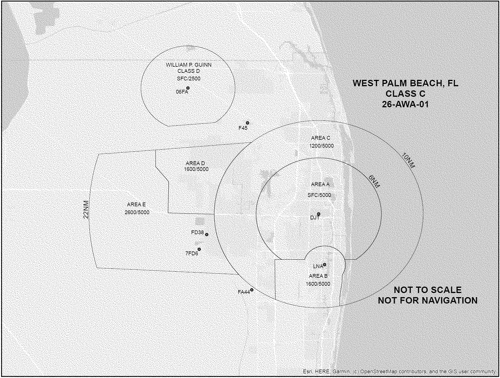

# Daily Digest — 2026-11-13

| | |
|---|---|
| **Digest date** | 2026-11-13 |
| **Data date range** | 2026-11-13 to 2026-11-13 |
| **Generated at** | 2026-11-14T05:03:17Z (UTC) |
| **Pipeline version** | bccbb5a5 |
| **Inference** | model layers ran — cli/haiku, opus |
| **Source watermarks** | CREC: 2026-11-13T15:14:11Z · BILLS: 2026-11-14T04:53:48Z · FR: 2026-11-14T01:18:49Z · USCOURTS: 2026-11-13T22:38:03Z · PLAW: 2026-11-09T15:10:06Z |

[Full observed listing for this day](day/2026-11-13.html) — the items our collectors observed for this publication day, mechanical rules applied, frozen at end of day; releases their publishers date on other days are counted there, not listed. This digest is the canonical record.

All items below cite the govinfo package (and granule, where applicable) they
summarize. Selection is mechanical; each item states the rule that included
it. See the Coverage Statement at the end for a full accounting of what was
published, what was summarized, and what was excluded and why.

---

## Contents

- [Day in Review](#day-in-review)
- [1. Congressional Floor Activity](#1-congressional-floor-activity)
- [2. Legislation](#2-legislation)
- [3. Federal Register](#3-federal-register)
- [4. Enacted Laws](#4-enacted-laws)
- [5. Judicial Activity](#5-judicial-activity)
- [6. Agency Announcements](#6-agency-announcements)
- [7. Recorded Votes](#7-recorded-votes)
- [8. Bill Actions](#8-bill-actions)
- [9. Presidential Actions](#9-presidential-actions)
- [Terms Used Today](#terms-used-today)
- [Coverage Statement](#coverage-statement)
- [Methodology](#methodology)

---

## Day in Review

The digest carries six roll-call vote records. In the House, members adopted H. Res. 1247, providing for consideration of H.R. 2102, the Major Richard Star Act, by 271-135 with 26 not voting; special-order speeches addressed impeachment notice, federal debt, immigration, and post-election voter concerns. In the Senate, cloture was invoked on the nominations of Gregory Carl Cook (Northern District of Alabama), Daniel Desmond Domenico (Tenth Circuit), and Anna St. John (Fifth Circuit), and Cook was confirmed 49-27. The Senate also passed S. 1353, and senators submitted dozens of amendments to H.R. 2347. Two enrolled bills appear: H.R. 4930, on intellectual property information sharing, and H.R. 8552, the veterans' cost-of-living adjustment.

The Federal Register items include 11 rules, 9 proposed rules, and one presidential document, Presidential Determination No. 2027-02, dated October 28, 2026, which concerns petroleum supply from countries other than Iran. The rules include several Treasury general licenses for Iran, Cuba, and Russia, EPA pesticide tolerances, and FDA confirmation of the Orange B revocation date. The proposed rules include APHIS removal of vacated horse protection provisions, several FAA airworthiness directives, and an Interior reopening of comment on Arctic drilling requirements.

The digest carries 35 appellate, 802 district, and 3 bankruptcy court items. The Ninth Circuit held that a plaintiff had standing to challenge Sedona's ordinance against sleeping in vehicles. The Eleventh Circuit vacated a dismissal of False Claims Act qui tam claims, and the Federal Circuit affirmed a denial of public safety officer death benefits.

*Composed from the summarized items below and the day's mechanical
counts; all specifics are cited in their sections.*

---

## 1. Congressional Floor Activity

Source: Congressional Record (CREC), issue observed 2026-11-13, covering proceedings of 2026-11-12. Published by govinfo 2026-11-13T12:55:29Z; observed by our collector 2026-11-13T13:23:44Z. Total issue size: 256 granule(s).

### 1.1 Senate

Tags: legislative · model keys: faa communications · health care pricing · senate amendments

*In plain terms: Sixteen items, led by Senate passage of S. 1353 extending Second Division Memorial authority through 2033; the rest are FAA rule transmittals and amendments to H.R. 2347 on water quality, mining, and health-care pricing.*

- **Executive and Other Communications** — The Senate received a series of Federal Aviation Administration communications from the Manager of Legal Litigation and Support transmitting rules, including airworthiness directives, airspace amendments, and instrument approach procedures, that were received during adjournment on November 2, 2026. The excerpt lists communications EC-5178 through EC-5199, each of which was referred to the Committee on Commerce, Science, and Transportation. The excerpt is truncated and does not include the full list.
  - *In plain terms:* The Senate received Federal Aviation Administration rules, including airworthiness directives and airspace amendments, during adjournment on November 2, 2026; an excerpt lists communications EC-5178 through EC-5199 referred to the Commerce Committee.
  - Included because: CREC-SEL-01 — floor item ≥ threshold floor time (18,971 characters) (document dated 2026-11-12)
  - Source: [CREC-2026-11-12 / CREC-2026-11-12-pt1-PgS5590](https://www.govinfo.gov/app/details/CREC-2026-11-12/CREC-2026-11-12-pt1-PgS5590)
- **Amendments Submitted and Proposed** — Senators submitted amendments SA 6901 through SA 6939 (the excerpt ends partway through SA 6939), each intended to be proposed either to amendment SA 6883 or directly to H.R. 2347, a bill to amend the Internal Revenue Code of 1986 to exclude from gross income damages, other than punitive damages, received on account of sexual acts or sexual contact. Each amendment was ordered to lie on the table. The excerpt is truncated.
  - *In plain terms:* Senators submitted amendments SA 6901 through SA 6939 (partly shown) to H.R. 2347, a bill excluding from income damages other than punitive damages received on account of sexual acts or sexual contact.
  - Included because: CREC-SEL-01 — floor item ≥ threshold floor time (33,284 characters) (document dated 2026-11-12)
  - Source: [CREC-2026-11-12 / CREC-2026-11-12-pt1-PgS5592-3](https://www.govinfo.gov/app/details/CREC-2026-11-12/CREC-2026-11-12-pt1-PgS5592-3)
- **Text of Amendments** — Senator Duckworth submitted amendment SA 6901 to amendment SA 6883 to H.R. 2347, proposing to replace a section of the bill concerning state water quality certification for federal licenses and permits. The text sets a 10-day deadline for acknowledging receipt of an application, a 90-day deadline to issue a completeness notice or identify missing materials, a right of applicants to petition a court for judicial review, a written denial requirement, and a reasonable review period not to exceed 1 year. The same page records SA 6902 (Budd and others), which would change the 345-kilovolt voltage threshold in section 216(b) of the Federal Power Act, and SA 6903 (Schmitt), which would define terms including 'impact on productive agricultural operations' and 'landowner input' and revise the Federal Power Act's transmission construction permit provisions.
  - *In plain terms:* Senator Duckworth submitted SA 6901 to replace a section on state water quality certification, setting a 10-day acknowledgment deadline, a 90-day completeness deadline, and a review period not to exceed 1 year.
  - Included because: CREC-SEL-01 — floor item ≥ threshold floor time (777,376 characters) (document dated 2026-11-12)
  - Source: [CREC-2026-11-12 / CREC-2026-11-12-pt1-PgS5595](https://www.govinfo.gov/app/details/CREC-2026-11-12/CREC-2026-11-12-pt1-PgS5595)
- **Text of Senate Amendment 6905** — Senator Marshall submitted amendment SA 6905 to amendment SA 6883 to H.R. 2347, proposing a new section 1852(o) of the Social Security Act governing prior authorization requirements for Medicare Advantage plans. The provision would require electronic prior authorization programs beginning with plan years on or after January 1, 2029, transparency reporting beginning January 1, 2028, and enrollee protection standards, and it directs the Secretary of Health and Human Services to publish plan-level prior authorization information on a Centers for Medicare & Medicaid Services website. The text also requires a Government Accountability Office report to Congress by January 1, 2033.
  - *In plain terms:* Senator Marshall submitted SA 6905 on Medicare Advantage prior authorization, requiring electronic programs for plan years on or after January 1, 2029, with a Government Accountability Office report due January 1, 2033.
  - Included because: CREC-SEL-01 — floor item ≥ threshold floor time (15,566 characters) (document dated 2026-11-12)
  - Source: [CREC-2026-11-12 / CREC-2026-11-12-pt1-PgS5597-2](https://www.govinfo.gov/app/details/CREC-2026-11-12/CREC-2026-11-12-pt1-PgS5597-2)
- **Text of Senate Amendment 6906** — Senators Marshall and Hickenlooper submitted amendment SA 6906 to amendment SA 6883 to H.R. 2347, proposing a title titled 'Hospital and Insurer Price Transparency' and a short title of the 'Patients Deserve Price Tags Act'. The amendment would add section 2718A to the Public Health Service Act, requiring hospitals to publish standard charges, including gross charges, discounted cash prices, payer-specific negotiated charges, and de-identified maximum and minimum negotiated charges, in machine-readable and consumer-friendly formats for at least 300 shoppable services. The text also includes definitions for applicable imaging providers, applicable laboratories, and specified ambulatory surgical centers, and it states that a price estimator tool does not by itself establish compliance.
  - *In plain terms:* Senators Marshall and Hickenlooper submitted SA 6906, the Patients Deserve Price Tags Act, requiring hospitals to publish standard charges, including discounted cash prices, for at least 300 shoppable services in machine-readable and consumer-friendly formats.
  - Included because: CREC-SEL-01 — floor item ≥ threshold floor time (115,078 characters) (document dated 2026-11-12)
  - Source: [CREC-2026-11-12 / CREC-2026-11-12-pt1-PgS5598](https://www.govinfo.gov/app/details/CREC-2026-11-12/CREC-2026-11-12-pt1-PgS5598)
- **Text of Senate Amendment 6935** — Senator Van Hollen submitted amendment SA 6935 to amendment SA 6883 to H.R. 2347, proposing to replace a division of the bill with water quality provisions. Section 1201 would amend section 304(a) of the Federal Water Pollution Control Act to require Federal Register notice, a comment period of at least 60 days, independent external scientific peer review, and state and tribal engagement before a water quality criterion is finalized, and it would amend section 509(b)(1) to reference the definition of 'waters of the United States'. Section 1202 would add subsection (e) to section 401 of the Act, limiting the scope of state certifications to water quality requirements, establishing prefiling meetings, and setting deadlines for acknowledging applications and issuing completeness notices, with certification waived if a certifying authority does not act within the reasonable review period.
  - *In plain terms:* Senator Van Hollen submitted SA 6935 to replace a division with water quality provisions, requiring Federal Register notice and a comment period of at least 60 days before a water quality criterion is finalized.
  - Included because: CREC-SEL-01 — floor item ≥ threshold floor time (25,948 characters) (document dated 2026-11-12)
  - Source: [CREC-2026-11-12 / CREC-2026-11-12-pt1-PgS5615](https://www.govinfo.gov/app/details/CREC-2026-11-12/CREC-2026-11-12-pt1-PgS5615)
- **Text of Senate Amendment 6950** — Senator Bennet submitted amendment SA 6950 to amendment SA 6883 to H.R. 2347, proposing a new Title IV, 'Mining Reform', to be added at the end of division B. The title defines terms including 'casual use,' 'exploration,' 'locatable mineral,' 'mineral activity,' and 'undue degradation,' and it limits the issuance of patents to mining claims for which a patent application was filed by September 30, 1994, with the requirements fully complied with. The title also repeals section 2325 of the Revised Statutes, establishes a $400 annual claim maintenance fee per unpatented claim beginning August 31, 2027, in lieu of assessment work, restricts relocation of relinquished claims for 10 years, and provides for Consumer Price Index adjustments every 5 years.
  - *In plain terms:* Senator Bennet submitted SA 6950, a Mining Reform title that sets a $400 annual claim maintenance fee per unpatented claim beginning August 31, 2027, instead of required assessment work.
  - Included because: CREC-SEL-01 — floor item ≥ threshold floor time (80,021 characters) (document dated 2026-11-12)
  - Source: [CREC-2026-11-12 / CREC-2026-11-12-pt1-PgS5620-4](https://www.govinfo.gov/app/details/CREC-2026-11-12/CREC-2026-11-12-pt1-PgS5620-4)
- **Text of Senate Amendment 6956** — Senators Bennet, Schiff, and Lujan submitted amendment SA 6956 to amendment SA 6883 to H.R. 2347, proposing to replace a section of the bill concerning federal environmental review procedures. The text requires federal agencies to publish draft environmental impact statements and environmental assessments in the Federal Register, with a Tribal consultation period and a public comment period each of not less than 45 days, and it sets deadlines of 1 year for environmental assessments and 2 years for environmental impact statements. The amendment also provides for the adoption of existing documents, a dispute resolution process under the direction of the Chairman whose resolutions are stated to be final and not subject to judicial review, and requirements for key permitting agency personnel to act on delayed determinations.
  - *In plain terms:* Senators Bennet, Schiff, and Lujan submitted SA 6956 to replace a federal environmental review section, requiring draft environmental impact statements and assessments in the Federal Register with comment periods of at least 45 days.
  - Included because: CREC-SEL-01 — floor item ≥ threshold floor time (27,881 characters) (document dated 2026-11-12)
  - Source: [CREC-2026-11-12 / CREC-2026-11-12-pt1-PgS5629](https://www.govinfo.gov/app/details/CREC-2026-11-12/CREC-2026-11-12-pt1-PgS5629)
- **Text of Senate Amendment 6957** — Senator Bennet, with Senators Schiff and Lujan, submitted amendment SA 6957, intended to be proposed to amendment SA 6883 to H.R. 2347, and ordered it to lie on the table. The text would replace pages 449 through 483 of the amendment with provisions that add section 302707 to chapter 3027 of title 54, U.S. Code, covering tribal program support, technical assistance, audit satisfaction, and a minimum two-year cure period before funds are withheld for an alleged misuse of federal funds. It would also amend section 306108 of title 54 to define terms including adverse effect of the undertaking, area of potential effects, and undertaking, with specified exclusions.
  - *In plain terms:* Senators Bennet, Schiff, and Lujan submitted SA 6957 to replace pages 449 through 483, adding tribal program support and a minimum two-year cure period before funds are withheld for alleged misuse of federal funds.
  - Included because: CREC-SEL-01 — floor item ≥ threshold floor time (35,472 characters) (document dated 2026-11-12)
  - Source: [CREC-2026-11-12 / CREC-2026-11-12-pt1-PgS5632](https://www.govinfo.gov/app/details/CREC-2026-11-12/CREC-2026-11-12-pt1-PgS5632)
- **Text of Senate Amendment 6959** — Senator Heinrich, on behalf of Ms. Cortez Masto, submitted amendment SA 6959, intended to be proposed to amendment SA 6883 to H.R. 2347, and ordered it to lie on the table. The text would replace lines 10 through 15 on page 494 with Division C, the Southern Nevada Economic Development and Conservation Act, which defines terms and directs the transfer of approximately 44,950 acres of Bureau of Land Management and Bureau of Reclamation land, 196 acres of tribal fee land, and 3,156 acres to the Las Vegas Paiute Tribe into trust status, with gaming prohibited on the transferred land. The division also adjusts the boundary of the Red Rock Canyon National Conservation Area to approximately 253,950 acres, revises the definition of public park in the Red Rock Canyon National Conservation Area Protection and Enhancement Act of 2002, and modifies land disposal provisions for Clark County.
  - *In plain terms:* Senator Heinrich, on behalf of Ms. Cortez Masto, submitted SA 6959 to add the Southern Nevada Economic Development and Conservation Act, transferring about 44,950 acres of BLM and Bureau of Reclamation land into trust status.
  - Included because: CREC-SEL-01 — floor item ≥ threshold floor time (68,383 characters) (document dated 2026-11-12)
  - Source: [CREC-2026-11-12 / CREC-2026-11-12-pt1-PgS5635-2](https://www.govinfo.gov/app/details/CREC-2026-11-12/CREC-2026-11-12-pt1-PgS5635-2)
- **Text of Senate Amendment 6961** — Senator Heinrich, on behalf of Mr. King, submitted amendment SA 6961, intended to be proposed to amendment SA 6883 to H.R. 2347, and ordered it to lie on the table. The text adds section 2216, which sets out temporary expedited authorization procedures for land-based wind energy projects on privately owned land that meet listed criteria, including avian and bat surveys, species screening, nationwide permit coverage for water crossings, and aviation review. Under the text, a federal agency must act on a complete application for a covered authorization by the applicable deadline, and if it does not issue a timely written determination, a specified remedy takes effect without further agency action.
  - *In plain terms:* Senator Heinrich, on behalf of Mr. King, submitted SA 6961 to add expedited authorization procedures for land-based wind energy projects on privately owned land meeting listed criteria, with a remedy applying if agencies miss deadlines.
  - Included because: CREC-SEL-01 — floor item ≥ threshold floor time (56,410 characters) (document dated 2026-11-12)
  - Source: [CREC-2026-11-12 / CREC-2026-11-12-pt1-PgS5641-2](https://www.govinfo.gov/app/details/CREC-2026-11-12/CREC-2026-11-12-pt1-PgS5641-2)
- **Text of Senate Amendment 6967** — Senator Markey submitted amendment SA 6967, intended to be proposed to amendment SA 6883 to H.R. 2347, and ordered it to lie on the table. The text adds subsection (g) to section 2117, requiring a data center corporation to obtain a Federal Communications Commission certificate finding that the data center will not harm the public interest before construction begins, based on evaluations of air and water quality, water availability, noise, light, energy costs, ecosystems, local economy, community well-being, and jobs, with reassessments every two years and authority to impose fines for noncompliance. The text also authorizes Environmental Protection Agency grants and appropriations for fiscal years 2027 through 2031 for air and water monitoring related to data centers, and directs a study of noise health impacts with a report to Congress within two years.
  - *In plain terms:* Senator Markey submitted SA 6967 to require data center corporations to obtain a Federal Communications Commission certificate finding the data center will not harm the public interest before construction begins, with reassessments every two years.
  - Included because: CREC-SEL-01 — floor item ≥ threshold floor time (16,269 characters) (document dated 2026-11-12)
  - Source: [CREC-2026-11-12 / CREC-2026-11-12-pt1-PgS5650-2](https://www.govinfo.gov/app/details/CREC-2026-11-12/CREC-2026-11-12-pt1-PgS5650-2)
- **Text of Senate Amendment 6996** — Senator Duckworth, with Senator Grassley, submitted amendment SA 6996, intended to be proposed to amendment SA 6883 to H.R. 2347, and ordered it to lie on the table. The text replaces pages 238 through 269 of the amendment with revisions to section 216 of the Federal Power Act governing Federal Energy Regulatory Commission permits for electric transmission facilities, including state siting authority, consultation requirements, landowner input, rights-of-way procedures under Federal Rules of Civil Procedure 71.1, and cost allocation through tariffs. The text also changes the lead agency designations for coordinating Federal authorizations for transmission facilities.
  - *In plain terms:* Senator Duckworth, with Senator Grassley, submitted SA 6996 to revise Federal Power Act section 216 on Federal Energy Regulatory Commission transmission permits, including state siting authority, landowner input, and cost allocation through tariffs.
  - Included because: CREC-SEL-01 — floor item ≥ threshold floor time (38,057 characters) (document dated 2026-11-12)
  - Source: [CREC-2026-11-12 / CREC-2026-11-12-pt1-PgS5657-2](https://www.govinfo.gov/app/details/CREC-2026-11-12/CREC-2026-11-12-pt1-PgS5657-2)
- **Text of Senate Amendment 6997** — Senator Duckworth submitted amendment SA 6997, intended to be proposed to amendment SA 6883 to H.R. 2347, and ordered it to lie on the table. The text replaces pages 249 through 256 of the amendment with a new subsection (j) of section 216 of the Federal Power Act, directing the Federal Energy Regulatory Commission to issue land restoration standards within 180 days of enactment, require on-site inspections by independent professional engineers paid by the permit holder, and set corrective action, civil penalty, and private civil action procedures for violations. The text also adds section 216A to the Federal Power Act, which provides that activities to maintain or increase transmission capacity within covered areas of existing rights-of-way are not treated as major federal actions under the National Environmental Policy Act of 1969 or as undertakings under section 306108 of title 54, U.S. Code.
  - *In plain terms:* Senator Duckworth submitted SA 6997 directing FERC to issue land restoration standards within 180 days of enactment and providing that certain transmission capacity maintenance is not treated as a major federal action under NEPA.
  - Included because: CREC-SEL-01 — floor item ≥ threshold floor time (23,604 characters) (document dated 2026-11-12)
  - Source: [CREC-2026-11-12 / CREC-2026-11-12-pt1-PgS5660](https://www.govinfo.gov/app/details/CREC-2026-11-12/CREC-2026-11-12-pt1-PgS5660)
- **Text of Senate Amendment 7002** — Senator Markey submitted amendment SA 7002 to amendment SA 6883 to H.R. 2347, which would replace pages 111 through 130 of the bill text. The replacement text establishes procedures for water quality certification, including prefiling meetings, required contents of complete applications, written acknowledgment within 3 days, a 90-day completeness determination, written denial requirements, a review period of up to one year after which the certification requirement is waived if no final action is taken, and a right to petition a court. The amendment was ordered to lie on the table.
  - *In plain terms:* Senator Markey submitted SA 7002 to replace pages 111 through 130 of the bill with water quality certification procedures, including a 3-day written acknowledgment, a 90-day completeness determination, and a one-year review period.
  - Included because: CREC-SEL-01 — floor item ≥ threshold floor time (20,499 characters) (document dated 2026-11-12)
  - Source: [CREC-2026-11-12 / CREC-2026-11-12-pt1-PgS5663-3](https://www.govinfo.gov/app/details/CREC-2026-11-12/CREC-2026-11-12-pt1-PgS5663-3)
- **Extending the Authority for Modifications to the Second Division Memorial in the District of Columbia** — The Senate passed S. 1353, as amended, which extends through September 30, 2033 the authority under section 352 of the National Defense Authorization Act for Fiscal Year 2018 for modifications to the Second Division Memorial in the District of Columbia; the committee-reported amendment changed the end date from 2032 to 2033. S. 3493, the Carson City Public Land Correction Act, was reported from the Committee on Energy and Natural Resources with an amendment and would direct the Secretary to convey about 1,270 acres of Federal land (Category 1 on the map) to Carson City, Nevada at no consideration for public purposes, about 0.5 acres for a roadway, and would require sales of about 356 acres (Category 2) to qualified bidders.
  - *In plain terms:* The Senate passed S. 1353 extending through September 30, 2033 authority to modify the Second Division Memorial; S. 3493 would transfer 1,270 acres to Carson City, Nevada, and require sales of 356 acres to qualified bidders.
  - Included because: CREC-SEL-01 — floor item ≥ threshold floor time (19,572 characters) (document dated 2026-11-12)
  - Source: [CREC-2026-11-12 / CREC-2026-11-12-pt1-PgS5667](https://www.govinfo.gov/app/details/CREC-2026-11-12/CREC-2026-11-12-pt1-PgS5667)

### 1.2 House of Representatives

Tags: legislative · model keys: executive communications · federal spending · house floor proceedings

*In plain terms: Six items, led by a 271-135 House vote adopting a rule for the Major Richard Star Act (H.R. 2102); the rest are four member floor speeches and a list of executive communications EC-5121 through EC-5150.*

- **Providing for Consideration of H.R. 2102, Major Richard Star Act** — On a 271-135 vote with 26 not voting (Roll No. 322), the House adopted H. Res. 1247, providing for consideration of H.R. 2102, the Major Richard Star Act. As considered, the bill amends sections 1413a and 1414 of title 10, United States Code, to expand combat-related special compensation eligibility to chapter 61 disability retirees with fewer than 20 years of creditable service and to end the concurrent receipt phase-in provisions, effective the first day of the first month after enactment. The bill was made debatable for one hour, divided among the chairs and ranking members of the Committees on Armed Services and Veterans' Affairs or their designees.
  - *In plain terms:* By 271-135, the House adopted a rule for H.R. 2102, the Major Richard Star Act, which would expand combat-related special compensation and end the concurrent receipt phase-in starting the first month after enactment.
  - Included because: CREC-SEL-01 — floor item ≥ threshold floor time (64,101 characters) (document dated 2026-11-12)
  - Source: [CREC-2026-11-12 / CREC-2026-11-12-pt1-PgH6194-4](https://www.govinfo.gov/app/details/CREC-2026-11-12/CREC-2026-11-12-pt1-PgH6194-4)
- **Censured But Not Silenced** — Representative Green of Texas delivered a 60-minute special order stating an intention to give notice of a House vote on articles of impeachment against President Donald John Trump as early as the following week. The speech referred to a House vote of 204 members to advance articles of impeachment against Secretary of War Hegseth, a letter the speaker sent to the President, and U.S. military operations in Iran. The speaker stated that articles to be presented would apply charges similar to those in the Hegseth articles to the President as Commander in Chief.
  - *In plain terms:* Representative Green of Texas gave a 60-minute special order stating an intention to give notice of a House vote on articles of impeachment against President Donald John Trump as early as the following week.
  - Included because: CREC-SEL-01 — floor item ≥ threshold floor time (34,566 characters) (document dated 2026-11-12)
  - Source: [CREC-2026-11-12 / CREC-2026-11-12-pt1-PgH6204-5](https://www.govinfo.gov/app/details/CREC-2026-11-12/CREC-2026-11-12-pt1-PgH6204-5)
- **Math Problem** — Representative Schweikert of Arizona delivered a 60-minute special order on federal spending, debt, and demographics, citing a 10-year Treasury yield above 5 percent and a 30-year home loan rate above 7 percent. The speech compared projections of 2026 tax receipts from OMB ($6 trillion), CBO ($5.6 trillion), and the Treasury ($5.4 trillion), and stated that about 24 percent of federal spending is subject to annual congressional votes. The speaker also stated that total net interest is about $1.2 trillion and that the majority of federal spending is projected to go to individuals over age 65 within about 20-some months.
  - *In plain terms:* Representative Schweikert of Arizona gave a 60-minute special order on federal spending and debt, citing a 10-year Treasury yield above 5 percent and a 30-year home loan rate above 7 percent.
  - Included because: CREC-SEL-01 — floor item ≥ threshold floor time (46,046 characters) (document dated 2026-11-12)
  - Source: [CREC-2026-11-12 / CREC-2026-11-12-pt1-PgH6208](https://www.govinfo.gov/app/details/CREC-2026-11-12/CREC-2026-11-12-pt1-PgH6208)
- **Addressing Voters' Needs** — Representative Roy of Texas delivered a 30-minute address on voter concerns following the 2026 election, citing a national debt of $42 trillion and the need to secure the border. The speech read a paraphrased social media post describing a hypothetical Ohio voter facing higher gas and grocery prices and a son unable to find work, and it referred to concerns about data centers, artificial intelligence, and Republican losses in Texas. The speaker stated that Congress was not consulted before U.S. military action against Iran and that Congress should have been asked to authorize it.
  - *In plain terms:* Representative Roy of Texas gave a 30-minute address on voter concerns after the 2026 election, citing a national debt of $42 trillion and stating that Congress was not consulted before U.S. military action against Iran.
  - Included because: CREC-SEL-01 — floor item ≥ threshold floor time (27,398 characters) (document dated 2026-11-12)
  - Source: [CREC-2026-11-12 / CREC-2026-11-12-pt1-PgH6214-2](https://www.govinfo.gov/app/details/CREC-2026-11-12/CREC-2026-11-12-pt1-PgH6214-2)
- **What Americans Expected from This Congress** — Representative Grothman of Wisconsin delivered a 30-minute address on immigration, stating that about one-sixth of the U.S. population is foreign-born and that roughly 800,000 people were naturalized each year before last year. He stated that a bill barring federal welfare benefits to noncitizens was not brought to the floor, and he described federal program provisions that he said penalize married couples with children. He asked the White House, possibly with Vice President Vance, to form a commission to recommend ways to address those program provisions.
  - *In plain terms:* Representative Grothman gave a 30-minute immigration address, saying about one-sixth of the U.S. population is foreign-born and urging the White House to form a commission on provisions the speaker said penalize married couples with children.
  - Included because: CREC-SEL-01 — floor item ≥ threshold floor time (16,755 characters) (document dated 2026-11-12)
  - Source: [CREC-2026-11-12 / CREC-2026-11-12-pt1-PgH6217](https://www.govinfo.gov/app/details/CREC-2026-11-12/CREC-2026-11-12-pt1-PgH6217)
- **Executive Communications, ETC.** — The Record lists executive communications EC-5121 through EC-5150, received and referred to House committees under clause 2 of rule XIV. The communications include final rules from the Forest Service, FDA, EPA, FCC, National Park Service, Fish and Wildlife Service, and FAA, an Alzheimer's disease national plan report from HHS, and Arms Export Control Act notifications from the Department of State. The excerpt ends at EC-5150, and the listing continues beyond the text provided.
  - *In plain terms:* The Record lists executive communications EC-5121 through EC-5150, referred to House committees, including final rules and an Alzheimer's national plan report from HHS.
  - Included because: CREC-SEL-01 — floor item ≥ threshold floor time (15,835 characters) (document dated 2026-11-12)
  - Source: [CREC-2026-11-12 / CREC-2026-11-12-pt1-PgH6220-2](https://www.govinfo.gov/app/details/CREC-2026-11-12/CREC-2026-11-12-pt1-PgH6220-2)

### 1.3 Recorded Votes

- **Cloture Motion (Executive Session)** — The Senate agreed to a cloture motion on the nomination of Gregory Carl Cook, of Alabama, to be United States District Judge for the Northern District of Alabama (Executive Calendar No. 945), by a vote of 50 yeas to 27 nays (Rollcall Vote No. 259 Ex.). The motion was submitted under rule XXII and bore the signatures of 17 Senators.
  - *In plain terms:* The Senate voted 50 yeas to 27 nays to end debate on the nomination of Gregory Carl Cook to be U.S. District Judge for the Northern District of Alabama.
  - Included because: CREC-SEL-02 — recorded vote (all recorded votes are listed) (document dated 2026-11-12)
  - Source: [CREC-2026-11-12 / CREC-2026-11-12-pt1-PgS5585-2](https://www.govinfo.gov/app/details/CREC-2026-11-12/CREC-2026-11-12-pt1-PgS5585-2)
- **Vote on Cook Nomination (Executive Session)** — The Senate confirmed the nomination of Gregory Carl Cook, of Alabama, to be United States District Judge for the Northern District of Alabama, by a vote of 49 yeas to 27 nays (Rollcall Vote No. 260 Ex.). The motion to reconsider was laid upon the table, and the President was to be notified of the Senate's action.
  - *In plain terms:* The Senate confirmed Gregory Carl Cook as U.S. District Judge for the Northern District of Alabama by 49 yeas to 27 nays.
  - Included because: CREC-SEL-02 — recorded vote (all recorded votes are listed) (document dated 2026-11-12)
  - Source: [CREC-2026-11-12 / CREC-2026-11-12-pt1-PgS5586-4](https://www.govinfo.gov/app/details/CREC-2026-11-12/CREC-2026-11-12-pt1-PgS5586-4)
- **Cloture Motion** — The Senate agreed to a cloture motion on the nomination of Daniel Desmond Domenico, of Colorado, to be United States Circuit Judge for the Tenth Circuit (Executive Calendar No. 901), by a vote of 51 yeas to 27 nays (Rollcall Vote No. 261 Ex.). The motion was submitted under rule XXII and bore the signatures of 17 Senators.
  - *In plain terms:* The Senate voted 51 yeas to 27 nays to end debate on the nomination of Daniel Desmond Domenico to be U.S. Circuit Judge for the Tenth Circuit.
  - Included because: CREC-SEL-02 — recorded vote (all recorded votes are listed) (document dated 2026-11-12)
  - Source: [CREC-2026-11-12 / CREC-2026-11-12-pt1-PgS5586-5](https://www.govinfo.gov/app/details/CREC-2026-11-12/CREC-2026-11-12-pt1-PgS5586-5)
- **Cloture Motion** — The Senate agreed to a cloture motion on the nomination of Anna St. John, of Louisiana, to be United States Circuit Judge for the Fifth Circuit (Executive Calendar No. 944), by a vote of 49 yeas to 26 nays (Rollcall Vote No. 262 Ex.). The motion was submitted under rule XXII and bore the signatures of 17 Senators.
  - *In plain terms:* The Senate voted 49 yeas to 26 nays to end debate on the nomination of Anna St. John to be U.S. Circuit Judge for the Fifth Circuit.
  - Included because: CREC-SEL-02 — recorded vote (all recorded votes are listed) (document dated 2026-11-12)
  - Source: [CREC-2026-11-12 / CREC-2026-11-12-pt1-PgS5587-2](https://www.govinfo.gov/app/details/CREC-2026-11-12/CREC-2026-11-12-pt1-PgS5587-2)

---

## 2. Legislation

Source: Congressional Bills (BILLS), text versions published 2026-11-13 to 2026-11-13.

### 2.1 Counts by Stage

| Stage (bill text version) | Count |
|---|---|
| Introduced (ih/is) | 40 |
| Reported (rh/rs) | 1 |
| Engrossed (eh/es) | 16 |
| Enrolled (enr) | 2 |
| Other versions | 12 |
| **Total bill texts published** | **71** |

### 2.2 Bills Listed by Mechanical Rule

Tags: legislative · model keys: nuclear fuel licensing · supersonic aviation · veterans compensation

*In plain terms: Four bills, led by a veterans' disability compensation cost-of-living increase effective December 1, 2026; the rest cover nuclear fuel licensing, tariff information sharing, and supersonic aviation.*

Bills below are listed because they matched at least one listing rule; the
matching rule is stated per item. All other bill texts are counted above and
accounted for in the Coverage Statement.

- **H. R. 3978 (pcs) — 119 HR 3978 PCS: Nuclear REFUEL (Recycling Efficient Fuels Utilizing Expedited Licensing) Act** — H.R. 3978, the Nuclear REFUEL (Recycling Efficient Fuels Utilizing Expedited Licensing) Act, passed the House of Representatives on November 9, 2026, and was received in the Senate and placed on the Senate calendar as Calendar No. 695 on November 10, 2026. The bill amends section 11 v. of the Atomic Energy Act of 1954 (42 U.S.C. 2014(v)) to add reprocessing to the list of activities in the definition of production facility, and to provide that the definition does not include reprocessing spent nuclear fuel in a manner that does not isolate plutonium. The bill's exclusion sits alongside the existing exclusion for uranium enrichment and isotope separation.
  - *In plain terms:* Passed the House on November 9, 2026, this bill adds recycling of spent nuclear fuel to the Atomic Energy Act's definition of production facility, excluding recycling that does not separate out plutonium.
  - Included because: BILLS-SEL-01 — reached stage: reported/enrolled/calendar (document dated 2026-11-10)
  - Source: [BILLS-119hr3978pcs](https://www.govinfo.gov/app/details/BILLS-119hr3978pcs)
- **H. R. 4930 (enr) — HR 4930 ENR: To expand the sharing of information with respect to suspected violations of intellectual property rights in trade.** — H.R. 4930 (enrolled, 119th Congress, Second Session) amends Section 628A of the Tariff Act of 1930 (19 U.S.C. 1628a) to expand information sharing on suspected intellectual property rights violations in trade. The amendments change the standard from "suspects" to "has a reasonable suspicion," extend covered items to packaging, packing materials, containers, and labels, and authorize U.S. Customs and Border Protection to provide nonpublic information generated by online marketplaces, express consignment operators, freight forwarders, and other entities involved in importation, with notice to the person as prescribed by the Secretary. The Act also adds "any other party with an interest in the merchandise, as determined appropriate by the Commissioner" to the parties eligible under subsection (b).
  - *In plain terms:* This Act lets U.S. Customs and Border Protection share nonpublic information on intellectual property violations it has reasonable suspicion of, including for packaging and labels, with notice to the person.
  - Included because: BILLS-SEL-01 — reached stage: reported/enrolled/calendar
  - Source: [BILLS-119hr4930enr](https://www.govinfo.gov/app/details/BILLS-119hr4930enr)
- **H. R. 8552 (enr) — HR 8552 ENR: Veterans’ Compensation Cost-of-Living Adjustment Act of 2026** — H.R. 8552 (enrolled, 119th Congress, Second Session), titled "Veterans’ Compensation Cost-of-Living Adjustment Act of 2026," directs the Secretary of Veterans Affairs to increase, effective December 1, 2026, the dollar amounts for disability compensation and dependency and indemnity compensation under specified provisions of title 38, United States Code, including sections 1114, 1115(1), 1162, 1311(a) through (d), 1313(a), and 1314. Each amount is increased by the same percentage as the Social Security benefit increase effective December 1, 2026, under section 215(i) of the Social Security Act, and the Secretary may administratively adjust certain rates under section 10 of Public Law 85-857. The Secretary must publish the adjusted amounts in the Federal Register by the date required under section 215(i)(2)(D) of the Social Security Act for a determination made during fiscal year 2027.
  - *In plain terms:* Effective December 1, 2026, this Act directs the Secretary of Veterans Affairs to raise veterans' disability compensation and dependency and indemnity compensation by the same percentage as the Social Security benefit increase effective December 1, 2026.
  - Included because: BILLS-SEL-01 — reached stage: reported/enrolled/calendar
  - Source: [BILLS-119hr8552enr](https://www.govinfo.gov/app/details/BILLS-119hr8552enr)
- **S. 1759 (rs) — 119 S1759 RS: Supersonic Aviation Modernization Act** — S. 1759, the Supersonic Aviation Modernization Act, was introduced by Senator Budd and cosponsors on May 14, 2025, and referred to the Committee on Commerce, Science, and Transportation. The committee reported the bill with an amendment on November 10, 2026, as Report No. 119-160 and Calendar No. 694. As reported, the bill directs the Administrator of the Federal Aviation Administration to issue a final rule within 2 years of enactment that creates a noise-based certification standard for civil supersonic aircraft, after consulting with the Administrator of the National Aeronautics and Space Administration, with takeoff and landing noise levels not exceeding those required for subsonic aircraft in operation as of enactment, and with a process for periodic review and updating of the standards.
  - *In plain terms:* Within 2 years of enactment, this bill directs the Federal Aviation Administration to issue a final regulation creating a noise-based certification standard for civil supersonic aircraft, after consulting NASA.
  - Included because: BILLS-SEL-01 — reached stage: reported/enrolled/calendar (document dated 2026-11-10)
  - Source: [BILLS-119s1759rs](https://www.govinfo.gov/app/details/BILLS-119s1759rs)

---

## 3. Federal Register

Source: Federal Register (FR), issue of 2026-11-13.

### 3.1 Counts by Document Type

| Document type | Count |
|---|---|
| Rules | 11 |
| Proposed rules | 9 |
| Notices | 97 |
| Presidential documents | 1 |
| **Total FR documents** | **118** |

### 3.2 Rules Published

Tags: department of commerce · executive · securities and exchange commission · model keys: color additive revocation · ofac general licenses · pesticide tolerances

*In plain terms: Eleven rules, led by confirmation of the FDA's Orange B color additive revocation for frankfurters; the rest are pesticide tolerances, OFAC general licenses for Iran, Cuba, and Russia, and routine safety zone and airspace updates.*

#### DEPARTMENT OF HEALTH AND HUMAN SERVICES

- **Revocation of the Color Additive Listing for Use of Orange B on Casings or Surfaces of Frankfurters and Sausages; Confirmation of Effective Date** (2026-23112; 21 CFR Part 74) — The Food and Drug Administration (FDA or we) is confirming the effective date of September 8, 2026, for the final order that appeared in the Federal Register of July 23, 2026, and that repealed the color additive regulation that allows for the use of Orange B for coloring the casings or surfaces of frankfurters and sausages. Action: Final order; confirmation of effective date. Dates: The effective date of September 8, 2026, for the final order published in the Federal Register of July 23, 2026 (91 FR 46276) is confirmed.
  - *In plain terms:* The FDA confirms that the final order repealing the color additive approval for Orange B on frankfurter and sausage casings or surfaces takes effect September 8, 2026; that order was published July 23, 2026.
  - Included because: FR-SEL-01 — document type: final rule (all listed)
  - Source: [FR-2026-11-13 / 2026-23112](https://www.govinfo.gov/app/details/FR-2026-11-13/2026-23112)

#### DEPARTMENT OF HOMELAND SECURITY

- **Safety Zone; Massachusetts Bay, Boston, MA** (2026-23148; 33 CFR Part 165) — The Coast Guard is establishing temporary moving safety zones for certain portions of the navigable water of Massachusetts Bay, 22 miles northeast of Boston, MA. The safety zones are needed to protect personnel, vessels, and the maritime public from potential hazards created by subsea demolition operations. Entry of vessels or persons into this zone is prohibited unless specifically authorized by the Captain of the Port, Sector Boston, or their designated representative. Action: Temporary final rule. Dates: This rule is effective from 11:59 p.m. February 28, 2027, through 8 a.m. September 30, 2027.
  - *In plain terms:* The Coast Guard establishes temporary moving safety zones in part of Massachusetts Bay, 22 miles northeast of Boston, to protect people, vessels, and the public from subsea demolition; entry is barred without Sector Boston's Captain of the Port's approval.
  - Included because: FR-SEL-01 — document type: final rule (all listed)
  - Source: [FR-2026-11-13 / 2026-23148](https://www.govinfo.gov/app/details/FR-2026-11-13/2026-23148)

#### DEPARTMENT OF THE TREASURY

- **Publication of Iran-Related Web General License W** (2026-23193; 31 CFR Chapter V) — The Department of the Treasury's Office of Foreign Assets Control (OFAC) is publishing an Iran-related general license (GL): GL W. This GL was previously made available on OFAC's website. Action: Publication of a web general license. Dates: GL W was issued on May 1, 2026. See SUPPLEMENTARY INFORMATION for additional relevant dates.
  - *In plain terms:* OFAC is publishing Iran-related general license GL W in the Federal Register; it was previously made available on OFAC's website.
  - Included because: FR-SEL-01 — document type: final rule (all listed)
  - Source: [FR-2026-11-13 / 2026-23193](https://www.govinfo.gov/app/details/FR-2026-11-13/2026-23193)
- **Publication of a Cuba Sanctions Regulations Web General License** (2026-23195; 31 CFR Part 516) — The Department of the Treasury's Office of Foreign Assets Control (OFAC) is publishing a general license (GL) issued in the Cuba Sanctions program: GL 1. This GL was previously made available on OFAC's website. Action: Publication of a web general license. Dates: GL 1 was issued on May 7, 2026. See SUPPLEMENTARY INFORMATION for additional relevant dates.
  - *In plain terms:* OFAC is publishing Cuba Sanctions general license GL 1 in the Federal Register; it was previously made available on OFAC's website.
  - Included because: FR-SEL-01 — document type: final rule (all listed)
  - Source: [FR-2026-11-13 / 2026-23195](https://www.govinfo.gov/app/details/FR-2026-11-13/2026-23195)
- **Publication of Russian Harmful Foreign Activities Sanctions Regulations Web General Licenses 55F and 115D** (2026-23196; 31 CFR Part 587) — The Department of the Treasury's Office of Foreign Assets Control (OFAC) is publishing two general licenses (GLs) issued pursuant to the Russian Harmful Foreign Activities Sanctions Regulations: GLs 55F and 115D, each of which was previously made available on OFAC's website. Action: Publication of web general licenses. Dates: GL 55F was issued on June 11, 2026. See SUPPLEMENTARY INFORMATION for additional relevant dates.
  - *In plain terms:* OFAC is publishing general licenses 55F and 115D under the Russian Harmful Foreign Activities Sanctions Regulations, both previously made available on OFAC's website.
  - Included because: FR-SEL-01 — document type: final rule (all listed)
  - Source: [FR-2026-11-13 / 2026-23196](https://www.govinfo.gov/app/details/FR-2026-11-13/2026-23196)
- **Publication of Iran-Related Web General Licenses EE and FF** (2026-23197; 31 CFR Part 560) — The Department of the Treasury's Office of Foreign Assets Control (OFAC) is publishing two Iran-related general licenses (GLs): GLs EE and FF, which were made available on OFAC's website at the time of issuance. Action: Publication of web general licenses. Dates: GL EE was issued on October 8, 2026. See SUPPLEMENTARY INFORMATION for additional relevant dates.
  - *In plain terms:* OFAC is publishing two Iran-related general licenses, GLs EE and FF, which were made available on OFAC's website when issued.
  - Included because: FR-SEL-01 — document type: final rule (all listed)
  - Source: [FR-2026-11-13 / 2026-23197](https://www.govinfo.gov/app/details/FR-2026-11-13/2026-23197)

#### DEPARTMENT OF TRANSPORTATION

- **Amendment of Class C Airspace; Laughlin Air Force Base, Del Rio, TX** (2026-23194; 14 CFR Part 71) — This action makes administrative amendments to the Laughlin AFB, TX, Class C airspace legal description. Specifically, the action updates the geographic coordinates of the airport reference point (ARP) to match the FAA's National Airspace System Resources (NASR) database information. Additionally, this action corrects the header format to conform with current FAA policy. Lastly, this action updates the outdated term “Airport/Facility Directory” to “Chart Supplement.” This action does not change the lateral boundaries, altitudes, or operating requirements of the Class C airspace area. Action: Final rule. Dates: Effective date 0901 UTC, February 18, 2027. The Director of the Federal Register approves this incorporation by reference action under 1 CFR part 51, subject to the annual revision of FAA Order JO 7400.11 and publication of conforming amendments.
  - *In plain terms:* The FAA updates Laughlin AFB, Texas Class C airspace text with current airport coordinates, a corrected header, and 'Chart Supplement' in place of 'Airport/Facility Directory'; boundaries, altitudes, and operating requirements are unchanged.
  - Included because: FR-SEL-01 — document type: final rule (all listed)
  - Source: [FR-2026-11-13 / 2026-23194](https://www.govinfo.gov/app/details/FR-2026-11-13/2026-23194)

#### ENVIRONMENTAL PROTECTION AGENCY

- **Isocycloseram; Pesticide Tolerance for Emergency Exemption** (2026-23115; 40 CFR Part 180) — This regulation establishes a time-limited tolerance for residues of isocycloseram, including its metabolites and degradates, in or on sunflowers. This action is in response to EPA's authorization of a specific exemption under the Federal Insecticide, Fungicide, and Rodenticide Act (FIFRA) authorizing use of the pesticide on sunflowers. This regulation establishes a maximum permissible level for residues of isocycloseram in or on sunflower, seed at 0.4 parts per million. The time-limited tolerance expires on December 31, 2029. Action: Final rule. Dates: This rule is effective November 13, 2026. Objections and requests for hearings must be received on or before January 12, 2027 and must be filed in accordance with the instructions provided in 40 CFR part 178 (see also Unit I.C. of this document).
  - *In plain terms:* EPA sets a temporary limit of 0.4 parts per million for isocycloseram residues, including metabolites and degradates, on sunflower seed, tied to an emergency pesticide-use exemption; the limit expires December 31, 2029.
  - Included because: FR-SEL-01 — document type: final rule (all listed)
  - Source: [FR-2026-11-13 / 2026-23115](https://www.govinfo.gov/app/details/FR-2026-11-13/2026-23115)
- **Ethephon; Pesticide Tolerances** (2026-23120; 40 CFR Part 180) — This regulation establishes tolerances for residues of ethephon in or on fig. Under the Federal Food, Drug, and Cosmetic Act (FFDCA), Interregional Research Project Number 4 (IR-4) submitted a petition to EPA requesting that EPA establish a maximum permissible level for residues of this pesticide in or on the identified commodity. Action: Final rule. Dates: This rule is effective on November 13, 2026. Objections and requests for hearings must be received on or before January 12, 2027, and must be filed in accordance with the instructions provided in 40 CFR part 178 (see also Unit I.C. of this document).
  - *In plain terms:* EPA sets pesticide tolerances (maximum allowable residue levels) for ethephon on figs, following a petition from IR-4 under the Federal Food, Drug, and Cosmetic Act.
  - Included because: FR-SEL-01 — document type: final rule (all listed)
  - Source: [FR-2026-11-13 / 2026-23120](https://www.govinfo.gov/app/details/FR-2026-11-13/2026-23120)
- **Air Plan Approval; Utah; Update to Materials Incorporated by Reference** (2026-23121; 40 CFR Part 52) — The U.S. Environmental Protection Agency (EPA) is updating the materials that are incorporated by reference (IBR) into the Utah State Implementation Plan (SIP). The regulations affected by this update have been previously submitted by Utah and approved by the EPA. In this final rule, the EPA is also notifying the public of corrections and clarifying changes in the Code of Federal Regulations (CFR) tables that identify material IBR into the Utah SIP. This update affects the materials that are available for public inspection at the National Archives and Records Administration (NARA) and the EPA Regional Office. Action: Final rule; notification of administrative change. Dates: This action is effective on November 13, 2026.
  - *In plain terms:* EPA updates materials incorporated by reference into Utah's state air plan, correcting related Code of Federal Regulations tables; the materials are available at the National Archives and EPA's regional office.
  - Included because: FR-SEL-01 — document type: final rule (all listed)
  - Source: [FR-2026-11-13 / 2026-23121](https://www.govinfo.gov/app/details/FR-2026-11-13/2026-23121)

#### GOVERNMENT ACCOUNTABILITY OFFICE

- **Update to Statutory Citations and Internet Address in Bid Protest Regulations** (2026-23168; 4 CFR Part 21) — The Government Accountability Office (GAO) is issuing a final rule to amend its Bid Protest Regulations, promulgated in accordance with the Competition in Contracting Act of 1984 (CICA), to make an administrative change by updating citations to the United States Code to reflect amendment and recodification of underlying statutory provisions. The revisions only reflect changes that update an internet address and that update statutory citations to reflect statutory changes, so GAO has determined that the rule is uncontroversial and therefore it is appropriate to issue a final rule. Action: Final rule; technical amendments. Dates: This rule is effective November 13, 2026.
  - *In plain terms:* The GAO issues a final rule updating an internet address and United States Code citations in its Bid Protest Regulations to reflect statutory amendments and recodification under the Competition in Contracting Act of 1984.
  - Included because: FR-SEL-01 — document type: final rule (all listed)
  - Source: [FR-2026-11-13 / 2026-23168](https://www.govinfo.gov/app/details/FR-2026-11-13/2026-23168)

### 3.3 Proposed Rules Published

Tags: department of commerce · executive · securities and exchange commission · model keys: airspace amendments · airworthiness directives · offshore drilling

*In plain terms: Nine proposed rules, led by an airspace change at President Donald J. Trump International Airport in West Palm Beach; four are aircraft airworthiness directives, and the rest address horse protection, apple crop insurance, Oregon air quality, and offshore drilling.*

#### DEPARTMENT OF AGRICULTURE

- **Horse Protection** (2026-23086; 9 CFR Part 11) — On May 8, 2024, the Animal and Plant Health Inspection Service (APHIS) of the United States Department of Agriculture published in the Federal Register a final rule that amended the regulations promulgated under the Horse Protection Act (the May 2024 Horse Protection final rule). APHIS is proposing to remove the provisions of the May 2024 Horse Protection final rule that have been vacated by court order and proposing to withdraw the remaining non-vacated provisions of the May 2024 Horse Protection final rule to ensure that the regulations afford due process and better align with the Act. APHIS is also proposing to amend the regulations by revising, among other things, the certification requirements for training and licensing of designated qualified persons (DQPs); enhancing DQP inspection procedures and the process for appealing APHIS inspections before any possible disqualification by management; and clarifying that if a horse is determined to be sore, it is disqualified from participating in the class in which the inspection took place and not the entire event. Action: Proposed rule. Dates: We will consider all comments that we receive on or before December 14, 2026.
  - *In plain terms:* APHIS, part of USDA, proposes removing court-struck parts of its May 8, 2024 Horse Protection rule, withdrawing the rest of it, and revising inspector certification, appeals, and rules for disqualifying sore horses.
  - Included because: FR-SEL-02 — document type: proposed rule (all listed)
  - Source: [FR-2026-11-13 / 2026-23086](https://www.govinfo.gov/app/details/FR-2026-11-13/2026-23086)
- **Common Crop Insurance Regulations; Apple Crop Insurance Provisions; Withdrawal** (2026-23123; 7 CFR Part 457) — This action informs the public that the Federal Crop Insurance Corporation (FCIC) is withdrawing a notice of proposed rulemaking with request for comments published in the Federal Register on December 16, 2021, titled Common Crop Insurance Regulations, Apple Crop Insurance Provisions. FCIC has determined that rulemaking is not necessary or appropriate at this time based on comments received in response to the proposed changes. If FCIC decides to pursue future regulatory action on this topic, it will issue a new proposed rule. Action: Notice of withdrawal of proposed rule. Dates: As of November 13, 2026, the proposed rule with request for comments published on December 16, 2021, at 86 FR 71396, is withdrawn.
  - *In plain terms:* The Federal Crop Insurance Corporation withdraws its December 16, 2021 proposed Apple Crop Insurance rule, finding rulemaking not necessary at this time based on comments; future action would need a new proposed rule.
  - Included because: FR-SEL-02 — document type: proposed rule (all listed)
  - Source: [FR-2026-11-13 / 2026-23123](https://www.govinfo.gov/app/details/FR-2026-11-13/2026-23123)

#### DEPARTMENT OF THE INTERIOR

- **Oil and Gas and Sulfur Operations in the Outer Continental Shelf—Revisions to the Requirements for Exploratory Drilling on the Arctic Outer Continental Shelf; Reopening of Comment Period** (2026-23145; 30 CFR Parts 250 and 254; 30 CFR Part 550) — The Department of the Interior (DOI or Department), acting through MMA, is reopening the comment period for Proposed Rule: Oil and Gas and Sulfur Operations in the Outer Continental Shelf—Revisions to the Requirements for Exploratory Drilling on the Arctic Outer Continental Shelf, which was published in the Federal Register on August 6, 2026. Action: Proposed rule; reopening of public comment period. Dates: The comment period for the proposed rule published August 6, 2026, at 91 FR 50998, is reopened. Comments should be received on or before December 14, 2026.
  - *In plain terms:* The Department of the Interior, acting through MMA, reopens the comment period for its proposed rule on exploratory drilling requirements in the Arctic Outer Continental Shelf, which was published August 6, 2026.
  - Included because: FR-SEL-02 — document type: proposed rule (all listed)
  - Source: [FR-2026-11-13 / 2026-23145](https://www.govinfo.gov/app/details/FR-2026-11-13/2026-23145)

#### DEPARTMENT OF TRANSPORTATION

- **Amendment of Class C Airspace; President Donald J. Trump International Airport, FL** (2026-23109; 14 CFR Part 71) — This action proposes to amend Class C airspace at the President Donald J. Trump International Airport (DJT), West Palm Beach, FL. The FAA is proposing this action to enhance the efficient management of air traffic operations and reduce the potential for midair collision in the West Palm Beach, FL, terminal area. Action: Notice of proposed rulemaking (NPRM). Dates: Comments must be received on or before January 12, 2027.
  - *In plain terms:* The FAA proposes amending Class C airspace at President Donald J. Trump International Airport (DJT) in West Palm Beach, Florida, to improve air traffic management and reduce the potential for midair collisions in the terminal area.
  - Included because: FR-SEL-02 — document type: proposed rule (all listed)
  - Source: [FR-2026-11-13 / 2026-23109](https://www.govinfo.gov/app/details/FR-2026-11-13/2026-23109)
  -  *Source graphic 1 of 1 from 2026-23109.*
- **Airworthiness Directives; General Electric Company Engines** (2026-23116; 14 CFR Part 39) — The FAA proposes to adopt a new airworthiness directive (AD) for certain General Electric Company (GE) Model GE Passport 20-17BB1A, GE Passport 20-18BB1A, GE Passport 20-19BB1A, and GE Passport 20-19BB1B engines. This proposed AD was prompted by an engine in-flight shutdown (IFSD) due to an engine fire caused by fuel leakage within the engine core compartment. This proposed AD would require replacement of a certain start bleed valve (SBV) fuel tube with a redesigned SBV fuel tube. The FAA is proposing this AD to address the unsafe condition on these products. Action: Notice of proposed rulemaking (NPRM). Dates: The FAA must receive comments on this proposed AD by December 28, 2026.
  - *In plain terms:* The FAA proposes a safety directive for four GE Passport engine models after an in-flight shutdown from a fuel-leak engine fire, requiring the start bleed valve fuel tube be replaced with a redesigned version.
  - Included because: FR-SEL-02 — document type: proposed rule (all listed)
  - Source: [FR-2026-11-13 / 2026-23116](https://www.govinfo.gov/app/details/FR-2026-11-13/2026-23116)
- **Airworthiness Directives; Pratt & Whitney Canada Corp. Engines** (2026-23118; 14 CFR Part 39) — The FAA proposes to adopt a new airworthiness directive (AD) for all Pratt & Whitney Canada Corp. (P&WC) Model PW814GA and PW815GA engines. This proposed AD was prompted by the manufacturer revising the airworthiness limitations section (ALS) of the existing airworthiness limitations manual (ALM) to introduce new or more restrictive airworthiness limitations and associated thresholds and intervals for life-limited parts. This proposed AD would require updating the ALS of the existing ALM or instructions for continued airworthiness (ICA) and the existing approved maintenance or inspection program, as applicable, to incorporate new or more restrictive instructions and associated thresholds and intervals for life-limited parts. The FAA is proposing this AD to address the unsafe condition on these products. Action: Notice of proposed rulemaking (NPRM). Dates: The FAA must receive comments on this NPRM by December 28, 2026.
  - *In plain terms:* The FAA proposes a safety directive for Pratt & Whitney Canada PW814GA and PW815GA engines, requiring maintenance programs to adopt the manufacturer's revised, more restrictive limits for life-limited parts.
  - Included because: FR-SEL-02 — document type: proposed rule (all listed)
  - Source: [FR-2026-11-13 / 2026-23118](https://www.govinfo.gov/app/details/FR-2026-11-13/2026-23118)
- **Airworthiness Directives; The Boeing Company Airplanes** (2026-23134; 14 CFR Part 39) — The FAA proposes to adopt a new airworthiness directive (AD) for all The Boeing Company Model 747-400 and 747-400F series airplanes. This proposed AD was prompted by a report of an overheated alternating current motor pump (ACMP) that caused a fire in the main landing gear (MLG) wheel well. This proposed AD would require a maintenance records check or inspection for any installed ACMP with a certain part number and applicable on-condition actions. This proposed AD would also prohibit the installation of affected parts. The FAA is proposing this AD to address the unsafe condition on these products. Action: Notice of proposed rulemaking (NPRM). Dates: The FAA must receive comments on this proposed AD by December 28, 2026.
  - *In plain terms:* The FAA proposes a safety directive for Boeing 747-400 and 747-400F airplanes after an overheated motor pump caused a landing gear wheel well fire, requiring inspections of pumps and barring installation of affected parts.
  - Included because: FR-SEL-02 — document type: proposed rule (all listed)
  - Source: [FR-2026-11-13 / 2026-23134](https://www.govinfo.gov/app/details/FR-2026-11-13/2026-23134)
- **Airworthiness Directives; The Boeing Company Airplanes** (2026-23198; 14 CFR Part 39) — The FAA proposes to adopt a new airworthiness directive (AD) for certain The Boeing Company Model 787-8 airplanes. This proposed AD was prompted by a report that certain wing skin outer mold line (OML) penetrating fasteners installed using threaded nuts without cap seals do not provide reliable protection against potential ignition sources when subjected to direct attachment lightning currents. This proposed AD would require inspecting between certain ribs on the left and right wing for wing skin penetrating fasteners with a threaded nut adjacent to the electromagnetic effects (EME) sleeve; inspecting the left and right wing fuel tanks, surge tanks, and dry bays for threaded nuts installed on fasteners that penetrate the upper and lower wing skins; accomplishing the inspection specified in a certain airworthiness limitation (AWL); and applicable on-condition actions. This proposed AD would also require accomplishing concurrent requirements and revising the maintenance program to incorporate the airworthiness limitation task. The FAA is proposing this AD to address the unsafe condition on these products. Action: Notice of proposed rulemaking (NPRM). Dates: The FAA must receive comments on this proposed AD by December 28, 2026.
  - *In plain terms:* The FAA proposes a safety directive for certain Boeing 787-8 airplanes, requiring wing fastener and fuel tank inspections after a report that threaded-nut fasteners without cap seals may not reliably protect against lightning-caused ignition.
  - Included because: FR-SEL-02 — document type: proposed rule (all listed)
  - Source: [FR-2026-11-13 / 2026-23198](https://www.govinfo.gov/app/details/FR-2026-11-13/2026-23198)

#### ENVIRONMENTAL PROTECTION AGENCY

- **Air Plan Approval; Oregon Department of Environmental Quality; Emission Standards and Controls for Sources Emitting Gasoline Vapors** (2026-23124; 40 CFR Part 52) — The Environmental Protection Agency (EPA) proposes to approve a revision to the Oregon State Implementation Plan (SIP) submitted by the Oregon Department of Environmental Quality (ODEQ) on December 17, 2025, for the Portland and Salem/Keizer, Oregon 1979 1-hour ozone maintenance areas. The proposed revision updates ODEQ's requirements in the SIP for Stages I and II vapor recovery systems at gasoline dispensing facilities including: decommissioning existing Stage II systems incompatible with onboard refueling vapor recovery systems; allowing removal from service of Stage II vapor recovery equipment compatible with onboard refueling vapor recovery; and removing the requirement for Stage II vapor recovery at new installations. The proposed revisions also include more widespread adoption of Stage I Enhanced Vapor Recovery, Stage I vapor balance, and enhanced conventional nozzles, among other changes. The EPA is proposing to find that ODEQ's demonstration to remove Stage II requirements is consistent with the Clean Air Act and the EPA's guidance. Action: Proposed rule. Dates: Comments must be received on or before December 14, 2026.
  - *In plain terms:* EPA proposes approving Oregon's December 17, 2025 air plan revision on gasoline vapor recovery in the Portland and Salem/Keizer ozone maintenance areas, which removes Stage II requirements and expands Stage I controls.
  - Included because: FR-SEL-02 — document type: proposed rule (all listed)
  - Source: [FR-2026-11-13 / 2026-23124](https://www.govinfo.gov/app/details/FR-2026-11-13/2026-23124)

### 3.4 Notices and Presidential Documents

Tags: department of commerce · executive · securities and exchange commission · model keys: executive memorandum · national defense authorization · presidential determination

*In plain terms: One presidential determination, No. 2027-02 dated October 28, 2026, sent to the Secretaries of State, Treasury, and Energy under section 1245 of the FY2012 National Defense Authorization Act.*

Notices are summarized only when they match a listing rule; all are counted
in 3.1 and in the Coverage Statement. Presidential documents in the FR are
always listed.

- **Presidential Determination Pursuant to Section 1245(d)(4)(B) and (C) of the National Defense Authorization Act for Fiscal Year 2012** (2026-23233) — Presidential Determination No. 2027-02, dated October 28, 2026, is a memorandum to the Secretaries of State, the Treasury, and Energy. It determines under section 1245(d)(4)(B) and (C) of the National Defense Authorization Act for Fiscal Year 2012 (Public Law 112-81) that there is a sufficient supply of petroleum and petroleum products from countries other than Iran to permit a significant reduction in the volume purchased from Iran by or through foreign financial institutions. The document directs the Secretary of State to publish the determination in the Federal Register, and it was filed on November 12, 2026.
  - *In plain terms:* Presidential Determination No. 2027-02, dated October 28, 2026, finds enough non-Iranian petroleum supply exists to significantly reduce purchases from Iran by or through foreign financial institutions, and was filed November 12, 2026.
  - Included because: FR-SEL-03 — presidential document (all listed)
  - Source: [FR-2026-11-13 / 2026-23233](https://www.govinfo.gov/app/details/FR-2026-11-13/2026-23233)

---

## 4. Enacted Laws

Source: Public and Private Laws (PLAW) published 2026-11-13.

No laws were published in this range.

---

## 5. Judicial Activity

Source: United States Courts Opinions (USCOURTS): opinions observed 2026-11-13
by our collector; each opinion states its own issue date beside its
listing ([how our clocks work](faq.html#fapds-three-clocks)).

Completeness disclosure (standing): USCOURTS carries opinions from
approximately 140 participating appellate, district, bankruptcy, and
national federal courts. Unlike the Congressional Record and the Federal
Register, which are the complete official record of their branches,
USCOURTS is participation-based and is NOT the complete federal judicial
record. Courts post opinions with delay — typically over several days —
so a day's digest carries the opinions that became available that day,
whatever date each was issued.

### 5.1 Appellate and National Court Opinions

Tags: judicial · model keys: appellate rulings · federal circuit courts · qualified immunity

*In plain terms: Thirty-five appellate rulings from ten federal courts, led by a Ninth Circuit published opinion partly reversing the dismissal of Sabrina Beram's claims against the City of Sedona; most others are affirmances or dismissals.*

Appellate and national court opinions are summarized; district and
bankruptcy opinions are counted in 5.2 and in the Coverage Statement.

#### United States Court of Appeals for the District of Columbia Circuit

- **Philip Hahn v. USA, et al** (No. 26-05255; filed 2026-11-12) — In an unpublished per curiam judgment filed November 12, 2026, the D.C. Circuit affirmed the District of Columbia district court's May 7, 2026 order dismissing Philip Hahn's complaint for lack of jurisdiction. The court held that the United States and Supreme Court staff are immune from damages suits based on official actions of judicial clerks that are an integral part of the judicial process, and that the jurisdictional question is not a factual issue requiring a jury. The Clerk was directed to withhold issuance of the mandate until seven days after resolution of any timely rehearing petition.
  - *In plain terms:* On November 12, 2026, the D.C. Circuit upheld the May 7, 2026 dismissal of Philip Hahn's complaint for lack of jurisdiction, holding the United States and Supreme Court staff immune from damages over judicial clerks' official actions.
  - Included because: USCOURTS-SEL-01 — appellate court opinion (all listed) (document dated 2026-11-12)
  - Source: [USCOURTS-caDC-26-05255 / USCOURTS-caDC-26-05255-0](https://www.govinfo.gov/app/details/USCOURTS-caDC-26-05255/USCOURTS-caDC-26-05255-0)
- **Darrell Harper v. USA, et al** (No. 26-05277; filed 2026-11-12) — In an unpublished per curiam judgment filed November 12, 2026, the D.C. Circuit affirmed the District of Columbia district court's dismissal of Darrell Harper's complaint against the United States and Donald J. Trump, and denied his motion to appoint counsel. The court held that damages claims against the United States were barred by sovereign immunity, and that the administration was not a proper defendant for claims based entirely on the actions of judicial officers. The court also affirmed on the alternative ground that the complaint sought review of orders of the Southern District of Texas, which the district court lacked jurisdiction to review, and noted that the dismissal was without prejudice to filing a new complaint.
  - *In plain terms:* On November 12, 2026, the D.C. Circuit upheld dismissal of Darrell Harper's complaint against the United States and Donald J. Trump, finding damages claims barred because the government is immune from them, and denied his request for appointed counsel.
  - Included because: USCOURTS-SEL-01 — appellate court opinion (all listed) (document dated 2026-11-12)
  - Source: [USCOURTS-caDC-26-05277 / USCOURTS-caDC-26-05277-0](https://www.govinfo.gov/app/details/USCOURTS-caDC-26-05277/USCOURTS-caDC-26-05277-0)

#### United States Court of Appeals for the Eighth Circuit

- **John Scharnhorst, III v. Sheriff Jay Cantrell, et al** (No. 24-01681; filed 2026-11-12) — A letter dated November 12, 2026 from the Clerk of the Eighth Circuit, Susan E. Bindler, informed counsel in John Scharnhorst, III v. Sheriff Jay Cantrell, et al. (No. 24-1681, on appeal from the Western District of Arkansas) that the court issued an opinion and entered judgment. The letter states that petitions for rehearing and for rehearing en banc must be received within 14 days of the entry of judgment, must be filed electronically in CM/ECF, and are subject to no mailing grace period except as provided by Fed. R. App. P. 25(a)(2)(iii).
  - *In plain terms:* The Eighth Circuit Clerk's November 12, 2026 letter to counsel in John Scharnhorst, III v. Sheriff Jay Cantrell, et al. reports an opinion and judgment, with rehearing petitions due within 14 days of judgment.
  - Included because: USCOURTS-SEL-01 — appellate court opinion (all listed) (document dated 2026-11-12)
  - Source: [USCOURTS-ca8-24-01681 / USCOURTS-ca8-24-01681-0](https://www.govinfo.gov/app/details/USCOURTS-ca8-24-01681/USCOURTS-ca8-24-01681-0)
- **United States v. Javoni Butler** (No. 25-02651; filed 2026-11-12) — In a November 12, 2026 letter to counsel in United States v. Javoni Butler, No. 25-2651, the Eighth Circuit Clerk of Court notified the parties that the court had issued an opinion and that judgment had been entered. The letter reminds counsel that petitions for rehearing and for rehearing en banc must be received within 14 days of the entry of judgment and must be filed electronically in CM/ECF. It states that no mailing grace period applies except as provided by FRAP 25(a)(2)(iii).
  - *In plain terms:* In a November 12, 2026 letter to counsel in United States v. Javoni Butler, No. 25-2651, the Eighth Circuit Clerk reported an opinion and entered judgment, with rehearing petitions due within 14 days of judgment.
  - Included because: USCOURTS-SEL-01 — appellate court opinion (all listed) (document dated 2026-11-12)
  - Source: [USCOURTS-ca8-25-02651 / USCOURTS-ca8-25-02651-0](https://www.govinfo.gov/app/details/USCOURTS-ca8-25-02651/USCOURTS-ca8-25-02651-0)
- **United States v. Thomas Clegg** (No. 26-01295; filed 2026-11-12) — On November 12, 2026, the Eighth Circuit filed an unpublished per curiam opinion in United States v. Thomas D. Clegg, No. 26-1295, an appeal from the Western District of Missouri. The defendant challenged as substantively unreasonable a within-Guidelines sentence imposed after a jury convicted him of conspiring to commit murder for hire and he pleaded guilty to a firearm offense. The court held that the district court properly considered the 18 U.S.C. § 3553(a) factors, granted counsel leave to withdraw under Anders v. California, and affirmed the sentence.
  - *In plain terms:* On November 12, 2026, the Eighth Circuit affirmed the sentence within the guidelines range for conspiring to commit murder for hire and a firearm offense in a non-binding opinion.
  - Included because: USCOURTS-SEL-01 — appellate court opinion (all listed) (document dated 2026-11-12)
  - Source: [USCOURTS-ca8-26-01295 / USCOURTS-ca8-26-01295-0](https://www.govinfo.gov/app/details/USCOURTS-ca8-26-01295/USCOURTS-ca8-26-01295-0)

#### United States Court of Appeals for the Eleventh Circuit

- **Colburn Kelly v. Cody Jett, et al** (No. 24-10553; filed 2026-11-12) — The Eleventh Circuit affirmed summary judgment for Deputy Cody Jett and Detective Jonathan Smith on qualified immunity grounds in a Section 1983 suit by Colburn Clifton Gooden Kelly, who alleged a Fourth Amendment seizure without an arrest warrant. The court held that an anonymous tip, together with the deputy's own observations at a McDonald's restaurant, supplied probable cause to detain Kelly. The court did not reach the district court's Heck v. Humphrey rationale and resolved the appeal on qualified immunity.
  - *In plain terms:* The Eleventh Circuit upheld a pretrial ruling for two officers in Colburn Kelly's suit over his detention without a warrant, finding an anonymous tip plus a deputy's own observations at a McDonald's gave enough grounds to detain him.
  - Included because: USCOURTS-SEL-01 — appellate court opinion (all listed) (document dated 2026-11-12)
  - Source: [USCOURTS-ca11-24-10553 / USCOURTS-ca11-24-10553-0](https://www.govinfo.gov/app/details/USCOURTS-ca11-24-10553/USCOURTS-ca11-24-10553-0)
- **USA v. Justin Sigmon** (No. 24-14236; filed 2026-11-12) — The Eleventh Circuit affirmed the conviction of Justin Dale Sigmon, entered after a jury trial, for knowingly engaging in sexual contact with his nine-year-old daughter in violation of 18 U.S.C. § 2244(a)(5), an offense arising from an incident on a 2023 cruise to the Bahamas. Sigmon challenged the sufficiency of the evidence on the intent element and the jury's exposure to unredacted forfeiture allegations in the indictment. The court held that the evidence, including video recordings and eyewitness accounts, was sufficient and that the district court did not abuse its discretion in finding the presumption of prejudice rebutted.
  - *In plain terms:* The Eleventh Circuit upheld Justin Sigmon's jury conviction for sexual contact with his nine-year-old daughter during a 2023 cruise to the Bahamas, finding the evidence, including videos and eyewitness accounts, sufficient.
  - Included because: USCOURTS-SEL-01 — appellate court opinion (all listed) (document dated 2026-11-12)
  - Source: [USCOURTS-ca11-24-14236 / USCOURTS-ca11-24-14236-0](https://www.govinfo.gov/app/details/USCOURTS-ca11-24-14236/USCOURTS-ca11-24-14236-0)
- **Brent Berry, et al v. Native American Services Corporation, et al** (No. 25-12009; filed 2026-11-12) — The Eleventh Circuit granted the Government's unopposed motion for summary reversal and vacated the Middle District of Florida's judgment on the pleadings, which had dismissed False Claims Act qui tam claims brought by Brent Berry and the Gose plaintiffs against Native American Services Corporation and Great American Insurance Group. The district court's sole basis, that the qui tam provisions violate the Appointments Clause, was rejected in United States ex rel. Zafirov v. Florida Medical Associates, LLC. The case is remanded with instructions to address the defendants' remaining Vesting Clause and Take Care Clause arguments.
  - *In plain terms:* The Eleventh Circuit vacated the dismissal of Brent Berry's False Claims Act suit against Native American Services Corporation, unopposed by the government, because its only stated basis had been rejected in another case, and sent it back.
  - Included because: USCOURTS-SEL-01 — appellate court opinion (all listed) (document dated 2026-11-12)
  - Source: [USCOURTS-ca11-25-12009 / USCOURTS-ca11-25-12009-0](https://www.govinfo.gov/app/details/USCOURTS-ca11-25-12009/USCOURTS-ca11-25-12009-0)
- **Weston Phillips v. Hagerty Insurance Agency, LLC, et al** (No. 25-12412; filed 2026-11-12) — The Eleventh Circuit affirmed summary judgment for Hagerty Insurance Agency, LLC and Essentia Insurance Company in a suit by Weston Phillips concerning a 1933 Buick insured under a Classic Automobile Policy with a $130,000 guaranteed value. The court found that Hagerty was an insurance agent rather than an insurer, that Essentia's tender of $47,703.13 for repair costs satisfied the policy because the vehicle was not a total or constructive total loss, and that the record did not support a bad faith claim under O.C.G.A. § 33-4-6. The court treated the claim for litigation expenses as abandoned.
  - *In plain terms:* The Eleventh Circuit upheld a pretrial ruling for Hagerty Insurance Agency and Essentia Insurance Company in Weston Phillips's suit over his 1933 Buick, which found a $47,703.13 repair payment satisfied the policy.
  - Included because: USCOURTS-SEL-01 — appellate court opinion (all listed) (document dated 2026-11-12)
  - Source: [USCOURTS-ca11-25-12412 / USCOURTS-ca11-25-12412-0](https://www.govinfo.gov/app/details/USCOURTS-ca11-25-12412/USCOURTS-ca11-25-12412-0)
- **USA v. Priscilla Ellis** (No. 25-12783; filed 2026-11-12) — The Eleventh Circuit dismissed sua sponte the pro se appeal of Priscilla Ann Ellis as duplicative of other pending appeals and, to the extent it challenged an April 28, 2023 order, as untimely. The court stated that the July 9, 2025 order was already the subject of Appeal No. 25-12594 and that challenges to the convictions or sentence duplicated Appeal No. 17-14716. All pending motions were denied as moot.
  - *In plain terms:* The Eleventh Circuit dismissed Priscilla Ellis's self-filed appeal on its own initiative as duplicating other pending appeals and, for the April 28, 2023 order, as late; all pending motions were denied as moot.
  - Included because: USCOURTS-SEL-01 — appellate court opinion (all listed) (document dated 2026-11-12)
  - Source: [USCOURTS-ca11-25-12783 / USCOURTS-ca11-25-12783-0](https://www.govinfo.gov/app/details/USCOURTS-ca11-25-12783/USCOURTS-ca11-25-12783-0)
- **Melissa Smith v. Emory Health Inc.** (No. 25-13093; filed 2026-11-12) — The Eleventh Circuit affirmed summary judgment for Emory Health Inc. on the retaliatory hostile work environment claim that Dr. Melissa Smith brought under the Americans with Disabilities Act. The opinion describes Smith's 2019 performance review, her performance improvement plan, her unpaid administrative suspension in April 2020, and the non-renewal of her employment contract. The district court had found that the evaluation and plan were not actionable retaliation and that the suspension and non-renewal were not causally related to her protected activity.
  - *In plain terms:* The Eleventh Circuit upheld a pretrial ruling for Emory Health Inc. against Dr. Melissa Smith's Americans with Disabilities Act retaliation claim over her 2019 review, improvement plan, April 2020 unpaid suspension, and contract non-renewal.
  - Included because: USCOURTS-SEL-01 — appellate court opinion (all listed) (document dated 2026-11-12)
  - Source: [USCOURTS-ca11-25-13093 / USCOURTS-ca11-25-13093-0](https://www.govinfo.gov/app/details/USCOURTS-ca11-25-13093/USCOURTS-ca11-25-13093-0)
- **USA v. Keenan Johnson** (No. 25-13829; filed 2026-11-12) — The Eleventh Circuit affirmed the district court's judgment in United States v. Keenan Johnson, in which a former Miami-Dade Police Department detective was convicted of two counts of perjury under 18 U.S.C. § 1623(a) for false testimony about a cell number at a suppression hearing. The panel held that sufficient evidence supported the jury's finding that the false statements were material, because they were capable of influencing the presiding judge's ruling on the motion to suppress. The opinion is designated not for publication.
  - *In plain terms:* The Eleventh Circuit upheld two perjury convictions of former Miami-Dade police detective Keenan Johnson for false testimony about a cell number at a suppression hearing; the opinion is designated not for publication.
  - Included because: USCOURTS-SEL-01 — appellate court opinion (all listed) (document dated 2026-11-12)
  - Source: [USCOURTS-ca11-25-13829 / USCOURTS-ca11-25-13829-0](https://www.govinfo.gov/app/details/USCOURTS-ca11-25-13829/USCOURTS-ca11-25-13829-0)
- **Zak Shaik v. TokMedia Enterprises, LLC, et al** (No. 26-10090; filed 2026-11-12) — In Zak Shaik v. TokMedia Enterprises, LLC, et al., the Eleventh Circuit affirmed the dismissal of a pro se complaint asserting state-law claims arising from a marketing services agreement, which the district court had dismissed as a shotgun pleading and for lack of subject matter jurisdiction, failure to state a claim, and failure to comply with court orders. The opinion addresses whether the complaint's amount-in-controversy and diversity-of-citizenship allegations were sufficient under 28 U.S.C. § 1332 and 28 U.S.C. § 1653, and it reports that the panel found no indication of bad faith in the $75,000 jurisdictional-amount allegation. The excerpt provided is truncated before the disposition of the remaining issues.
  - *In plain terms:* The Eleventh Circuit upheld dismissal of Zak Shaik's self-filed complaint against TokMedia Enterprises, LLC, et al., which the lower court dismissed for pleading defects and other grounds; the excerpt is cut off before remaining issues.
  - Included because: USCOURTS-SEL-01 — appellate court opinion (all listed) (document dated 2026-11-12)
  - Source: [USCOURTS-ca11-26-10090 / USCOURTS-ca11-26-10090-0](https://www.govinfo.gov/app/details/USCOURTS-ca11-26-10090/USCOURTS-ca11-26-10090-0)
- **Nadine Frakes v. City of Boynton Beach, et al** (No. 26-10630; filed 2026-11-12) — The Eleventh Circuit affirmed the Southern District of Florida's dismissal with prejudice of Nadine Frakes's 42 U.S.C. § 1983 suit against the City of Boynton Beach and four Boynton Beach Police Department members, arising from officers' warrantless entry into her home after her daughter's death in March 2023. The panel held that the individual officers were entitled to qualified immunity on the unreasonable-search claims, that the failure-to-train and supervisory-liability claims were insufficiently pleaded, and that the district court did not abuse its discretion in dismissing without leave to amend.
  - *In plain terms:* The Eleventh Circuit upheld the permanent dismissal of Nadine Frakes's suit against Boynton Beach and four police members over a warrantless home entry after her daughter's March 2023 death.
  - Included because: USCOURTS-SEL-01 — appellate court opinion (all listed) (document dated 2026-11-12)
  - Source: [USCOURTS-ca11-26-10630 / USCOURTS-ca11-26-10630-0](https://www.govinfo.gov/app/details/USCOURTS-ca11-26-10630/USCOURTS-ca11-26-10630-0)
- **USA v. Lavi Rubinstein** (No. 26-13111; filed 2026-11-12) — The Eleventh Circuit affirmed the revocation of Lavi Rubinstein's supervised release and the nine-month term of imprisonment imposed by the Southern District of Florida. The district court found two violations, one for accepting employment with a company that produces visual depictions of sexually explicit conduct and one for failing to notify his probation officer of a change in employment at least ten days in advance. The panel held that Rubinstein's admission to the second violation was sufficient to support revocation, and that he waived any challenge to the sentence's dependence on the first violation.
  - *In plain terms:* The Eleventh Circuit upheld the revocation of Lavi Rubinstein's supervised release and his nine-month prison term, based on his admitted failure to tell his probation officer of a job change at least ten days in advance.
  - Included because: USCOURTS-SEL-01 — appellate court opinion (all listed) (document dated 2026-11-12)
  - Source: [USCOURTS-ca11-26-13111 / USCOURTS-ca11-26-13111-0](https://www.govinfo.gov/app/details/USCOURTS-ca11-26-13111/USCOURTS-ca11-26-13111-0)

#### United States Court of Appeals for the Federal Circuit

- **Drake v. Collins** (No. 25-01524; filed 2026-11-12) — The Federal Circuit dismissed for lack of jurisdiction Richard L. Drake's appeal from a Court of Appeals for Veterans Claims decision that affirmed a Board of Veterans' Appeals denial of service connection for a bladder disability. The court held that Drake's statutory-interpretation argument under 38 U.S.C. § 5103A(d)(1) was forfeited because it was not fairly raised before the Veterans Court, and that even if considered, the claimed misinterpretation would not alter the outcome because Drake received both an examination and a medical opinion. The disposition is nonprecedential.
  - *In plain terms:* The Federal Circuit dismissed Richard L. Drake's appeal for lack of jurisdiction after the Veterans Court upheld a denial of a claim tying his bladder disability to military service; the decision is not binding as precedent.
  - Included because: USCOURTS-SEL-01 — appellate court opinion (all listed) (document dated 2026-11-12)
  - Source: [USCOURTS-ca13-25-01524 / USCOURTS-ca13-25-01524-0](https://www.govinfo.gov/app/details/USCOURTS-ca13-25-01524/USCOURTS-ca13-25-01524-0)
- **Weston v. DOJ** (No. 26-01515; filed 2026-11-12) — The Federal Circuit affirmed the Bureau of Justice Assistance's denial of Ashley Weston's claim for death benefits under the Public Safety Officers' Benefits Act of 1976, following her father's July 2015 death from cardiovascular disease after a suspected stroke. The court held that substantial evidence supported the determination that the firefighter did not die in the line of duty, because his track walk and weight lifting did not constitute an official training program under 28 C.F.R. § 32.13 and the fire department had no mandatory fitness policy. The disposition is nonprecedential.
  - *In plain terms:* The Federal Circuit upheld the denial of Ashley Weston's death benefits claim over her firefighter father's July 2015 death, finding he did not die in the line of duty; the decision is not precedential.
  - Included because: USCOURTS-SEL-01 — appellate court opinion (all listed) (document dated 2026-11-12)
  - Source: [USCOURTS-ca13-26-01515 / USCOURTS-ca13-26-01515-0](https://www.govinfo.gov/app/details/USCOURTS-ca13-26-01515/USCOURTS-ca13-26-01515-0)

#### United States Court of Appeals for the Fifth Circuit

- **First Service Bank v. Swarek** (No. 25-60618; filed 2026-11-12) — In an unpublished per curiam opinion dated November 12, 2026, the U.S. Court of Appeals for the Fifth Circuit affirmed summary judgment in favor of First Service Bank against pro se defendant Thomas L. Swarek on his guaranty of a $50,000,000 loan, along with the alternative denial of his motion to set aside default. The court held that the participation and servicing agreements established the bank's authority to enforce the full debt, that M S Facilities was not a required party under Federal Rule of Civil Procedure 19(a), and that the appellant had forfeited his challenge to the judgment amount by not raising it in the district court. The court also found no abuse of discretion in the district court's reliance on evidence submitted with the summary judgment reply.
  - *In plain terms:* On November 12, 2026, the Fifth Circuit upheld a pretrial ruling for First Service Bank against Thomas L. Swarek on his guaranty of a $50,000,000 loan, and upheld denial of his motion to set aside the default.
  - Included because: USCOURTS-SEL-01 — appellate court opinion (all listed) (document dated 2026-11-12)
  - Source: [USCOURTS-ca5-25-60618 / USCOURTS-ca5-25-60618-0](https://www.govinfo.gov/app/details/USCOURTS-ca5-25-60618/USCOURTS-ca5-25-60618-0)
- **Stanford v. England Carrier** (No. 26-10366; filed 2026-11-12) — In an unpublished per curiam opinion dated November 12, 2026, the U.S. Court of Appeals for the Fifth Circuit affirmed the judgment of the U.S. District Court for the Northern District of Texas in an appeal by Jason Stanford, doing business as Motor Carrier No. 1476454 Rollin' Smoke at the Attache, against England Carrier Services, L.L.C.; England Logistics, L.L.C.; CR England, Incorporated; and King of Freight, L.L.C. The court stated that, after reviewing the briefs and record, it found no reversible error and cited Fifth Circuit Rule 47.6.
  - *In plain terms:* On November 12, 2026, the Fifth Circuit upheld a Northern District of Texas judgment for England Carrier Services, L.L.C. and three other companies in Jason Stanford's appeal, finding no reversible error.
  - Included because: USCOURTS-SEL-01 — appellate court opinion (all listed) (document dated 2026-11-12)
  - Source: [USCOURTS-ca5-26-10366 / USCOURTS-ca5-26-10366-0](https://www.govinfo.gov/app/details/USCOURTS-ca5-26-10366/USCOURTS-ca5-26-10366-0)
- **Clemons-Ali v. Tulino** (No. 26-20195; filed 2026-11-12) — In an unpublished per curiam opinion dated November 12, 2026, the U.S. Court of Appeals for the Fifth Circuit affirmed the dismissal without prejudice of Carey Clemons-Ali's Family and Medical Leave Act suit against Doug Tulino, Acting Postmaster General, for failure to effect service of process by the extended deadline, and affirmed the denial of her Rule 60(b) motion. The court held that the district court did not abuse its discretion, that Clemons-Ali did not seek to show good cause for the service failure until after dismissal, and that her Rule 60(b)(1) and (6) arguments were forfeited or otherwise unsuccessful. The opinion notes that she may refile her claims until the statute of limitations on her FMLA claims has run.
  - *In plain terms:* On November 12, 2026, the Fifth Circuit upheld dismissal of Carey Clemons-Ali's Family and Medical Leave Act suit against Doug Tulino for a missed service deadline, leaving her free to refile before the claims' limitations period ends.
  - Included because: USCOURTS-SEL-01 — appellate court opinion (all listed) (document dated 2026-11-12)
  - Source: [USCOURTS-ca5-26-20195 / USCOURTS-ca5-26-20195-0](https://www.govinfo.gov/app/details/USCOURTS-ca5-26-20195/USCOURTS-ca5-26-20195-0)
- **Moore v. Dowies** (No. 26-30256; filed 2026-11-12) — In an unpublished per curiam opinion dated November 12, 2026, the U.S. Court of Appeals for the Fifth Circuit affirmed the district court's summary judgment in Cedre Moore v. Sam Dowies et al., which arose from a Fourth Amendment excessive force claim under 42 U.S.C. § 1983 following Moore's booking into jail. The appeal concerned the summary judgment ruling on the individual capacity claims against the two wardens and the Monell claim against the sheriff, and the court affirmed essentially for the reasons stated in the district court's March 31, 2026 Memorandum Ruling and Order. The district court had dismissed the wardens' official capacity claims under Rule 12(b) and declined supplemental jurisdiction over the state-law claims.
  - *In plain terms:* On November 12, 2026, the Fifth Circuit upheld a summary judgment ruling against Cedre Moore's excessive-force claim over her jail booking, relying largely on the district court's March 31, 2026 ruling.
  - Included because: USCOURTS-SEL-01 — appellate court opinion (all listed) (document dated 2026-11-12)
  - Source: [USCOURTS-ca5-26-30256 / USCOURTS-ca5-26-30256-0](https://www.govinfo.gov/app/details/USCOURTS-ca5-26-30256/USCOURTS-ca5-26-30256-0)

#### United States Court of Appeals for the Fourth Circuit

- **US v. Carl Colvin** (No. 25-04155; filed 2026-11-12) — In an unpublished per curiam opinion dated November 12, 2026, the U.S. Court of Appeals for the Fourth Circuit affirmed the judgment in United States v. Carl Dennis Colvin, a conviction entered on a conditional guilty plea to possession of child sexual abuse material under 18 U.S.C. §§ 2252A(a)(5)(B) and 2252A(b)(2). The appeal challenged the denial of a motion to suppress evidence from a search of a cell phone conducted under a search warrant, along with statements made after that search. The court concluded that officers had probable cause to seize the phone before obtaining the warrant, that probable cause supported the warrant, and that the good-faith exception would apply even if the warrant were deficient.
  - *In plain terms:* On November 12, 2026, the Fourth Circuit upheld Carl Colvin's child sexual abuse material possession conviction, entered after a conditional guilty plea, rejecting his challenges to phone search evidence and his later statements.
  - Included because: USCOURTS-SEL-01 — appellate court opinion (all listed) (document dated 2026-11-12)
  - Source: [USCOURTS-ca4-25-04155 / USCOURTS-ca4-25-04155-0](https://www.govinfo.gov/app/details/USCOURTS-ca4-25-04155/USCOURTS-ca4-25-04155-0)

#### United States Court of Appeals for the Ninth Circuit

- **Sabrina Beram v. City of Sedona** (No. 23-15912; filed 2026-11-12) — In a published opinion filed November 12, 2026, the Ninth Circuit affirmed in part and reversed in part the District of Arizona's dismissal of Sabrina Beram's action against the City of Sedona, and remanded. The panel held that Beram alleged an Article III injury and had standing to seek injunctive relief based on the city's credible threat of enforcing its ordinance prohibiting sleeping in a vehicle. The panel further held that Title II of the Americans with Disabilities Act may cover a failure to provide reasonable accommodation that would allow a person with a disability to comply with a criminal ordinance, and it affirmed dismissal of the Eighth Amendment claim, which Beram abandoned.
  - *In plain terms:* On November 12, 2026, the Ninth Circuit partly reversed dismissal of Sabrina Beram's suit against the City of Sedona, finding she has standing to seek an injunction against its vehicle-sleeping ordinance and remanding the case.
  - Included because: USCOURTS-SEL-01 — appellate court opinion (all listed) (document dated 2026-11-12)
  - Source: [USCOURTS-ca9-23-15912 / USCOURTS-ca9-23-15912-0](https://www.govinfo.gov/app/details/USCOURTS-ca9-23-15912/USCOURTS-ca9-23-15912-0)

#### United States Court of Appeals for the Sixth Circuit

- **Lodestar Energy, Inc., et al v. OWCP, et al** (No. 25-03840; filed 2026-11-12) — In an opinion marked not recommended for publication, dated November 12, 2026, the U.S. Court of Appeals for the Sixth Circuit denied the petition for review filed by Lodestar Energy, Inc. and Kentucky Employers' Mutual Insurance of a Benefits Review Board decision affirming an award of survivor benefits under the Black Lung Benefits Act to Bonnie Owens, the widow of miner John Owens. The Administrative Law Judge initially denied benefits in May 2022, the Board vacated and remanded that decision, and on remand the ALJ granted benefits in July 2024 after reweighing the pulmonary function test evidence. The Board affirmed the second decision in September 2025, and the court's standard of review is de novo for legal conclusions and substantial evidence for factual determinations.
  - *In plain terms:* On November 12, 2026, the Sixth Circuit denied a petition by Lodestar Energy and Kentucky Employers' Mutual Insurance challenging a Black Lung survivor benefits award to Bonnie Owens, a miner's widow; the opinion is not recommended for publication.
  - Included because: USCOURTS-SEL-01 — appellate court opinion (all listed) (document dated 2026-11-12)
  - Source: [USCOURTS-ca6-25-03840 / USCOURTS-ca6-25-03840-0](https://www.govinfo.gov/app/details/USCOURTS-ca6-25-03840/USCOURTS-ca6-25-03840-0)

#### United States Court of Appeals for the Tenth Circuit

- **Porter, et al v. T.J. Crowder and Sons, et al** (No. 25-01310; filed 2026-11-12) — The Tenth Circuit's order and judgment, filed November 12, 2026, in Porter, et al. v. T.J. Crowder and Sons, LLC, et al. (No. 25-1310), affirms the District of Colorado's rulings in an FLSA action. The district court found that Christopher Porter's work as a manure handler was agricultural and exempt from the FLSA overtime requirement, and that Breanna Porter did not prove an amount recoverable for unpaid tasks. The panel reviewed the factual findings for clear error and addressed whether the work was secondary farming under 29 U.S.C. § 203(f).
  - *In plain terms:* On November 12, 2026, the Tenth Circuit upheld a Colorado federal court's rulings in a Fair Labor Standards Act case, finding Christopher Porter's manure-handling work agricultural and exempt from overtime requirements.
  - Included because: USCOURTS-SEL-01 — appellate court opinion (all listed) (document dated 2026-11-12)
  - Source: [USCOURTS-ca10-25-01310 / USCOURTS-ca10-25-01310-0](https://www.govinfo.gov/app/details/USCOURTS-ca10-25-01310/USCOURTS-ca10-25-01310-0)
- **Florez v. Blanche, et al** (No. 26-01188; filed 2026-06-26) — On June 26, 2026, the Tenth Circuit entered an order in Florez v. Blanche, et al. (No. 26-1188) dismissing the appeal for failure to prosecute under Tenth Circuit Rule 42.1. The dismissal followed Joseph M. Florez's failure to respond to a May 19, 2026 order asking whether he waived appellate review by not timely objecting to the magistrate judge's recommendation. The order states that it stands as the mandate of the court.
  - *In plain terms:* On June 26, 2026, the Tenth Circuit dismissed Joseph M. Florez's appeal for failure to pursue it under Tenth Circuit Rule 42.1, after no response to a May 19, 2026 order asking whether review was waived.
  - Included because: USCOURTS-SEL-01 — appellate court opinion (all listed) (document dated 2026-11-12)
  - Source: [USCOURTS-ca10-26-01188 / USCOURTS-ca10-26-01188-0](https://www.govinfo.gov/app/details/USCOURTS-ca10-26-01188/USCOURTS-ca10-26-01188-0)
- **Florez v. Blanche, et al** (No. 26-01188; filed 2026-11-12) — On November 12, 2026, the Tenth Circuit issued an order and judgment in Florez v. Blanche, et al. (No. 26-1188) affirming the District of Colorado's dismissal of Joseph M. Florez's second amended complaint as frivolous. Florez, a pretrial detainee, sued under 42 U.S.C. § 1983 and Bivens, alleging that 18 U.S.C. § 922(g)(1) violates the Second Amendment and the Bill of Attainder Clauses. The panel relied on its decision in Vincent v. Bondi, 127 F.4th 1263 (10th Cir. 2025), and denied Florez's motion to proceed without prepayment of costs and fees.
  - *In plain terms:* On November 12, 2026, the Tenth Circuit upheld the Colorado federal court's dismissal of Joseph M. Florez's second amended complaint as frivolous and denied a request to proceed without prepaying costs and fees.
  - Included because: USCOURTS-SEL-01 — appellate court opinion (all listed) (document dated 2026-11-12)
  - Source: [USCOURTS-ca10-26-01188 / USCOURTS-ca10-26-01188-1](https://www.govinfo.gov/app/details/USCOURTS-ca10-26-01188/USCOURTS-ca10-26-01188-1)
- **United States v. Ukashat** (No. 26-04108; filed 2026-11-12) — On November 12, 2026, the Tenth Circuit affirmed the District of Utah's denial of Mubarak Sulaiman Ukashat's 28 U.S.C. § 2255 motion as to his certified claim of ineffective assistance of counsel regarding a sentencing continuance. The court dismissed the remainder of the appeal, declined to expand the certificate of appealability, and denied his motion for release pending appeal as moot. The underlying matter involved a guilty plea to failure to file currency and monetary instrument reports under 31 U.S.C. § 5324(c)(1), for which a 24-month sentence was imposed.
  - *In plain terms:* On November 12, 2026, the Tenth Circuit affirmed the denial of Mubarak Sulaiman Ukashat's motion to set aside the sentence on one ineffective-assistance claim and dismissed the rest of the appeal.
  - Included because: USCOURTS-SEL-01 — appellate court opinion (all listed) (document dated 2026-11-12)
  - Source: [USCOURTS-ca10-26-04108 / USCOURTS-ca10-26-04108-0](https://www.govinfo.gov/app/details/USCOURTS-ca10-26-04108/USCOURTS-ca10-26-04108-0)

#### United States Court of Appeals for the Third Circuit

- **Cheryl Borowski v. Kean University, et al** (No. 25-02303; filed 2026-11-12) — On November 12, 2026, the Third Circuit issued a non-precedential opinion in Cheryl Borowski v. Kean University, et al. (No. 25-2303) affirming the District of New Jersey's dismissal of Borowski's claims based on sovereign immunity, qualified immunity, and lack of standing for the declaratory relief sought on her First Amendment claim. The opinion holds that Kean University and its officers in their official capacities are entitled to Eleventh Amendment immunity as an arm of the state. The opinion also addresses claims against New Jersey Civil Service Commission Director Allison Christopher Myers, arising from a letter stating that adjunct professors could not appeal to the Commission.
  - *In plain terms:* On November 12, 2026, the Third Circuit affirmed dismissal of Cheryl Borowski's claims in an opinion not binding as precedent, holding Kean University immune under the Eleventh Amendment as a state arm.
  - Included because: USCOURTS-SEL-01 — appellate court opinion (all listed) (document dated 2026-11-12)
  - Source: [USCOURTS-ca3-25-02303 / USCOURTS-ca3-25-02303-0](https://www.govinfo.gov/app/details/USCOURTS-ca3-25-02303/USCOURTS-ca3-25-02303-0)
- **Donell Prince v. Priscilla Pajela** (No. 25-02839; filed 2026-11-12) — On November 12, 2026, the Third Circuit issued a non-precedential per curiam opinion affirming the District of New Jersey's entry of summary judgment against pro se appellant Donell Prince in his action against landlord Priscilla Pajela. The court found no abuse of discretion in the denial of Prince's spoliation sanctions request and no error in denying leave to add Fair Housing Act § 3617 claims against three additional individuals. The court also held that Prince's proffered evidence did not establish Pajela's involvement in the alleged exposure to toxic fumes.
  - *In plain terms:* On November 12, 2026, the Third Circuit affirmed in a non-binding opinion summary judgment for landlord Priscilla Pajela against self-represented Donell Prince, upholding denial of sanctions for evidence destruction.
  - Included because: USCOURTS-SEL-01 — appellate court opinion (all listed) (document dated 2026-11-12)
  - Source: [USCOURTS-ca3-25-02839 / USCOURTS-ca3-25-02839-0](https://www.govinfo.gov/app/details/USCOURTS-ca3-25-02839/USCOURTS-ca3-25-02839-0)
- **USA v. Carlos Cegledi** (No. 25-03398; filed 2026-11-12) — In a non-precedential opinion, the Third Circuit dismissed as moot a pro se appeal by Carlos Cegledi from the Middle District of Pennsylvania's November 17, 2025 denial, without prejudice, of a motion for early termination of supervised release. The court held that the Eastern District of Pennsylvania accepted transfer of jurisdiction under 18 U.S.C. § 3605 on December 15, 2025, so the transferor court could no longer grant the requested relief. The opinion also warned that future filings containing fabricated authorities or quotations may result in sanctions.
  - *In plain terms:* In a non-binding opinion, the Third Circuit dismissed Carlos Cegledi's appeal as moot of a November 17, 2025 denial, because the Eastern District of Pennsylvania accepted a transfer of jurisdiction on December 15, 2025.
  - Included because: USCOURTS-SEL-01 — appellate court opinion (all listed) (document dated 2026-11-12)
  - Source: [USCOURTS-ca3-25-03398 / USCOURTS-ca3-25-03398-0](https://www.govinfo.gov/app/details/USCOURTS-ca3-25-03398/USCOURTS-ca3-25-03398-0)
- **Ricky Kamdem-Ouaffo v. Fein Such Kahn & Shepard, et al** (No. 26-01123; filed 2026-11-12) — In a non-precedential per curiam opinion, the Third Circuit affirmed the District of New Jersey's denial of pro se appellant Ricky Kamdem-Ouaffo's post-judgment motions for leave to seek reconsideration and for recusal of the district judge. The court found no abuse of discretion in the denials, citing a prior filing injunction and the grounds for relief under Fed. R. Civ. P. 60(b). It also held that disagreement with a judge's rulings did not establish a basis for recusal under 28 U.S.C. § 455(a).
  - *In plain terms:* In a non-binding opinion, the Third Circuit affirmed the denial of self-represented Ricky Kamdem-Ouaffo's post-judgment requests for reconsideration and for the district judge to step aside from the case.
  - Included because: USCOURTS-SEL-01 — appellate court opinion (all listed) (document dated 2026-11-12)
  - Source: [USCOURTS-ca3-26-01123 / USCOURTS-ca3-26-01123-0](https://www.govinfo.gov/app/details/USCOURTS-ca3-26-01123/USCOURTS-ca3-26-01123-0)
- **Donell Prince v. Priscilla Pajela, et al** (No. 26-01368; filed 2026-11-12) — In a consolidated non-precedential per curiam opinion, the Third Circuit affirmed the District of New Jersey's grant of summary judgment to landlord Priscilla Pajela on the claims of pro se appellant Donell Prince. The court upheld the denial of spoliation sanctions, the denial of leave to add Fair Housing Act claims under 42 U.S.C. § 3617 against three additional individuals, and the summary judgment ruling, which found that the evidence did not establish Pajela's involvement in the alleged exposure. The court also noted that Prince did not adequately develop arguments regarding other claims.
  - *In plain terms:* In a consolidated non-binding opinion, the Third Circuit affirmed summary judgment for landlord Priscilla Pajela against self-represented Donell Prince, upholding denial of sanctions for evidence destruction.
  - Included because: USCOURTS-SEL-01 — appellate court opinion (all listed) (document dated 2026-11-12)
  - Source: [USCOURTS-ca3-26-01368 / USCOURTS-ca3-26-01368-0](https://www.govinfo.gov/app/details/USCOURTS-ca3-26-01368/USCOURTS-ca3-26-01368-0)
- **Santanyo Lewis v. Laurel Harry, et al** (No. 26-01834; filed 2026-11-12) — In a non-precedential per curiam opinion, the Third Circuit summarily affirmed the Western District of Pennsylvania's dismissal under 28 U.S.C. § 1915(e)(2) of pro se prisoner Santanyo Lewis's 42 U.S.C. § 1983 complaint alleging deficient medical care at SCI-Greene and SCI-Coal Township. The court held that the complaint did not allege personal involvement by the supervisory defendants and did not plausibly state an Eighth Amendment deliberate indifference claim against nurse Jennifer Beers or Amy Clark. The court also denied Lewis's motion for appointment of counsel.
  - *In plain terms:* In a non-binding opinion, the Third Circuit summarily affirmed dismissal of Santanyo Lewis's prisoner complaint alleging deficient medical care, and denied a request for appointed counsel.
  - Included because: USCOURTS-SEL-01 — appellate court opinion (all listed) (document dated 2026-11-12)
  - Source: [USCOURTS-ca3-26-01834 / USCOURTS-ca3-26-01834-0](https://www.govinfo.gov/app/details/USCOURTS-ca3-26-01834/USCOURTS-ca3-26-01834-0)
- **Allen Satz v. Ava Satz** (No. 26-02106; filed 2026-11-12) — In a non-precedential per curiam opinion, the Third Circuit vacated the District of New Jersey's dismissal of pro se appellant Allen Satz's amended complaint against Ava Satz under the Rooker-Feldman doctrine and remanded the case. The court held that the district court did not perform the required claim-by-claim analysis to determine which claims seek review of state-court judgments and which present independent claims, such as certain New Jersey tort claims against Ava Satz. The court left the analysis of other defenses for the district court to perform in the first instance.
  - *In plain terms:* In a non-binding opinion, the Third Circuit vacated the dismissal of Allen Satz's amended complaint against Ava Satz, which had rested on the Rooker-Feldman doctrine, and sent the case back to the lower court.
  - Included because: USCOURTS-SEL-01 — appellate court opinion (all listed) (document dated 2026-11-12)
  - Source: [USCOURTS-ca3-26-02106 / USCOURTS-ca3-26-02106-0](https://www.govinfo.gov/app/details/USCOURTS-ca3-26-02106/USCOURTS-ca3-26-02106-0)

### 5.2 Counts by Court Category

| Court category | Opinions |
|---|---|
| Appellate | 35 |
| District | 802 |
| Bankruptcy | 3 |
| National | 0 |
| **Total opinions extracted** | **840** |

Archive-window disclosure (rule USCOURTS-FETCH-01): 34350 USCOURTS package(s) have been listed in delta syncs but fell outside the 7-day archive window and were not fetched (global running count across all syncs, not limited to this date).

---

## 6. Agency Announcements

Official press releases and statements the agencies themselves date
on 2026-11-13 (sources listed in the source guide). These are the
agencies' own announcements — official advocacy, quoted and
attributed, not findings of this digest. Agency web content can be
edited or removed without notice; captures and hashes are preserved
per the provenance policy.

#### Alcohol and Tobacco Tax and Trade Bureau (email)

- **TTB Newsletter for November 13, 2026** — dated 2026-11-13 by the agency
  - Included because: AGENCYPR-SEL-01 — official agency release dated this day by the agency (all such releases from active sources are listed; titles only in the pilot)
  - Source: agency email bulletin to this project's subscription, captured and DKIM-verified (the bulletin named no canonical page)

#### Bureau of Transportation Statistics (email)

- **[North American Transborder Freight valued at $161.1 billion in September 2026, up 23.4% from September 2025](https://data.bts.gov/stories/s/kijm-95mr)** — dated 2026-11-13 by the agency
  - Included because: AGENCYPR-SEL-01 — official agency release dated this day by the agency (all such releases from active sources are listed; titles only in the pilot)
  - Source: agency email bulletin to this project's subscription, captured and DKIM-verified
- **Transportation Producer Price Index – October 2026** — dated 2026-11-13 by the agency
  - Included because: AGENCYPR-SEL-01 — official agency release dated this day by the agency (all such releases from active sources are listed; titles only in the pilot)
  - Source: agency email bulletin to this project's subscription, captured and DKIM-verified (the bulletin named no canonical page)

#### CFTC Press Releases

- **[CFTC Files Lawsuit Against Arkansas as the Agency Defends its Federal Jurisdiction Over Prediction Markets](https://www.cftc.gov/PressRoom/PressReleases/9325-26)** — dated 2026-11-13 by the agency
  - Included because: AGENCYPR-SEL-01 — official agency release dated this day by the agency (all such releases from active sources are listed; titles only in the pilot)
- **[CFTC Sues Louisiana After State Court Blocks CFTC-Regulated Exchanges](https://www.cftc.gov/PressRoom/PressReleases/9326-26)** — dated 2026-11-13 by the agency
  - Included because: AGENCYPR-SEL-01 — official agency release dated this day by the agency (all such releases from active sources are listed; titles only in the pilot)

#### CISA Cybersecurity Advisories

- **[CISA Adds Two Known Exploited Vulnerabilities to Catalog](https://www.cisa.gov/news-events/alerts/2026/11/13/cisa-adds-two-known-exploited-vulnerabilities-catalog)** — dated 2026-11-13 by the agency
  - Included because: AGENCYPR-SEL-01 — official agency release dated this day by the agency (all such releases from active sources are listed; titles only in the pilot)

#### CPSC Recalls and News (email)

- **[RECALLS AND WARNINGS: Allstar Sharper Image Tabletop and Infinity Fire Pits, Cummins Portable Generators, Huffy Buzz Bicycles Cerana Trikes, and more . . .](https://www.cpsc.gov/Recalls/2027/Allstar-Recalls-Sharper-Image-Tabletop-and-Infinity-Fire-Pits-Due-to-Risk-of-Serious-Injury-from-Burn-and-Fire-Hazards?utm_campaign=&utm_content=&utm_medium=email&utm_source=govdelivery&utm_term=20261113)** — dated 2026-11-13 by the agency
  - Included because: AGENCYPR-SEL-01 — official agency release dated this day by the agency (all such releases from active sources are listed; titles only in the pilot)
  - Source: agency email bulletin to this project's subscription, captured and DKIM-verified

#### DEA Updates (email)

- **Take Back Day Results, Kratom Watch, and Webinars** — dated 2026-11-13 by the agency
  - Included because: AGENCYPR-SEL-01 — official agency release dated this day by the agency (all such releases from active sources are listed; titles only in the pilot)
  - Source: agency email bulletin to this project's subscription, captured and DKIM-verified (the bulletin named no canonical page)

#### Defense News Releases

- **[Naval Academy Honors Marine Aviators With Harrier Display](https://www.war.gov/News/News-Stories/Article/Article/4648058/naval-academy-honors-marine-aviators-with-harrier-display/)** — dated 2026-11-13 by the agency
  - Included because: AGENCYPR-SEL-01 — official agency release dated this day by the agency (all such releases from active sources are listed; titles only in the pilot)
- **[Task Force Senior Advisor Promises Service Members Clean, Comfortable Housing](https://www.war.gov/News/News-Stories/Article/Article/4648538/task-force-senior-advisor-promises-service-members-clean-comfortable-housing/)** — dated 2026-11-13 by the agency
  - Included because: AGENCYPR-SEL-01 — official agency release dated this day by the agency (all such releases from active sources are listed; titles only in the pilot)
- **[U.S., Colombian Armies Expand Cooperation](https://www.war.gov/News/News-Stories/Article/Article/4648217/us-colombian-armies-expand-cooperation/)** — dated 2026-11-13 by the agency
  - Included because: AGENCYPR-SEL-01 — official agency release dated this day by the agency (all such releases from active sources are listed; titles only in the pilot)

#### DHS News Releases

- **[ICE Arrests Illegal Alien Responsible for Fatal DUI After Illinois Sanctuary Politicians Released Him](https://www.dhs.gov/news/2026/11/13/ice-arrests-illegal-alien-responsible-fatal-dui-after-illinois-sanctuary)** — dated 2026-11-13 by the agency
  - Included because: AGENCYPR-SEL-01 — official agency release dated this day by the agency (all such releases from active sources are listed; titles only in the pilot)
- **[ICYMI: Secretary Mullin and Secretary Duffy Address Nationwide FAA Ground Stop of All Flights](https://www.dhs.gov/news/2026/11/13/icymi-secretary-mullin-and-secretary-duffy-address-nationwide-faa-ground-stop-all)** — dated 2026-11-13 by the agency
  - Included because: AGENCYPR-SEL-01 — official agency release dated this day by the agency (all such releases from active sources are listed; titles only in the pilot)
- **[SANCTUARY INSANITY: DHS Blasts Sanctuary California for Releasing Illegal Alien Gang Member Arrested for Assault and Robbery](https://www.dhs.gov/news/2026/11/13/sanctuary-insanity-dhs-blasts-sanctuary-california-releasing-illegal-alien-gang)** — dated 2026-11-13 by the agency
  - Included because: AGENCYPR-SEL-01 — official agency release dated this day by the agency (all such releases from active sources are listed; titles only in the pilot)

#### DOE Office of Indian Energy (email)

- **Sponsorships Available for TEF!** — dated 2026-11-13 by the agency
  - Included because: AGENCYPR-SEL-01 — official agency release dated this day by the agency (all such releases from active sources are listed; titles only in the pilot)
  - Source: agency email bulletin to this project's subscription, captured and DKIM-verified (the bulletin named no canonical page)

#### EEOC Newsroom

- **[Delta Air Lines Resolves EEOC Pregnancy Discrimination Suit](https://www.eeoc.gov/newsroom/delta-air-lines-resolves-eeoc-pregnancy-discrimination-suit)** — dated 2026-11-13 by the agency
  - Included because: AGENCYPR-SEL-01 — official agency release dated this day by the agency (all such releases from active sources are listed; titles only in the pilot)
- **[Osmose Utilities to Pay $25,000 in EEOC Disability Discrimination Lawsuit](https://www.eeoc.gov/newsroom/osmose-utilities-pay-25000-eeoc-disability-discrimination-lawsuit)** — dated 2026-11-13 by the agency
  - Included because: AGENCYPR-SEL-01 — official agency release dated this day by the agency (all such releases from active sources are listed; titles only in the pilot)
- **[Wabash National Settles EEOC Pregnancy Discrimination Lawsuit](https://www.eeoc.gov/newsroom/wabash-national-settles-eeoc-pregnancy-discrimination-lawsuit)** — dated 2026-11-13 by the agency
  - Included because: AGENCYPR-SEL-01 — official agency release dated this day by the agency (all such releases from active sources are listed; titles only in the pilot)

#### FDA Email Updates (email)

- **FDA MedWatch - 10 Day Forecast Capsules by Game Changer Products** — dated 2026-11-13 by the agency
  - Included because: AGENCYPR-SEL-01 — official agency release dated this day by the agency (all such releases from active sources are listed; titles only in the pilot)
  - Source: agency email bulletin to this project's subscription, captured and DKIM-verified (the bulletin named no canonical page)

#### FDIC Press Releases

- **[Agencies Extend Comment Period for Proposed Third-Party Risk Management Gu…](https://www.fdic.gov/news/press-releases/2026/agencies-extend-comment-period-proposed-third-party-risk-management)** — dated 2026-11-13 by the agency
  - Included because: AGENCYPR-SEL-01 — official agency release dated this day by the agency (all such releases from active sources are listed; titles only in the pilot)

#### FDIC Press Releases (email)

- **[Financial Institution Letter: Extension of Comment Period for Proposed Third-Party Risk Management Guidance](https://www.fdic.gov/news/financial-institution-letters/2026/proposed-interagency-third-party-risk-management-guidance?source=govdelivery&utm_medium=email&utm_source=govdelivery)** — dated 2026-11-13 by the agency
  - Included because: AGENCYPR-SEL-01 — official agency release dated this day by the agency (all such releases from active sources are listed; titles only in the pilot)
  - Source: agency email bulletin to this project's subscription, captured and DKIM-verified
- **[Press Release: Agencies Extend Comment Period for Proposed Third-Party Risk Management Guidance](https://www.govinfo.gov/content/pkg/FR-2026-09-15/pdf/2026-18859.pdf?source=govdelivery&utm_medium=email&utm_source=govdelivery)** — dated 2026-11-13 by the agency
  - Included because: AGENCYPR-SEL-01 — official agency release dated this day by the agency (all such releases from active sources are listed; titles only in the pilot)
  - Source: agency email bulletin to this project's subscription, captured and DKIM-verified

#### FEC Press Releases

- **[Week of November 9 – 13, 2026](https://www.fec.gov/updates/week-of-november-9-13-2026/)** — dated 2026-11-13 by the agency
  - Included because: AGENCYPR-SEL-01 — official agency release dated this day by the agency (all such releases from active sources are listed; titles only in the pilot)

#### Federal Reserve Board Announcements (email)

- **[Speech by Vice Chair Jefferson on new technology, old questions: productivity puzzles and the macroeconomy](https://www.federalreserve.gov/newsevents/speech/jefferson20261113a.htm)** — dated 2026-11-13 by the agency
  - Included because: AGENCYPR-SEL-01 — official agency release dated this day by the agency (all such releases from active sources are listed; titles only in the pilot)
  - Source: agency email bulletin to this project's subscription, captured and DKIM-verified

#### Federal Reserve Press Releases

- **[Agencies extend comment period for proposed third-party risk management guidance](https://www.federalreserve.gov/newsevents/pressreleases/bcreg20261113a.htm)** — dated 2026-11-13 by the agency
  - Included because: AGENCYPR-SEL-01 — official agency release dated this day by the agency (all such releases from active sources are listed; titles only in the pilot)
  - Corroborated: the same release (same canonical URL) also arrived via the agency's email bulletin to this project's subscription, DKIM-verified — one document received through two ingestion channels; listed once, both captures preserved.

#### FSIS Recalls and Public Health Alerts (email)

- **Constituent Update - November 13, 2026** — dated 2026-11-13 by the agency
  - Included because: AGENCYPR-SEL-01 — official agency release dated this day by the agency (all such releases from active sources are listed; titles only in the pilot)
  - Source: agency email bulletin to this project's subscription, captured and DKIM-verified (the bulletin named no canonical page)
- **USDA Food Safety and Inspection Service Eligible U.S. Establishments by Country Update** — dated 2026-11-13 by the agency
  - Included because: AGENCYPR-SEL-01 — official agency release dated this day by the agency (all such releases from active sources are listed; titles only in the pilot)
  - Source: agency email bulletin to this project's subscription, captured and DKIM-verified (the bulletin named no canonical page)

#### FTC Press Releases

- **[FTC Sues to Block Veterinary Supplies Distributor Covetrus’s $3.5 Billion Acquisition of Rival MWI](https://www.ftc.gov/news-events/news/press-releases/2026/11/ftc-sues-block-veterinary-supplies-distributor-covetruss-35-billion-acquisition-rival-mwi)** — dated 2026-11-13 by the agency
  - Included because: AGENCYPR-SEL-01 — official agency release dated this day by the agency (all such releases from active sources are listed; titles only in the pilot)

#### GAO Reports & Testimonies

- **[Military Personnel: More Complete Data Needed on Humanitarian Reassignments and Safety Transfers](https://www.gao.gov/products/gao-27-108819)** — dated 2026-11-13 by the agency
  - Included because: AGENCYPR-SEL-01 — official agency release dated this day by the agency (all such releases from active sources are listed; titles only in the pilot)

#### ICE Newsroom

- **[ICE issues immigration detainer against illegal alien who killed beloved college hockey player in Connecticut](https://www.ice.gov/news/releases/ice-issues-immigration-detainer-against-illegal-alien-who-killed-beloved-college)** — dated 2026-11-13 by the agency
  - Included because: AGENCYPR-SEL-01 — official agency release dated this day by the agency (all such releases from active sources are listed; titles only in the pilot)

#### IRS Newsroom

- **[IRS appoints 10 new members to Electronic Tax Administration Advisory Committee](https://www.irs.gov/newsroom/irs-appoints-10-new-members-to-electronic-tax-administration-advisory-committee)** — dated 2026-11-13 by the agency
  - Included because: AGENCYPR-SEL-01 — official agency release dated this day by the agency (all such releases from active sources are listed; titles only in the pilot)
- **[IRS issues frequently asked questions about the Low-income Communities Bonus Credit Amount Program](https://www.irs.gov/newsroom/irs-issues-frequently-asked-questions-about-the-low-income-communities-bonus-credit-amount-program)** — dated 2026-11-13 by the agency
  - Included because: AGENCYPR-SEL-01 — official agency release dated this day by the agency (all such releases from active sources are listed; titles only in the pilot)

#### IRS Newswire (email)

- **[IR-2026-138: IRS appoints 10 new members to Electronic Tax Administration Advisory Committee](http://www.irs.gov/etaac)** — dated 2026-11-13 by the agency
  - Included because: AGENCYPR-SEL-01 — official agency release dated this day by the agency (all such releases from active sources are listed; titles only in the pilot)
  - Source: agency email bulletin to this project's subscription, captured and DKIM-verified
- **Notice 2026-67, Designated Qualified Opportunity Zones** — dated 2026-11-13 by the agency
  - Included because: AGENCYPR-SEL-01 — official agency release dated this day by the agency (all such releases from active sources are listed; titles only in the pilot)
  - Source: agency email bulletin to this project's subscription, captured and DKIM-verified (the bulletin named no canonical page)
- **e-News for Tax Professionals 2026-45** — dated 2026-11-13 by the agency
  - Included because: AGENCYPR-SEL-01 — official agency release dated this day by the agency (all such releases from active sources are listed; titles only in the pilot)
  - Source: agency email bulletin to this project's subscription, captured and DKIM-verified (the bulletin named no canonical page)

#### Justice Department News (email)

- **[Assistant United States Attorney](https://www.justice.gov/legal-careers/job/assistant-united-states-attorney-744)** — dated 2026-11-13 by the agency
  - Included because: AGENCYPR-SEL-01 — official agency release dated this day by the agency (all such releases from active sources are listed; titles only in the pilot)
  - Source: agency email bulletin to this project's subscription, captured and DKIM-verified
- **[Assistant United States Attorney](https://www.justice.gov/legal-careers/job/assistant-united-states-attorney-743)** — dated 2026-11-13 by the agency
  - Included because: AGENCYPR-SEL-01 — official agency release dated this day by the agency (all such releases from active sources are listed; titles only in the pilot)
  - Source: agency email bulletin to this project's subscription, captured and DKIM-verified
- **EOIR OCAHO Decisions - Nov. 13, 2026** — dated 2026-11-13 by the agency
  - Included because: AGENCYPR-SEL-01 — official agency release dated this day by the agency (all such releases from active sources are listed; titles only in the pilot)
  - Source: agency email bulletin to this project's subscription, captured and DKIM-verified (the bulletin named no canonical page)

#### Justice Press Releases

- **[Florida Man Pleads Guilty to $42M Durable Medical Equipment and Cancer Genetic Testing Fraud on Medicare](https://www.justice.gov/opa/pr/florida-man-pleads-guilty-42m-durable-medical-equipment-and-cancer-genetic-testing-fraud)** — dated 2026-11-13 by the agency
  - Included because: AGENCYPR-SEL-01 — official agency release dated this day by the agency (all such releases from active sources are listed; titles only in the pilot)
  - Corroborated: the same release (same canonical URL) also arrived via the agency's email bulletin to this project's subscription, DKIM-verified — one document received through two ingestion channels; listed once, both captures preserved.
- **[HVAC Supplier Johnson Controls Inc. and Two Subsidiaries Agree to Pay $5 Million to Settle Cybersecurity Fraud Allegations](https://www.justice.gov/opa/pr/hvac-supplier-johnson-controls-inc-and-two-subsidiaries-agree-pay-5-million-settle)** — dated 2026-11-13 by the agency
  - Included because: AGENCYPR-SEL-01 — official agency release dated this day by the agency (all such releases from active sources are listed; titles only in the pilot)
  - Corroborated: the same release (same canonical URL) also arrived via the agency's email bulletin to this project's subscription, DKIM-verified — one document received through two ingestion channels; listed once, both captures preserved.
- **[Man Facing Federal Charges for Allegedly Defrauding the VA Appears in Federal Court](https://www.justice.gov/usao-wdnc/pr/man-facing-federal-charges-allegedly-defrauding-va-appears-federal-court)** — dated 2026-11-13 by the agency
  - Included because: AGENCYPR-SEL-01 — official agency release dated this day by the agency (all such releases from active sources are listed; titles only in the pilot)
  - Corroborated: the same release (same canonical URL) also arrived via the agency's email bulletin to this project's subscription, DKIM-verified — one document received through two ingestion channels; listed once, both captures preserved.
- **[2 Montana women sentenced to prison for trafficking meth](https://www.justice.gov/usao-mt/pr/2-montana-women-sentenced-prison-trafficking-meth)** — dated 2026-11-13 by the agency
  - Included because: AGENCYPR-SEL-01 — official agency release dated this day by the agency (all such releases from active sources are listed; titles only in the pilot)
- **[29-Year-Old Man Arrested for Child Exploitation](https://www.justice.gov/usao-pr/pr/29-year-old-man-arrested-child-exploitation)** — dated 2026-11-13 by the agency
  - Included because: AGENCYPR-SEL-01 — official agency release dated this day by the agency (all such releases from active sources are listed; titles only in the pilot)
- **[4 defendants convicted in case involving freight shipment of hundreds of pounds of cocaine, fentanyl, methamphetamine & marijuana](https://www.justice.gov/usao-sdoh/pr/4-defendants-convicted-case-involving-freight-shipment-hundreds-pounds-cocaine)** — dated 2026-11-13 by the agency
  - Included because: AGENCYPR-SEL-01 — official agency release dated this day by the agency (all such releases from active sources are listed; titles only in the pilot)
- **[Alien Pleads Guilty to Illegal Reentry as an Aggravated Felon](https://www.justice.gov/usao-ndia/pr/alien-pleads-guilty-illegal-reentry-aggravated-felon)** — dated 2026-11-13 by the agency
  - Included because: AGENCYPR-SEL-01 — official agency release dated this day by the agency (all such releases from active sources are listed; titles only in the pilot)
- **[Baltimore Man Pleads Guilty to Firearms Charges Connected to Verbal Dispute at Baltimore Metro Station](https://www.justice.gov/usao-md/pr/baltimore-man-pleads-guilty-firearms-charges-connected-verbal-dispute-baltimore-metro)** — dated 2026-11-13 by the agency
  - Included because: AGENCYPR-SEL-01 — official agency release dated this day by the agency (all such releases from active sources are listed; titles only in the pilot)
- **[Bethany Man Sentenced to Federal Prison after Firearms and Drugs Found at Residence](https://www.justice.gov/usao-wdok/pr/bethany-man-sentenced-federal-prison-after-firearms-and-drugs-found-residence)** — dated 2026-11-13 by the agency
  - Included because: AGENCYPR-SEL-01 — official agency release dated this day by the agency (all such releases from active sources are listed; titles only in the pilot)
  - Corroborated: the same release (same canonical URL) also arrived via the agency's email bulletin to this project's subscription, DKIM-verified — one document received through two ingestion channels; listed once, both captures preserved.
- **[Career offender sentenced to over 21 years in prison for latest drug and firearms conviction](https://www.justice.gov/usao-edva/pr/career-offender-sentenced-over-21-years-prison-latest-drug-and-firearms-conviction)** — dated 2026-11-13 by the agency
  - Included because: AGENCYPR-SEL-01 — official agency release dated this day by the agency (all such releases from active sources are listed; titles only in the pilot)
- **[Charlotte Woman Sentenced to Prison for Interfering with Federal Officers Performing Official Duties and Related Offenses](https://www.justice.gov/usao-wdnc/pr/charlotte-woman-sentenced-prison-interfering-federal-officers-performing-official)** — dated 2026-11-13 by the agency
  - Included because: AGENCYPR-SEL-01 — official agency release dated this day by the agency (all such releases from active sources are listed; titles only in the pilot)
  - Corroborated: the same release (same canonical URL) also arrived via the agency's email bulletin to this project's subscription, DKIM-verified — one document received through two ingestion channels; listed once, both captures preserved.
- **[Chinese National in Viral YouTube Video Sentenced to 6 ½ Years in $27 Million Multinational Fraud Scheme Targeting 2,000 Seniors](https://www.justice.gov/usao-sdca/pr/chinese-national-viral-youtube-video-sentenced-6-12-years-27-million-multinational)** — dated 2026-11-13 by the agency
  - Included because: AGENCYPR-SEL-01 — official agency release dated this day by the agency (all such releases from active sources are listed; titles only in the pilot)
  - Corroborated: the same release (same canonical URL) also arrived via the agency's email bulletin to this project's subscription, DKIM-verified — one document received through two ingestion channels; listed once, both captures preserved.
- **[Clarksville Woman Indicted on Federal Child Exploitation Charges](https://www.justice.gov/usao-mdtn/pr/clarksville-woman-indicted-federal-child-exploitation-charges)** — dated 2026-11-13 by the agency
  - Included because: AGENCYPR-SEL-01 — official agency release dated this day by the agency (all such releases from active sources are listed; titles only in the pilot)
- **[Convicted Felon Sentenced to 5 Years on Federal Firearm Charge](https://www.justice.gov/usao-wdva/pr/convicted-felon-sentenced-5-years-federal-firearm-charge)** — dated 2026-11-13 by the agency
  - Included because: AGENCYPR-SEL-01 — official agency release dated this day by the agency (all such releases from active sources are listed; titles only in the pilot)
- **[D.C. Man Gets 36 Years in Prison for Shooting Death Over BBQ Grill Argument](https://www.justice.gov/usao-dc/pr/dc-man-gets-36-years-prison-shooting-death-over-bbq-grill-argument)** — dated 2026-11-13 by the agency
  - Included because: AGENCYPR-SEL-01 — official agency release dated this day by the agency (all such releases from active sources are listed; titles only in the pilot)
  - Corroborated: the same release (same canonical URL) also arrived via the agency's email bulletin to this project's subscription, DKIM-verified — one document received through two ingestion channels; listed once, both captures preserved.
- **[Davenport Man Sentenced to 25 Years in Federal Prison for Drug and Firearm Charges](https://www.justice.gov/usao-sdia/pr/davenport-man-sentenced-25-years-federal-prison-drug-and-firearm-charges)** — dated 2026-11-13 by the agency
  - Included because: AGENCYPR-SEL-01 — official agency release dated this day by the agency (all such releases from active sources are listed; titles only in the pilot)
  - Corroborated: the same release (same canonical URL) also arrived via the agency's email bulletin to this project's subscription, DKIM-verified — one document received through two ingestion channels; listed once, both captures preserved.
- **[Dominican National Sentenced to More than Three Years in Prison for Role Aiding a Drug Trafficking Conspiracy](https://www.justice.gov/usao-nh/pr/dominican-national-sentenced-more-three-years-prison-role-aiding-drug-trafficking)** — dated 2026-11-13 by the agency
  - Included because: AGENCYPR-SEL-01 — official agency release dated this day by the agency (all such releases from active sources are listed; titles only in the pilot)
- **[EDNC Forms Taxpayer Fraud Task Force, TF2, Harnessing Combined Talents of Federal Partners to Combat Fraud Against the Government](https://www.justice.gov/usao-ednc/pr/ednc-forms-taxpayer-fraud-task-force-tf2-harnessing-combined-talents-federal-1)** — dated 2026-11-13 by the agency
  - Included because: AGENCYPR-SEL-01 — official agency release dated this day by the agency (all such releases from active sources are listed; titles only in the pilot)
- **[EDNC Forms Taxpayer Fraud Task Force, TF2, Harnessing Combined Talents of Federal Partners to Combat Fraud Against the Government](https://www.justice.gov/usao-ednc/pr/ednc-forms-taxpayer-fraud-task-force-tf2-harnessing-combined-talents-federal-0)** — dated 2026-11-13 by the agency
  - Included because: AGENCYPR-SEL-01 — official agency release dated this day by the agency (all such releases from active sources are listed; titles only in the pilot)
- **[EDNC Forms Taxpayer Fraud Task Force, TF2, Harnessing Combined Talents of Federal Partners to Combat Fraud Against the Government](https://www.justice.gov/usao-ednc/pr/ednc-forms-taxpayer-fraud-task-force-tf2-harnessing-combined-talents-federal-partners)** — dated 2026-11-13 by the agency
  - Included because: AGENCYPR-SEL-01 — official agency release dated this day by the agency (all such releases from active sources are listed; titles only in the pilot)
- **[Eastern Shore Man Pleads Guilty to Sexually Exploiting Teenager](https://www.justice.gov/usao-md/pr/eastern-shore-man-pleads-guilty-sexually-exploiting-teenager)** — dated 2026-11-13 by the agency
  - Included because: AGENCYPR-SEL-01 — official agency release dated this day by the agency (all such releases from active sources are listed; titles only in the pilot)
- **[Federal Court in San Diego, California, Enters Permanent Injunction Barring Criminally Prosecuted Tax Preparer from Preparing Federal Tax Returns for Others](https://www.justice.gov/opa/pr/federal-court-san-diego-california-enters-permanent-injunction-barring-criminally-prosecuted)** — dated 2026-11-13 by the agency
  - Included because: AGENCYPR-SEL-01 — official agency release dated this day by the agency (all such releases from active sources are listed; titles only in the pilot)
- **[Federal Grand Jury Indicts Repeat Northampton County Felons for Selling Meth and Fentanyl](https://www.justice.gov/usao-ednc/pr/federal-grand-jury-indicts-repeat-northampton-county-felons-selling-meth-and-fentanyl)** — dated 2026-11-13 by the agency
  - Included because: AGENCYPR-SEL-01 — official agency release dated this day by the agency (all such releases from active sources are listed; titles only in the pilot)
- **[Federal Jury Convicts Crucian Man For Possessing “Glock switch” Machine Gun](https://www.justice.gov/usao-vi/pr/federal-jury-convicts-crucian-man-possessing-glock-switch-machine-gun)** — dated 2026-11-13 by the agency
  - Included because: AGENCYPR-SEL-01 — official agency release dated this day by the agency (all such releases from active sources are listed; titles only in the pilot)
- **[Florida Woman Sentenced for Scamming Millions of Dollars by E-mail](https://www.justice.gov/usao-wdva/pr/florida-woman-sentenced-scamming-millions-dollars-e-mail)** — dated 2026-11-13 by the agency
  - Included because: AGENCYPR-SEL-01 — official agency release dated this day by the agency (all such releases from active sources are listed; titles only in the pilot)
  - Corroborated: the same release (same canonical URL) also arrived via the agency's email bulletin to this project's subscription, DKIM-verified — one document received through two ingestion channels; listed once, both captures preserved.
- **[Grand jury has indicted multiple defendants for immigration violations](https://www.justice.gov/usao-sdga/pr/grand-jury-has-indicted-multiple-defendants-immigration-violations)** — dated 2026-11-13 by the agency
  - Included because: AGENCYPR-SEL-01 — official agency release dated this day by the agency (all such releases from active sources are listed; titles only in the pilot)
- **[HSI San Juan Arrests 2 Men on Child Exploitation Charges](https://www.justice.gov/usao-pr/pr/hsi-san-juan-arrests-2-men-child-exploitation-charges-0)** — dated 2026-11-13 by the agency
  - Included because: AGENCYPR-SEL-01 — official agency release dated this day by the agency (all such releases from active sources are listed; titles only in the pilot)
- **[Illegal alien pleads guilty after soliciting sex from a minor](https://www.justice.gov/usao-ks/pr/illegal-alien-pleads-guilty-after-soliciting-sex-minor)** — dated 2026-11-13 by the agency
  - Included because: AGENCYPR-SEL-01 — official agency release dated this day by the agency (all such releases from active sources are listed; titles only in the pilot)
- **[Illinois Man Sentenced to Prison for Stealing Social Security Benefits](https://www.justice.gov/usao-mdfl/pr/illinois-man-sentenced-prison-stealing-social-security-benefits)** — dated 2026-11-13 by the agency
  - Included because: AGENCYPR-SEL-01 — official agency release dated this day by the agency (all such releases from active sources are listed; titles only in the pilot)
- **[Inmate Charged with Assaulting USP Canaan Employee and Possessing a Weapon](https://www.justice.gov/usao-mdpa/pr/inmate-charged-assaulting-usp-canaan-employee-and-possessing-weapon)** — dated 2026-11-13 by the agency
  - Included because: AGENCYPR-SEL-01 — official agency release dated this day by the agency (all such releases from active sources are listed; titles only in the pilot)
  - Corroborated: the same release (same canonical URL) also arrived via the agency's email bulletin to this project's subscription, DKIM-verified — one document received through two ingestion channels; listed once, both captures preserved.
- **[Johnson Controls, Inc. and Two Subsidiaries Agree to Pay $5 Million to Settle Federal Fraud Allegations](https://www.justice.gov/usao-ndga/pr/johnson-controls-inc-and-two-subsidiaries-agree-pay-5-million-settle-federal-fraud)** — dated 2026-11-13 by the agency
  - Included because: AGENCYPR-SEL-01 — official agency release dated this day by the agency (all such releases from active sources are listed; titles only in the pilot)
  - Corroborated: the same release (same canonical URL) also arrived via the agency's email bulletin to this project's subscription, DKIM-verified — one document received through two ingestion channels; listed once, both captures preserved.
- **[Kansas bookkeeper indicted for embezzling from employer](https://www.justice.gov/usao-ks/pr/kansas-bookkeeper-indicted-embezzling-employer)** — dated 2026-11-13 by the agency
  - Included because: AGENCYPR-SEL-01 — official agency release dated this day by the agency (all such releases from active sources are listed; titles only in the pilot)
  - Corroborated: the same release (same canonical URL) also arrived via the agency's email bulletin to this project's subscription, DKIM-verified — one document received through two ingestion channels; listed once, both captures preserved.
- **[Kickapoo Man Sentenced to 20 Years in Federal Prison for Transporting Child Sexual Abuse Material on his Cellphone](https://www.justice.gov/usao-wdtx/pr/kickapoo-man-sentenced-20-years-federal-prison-transporting-child-sexual-abuse)** — dated 2026-11-13 by the agency
  - Included because: AGENCYPR-SEL-01 — official agency release dated this day by the agency (all such releases from active sources are listed; titles only in the pilot)
- **[Lake County Man Loses Nearly $200K in Cryptocurrency Investment Fraud Scam](https://www.justice.gov/usao-ndoh/pr/lake-county-man-loses-nearly-200k-cryptocurrency-investment-fraud-scam)** — dated 2026-11-13 by the agency
  - Included because: AGENCYPR-SEL-01 — official agency release dated this day by the agency (all such releases from active sources are listed; titles only in the pilot)
- **[Lewis County Man Sentenced for Violent Crime Offense](https://www.justice.gov/usao-ndwv/pr/lewis-county-man-sentenced-violent-crime-offense)** — dated 2026-11-13 by the agency
  - Included because: AGENCYPR-SEL-01 — official agency release dated this day by the agency (all such releases from active sources are listed; titles only in the pilot)
  - Corroborated: the same release (same canonical URL) also arrived via the agency's email bulletin to this project's subscription, DKIM-verified — one document received through two ingestion channels; listed once, both captures preserved.
- **[Lolo man sentenced to 8 years in prison for helping transport meth into Montana](https://www.justice.gov/usao-mt/pr/lolo-man-sentenced-8-years-prison-helping-transport-meth-montana)** — dated 2026-11-13 by the agency
  - Included because: AGENCYPR-SEL-01 — official agency release dated this day by the agency (all such releases from active sources are listed; titles only in the pilot)
- **[Long Grove Man Sentenced to 15 Years in Federal Prison for Receipt and Possession of Child Pornography](https://www.justice.gov/usao-sdia/pr/long-grove-man-sentenced-15-years-federal-prison-receipt-and-possession-child)** — dated 2026-11-13 by the agency
  - Included because: AGENCYPR-SEL-01 — official agency release dated this day by the agency (all such releases from active sources are listed; titles only in the pilot)
  - Corroborated: the same release (same canonical URL) also arrived via the agency's email bulletin to this project's subscription, DKIM-verified — one document received through two ingestion channels; listed once, both captures preserved.
- **[Massachusetts Man Charged for Allegedly Selling at least 10 Ghost Guns and Ammunition](https://www.justice.gov/usao-ma/pr/massachusetts-man-charged-allegedly-selling-least-10-ghost-guns-and-ammunition)** — dated 2026-11-13 by the agency
  - Included because: AGENCYPR-SEL-01 — official agency release dated this day by the agency (all such releases from active sources are listed; titles only in the pilot)
- **[Massachusetts Man Pleads Guilty to Multi-Million-Dollar SNAP Fraud](https://www.justice.gov/usao-ma/pr/illegal-alien-pleads-guilty-multi-million-dollar-snap-fraud)** — dated 2026-11-13 by the agency
  - Included because: AGENCYPR-SEL-01 — official agency release dated this day by the agency (all such releases from active sources are listed; titles only in the pilot)
  - Corroborated: the same release (same canonical URL) also arrived via the agency's email bulletin to this project's subscription, DKIM-verified — one document received through two ingestion channels; listed once, both captures preserved.
- **[Mexican Cartel Leader Known As “Tony Montana” Sentenced for Armed Drug Trafficking as Part of Homeland Security Task Force Initiative](https://www.justice.gov/opa/pr/mexican-cartel-leader-known-tony-montana-sentenced-armed-drug-trafficking-part-homeland)** — dated 2026-11-13 by the agency
  - Included because: AGENCYPR-SEL-01 — official agency release dated this day by the agency (all such releases from active sources are listed; titles only in the pilot)
- **[Money Launderer Sentenced for Laundering $52 Million for the Sinaloa Cartel as Part of Ongoing Homeland Security Task Force Investigation](https://www.justice.gov/usao-sdca/pr/money-launderer-sentenced-laundering-52-million-sinaloa-cartel-part-ongoing-homeland)** — dated 2026-11-13 by the agency
  - Included because: AGENCYPR-SEL-01 — official agency release dated this day by the agency (all such releases from active sources are listed; titles only in the pilot)
  - Corroborated: the same release (same canonical URL) also arrived via the agency's email bulletin to this project's subscription, DKIM-verified — one document received through two ingestion channels; listed once, both captures preserved.
- **[Monroe County Man and Lehigh County Woman Indicted for Drug Offenses](https://www.justice.gov/usao-mdpa/pr/monroe-county-man-and-lehigh-county-woman-indicted-drug-offenses)** — dated 2026-11-13 by the agency
  - Included because: AGENCYPR-SEL-01 — official agency release dated this day by the agency (all such releases from active sources are listed; titles only in the pilot)
  - Corroborated: the same release (same canonical URL) also arrived via the agency's email bulletin to this project's subscription, DKIM-verified — one document received through two ingestion channels; listed once, both captures preserved.
- **[Monroe Man Sentenced to 23 Years in Federal Prison for Trafficking Methamphetamine in Union Parish](https://www.justice.gov/usao-wdla/pr/monroe-man-sentenced-23-years-federal-prison-trafficking-methamphetamine-union-parish)** — dated 2026-11-13 by the agency
  - Included because: AGENCYPR-SEL-01 — official agency release dated this day by the agency (all such releases from active sources are listed; titles only in the pilot)
  - Corroborated: the same release (same canonical URL) also arrived via the agency's email bulletin to this project's subscription, DKIM-verified — one document received through two ingestion channels; listed once, both captures preserved.
- **[New Britain Man Admits Possessing Stolen Gun in Stolen Car in Hartford](https://www.justice.gov/usao-ct/pr/new-britain-man-admits-possessing-stolen-gun-stolen-car-hartford)** — dated 2026-11-13 by the agency
  - Included because: AGENCYPR-SEL-01 — official agency release dated this day by the agency (all such releases from active sources are listed; titles only in the pilot)
- **[New Terrorism Charge Filed Against Alleged Shooter at the White House Correspondents’ Association Dinner](https://www.justice.gov/usao-dc/pr/new-terrorism-charge-filed-against-alleged-shooter-white-house-correspondents)** — dated 2026-11-13 by the agency
  - Included because: AGENCYPR-SEL-01 — official agency release dated this day by the agency (all such releases from active sources are listed; titles only in the pilot)
- **[Northern Kentucky Man and Former Lawyer Indicted in Alleged Murder-for-Hire Scheme](https://www.justice.gov/usao-edky/pr/northern-kentucky-man-and-former-lawyer-indicted-alleged-murder-hire-scheme)** — dated 2026-11-13 by the agency
  - Included because: AGENCYPR-SEL-01 — official agency release dated this day by the agency (all such releases from active sources are listed; titles only in the pilot)
  - Corroborated: the same release (same canonical URL) also arrived via the agency's email bulletin to this project's subscription, DKIM-verified — one document received through two ingestion channels; listed once, both captures preserved.
- **[Oklahoma Man Sentenced to over 17 Years in Federal Prison for Bank Robbery](https://www.justice.gov/usao-wdar/pr/oklahoma-man-sentenced-over-17-years-federal-prison-bank-robbery)** — dated 2026-11-13 by the agency
  - Included because: AGENCYPR-SEL-01 — official agency release dated this day by the agency (all such releases from active sources are listed; titles only in the pilot)
  - Corroborated: the same release (same canonical URL) also arrived via the agency's email bulletin to this project's subscription, DKIM-verified — one document received through two ingestion channels; listed once, both captures preserved.
- **[Palm Harbor Man Arrested for Threatening to Injure and Kill Four Individuals, Including Two Sitting United States Congressmembers](https://www.justice.gov/usao-mdfl/pr/palm-harbor-man-arrested-threatening-injure-and-kill-four-individuals-including-two)** — dated 2026-11-13 by the agency
  - Included because: AGENCYPR-SEL-01 — official agency release dated this day by the agency (all such releases from active sources are listed; titles only in the pilot)
  - Corroborated: the same release (same canonical URL) also arrived via the agency's email bulletin to this project's subscription, DKIM-verified — one document received through two ingestion channels; listed once, both captures preserved.
- **[Pleasanton Biotech Company Agrees to Pay Over a Half Million Dollars to Resolve Allegations That It Improperly Obtained Federal Grant Funds](https://www.justice.gov/usao-ndca/pr/pleasanton-biotech-company-agrees-pay-over-half-million-dollars-resolve-allegations-it)** — dated 2026-11-13 by the agency
  - Included because: AGENCYPR-SEL-01 — official agency release dated this day by the agency (all such releases from active sources are listed; titles only in the pilot)
  - Corroborated: the same release (same canonical URL) also arrived via the agency's email bulletin to this project's subscription, DKIM-verified — one document received through two ingestion channels; listed once, both captures preserved.
- **[Previously Convicted Mexican National Unlawfully Residing in the United States Pleads Guilty to Fentanyl Trafficking and Illegal Reentry](https://www.justice.gov/usao-or/pr/previously-convicted-mexican-national-unlawfully-residing-united-states-pleads-guilty)** — dated 2026-11-13 by the agency
  - Included because: AGENCYPR-SEL-01 — official agency release dated this day by the agency (all such releases from active sources are listed; titles only in the pilot)
  - Corroborated: the same release (same canonical URL) also arrived via the agency's email bulletin to this project's subscription, DKIM-verified — one document received through two ingestion channels; listed once, both captures preserved.
- **[Previously convicted felon charged with federal gun violation after fatal shooting of 3-year-old child](https://www.justice.gov/usao-ndtx/pr/previously-convicted-felon-charged-federal-gun-violation-after-fatal-shooting-3-year)** — dated 2026-11-13 by the agency
  - Included because: AGENCYPR-SEL-01 — official agency release dated this day by the agency (all such releases from active sources are listed; titles only in the pilot)
- **[Revere Woman Indicted for Wire Fraud Arising from Million Dollar Romance and Investment Fraud Scheme](https://www.justice.gov/usao-ma/pr/revere-woman-indicted-wire-fraud-arising-million-dollar-romance-and-investment-fraud)** — dated 2026-11-13 by the agency
  - Included because: AGENCYPR-SEL-01 — official agency release dated this day by the agency (all such releases from active sources are listed; titles only in the pilot)
- **[Savannah man sentenced after pleading guilty to trafficking psilocyn](https://www.justice.gov/usao-sdga/pr/savannah-man-sentenced-after-pleading-guilty-trafficking-psilocyn)** — dated 2026-11-13 by the agency
  - Included because: AGENCYPR-SEL-01 — official agency release dated this day by the agency (all such releases from active sources are listed; titles only in the pilot)
  - Corroborated: the same release (same canonical URL) also arrived via the agency's email bulletin to this project's subscription, DKIM-verified — one document received through two ingestion channels; listed once, both captures preserved.
- **[Southwest Georgian Sentenced to 25 Years for Trafficking Methamphetamine](https://www.justice.gov/usao-mdga/pr/southwest-georgian-sentenced-25-years-trafficking-methamphetamine)** — dated 2026-11-13 by the agency
  - Included because: AGENCYPR-SEL-01 — official agency release dated this day by the agency (all such releases from active sources are listed; titles only in the pilot)
- **[Tallahassee Man Sentenced to Federal Prison for False Tax Filing Scheme](https://www.justice.gov/usao-ndfl/pr/tallahassee-man-sentenced-federal-prison-false-tax-filing-scheme)** — dated 2026-11-13 by the agency
  - Included because: AGENCYPR-SEL-01 — official agency release dated this day by the agency (all such releases from active sources are listed; titles only in the pilot)
- **[Teen Gets Probation for Shooting a Juvenile Playing Basketball at a Recreation Center](https://www.justice.gov/usao-dc/pr/teen-gets-probation-shooting-juvenile-playing-basketball-recreation-center)** — dated 2026-11-13 by the agency
  - Included because: AGENCYPR-SEL-01 — official agency release dated this day by the agency (all such releases from active sources are listed; titles only in the pilot)
  - Corroborated: the same release (same canonical URL) also arrived via the agency's email bulletin to this project's subscription, DKIM-verified — one document received through two ingestion channels; listed once, both captures preserved.
- **[Teen Sentenced for 2024 Armed Carjacking](https://www.justice.gov/usao-dc/pr/teen-sentenced-2024-armed-carjacking)** — dated 2026-11-13 by the agency
  - Included because: AGENCYPR-SEL-01 — official agency release dated this day by the agency (all such releases from active sources are listed; titles only in the pilot)
- **[Trio of Felons Sentenced to Federal Prison for New Gun Crimes](https://www.justice.gov/usao-sd/pr/trio-felons-sentenced-federal-prison-new-gun-crimes)** — dated 2026-11-13 by the agency
  - Included because: AGENCYPR-SEL-01 — official agency release dated this day by the agency (all such releases from active sources are listed; titles only in the pilot)
  - Corroborated: the same release (same canonical URL) also arrived via the agency's email bulletin to this project's subscription, DKIM-verified — one document received through two ingestion channels; listed once, both captures preserved.
- **[U.S. Attorney Russ Ferguson Convenes Rural Crime Summit with Federal, State, Local, and Tribal Law Enforcement to Enhance Public Safety](https://www.justice.gov/usao-wdnc/pr/us-attorney-russ-ferguson-convenes-rural-crime-summit-federal-state-local-and-tribal)** — dated 2026-11-13 by the agency
  - Included because: AGENCYPR-SEL-01 — official agency release dated this day by the agency (all such releases from active sources are listed; titles only in the pilot)
  - Corroborated: the same release (same canonical URL) also arrived via the agency's email bulletin to this project's subscription, DKIM-verified — one document received through two ingestion channels; listed once, both captures preserved.
- **[U.S. Attorney’s Office Filed 103 Border-Related Cases This Week](https://www.justice.gov/usao-sdca/pr/us-attorneys-office-filed-103-border-related-cases-week-0)** — dated 2026-11-13 by the agency
  - Included because: AGENCYPR-SEL-01 — official agency release dated this day by the agency (all such releases from active sources are listed; titles only in the pilot)
  - Corroborated: the same release (same canonical URL) also arrived via the agency's email bulletin to this project's subscription, DKIM-verified — one document received through two ingestion channels; listed once, both captures preserved.
- **[Warrenton man charged with transportation of child sexual abuse material](https://www.justice.gov/usao-edva/pr/warrenton-man-charged-transportation-child-sexual-abuse-material)** — dated 2026-11-13 by the agency
  - Included because: AGENCYPR-SEL-01 — official agency release dated this day by the agency (all such releases from active sources are listed; titles only in the pilot)
  - Corroborated: the same release (same canonical URL) also arrived via the agency's email bulletin to this project's subscription, DKIM-verified — one document received through two ingestion channels; listed once, both captures preserved.

#### Labor News Releases

- **[US Department of Labor honors 772 employers committed to veterans’ employment with 2026 HIRE Vets Medallion Awards](http://www.dol.gov/newsroom/releases/vets/vets20261113)** — dated 2026-11-13 by the agency
  - Included because: AGENCYPR-SEL-01 — official agency release dated this day by the agency (all such releases from active sources are listed; titles only in the pilot)
- **[US Department of Labor issues guidance to employers, plan fiduciaries on inaccurate health network provider directories](http://www.dol.gov/newsroom/releases/ebsa/ebsa20261113)** — dated 2026-11-13 by the agency
  - Included because: AGENCYPR-SEL-01 — official agency release dated this day by the agency (all such releases from active sources are listed; titles only in the pilot)

#### Library of Congress (email)

- **[Upcoming Author Program: Yusef Komunyakaa Receives Rebekah Johnson Bobbitt Poetry Prize](https://blogs.loc.gov/bookmarked/2026/11/13/upcoming-author-program-yusef-komunyakaa-receives-rebekah-johnson-bobbitt-poetry-prize/?loclr=eabook)** — dated 2026-11-13 by the agency
  - Included because: AGENCYPR-SEL-01 — official agency release dated this day by the agency (all such releases from active sources are listed; titles only in the pilot)
  - Source: agency email bulletin to this project's subscription, captured and DKIM-verified

#### NASA News Releases

- **[A Global Rebound for Mangroves](https://science.nasa.gov/earth/earth-observatory/a-global-rebound-for-mangroves/)** — dated 2026-11-13 by the agency
  - Included because: AGENCYPR-SEL-01 — official agency release dated this day by the agency (all such releases from active sources are listed; titles only in the pilot)
- **[APOD: 2026 November 13 – NGC 206 and the Star Clouds of Andromeda](https://science.nasa.gov/image-article/apod-2026-november-13-ngc-206-and-the-star-clouds-of-andromeda/)** — dated 2026-11-13 by the agency
  - Included because: AGENCYPR-SEL-01 — official agency release dated this day by the agency (all such releases from active sources are listed; titles only in the pilot)
- **[Gemini Astronaut Photos Inspired Early Earth Observation Program](https://www.nasa.gov/image-article/gemini-astronaut-photos-inspired-early-earth-observation-program/)** — dated 2026-11-13 by the agency
  - Included because: AGENCYPR-SEL-01 — official agency release dated this day by the agency (all such releases from active sources are listed; titles only in the pilot)
- **[Outbursts from a Massive Star](https://www.nasa.gov/image-article/outbursts-from-a-massive-star/)** — dated 2026-11-13 by the agency
  - Included because: AGENCYPR-SEL-01 — official agency release dated this day by the agency (all such releases from active sources are listed; titles only in the pilot)

#### NCUA Press Releases

- **[Agencies Extend Comment Period for Proposed Third-Party Risk Management Guidance](https://ncua.gov/newsroom/press-release/2026/agencies-extend-comment-period-proposed-third-party-risk-management-guidance)** — dated 2026-11-13 by the agency
  - Included because: AGENCYPR-SEL-01 — official agency release dated this day by the agency (all such releases from active sources are listed; titles only in the pilot)
- **[NCUA Announces Four Final Rules](https://ncua.gov/newsroom/press-release/2026/ncua-announces-four-final-rules)** — dated 2026-11-13 by the agency
  - Included because: AGENCYPR-SEL-01 — official agency release dated this day by the agency (all such releases from active sources are listed; titles only in the pilot)

#### NHTSA (email)

- **Upcoming | Older Driver Safety Awareness Week** — dated 2026-11-13 by the agency
  - Included because: AGENCYPR-SEL-01 — official agency release dated this day by the agency (all such releases from active sources are listed; titles only in the pilot)
  - Source: agency email bulletin to this project's subscription, captured and DKIM-verified (the bulletin named no canonical page)

#### NLRB News Releases

- **[Nathan M. Seidman Named Regional Director for Region 20—San Francisco, CA, and Honolulu, HI](https://www.nlrb.gov/news-outreach/news-story/nathan-m-seidman-named-regional-director-for-region-20-san-francisco-ca)** — dated 2026-11-13 by the agency
  - Included because: AGENCYPR-SEL-01 — official agency release dated this day by the agency (all such releases from active sources are listed; titles only in the pilot)

#### NOAA News Releases

- **[Find out how El Niño will affect your local fisheries](https://www.noaa.gov/stories/how-will-el-ni-o-affect-your-local-fisheries-ext)** — dated 2026-11-13 by the agency
  - Included because: AGENCYPR-SEL-01 — official agency release dated this day by the agency (all such releases from active sources are listed; titles only in the pilot)
- **[Status and trends of U.S. fisheries and economic impacts](https://www.noaa.gov/stories/noaa-fisheries-releases-three-flagship-reports-2025-status-of-stocks-2024-fisheries-of-united-states)** — dated 2026-11-13 by the agency
  - Included because: AGENCYPR-SEL-01 — official agency release dated this day by the agency (all such releases from active sources are listed; titles only in the pilot)

#### OCC Bulletins

- **[Third-Party Risk Management: Proposed Guidance and Request for Comment; Extension of Comment Period](https://www.occ.gov/news-issuances/bulletins/2026/bulletin-2026-57.html)** — dated 2026-11-13 by the agency
  - Included because: AGENCYPR-SEL-01 — official agency release dated this day by the agency (all such releases from active sources are listed; titles only in the pilot)

#### OCC News Releases

- **[Agencies Extend Comment Period for Proposed Third-Party Risk Management Guidance](https://www.occ.gov/news-issuances/news-releases/2026/nr-ia-2026-100.html)** — dated 2026-11-13 by the agency
  - Included because: AGENCYPR-SEL-01 — official agency release dated this day by the agency (all such releases from active sources are listed; titles only in the pilot)

#### OFAC Recent Actions

- **[Counter Narcotics and Counter Terrorism Designations](https://ofac.treasury.gov/recent-actions/20261113)** — dated 2026-11-13 by the agency
  - Included because: AGENCYPR-SEL-01 — official agency release dated this day by the agency (all such releases from active sources are listed; titles only in the pilot)

#### SEC Press Releases

- **[SEC Proposes Executive and Director Compensation Disclosure Reforms](https://www.sec.gov/newsroom/press-releases/2026-114-sec-proposes-executive-director-compensation-disclosure-reforms)** — dated 2026-11-13 by the agency
  - Included because: AGENCYPR-SEL-01 — official agency release dated this day by the agency (all such releases from active sources are listed; titles only in the pilot)

#### Sentencing Commission News (email)

- **News Release: U.S. Sentencing Commission Votes to Expand Consultation with Key Stakeholders in Federal Sentencing System** — dated 2026-11-13 by the agency
  - Included because: AGENCYPR-SEL-01 — official agency release dated this day by the agency (all such releases from active sources are listed; titles only in the pilot)
  - Source: agency email bulletin to this project's subscription, captured and DKIM-verified (the bulletin named no canonical page)

#### Treasury Press Releases (email)

- **OFAC SDN List Update: Counter Narcotics and Counter Terrorism Designations** — dated 2026-11-13 by the agency
  - Included because: AGENCYPR-SEL-01 — official agency release dated this day by the agency (all such releases from active sources are listed; titles only in the pilot)
  - Source: agency email bulletin to this project's subscription, captured and DKIM-verified (the bulletin named no canonical page)
- **Treasury Sanctions Guatemalan Drug Trafficking Organizations Supporting Mexican Narco-Terrorist Cartels** — dated 2026-11-13 by the agency
  - Included because: AGENCYPR-SEL-01 — official agency release dated this day by the agency (all such releases from active sources are listed; titles only in the pilot)
  - Source: agency email bulletin to this project's subscription, captured and DKIM-verified (the bulletin named no canonical page)
- **U.S. Department of the Treasury Daily Treasury Bill Rates Update** — dated 2026-11-13 by the agency
  - Included because: AGENCYPR-SEL-01 — official agency release dated this day by the agency (all such releases from active sources are listed; titles only in the pilot)
  - Source: agency email bulletin to this project's subscription, captured and DKIM-verified (the bulletin named no canonical page)
- **U.S. Department of the Treasury Daily Treasury Long-Term Rates Update** — dated 2026-11-13 by the agency
  - Included because: AGENCYPR-SEL-01 — official agency release dated this day by the agency (all such releases from active sources are listed; titles only in the pilot)
  - Source: agency email bulletin to this project's subscription, captured and DKIM-verified (the bulletin named no canonical page)
- **U.S. Department of the Treasury Daily Treasury Real Long-Term Rates Update** — dated 2026-11-13 by the agency
  - Included because: AGENCYPR-SEL-01 — official agency release dated this day by the agency (all such releases from active sources are listed; titles only in the pilot)
  - Source: agency email bulletin to this project's subscription, captured and DKIM-verified (the bulletin named no canonical page)
- **U.S. Department of the Treasury Daily Treasury Real Yield Curve Rates Update** — dated 2026-11-13 by the agency
  - Included because: AGENCYPR-SEL-01 — official agency release dated this day by the agency (all such releases from active sources are listed; titles only in the pilot)
  - Source: agency email bulletin to this project's subscription, captured and DKIM-verified (the bulletin named no canonical page)
- **U.S. Department of the Treasury Daily Treasury Yield Curve Rates Update** — dated 2026-11-13 by the agency
  - Included because: AGENCYPR-SEL-01 — official agency release dated this day by the agency (all such releases from active sources are listed; titles only in the pilot)
  - Source: agency email bulletin to this project's subscription, captured and DKIM-verified (the bulletin named no canonical page)

#### U.S. Attorneys News (email)

- **[North Shore Man Sentenced to Two Years in Prison for Sending Money to Iran in Violation of U.S. Sanctions](https://www.justice.gov/usao-hi/pr/north-shore-man-sentenced-two-years-prison-sending-money-iran-violation-us-sanctions)** — dated 2026-11-13 by the agency
  - Included because: AGENCYPR-SEL-01 — official agency release dated this day by the agency (all such releases from active sources are listed; titles only in the pilot)
  - Source: agency email bulletin to this project's subscription, captured and DKIM-verified
- **[Pensacola Man Indicted for Threatening to Kill the President](https://www.justice.gov/usao-ndfl/pr/pensacola-man-indicted-threatening-kill-president)** — dated 2026-11-13 by the agency
  - Included because: AGENCYPR-SEL-01 — official agency release dated this day by the agency (all such releases from active sources are listed; titles only in the pilot)
  - Source: agency email bulletin to this project's subscription, captured and DKIM-verified

#### USDA News (email)

- **The Recipe for a Safe Thanksgiving** — dated 2026-11-13 by the agency
  - Included because: AGENCYPR-SEL-01 — official agency release dated this day by the agency (all such releases from active sources are listed; titles only in the pilot)
  - Source: agency email bulletin to this project's subscription, captured and DKIM-verified (the bulletin named no canonical page)
- **USDA Daily Radio Newsline - 11/13/2026** — dated 2026-11-13 by the agency
  - Included because: AGENCYPR-SEL-01 — official agency release dated this day by the agency (all such releases from active sources are listed; titles only in the pilot)
  - Source: agency email bulletin to this project's subscription, captured and DKIM-verified (the bulletin named no canonical page)

#### USDA NRCS (email)

- **Fridays on the Farm: Veteran Aims to Heal Land and People** — dated 2026-11-13 by the agency
  - Included because: AGENCYPR-SEL-01 — official agency release dated this day by the agency (all such releases from active sources are listed; titles only in the pilot)
  - Source: agency email bulletin to this project's subscription, captured and DKIM-verified (the bulletin named no canonical page)

#### USDA Rural Development (email)

- **News Release: USDA Announces First Ever Government Collaboration with OPM on Emerging Technologies and Workforce Adoption** — dated 2026-11-13 by the agency
  - Included because: AGENCYPR-SEL-01 — official agency release dated this day by the agency (all such releases from active sources are listed; titles only in the pilot)
  - Source: agency email bulletin to this project's subscription, captured and DKIM-verified (the bulletin named no canonical page)

#### USTR Press Releases

- **[United States Seeks Mexico’s Review of Alleged Denial of Workers’ Rights at Industrias FG](https://ustr.gov/about/policy-offices/press-office/press-releases/2026/november/united-states-seeks-mexicos-review-alleged-denial-workers-rights-industrias-fg)** — dated 2026-11-13 by the agency
  - Included because: AGENCYPR-SEL-01 — official agency release dated this day by the agency (all such releases from active sources are listed; titles only in the pilot)

#### VA News Releases

- **[Career opportunities for Veterans abound at VA](https://news.va.gov/150875/career-opportunities-for-veterans-abound-at-va/)** — dated 2026-11-13 by the agency
  - Included because: AGENCYPR-SEL-01 — official agency release dated this day by the agency (all such releases from active sources are listed; titles only in the pilot)
- **[VA Research Wrap Up: New findings on cancer, PTSD and brain-computer interfaces](https://news.va.gov/150905/va-research-cancer-ptsd-brain-computer-interfaces/)** — dated 2026-11-13 by the agency
  - Included because: AGENCYPR-SEL-01 — official agency release dated this day by the agency (all such releases from active sources are listed; titles only in the pilot)
- **[VA’s Million Veteran Program is producing hundreds of research findings](https://news.va.gov/150842/mvp-producing-hundreds-research-findings/)** — dated 2026-11-13 by the agency
  - Included because: AGENCYPR-SEL-01 — official agency release dated this day by the agency (all such releases from active sources are listed; titles only in the pilot)

#### White House Briefing Room

- **[Trump Administration Delivers Record-Setting Results Through Executive Action](https://www.whitehouse.gov/releases/2026/11/trump-administration-delivers-record-setting-results-through-executive-action/)** — dated 2026-11-13 by the agency
  - Included because: AGENCYPR-SEL-01 — official agency release dated this day by the agency (all such releases from active sources are listed; titles only in the pilot)

30 release(s) above arrived through more than one ingestion channel and are each listed once, marked "Corroborated" in place. Every arrival is captured, hashed, and counted in the Coverage Statement — the merge is presentation, not omission.

Also observed this day, not listed above: 5 release(s) the agencies date on other days (feed backfill from newly activated sources). Excluded under AGENCYPR-EX-01; counted in the Coverage Statement; captures preserved.

---

## 7. Recorded Votes

Roll-call votes the chambers themselves record on 2026-11-13, in
vote-number order. Every recorded vote in the window is listed:
selection is by existence, not by importance, and no rule here
prefers one question over another. Tallies and member positions
come from the chamber's own published vote record, captured and
hashed like every other source. This is the chambers' vote record
itself; section 1.3 lists the Congressional Record granules in
which votes were printed.

Coverage note: House roll-call votes are not yet ingested here, so this section lists Senate votes only. House votes printed in the Congressional Record appear in section 1.3.

No recorded votes dated this day were observed.

Also observed this day, not listed above: 6 recorded vote(s) the chambers date on other days (the index lookback window reaches back further than one day). Excluded under VOTES-EX-01; counted in the Coverage Statement; captures preserved.

---

## 8. Bill Actions

What the chambers did with individual measures on 2026-11-13, as the
Library of Congress's own bill-status record states it. Every action
in the ingestion window is listed, in bill-designation order:
selection is by existence, not by importance, and no rule here
prefers one measure over another. Section 2 lists the text of bills
published this day; this section lists what happened to them.

Publication lag: the record dates an action by the day the chamber took it and publishes it the following morning, so this section fills in after the day it describes has ended — the same lag the judicial section carries, and it is restated under Known gaps.

No bill actions dated this day were observed.

---

## 9. Presidential Actions

Source: the Executive Office of the President, as published on
whitehouse.gov and observed 2026-11-13. These are the President's own
instruments — executive orders, proclamations, memoranda — carried
here as the White House published them, days before the Federal
Register compiles them into section 3.

Register (GUIDE §2): titles are the publisher's words and appear verbatim; any prose of ours about them is attributed, exactly as it is for agency releases. This section states what the White House published, never whether it was significant.

No presidential actions dated this day were observed. The White House publishes on its own schedule; an action taken today may appear in a later digest, and one dated earlier is counted under PRESACT-EX-01 rather than listed as today's news.

---

## Terms Used Today

- *cloture* — a Senate vote to end debate so a final vote can happen
- *engrossed* — the official text of a bill as passed by one chamber
- *enrolled* — the final text of a bill passed by both chambers, sent to the President
- *incorporation by reference* — making an outside document legally part of a rule without reprinting it
- *motion to proceed* — a Senate vote on whether to start considering a bill
- *notice of proposed rulemaking* — the formal announcement of a draft regulation
- *proposed rule* — a draft regulation published for public comment before adoption
- *safety zone* — a temporary area of water that vessels may not enter without permission
- *state implementation plan* — a state's federally-approved plan for meeting national air quality standards

---

## Coverage Statement

*This section is mandatory and appears in every digest, including days with
no publications. It accounts for every package observed on this digest day
(GUIDE §3, observation-day filing); each package's own date may differ
and is stated where it does. "Excluded" always names the mechanical rule;
there are no unexplained omissions.*

**Sync summary:** BILLS: completed 2026-11-14T05:00:04Z · CREC: completed 2026-11-14T05:00:03Z · FR: completed 2026-11-14T05:01:11Z · PLAW: completed 2026-11-14T05:01:13Z · USCOURTS: completed 2026-11-14T05:01:12Z; last watermarks as listed in the header.

| Collection | Packages observed | Granules/documents | Summarized | Counted only | Excluded by rule |
|---|---|---|---|---|---|
| CREC | 1 | 256 | 26 | 30 | 200 |
| BILLS | 71 | — | 4 | 67 | 0 |
| FR | 1 | 118 | 21 | 97 | 0 |
| USCOURTS | 476 | 840 | 35 | 805 | 0 |
| PLAW | 0 | 0 | 0 | 0 | 0 |
| AGENCYPR | 170 | 170 | 0 | 165 | 5 |
| VOTES | 6 | 6 | 0 | 0 | 6 |
| BILLACTIONS | 0 | 0 | 0 | 0 | 0 |
| PRESACT | 0 | 0 | 0 | 0 | 0 |

**Exclusion rules applied today:**

- CREC-EX-01: floor granule below floor-time threshold — 200 item(s)
- CREC-EX-02: extensions/daily-digest sections (counted) — 30 item(s)
- FR-EX-01: notices counted, not individually summarized — 97 item(s)
- USCOURTS-EX-01: district court opinions counted, not individually summarized — 802 item(s)
- USCOURTS-EX-02: bankruptcy court opinions counted, not individually summarized — 3 item(s)
- AGENCYPR-EX-01: release dated outside this day by the agency (feed backfill / newly activated source) — counted, not listed — 5 item(s)
- VOTES-EX-01: recorded vote the chamber dates on another day (inside the index lookback window) — counted, not listed — 6 item(s)

**Source graphics:** 2 graphic(s) flagged across today's documents: 1 content graphic(s) (equations, forms, maps, annex pages) and 1 boilerplate (signatures/seals, excluded by rule FR-GPH-01). Of the content graphics, 0 were analyzed via vision pass (vision pass not yet implemented) and 1 embedded above; the remainder are viewable in the cited source PDFs.

**Known gaps:** 11 package(s) were not fetched and are not covered above; courts post opinions with delay; opinions filed on this date may appear in later syncs.

*Verification: any item above can be checked against its source in one click
via its govinfo link. Totals in this table are reproducible from the stored
extraction records for 2026-11-13.*

---

## Methodology

Selection rules, summarization prompts, and thresholds are versioned in this
repository and identified by the pipeline version in the header (bccbb5a5).
Editorial principles — primary sources only, opinion-agnostic prose, mechanical
party-blind selection, full coverage accounting — are defined in
[GUIDE.md](../GUIDE.md) §2. Ruleset in effect: prompt version 2; plain-language version 2. To reproduce this digest: re-run the
report stage against the extracted records for 2026-11-13; no upstream re-fetch
is required (GUIDE.md §5).

*Inference (GUIDE §6 r15, standing): The pipeline finalizes every
publication day with or without an inference provider. Model layers
are additive. When no inference was available for a day, the digest
states that fact in its own prose and nothing more; the cause is
operational detail recorded in the day's provenance and operations
report, not in the published digest. The Coverage Statement's
arithmetic reconciles regardless. Items are listed with their
citations whether or not they were summarized. A day finalized
without model layers is frozen like any other day; prose is not
backfilled into a frozen digest.*

*Filing note (2026-08-06, standing): digests from 2026-08-06 file
govinfo packages under their day of first observation — FAPD's three
clocks are explained in the [FAQ](faq.html#fapds-three-clocks). The
Federal Register files under its cover date, on which it is legally
published. Digests before 2026-08-06 filed by each document's own
date; the two Congressional Record issues observed 2026-08-04/05
(proceedings of 08-03/08-04) fell between the freeze and this change
and appear in no digest — disclosed here, not backfilled.*

*"In plain terms" lines are model-generated restatements of the stored
summaries, derived only from the summary text shown beside them; items
without one had no usable restatement. ALL-CAPS source headings are
case-normalized for display; original casing is preserved at the source
link. Source titles and model-generated prose are shown as text: list,
heading or link markup inside them is displayed as plain paragraphs and
characters, never as digest structure. Term definitions above are
static, repo-versioned prose.*

License: this digest's compilation and prose are
[CC BY 4.0](https://creativecommons.org/licenses/by/4.0/) (credit
"FAPD — Free Agentic Publication Digester"); quoted official
government text is public domain (17 U.S.C. § 105).
