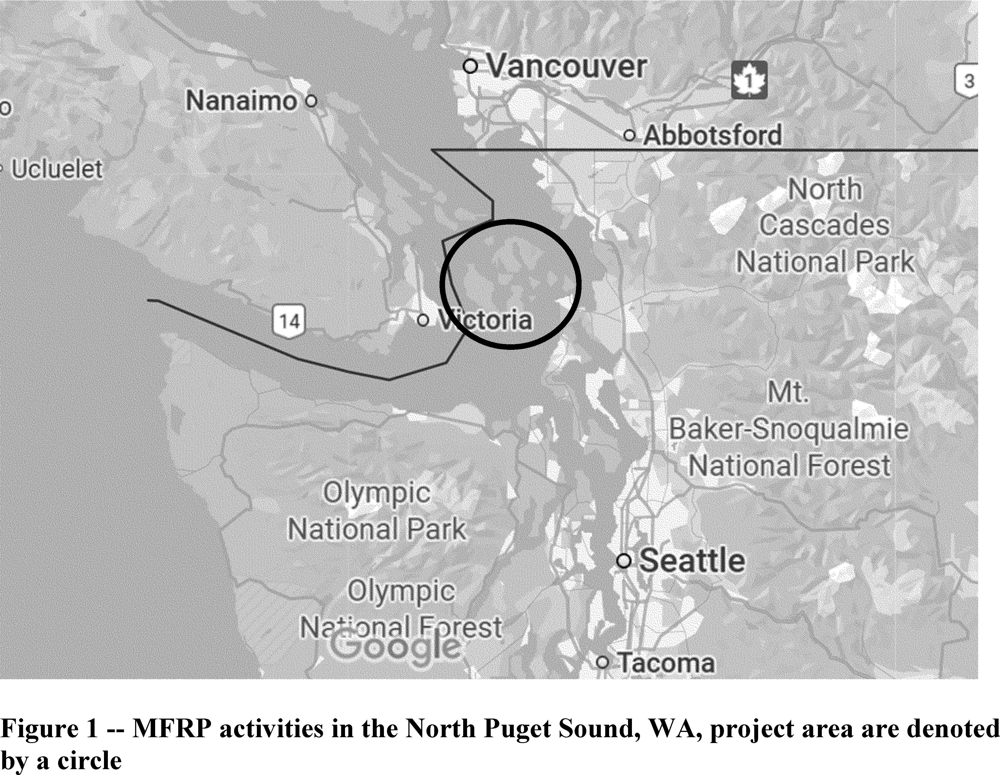
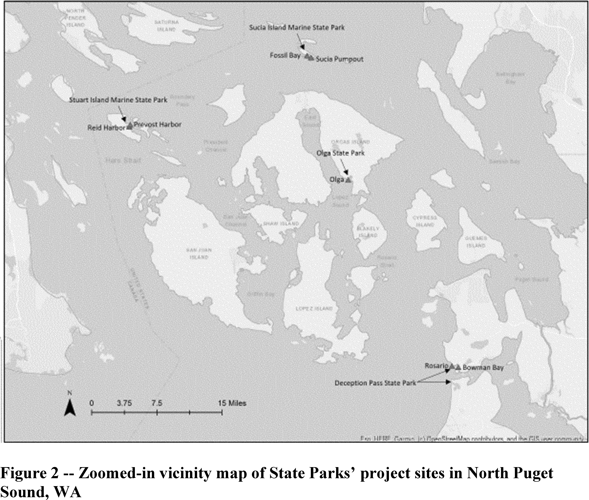
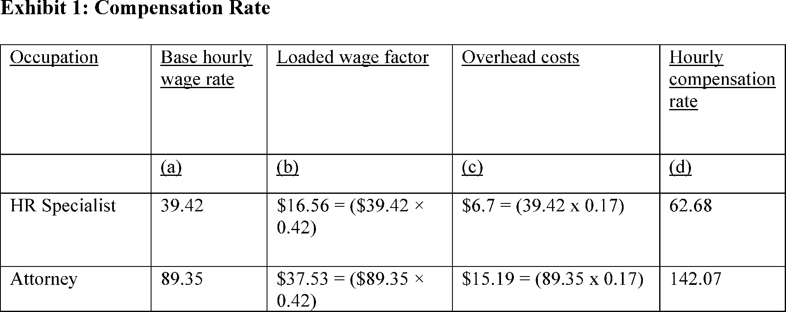
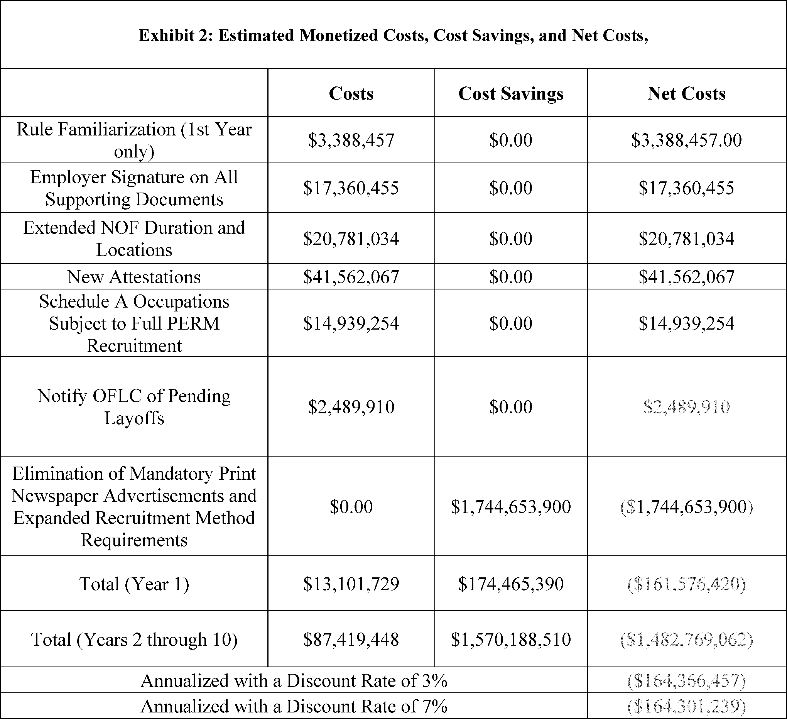

# Daily Digest — 2026-11-17

| | |
|---|---|
| **Digest date** | 2026-11-17 |
| **Data date range** | 2026-11-17 to 2026-11-17 |
| **Generated at** | 2026-11-18T06:16:34Z (UTC) |
| **Pipeline version** | 88281ed5 |
| **Inference** | model layers ran — cli/haiku, opus |
| **Source watermarks** | CREC: 2026-11-17T14:46:41Z · BILLS: 2026-11-17T06:08:07Z · FR: 2026-11-17T07:11:49Z · USCOURTS: 2026-11-18T00:37:07Z · PLAW: 2026-11-09T15:10:06Z |

[Full observed listing for this day](day/2026-11-17.html) — the items our collectors observed for this publication day, mechanical rules applied, frozen at end of day; releases their publishers date on other days are counted there, not listed. This digest is the canonical record.

All items below cite the govinfo package (and granule, where applicable) they
summarize. Selection is mechanical; each item states the rule that included
it. See the Coverage Statement at the end for a full accounting of what was
published, what was summarized, and what was excluded and why.

---

## Contents

- [Day in Review](#day-in-review)
- [1. Congressional Floor Activity](#1-congressional-floor-activity)
- [2. Legislation](#2-legislation)
- [3. Federal Register](#3-federal-register)
- [4. Enacted Laws](#4-enacted-laws)
- [5. Judicial Activity](#5-judicial-activity)
- [6. Agency Announcements](#6-agency-announcements)
- [7. Recorded Votes](#7-recorded-votes)
- [8. Bill Actions](#8-bill-actions)
- [9. Presidential Actions](#9-presidential-actions)
- [Terms Used Today](#terms-used-today)
- [Coverage Statement](#coverage-statement)
- [Methodology](#methodology)

---

## Day in Review

The digest carries 65 Senate floor items and one House extension of remarks. The Senate record reflects two recorded votes. The Senate confirmed the nomination of Domenico, 51 to 46, and agreed, 70 to 27, to a cloture motion on substitute amendment No. 6883 to H.R. 2347. Senators submitted further amendments to that measure, including proposals on Clean Water Act certifications, solar permitting, and transmission incentives. The digest also carries 14 bills reported in the Senate, most from the Committee on Energy and Natural Resources, along with eight bills introduced in the House and four introduced in the Senate.

On the regulatory side, the digest carries nine final rules and eight proposed rules. The Nuclear Regulatory Commission issued a direct final rule and a companion proposal reducing the Advisory Committee on Reactor Safeguards under Executive Order 14300. The Justice Department finalized its interim rule on Board of Immigration Appeals procedures, and the FCC revised its NEPA rules. Among the proposals, FDA would find that N-acetyl-L-cysteine is not excluded from the dietary supplement definition. The Labor Department proposed changes to the PERM program, and VA proposed ending premium collection on certain NSLI policies.

The digest carries 31 appellate opinions and one national court decision. The Fifth Circuit reversed a denial of qualified immunity to a Houston officer in Tuttle v. Gallegos. The Sixth Circuit affirmed the district court on all issues in Ford v. InterMotive. The Federal Circuit held it had jurisdiction in Traxcell v. Cellco. A Court of Federal Claims special master dismissed a vaccine injury petition in Hagos.

*Composed from the summarized items below and the day's mechanical
counts; all specifics are cited in their sections.*

---

## 1. Congressional Floor Activity

Source: Congressional Record (CREC), issue observed 2026-11-17, covering proceedings of 2026-11-16. Published by govinfo 2026-11-17T11:55:34Z; observed by our collector 2026-11-17T12:11:09Z. Total issue size: 74 granule(s).

### 1.1 Senate

Tags: legislative · model keys: clean water act · farm bill · senate amendments

*In plain terms: Eight items, mostly amendments to H.R. 2347 led by an Alsobrooks-Shaheen Clean Water Act title; the rest are floor statements on permitting and the farm bill.*

- **Energy (Executive Session)** — In Senate floor remarks, Senator Markey discussed energy affordability and a pending permitting bill, stating that the bill would eliminate the ability to vacate permits under the National Environmental Policy Act and would limit court review of certain environmental claims. He cited projections of data center and AI infrastructure spending exceeding $10 trillion over eight years, and stated that projected electricity bill reductions would be about $4 to $6 a month by 2040. He also cited an earlier Rhodium model estimating that the bill could increase economywide emissions by 1 percent, and noted that the bill includes data center cost and community assistance provisions.
  - *In plain terms:* Senator Markey said the pending permitting bill would end the ability to vacate National Environmental Policy Act permits and cited projected electricity bill reductions of $4 to $6 a month by 2040.
  - Included because: CREC-SEL-01 — floor item ≥ threshold floor time (21,134 characters) (document dated 2026-11-16)
  - Source: [CREC-2026-11-16 / CREC-2026-11-16-pt1-PgS5676](https://www.govinfo.gov/app/details/CREC-2026-11-16/CREC-2026-11-16-pt1-PgS5676)
- **Text of Amendments** — Three amendments to SA 6883 to H.R. 2347 were submitted and ordered to lie on the table. SA 7009, submitted by Mr. Moran with Mr. Schmitt, Mr. Grassley, and Mr. Young, would authorize the Commission to attach land restoration terms to permits and to require corrective action at the permit holder's expense. SA 7010, submitted by Mr. Paul, would strike section 2116 of the amendment, which relates to Transmission Organization governance, and SA 7011, submitted by Ms. Alsobrooks and Mrs. Shaheen, would strike title II of division A and insert a Clean Water Act title amending Section 401 of the Federal Water Pollution Control Act.
  - *In plain terms:* Three amendments to SA 6883 were submitted and set aside: SA 7009 (Moran) on land restoration terms, SA 7010 (Paul) to strike section 2116, and SA 7011 (Alsobrooks, Shaheen) to replace title II of division A.
  - Included because: CREC-SEL-01 — floor item ≥ threshold floor time (173,789 characters) (document dated 2026-11-16)
  - Source: [CREC-2026-11-16 / CREC-2026-11-16-pt1-PgS5685-2](https://www.govinfo.gov/app/details/CREC-2026-11-16/CREC-2026-11-16-pt1-PgS5685-2)
- **Text of Senate Amendment 7011** — Amendment SA 7011, submitted by Alsobrooks and Shaheen to SA 6883 to H.R. 2347, would strike title II of division A and insert a Clean Water Act title amending Section 401 of the Federal Water Pollution Control Act. The proposed Section 401 text would limit the scope of state certifications to water quality requirements for the activity as a whole, restrict denial of certification to specified determinations, and provide for prefiling meetings on request, written acknowledgment of applications within 3 days, and written notice of completeness or missing materials within 90 days. It would also allow applicants to petition a court for judicial review of an alleged failure by a certifying authority to act under those procedures.
  - *In plain terms:* Amendment SA 7011 would replace title II of division A with a Clean Water Act title amending Section 401, requiring written acknowledgment of applications within 3 days and written completeness notices within 90 days.
  - Included because: CREC-SEL-01 — floor item ≥ threshold floor time (34,829 characters) (document dated 2026-11-16)
  - Source: [CREC-2026-11-16 / CREC-2026-11-16-pt1-PgS5686](https://www.govinfo.gov/app/details/CREC-2026-11-16/CREC-2026-11-16-pt1-PgS5686)
- **Text of Senate Amendment 7012** — Senators Ossoff and Warnock submitted amendment SA 7012 to amendment SA 7005 and to SA 6883 to H.R. 2347, which would strike lines 13 and 14 of the amendment and insert a subsection (f) titled Accelerated Permitting for Projects Using Domestic Content. Under the text, the Secretaries of the Interior and Agriculture would give priority to eligible solar projects certified as expected to satisfy domestic content requirements, reduce by 50 percent the deadlines for specified National Environmental Policy Act reviews and authorizations for those projects, and require completion certifications within 90 days after a project is placed into service. Applicants would retain supporting records for not less than 3 years.
  - *In plain terms:* Ossoff and Warnock's SA 7012 would have Interior and Agriculture prioritize eligible solar projects certified to meet domestic content requirements, cut National Environmental Policy Act review deadlines by 50 percent, require completion certifications within 90 days after service, and require records kept at least 3 years.
  - Included because: CREC-SEL-01 — floor item ≥ threshold floor time (17,894 characters) (document dated 2026-11-16)
  - Source: [CREC-2026-11-16 / CREC-2026-11-16-pt1-PgS5689](https://www.govinfo.gov/app/details/CREC-2026-11-16/CREC-2026-11-16-pt1-PgS5689)
- **Text of Senate Amendment 7015** — Senator Bennet submitted amendment SA 7015 to H.R. 2347, proposing a replacement for lines 3 through page 35, line 20 of amendment SA 6957. The text adds section 302707 to chapter 3027 of title 54, United States Code, stating that approved tribal preservation programs are an exercise of inherent tribal governmental authority, requiring written consent of a tribe's governing body before the Secretary assumes tribal preservation officer functions, and requiring written notice, technical assistance, and at least 2 years to cure before funds are withheld for alleged material misuse of federal funds. It also amends section 306108 of title 54 to add definitions for 'adverse effect of the undertaking,' 'area of potential effects,' and 'undertaking,' with specified exclusions.
  - *In plain terms:* Senator Bennet's SA 7015 would state that approved tribal preservation programs exercise inherent tribal governmental authority, require a tribe's governing body to consent in writing before the Secretary assumes tribal preservation officer functions, and require at least 2 years to fix alleged misuse before funds are withheld.
  - Included because: CREC-SEL-01 — floor item ≥ threshold floor time (35,564 characters) (document dated 2026-11-16)
  - Source: [CREC-2026-11-16 / CREC-2026-11-16-pt1-PgS5691](https://www.govinfo.gov/app/details/CREC-2026-11-16/CREC-2026-11-16-pt1-PgS5691)
- **Text of Senate Amendment 7016** — Senator Welch submitted amendment SA 7016 to H.R. 2347, proposing to strike section 2108 of amendment SA 6883 and insert a new section 2108 titled 'Dispatchable Energy Systems Market Access.' The text defines qualifying behind-the-meter distributed energy system facilities and aggregations of two or more such facilities with a combined capacity of at least 100 kilowatts, and states that such a designation does not by itself subject the facility, its retail service, or its distribution service to Federal Energy Regulatory Commission jurisdiction. It adds section 229 to the Federal Power Act, under which, 18 months after enactment, transmission organization rates and terms may not prevent qualifying aggregations from participating in wholesale markets, requires tariff and compliance filings within 180 days, requires Commission action on complaints within 180 days, and prohibits double compensation with disgorgement of amounts received.
  - *In plain terms:* Senator Welch's SA 7016 would replace section 2108 of SA 6883 with a provision that, 18 months after enactment, bars transmission organization rates from preventing qualifying on-site aggregations of at least 100 kilowatts from joining wholesale markets.
  - Included because: CREC-SEL-01 — floor item ≥ threshold floor time (23,553 characters) (document dated 2026-11-16)
  - Source: [CREC-2026-11-16 / CREC-2026-11-16-pt1-PgS5694](https://www.govinfo.gov/app/details/CREC-2026-11-16/CREC-2026-11-16-pt1-PgS5694)
- **Text of Senate Amendment 7018** — Senator Welch submitted amendment SA 7018 to H.R. 2347, proposing a new section titled 'Shared Utility Rewards for Grid Efficiency' for insertion in title I of division B. The section defines terms including 'advanced conductor,' 'grid-enhancing technology,' and 'covered transmission action,' and amends section 219 of the Federal Power Act to direct the Commission to issue rules that include incentive mechanisms such as performance-based measures and shared savings frameworks. It requires the Commission, within one year of enactment, to issue a final rule establishing shared savings frameworks for covered transmitting utilities, including standardized methodologies for baseline performance, cost savings, and recovery percentages applicable across similarly situated transmission segments.
  - *In plain terms:* Senator Welch's SA 7018 would require the Commission to issue a final rule within one year of enactment establishing shared savings frameworks for covered transmitting utilities.
  - Included because: CREC-SEL-01 — floor item ≥ threshold floor time (32,766 characters) (document dated 2026-11-16)
  - Source: [CREC-2026-11-16 / CREC-2026-11-16-pt1-PgS5697](https://www.govinfo.gov/app/details/CREC-2026-11-16/CREC-2026-11-16-pt1-PgS5697)
- **Farm Bill** — In a Senate floor statement under the heading 'Farm Bill,' Senator Bennet said Congress has missed its deadline for a five-year farm bill for three consecutive years and cited increased costs for fertilizer, financing, and farm diesel. The statement describes the Senate Agriculture Committee's farm bill as having passed without Democratic support and sets out four priorities: a two-year delay of state SNAP cost shifts without reducing other farm bill programs, restoring funding cuts to EQIP and CSP, avoiding reopening debates on Proposition 12 and pesticides, and providing immediate economic assistance to producers. The statement also refers to the budget bill passed by Republicans without Democratic votes, which changed how SNAP benefits are funded for states.
  - *In plain terms:* In a floor statement, Senator Bennet said Congress missed the five-year farm bill deadline three years running and listed four priorities, including a two-year delay of state SNAP cost shifts and immediate economic aid for producers.
  - Included because: CREC-SEL-01 — floor item ≥ threshold floor time (16,382 characters) (document dated 2026-11-16)
  - Source: [CREC-2026-11-16 / CREC-2026-11-16-pt1-PgS5702-2](https://www.govinfo.gov/app/details/CREC-2026-11-16/CREC-2026-11-16-pt1-PgS5702-2)

### 1.2 House of Representatives

No House floor items met the selection thresholds. 0 floor granule(s) are accounted for in the Coverage Statement.

### 1.3 Recorded Votes

- **Vote on Domenico Nomination (Executive Session)** — The Senate confirmed the nomination of Domenico by a vote of 51 yeas to 46 nays (Roll Call Vote No. 263 Ex.), with three senators not voting. The vote occurred after Senator Armstrong requested by unanimous consent that the previously scheduled rollcall vote take place immediately.
  - *In plain terms:* The Senate confirmed Domenico's nomination 51 to 46 in Roll Call Vote No. 263 Ex., with three senators not voting, after Senator Armstrong asked by unanimous consent that the scheduled vote occur immediately.
  - Included because: CREC-SEL-02 — recorded vote (all recorded votes are listed) (document dated 2026-11-16)
  - Source: [CREC-2026-11-16 / CREC-2026-11-16-pt1-PgS5679](https://www.govinfo.gov/app/details/CREC-2026-11-16/CREC-2026-11-16-pt1-PgS5679)
- **Cloture Motion** — The Senate agreed to a cloture motion under rule XXII to bring to a close debate on substitute amendment No. 6883 to H.R. 2347, a bill to amend the Internal Revenue Code of 1986 to exclude from gross income any damages, other than punitive damages, received on account of any sexual acts or sexual contact. The motion was agreed to by a vote of 70 yeas to 27 nays (Roll Call Vote No. 264 Leg.), with three senators not voting. The cloture motion was signed by seventeen Senators.
  - *In plain terms:* The Senate voted 70 to 27 to end debate on substitute amendment No. 6883 to H.R. 2347, a bill excluding from gross income damages other than punitive damages received for sexual acts or contact.
  - Included because: CREC-SEL-02 — recorded vote (all recorded votes are listed) (document dated 2026-11-16)
  - Source: [CREC-2026-11-16 / CREC-2026-11-16-pt1-PgS5679-3](https://www.govinfo.gov/app/details/CREC-2026-11-16/CREC-2026-11-16-pt1-PgS5679-3)

---

## 2. Legislation

Source: Congressional Bills (BILLS), text versions published 2026-11-17 to 2026-11-17.

### 2.1 Counts by Stage

| Stage (bill text version) | Count |
|---|---|
| Introduced (ih/is) | 12 |
| Reported (rh/rs) | 14 |
| Engrossed (eh/es) | 1 |
| Enrolled (enr) | 0 |
| Other versions | 10 |
| **Total bill texts published** | **37** |

### 2.2 Bills Listed by Mechanical Rule

Tags: legislative · model keys: public lands · senate bills · wilderness study area

*In plain terms: 14 bills advanced in the Senate, led by a Montana measure releasing about 81,000 acres of wilderness study area; the rest cover public lands, museums, grid reliability, and desalination.*

Bills below are listed because they matched at least one listing rule; the
matching rule is stated per item. All other bill texts are counted above and
accounted for in the Coverage Statement.

- **H. R. 331 (rs) — 119 HR 331 RS: To amend the Aquifer Recharge Flexibility Act to clarify a provision relating to conveyances for aquifer recharge purposes.** — H.R. 331, reported in the Senate without amendment, would amend subsection (c) of the Aquifer Recharge Flexibility Act (43 U.S.C. 390g-9). It permits a holder, acting for itself or on behalf of a State, political subdivision, Indian Tribe, or public entity, to use an existing right-of-way, easement, permit, or other authorization for aquifer recharge without additional authorization from the Secretary, subject to 30 days' advance notice to the Bureau of Land Management. The bill also provides that the subsection does not waive compliance with applicable Federal laws and Bureau policies and does not authorize construction, modification, or expansion of covered infrastructure.
  - *In plain terms:* H.R. 331 would let holders use existing rights-of-way, easements, permits, or other authorizations for aquifer recharge without new Secretary approval, after 30 days' notice to the Bureau of Land Management.
  - Included because: BILLS-SEL-01 — reached stage: reported/enrolled/calendar (document dated 2026-11-12)
  - Source: [BILLS-119hr331rs](https://www.govinfo.gov/app/details/BILLS-119hr331rs)
- **H. R. 5729 (rs) — 119 HR 5729 RS: North Rim Restoration Act** — H.R. 5729, the North Rim Restoration Act, was reported in the Senate without amendment. It authorizes the Secretary of the Interior, acting through the National Park Service, to use emergency acquisition flexibilities under 48 CFR part 18 for contracting in the Grand Canyon National Park areas affected by the Dragon Bravo Fire, with reports to Congress every 180 days and expiration after 7 years or upon completion of projects. It also authorizes noncompetitive contracts for North Rim facilities with the concessioner holding a valid concession contract on the date of enactment, upon a written Secretary determination, for up to 7 years.
  - *In plain terms:* H.R. 5729 would allow emergency contracting flexibilities for Grand Canyon National Park areas affected by the Dragon Bravo Fire and allow noncompetitive contracts of up to 7 years for North Rim facilities with the current concession holder.
  - Included because: BILLS-SEL-01 — reached stage: reported/enrolled/calendar (document dated 2026-11-12)
  - Source: [BILLS-119hr5729rs](https://www.govinfo.gov/app/details/BILLS-119hr5729rs)
- **H. R. 7618 (rs) — 119 HR 7618 RS: American Battlefield Protection Program Amendments Act of 2026** — H.R. 7618, the American Battlefield Protection Program Amendments Act of 2026, was reported in the Senate without amendment. It extends the battlefield acquisition grant program under 54 U.S.C. 308103(f) through 2036, strikes subsection (d) of 54 U.S.C. 308104, and sets the battlefield restoration grant authorization at $2,000,000 for each fiscal year through fiscal year 2036. It also directs the Secretary of the Interior, subject to advance appropriations, to prepare or certify studies of sites tied to the French and Indian War (1754–1763) and the Mexican-American War (1846–1848), for submission to the House and Senate committees on natural resources.
  - *In plain terms:* H.R. 7618 would extend battlefield acquisition grants through 2036, authorize $2,000,000 yearly through 2036 for battlefield restoration grants, and direct Interior studies of French and Indian War and Mexican-American War sites, subject to advance appropriations.
  - Included because: BILLS-SEL-01 — reached stage: reported/enrolled/calendar (document dated 2026-11-12)
  - Source: [BILLS-119hr7618rs](https://www.govinfo.gov/app/details/BILLS-119hr7618rs)
- **S. 140 (rs) — 115 S140 RS: Wildfire Prevention Act of 2025** — S. 140, the Wildfire Prevention Act of 2025, was reported in the Senate with an amendment in the nature of a substitute. The table of contents shows provisions on hazardous fuels reduction on National Forest System and Bureau of Land Management lands, including annual acreage goals for mechanical thinning and prescribed fire, annual public reporting, budget-submission reporting, timber sales, and categorical exclusions for high-priority hazard trees. The source text is truncated, so provisions beyond the portion provided are not summarized.
  - *In plain terms:* S. 140 was reported with a substitute amendment; its table of contents covers hazardous fuels reduction on National Forest System and Bureau of Land Management lands, but the source text is cut off.
  - Included because: BILLS-SEL-01 — reached stage: reported/enrolled/calendar (document dated 2026-11-12)
  - Source: [BILLS-119s140rs](https://www.govinfo.gov/app/details/BILLS-119s140rs)
- **S. 2970 (rs) — 119 S2970 RS: To authorize the use of off-highway vehicles in certain areas of the Capitol Reef National Park, Utah.** — S. 2970, reported in the Senate with an amendment, would authorize the use of off-highway vehicles on specified roads within Capitol Reef National Park in Utah, including Burr Trail Road, Highway 24, and Notom Bullfrog Road. Utah State law would apply to the use of motor vehicles, including off-highway vehicles, on those covered roads, and the term off-highway vehicle takes its meaning from State law. The amended version of the covered-roads definition adds Sevier and Wayne Counties as the location of Baker Ranch Road.
  - *In plain terms:* S. 2970 would allow off-highway vehicles on specified roads in Capitol Reef National Park in Utah, governed by Utah state law, and as amended would list Sevier and Wayne Counties as Baker Ranch Road's location.
  - Included because: BILLS-SEL-01 — reached stage: reported/enrolled/calendar (document dated 2026-11-12)
  - Source: [BILLS-119s2970rs](https://www.govinfo.gov/app/details/BILLS-119s2970rs)
- **S. 3371 (rs) — 119 S3371 RS: National Museum of the Blind People’s Movement Act** — S. 3371, the National Museum of the Blind People's Movement Act, was reported in the Senate with an amendment. It designates the Museum of the Blind People's Movement, located at 200 East Wells Street in Baltimore, Maryland, as the National Museum of the Blind People's Movement. The bill's findings describe the National Federation of the Blind, its founding in 1940, and the museum and archive housed in its Jernigan Institute.
  - *In plain terms:* S. 3371 would designate the Museum of the Blind People's Movement at 200 East Wells Street in Baltimore, Maryland, as the National Museum of the Blind People's Movement.
  - Included because: BILLS-SEL-01 — reached stage: reported/enrolled/calendar (document dated 2026-11-12)
  - Source: [BILLS-119s3371rs](https://www.govinfo.gov/app/details/BILLS-119s3371rs)
- **S. 3524 (rs) — 119 S3524 RS: American Battlefield Protection Program Amendments Act of 2025** — As reported by the Senate Committee on Energy and Natural Resources on November 12, 2026, this bill would amend title 54 of the United States Code to extend the battlefield acquisition grant program through fiscal year 2036, strike the battlefield interpretation grant subsection, and authorize $2,000,000 per fiscal year through fiscal year 2036 for battlefield restoration grants. It would also direct the Secretary of the Interior, through the National Park Service, to prepare or certify studies of sites tied to the French and Indian War (1754-1763) and the Mexican-American War (1846-1848), subject to the availability of appropriations. The bill sets deadlines for submitting those studies to the Committees on Natural Resources and Energy and Natural Resources.
  - *In plain terms:* S. 3524 would extend battlefield acquisition grants through fiscal year 2036, authorize $2,000,000 per fiscal year through 2036 for restoration grants, and direct site studies for sites tied to the French and Indian War and Mexican-American War, subject to appropriations.
  - Included because: BILLS-SEL-01 — reached stage: reported/enrolled/calendar (document dated 2026-11-12)
  - Source: [BILLS-119s3524rs](https://www.govinfo.gov/app/details/BILLS-119s3524rs)
- **S. 3527 (rs) — 95 S3527 RS: Montana Sportsmen Conservation Act** — As reported by the Senate Committee on Energy and Natural Resources on November 12, 2026, the Montana Sportsmen Conservation Act would release approximately 81,000 acres of the Middle Fork Judith Wilderness Study Area and approximately 11,380 and 11,580 acres of the Hoodoo Mountain and Wales Creek Wilderness Study Areas, respectively, from wilderness study area status. The released lands would be managed under the applicable land and resource management plans adopted under the Forest and Rangeland Renewable Resources Planning Act of 1974 and the Federal Land Policy and Management Act of 1976. The findings cite prior agency suitability determinations and 2020 and 2021 land management plan revisions for these areas.
  - *In plain terms:* The Montana Sportsmen Conservation Act would release approximately 81,000 acres of the Middle Fork Judith Wilderness Study Area, 11,380 acres of Hoodoo Mountain, and 11,580 acres of Wales Creek from wilderness study area status.
  - Included because: BILLS-SEL-01 — reached stage: reported/enrolled/calendar (document dated 2026-11-12)
  - Source: [BILLS-119s3527rs](https://www.govinfo.gov/app/details/BILLS-119s3527rs)
- **S. 4410 (rs) — 119 S4410 RS: To amend the Mineral Leasing Act to provide for the payment of bonus payments of certain coal leases issued under that Act.** — As reported without amendment by the Senate Committee on Energy and Natural Resources on November 12, 2026, this bill would amend section 2(a) of the Mineral Leasing Act (30 U.S.C. 201(a)) by adding a new paragraph (6). The new paragraph provides that bonus payments for coal leases issued under a system of deferred bonus payment are payable in 10 equal annual installments, with the first installment submitted with the bid. The bill was introduced by Senator Barrasso on April 28, 2026.
  - *In plain terms:* S. 4410 would amend the Mineral Leasing Act to make bonus payments for deferred-payment coal leases payable in 10 equal annual installments, with the first installment submitted with the bid.
  - Included because: BILLS-SEL-01 — reached stage: reported/enrolled/calendar (document dated 2026-11-12)
  - Source: [BILLS-119s4410rs](https://www.govinfo.gov/app/details/BILLS-119s4410rs)
- **S. 465 (rs) — 119 S465 RS: Guaranteeing Reliability through the Interconnection of Dispatchable Power Act** — As reported without amendment by the Senate Committee on Energy and Natural Resources on November 12, 2026, the Guaranteeing Reliability through the Interconnection of Dispatchable Power Act (GRID Power Act) would require the Federal Energy Regulatory Commission to initiate a rulemaking within 90 days of enactment to reform interconnection queue procedures and amend the pro forma Large Generator Interconnection Procedures and Agreement. The rulemaking would allow transmission providers to propose prioritizing new dispatchable power projects in the interconnection queue, requiring a demonstration of need and a description of reliability benefits. The bill requires Commission action on each proposal within 60 days, final regulations within 180 days of enactment, and a regulatory review at least once every 5 years.
  - *In plain terms:* The GRID Power Act would require the Federal Energy Regulatory Commission to begin a rulemaking within 90 days of enactment on prioritizing new dispatchable (on-demand) power projects in interconnection queues, with final regulations due within 180 days of enactment.
  - Included because: BILLS-SEL-01 — reached stage: reported/enrolled/calendar (document dated 2026-11-12)
  - Source: [BILLS-119s465rs](https://www.govinfo.gov/app/details/BILLS-119s465rs)
- **S. 4870 (rs) — 119 S4870 RS: Earth MRI Reauthorization Act of 2026** — As reported with an amendment by the Senate Committee on Energy and Natural Resources on November 12, 2026, the Earth MRI Reauthorization Act of 2026 would amend section 40201 of the Infrastructure Investment and Jobs Act to reauthorize the Earth Mapping Resources Initiative. The bill expands the initiative's purpose to include data from modern sensing technologies, such as airborne gravity gradiometry and advanced geochemical methods, and adds the 3D Hydrography Program to the listed data sources. It replaces the authorization period of fiscal years 2022 through 2026 with fiscal years 2027 through 2031.
  - *In plain terms:* The Earth MRI Reauthorization Act of 2026 would renew the Earth Mapping Resources Initiative's authorization for fiscal years 2027 through 2031 in place of 2022 through 2026, and add data from modern sensing technologies and the 3D Hydrography Program.
  - Included because: BILLS-SEL-01 — reached stage: reported/enrolled/calendar (document dated 2026-11-12)
  - Source: [BILLS-119s4870rs](https://www.govinfo.gov/app/details/BILLS-119s4870rs)
- **S. 5352 (rs) — 104 S5352 RS: Desalination Reauthorization Act** — As reported with an amendment by the Senate Committee on Energy and Natural Resources on November 12, 2026, the Desalination Reauthorization Act would amend the Water Infrastructure Improvements for the Nation Act and the Water Desalination Act of 1996 to reauthorize desalination programs. The bill redefines eligible desalination projects, permits the Secretary to participate in such projects at up to 25 percent of total project cost with no dollar limitation, and adds a competitive grant program for advanced pilot desalination technologies with technoeconomic analysis requirements. It also increases the cost-sharing study and pilot provisions, raises the institutions of higher education grant amount under section 8(a) from $1,000,000 to $2,500,000, and sets a 15-year expiration for certain projects.
  - *In plain terms:* The Desalination Reauthorization Act would let the Secretary participate in desalination projects at up to 25 percent of total cost with no dollar limit, and raise the section 8(a) higher-education grant amount from $1,000,000 to $2,500,000.
  - Included because: BILLS-SEL-01 — reached stage: reported/enrolled/calendar (document dated 2026-11-12)
  - Source: [BILLS-119s5352rs](https://www.govinfo.gov/app/details/BILLS-119s5352rs)
- **S. 5359 (rs) — 119 S5359 RS: Pennington County Land Conveyance Act** — S. 5359, the Pennington County Land Conveyance Act, was introduced by Mr. Thune and Mr. Rounds on August 7, 2026, and reported with an amendment by Mr. Lee on November 12, 2026. As amended, it directs the Secretary of Agriculture, acting through the Chief of the Forest Service, to convey without consideration approximately 8.97 acres of Black Hills National Forest land and any improvements on that land to Pennington County, South Dakota, for public purposes including a public works facility, and to modify the forest boundary to reflect the conveyance. The bill also provides that the land reverts to the United States, at the Secretary's discretion, if the County uses it for an unauthorized purpose, subject to consultation with the State of South Dakota and to notice, hearing, public comment, and correction procedures.
  - *In plain terms:* S. 5359 would convey about 8.97 acres of Black Hills National Forest land to Pennington County, South Dakota, at no cost, and return the land to the United States at the Secretary's discretion if the County uses it for an unauthorized purpose.
  - Included because: BILLS-SEL-01 — reached stage: reported/enrolled/calendar (document dated 2026-11-12)
  - Source: [BILLS-119s5359rs](https://www.govinfo.gov/app/details/BILLS-119s5359rs)
- **S. 90 (rs) — 119 S90 RS: Historic Roadways Protection Act** — S. 90, the "Historic Roadways Protection Act," was introduced by Mr. Lee and Mr. Curtis on January 14, 2025, and reported with an amendment by Mr. Lee on November 12, 2026. As amended, it provides that, until the Secretary of the Interior certifies to Congress that the listed R.S. 2477 cases have been adjudicated or otherwise resolved, no Federal funds may be obligated or expended to finalize certain travel management plans for listed Utah travel management areas, or to implement covered plans finalized after the effective date of the January 13, 2017 settlement agreement in Southern Utah Wilderness Alliance, et al. v. U.S. Department of the Interior, et al. (Consolidated Case No. 2:12-cv-257 DAK). The amended text further specifies that the travel management areas listed for finalization remain subject to the plans in effect on the day before that settlement agreement's effective date.
  - *In plain terms:* S. 90 would bar federal funds to finalize or implement certain Utah travel management plans until the Interior Secretary certifies to Congress that listed R.S. 2477 cases are adjudicated or resolved.
  - Included because: BILLS-SEL-01 — reached stage: reported/enrolled/calendar (document dated 2026-11-12)
  - Source: [BILLS-119s90rs](https://www.govinfo.gov/app/details/BILLS-119s90rs)

---

## 3. Federal Register

Source: Federal Register (FR), issue of 2026-11-17.

### 3.1 Counts by Document Type

| Document type | Count |
|---|---|
| Rules | 9 |
| Proposed rules | 8 |
| Notices | 82 |
| Presidential documents | 0 |
| **Total FR documents** | **99** |

### 3.2 Rules Published

Tags: department of labor · executive · securities and exchange commission · model keys: coal ash permits · federal rules · immigration appeals

*In plain terms: Nine final rules and notices, led by Board of Immigration Appeals procedure changes and approval of Louisiana's coal ash permit program; the rest cover marine mammals, FCC, credit unions, and a Pittsburgh river safety zone.*

#### DEPARTMENT OF COMMERCE

- **Takes of Marine Mammals Incidental to Specified Activities; Taking Marine Mammals Incidental to the Washington State Parks and Recreation Commission's Marine Facilities Replacement Program in North Puget Sound, Washington** (2026-23365; 50 CFR Part 217) — NMFS, upon request from the Washington State Parks and Recreation Commission (State Parks), issues this final rule and associated 5-year letter of authorization (LOA) pursuant to the Marine Mammal Protection Act (MMPA) to govern the taking of marine mammals incidental to construction activities conducted in support of the Marine Facilities Replacement Program (MFRP) in North Puget Sound in Western Washington (WA) over the course of 5 years. This final rule prescribes permissible methods of taking and other means of effecting the least practicable adverse impact on marine mammal species and their habitat and establishes requirements for monitoring and reporting such taking. Action: Final rule; notice of issuance of letter of authorization. Dates: Effective from November 17, 2026 through November 17, 2031.
  - *In plain terms:* NMFS issues a final rule and five-year letter of authorization under the Marine Mammal Protection Act, at the request of Washington State Parks, governing incidental taking of marine mammals during construction for the Marine Facilities Replacement Program in North Puget Sound, Washington.
  - Included because: FR-SEL-01 — document type: final rule (all listed)
  - Source: [FR-2026-11-17 / 2026-23365](https://www.govinfo.gov/app/details/FR-2026-11-17/2026-23365)
  -  *Source graphic 1 of 2 from 2026-23365.*
  -  *Source graphic 2 of 2 from 2026-23365.*

#### DEPARTMENT OF HOMELAND SECURITY

- **Safety Zone; Monongahela River, Pittsburgh, PA** (2026-23405; 33 CFR Part 165) — The Coast Guard is establishing a temporary safety zone for navigable waters on the Monongahela River from Mile Marker 15 to Mile Marker 16. This safety zone is necessary to protect personnel and vessels from potential hazards on navigable waters during an operation to install aerial transverse wirelines. Entry of vessels or persons into this zone is prohibited unless specifically authorized by the Captain of the Port, Marine Safety Unit Pittsburgh or their designated representative or their designated representative. Action: Temporary final rule. Dates: This rule is effective without actual notice from November 17, 2026 through November 19, 2026. For the purposes of enforcement, actual notice will be used from November 16, 2026, through November 17, 2026. The temporary safety zone will be enforced from 7 a.m. to 5 p.m. each day during this period.
  - *In plain terms:* The Coast Guard is setting a temporary safety zone on the Monongahela River between Mile Markers 15 and 16 to protect against hazards during aerial wireline installation, barring entry unless authorized by the Captain of the Port, Marine Safety Unit Pittsburgh, or their representative.
  - Included because: FR-SEL-01 — document type: final rule (all listed)
  - Source: [FR-2026-11-17 / 2026-23405](https://www.govinfo.gov/app/details/FR-2026-11-17/2026-23405)

#### DEPARTMENT OF JUSTICE

- **Appellate Procedures for the Board of Immigration Appeals** (2026-23320; 8 CFR Parts 1003, 1208, and 1240) — In February 2026, the Department issued an interim final rule (“IFR”), effective March 9, 2026, to streamline Board of Immigration Appeals (“Board” or “BIA”) procedures. The IFR's comment period closed on April 8, 2026. In this final rule, the Department responds to comments received and finalizes the IFR with minor changes. Action: Final rule. Dates: This rule is effective on December 17, 2026.
  - *In plain terms:* A streamlining rule for Board of Immigration Appeals procedures took effect March 9, 2026, while comments were accepted until April 8, 2026; this final rule responds to those comments and adopts the rule with minor changes.
  - Included because: FR-SEL-01 — document type: final rule (all listed)
  - Source: [FR-2026-11-17 / 2026-23320](https://www.govinfo.gov/app/details/FR-2026-11-17/2026-23320)

#### ENVIRONMENTAL PROTECTION AGENCY

- **Louisiana: Approval of State Coal Combustion Residuals Permit Program** (2026-23383; 40 CFR Part 257) — The Environmental Protection Agency (EPA or the Agency) is approving the Louisiana coal combustion residuals (CCR) permit program under the Resource Conservation and Recovery Act (RCRA). After reviewing the CCR permit program application submitted by the Louisiana Department of Environmental Quality (LDEQ), EPA has determined that Louisiana's partial CCR permit program meets the standard for approval under RCRA. Louisiana's CCR permit program will operate in lieu of the Federal CCR program with the exception of the specific provisions noted below. Action: Availability of final decision. Dates: This action is effective on December 17, 2026.
  - *In plain terms:* EPA is approving Louisiana's partial coal combustion residuals permit program under the Resource Conservation and Recovery Act, finding it meets the approval standard, so Louisiana will operate it instead of the federal coal combustion residuals program except for the specific provisions noted below.
  - Included because: FR-SEL-01 — document type: final rule (all listed)
  - Source: [FR-2026-11-17 / 2026-23383](https://www.govinfo.gov/app/details/FR-2026-11-17/2026-23383)

#### FEDERAL COMMUNICATIONS COMMISSION

- **Modernizing the Commission's National Environmental Policy Act Rules** (2026-23385; 47 CFR Parts 1, 2, 5, 17, 22, 27, 30, 63, 73, 74, 78, 80, 90, 97, and 101) — In this document ( Order ), the Federal Communications Commission (“Commission” or “FCC”) takes action to cut through outdated and unnecessary burdens that have slowed deployment of critical communications networks. These reforms restore balance to the Commission's National Environmental Policy Act (NEPA) implementation by providing clear and predictable rules to ensure NEPA serves as a tool for informed decision-making rather than a barrier to investment, innovation, and connectivity. Action: Final rule. Dates: These rules are effective December 17, 2026, except for instruction 2 (§ 1.61), instruction 3 (§ 1.923), instruction 4 (§ 1.929), instruction 6 (§ 1.1303), instruction 7 (§ 1.1304), instruction 8 (§ 1.1305), instruction 9 (§ 1.1306), instruction 10 (§ 1.1307), instruction 11 (§ 1.1308), instruction 12 (§ 1.1309), instruction 13 (§§ 1.1311 through 1.1313), instruction 14 (§§ 1.1314, 1.1315, 1.1317, 1.1319, and 1.1320), instruction 15 (§ 1.1706), instruction 16 (§ 1.2113), instruction 17 (§ 1.6002), instruction 18 (§ 1.9010), instruction 19 (§ 1.70007), instruction 20 (§§ 1.90000 through 1.90002), instruction 22 (§ 2.1091), instruction 23 (§ 2.1093), instruction 25 (§ 5.63), instruction 27 (§ 17.4), instruction 28 (§ 17.6), instruction 30 (§ 22.143), instruction 31 (§ 22.165), instruction 32 (§ 22.503), instruction 34 (§ 27.11), instruction 35 (§ 27.803), instruction 36 (§ 27.903), instruction 37 (§ 27.1208), instruction 39 (§ 30.101), instruction 41 (§ 63.01), instruction 42 (§ 63.18), instruction 44 (§ 73.406), instruction 45 (§ 73.1010), instruction 47 (§ 74.5), instruction 48 (§ 74.25), instruction 50 (§ 78.15), instruction 51 (§ 78.109), instruction 53 (§ 80.371), instruction 55 (§ 90.129), instruction 56 (§ 90.159), instruction 57 (§ 90.169), instruction 58 (§ 90.655), instruction 59 (§ 90.683), instruction 60 (§ 90.733), instruction 61 (§ 90.1207), instruction 63 (§ 97.13), instruction 65 (§ 101.31), instruction 66 (§ 101.1009), instruction 67 (§ 101.1329), and instruction 68 (§ 101.1523), which are delayed indefinitely. The Federal Communications Commission will publish a document in the Federal Register announcing the effective date of these rule sections.
  - *In plain terms:* In this order, the FCC removes outdated and unnecessary burdens that have slowed deployment of communications networks, adopting clear, predictable rules so the National Environmental Policy Act serves as a tool for informed decision-making.
  - Included because: FR-SEL-01 — document type: final rule (all listed)
  - Source: [FR-2026-11-17 / 2026-23385](https://www.govinfo.gov/app/details/FR-2026-11-17/2026-23385)
- **Protecting Consumers From SIM-Swap and Port-Out Fraud** (2026-23400; 47 CFR Part 64) — In this document, the Wireline Competition Bureau (Bureau) announces that the Office of Management and Budget (OMB) has approved, for a period of three years, the information collection associated with the Commission's rules adopted in the SIM Swap and Port-Out Fraud Order, FCC 23-95. This document is consistent with that Order, which stated that the revised rules would not become effective until OMB completed its review of any information collection requirements under the Paperwork Reduction Act and that the Bureau would announce the compliance date for the revised rules by subsequent Public Notice and cause the Commission's rules to be revised accordingly. Action: Final rule; announcement of effective and compliance dates. Dates: Effective date: Amendatory instruction 6 (47 CFR 64.2010(h)(2) through (6) and (8)), published at 88 FR 85794, December 8, 2023, is effective on November 17, 2026. The amendments in this final rule are effective November 17, 2026. Compliance date: Compliance with the amendments to 47 CFR 64.2010(h), published at 88 FR 85794, December 8, 2023, for covered providers is required as of December 17, 2026.
  - *In plain terms:* The FCC's Wireline Competition Bureau announces that the Office of Management and Budget approved, for three years, information collection for its SIM-swap and port-out fraud rules, which take effect only after that review and will have their compliance date announced by public notice.
  - Included because: FR-SEL-01 — document type: final rule (all listed)
  - Source: [FR-2026-11-17 / 2026-23400](https://www.govinfo.gov/app/details/FR-2026-11-17/2026-23400)

#### NATIONAL CREDIT UNION ADMINISTRATION

- **Chartering and Field of Membership for Federal Credit Unions; Associational Common Bonds and Client-Customer Relationships** (2026-23392; 12 CFR Part 701) — The NCUA Board (Board) is issuing a final rule to amend its criteria for determining associational common bonds. The amendments clarify that requiring members to buy a good, product, or service from a group as a condition of membership will no longer automatically bar eligibility as a recognized association. After considering public comments, the Board finalizes the proposed rule with certain modifications. The Board's revisions detail how NCUA assesses client-customer relationships (including relevant examples). These changes also simplify NCUA's process for reviewing pre-approved groups. Action: Final rule. Dates: This final rule is effective on January 4, 2027.
  - *In plain terms:* The NCUA Board's final rule amends associational common bond criteria so requiring members to buy a group's product or service no longer automatically bars eligibility, revises client-customer relationship assessment, and simplifies pre-approved group review.
  - Included because: FR-SEL-01 — document type: final rule (all listed)
  - Source: [FR-2026-11-17 / 2026-23392](https://www.govinfo.gov/app/details/FR-2026-11-17/2026-23392)

#### NUCLEAR REGULATORY COMMISSION

- **Advisory Committee on Reactor Safeguards Functions** (2026-23343; 10 CFR Parts 1, 2, 50, 52, 53 and 54) — The U.S. Nuclear Regulatory Commission (NRC) is amending its regulations in response to section 4.(b) of Executive Order (E.O.) 14300, “Ordering the Reform of the Nuclear Regulatory Commission.” Specifically, this direct final rule revises the NRC's regulations to reduce the personnel and functions of the Advisory Committee on Reactor Safeguards (ACRS) to the minimum necessary to fulfill the ACRS's statutory obligations. Action: Direct final rule. Dates: The final rule is effective on February 1, 2027, unless significant adverse comments are received. Comments must be submitted electronically using https://www.regulations.gov by 11:59 p.m. eastern time on December 17, 2026. If the direct final rule is withdrawn as a result of such comments, timely notice of the withdrawal will be published in the Federal Register . Comments received on this direct final rule will also be considered to be comments on the companion proposed rule published in the Proposed Rules section of this issue of the Federal Register .
  - *In plain terms:* The NRC is issuing a final rule, not a proposal, under Section 4(b) of Executive Order 14300 to reduce the Advisory Committee on Reactor Safeguards' personnel and functions to the minimum needed for statutory duties.
  - Included because: FR-SEL-01 — document type: final rule (all listed)
  - Source: [FR-2026-11-17 / 2026-23343](https://www.govinfo.gov/app/details/FR-2026-11-17/2026-23343)

#### SMALL BUSINESS ADMINISTRATION

- **Small Business Investment Company (SBIC) Leverage Availability** (2026-23358; 13 CFR Part 107) — The U.S. Small Business Administration (“SBA” or “Agency”) is publishing this interim final rule (“IFR”) amending the U.S. Small Business Administration's loan guarantee regulations applicable to the Small Business Investment Company (“SBIC”) program to implement the provisions of the Investing in All of America Act of 2025 (“the Investing Act”). These provisions increase the maximum amount of leverage available to SBICs issuing standard debentures in ratios of up to two-to-one against private capital, update the private capital definition to include certain government-sponsored corporations and college/university trusts or endowments, and grant Small Business Investment Companies access to additional “bonus” leverage for investments in critical technology areas, small manufacturers, rural areas, and low-income geographic areas, all in conformance with the Investing Act. Action: Interim final rule. Dates: Effective date: This interim final rule is effective November 17, 2026. SBA will consider comments received on or before December 17, 2026.
  - *In plain terms:* The SBA's rule, effective now while public comments are accepted, implements the Investing in All of America Act of 2025 by raising SBIC leverage up to two-to-one against private capital, broadening the private capital definition, and adding bonus leverage.
  - Included because: FR-SEL-01 — document type: final rule (all listed)
  - Source: [FR-2026-11-17 / 2026-23358](https://www.govinfo.gov/app/details/FR-2026-11-17/2026-23358)

### 3.3 Proposed Rules Published

Tags: department of labor · executive · securities and exchange commission · model keys: dietary supplements · life insurance premiums · proposed rules

*In plain terms: Eight proposed rules, led by a VA plan to stop collecting premiums on certain life insurance policies and an FDA proposal on N-acetyl-L-cysteine; the rest span aviation, mining, labor, and postal matters.*

#### DEPARTMENT OF HEALTH AND HUMAN SERVICES

- **Rulemaking To Provide That N-acetyl-L-cysteine Is Not Excluded From the Dietary Supplement Definition** (2026-23351; 21 CFR Part 190) — The Food and Drug Administration (FDA or we) is proposing to issue a regulation finding that N-acetyl-L-cysteine (NAC) is not excluded from the dietary supplement definition in the Federal Food, Drug, and Cosmetic Act (FD&C Act). This action, if finalized, would allow products containing NAC to be lawfully marketed as dietary supplements, provided that such products are not otherwise in violation of the FD&C Act. We also propose to provide that the addition of NAC to a dietary supplement is not a prohibited act under section 301(ll) of the FD&C Act. Action: Proposed rule. Dates: Either electronic or written comments on the proposed rule must be submitted by January 19, 2027.
  - *In plain terms:* The FDA proposes, if finalized, that N-acetyl-L-cysteine (NAC) is not excluded from the dietary supplement definition, allowing NAC products to be marketed if not otherwise violating the Food, Drug, and Cosmetic Act, and that adding NAC to supplements is not prohibited under section 301(ll).
  - Included because: FR-SEL-02 — document type: proposed rule (all listed)
  - Source: [FR-2026-11-17 / 2026-23351](https://www.govinfo.gov/app/details/FR-2026-11-17/2026-23351)

#### DEPARTMENT OF LABOR

- **Modernizing the Labor Market Test and Improving Protections for U.S. Workers in the PERM Immigrant Visa Program** (2026-23370; 20 CFR Part 656) — The Department of Labor (Department or DOL) proposes to amend its regulations regarding the certification of job opportunities offered by employers seeking to employ aliens on a permanent basis in the United States. This Notice of Proposed Rulemaking (NPRM or proposed rule) strengthens the standards by which the Department receives and reviews employers' applications for permanent labor certification and improves the integrity of the overall employment-based immigrant visa program to more effectively protect the wages and job opportunities of U.S. workers similarly employed in the United States. Among the issues addressed in this proposed rule are eliminating further administration of Schedule A, which exempts certain job opportunities from the statutorily required labor market test; strengthening the minimum standards of recruitment to ensure all employers seeking labor certification access the broadest pool of high-quality U.S. workers using the latest technologies and methods; enhancing safeguards for U.S. \[official summary truncated; see source\] Action: Notice of proposed rulemaking. Dates: Interested persons are invited to submit written comments on all aspects of this proposed rule and the changes to the information collection on or before January 19, 2027.
  - *In plain terms:* The Labor Department proposes amending its permanent labor certification rules for employers seeking to employ noncitizens permanently, strengthening application standards and recruitment minimums and ending further administration of Schedule A, which exempts certain jobs from the labor market test.
  - Included because: FR-SEL-02 — document type: proposed rule (all listed)
  - Source: [FR-2026-11-17 / 2026-23370](https://www.govinfo.gov/app/details/FR-2026-11-17/2026-23370)
  -  *Source graphic 1 of 13 from 2026-23370.*
  -  *Source graphic 2 of 13 from 2026-23370.*
  - *Graphics not rendered here: 11 of 13 — see the [source PDF](https://www.govinfo.gov/content/pkg/FR-2026-11-17/pdf/FR-2026-11-17.pdf).*
- **Respirable Crystalline Silica and Respiratory Protection** (2026-23390; 30 CFR Part 71) — The Mine Safety and Health Administration (MSHA) is correcting an error in the “Respirable Crystalline Silica and Respiratory Protection” proposed rule that was published in the Federal Register on November 12, 2026. The proposed rule clarifies and modifies provisions of MSHA's respirable crystalline silica and respiratory protection standards. Action: Proposed rule; correction. Dates: This correction is effective November 17, 2026.
  - *In plain terms:* The Mine Safety and Health Administration is correcting an error in its proposed rule on respirable crystalline silica and respiratory protection, published in the Federal Register on November 12, 2026, which clarifies and modifies those standards.
  - Included because: FR-SEL-02 — document type: proposed rule (all listed)
  - Source: [FR-2026-11-17 / 2026-23390](https://www.govinfo.gov/app/details/FR-2026-11-17/2026-23390)

#### DEPARTMENT OF TRANSPORTATION

- **Airworthiness Directives; Daher Aircraft, SAS** (2026-23372; 14 CFR Part 39) — The FAA proposes to supersede Airworthiness Directive (AD) 2015-17-10, which applies to certain SOCATA (type certificate currently held by Daher Aircraft, SAS) (Daher) Model TBM 700 airplanes. AD 2015-17-10 requires repetitively inspecting the forging body of the main landing gear (MLG) for cracks and, depending on findings, performing corrective actions. AD 2015-17-10 allows for replacement of affected MLG with a reinforced landing gear as a terminating action for repetitive inspections. Since the FAA issued AD 2015-17-10, additional MLG serviceable parts have been developed, and it has been determined that dye penetrant is no longer an authorized inspection method. This proposed AD would continue to require the actions of AD 2015-17-10, add the additional serviceable parts, and eliminate the option of using dye penetrant as an inspection method. The FAA is proposing this AD to address the unsafe condition on these products. Action: Notice of proposed rulemaking (NPRM). Dates: The FAA must receive comments on this NPRM by January 4, 2027.
  - *In plain terms:* The FAA proposes superseding Airworthiness Directive 2015-17-10 for certain Daher (formerly SOCATA) TBM 700 airplanes to keep its main landing gear inspection and corrective actions, add more serviceable parts, and drop dye penetrant as an inspection method.
  - Included because: FR-SEL-02 — document type: proposed rule (all listed)
  - Source: [FR-2026-11-17 / 2026-23372](https://www.govinfo.gov/app/details/FR-2026-11-17/2026-23372)
- **Modernizing to Electronic Payments** (2026-23397; 14 CFR Parts 13, 47, 49, 61, 63, 65, 187, and 406) — FAA proposes to modernize its payment systems to require electronic payments and eliminate the option to pay by paper payment methods such as cash, money orders, and paper checks. This proposal complies with Executive Order 14247 titled “Modernizing Payments To and From America's Bank Account,” which seeks to increase the efficiency of the Federal Government by phasing out paper receipts and mandating electronic payments to and from agencies. Action: Notice of proposed rulemaking (NPRM). Dates: Send comments on or before January 4, 2027.
  - *In plain terms:* The FAA proposes requiring electronic payments and ending paper options like cash, money orders, and paper checks, in line with Executive Order 14247, 'Modernizing Payments To and From America's Bank Account,' which mandates electronic payments to and from agencies.
  - Included because: FR-SEL-02 — document type: proposed rule (all listed)
  - Source: [FR-2026-11-17 / 2026-23397](https://www.govinfo.gov/app/details/FR-2026-11-17/2026-23397)

#### DEPARTMENT OF VETERANS AFFAIRS

- **Discontinuing Premium Collection From Policyholders on Certain National Service Life Insurance Policies** (2026-23364; 38 CFR Part 8) — The Department of Veterans Affairs (VA) is proposing to amend its National Service Life Insurance (NSLI) regulations to cease collecting premiums from veterans with NSLI policies identified by the prefixes “V,” “J,” and “JR.” VA has determined there are sufficient financial resources to cover the remaining active policies, enabling veterans to benefit from continued coverage without having to pay future premiums. These programs cover predominantly World War II-era veterans. Action: Proposed rule. Dates: Comments must be received by December 17, 2026.
  - *In plain terms:* The VA proposes ending premium collection from veterans holding National Service Life Insurance policies with the prefixes 'V,' 'J,' and 'JR,' having determined sufficient financial resources remain for active policies; these programs mainly cover World War II-era veterans.
  - Included because: FR-SEL-02 — document type: proposed rule (all listed)
  - Source: [FR-2026-11-17 / 2026-23364](https://www.govinfo.gov/app/details/FR-2026-11-17/2026-23364)

#### NUCLEAR REGULATORY COMMISSION

- **Advisory Committee on Reactor Safeguards Functions** (2026-23342; 10 CFR Parts 1, 2, 50, 52, 53 and 54) — The U.S. Nuclear Regulatory Commission (NRC) is proposing to amend its regulations in response to Section 4.(b) of Executive Order (E.O.) 14300, “Ordering the Reform of the Nuclear Regulatory Commission.” Specifically, this proposed rule revises the NRC's regulations to reduce the personnel and functions of the Advisory Committee on Reactor Safeguards (ACRS) to the minimum necessary to fulfill the ACRS's statutory obligations. Action: Proposed rule. Dates: Comments must be submitted using https://www.regulations.gov by 11:59 p.m. eastern time on December 17, 2026. Please include Docket ID NRC-2025-0974 in your comment submission.
  - *In plain terms:* The Nuclear Regulatory Commission proposes amending its rules in response to Section 4(b) of Executive Order 14300, reducing the Advisory Committee on Reactor Safeguards' personnel and functions to the minimum needed for its statutory duties.
  - Included because: FR-SEL-02 — document type: proposed rule (all listed)
  - Source: [FR-2026-11-17 / 2026-23342](https://www.govinfo.gov/app/details/FR-2026-11-17/2026-23342)

#### POSTAL REGULATORY COMMISSION

- **Periodic Reporting** (2026-23363; 39 CFR Part 3050) — The Commission is acknowledging a recent Postal Service filing requesting the Commission initiate a rulemaking proceeding to consider changes to analytical principles relating to periodic reports. This document informs the public of the filing, invites public comment, and takes other administrative steps. Action: Notice of proposed rulemaking. Dates: Comments are due November 27, 2026.
  - *In plain terms:* The Commission acknowledges a Postal Service filing asking it to start a rulemaking on changes to analytical principles for periodic reports, informs the public of the filing, and invites public comment.
  - Included because: FR-SEL-02 — document type: proposed rule (all listed)
  - Source: [FR-2026-11-17 / 2026-23363](https://www.govinfo.gov/app/details/FR-2026-11-17/2026-23363)

### 3.4 Notices and Presidential Documents

Notices are summarized only when they match a listing rule; all are counted
in 3.1 and in the Coverage Statement. Presidential documents in the FR are
always listed.

No notices or presidential documents matched a listing rule.

---

## 4. Enacted Laws

Source: Public and Private Laws (PLAW) published 2026-11-17.

No laws were published in this range.

---

## 5. Judicial Activity

Source: United States Courts Opinions (USCOURTS): opinions observed 2026-11-17
by our collector; each opinion states its own issue date beside its
listing ([how our clocks work](faq.html#fapds-three-clocks)).

Completeness disclosure (standing): USCOURTS carries opinions from
approximately 140 participating appellate, district, bankruptcy, and
national federal courts. Unlike the Congressional Record and the Federal
Register, which are the complete official record of their branches,
USCOURTS is participation-based and is NOT the complete federal judicial
record. Courts post opinions with delay — typically over several days —
so a day's digest carries the opinions that became available that day,
whatever date each was issued.

### 5.1 Appellate and National Court Opinions

Tags: judicial · model keys: court decisions · criminal sentencing · qualified immunity

*In plain terms: 32 court decisions, led by a published Sixth Circuit ruling in Ford v. InterMotive; the rest are mostly appeals involving criminal sentencing, immigration, employment, and qualified immunity.*

Appellate and national court opinions are summarized; district and
bankruptcy opinions are counted in 5.2 and in the Coverage Statement.

#### United States Court of Appeals for the Eleventh Circuit

- **Nikita Griffin v. Merrill Lynch Pierce Fenner & Smith Incorporated** (No. 24-13699; filed 2026-11-16) — In Griffin v. Merrill Lynch, Pierce, Fenner & Smith Inc., the U.S. Court of Appeals for the Eleventh Circuit affirmed the Northern District of Georgia's dismissal of Nikita Griffin's petition to vacate a FINRA arbitration award under 9 U.S.C. § 10. The court did not reach the district court's ruling that the petition was untimely under 9 U.S.C. § 12, and instead held that Griffin did not set forth sufficient grounds for vacatur because his petition alleged prejudice and misconduct without factual support and identified no arbitrator partiality. The unpublished per curiam opinion was filed November 16, 2026.
  - *In plain terms:* The Eleventh Circuit upheld dismissal of Nikita Griffin's request to set aside a FINRA arbitration award, finding his claims of prejudice and misconduct lacked factual support; the unpublished opinion was filed November 16, 2026.
  - Included because: USCOURTS-SEL-01 — appellate court opinion (all listed) (document dated 2026-11-16)
  - Source: [USCOURTS-ca11-24-13699 / USCOURTS-ca11-24-13699-0](https://www.govinfo.gov/app/details/USCOURTS-ca11-24-13699/USCOURTS-ca11-24-13699-0)
- **Isaac Johnson v. Social Security Administration, Commissioner** (No. 25-10591; filed 2026-11-16) — The Eleventh Circuit dismissed, sua sponte and for lack of jurisdiction, the pro se appeal of Isaac Johnson from a magistrate judge's September 7, 2022 order closing a Social Security benefits case. The court held that the notice of appeal, filed February 24, 2025, was untimely under the 60-day limit in 28 U.S.C. § 2107(b) and Fed. R. App. P. 4(a)(1)(B), and that it was also untimely as to earlier orders. All pending motions were denied as moot.
  - *In plain terms:* The Eleventh Circuit, on its own motion, dismissed Isaac Johnson's appeal without a lawyer for lack of jurisdiction, because his February 24, 2025 notice of appeal was filed too late under the 60-day limit.
  - Included because: USCOURTS-SEL-01 — appellate court opinion (all listed) (document dated 2026-11-16)
  - Source: [USCOURTS-ca11-25-10591 / USCOURTS-ca11-25-10591-0](https://www.govinfo.gov/app/details/USCOURTS-ca11-25-10591/USCOURTS-ca11-25-10591-0)
- **USA v. Zachary Rugen** (No. 25-12342; filed 2026-11-16) — In United States v. Rugen, the U.S. Court of Appeals for the Eleventh Circuit affirmed a 60-month sentence imposed on Zachary Rugen, who pleaded guilty to wire fraud and illegal firearm possession after embezzling at least $473,372.01 from his employer. The court held that the district court imposed an upward variance rather than an upward departure, so advance notice under Federal Rule of Criminal Procedure 32(h) was not required, and it concluded that the sentence was procedurally reasonable. The unpublished per curiam opinion was filed November 16, 2026.
  - *In plain terms:* The Eleventh Circuit upheld a 60-month sentence for Zachary Rugen, who pleaded guilty to wire fraud and illegal firearm possession after embezzling at least $473,372.01 from his employer; the unpublished opinion was filed November 16, 2026.
  - Included because: USCOURTS-SEL-01 — appellate court opinion (all listed) (document dated 2026-11-16)
  - Source: [USCOURTS-ca11-25-12342 / USCOURTS-ca11-25-12342-0](https://www.govinfo.gov/app/details/USCOURTS-ca11-25-12342/USCOURTS-ca11-25-12342-0)
- **USA v. Dan Rotta** (No. 25-14512; filed 2026-11-16) — In United States v. Rotta, the U.S. Court of Appeals for the Eleventh Circuit granted the government's motion to dismiss the appeal of Dan Rotta based on the appeal waiver in his plea agreement. The per curiam order cites precedent stating that appeal waivers are enforced when made knowingly and voluntarily and that such waivers cover appeals of difficult or debatable legal issues. The order was filed November 16, 2026.
  - *In plain terms:* The Eleventh Circuit granted the government's motion to dismiss Dan Rotta's appeal under the appeal waiver in his plea agreement; the order was filed November 16, 2026.
  - Included because: USCOURTS-SEL-01 — appellate court opinion (all listed) (document dated 2026-11-16)
  - Source: [USCOURTS-ca11-25-14512 / USCOURTS-ca11-25-14512-0](https://www.govinfo.gov/app/details/USCOURTS-ca11-25-14512/USCOURTS-ca11-25-14512-0)
- **Ronald Jones v. School Board of Gadsden County** (No. 26-11227; filed 2026-11-16) — In Jones v. School Board of Gadsden County, the U.S. Court of Appeals for the Eleventh Circuit affirmed the Northern District of Florida's dismissal, with prejudice, of Ronald Jones's age discrimination claim under the ADEA and retaliation claim under Title VII arising from his unsuccessful application for a teaching position at Gadsden County High School. The court held that the complaint did not plausibly allege that age or prior protected activity was the reason for the hiring decision, and it noted that the complaint did not allege the decisionmaker's knowledge of the prior activity. Jones also appealed the denial of his motion for leave to amend, and the unpublished per curiam opinion was filed November 16, 2026.
  - *In plain terms:* The Eleventh Circuit affirmed the with-prejudice dismissal of Ronald Jones's age discrimination and retaliation claims over a teaching job application at Gadsden County High School; the unpublished opinion was filed November 16, 2026.
  - Included because: USCOURTS-SEL-01 — appellate court opinion (all listed) (document dated 2026-11-16)
  - Source: [USCOURTS-ca11-26-11227 / USCOURTS-ca11-26-11227-0](https://www.govinfo.gov/app/details/USCOURTS-ca11-26-11227/USCOURTS-ca11-26-11227-0)
- **USA v. Alfredo Graham, III** (No. 26-11571; filed 2026-11-16) — The Eleventh Circuit reviewed an appeal by Alfredo Graham, III, of a sentence of 24 months' imprisonment followed by 364 days of supervised release, imposed upon revocation of supervised release. Graham argued that the sentence, which was 14 months above the high end of the advisory guidelines range of 4 to 10 months, was substantively unreasonable. The excerpt sets out the procedural history and the abuse-of-discretion standard under 18 U.S.C. §§ 3583(e) and 3553(a), and ends before the court's disposition.
  - *In plain terms:* The Eleventh Circuit reviewed Alfredo Graham III's appeal of a 24-month prison sentence plus 364 days of supervised release, imposed after revocation of his supervised release, which he argued was unreasonable.
  - Included because: USCOURTS-SEL-01 — appellate court opinion (all listed) (document dated 2026-11-16)
  - Source: [USCOURTS-ca11-26-11571 / USCOURTS-ca11-26-11571-0](https://www.govinfo.gov/app/details/USCOURTS-ca11-26-11571/USCOURTS-ca11-26-11571-0)
- **Ava Cannie v. Selene Finance, LLC, et al** (No. 26-12992; filed 2026-11-16) — In Cannie v. Selene Finance, LLC, the U.S. Court of Appeals for the Eleventh Circuit dismissed, on its own motion, the pro se appeal of Ava Electris Cannie for lack of appellate jurisdiction. The court explained that a magistrate judge's report and recommendation that has not been adopted by the district court before the notice of appeal is filed is not a final, appealable decision under 28 U.S.C. § 1291, and it denied all pending motions as moot. The order was filed November 16, 2026.
  - *In plain terms:* The Eleventh Circuit dismissed self-represented Ava Electris Cannie's appeal for lack of jurisdiction, since a magistrate judge's recommendation not yet adopted by the district court is not a final decision; filed November 16, 2026.
  - Included because: USCOURTS-SEL-01 — appellate court opinion (all listed) (document dated 2026-11-16)
  - Source: [USCOURTS-ca11-26-12992 / USCOURTS-ca11-26-12992-0](https://www.govinfo.gov/app/details/USCOURTS-ca11-26-12992/USCOURTS-ca11-26-12992-0)

#### United States Court of Appeals for the Federal Circuit

- **Traxcell Technologies, LLC v. Cellco Partnership** (No. 25-01496; filed 2026-11-16) — In Traxcell Technologies, LLC v. Cellco Partnership (Fed. Cir., decided November 16, 2026), the court held that it had appellate jurisdiction over an appeal from a Western District of Texas judgment denying relief in an independent action under Federal Rule of Civil Procedure 60(d)(1) that sought to void a 35 U.S.C. § 285 attorneys' fee award. The court concluded that the Western District of Texas lacked jurisdiction because the motion did not present a grave miscarriage of justice under United States v. Beggerly, and it vacated the judgment and remanded with instructions to dismiss for lack of jurisdiction. This version of the opinion is filed under docket number 2025-1496, and a companion version is filed under docket number 2025-1683.
  - *In plain terms:* The Federal Circuit ruled it had jurisdiction, then vacated a Western District of Texas judgment and ordered dismissal for lack of jurisdiction; decided November 16, 2026 under docket 2025-1496, with companion 2025-1683.
  - Included because: USCOURTS-SEL-01 — appellate court opinion (all listed) (document dated 2026-11-16)
  - Source: [USCOURTS-ca13-25-01496 / USCOURTS-ca13-25-01496-0](https://www.govinfo.gov/app/details/USCOURTS-ca13-25-01496/USCOURTS-ca13-25-01496-0)
- **Traxcell Technologies, LLC v. Cellco Partnership** (No. 25-01683; filed 2026-11-16) — In Traxcell Technologies, LLC v. Cellco Partnership (Fed. Cir., decided November 16, 2026), the court held that it had appellate jurisdiction over an appeal from a Western District of Texas judgment denying relief in an independent action under Federal Rule of Civil Procedure 60(d)(1) that sought to void a 35 U.S.C. § 285 attorneys' fee award. The court concluded that the Western District of Texas lacked jurisdiction because the motion did not present a grave miscarriage of justice under United States v. Beggerly, and it vacated the judgment and remanded with instructions to dismiss for lack of jurisdiction. This version of the opinion is filed under docket number 2025-1683, and a companion version is filed under docket number 2025-1496.
  - *In plain terms:* The Federal Circuit ruled it had jurisdiction, then vacated a Western District of Texas judgment and ordered dismissal for lack of jurisdiction; decided November 16, 2026 under docket 2025-1683, with companion 2025-1496.
  - Included because: USCOURTS-SEL-01 — appellate court opinion (all listed) (document dated 2026-11-16)
  - Source: [USCOURTS-ca13-25-01683 / USCOURTS-ca13-25-01683-0](https://www.govinfo.gov/app/details/USCOURTS-ca13-25-01683/USCOURTS-ca13-25-01683-0)

#### United States Court of Appeals for the Fifth Circuit

- **Tuttle v. Gallegos** (No. 25-20132; filed 2026-11-16) — On November 16, 2026, the U.S. Court of Appeals for the Fifth Circuit, in an opinion by Judge Clement that substitutes for a prior withdrawn opinion, reversed the district court's denial of qualified immunity to Houston police officer Felipe Gallegos in a suit by the estates of Dennis Tuttle and Rhogena Nicholas, who were killed during a January 28, 2019 no-knock warrant execution at their residence. The court held that Gallegos did not violate Tuttle's or Nicholas's Fourth Amendment rights under 42 U.S.C. § 1983 and was therefore entitled to qualified immunity. The opinion summarizes the parties' disputed accounts of the 80-second episode, including the City's version and the plaintiffs' version based on body-worn camera video.
  - *In plain terms:* The Fifth Circuit reversed denial of qualified immunity to Houston officer Felipe Gallegos on November 16, 2026, holding he did not violate Dennis Tuttle's or Rhogena Nicholas's Fourth Amendment rights during a January 28, 2019 no-knock warrant.
  - Included because: USCOURTS-SEL-01 — appellate court opinion (all listed) (document dated 2026-11-16)
  - Source: [USCOURTS-ca5-25-20132 / USCOURTS-ca5-25-20132-0](https://www.govinfo.gov/app/details/USCOURTS-ca5-25-20132/USCOURTS-ca5-25-20132-0)
- **Poor Boy v. City of Winnfield** (No. 25-30624; filed 2026-11-16) — On November 16, 2026, the Fifth Circuit affirmed in part, vacated in part, and remanded a district court's grant of summary judgment to the City of Winnfield, Louisiana, in a suit by Poor Boy Tree Service, Inc. and Mobile Help 4U, Inc. seeking payment for Hurricane Laura cleanup and recovery work performed without a written agreement. The court affirmed the holding that Mayor George Moss lacked capacity to form a binding oral contract without board of aldermen authorization under the Lawrason Act, citing Louisiana Supreme Court and appellate precedent. The opinion also addresses the plaintiffs' ratification and open account arguments, and the appeal was decided on de novo review of the summary judgment record.
  - *In plain terms:* The Fifth Circuit partly affirmed, partly vacated, and remanded a summary judgment for Winnfield, Louisiana, in a Hurricane Laura cleanup payment suit, upholding that the mayor lacked authority to bind the city without board approval; decided November 16, 2026.
  - Included because: USCOURTS-SEL-01 — appellate court opinion (all listed) (document dated 2026-11-16)
  - Source: [USCOURTS-ca5-25-30624 / USCOURTS-ca5-25-30624-0](https://www.govinfo.gov/app/details/USCOURTS-ca5-25-30624/USCOURTS-ca5-25-30624-0)
- **USA v. Alvarez** (No. 26-10031; filed 2026-11-16) — In this unpublished per curiam opinion issued November 16, 2026, the Fifth Circuit granted the government's motion for summary affirmance and affirmed the judgment of the Northern District of Texas against Juan Alvarez, who pleaded guilty to stealing a firearm from a federal firearms licensee's inventory under 18 U.S.C. § 922(u). Alvarez argued for the first time on appeal that the district court erred in applying U.S.S.G. § 2K2.1(b)(7)(B), an argument the court held was foreclosed by the guidelines commentary and by United States v. Vargas (en banc). The court also denied Alvarez's motion to stay proceedings pending the Supreme Court's decision in Beaird v. United States and denied the government's alternative request for an extension of time to file a brief.
  - *In plain terms:* The Fifth Circuit affirmed, on the government's motion, the Northern District of Texas judgment against Juan Alvarez for stealing a firearm from a federal licensee's inventory, and denied his stay request; unpublished, filed November 16, 2026.
  - Included because: USCOURTS-SEL-01 — appellate court opinion (all listed) (document dated 2026-11-16)
  - Source: [USCOURTS-ca5-26-10031 / USCOURTS-ca5-26-10031-0](https://www.govinfo.gov/app/details/USCOURTS-ca5-26-10031/USCOURTS-ca5-26-10031-0)
- **Sentry Select Insurance v. National Trans** (No. 26-10649; filed 2026-11-16) — In this unpublished per curiam opinion issued November 16, 2026, the Fifth Circuit affirmed a Northern District of Texas final judgment in an action by Sentry Select Insurance Company seeking a declaration of no coverage obligations under a transportation company's policy. The judgment granted declaratory relief that expressly bound only two of the four defendants, who were found in default, and the district court denied Sentry's Rule 59(e) motion to expressly include the other two defendants. The Fifth Circuit held that the Texas Declaratory Judgment Act does not apply in federal court, that Sentry identified no manifest error of law, and that the district court did not abuse its discretion.
  - *In plain terms:* The Fifth Circuit affirmed a Northern District of Texas judgment in Sentry Select Insurance's no-coverage declaratory suit, which bound only two of four defendants found in default; unpublished, filed November 16, 2026.
  - Included because: USCOURTS-SEL-01 — appellate court opinion (all listed) (document dated 2026-11-16)
  - Source: [USCOURTS-ca5-26-10649 / USCOURTS-ca5-26-10649-0](https://www.govinfo.gov/app/details/USCOURTS-ca5-26-10649/USCOURTS-ca5-26-10649-0)
- **Romano v. Methodist Hosp** (No. 26-20151; filed 2026-11-16) — In this unpublished per curiam opinion issued November 16, 2026, the Fifth Circuit affirmed a summary judgment entered by the Southern District of Texas in favor of The Methodist Hospital in a suit by Angela Romano alleging race and age discrimination under Title VII and the Age Discrimination in Employment Act. The district court granted judgment on the threshold ground that the hospital was not Romano's employer. The Fifth Circuit held that Romano forfeited the employer argument by not raising or rebutting the hospital's argument in her summary judgment response.
  - *In plain terms:* The Fifth Circuit affirmed summary judgment for The Methodist Hospital against Angela Romano's Title VII and ADEA discrimination claims, on the ground the hospital was not her employer, which she forfeited by not contesting; unpublished, filed November 16, 2026.
  - Included because: USCOURTS-SEL-01 — appellate court opinion (all listed) (document dated 2026-11-16)
  - Source: [USCOURTS-ca5-26-20151 / USCOURTS-ca5-26-20151-0](https://www.govinfo.gov/app/details/USCOURTS-ca5-26-20151/USCOURTS-ca5-26-20151-0)
- **USA v. Carrillo** (No. 26-50289; filed 2026-11-16) — In this unpublished per curiam opinion issued November 16, 2026, the Fifth Circuit granted the government's motion to dismiss and dismissed the appeal of Pablo Carrillo, who pleaded guilty to conspiracy to possess with intent to distribute cocaine in the Western District of Texas. Carrillo argued for the first time on appeal that the district court erred in determining he was a career offender, and he contended that his plea agreement should be rescinded for mutual mistake. The court held that the appeal waiver in his plea agreement was knowing and voluntary and applied to the circumstances, and it found that the career offender eligibility did not go to the essential terms of the plea agreement.
  - *In plain terms:* The Fifth Circuit granted the government's motion and dismissed Pablo Carrillo's appeal of his cocaine conspiracy guilty plea, holding his appeal waiver was knowing, voluntary, and applicable; unpublished, filed November 16, 2026.
  - Included because: USCOURTS-SEL-01 — appellate court opinion (all listed) (document dated 2026-11-16)
  - Source: [USCOURTS-ca5-26-50289 / USCOURTS-ca5-26-50289-0](https://www.govinfo.gov/app/details/USCOURTS-ca5-26-50289/USCOURTS-ca5-26-50289-0)
- **Mayen-Cardona v. Blanche** (No. 26-60212; filed 2026-11-16) — In a non-precedential per curiam opinion filed November 16, 2026, the Fifth Circuit denied the petition for review filed by a Honduran citizen and her child, who sought review of a Board of Immigration Appeals order dismissing her appeal of the denial of asylum, withholding of removal, and Convention Against Torture protection. The court held that the administrative record does not compel a nexus between the alleged harm and a protected social group, which it stated was dispositive of the asylum and withholding claims. It also held that the record does not compel a finding that the petitioner is more likely than not to be tortured with government acquiescence if repatriated.
  - *In plain terms:* The Fifth Circuit denied review for a Honduran citizen and her child, finding the record did not compel a nexus to a protected social group or likely torture with government acquiescence; non-precedential, filed November 16, 2026.
  - Included because: USCOURTS-SEL-01 — appellate court opinion (all listed) (document dated 2026-11-16)
  - Source: [USCOURTS-ca5-26-60212 / USCOURTS-ca5-26-60212-0](https://www.govinfo.gov/app/details/USCOURTS-ca5-26-60212/USCOURTS-ca5-26-60212-0)

#### United States Court of Appeals for the Fourth Circuit

- **Mario Lopez v. Todd Blanche** (No. 24-06951; filed 2026-11-16) — In an unpublished per curiam opinion dated November 16, 2026, the Fourth Circuit vacated the district court's order denying Mario Rene Lopez's 28 U.S.C. § 2241 petition challenging immigration detention and remanded with instructions to dismiss the petition as moot. The court relied on its decision in the related case Lopez v. Bondi, after which Lopez was released from ICE detention and removal proceedings were terminated. The court also denied as moot Lopez's motion for summary reversal.
  - *In plain terms:* In an opinion dated November 16, 2026, the Fourth Circuit set aside a lower court's denial of Mario Rene Lopez's immigration detention petition and ordered it dismissed as moot, after Lopez was released from ICE detention.
  - Included because: USCOURTS-SEL-01 — appellate court opinion (all listed) (document dated 2026-11-16)
  - Source: [USCOURTS-ca4-24-06951 / USCOURTS-ca4-24-06951-0](https://www.govinfo.gov/app/details/USCOURTS-ca4-24-06951/USCOURTS-ca4-24-06951-0)
- **Madeleine Rosales-Mallma v. Todd Blanche** (No. 25-01649; filed 2026-11-16) — In Madeleine Rosalba Rosales-Mallma v. Todd Blanche, Attorney General (4th Cir., decided November 16, 2026, unpublished), the court denied a petition for review of a Board of Immigration Appeals order dismissing an appeal from the denial of asylum and withholding of removal. The court held that substantial evidence supported the agency's finding that the petitioner did not establish the required nexus, because an imputed political opinion or proposed particular social group was not shown to be at least one central reason for the feared harm. The opinion states that unpublished opinions are not binding precedent in the Fourth Circuit.
  - *In plain terms:* The Fourth Circuit denied Madeleine Rosales-Mallma's petition for review of a Board of Immigration Appeals order upholding denial of asylum and withholding of removal, finding substantial evidence showed no required nexus; unpublished, filed November 16, 2026.
  - Included because: USCOURTS-SEL-01 — appellate court opinion (all listed) (document dated 2026-11-16)
  - Source: [USCOURTS-ca4-25-01649 / USCOURTS-ca4-25-01649-0](https://www.govinfo.gov/app/details/USCOURTS-ca4-25-01649/USCOURTS-ca4-25-01649-0)
- **Chanda Lowrance v. Twitch Interactive, Inc.** (No. 25-01801; filed 2026-11-16) — In Chanda Mandisa Lowrance v. Twitch Interactive, Inc. (4th Cir., decided November 16, 2026, unpublished), the court dismissed a pro se appeal for lack of appellate jurisdiction. The appeal challenged District of Maryland orders of July 11, 2025 compelling arbitration and staying the case, and the court found no basis to review the June 25, 2025 and July 16, 2025 orders because the appellant had not shown an intent to appeal them. The court also found that the July 11, 2025 orders were neither final nor appealable as interlocutory or collateral orders, and it denied the pending motions, including motions for stay pending appeal and judicial notice.
  - *In plain terms:* The Fourth Circuit dismissed Chanda Lowrance's self-represented appeal of July 11, 2025 orders compelling arbitration and staying the case, finding no appellate jurisdiction; unpublished, decided November 16, 2026.
  - Included because: USCOURTS-SEL-01 — appellate court opinion (all listed) (document dated 2026-11-16)
  - Source: [USCOURTS-ca4-25-01801 / USCOURTS-ca4-25-01801-0](https://www.govinfo.gov/app/details/USCOURTS-ca4-25-01801/USCOURTS-ca4-25-01801-0)
- **Angelia Al Sardieh v. Ur Jaddou** (No. 25-01875; filed 2026-11-16) — In an unpublished opinion dated November 16, 2026, the Fourth Circuit affirmed a district court's grant of summary judgment to USCIS in an Administrative Procedure Act challenge brought by Angelia Al Sardieh and Sami Al Sardieh. The challenge concerned USCIS's denial of a visa petition under the marriage fraud bar in 8 U.S.C. § 1154(c), based on earlier fraudulent divorce documentation submitted in prior petitions. The opinion describes the petition history from 2006 through 2024, and the excerpt ends partway through the analysis of the APA arguments.
  - *In plain terms:* The Fourth Circuit, in an opinion dated November 16, 2026, upheld a ruling for USCIS over its denial of a visa petition under the marriage fraud bar based on earlier fraudulent divorce documents.
  - Included because: USCOURTS-SEL-01 — appellate court opinion (all listed) (document dated 2026-11-16)
  - Source: [USCOURTS-ca4-25-01875 / USCOURTS-ca4-25-01875-0](https://www.govinfo.gov/app/details/USCOURTS-ca4-25-01875/USCOURTS-ca4-25-01875-0)

#### United States Court of Appeals for the Sixth Circuit

- **Ford Motor Company, et al v. Intermotive, Inc., et al** (No. 25-01971; filed 2026-11-16) — In a published opinion filed November 16, 2026, the Sixth Circuit affirmed the Eastern District of Michigan on all issues in a dispute between Ford Global Technologies, LLC and Ford Motor Company and InterMotive, Inc. and Gregory E. Schafer concerning an Upfitter Interface Module trade secret. Ford appealed the denial of its motion for judgment as a matter of law on the trade secret claim and the jury's unjust enrichment award, while InterMotive cross-appealed the cancellation of its Lanham Act jury award, the denial of prejudgment interest and enhanced trademark damages, the bar on disgorgement damages for breach of a non-disclosure agreement, and a pretrial order excluding its implied contract theory. The opinion recounts that the parties collaborated on UIM development from 2011 to 2013, after which Ford informed InterMotive it would not proceed with the project.
  - *In plain terms:* The Sixth Circuit's published opinion, filed November 16, 2026, affirmed the Eastern District of Michigan on all issues in Ford's trade secret and unjust enrichment dispute with InterMotive and Gregory E. Schafer over an Upfitter Interface Module.
  - Included because: USCOURTS-SEL-01 — appellate court opinion (all listed) (document dated 2026-11-16)
  - Source: [USCOURTS-ca6-25-01971 / USCOURTS-ca6-25-01971-0](https://www.govinfo.gov/app/details/USCOURTS-ca6-25-01971/USCOURTS-ca6-25-01971-0)
- **USA v. Ryan Jones** (No. 25-01975; filed 2026-11-16) — In an unpublished opinion filed November 16, 2026, the Sixth Circuit affirmed the Eastern District of Michigan judgment sentencing Ryan Alexander Jones to 51 months in prison for possessing a firearm as a felon under 18 U.S.C. § 922(g)(1). The court held that binding circuit precedent in United States v. Williams forecloses his facial and as-applied Second Amendment challenges, and that his as-applied claim fails because he conceded he cannot prove he is not dangerous. The court declined to consider his Commerce Clause argument, which was raised for the first time in a reply brief, and stated that the argument would be foreclosed by precedent in any event.
  - *In plain terms:* The Sixth Circuit affirmed Ryan Alexander Jones's 51-month sentence for possessing a firearm as a felon, holding binding precedent foreclosed his Second Amendment challenges; unpublished, filed November 16, 2026.
  - Included because: USCOURTS-SEL-01 — appellate court opinion (all listed) (document dated 2026-11-16)
  - Source: [USCOURTS-ca6-25-01975 / USCOURTS-ca6-25-01975-0](https://www.govinfo.gov/app/details/USCOURTS-ca6-25-01975/USCOURTS-ca6-25-01975-0)
- **Ford Motor Company, et al v. Intermotive, Inc., et al** (No. 25-01985; filed 2026-11-16) — The Sixth Circuit opinion filed November 16, 2026 in Ford Global Technologies, LLC v. InterMotive, Inc. and designated for publication is docketed under appeal number 25-1985, with the consolidated appeals identified as Nos. 25-1971/1985 from the Eastern District of Michigan at Flint, case No. 4:17-cv-11584. The opinion affirms the district court on all issues raised, including Ford's challenge to the trade secret judgment and the jury's unjust enrichment award, and InterMotive's cross-appeal of rulings on Lanham Act damages, prejudgment interest, enhanced damages, disgorgement, and the implied contract theory. The text lists the same panel and counsel as the companion filing under appeal number 25-1971.
  - *In plain terms:* The Sixth Circuit's publication-designated opinion, filed November 16, 2026 as appeal No. 25-1985 and consolidated with No. 25-1971, affirmed the Eastern District of Michigan on all issues in the Ford–InterMotive dispute.
  - Included because: USCOURTS-SEL-01 — appellate court opinion (all listed) (document dated 2026-11-16)
  - Source: [USCOURTS-ca6-25-01985 / USCOURTS-ca6-25-01985-0](https://www.govinfo.gov/app/details/USCOURTS-ca6-25-01985/USCOURTS-ca6-25-01985-0)
- **USA v. Reggie Jordan** (No. 25-03685; filed 2026-11-16) — In an unpublished opinion filed November 16, 2026, the Sixth Circuit affirmed the Northern District of Ohio judgment against Reggie Jordan, who was convicted of being a felon in possession of a firearm and ammunition under 18 U.S.C. §§ 922(g)(1) and 924(a)(2). The court rejected his facial and as-applied Second Amendment challenges under circuit precedent, finding that his aggravated robbery conviction and drug trafficking convictions support the conclusion that he is a dangerous individual. The court also held that his 120-month sentence, which equals the statutory maximum that became his guidelines recommendation, was substantively reasonable and that the district court did not abuse its discretion in ordering it to run consecutively to his state sentence.
  - *In plain terms:* The Sixth Circuit affirmed Reggie Jordan's felon-in-possession conviction and 120-month consecutive sentence from the Northern District of Ohio, rejecting his Second Amendment challenges; unpublished, filed November 16, 2026.
  - Included because: USCOURTS-SEL-01 — appellate court opinion (all listed) (document dated 2026-11-16)
  - Source: [USCOURTS-ca6-25-03685 / USCOURTS-ca6-25-03685-0](https://www.govinfo.gov/app/details/USCOURTS-ca6-25-03685/USCOURTS-ca6-25-03685-0)
- **Mitzi Sanders v. Sumner County Bd of Education** (No. 25-05773; filed 2026-11-16) — In an opinion not recommended for publication, the Sixth Circuit affirmed a jury verdict for the Sumner County Board of Education in an Age Discrimination in Employment Act case brought by Mitzi Sanders over a 2022 cosmetology instructor hiring decision at Gallatin High School. The appellant challenged the district court's refusal to adopt her proposed jury instructions, its response to a jury question about causation, and its exclusion of evidence about 2021 and 2024 hiring decisions. The court stated that it found no reversible error and affirmed the judgment.
  - *In plain terms:* The Sixth Circuit, in an opinion not recommended for publication, affirmed a jury verdict for the Sumner County Board of Education in Mitzi Sanders's age discrimination case over a 2022 cosmetology instructor hiring decision.
  - Included because: USCOURTS-SEL-01 — appellate court opinion (all listed) (document dated 2026-11-16)
  - Source: [USCOURTS-ca6-25-05773 / USCOURTS-ca6-25-05773-0](https://www.govinfo.gov/app/details/USCOURTS-ca6-25-05773/USCOURTS-ca6-25-05773-0)
- **Brandon Bailey v. Dustin Henderson** (No. 25-06132; filed 2026-11-16) — In an unpublished opinion filed November 16, 2026 in No. 25-6132, the Sixth Circuit affirmed the Eastern District of Kentucky grant of summary judgment to Lieutenant Dustin Henderson on qualified immunity grounds in an inmate's Section 1983 excessive force suit arising from a taser deployment. The court found no evidence of malicious and sadistic intent and held that tasing a noncompliant inmate after repeated orders was not objectively cruel or unusual, and that no clearly established law prohibited the use of force. The court also rejected the argument that the district court erred by not referencing video footage in its opinion, stating that the video confirmed the facts in the summary judgment record.
  - *In plain terms:* The Sixth Circuit affirmed summary judgment for Lieutenant Dustin Henderson on qualified immunity in an inmate's excessive force suit over a taser deployment, finding no clearly established law barred the force; unpublished, filed November 16, 2026, No. 25-6132.
  - Included because: USCOURTS-SEL-01 — appellate court opinion (all listed) (document dated 2026-11-16)
  - Source: [USCOURTS-ca6-25-06132 / USCOURTS-ca6-25-06132-0](https://www.govinfo.gov/app/details/USCOURTS-ca6-25-06132/USCOURTS-ca6-25-06132-0)
- **Mandy Nielsen v. Seven Seventeen Credit Union, et al** (No. 26-03232; filed 2026-11-16) — In Mandy Nielsen v. Seven Seventeen Credit Union, et al., No. 26-3232 (not recommended for publication), the U.S. Court of Appeals for the Sixth Circuit affirmed the Northern District of Ohio's grant of summary judgment to the Credit Union on Nielsen's quid-pro-quo sexual harassment claim under Title VII and upheld the district court's disallowance of her Ohio aiding-and-abetting claim against supervisor Angelo LoCastro. The panel stated that it did not endorse all of the district court's reasoning. It also held that Nielsen's own testimony was sufficient to create a genuine dispute of material fact on whether LoCastro's sexual advances were unwelcome.
  - *In plain terms:* The Sixth Circuit affirmed summary judgment for Seven Seventeen Credit Union on Mandy Nielsen's Title VII quid-pro-quo harassment claim and upheld dismissal of her Ohio aiding-and-abetting claim; not recommended for publication, filed November 16, 2026.
  - Included because: USCOURTS-SEL-01 — appellate court opinion (all listed) (document dated 2026-11-16)
  - Source: [USCOURTS-ca6-26-03232 / USCOURTS-ca6-26-03232-0](https://www.govinfo.gov/app/details/USCOURTS-ca6-26-03232/USCOURTS-ca6-26-03232-0)
- **Karen Crowley v. Jeffrey Cassidy, et al** (No. 26-05258; filed 2026-11-16) — In Karen Crowley v. Jeffrey Cassidy, et al., No. 26-5258 (not recommended for publication), the U.S. Court of Appeals for the Sixth Circuit reversed the Eastern District of Tennessee's denial of qualified immunity to Deputy Officer Benjamin Beach in a 42 U.S.C. § 1983 Fourth Amendment excessive-force suit arising from the death of Casey Crowley. The court held that, based on uncontested facts, Beach's use of deadly force was not objectively unreasonable because he reasonably believed Casey posed an imminent, deadly threat after Sergeant Nygaard yelled that Casey had a gun. The majority opinion was written by Judge Thapar with Judge Batchelder concurring, and Judge White filed a separate dissent.
  - *In plain terms:* The Sixth Circuit reversed a lower court and held that Deputy Benjamin Beach's deadly force against Casey Crowley was not unreasonable, because he believed Casey posed an imminent deadly threat, based on undisputed facts.
  - Included because: USCOURTS-SEL-01 — appellate court opinion (all listed) (document dated 2026-11-16)
  - Source: [USCOURTS-ca6-26-05258 / USCOURTS-ca6-26-05258-0](https://www.govinfo.gov/app/details/USCOURTS-ca6-26-05258/USCOURTS-ca6-26-05258-0)

#### United States Court of Appeals for the Tenth Circuit

- **Silva v. Blanche** (No. 25-09589; filed 2026-11-16) — In Silva v. Blanche, the U.S. Court of Appeals for the Tenth Circuit denied the petition for review filed by Alexandre Veiga Silva, a Brazilian citizen, of a Board of Immigration Appeals decision that affirmed the denial of his application for cancellation of removal. The court noted that the Board expressly incorporated the immigration judge's reasoning and rejected Silva's argument that the Board had created a wealth bar or a numerosity requirement, explaining that the immigration judge had considered his assets and number of qualifying children as part of the hardship analysis rather than as bars to relief. The order and judgment, filed November 16, 2026, is unpublished and may be cited for its persuasive value only.
  - *In plain terms:* The Tenth Circuit denied Alexandre Veiga Silva's petition against denial of his cancellation of removal, ruling his assets and children counted toward hardship, not as bars; the unpublished order was filed November 16, 2026.
  - Included because: USCOURTS-SEL-01 — appellate court opinion (all listed) (document dated 2026-11-16)
  - Source: [USCOURTS-ca10-25-09589 / USCOURTS-ca10-25-09589-0](https://www.govinfo.gov/app/details/USCOURTS-ca10-25-09589/USCOURTS-ca10-25-09589-0)

#### United States Court of Appeals for the Third Circuit

- **Kevin Coit v. R. Marsh, et al** (No. 26-01784; filed 2026-11-16) — In Kevin Coit v. R. Marsh, et al. (3d Cir., filed November 16, 2026, not precedential), the Third Circuit summarily affirmed a district court order granting summary judgment to prison defendants in a pro se 42 U.S.C. § 1983 action. The panel held that Coit did not properly exhaust administrative remedies as required by the Prison Litigation Reform Act, 42 U.S.C. § 1997e(a), and that the record, including handwritten grievance and court filings, did not support excusing the failure. The disposition states that it is not an opinion of the full court and is not binding precedent under I.O.P. 5.7.
  - *In plain terms:* The Third Circuit summarily affirmed summary judgment for prison defendants in Kevin Coit's self-represented civil rights suit, finding he did not exhaust administrative remedies as the Prison Litigation Reform Act requires; filed November 16, 2026, not precedential.
  - Included because: USCOURTS-SEL-01 — appellate court opinion (all listed) (document dated 2026-11-16)
  - Source: [USCOURTS-ca3-26-01784 / USCOURTS-ca3-26-01784-0](https://www.govinfo.gov/app/details/USCOURTS-ca3-26-01784/USCOURTS-ca3-26-01784-0)
- **USA v. Eduardo Cruz Mazzini** (No. 26-02651; filed 2026-11-16) — In United States v. Eduardo Cruz Mazzini (3d Cir., filed November 16, 2026, not precedential), the court affirmed the District of Delaware's denial of a petition for a writ of coram nobis challenging a 2010 guilty plea to making a false statement in a passport application. The court held that the District Court did not err in finding no sound reason for the thirteen-year delay in seeking relief, citing Ragbir v. United States, 950 F.3d 54 (3d Cir. 2020). The court declined to address whether Mazzini falsely claimed United States citizenship under 8 U.S.C. § 1182(a)(6)(C)(ii), because that issue was not before the District Court.
  - *In plain terms:* The Third Circuit affirmed denial of Eduardo Cruz Mazzini's petition to set aside his 2010 guilty plea for a false passport application statement, finding no sound reason for a thirteen-year delay; filed November 16, 2026.
  - Included because: USCOURTS-SEL-01 — appellate court opinion (all listed) (document dated 2026-11-16)
  - Source: [USCOURTS-ca3-26-02651 / USCOURTS-ca3-26-02651-0](https://www.govinfo.gov/app/details/USCOURTS-ca3-26-02651/USCOURTS-ca3-26-02651-0)

#### United States Court of Federal Claims

- **HAGOS v. SECRETARY OF HEALTH AND HUMAN SERVICES** (No. 1:21-vv-01181; filed 2026-11-13) — In HAGOS v. Secretary of Health and Human Services, No. 21-1181V, Chief Special Master Corcoran of the U.S. Court of Federal Claims, Office of Special Masters, dismissed the petition filed under the National Vaccine Injury Compensation Program. The petitioner had alleged a shoulder injury related to vaccine administration (SIRVA) from a January 23, 2021 influenza vaccine. The decision concluded that the petitioner did not establish by preponderant evidence that residual effects of the alleged injury lasted more than six months after vaccination, which is the program's severity requirement, and the matter was dismissed rather than transferred out of the Special Processing Unit.
  - *In plain terms:* A special master dismissed a vaccine injury claim alleging a shoulder injury from a January 23, 2021 flu shot, finding the petitioner did not show effects lasting over six months.
  - Included because: USCOURTS-SEL-02 — national court opinion (all listed) (document dated 2026-11-13)
  - Source: [USCOURTS-cofc-1_21-vv-01181 / USCOURTS-cofc-1_21-vv-01181-0](https://www.govinfo.gov/app/details/USCOURTS-cofc-1_21-vv-01181/USCOURTS-cofc-1_21-vv-01181-0)

### 5.2 Counts by Court Category

| Court category | Opinions |
|---|---|
| Appellate | 31 |
| District | 643 |
| Bankruptcy | 5 |
| National | 1 |
| **Total opinions extracted** | **680** |

Archive-window disclosure (rule USCOURTS-FETCH-01): 34302 USCOURTS package(s) have been listed in delta syncs but fell outside the 7-day archive window and were not fetched (global running count across all syncs, not limited to this date).

---

## 6. Agency Announcements

Official press releases and statements the agencies themselves date
on 2026-11-17 (sources listed in the source guide). These are the
agencies' own announcements — official advocacy, quoted and
attributed, not findings of this digest. Agency web content can be
edited or removed without notice; captures and hashes are preserved
per the provenance policy.

#### Animal and Plant Health Inspection Service (email)

- **APHIS Issues Environmental Assessment and Finding of No Significant Impact for Cactus Moth Biological Control** — dated 2026-11-17 by the agency
  - Included because: AGENCYPR-SEL-01 — official agency release dated this day by the agency (all such releases from active sources are listed; titles only in the pilot)
  - Source: agency email bulletin to this project's subscription, captured and DKIM-verified (the bulletin named no canonical page)

#### CDC Newsroom

- **[Loss of U.S. Measles Elimination Status](https://www.cdc.gov/media/releases/2026/loss-of-usmeasles-elimination-status.html)** — dated 2026-11-17 by the agency
  - Included because: AGENCYPR-SEL-01 — official agency release dated this day by the agency (all such releases from active sources are listed; titles only in the pilot)

#### Census Bureau (email)

- **Census Bureau Releases New Estimates on America’s Families and Living Arrangements** — dated 2026-11-17 by the agency
  - Included because: AGENCYPR-SEL-01 — official agency release dated this day by the agency (all such releases from active sources are listed; titles only in the pilot)
  - Source: agency email bulletin to this project's subscription, captured and DKIM-verified (the bulletin named no canonical page)
- **Turn Numbers Into Creativity With Statistics in Schools** — dated 2026-11-17 by the agency
  - Included because: AGENCYPR-SEL-01 — official agency release dated this day by the agency (all such releases from active sources are listed; titles only in the pilot)
  - Source: agency email bulletin to this project's subscription, captured and DKIM-verified (the bulletin named no canonical page)
- **💻 Wednesday: Houston by the Numbers: Turning Employment Data into Regional Insight** — dated 2026-11-17 by the agency
  - Included because: AGENCYPR-SEL-01 — official agency release dated this day by the agency (all such releases from active sources are listed; titles only in the pilot)
  - Source: agency email bulletin to this project's subscription, captured and DKIM-verified (the bulletin named no canonical page)

#### CFTC Press Releases

- **[CFTC Announces Agenda for December Roundtable on 24/7 Trading](https://www.cftc.gov/PressRoom/PressReleases/9327-26)** — dated 2026-11-17 by the agency
  - Included because: AGENCYPR-SEL-01 — official agency release dated this day by the agency (all such releases from active sources are listed; titles only in the pilot)

#### Children's Bureau — News From CB (email)

- **Call for Papers—Journal of Public Child Welfare in Partnership with the U.S. Children’s Bureau** — dated 2026-11-17 by the agency
  - Included because: AGENCYPR-SEL-01 — official agency release dated this day by the agency (all such releases from active sources are listed; titles only in the pilot)
  - Source: agency email bulletin to this project's subscription, captured and DKIM-verified (the bulletin named no canonical page)

#### CISA Cybersecurity Advisories

- **[CISA Adds One Known Exploited Vulnerability to Catalog](https://www.cisa.gov/news-events/alerts/2026/11/17/cisa-adds-one-known-exploited-vulnerability-catalog)** — dated 2026-11-17 by the agency
  - Included because: AGENCYPR-SEL-01 — official agency release dated this day by the agency (all such releases from active sources are listed; titles only in the pilot)
- **[Critical Java Vulnerability Requires Immediate Patching](https://www.cisa.gov/news-events/alerts/2026/11/17/critical-java-vulnerability-requires-immediate-patching)** — dated 2026-11-17 by the agency
  - Included because: AGENCYPR-SEL-01 — official agency release dated this day by the agency (all such releases from active sources are listed; titles only in the pilot)
- **[Dorsett Controls InfoScan](https://www.cisa.gov/news-events/ics-advisories/icsa-26-321-01)** — dated 2026-11-17 by the agency
  - Included because: AGENCYPR-SEL-01 — official agency release dated this day by the agency (all such releases from active sources are listed; titles only in the pilot)
- **[Siemens .NET Client Library for SIMATIC S7 Webserver API](https://www.cisa.gov/news-events/ics-advisories/icsa-26-321-02)** — dated 2026-11-17 by the agency
  - Included because: AGENCYPR-SEL-01 — official agency release dated this day by the agency (all such releases from active sources are listed; titles only in the pilot)
- **[Siemens Industrial Automation Software Products](https://www.cisa.gov/news-events/ics-advisories/icsa-26-321-03)** — dated 2026-11-17 by the agency
  - Included because: AGENCYPR-SEL-01 — official agency release dated this day by the agency (all such releases from active sources are listed; titles only in the pilot)
- **[Siemens Industrial Software Products](https://www.cisa.gov/news-events/ics-advisories/icsa-26-321-04)** — dated 2026-11-17 by the agency
  - Included because: AGENCYPR-SEL-01 — official agency release dated this day by the agency (all such releases from active sources are listed; titles only in the pilot)
- **[Siemens Mendix Studio Pro](https://www.cisa.gov/news-events/ics-advisories/icsa-26-321-05)** — dated 2026-11-17 by the agency
  - Included because: AGENCYPR-SEL-01 — official agency release dated this day by the agency (all such releases from active sources are listed; titles only in the pilot)
- **[Siemens ROS#](https://www.cisa.gov/news-events/ics-advisories/icsa-26-321-06)** — dated 2026-11-17 by the agency
  - Included because: AGENCYPR-SEL-01 — official agency release dated this day by the agency (all such releases from active sources are listed; titles only in the pilot)
- **[Siemens RUGGEDCOM APE1808](https://www.cisa.gov/news-events/ics-advisories/icsa-26-321-07)** — dated 2026-11-17 by the agency
  - Included because: AGENCYPR-SEL-01 — official agency release dated this day by the agency (all such releases from active sources are listed; titles only in the pilot)
- **[Siemens SIMATIC](https://www.cisa.gov/news-events/ics-advisories/icsa-26-321-08)** — dated 2026-11-17 by the agency
  - Included because: AGENCYPR-SEL-01 — official agency release dated this day by the agency (all such releases from active sources are listed; titles only in the pilot)
- **[Siemens SIMATIC WinCC](https://www.cisa.gov/news-events/ics-advisories/icsa-26-321-09)** — dated 2026-11-17 by the agency
  - Included because: AGENCYPR-SEL-01 — official agency release dated this day by the agency (all such releases from active sources are listed; titles only in the pilot)
- **[Siemens Simcenter Femap](https://www.cisa.gov/news-events/ics-advisories/icsa-26-321-10)** — dated 2026-11-17 by the agency
  - Included because: AGENCYPR-SEL-01 — official agency release dated this day by the agency (all such releases from active sources are listed; titles only in the pilot)
- **[Siemens meta-iot2050](https://www.cisa.gov/news-events/ics-advisories/icsa-26-321-11)** — dated 2026-11-17 by the agency
  - Included because: AGENCYPR-SEL-01 — official agency release dated this day by the agency (all such releases from active sources are listed; titles only in the pilot)

#### CMS Newsroom (email)

- **[Special Edition: CRUSH Proposed Rule | Home Health & Hospice Enrollment](https://www.cms.gov/training-education/medicare-learning-network/newsletter/mln-connects-newsletter-november-17-2026#_Toc245792264)** — dated 2026-11-17 by the agency
  - Included because: AGENCYPR-SEL-01 — official agency release dated this day by the agency (all such releases from active sources are listed; titles only in the pilot)
  - Source: agency email bulletin to this project's subscription, captured and DKIM-verified

#### Defense News Releases

- **[America's Corps of Cadets Will Build Patriotic, Honorable Leaders of Character](https://www.war.gov/News/News-Stories/Article/Article/4649570/americas-corps-of-cadets-will-build-patriotic-honorable-leaders-of-character/)** — dated 2026-11-17 by the agency
  - Included because: AGENCYPR-SEL-01 — official agency release dated this day by the agency (all such releases from active sources are listed; titles only in the pilot)
- **[DOW Looks for 'Next Great American Base,' Challenges States to Think Futuristically](https://www.war.gov/News/News-Stories/Article/Article/4649602/dow-looks-for-next-great-american-base-challenges-states-to-think-futuristically/)** — dated 2026-11-17 by the agency
  - Included because: AGENCYPR-SEL-01 — official agency release dated this day by the agency (all such releases from active sources are listed; titles only in the pilot)
- **[Naval Research Lab Completes First INSPYRE Field Campaign](https://www.war.gov/News/News-Stories/Article/Article/4650233/naval-research-lab-completes-first-inspyre-field-campaign/)** — dated 2026-11-17 by the agency
  - Included because: AGENCYPR-SEL-01 — official agency release dated this day by the agency (all such releases from active sources are listed; titles only in the pilot)

#### DHS News Releases

- **[SANCTUARY INSANITY: DHS Calls Out Sanctuary Politicians in New York for Releasing Illegal Alien Arrested for Attempted Murder, Assault, and Other Crimes](https://www.dhs.gov/news/2026/11/17/sanctuary-insanity-dhs-calls-out-sanctuary-politicians-new-york-releasing-illegal)** — dated 2026-11-17 by the agency
  - Included because: AGENCYPR-SEL-01 — official agency release dated this day by the agency (all such releases from active sources are listed; titles only in the pilot)
- **[WORST OF THE WORST: ICE Arrests Violent Assailants, Drug Traffickers, and Burglars](https://www.dhs.gov/news/2026/11/17/worst-worst-ice-arrests-violent-assailants-drug-traffickers-and-burglars)** — dated 2026-11-17 by the agency
  - Included because: AGENCYPR-SEL-01 — official agency release dated this day by the agency (all such releases from active sources are listed; titles only in the pilot)

#### DOE Office of Indian Energy (email)

- **Applications now open for DOE IE’s TALENT career building program** — dated 2026-11-17 by the agency
  - Included because: AGENCYPR-SEL-01 — official agency release dated this day by the agency (all such releases from active sources are listed; titles only in the pilot)
  - Source: agency email bulletin to this project's subscription, captured and DKIM-verified (the bulletin named no canonical page)

#### EEOC Newsroom

- **[All Inclusive Collection LLC to Pay $45,000 in EEOC Age Discrimination Charge](https://www.eeoc.gov/newsroom/all-inclusive-collection-llc-pay-45000-eeoc-age-discrimination-charge)** — dated 2026-11-17 by the agency
  - Included because: AGENCYPR-SEL-01 — official agency release dated this day by the agency (all such releases from active sources are listed; titles only in the pilot)
- **[Prairie Green at Fay’s Point to Pay $160,000 for Pregnancy Discrimination](https://www.eeoc.gov/newsroom/prairie-green-fays-point-pay-160000-pregnancy-discrimination)** — dated 2026-11-17 by the agency
  - Included because: AGENCYPR-SEL-01 — official agency release dated this day by the agency (all such releases from active sources are listed; titles only in the pilot)

#### Energy Press Releases

- **[Energy Department Announces $2.8 Billion Loan to Strengthen Grid Reliability and Help Lower Costs in Wyoming](https://www.energy.gov/articles/energy-department-announces-28-billion-loan-strengthen-grid-reliability-and-help-lower)** — dated 2026-11-17 by the agency
  - Included because: AGENCYPR-SEL-01 — official agency release dated this day by the agency (all such releases from active sources are listed; titles only in the pilot)

#### FAA Updates (email)

- **FAA Advisory Circulars Update Notification** — dated 2026-11-17 by the agency
  - Included because: AGENCYPR-SEL-01 — official agency release dated this day by the agency (all such releases from active sources are listed; titles only in the pilot)
  - Source: agency email bulletin to this project's subscription, captured and DKIM-verified (the bulletin named no canonical page)
- **FAA Form Update Notification** — dated 2026-11-17 by the agency
  - Included because: AGENCYPR-SEL-01 — official agency release dated this day by the agency (all such releases from active sources are listed; titles only in the pilot)
  - Source: agency email bulletin to this project's subscription, captured and DKIM-verified (the bulletin named no canonical page)
- **FAA Form Update Notification** — dated 2026-11-17 by the agency
  - Included because: AGENCYPR-SEL-01 — official agency release dated this day by the agency (all such releases from active sources are listed; titles only in the pilot)
  - Source: agency email bulletin to this project's subscription, captured and DKIM-verified (the bulletin named no canonical page)
- **FAA Orders & Notices Update Notification** — dated 2026-11-17 by the agency
  - Included because: AGENCYPR-SEL-01 — official agency release dated this day by the agency (all such releases from active sources are listed; titles only in the pilot)
  - Source: agency email bulletin to this project's subscription, captured and DKIM-verified (the bulletin named no canonical page)
- **FAA Orders & Notices Update Notification** — dated 2026-11-17 by the agency
  - Included because: AGENCYPR-SEL-01 — official agency release dated this day by the agency (all such releases from active sources are listed; titles only in the pilot)
  - Source: agency email bulletin to this project's subscription, captured and DKIM-verified (the bulletin named no canonical page)
- **FAA Orders & Notices Update Notification** — dated 2026-11-17 by the agency
  - Included because: AGENCYPR-SEL-01 — official agency release dated this day by the agency (all such releases from active sources are listed; titles only in the pilot)
  - Source: agency email bulletin to this project's subscription, captured and DKIM-verified (the bulletin named no canonical page)
- **FAA Orders & Notices Update Notification** — dated 2026-11-17 by the agency
  - Included because: AGENCYPR-SEL-01 — official agency release dated this day by the agency (all such releases from active sources are listed; titles only in the pilot)
  - Source: agency email bulletin to this project's subscription, captured and DKIM-verified (the bulletin named no canonical page)
- **FAA Orders & Notices Update Notification** — dated 2026-11-17 by the agency
  - Included because: AGENCYPR-SEL-01 — official agency release dated this day by the agency (all such releases from active sources are listed; titles only in the pilot)
  - Source: agency email bulletin to this project's subscription, captured and DKIM-verified (the bulletin named no canonical page)
- **FAA Orders & Notices Update Notification** — dated 2026-11-17 by the agency
  - Included because: AGENCYPR-SEL-01 — official agency release dated this day by the agency (all such releases from active sources are listed; titles only in the pilot)
  - Source: agency email bulletin to this project's subscription, captured and DKIM-verified (the bulletin named no canonical page)

#### FDA Email Updates (email)

- **FDA Approves First Drug Shown to Help Patients with Infantile-Onset Niemann-Pick Disease Type C Live Longer** — dated 2026-11-17 by the agency
  - Included because: AGENCYPR-SEL-01 — official agency release dated this day by the agency (all such releases from active sources are listed; titles only in the pilot)
  - Source: agency email bulletin to this project's subscription, captured and DKIM-verified (the bulletin named no canonical page)
- **FDA Launches the Global Reliance Disclosure Program to Expand Patient Access to Medicines Worldwide** — dated 2026-11-17 by the agency
  - Included because: AGENCYPR-SEL-01 — official agency release dated this day by the agency (all such releases from active sources are listed; titles only in the pilot)
  - Source: agency email bulletin to this project's subscription, captured and DKIM-verified (the bulletin named no canonical page)

#### FDA Press Announcements

- **[FDA Approves First Drug Shown to Help Patients with Infantile-Onset Niemann-Pick Disease Type C Live Longer](http://www.fda.gov/news-events/press-announcements/fda-approves-first-drug-shown-help-patients-infantile-onset-niemann-pick-disease-type-c-live-longer)** — dated 2026-11-17 by the agency
  - Included because: AGENCYPR-SEL-01 — official agency release dated this day by the agency (all such releases from active sources are listed; titles only in the pilot)
- **[FDA Launches the Global Reliance Disclosure Program to Expand Patient Access to Medicines Worldwide](http://www.fda.gov/news-events/press-announcements/fda-launches-global-reliance-disclosure-program-expand-patient-access-medicines-worldwide)** — dated 2026-11-17 by the agency
  - Included because: AGENCYPR-SEL-01 — official agency release dated this day by the agency (all such releases from active sources are listed; titles only in the pilot)

#### FDIC Press Releases

- **[FDIC Approves the Deposit Insurance Application for OneMain Bank, West Val…](https://www.fdic.gov/news/press-releases/2026/fdic-approves-deposit-insurance-application-onemain-bank-west-valley-city)** — dated 2026-11-17 by the agency
  - Included because: AGENCYPR-SEL-01 — official agency release dated this day by the agency (all such releases from active sources are listed; titles only in the pilot)
- **[FDIC Board of Directors Approves Proposed Rule on Custodial Deposits](https://www.fdic.gov/news/press-releases/2026/fdic-board-directors-approves-proposed-rule-custodial-deposits)** — dated 2026-11-17 by the agency
  - Included because: AGENCYPR-SEL-01 — official agency release dated this day by the agency (all such releases from active sources are listed; titles only in the pilot)
- **[FDIC Encourages Comment on FinCEN-Proposed Rulemaking to Strengthen and Modernize Customer Due Diligence Requirements](https://www.fdic.gov/news/press-releases/2026/fdic-encourages-comment-fincen-proposed-rulemaking-strengthen-and)** — dated 2026-11-17 by the agency
  - Included because: AGENCYPR-SEL-01 — official agency release dated this day by the agency (all such releases from active sources are listed; titles only in the pilot)

#### FDIC Press Releases (email)

- **FDIC Board of Directors Approve New Actions** — dated 2026-11-17 by the agency
  - Included because: AGENCYPR-SEL-01 — official agency release dated this day by the agency (all such releases from active sources are listed; titles only in the pilot)
  - Source: agency email bulletin to this project's subscription, captured and DKIM-verified (the bulletin named no canonical page)
- **Press Release: FDIC Approves the Deposit Insurance Application for OneMain Bank, West Valley City, Utah** — dated 2026-11-17 by the agency
  - Included because: AGENCYPR-SEL-01 — official agency release dated this day by the agency (all such releases from active sources are listed; titles only in the pilot)
  - Source: agency email bulletin to this project's subscription, captured and DKIM-verified (the bulletin named no canonical page)
- **[Press Release: FDIC Encourages Comment on FinCEN-Proposed Rulemaking to Strengthen and Modernize Customer Due Diligence Requirements](https://www.fincen.gov/system/files/2026-11/CDD-NPRM-11122026.pdf?source=govdelivery&utm_medium=email&utm_source=govdelivery)** — dated 2026-11-17 by the agency
  - Included because: AGENCYPR-SEL-01 — official agency release dated this day by the agency (all such releases from active sources are listed; titles only in the pilot)
  - Source: agency email bulletin to this project's subscription, captured and DKIM-verified

#### Federal Reserve Board Announcements (email)

- **[Speech by Governor Waller on payments](https://www.federalreserve.gov/newsevents/speech/waller20261117a.htm)** — dated 2026-11-17 by the agency
  - Included because: AGENCYPR-SEL-01 — official agency release dated this day by the agency (all such releases from active sources are listed; titles only in the pilot)
  - Source: agency email bulletin to this project's subscription, captured and DKIM-verified

#### FEMA Press Releases

- **[FEMA and FCC Successfully Complete Nationwide Emergency Alert System Test](https://www.fema.gov/press-release/20261117/fema-and-fcc-successfully-complete-nationwide-emergency-alert-system-test)** — dated 2026-11-17 by the agency
  - Included because: AGENCYPR-SEL-01 — official agency release dated this day by the agency (all such releases from active sources are listed; titles only in the pilot)
- **[FEMA and FCC to Conduct Nationwide Test of the Emergency Alert System on November 17, 2026](https://www.fema.gov/press-release/20261116/fema-and-fcc-conduct-nationwide-test-emergency-alert-system-november-17-2026)** — dated 2026-11-17 by the agency
  - Included because: AGENCYPR-SEL-01 — official agency release dated this day by the agency (all such releases from active sources are listed; titles only in the pilot)
- **[Tomorrow -- What to Expect During the November 17 Nationwide Emergency Alert System Test](https://www.fema.gov/press-release/20261116/tomorrow-what-expect-during-november-17-nationwide-emergency-alert-system-0)** — dated 2026-11-17 by the agency
  - Included because: AGENCYPR-SEL-01 — official agency release dated this day by the agency (all such releases from active sources are listed; titles only in the pilot)
- **[Tomorrow -- What to Expect During the November 17 Nationwide Emergency Alert System Test](https://www.fema.gov/press-release/20261116/tomorrow-what-expect-during-november-17-nationwide-emergency-alert-system)** — dated 2026-11-17 by the agency
  - Included because: AGENCYPR-SEL-01 — official agency release dated this day by the agency (all such releases from active sources are listed; titles only in the pilot)
- **[What to Expect During the November 17 Nationwide Emergency Alert System Test](https://www.fema.gov/press-release/20261116/what-expect-during-november-17-nationwide-emergency-alert-system-test-5)** — dated 2026-11-17 by the agency
  - Included because: AGENCYPR-SEL-01 — official agency release dated this day by the agency (all such releases from active sources are listed; titles only in the pilot)
- **[What to Expect During the November 17 Nationwide Emergency Alert System Test](https://www.fema.gov/press-release/20261116/what-expect-during-november-17-nationwide-emergency-alert-system-test-0)** — dated 2026-11-17 by the agency
  - Included because: AGENCYPR-SEL-01 — official agency release dated this day by the agency (all such releases from active sources are listed; titles only in the pilot)
- **[What to Expect During the November 17 Nationwide Emergency Alert System Test](https://www.fema.gov/press-release/20261116/what-expect-during-november-17-nationwide-emergency-alert-system-test)** — dated 2026-11-17 by the agency
  - Included because: AGENCYPR-SEL-01 — official agency release dated this day by the agency (all such releases from active sources are listed; titles only in the pilot)
- **[What to Expect During the November 17 Nationwide Emergency Alert System Test](https://www.fema.gov/press-release/20261116/what-expect-during-november-17-nationwide-emergency-alert-system-test-4)** — dated 2026-11-17 by the agency
  - Included because: AGENCYPR-SEL-01 — official agency release dated this day by the agency (all such releases from active sources are listed; titles only in the pilot)
- **[What to Expect During the November 17 Nationwide Emergency Alert System Test](https://www.fema.gov/press-release/20261116/what-expect-during-november-17-nationwide-emergency-alert-system-test-6)** — dated 2026-11-17 by the agency
  - Included because: AGENCYPR-SEL-01 — official agency release dated this day by the agency (all such releases from active sources are listed; titles only in the pilot)

#### FinCEN Updates (email)

- **FinCEN Updates: FinCEN Issues Proposed Rule to Strengthen Customer Due Diligence Requirements for Covered Financial Institutions** — dated 2026-11-17 by the agency
  - Included because: AGENCYPR-SEL-01 — official agency release dated this day by the agency (all such releases from active sources are listed; titles only in the pilot)
  - Source: agency email bulletin to this project's subscription, captured and DKIM-verified (the bulletin named no canonical page)

#### FTC Press Releases

- **[FTC Takes Enforcement Action Against Safety-Harness Manufacturer for Allegedly False Made in the USA Claims](https://www.ftc.gov/news-events/news/press-releases/2026/11/ftc-takes-enforcement-action-against-safety-harness-manufacturer-allegedly-false-made-usa-claims)** — dated 2026-11-17 by the agency
  - Included because: AGENCYPR-SEL-01 — official agency release dated this day by the agency (all such releases from active sources are listed; titles only in the pilot)

#### GAO Reports & Testimonies

- **[Space Supply Chains: Additional DOD Actions Could Strengthen Its Enterprise Approach for Managing Risks](https://www.gao.gov/products/gao-27-108683)** — dated 2026-11-17 by the agency
  - Included because: AGENCYPR-SEL-01 — official agency release dated this day by the agency (all such releases from active sources are listed; titles only in the pilot)

#### HUD Inspector General (email)

- **New Release - Top Management and Performance Challenges Facing the U.S. Department of Housing and Urban Development in FY 2027** — dated 2026-11-17 by the agency
  - Included because: AGENCYPR-SEL-01 — official agency release dated this day by the agency (all such releases from active sources are listed; titles only in the pilot)
  - Source: agency email bulletin to this project's subscription, captured and DKIM-verified (the bulletin named no canonical page)

#### ICE Newsroom

- **[ICE deports plane full of violent criminal illegal aliens to Brazil, Colombia on weekend flight](https://www.ice.gov/news/releases/ice-deports-plane-full-violent-criminal-illegal-aliens-brazil-colombia-weekend-flight)** — dated 2026-11-17 by the agency
  - Included because: AGENCYPR-SEL-01 — official agency release dated this day by the agency (all such releases from active sources are listed; titles only in the pilot)
- **[No safe haven for child sex offenders: ICE arrests convicted predator in California](https://www.ice.gov/news/releases/no-safe-haven-child-sex-offenders-ice-arrests-convicted-predator-california)** — dated 2026-11-17 by the agency
  - Included because: AGENCYPR-SEL-01 — official agency release dated this day by the agency (all such releases from active sources are listed; titles only in the pilot)

#### IRS Newsroom

- **[Treasury, IRS issue final rules to help hardworking Americans build a financially secure retirement](https://www.irs.gov/newsroom/treasury-irs-issue-final-rules-to-help-hardworking-americans-build-a-financially-secure-retirement)** — dated 2026-11-17 by the agency
  - Included because: AGENCYPR-SEL-01 — official agency release dated this day by the agency (all such releases from active sources are listed; titles only in the pilot)

#### IRS Newswire (email)

- **IR-2026-141: Treasury, IRS Issue Final Rules to Help Hardworking Americans Build a Financially Secure Retirement.** — dated 2026-11-17 by the agency
  - Included because: AGENCYPR-SEL-01 — official agency release dated this day by the agency (all such releases from active sources are listed; titles only in the pilot)
  - Source: agency email bulletin to this project's subscription, captured and DKIM-verified (the bulletin named no canonical page)
- **Notice 2026-70: November interest rates** — dated 2026-11-17 by the agency
  - Included because: AGENCYPR-SEL-01 — official agency release dated this day by the agency (all such releases from active sources are listed; titles only in the pilot)
  - Source: agency email bulletin to this project's subscription, captured and DKIM-verified (the bulletin named no canonical page)
- **[Revenue Ruling 2026-24: December AFRs](https://www.irs.gov/pub/irs-drop/rr-26-24.pdf)** — dated 2026-11-17 by the agency
  - Included because: AGENCYPR-SEL-01 — official agency release dated this day by the agency (all such releases from active sources are listed; titles only in the pilot)
  - Source: agency email bulletin to this project's subscription, captured and DKIM-verified
- **Tax Tip 2026-83: Education benefits that can help taxpayers save** — dated 2026-11-17 by the agency
  - Included because: AGENCYPR-SEL-01 — official agency release dated this day by the agency (all such releases from active sources are listed; titles only in the pilot)
  - Source: agency email bulletin to this project's subscription, captured and DKIM-verified (the bulletin named no canonical page)

#### Justice Department News (email)

- **[DOJ OIG Releases Report on the Top Management and Performance Challenges Facing the Department of Justice](https://oig.justice.gov/reports/top-management-and-performance-challenges-facing-department-justice-2026?utm_source=govdelivery&utm_medium=email&utm_campaign=tmpc&utm_content=title)** — dated 2026-11-17 by the agency
  - Included because: AGENCYPR-SEL-01 — official agency release dated this day by the agency (all such releases from active sources are listed; titles only in the pilot)
  - Source: agency email bulletin to this project's subscription, captured and DKIM-verified
- **[Lancaster County Man Sentenced to 15 Months in Prison for Defrauding Pandemic Broadband Assistance Program of More Than $741,000](https://www.justice.gov/usao-edpa/pr/lancaster-county-man-sentenced-15-months-prison-defrauding-pandemic-broadband)** — dated 2026-11-17 by the agency
  - Included because: AGENCYPR-SEL-01 — official agency release dated this day by the agency (all such releases from active sources are listed; titles only in the pilot)
  - Source: agency email bulletin to this project's subscription, captured and DKIM-verified
- **OIG Criminal or Civil Cases Update** — dated 2026-11-17 by the agency
  - Included because: AGENCYPR-SEL-01 — official agency release dated this day by the agency (all such releases from active sources are listed; titles only in the pilot)
  - Source: agency email bulletin to this project's subscription, captured and DKIM-verified (the bulletin named no canonical page)
- **OIG Ongoing Work Update** — dated 2026-11-17 by the agency
  - Included because: AGENCYPR-SEL-01 — official agency release dated this day by the agency (all such releases from active sources are listed; titles only in the pilot)
  - Source: agency email bulletin to this project's subscription, captured and DKIM-verified (the bulletin named no canonical page)
- **[Updated Census Bureau Median Family Income Data (Fall 2026)](https://www.justice.gov/ust/notice/updated-census-bureau-median-family-income-data-fall-2026)** — dated 2026-11-17 by the agency
  - Included because: AGENCYPR-SEL-01 — official agency release dated this day by the agency (all such releases from active sources are listed; titles only in the pilot)
  - Source: agency email bulletin to this project's subscription, captured and DKIM-verified

#### Justice Press Releases

- **[JOINT STATEMENT FROM DEPARTMENT OF COMMERCE AND DEPARTMENT OF JUSTICE ON MEGASPEED INVESTIGATION](https://www.justice.gov/opa/pr/joint-statement-department-commerce-and-department-justice-megaspeed-investigation)** — dated 2026-11-17 by the agency
  - Included because: AGENCYPR-SEL-01 — official agency release dated this day by the agency (all such releases from active sources are listed; titles only in the pilot)
  - Corroborated: the same release (same canonical URL) also arrived via the agency's email bulletin to this project's subscription, DKIM-verified — one document received through two ingestion channels; listed once, both captures preserved.
- **[Justice Department Surpasses $1B In Awards Under Reauthorized Radiation Exposure Compensation Act](https://www.justice.gov/opa/pr/justice-department-surpasses-1b-awards-under-reauthorized-radiation-exposure-compensation)** — dated 2026-11-17 by the agency
  - Included because: AGENCYPR-SEL-01 — official agency release dated this day by the agency (all such releases from active sources are listed; titles only in the pilot)
  - Corroborated: the same release (same canonical URL) also arrived via the agency's email bulletin to this project's subscription, DKIM-verified — one document received through two ingestion channels; listed once, both captures preserved.
- **[PACE Organization InnovAge Agrees to Pay $36M to Resolve False Claims Act Allegations of Failing to Provide Comprehensive Medical Services and Timely Specialist Referrals to Seniors](https://www.justice.gov/opa/pr/pace-organization-innovage-agrees-pay-36m-resolve-false-claims-act-allegations-failing)** — dated 2026-11-17 by the agency
  - Included because: AGENCYPR-SEL-01 — official agency release dated this day by the agency (all such releases from active sources are listed; titles only in the pilot)
  - Corroborated: the same release (same canonical URL) also arrived via the agency's email bulletin to this project's subscription, DKIM-verified — one document received through two ingestion channels; listed once, both captures preserved.
- **[San Antonio Man Indicted for Impersonating Federal Contracting Officers and Supplying Counterfeit Goods to U.S. Army](https://www.justice.gov/usao-wdtx/pr/san-antonio-man-indicted-impersonating-federal-contracting-officers-and-supplying)** — dated 2026-11-17 by the agency
  - Included because: AGENCYPR-SEL-01 — official agency release dated this day by the agency (all such releases from active sources are listed; titles only in the pilot)
  - Corroborated: the same release (same canonical URL) also arrived via the agency's email bulletin to this project's subscription, DKIM-verified — one document received through two ingestion channels; listed once, both captures preserved.
- **[The U.S. Attorney’s Office for the South District of West Virginia, along with the VA and VA OIG, Announce Enforcement Actions Against 15 Defendants for Defrauding Veterans Benefits Programs](https://www.justice.gov/usao-sdwv/pr/us-attorneys-office-south-district-west-virginia-along-va-and-va-oig-announce)** — dated 2026-11-17 by the agency
  - Included because: AGENCYPR-SEL-01 — official agency release dated this day by the agency (all such releases from active sources are listed; titles only in the pilot)
  - Corroborated: the same release (same canonical URL) also arrived via the agency's email bulletin to this project's subscription, DKIM-verified — one document received through two ingestion channels; listed once, both captures preserved.
- **[Algerian man pleads guilty to his role in black market fraud conspiracy that targeted thousands of victims](https://www.justice.gov/usao-wdny/pr/algerian-man-pleads-guilty-his-role-black-market-fraud-conspiracy-targeted-thousands)** — dated 2026-11-17 by the agency
  - Included because: AGENCYPR-SEL-01 — official agency release dated this day by the agency (all such releases from active sources are listed; titles only in the pilot)
  - Corroborated: the same release (same canonical URL) also arrived via the agency's email bulletin to this project's subscription, DKIM-verified — one document received through two ingestion channels; listed once, both captures preserved.
- **[Andy Sanborn Pays More than $500,000 to Resolve False Claims Act Allegations Related to Misuse of Pandemic Relief Funds](https://www.justice.gov/usao-nh/pr/andy-sanborn-pays-more-500000-resolve-false-claims-act-allegations-related-misuse)** — dated 2026-11-17 by the agency
  - Included because: AGENCYPR-SEL-01 — official agency release dated this day by the agency (all such releases from active sources are listed; titles only in the pilot)
  - Corroborated: the same release (same canonical URL) also arrived via the agency's email bulletin to this project's subscription, DKIM-verified — one document received through two ingestion channels; listed once, both captures preserved.
- **[Bradford County Man Sentenced to 120 Months for Drug Trafficking Offense](https://www.justice.gov/usao-mdpa/pr/bradford-county-man-sentenced-120-months-drug-trafficking-offense)** — dated 2026-11-17 by the agency
  - Included because: AGENCYPR-SEL-01 — official agency release dated this day by the agency (all such releases from active sources are listed; titles only in the pilot)
  - Corroborated: the same release (same canonical URL) also arrived via the agency's email bulletin to this project's subscription, DKIM-verified — one document received through two ingestion channels; listed once, both captures preserved.
- **[British National Sentenced to 6 Years in Federal Prison for Hacking into Companies and Stealing at Least $11 Million in Virtual Currency](https://www.justice.gov/usao-cdca/pr/british-national-sentenced-6-years-federal-prison-hacking-companies-and-stealing-least)** — dated 2026-11-17 by the agency
  - Included because: AGENCYPR-SEL-01 — official agency release dated this day by the agency (all such releases from active sources are listed; titles only in the pilot)
- **[Cherry Tree Resident Sentenced to 30 Years in Prison for Distributing Fentanyl Resulting in Death](https://www.justice.gov/usao-wdpa/pr/cherry-tree-resident-sentenced-30-years-prison-distributing-fentanyl-resulting-death)** — dated 2026-11-17 by the agency
  - Included because: AGENCYPR-SEL-01 — official agency release dated this day by the agency (all such releases from active sources are listed; titles only in the pilot)
  - Corroborated: the same release (same canonical URL) also arrived via the agency's email bulletin to this project's subscription, DKIM-verified — one document received through two ingestion channels; listed once, both captures preserved.
- **[Child Predator Deemed “Extreme Danger” Sentenced to Life in Prison For Relentlessly Sexually Exploiting Multiple Minors in Hawaii](https://www.justice.gov/opa/pr/child-predator-deemed-extreme-danger-sentenced-life-prison-relentlessly-sexually-exploiting)** — dated 2026-11-17 by the agency
  - Included because: AGENCYPR-SEL-01 — official agency release dated this day by the agency (all such releases from active sources are listed; titles only in the pilot)
  - Corroborated: the same release (same canonical URL) also arrived via the agency's email bulletin to this project's subscription, DKIM-verified — one document received through two ingestion channels; listed once, both captures preserved.
- **[Collin County man sentenced to 90 years in federal prison for dark web child sexual exploitation offenses](https://www.justice.gov/usao-edtx/pr/collin-county-man-sentenced-90-years-federal-prison-dark-web-child-sexual-exploitation)** — dated 2026-11-17 by the agency
  - Included because: AGENCYPR-SEL-01 — official agency release dated this day by the agency (all such releases from active sources are listed; titles only in the pilot)
- **[Connecticut Man Sentenced to 14 Months in Federal Prison in Nationwide Fraud Conspiracy](https://www.justice.gov/usao-vt/pr/connecticut-man-sentenced-14-months-federal-prison-nationwide-fraud-conspiracy)** — dated 2026-11-17 by the agency
  - Included because: AGENCYPR-SEL-01 — official agency release dated this day by the agency (all such releases from active sources are listed; titles only in the pilot)
- **[D.C. Restauranteur Charged in Elder Financial Exploitation Scheme Against His Neighbor, a 78-Year-Old Disabled Veteran](https://www.justice.gov/usao-dc/pr/dc-restauranteur-charged-elder-financial-exploitation-scheme-against-his-neighbor-78)** — dated 2026-11-17 by the agency
  - Included because: AGENCYPR-SEL-01 — official agency release dated this day by the agency (all such releases from active sources are listed; titles only in the pilot)
  - Corroborated: the same release (same canonical URL) also arrived via the agency's email bulletin to this project's subscription, DKIM-verified — one document received through two ingestion channels; listed once, both captures preserved.
- **[Davenport Man Sentenced to 19 Years in Federal Prison for Drug and Firearm Charges](https://www.justice.gov/usao-sdia/pr/davenport-man-sentenced-19-years-federal-prison-drug-and-firearm-charges)** — dated 2026-11-17 by the agency
  - Included because: AGENCYPR-SEL-01 — official agency release dated this day by the agency (all such releases from active sources are listed; titles only in the pilot)
- **[District of Arizona Charged 324 Individuals for Immigration-Related Criminal Conduct Last Week](https://www.justice.gov/usao-az/pr/district-arizona-charged-324-individuals-immigration-related-criminal-conduct-last-week)** — dated 2026-11-17 by the agency
  - Included because: AGENCYPR-SEL-01 — official agency release dated this day by the agency (all such releases from active sources are listed; titles only in the pilot)
- **[Dominican National Charged with Illegal Reentry](https://www.justice.gov/usao-mdpa/pr/dominican-national-charged-illegal-reentry-3)** — dated 2026-11-17 by the agency
  - Included because: AGENCYPR-SEL-01 — official agency release dated this day by the agency (all such releases from active sources are listed; titles only in the pilot)
- **[Dublin man who sexually abused minors in Ohio & Utah sentenced to 45 years in prison](https://www.justice.gov/usao-sdoh/pr/dublin-man-who-sexually-abused-minors-ohio-utah-sentenced-45-years-prison)** — dated 2026-11-17 by the agency
  - Included because: AGENCYPR-SEL-01 — official agency release dated this day by the agency (all such releases from active sources are listed; titles only in the pilot)
- **[Duquesne Felon Sentenced to Eight and a Half Years in Prison for Unlawful Possession of Firearms and Trafficking of Heroin and Fentanyl](https://www.justice.gov/usao-wdpa/pr/duquesne-felon-sentenced-eight-and-half-years-prison-unlawful-possession-firearms-and)** — dated 2026-11-17 by the agency
  - Included because: AGENCYPR-SEL-01 — official agency release dated this day by the agency (all such releases from active sources are listed; titles only in the pilot)
  - Corroborated: the same release (same canonical URL) also arrived via the agency's email bulletin to this project's subscription, DKIM-verified — one document received through two ingestion channels; listed once, both captures preserved.
- **[Essex County Man Pleads Guilty to Impersonating ICE Agents During Newark Robberies](https://www.justice.gov/usao-nj/pr/essex-county-man-pleads-guilty-impersonating-ice-agents-during-newark-robberies)** — dated 2026-11-17 by the agency
  - Included because: AGENCYPR-SEL-01 — official agency release dated this day by the agency (all such releases from active sources are listed; titles only in the pilot)
- **[Essex, Vermont Man Charged with Distribution of and Possession with Intent to Distribute Cocaine Base](https://www.justice.gov/usao-vt/pr/essex-vermont-man-charged-distribution-and-possession-intent-distribute-cocaine-base)** — dated 2026-11-17 by the agency
  - Included because: AGENCYPR-SEL-01 — official agency release dated this day by the agency (all such releases from active sources are listed; titles only in the pilot)
  - Corroborated: the same release (same canonical URL) also arrived via the agency's email bulletin to this project's subscription, DKIM-verified — one document received through two ingestion channels; listed once, both captures preserved.
- **[Extradited Mexican National Pleads Guilty to Fentanyl Trafficking in Homeland Security Task Force Investigation](https://www.justice.gov/usao-sdca/pr/extradited-mexican-national-pleads-guilty-fentanyl-trafficking-homeland-security-task)** — dated 2026-11-17 by the agency
  - Included because: AGENCYPR-SEL-01 — official agency release dated this day by the agency (all such releases from active sources are listed; titles only in the pilot)
  - Corroborated: the same release (same canonical URL) also arrived via the agency's email bulletin to this project's subscription, DKIM-verified — one document received through two ingestion channels; listed once, both captures preserved.
- **[Federal agents arrest man on local parole for illegally possessing firearm](https://www.justice.gov/usao-sdoh/pr/federal-agents-arrest-man-local-parole-illegally-possessing-firearm)** — dated 2026-11-17 by the agency
  - Included because: AGENCYPR-SEL-01 — official agency release dated this day by the agency (all such releases from active sources are listed; titles only in the pilot)
  - Corroborated: the same release (same canonical URL) also arrived via the agency's email bulletin to this project's subscription, DKIM-verified — one document received through two ingestion channels; listed once, both captures preserved.
- **[Felon Apprehended in Jackson County Pleads Guilty to Federal Drug Charge](https://www.justice.gov/usao-ndfl/pr/felon-apprehended-jackson-county-pleads-guilty-federal-drug-charge)** — dated 2026-11-17 by the agency
  - Included because: AGENCYPR-SEL-01 — official agency release dated this day by the agency (all such releases from active sources are listed; titles only in the pilot)
- **[Florida Man Sentenced to Prison for Stealing Over $800,000 from Victims in Cell Phone Tower Fraud Scheme](https://www.justice.gov/usao-wdnc/pr/florida-man-sentenced-prison-stealing-over-800000-victims-cell-phone-tower-fraud)** — dated 2026-11-17 by the agency
  - Included because: AGENCYPR-SEL-01 — official agency release dated this day by the agency (all such releases from active sources are listed; titles only in the pilot)
  - Corroborated: the same release (same canonical URL) also arrived via the agency's email bulletin to this project's subscription, DKIM-verified — one document received through two ingestion channels; listed once, both captures preserved.
- **[Former CEO sentenced for falsifying dozens of wastewater test results](https://www.justice.gov/usao-sdtx/pr/former-ceo-sentenced-falsifying-dozens-wastewater-test-results)** — dated 2026-11-17 by the agency
  - Included because: AGENCYPR-SEL-01 — official agency release dated this day by the agency (all such releases from active sources are listed; titles only in the pilot)
  - Corroborated: the same release (same canonical URL) also arrived via the agency's email bulletin to this project's subscription, DKIM-verified — one document received through two ingestion channels; listed once, both captures preserved.
- **[Former FBI employee sentenced to over 17 years in prison for trafficking in child sexual abuse material](https://www.justice.gov/usao-edva/pr/former-fbi-employee-sentenced-over-17-years-prison-trafficking-child-sexual-abuse)** — dated 2026-11-17 by the agency
  - Included because: AGENCYPR-SEL-01 — official agency release dated this day by the agency (all such releases from active sources are listed; titles only in the pilot)
  - Corroborated: the same release (same canonical URL) also arrived via the agency's email bulletin to this project's subscription, DKIM-verified — one document received through two ingestion channels; listed once, both captures preserved.
- **[Former Mobile County Sheriff’s Office Employee Pleads Guilty to Bank Fraud, Money Laundering, and Tax Evasion](https://www.justice.gov/usao-sdal/pr/former-mobile-county-sheriffs-office-employee-pleads-guilty-bank-fraud-money)** — dated 2026-11-17 by the agency
  - Included because: AGENCYPR-SEL-01 — official agency release dated this day by the agency (all such releases from active sources are listed; titles only in the pilot)
- **[Former Personal Injury Lawyer Sentenced to Federal Prison for Defrauding Employer and Clients of Over $2M](https://www.justice.gov/usao-sc/pr/former-personal-injury-lawyer-sentenced-federal-prison-defrauding-employer-and-clients)** — dated 2026-11-17 by the agency
  - Included because: AGENCYPR-SEL-01 — official agency release dated this day by the agency (all such releases from active sources are listed; titles only in the pilot)
  - Corroborated: the same release (same canonical URL) also arrived via the agency's email bulletin to this project's subscription, DKIM-verified — one document received through two ingestion channels; listed once, both captures preserved.
- **[Harrisburg Man Indicted for Failure to Register as a Sex Offender](https://www.justice.gov/usao-mdpa/pr/harrisburg-man-indicted-failure-register-sex-offender-2)** — dated 2026-11-17 by the agency
  - Included because: AGENCYPR-SEL-01 — official agency release dated this day by the agency (all such releases from active sources are listed; titles only in the pilot)
  - Corroborated: the same release (same canonical URL) also arrived via the agency's email bulletin to this project's subscription, DKIM-verified — one document received through two ingestion channels; listed once, both captures preserved.
- **[Harrisburg Man Sentenced to Over 13 Years in Prison for Drugs and Firearms Trafficking](https://www.justice.gov/usao-mdpa/pr/harrisburg-man-sentenced-over-13-years-prison-drugs-and-firearms-trafficking)** — dated 2026-11-17 by the agency
  - Included because: AGENCYPR-SEL-01 — official agency release dated this day by the agency (all such releases from active sources are listed; titles only in the pilot)
  - Corroborated: the same release (same canonical URL) also arrived via the agency's email bulletin to this project's subscription, DKIM-verified — one document received through two ingestion channels; listed once, both captures preserved.
- **[Honduran Illegal Alien Charged With Illegal Re-Entry of Removed Alien](https://www.justice.gov/usao-edla/pr/honduran-illegal-alien-charged-illegal-re-entry-removed-alien-0)** — dated 2026-11-17 by the agency
  - Included because: AGENCYPR-SEL-01 — official agency release dated this day by the agency (all such releases from active sources are listed; titles only in the pilot)
  - Corroborated: the same release (same canonical URL) also arrived via the agency's email bulletin to this project's subscription, DKIM-verified — one document received through two ingestion channels; listed once, both captures preserved.
- **[Honduran Illegal Alien Charged With Illegal Re-Entry of Removed Alien](https://www.justice.gov/usao-edla/pr/honduran-illegal-alien-charged-illegal-re-entry-removed-alien)** — dated 2026-11-17 by the agency
  - Included because: AGENCYPR-SEL-01 — official agency release dated this day by the agency (all such releases from active sources are listed; titles only in the pilot)
- **[Illegal Alien With Multiple Deportations and a Drug Trafficking Conviction Charged for Illegal Reentry](https://www.justice.gov/usao-nv/pr/illegal-alien-multiple-deportations-and-drug-trafficking-conviction-charged-illegal)** — dated 2026-11-17 by the agency
  - Included because: AGENCYPR-SEL-01 — official agency release dated this day by the agency (all such releases from active sources are listed; titles only in the pilot)
- **[Illegal alien from Guatemala who caused head-on collision sentenced to 2 years in prison for illegally reentering United States](https://www.justice.gov/usao-sdoh/pr/illegal-alien-guatemala-who-caused-head-collision-sentenced-2-years-prison-illegally)** — dated 2026-11-17 by the agency
  - Included because: AGENCYPR-SEL-01 — official agency release dated this day by the agency (all such releases from active sources are listed; titles only in the pilot)
- **[Indian National Living in San Bernardino County Sentenced to 2½ Years in Federal Prison for Role in $7.2 Million Cargo Theft Ring](https://www.justice.gov/usao-cdca/pr/indian-national-living-san-bernardino-county-sentenced-2-12-years-federal-prison-role)** — dated 2026-11-17 by the agency
  - Included because: AGENCYPR-SEL-01 — official agency release dated this day by the agency (all such releases from active sources are listed; titles only in the pilot)
  - Corroborated: the same release (same canonical URL) also arrived via the agency's email bulletin to this project's subscription, DKIM-verified — one document received through two ingestion channels; listed once, both captures preserved.
- **[Inland Empire Man Pleads Guilty to Obtaining $2.1 Million in COVID-19 Jobless Benefits Using Stolen IDs and Prisoner Names](https://www.justice.gov/usao-cdca/pr/inland-empire-man-pleads-guilty-obtaining-21-million-covid-19-jobless-benefits-using)** — dated 2026-11-17 by the agency
  - Included because: AGENCYPR-SEL-01 — official agency release dated this day by the agency (all such releases from active sources are listed; titles only in the pilot)
  - Corroborated: the same release (same canonical URL) also arrived via the agency's email bulletin to this project's subscription, DKIM-verified — one document received through two ingestion channels; listed once, both captures preserved.
- **[Iranian Intelligence Agent Sentenced to 330 Months in Prison for Foiled Plot to Assassinate U.S. Government Officials](https://www.justice.gov/usao-edny/pr/iranian-intelligence-agent-sentenced-330-months-prison-foiled-plot-assassinate-us)** — dated 2026-11-17 by the agency
  - Included because: AGENCYPR-SEL-01 — official agency release dated this day by the agency (all such releases from active sources are listed; titles only in the pilot)
- **[Iranian Intelligence Agent Sentenced to Over 27 Years in Prison for Foiled Plot to Assassinate U.S. Government Officials](https://www.justice.gov/opa/pr/iranian-intelligence-agent-sentenced-over-27-years-prison-foiled-plot-assassinate-us)** — dated 2026-11-17 by the agency
  - Included because: AGENCYPR-SEL-01 — official agency release dated this day by the agency (all such releases from active sources are listed; titles only in the pilot)
- **[Irish National Indicted For Destroying $60 Million U.S. Military C-130H Aircraft At Shannon Airport, Ireland](https://www.justice.gov/usao-sdny/pr/irish-national-indicted-destroying-60-million-us-military-c-130h-aircraft-shannon)** — dated 2026-11-17 by the agency
  - Included because: AGENCYPR-SEL-01 — official agency release dated this day by the agency (all such releases from active sources are listed; titles only in the pilot)
- **[Jefferson County Doctor, Spouse Admit Healthcare Fraud and Illegal Prescription Practices](https://www.justice.gov/usao-edmo/pr/jefferson-county-doctor-spouse-admit-healthcare-fraud-and-illegal-prescription)** — dated 2026-11-17 by the agency
  - Included because: AGENCYPR-SEL-01 — official agency release dated this day by the agency (all such releases from active sources are listed; titles only in the pilot)
- **[Jefferson County Man Sentenced to 16 ½ Years in Prison for Selling Fentanyl that Killed Man](https://www.justice.gov/usao-edmo/pr/jefferson-county-man-sentenced-16-12-years-prison-selling-fentanyl-killed-man)** — dated 2026-11-17 by the agency
  - Included because: AGENCYPR-SEL-01 — official agency release dated this day by the agency (all such releases from active sources are listed; titles only in the pilot)
- **[Justice Department Grants Millions of Dollars to Missouri to Combat Crime, Aid Victims and Communities](https://www.justice.gov/usao-edmo/pr/justice-department-grants-millions-dollars-missouri-combat-crime-aid-victims-and)** — dated 2026-11-17 by the agency
  - Included because: AGENCYPR-SEL-01 — official agency release dated this day by the agency (all such releases from active sources are listed; titles only in the pilot)
  - Corroborated: the same release (same canonical URL) also arrived via the agency's email bulletin to this project's subscription, DKIM-verified — one document received through two ingestion channels; listed once, both captures preserved.
- **[Justice Department, VA, and VA OIG Announce Enforcement Actions Against 15 Defendants for Defrauding Veterans Benefits Programs](https://www.justice.gov/usao-ndtx/pr/justice-department-va-and-va-oig-announce-enforcement-actions-against-15-defendants)** — dated 2026-11-17 by the agency
  - Included because: AGENCYPR-SEL-01 — official agency release dated this day by the agency (all such releases from active sources are listed; titles only in the pilot)
- **[Justice Department, VA, and VA OIG Announce Enforcement Actions Against 15 Defendants for Defrauding Veterans Benefits Programs](https://www.justice.gov/opa/pr/justice-department-va-and-va-oig-announce-enforcement-actions-against-15-defendants)** — dated 2026-11-17 by the agency
  - Included because: AGENCYPR-SEL-01 — official agency release dated this day by the agency (all such releases from active sources are listed; titles only in the pilot)
- **[LOCAL BUSINESSMAN PLEADS GUILTY TO FAILURE TO PAY OVER $1 MILLION IN FEDERAL EMPLOYMENT TAXES](https://www.justice.gov/usao-mdla/pr/local-businessman-pleads-guilty-failure-pay-over-1-million-federal-employment-taxes)** — dated 2026-11-17 by the agency
  - Included because: AGENCYPR-SEL-01 — official agency release dated this day by the agency (all such releases from active sources are listed; titles only in the pilot)
  - Corroborated: the same release (same canonical URL) also arrived via the agency's email bulletin to this project's subscription, DKIM-verified — one document received through two ingestion channels; listed once, both captures preserved.
- **[Las Vegas Man Pleads Guilty to Armed Carjackings in Las Vegas and Laughlin](https://www.justice.gov/usao-nv/pr/las-vegas-man-pleads-guilty-armed-carjackings-las-vegas-and-laughlin)** — dated 2026-11-17 by the agency
  - Included because: AGENCYPR-SEL-01 — official agency release dated this day by the agency (all such releases from active sources are listed; titles only in the pilot)
  - Corroborated: the same release (same canonical URL) also arrived via the agency's email bulletin to this project's subscription, DKIM-verified — one document received through two ingestion channels; listed once, both captures preserved.
- **[Maryland Man Sentenced for Posting Threatening Comments Against President Trump on Social Media](https://www.justice.gov/usao-md/pr/maryland-man-sentenced-posting-threatening-comments-against-president-trump-social-media)** — dated 2026-11-17 by the agency
  - Included because: AGENCYPR-SEL-01 — official agency release dated this day by the agency (all such releases from active sources are listed; titles only in the pilot)
- **[Massachusetts Man Sentenced to Prison for Possession of Child Pornography](https://www.justice.gov/usao-ma/pr/massachusetts-man-sentenced-prison-possession-child-pornography)** — dated 2026-11-17 by the agency
  - Included because: AGENCYPR-SEL-01 — official agency release dated this day by the agency (all such releases from active sources are listed; titles only in the pilot)
  - Corroborated: the same release (same canonical URL) also arrived via the agency's email bulletin to this project's subscription, DKIM-verified — one document received through two ingestion channels; listed once, both captures preserved.
- **[McAlester Resident Pleads Guilty To Possession With Intent To Distribute Methamphetamine](https://www.justice.gov/usao-edok/pr/mcalester-resident-pleads-guilty-possession-intent-distribute-methamphetamine)** — dated 2026-11-17 by the agency
  - Included because: AGENCYPR-SEL-01 — official agency release dated this day by the agency (all such releases from active sources are listed; titles only in the pilot)
- **[Mexican National Sentenced for Methamphetamine Trafficking Conspiracy and Money Laundering](https://www.justice.gov/usao-edky/pr/mexican-national-sentenced-methamphetamine-trafficking-conspiracy-and-money-laundering)** — dated 2026-11-17 by the agency
  - Included because: AGENCYPR-SEL-01 — official agency release dated this day by the agency (all such releases from active sources are listed; titles only in the pilot)
- **[Mississippi Businessman Sentenced to 10 Years in Prison for $19M Medicare Fraud](https://www.justice.gov/opa/pr/mississippi-businessman-sentenced-10-years-prison-19m-medicare-fraud)** — dated 2026-11-17 by the agency
  - Included because: AGENCYPR-SEL-01 — official agency release dated this day by the agency (all such releases from active sources are listed; titles only in the pilot)
- **[Missouri Woman Admits Theft of Dead Relative’s Social Security Funds](https://www.justice.gov/usao-edmo/pr/missouri-woman-admits-theft-dead-relatives-social-security-funds)** — dated 2026-11-17 by the agency
  - Included because: AGENCYPR-SEL-01 — official agency release dated this day by the agency (all such releases from active sources are listed; titles only in the pilot)
  - Corroborated: the same release (same canonical URL) also arrived via the agency's email bulletin to this project's subscription, DKIM-verified — one document received through two ingestion channels; listed once, both captures preserved.
- **[New Jersey Man Sentenced for his Role as Part of International Ring Targeting Cell Phone Shipments for Theft](https://www.justice.gov/usao-nj/pr/new-jersey-man-sentenced-his-role-part-international-ring-targeting-cell-phone-shipments)** — dated 2026-11-17 by the agency
  - Included because: AGENCYPR-SEL-01 — official agency release dated this day by the agency (all such releases from active sources are listed; titles only in the pilot)
  - Corroborated: the same release (same canonical URL) also arrived via the agency's email bulletin to this project's subscription, DKIM-verified — one document received through two ingestion channels; listed once, both captures preserved.
- **[New Orleans Man and Texas Woman Plead Guilty to Conspiracy to Commit Wire Fraud and a Violation of the Federal Controlled Substances Act](https://www.justice.gov/usao-edla/pr/new-orleans-man-and-texas-woman-plead-guilty-conspiracy-commit-wire-fraud-and)** — dated 2026-11-17 by the agency
  - Included because: AGENCYPR-SEL-01 — official agency release dated this day by the agency (all such releases from active sources are listed; titles only in the pilot)
- **[Operation Take Back America efforts continue with 295 more cases filed in border enforcement actions](https://www.justice.gov/usao-sdtx/pr/operation-take-back-america-efforts-continue-295-more-cases-filed-border-enforcement)** — dated 2026-11-17 by the agency
  - Included because: AGENCYPR-SEL-01 — official agency release dated this day by the agency (all such releases from active sources are listed; titles only in the pilot)
  - Corroborated: the same release (same canonical URL) also arrived via the agency's email bulletin to this project's subscription, DKIM-verified — one document received through two ingestion channels; listed once, both captures preserved.
- **[Ottumwa Man Sentenced to Over 12 Years in Federal Prison for Drug Charges](https://www.justice.gov/usao-sdia/pr/ottumwa-man-sentenced-over-12-years-federal-prison-drug-charges)** — dated 2026-11-17 by the agency
  - Included because: AGENCYPR-SEL-01 — official agency release dated this day by the agency (all such releases from active sources are listed; titles only in the pilot)
- **[PACE Organization InnovAge Agrees to Pay $36M to Resolve False Claims Act Allegations of Failing to Provide Comprehensive Medical Services and Timely Specialist Referrals to Seniors](https://www.justice.gov/usao-co/pr/pace-organization-innovage-agrees-pay-36m-resolve-false-claims-act-allegations-failing)** — dated 2026-11-17 by the agency
  - Included because: AGENCYPR-SEL-01 — official agency release dated this day by the agency (all such releases from active sources are listed; titles only in the pilot)
  - Corroborated: the same release (same canonical URL) also arrived via the agency's email bulletin to this project's subscription, DKIM-verified — one document received through two ingestion channels; listed once, both captures preserved.
- **[Parker Man Sentenced For COVID-19 Related Fraud](https://www.justice.gov/usao-co/pr/parker-man-sentenced-covid-19-related-fraud)** — dated 2026-11-17 by the agency
  - Included because: AGENCYPR-SEL-01 — official agency release dated this day by the agency (all such releases from active sources are listed; titles only in the pilot)
  - Corroborated: the same release (same canonical URL) also arrived via the agency's email bulletin to this project's subscription, DKIM-verified — one document received through two ingestion channels; listed once, both captures preserved.
- **[Peoria-Area Man Charged with Threat to BioUrja Plant](https://www.justice.gov/usao-cdil/pr/peoria-area-man-charged-threat-biourja-plant)** — dated 2026-11-17 by the agency
  - Included because: AGENCYPR-SEL-01 — official agency release dated this day by the agency (all such releases from active sources are listed; titles only in the pilot)
- **[Plymouth Woman Sentenced for PPP Fraud and Money Laundering](https://www.justice.gov/usao-ma/pr/plymouth-woman-sentenced-ppp-fraud-and-money-laundering)** — dated 2026-11-17 by the agency
  - Included because: AGENCYPR-SEL-01 — official agency release dated this day by the agency (all such releases from active sources are listed; titles only in the pilot)
- **[Portsmouth marijuana trafficker sentenced to over six years in prison for federal drug and firearms conviction](https://www.justice.gov/usao-edva/pr/portsmouth-marijuana-trafficker-sentenced-over-six-years-prison-federal-drug-and)** — dated 2026-11-17 by the agency
  - Included because: AGENCYPR-SEL-01 — official agency release dated this day by the agency (all such releases from active sources are listed; titles only in the pilot)
- **[Previously convicted felon pleads guilty to federal gun crime as part of ‘Operation Fly City’](https://www.justice.gov/usao-sdoh/pr/previously-convicted-felon-pleads-guilty-federal-gun-crime-part-operation-fly-city)** — dated 2026-11-17 by the agency
  - Included because: AGENCYPR-SEL-01 — official agency release dated this day by the agency (all such releases from active sources are listed; titles only in the pilot)
  - Corroborated: the same release (same canonical URL) also arrived via the agency's email bulletin to this project's subscription, DKIM-verified — one document received through two ingestion channels; listed once, both captures preserved.
- **[Registered Sex Offender Pleads Guilty to Possession and Distribution of Child Pornography](https://www.justice.gov/usao-ma/pr/registered-sex-offender-pleads-guilty-possession-and-distribution-child-pornography)** — dated 2026-11-17 by the agency
  - Included because: AGENCYPR-SEL-01 — official agency release dated this day by the agency (all such releases from active sources are listed; titles only in the pilot)
  - Corroborated: the same release (same canonical URL) also arrived via the agency's email bulletin to this project's subscription, DKIM-verified — one document received through two ingestion channels; listed once, both captures preserved.
- **[Salinas Man Sentenced to Over 11 Years in Prison for Attempted Sexual Exploitation of a 12-Year-Old and Distributing Child Pornography](https://www.justice.gov/opa/pr/salinas-man-sentenced-over-11-years-prison-attempted-sexual-exploitation-12-year-old-and)** — dated 2026-11-17 by the agency
  - Included because: AGENCYPR-SEL-01 — official agency release dated this day by the agency (all such releases from active sources are listed; titles only in the pilot)
- **[Salt Lake County Resident Indicted After Allegedly Distributing Fentanyl That Resulted in Death of a Utah Resident](https://www.justice.gov/usao-ut/pr/salt-lake-county-resident-indicted-after-allegedly-distributing-fentanyl-resulted-death)** — dated 2026-11-17 by the agency
  - Included because: AGENCYPR-SEL-01 — official agency release dated this day by the agency (all such releases from active sources are listed; titles only in the pilot)
  - Corroborated: the same release (same canonical URL) also arrived via the agency's email bulletin to this project's subscription, DKIM-verified — one document received through two ingestion channels; listed once, both captures preserved.
- **[Savannah men sentenced to federal prison on federal firearms and drug charges](https://www.justice.gov/usao-sdga/pr/savannah-men-sentenced-federal-prison-federal-firearms-and-drug-charges)** — dated 2026-11-17 by the agency
  - Included because: AGENCYPR-SEL-01 — official agency release dated this day by the agency (all such releases from active sources are listed; titles only in the pilot)
- **[Service of process on the United States Attorney in civil cases](https://www.justice.gov/usao-sdtx/pr/service-process-united-states-attorney-civil-cases)** — dated 2026-11-17 by the agency
  - Included because: AGENCYPR-SEL-01 — official agency release dated this day by the agency (all such releases from active sources are listed; titles only in the pilot)
  - Corroborated: the same release (same canonical URL) also arrived via the agency's email bulletin to this project's subscription, DKIM-verified — one document received through two ingestion channels; listed once, both captures preserved.
- **[South Bend Man Sentenced to 15 Months in Prison for Firearm Offense](https://www.justice.gov/usao-ndin/pr/south-bend-man-sentenced-15-months-prison-firearm-offense)** — dated 2026-11-17 by the agency
  - Included because: AGENCYPR-SEL-01 — official agency release dated this day by the agency (all such releases from active sources are listed; titles only in the pilot)
- **[Statement by U.S. Attorney Ron Parsons on the Retirement of Minnehaha County Sheriff Mike Milstead](https://www.justice.gov/usao-sd/pr/statement-us-attorney-ron-parsons-retirement-minnehaha-county-sherriff-mike-milstead)** — dated 2026-11-17 by the agency
  - Included because: AGENCYPR-SEL-01 — official agency release dated this day by the agency (all such releases from active sources are listed; titles only in the pilot)
  - Corroborated: the same release (same canonical URL) also arrived via the agency's email bulletin to this project's subscription, DKIM-verified — one document received through two ingestion channels; listed once, both captures preserved.
- **[Suburban Chicago Man Charged in Federal Court With Cyberstalking Adult Entertainment Content Creator](https://www.justice.gov/usao-ndil/pr/suburban-chicago-man-charged-federal-court-cyberstalking-adult-entertainment-content)** — dated 2026-11-17 by the agency
  - Included because: AGENCYPR-SEL-01 — official agency release dated this day by the agency (all such releases from active sources are listed; titles only in the pilot)
- **[Tajik National Convicted of Providing Material Support to ISIS and Firearms Offenses](https://www.justice.gov/usao-edny/pr/tajik-national-convicted-providing-material-support-isis-and-firearms-offenses)** — dated 2026-11-17 by the agency
  - Included because: AGENCYPR-SEL-01 — official agency release dated this day by the agency (all such releases from active sources are listed; titles only in the pilot)
- **[Tajik National Convicted of Providing Material Support to ISIS and Firearms Offenses](https://www.justice.gov/opa/pr/tajik-national-convicted-providing-material-support-isis-and-firearms-offenses)** — dated 2026-11-17 by the agency
  - Included because: AGENCYPR-SEL-01 — official agency release dated this day by the agency (all such releases from active sources are listed; titles only in the pilot)
- **[Tallahassee Career Felon Pleads Guilty to Federal Gun Charge](https://www.justice.gov/usao-ndfl/pr/tallahassee-career-felon-pleads-guilty-federal-gun-charge)** — dated 2026-11-17 by the agency
  - Included because: AGENCYPR-SEL-01 — official agency release dated this day by the agency (all such releases from active sources are listed; titles only in the pilot)
- **[Texas Man Pleads Guilty to Sex Trafficking](https://www.justice.gov/usao-edla/pr/texas-man-pleads-guilty-sex-trafficking)** — dated 2026-11-17 by the agency
  - Included because: AGENCYPR-SEL-01 — official agency release dated this day by the agency (all such releases from active sources are listed; titles only in the pilot)
- **[The U.S. Attorney’s Office for Northern Ohio Announces Charges as Part of Nationwide Enforcement Actions Targeting Veterans Benefits Programs](https://www.justice.gov/usao-ndoh/pr/us-attorneys-office-northern-ohio-announces-charges-part-nationwide-enforcement)** — dated 2026-11-17 by the agency
  - Included because: AGENCYPR-SEL-01 — official agency release dated this day by the agency (all such releases from active sources are listed; titles only in the pilot)
- **[Trinitarios Gang Member Sentenced to Decade in Prison for Role in September 2023 Double Murder](https://www.justice.gov/usao-ma/pr/trinitarios-gang-member-sentenced-decade-prison-role-september-2023-double-murder)** — dated 2026-11-17 by the agency
  - Included because: AGENCYPR-SEL-01 — official agency release dated this day by the agency (all such releases from active sources are listed; titles only in the pilot)
  - Corroborated: the same release (same canonical URL) also arrived via the agency's email bulletin to this project's subscription, DKIM-verified — one document received through two ingestion channels; listed once, both captures preserved.
- **[U.S. Attorney’s Office’s Collection and Enforcement Efforts Net Nearly $80 Million in Fiscal Year 2026](https://www.justice.gov/usao-edky/pr/us-attorneys-offices-collection-and-enforcement-efforts-net-nearly-80-million-fiscal)** — dated 2026-11-17 by the agency
  - Included because: AGENCYPR-SEL-01 — official agency release dated this day by the agency (all such releases from active sources are listed; titles only in the pilot)
- **[USAO Team Member Honored with National Award](https://www.justice.gov/usao-ndoh/pr/usao-team-member-honored-national-award)** — dated 2026-11-17 by the agency
  - Included because: AGENCYPR-SEL-01 — official agency release dated this day by the agency (all such releases from active sources are listed; titles only in the pilot)
- **[Washington state man sentenced for his involvement in bitcoin scheme](https://www.justice.gov/usao-wdny/pr/washington-state-man-sentenced-his-involvement-bitcoin-scheme)** — dated 2026-11-17 by the agency
  - Included because: AGENCYPR-SEL-01 — official agency release dated this day by the agency (all such releases from active sources are listed; titles only in the pilot)

#### Labor News Releases

- **[US Department of Labor issues opinion letters addressing Fair Labor Standards Act exemption, Family and Medical Leave Act hours of service](http://www.dol.gov/newsroom/releases/whd/whd20261117)** — dated 2026-11-17 by the agency
  - Included because: AGENCYPR-SEL-01 — official agency release dated this day by the agency (all such releases from active sources are listed; titles only in the pilot)
- **[US Department of Labor proposes new class exemption for qualified professional asset managers to protect retirement plans from disruptions](http://www.dol.gov/newsroom/releases/ebsa/ebsa20261117)** — dated 2026-11-17 by the agency
  - Included because: AGENCYPR-SEL-01 — official agency release dated this day by the agency (all such releases from active sources are listed; titles only in the pilot)

#### Library of Congress (email)

- **[How Stanley Kubrick Got His Start](https://blogs.loc.gov/loc/2026/11/how-stanley-kubrick-got-his-start/?loclr=ealocb)** — dated 2026-11-17 by the agency
  - Included because: AGENCYPR-SEL-01 — official agency release dated this day by the agency (all such releases from active sources are listed; titles only in the pilot)
  - Source: agency email bulletin to this project's subscription, captured and DKIM-verified

#### NASA News Releases

- **[APOD: 2026 November 17 – Milky Way versus Aurora](https://science.nasa.gov/image-article/apod-2026-november-17-milky-way-versus-aurora/)** — dated 2026-11-17 by the agency
  - Included because: AGENCYPR-SEL-01 — official agency release dated this day by the agency (all such releases from active sources are listed; titles only in the pilot)
- **[BPS Digital AVATAR Challenge](https://www.nasa.gov/directorates/stmd/prizes-challenges-crowdsourcing-program/center-of-excellence-for-collaborative-innovation-coeci/bps-digital-avatar-challenge/)** — dated 2026-11-17 by the agency
  - Included because: AGENCYPR-SEL-01 — official agency release dated this day by the agency (all such releases from active sources are listed; titles only in the pilot)
- **[Curiosity Blog, Sols 5072-5076: The Return of the Polygons](https://science.nasa.gov/blog/curiosity-blog-sols-5072-5076-the-return-of-the-polygons/)** — dated 2026-11-17 by the agency
  - Included because: AGENCYPR-SEL-01 — official agency release dated this day by the agency (all such releases from active sources are listed; titles only in the pilot)
- **[NASA Invites Media, Public to View Roman Telescope’s First Images](https://www.nasa.gov/news-release/nasa-invites-media-public-to-view-roman-telescopes-first-images/)** — dated 2026-11-17 by the agency
  - Included because: AGENCYPR-SEL-01 — official agency release dated this day by the agency (all such releases from active sources are listed; titles only in the pilot)
- **[NASA Launches Nuclear Power Systems Student Contest](https://science.nasa.gov/centers-and-facilities/glenn/nasa-launches-nuclear-power-systems-student-contest/)** — dated 2026-11-17 by the agency
  - Included because: AGENCYPR-SEL-01 — official agency release dated this day by the agency (all such releases from active sources are listed; titles only in the pilot)
- **[NASA Space Apps Challenge Breaks Global Hackathon Records](https://science.nasa.gov/open-science/nasa-space-apps-challenge-breaks-global-hackathon-records/)** — dated 2026-11-17 by the agency
  - Included because: AGENCYPR-SEL-01 — official agency release dated this day by the agency (all such releases from active sources are listed; titles only in the pilot)
- **[NASA to Cover 35th SpaceX Resupply Mission Space Station Departure](https://www.nasa.gov/news-release/nasa-to-cover-35th-spacex-resupply-mission-space-station-departure/)** — dated 2026-11-17 by the agency
  - Included because: AGENCYPR-SEL-01 — official agency release dated this day by the agency (all such releases from active sources are listed; titles only in the pilot)
- **[NICER Status Updates](https://www.nasa.gov/missions/station/nicer-status-updates/)** — dated 2026-11-17 by the agency
  - Included because: AGENCYPR-SEL-01 — official agency release dated this day by the agency (all such releases from active sources are listed; titles only in the pilot)
- **[New Album of Baby Star Sounds Shared by NASA’s Chandra](https://science.nasa.gov/missions/chandra/new-album-of-baby-star-sounds-shared-by-nasas-chandra/)** — dated 2026-11-17 by the agency
  - Included because: AGENCYPR-SEL-01 — official agency release dated this day by the agency (all such releases from active sources are listed; titles only in the pilot)
- **[Space Selfie](https://www.nasa.gov/image-article/space-selfie-2/)** — dated 2026-11-17 by the agency
  - Included because: AGENCYPR-SEL-01 — official agency release dated this day by the agency (all such releases from active sources are listed; titles only in the pilot)
- **[Tossing Fireworks from Cloud to Cloud](https://science.nasa.gov/earth/earth-observatory/tossing-fireworks-from-cloud-to-cloud/)** — dated 2026-11-17 by the agency
  - Included because: AGENCYPR-SEL-01 — official agency release dated this day by the agency (all such releases from active sources are listed; titles only in the pilot)

#### National Institute of Food and Agriculture (email)

- **[Now Available: Research Facilities Act Program NOFO](https://www.nifa.usda.gov/grants/programs/research-facilities-act-program-rfap?utm_content=&utm_medium=email&utm_name=&utm_source=govdelivery&utm_term=)** — dated 2026-11-17 by the agency
  - Included because: AGENCYPR-SEL-01 — official agency release dated this day by the agency (all such releases from active sources are listed; titles only in the pilot)
  - Source: agency email bulletin to this project's subscription, captured and DKIM-verified

#### NCUA Press Releases

- **[FinCEN Proposes Rulemaking to Strengthen Customer Due Diligence Requirements](https://ncua.gov/newsroom/press-release/2026/fincen-proposes-rulemaking-strengthen-customer-due-diligence-requirements)** — dated 2026-11-17 by the agency
  - Included because: AGENCYPR-SEL-01 — official agency release dated this day by the agency (all such releases from active sources are listed; titles only in the pilot)

#### OCC News Releases

- **[Comptroller of the Currency Issues Statement on FinCEN Customer Due Diligence](https://www.occ.gov/news-issuances/news-releases/2026/nr-occ-2026-101.html)** — dated 2026-11-17 by the agency
  - Included because: AGENCYPR-SEL-01 — official agency release dated this day by the agency (all such releases from active sources are listed; titles only in the pilot)

#### SSA Press Releases (email)

- **Getting SSI and Working? What you need to know** — dated 2026-11-17 by the agency
  - Included because: AGENCYPR-SEL-01 — official agency release dated this day by the agency (all such releases from active sources are listed; titles only in the pilot)
  - Source: agency email bulletin to this project's subscription, captured and DKIM-verified (the bulletin named no canonical page)
- **[Social Security Administration Actuarial Publications Update](https://govlinks.ssa.gov/CL0/http:%2F%2Fwww.socialsecurity.gov%2Fmyaccount%2F%3Futm_medium=email%26utm_source=govdelivery/1/010001a1eb2cde87-6a4541fb-319c-4fb1-9997-c886b3c5215d-000000/0YgRSxbZh2Mk0OKEpyvWa6Q-0vHF2eqArOiyo3fFgOQ=452)** — dated 2026-11-17 by the agency
  - Included because: AGENCYPR-SEL-01 — official agency release dated this day by the agency (all such releases from active sources are listed; titles only in the pilot)
  - Source: agency email bulletin to this project's subscription, captured and DKIM-verified

#### Treasury Press Releases (email)

- **FinCEN Issues Proposed Rule to Strengthen Customer Due Diligence Requirements for Covered Financial Institutions** — dated 2026-11-17 by the agency
  - Included because: AGENCYPR-SEL-01 — official agency release dated this day by the agency (all such releases from active sources are listed; titles only in the pilot)
  - Source: agency email bulletin to this project's subscription, captured and DKIM-verified (the bulletin named no canonical page)
- **IRS Auctions** — dated 2026-11-17 by the agency
  - Included because: AGENCYPR-SEL-01 — official agency release dated this day by the agency (all such releases from active sources are listed; titles only in the pilot)
  - Source: agency email bulletin to this project's subscription, captured and DKIM-verified (the bulletin named no canonical page)
- **IRS Auctions** — dated 2026-11-17 by the agency
  - Included because: AGENCYPR-SEL-01 — official agency release dated this day by the agency (all such releases from active sources are listed; titles only in the pilot)
  - Source: agency email bulletin to this project's subscription, captured and DKIM-verified (the bulletin named no canonical page)
- **IRS Auctions** — dated 2026-11-17 by the agency
  - Included because: AGENCYPR-SEL-01 — official agency release dated this day by the agency (all such releases from active sources are listed; titles only in the pilot)
  - Source: agency email bulletin to this project's subscription, captured and DKIM-verified (the bulletin named no canonical page)
- **Treasury, IRS Issue Final Rules to Help Hardworking Americans Build a Financially Secure Retirement** — dated 2026-11-17 by the agency
  - Included because: AGENCYPR-SEL-01 — official agency release dated this day by the agency (all such releases from active sources are listed; titles only in the pilot)
  - Source: agency email bulletin to this project's subscription, captured and DKIM-verified (the bulletin named no canonical page)
- **U.S. Department of the Treasury Daily Treasury Bill Rates Update** — dated 2026-11-17 by the agency
  - Included because: AGENCYPR-SEL-01 — official agency release dated this day by the agency (all such releases from active sources are listed; titles only in the pilot)
  - Source: agency email bulletin to this project's subscription, captured and DKIM-verified (the bulletin named no canonical page)
- **U.S. Department of the Treasury Daily Treasury Long-Term Rates Update** — dated 2026-11-17 by the agency
  - Included because: AGENCYPR-SEL-01 — official agency release dated this day by the agency (all such releases from active sources are listed; titles only in the pilot)
  - Source: agency email bulletin to this project's subscription, captured and DKIM-verified (the bulletin named no canonical page)
- **U.S. Department of the Treasury Daily Treasury Real Long-Term Rates Update** — dated 2026-11-17 by the agency
  - Included because: AGENCYPR-SEL-01 — official agency release dated this day by the agency (all such releases from active sources are listed; titles only in the pilot)
  - Source: agency email bulletin to this project's subscription, captured and DKIM-verified (the bulletin named no canonical page)
- **U.S. Department of the Treasury Daily Treasury Real Yield Curve Rates Update** — dated 2026-11-17 by the agency
  - Included because: AGENCYPR-SEL-01 — official agency release dated this day by the agency (all such releases from active sources are listed; titles only in the pilot)
  - Source: agency email bulletin to this project's subscription, captured and DKIM-verified (the bulletin named no canonical page)
- **U.S. Department of the Treasury Daily Treasury Yield Curve Rates Update** — dated 2026-11-17 by the agency
  - Included because: AGENCYPR-SEL-01 — official agency release dated this day by the agency (all such releases from active sources are listed; titles only in the pilot)
  - Source: agency email bulletin to this project's subscription, captured and DKIM-verified (the bulletin named no canonical page)

#### U.S. Attorneys News (email)

- **[Assistant Bank Manager Charged With Accepting Bribes](https://www.justice.gov/usao-ma/pr/assistant-bank-manager-charged-accepting-bribes)** — dated 2026-11-17 by the agency
  - Included because: AGENCYPR-SEL-01 — official agency release dated this day by the agency (all such releases from active sources are listed; titles only in the pilot)
  - Source: agency email bulletin to this project's subscription, captured and DKIM-verified
- **[Federal Jury Convicts Two Individuals for Fraud Involving GI Bill Benefits](https://www.justice.gov/usao-mdfl/pr/federal-jury-convicts-two-individuals-fraud-involving-gi-bill-benefits)** — dated 2026-11-17 by the agency
  - Included because: AGENCYPR-SEL-01 — official agency release dated this day by the agency (all such releases from active sources are listed; titles only in the pilot)
  - Source: agency email bulletin to this project's subscription, captured and DKIM-verified
- **[Former Steelworkers Union Financial Secretary Indicted for Wire Fraud and Embezzlement](https://www.justice.gov/usao-wdpa/pr/former-steelworkers-union-financial-secretary-indicted-wire-fraud-and-embezzlement)** — dated 2026-11-17 by the agency
  - Included because: AGENCYPR-SEL-01 — official agency release dated this day by the agency (all such releases from active sources are listed; titles only in the pilot)
  - Source: agency email bulletin to this project's subscription, captured and DKIM-verified
- **[Four Convicted for Defrauding Federal Program Intended for Service-Disabled Veteran-Owned Small Businesses in Connection with Construction Contract for Cancer Treatment Center at Bay Pines VA Medical Center](https://www.justice.gov/usao-mdfl/pr/four-convicted-defrauding-federal-program-intended-service-disabled-veteran-owned)** — dated 2026-11-17 by the agency
  - Included because: AGENCYPR-SEL-01 — official agency release dated this day by the agency (all such releases from active sources are listed; titles only in the pilot)
  - Source: agency email bulletin to this project's subscription, captured and DKIM-verified
- **[Hoboken Man Admits Mailing Threatening Communications to a Public Official](https://www.justice.gov/usao-nj/pr/hoboken-man-admits-mailing-threatening-communications-public-official)** — dated 2026-11-17 by the agency
  - Included because: AGENCYPR-SEL-01 — official agency release dated this day by the agency (all such releases from active sources are listed; titles only in the pilot)
  - Source: agency email bulletin to this project's subscription, captured and DKIM-verified
- **[Lansing Men Charged with Robbing Stores at Gunpoint](https://www.justice.gov/usao-wdmi/pr/2026_1117_Fernandez_et_al._IND_PR)** — dated 2026-11-17 by the agency
  - Included because: AGENCYPR-SEL-01 — official agency release dated this day by the agency (all such releases from active sources are listed; titles only in the pilot)
  - Source: agency email bulletin to this project's subscription, captured and DKIM-verified
- **[Oahu Child Predator Deemed “Extreme Danger” Sentenced to Life in Prison for Relentlessly Sexually Exploiting Multiple Minors in Hawaii](https://www.justice.gov/usao-hi/pr/oahu-child-predator-deemed-extreme-danger-sentenced-life-prison-relentlessly-sexually)** — dated 2026-11-17 by the agency
  - Included because: AGENCYPR-SEL-01 — official agency release dated this day by the agency (all such releases from active sources are listed; titles only in the pilot)
  - Source: agency email bulletin to this project's subscription, captured and DKIM-verified
- **[Rapid City Man Sentenced to 3 Years in Federal Prison for Engaging in Sexual Contact with a Minor](https://www.justice.gov/usao-sd/pr/rapid-city-man-sentenced-3-years-federal-prison-engaging-sexual-contact-minor)** — dated 2026-11-17 by the agency
  - Included because: AGENCYPR-SEL-01 — official agency release dated this day by the agency (all such releases from active sources are listed; titles only in the pilot)
  - Source: agency email bulletin to this project's subscription, captured and DKIM-verified
- **[The U.S. Attorney’s Office for the Middle District of Florida, along with the VA, and VA OIG Announce Enforcement Actions Against Individuals for Defrauding Veterans Benefits Programs](https://www.justice.gov/usao-mdfl/pr/us-attorneys-office-middle-district-florida-along-va-and-va-oig-announce-enforcement)** — dated 2026-11-17 by the agency
  - Included because: AGENCYPR-SEL-01 — official agency release dated this day by the agency (all such releases from active sources are listed; titles only in the pilot)
  - Source: agency email bulletin to this project's subscription, captured and DKIM-verified
- **[Two Manhattan Men Charged In Wholesale Methamphetamine, GBL, MDMA, And Ketamine Distribution Conspiracy](https://www.justice.gov/usao-sdny/pr/two-manhattan-men-charged-wholesale-methamphetamine-gbl-mdma-and-ketamine-distribution)** — dated 2026-11-17 by the agency
  - Included because: AGENCYPR-SEL-01 — official agency release dated this day by the agency (all such releases from active sources are listed; titles only in the pilot)
  - Source: agency email bulletin to this project's subscription, captured and DKIM-verified
- **[Violent Drug Dealer Sentenced to More than 27 Years](https://www.justice.gov/usao-ndwv/pr/violent-drug-dealer-sentenced-more-27-years)** — dated 2026-11-17 by the agency
  - Included because: AGENCYPR-SEL-01 — official agency release dated this day by the agency (all such releases from active sources are listed; titles only in the pilot)
  - Source: agency email bulletin to this project's subscription, captured and DKIM-verified
- **[Yakima Man Sentenced to 30 Months in Federal Prison for Unlawfully Possessing a Firearm](https://www.justice.gov/usao-sd/pr/yakima-man-sentenced-30-months-federal-prison-unlawfully-possessing-firearm)** — dated 2026-11-17 by the agency
  - Included because: AGENCYPR-SEL-01 — official agency release dated this day by the agency (all such releases from active sources are listed; titles only in the pilot)
  - Source: agency email bulletin to this project's subscription, captured and DKIM-verified

#### USDA News (email)

- **USDA Daily Radio Newsline - 11/17/2026** — dated 2026-11-17 by the agency
  - Included because: AGENCYPR-SEL-01 — official agency release dated this day by the agency (all such releases from active sources are listed; titles only in the pilot)
  - Source: agency email bulletin to this project's subscription, captured and DKIM-verified (the bulletin named no canonical page)
- **USDA Weekly Radio Features - 11/17/2026** — dated 2026-11-17 by the agency
  - Included because: AGENCYPR-SEL-01 — official agency release dated this day by the agency (all such releases from active sources are listed; titles only in the pilot)
  - Source: agency email bulletin to this project's subscription, captured and DKIM-verified (the bulletin named no canonical page)
- **[USDA to Host Tribal Advisory Committee Meeting on December 7](https://www.usda.gov/about-usda/general-information/staff-offices/office-tribal-relations/tribal-advisory-committee?utm_medium=email&utm_source=govdelivery)** — dated 2026-11-17 by the agency
  - Included because: AGENCYPR-SEL-01 — official agency release dated this day by the agency (all such releases from active sources are listed; titles only in the pilot)
  - Source: agency email bulletin to this project's subscription, captured and DKIM-verified

#### USPS Inspector General (email)

- **[Entry Level Criminal Investigator (Internal)](https://www.uspsoig.gov/work-for-us/entry-level-criminal-investigator-internal)** — dated 2026-11-17 by the agency
  - Included because: AGENCYPR-SEL-01 — official agency release dated this day by the agency (all such releases from active sources are listed; titles only in the pilot)
  - Source: agency email bulletin to this project's subscription, captured and DKIM-verified

#### USPS Newsroom

- **[Daniel M. Tangherlini Elected Chair of the Postal Service Board of Governors](https://about.usps.com/newsroom/rssrequest.htm?nr=national-releases/2026/1110-daniel-m-tangherlini-elected-chair-of-the-usps-board-of-governors.htm)** — dated 2026-11-17 by the agency
  - Included because: AGENCYPR-SEL-01 — official agency release dated this day by the agency (all such releases from active sources are listed; titles only in the pilot)
- **[USPS to close for Thanksgiving holiday on Nov. 26](https://about.usps.com/newsroom/rssrequest.htm?nr=national-releases/2026/1117-usps-to-close-for-thanksgiving-holiday-on-nov-26.htm)** — dated 2026-11-17 by the agency
  - Included because: AGENCYPR-SEL-01 — official agency release dated this day by the agency (all such releases from active sources are listed; titles only in the pilot)

#### VA News Releases

- **[Think outside the box: Inside the National Disabled Veterans Golf Clinic](https://news.va.gov/151060/inside-national-disabled-veterans-golf-clinic/)** — dated 2026-11-17 by the agency
  - Included because: AGENCYPR-SEL-01 — official agency release dated this day by the agency (all such releases from active sources are listed; titles only in the pilot)
- **[Veterans Canteen Service Black Friday deals begin this Friday, Nov. 20!](https://news.va.gov/151102/veterans-canteen-service-black-friday-deals/)** — dated 2026-11-17 by the agency
  - Included because: AGENCYPR-SEL-01 — official agency release dated this day by the agency (all such releases from active sources are listed; titles only in the pilot)
- **[Veterans: Find your edge in the federal hiring process](https://news.va.gov/150975/veterans-find-edge-federal-hiring-process/)** — dated 2026-11-17 by the agency
  - Included because: AGENCYPR-SEL-01 — official agency release dated this day by the agency (all such releases from active sources are listed; titles only in the pilot)

#### White House Briefing Room

- **[Joint Statement on an Agreement Between the United States of America and the Kingdom of Thailand on Reciprocal Trade](https://www.whitehouse.gov/briefings-statements/2026/11/joint-statement-on-an-agreement-between-the-united-states-of-america-and-the-kingdom-of-thailand-on-reciprocal-trade/)** — dated 2026-11-17 by the agency
  - Included because: AGENCYPR-SEL-01 — official agency release dated this day by the agency (all such releases from active sources are listed; titles only in the pilot)
- **[Presidential Message on American Education Week](https://www.whitehouse.gov/briefings-statements/2026/11/presidential-message-on-american-education-week-ddcb/)** — dated 2026-11-17 by the agency
  - Included because: AGENCYPR-SEL-01 — official agency release dated this day by the agency (all such releases from active sources are listed; titles only in the pilot)
- **[Quad Leaders’ Summit Joint Press Release](https://www.whitehouse.gov/briefings-statements/2026/11/quad-leaders-summit-joint-press-release/)** — dated 2026-11-17 by the agency
  - Included because: AGENCYPR-SEL-01 — official agency release dated this day by the agency (all such releases from active sources are listed; titles only in the pilot)

39 release(s) above arrived through more than one ingestion channel and are each listed once, marked "Corroborated" in place. Every arrival is captured, hashed, and counted in the Coverage Statement — the merge is presentation, not omission.

Also observed this day, not listed above: 9 release(s) the agencies date on other days (feed backfill from newly activated sources). Excluded under AGENCYPR-EX-01; counted in the Coverage Statement; captures preserved.

---

## 7. Recorded Votes

Roll-call votes the chambers themselves record on 2026-11-17, in
vote-number order. Every recorded vote in the window is listed:
selection is by existence, not by importance, and no rule here
prefers one question over another. Tallies and member positions
come from the chamber's own published vote record, captured and
hashed like every other source. This is the chambers' vote record
itself; section 1.3 lists the Congressional Record granules in
which votes were printed.

Coverage note: House roll-call votes are not yet ingested here, so this section lists Senate votes only. House votes printed in the Congressional Record appear in section 1.3.

#### United States Senate

- **[Vote 265 — PN1181-7: On the Nomination](https://www.senate.gov/legislative/LIS/roll_call_votes/vote1192/vote_119_2_00265.xml)** — Nomination Confirmed (52-46).
  - Confirmation: Anna St. John, of L.A., to be U.S. Circuit Judge for the Fifth Circuit
  - Tally: Yea 52 · Nay 46 · Present 0 · Not Voting 2
  - Included because: VOTES-SEL-01 — recorded vote of this day in a chamber's own roll-call record (every recorded vote is listed, in vote-number order; selection is by existence, not importance)
  - Source: the chamber's own roll-call record (linked above)

---

## 8. Bill Actions

What the chambers did with individual measures on 2026-11-17, as the
Library of Congress's own bill-status record states it. Every action
in the ingestion window is listed, in bill-designation order:
selection is by existence, not by importance, and no rule here
prefers one measure over another. Section 2 lists the text of bills
published this day; this section lists what happened to them.

Publication lag: the record dates an action by the day the chamber took it and publishes it the following morning, so this section fills in after the day it describes has ended — the same lag the judicial section carries, and it is restated under Known gaps.

No bill actions dated this day were observed.

---

## 9. Presidential Actions

Source: the Executive Office of the President, as published on
whitehouse.gov and observed 2026-11-17. These are the President's own
instruments — executive orders, proclamations, memoranda — carried
here as the White House published them, days before the Federal
Register compiles them into section 3.

Register (GUIDE §2): titles are the publisher's words and appear verbatim; any prose of ours about them is attributed, exactly as it is for agency releases. This section states what the White House published, never whether it was significant.

No presidential actions dated this day were observed. The White House publishes on its own schedule; an action taken today may appear in a later digest, and one dated earlier is counted under PRESACT-EX-01 rather than listed as today's news.

---

## Terms Used Today

- *cloture* — a Senate vote to end debate so a final vote can happen
- *direct final rule* — a rule that takes effect automatically unless significant objections arrive
- *engrossed* — the official text of a bill as passed by one chamber
- *enrolled* — the final text of a bill passed by both chambers, sent to the President
- *interim final rule* — a rule that takes effect without waiting for public comment, though comments are still accepted
- *notice of proposed rulemaking* — the formal announcement of a draft regulation
- *proposed rule* — a draft regulation published for public comment before adoption
- *safety zone* — a temporary area of water that vessels may not enter without permission

---

## Coverage Statement

*This section is mandatory and appears in every digest, including days with
no publications. It accounts for every package observed on this digest day
(GUIDE §3, observation-day filing); each package's own date may differ
and is stated where it does. "Excluded" always names the mechanical rule;
there are no unexplained omissions.*

**Sync summary:** BILLS: completed 2026-11-18T05:15:51Z · CREC: completed 2026-11-18T05:15:44Z · FR: completed 2026-11-18T05:15:58Z · PLAW: completed 2026-11-17T20:21:23Z · USCOURTS: completed 2026-11-18T05:15:59Z; last watermarks as listed in the header.

| Collection | Packages observed | Granules/documents | Summarized | Counted only | Excluded by rule |
|---|---|---|---|---|---|
| CREC | 1 | 74 | 10 | 9 | 55 |
| BILLS | 37 | — | 14 | 23 | 0 |
| FR | 1 | 99 | 17 | 82 | 0 |
| USCOURTS | 500 | 680 | 32 | 648 | 0 |
| PLAW | 0 | 0 | 0 | 0 | 0 |
| AGENCYPR | 256 | 256 | 0 | 247 | 9 |
| VOTES | 1 | 1 | 0 | 1 | 0 |
| BILLACTIONS | 0 | 0 | 0 | 0 | 0 |
| PRESACT | 0 | 0 | 0 | 0 | 0 |

**Exclusion rules applied today:**

- CREC-EX-01: floor granule below floor-time threshold — 55 item(s)
- CREC-EX-02: extensions/daily-digest sections (counted) — 9 item(s)
- FR-EX-01: notices counted, not individually summarized — 82 item(s)
- USCOURTS-EX-01: district court opinions counted, not individually summarized — 643 item(s)
- USCOURTS-EX-02: bankruptcy court opinions counted, not individually summarized — 5 item(s)
- AGENCYPR-EX-01: release dated outside this day by the agency (feed backfill / newly activated source) — counted, not listed — 9 item(s)

**Source graphics:** 19 graphic(s) flagged across today's documents: 19 content graphic(s) (equations, forms, maps, annex pages) and 0 boilerplate (signatures/seals, excluded by rule FR-GPH-01). Of the content graphics, 0 were analyzed via vision pass (vision pass not yet implemented) and 4 embedded above; the remainder are viewable in the cited source PDFs.

**Known gaps:** 144 package(s) were not fetched and are not covered above; courts post opinions with delay; opinions filed on this date may appear in later syncs.

*Verification: any item above can be checked against its source in one click
via its govinfo link. Totals in this table are reproducible from the stored
extraction records for 2026-11-17.*

---

## Methodology

Selection rules, summarization prompts, and thresholds are versioned in this
repository and identified by the pipeline version in the header (88281ed5).
Editorial principles — primary sources only, opinion-agnostic prose, mechanical
party-blind selection, full coverage accounting — are defined in
[GUIDE.md](../GUIDE.md) §2. Ruleset in effect: prompt version 2; plain-language version 2. To reproduce this digest: re-run the
report stage against the extracted records for 2026-11-17; no upstream re-fetch
is required (GUIDE.md §5).

*Inference (GUIDE §6 r15, standing): The pipeline finalizes every
publication day with or without an inference provider. Model layers
are additive. When no inference was available for a day, the digest
states that fact in its own prose and nothing more; the cause is
operational detail recorded in the day's provenance and operations
report, not in the published digest. The Coverage Statement's
arithmetic reconciles regardless. Items are listed with their
citations whether or not they were summarized. A day finalized
without model layers is frozen like any other day; prose is not
backfilled into a frozen digest.*

*Filing note (2026-08-06, standing): digests from 2026-08-06 file
govinfo packages under their day of first observation — FAPD's three
clocks are explained in the [FAQ](faq.html#fapds-three-clocks). The
Federal Register files under its cover date, on which it is legally
published. Digests before 2026-08-06 filed by each document's own
date; the two Congressional Record issues observed 2026-08-04/05
(proceedings of 08-03/08-04) fell between the freeze and this change
and appear in no digest — disclosed here, not backfilled.*

*"In plain terms" lines are model-generated restatements of the stored
summaries, derived only from the summary text shown beside them; items
without one had no usable restatement. ALL-CAPS source headings are
case-normalized for display; original casing is preserved at the source
link. Source titles and model-generated prose are shown as text: list,
heading or link markup inside them is displayed as plain paragraphs and
characters, never as digest structure. Term definitions above are
static, repo-versioned prose.*

License: this digest's compilation and prose are
[CC BY 4.0](https://creativecommons.org/licenses/by/4.0/) (credit
"FAPD — Free Agentic Publication Digester"); quoted official
government text is public domain (17 U.S.C. § 105).
