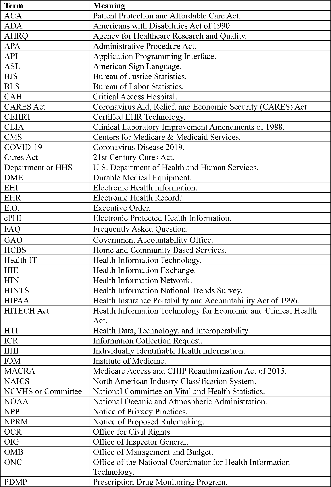
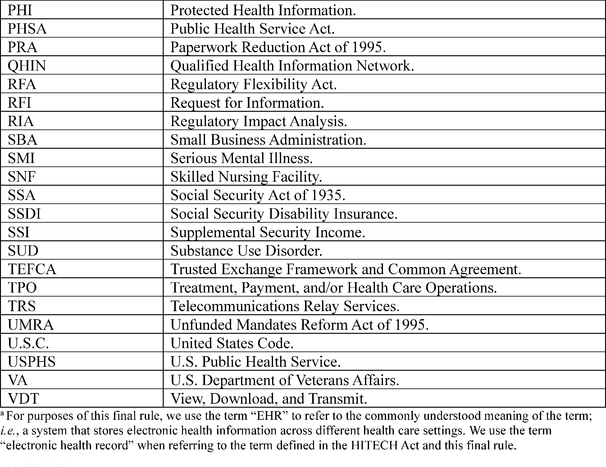
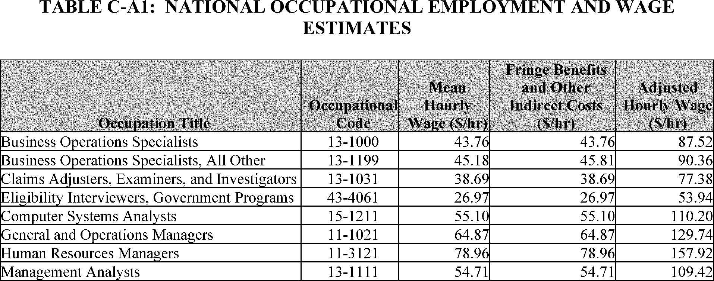
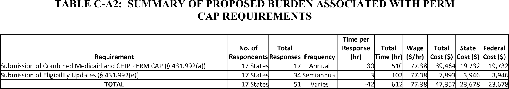
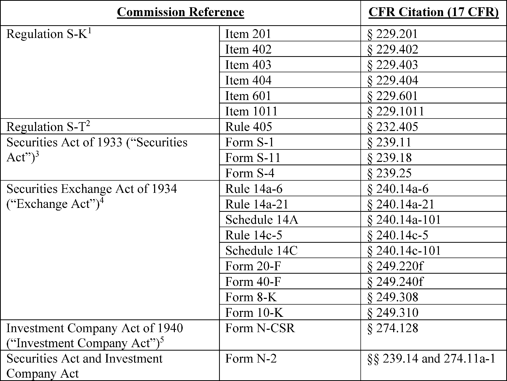
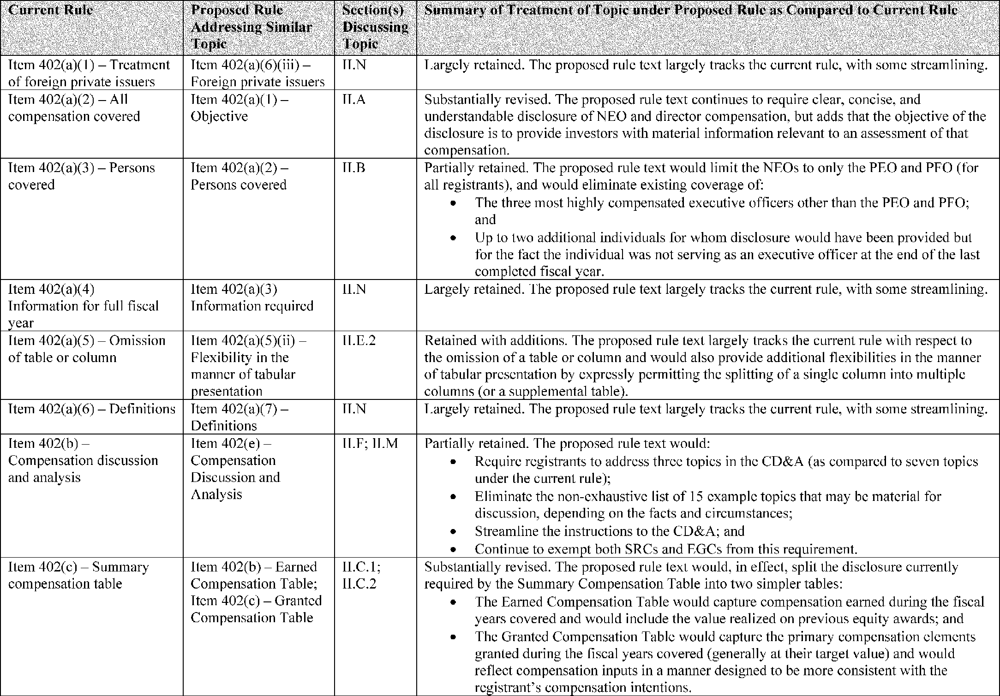

# Daily Digest — 2026-11-19

| | |
|---|---|
| **Digest date** | 2026-11-19 |
| **Data date range** | 2026-11-19 to 2026-11-19 |
| **Generated at** | 2026-11-20T05:02:54Z (UTC) |
| **Pipeline version** | a7509a61 |
| **Inference** | model layers ran — cli/haiku, opus |
| **Source watermarks** | CREC: 2026-11-19T15:50:11Z · BILLS: 2026-11-19T10:24:05Z · FR: 2026-11-19T22:56:52Z · USCOURTS: 2026-11-20T04:02:48Z · PLAW: 2026-11-18T16:47:20Z |

[Full observed listing for this day](day/2026-11-19.html) — the items our collectors observed for this publication day, mechanical rules applied, frozen at end of day; releases their publishers date on other days are counted there, not listed. This digest is the canonical record.

All items below cite the govinfo package (and granule, where applicable) they
summarize. Selection is mechanical; each item states the rule that included
it. See the Coverage Statement at the end for a full accounting of what was
published, what was summarized, and what was excluded and why.

---

## Contents

- [Day in Review](#day-in-review)
- [1. Congressional Floor Activity](#1-congressional-floor-activity)
- [2. Legislation](#2-legislation)
- [3. Federal Register](#3-federal-register)
- [4. Enacted Laws](#4-enacted-laws)
- [5. Judicial Activity](#5-judicial-activity)
- [6. Agency Announcements](#6-agency-announcements)
- [7. Recorded Votes](#7-recorded-votes)
- [8. Bill Actions](#8-bill-actions)
- [9. Presidential Actions](#9-presidential-actions)
- [Terms Used Today](#terms-used-today)
- [Coverage Statement](#coverage-statement)
- [Methodology](#methodology)

---

## Day in Review

The digest carries three recorded roll-call votes. The House voted 396-14 under suspension of the rules to pass H.R. 9640, reauthorizing the Earth Mapping Resources Initiative. Suspension motions were also made on H.R. 5490, the Dismantle Foreign Scam Syndicates Act, and H.R. 7934, the Settlement Agreement Information Database Act of 2026. The Intelligence Authorization Act for Fiscal Year 2027 was reported with an amendment. The Senate resumed consideration of H.R. 2347, the Survivor Justice Tax Prevention Act, with amendments pending. It also received S. 5767, the Student Loan Borrower Bill of Rights, and executive reports on seven ambassadorial nominations.

The digest carries 11 rules and nine proposed rules. HHS issued a final rule modifying the HIPAA Privacy Rule. Commerce issued an interim final rule establishing restrictions on exports to overseas data centers that provide remote access to advanced semiconductors. Proposed rules include CMS program integrity revisions across Medicare, Medicaid, CHIP and the Marketplace, SEC amendments to executive compensation disclosure, FinCEN customer due diligence changes under Executive Order 14406, and several FAA airworthiness directives.

The digest carries 51 appellate opinions and 795 district court opinions. The Fourth Circuit affirmed a District of Maryland judgment in KalshiEX v. Martin, concerning whether the Commodity Exchange Act displaces Maryland gaming law for sports event contracts. In a separate case, it held that the Tax Court's 90-day petition deadline is not jurisdictional. In opinions dated November 18, 2026, the Fifth Circuit vacated FDA marketing denial orders for five e-cigarette companies and remanded. The Seventh Circuit reversed dismissal of challenges to an Illinois law requiring charitable organizations to post demographic disclosures.

*Composed from the summarized items below and the day's mechanical
counts; all specifics are cited in their sections.*

---

## 1. Congressional Floor Activity

Source: Congressional Record (CREC), issue observed 2026-11-19, covering proceedings of 2026-11-18. Published by govinfo 2026-11-19T13:23:06Z; observed by our collector 2026-11-19T13:29:05Z. Total issue size: 151 granule(s).

### 1.1 Senate

Tags: legislative · model keys: ambassadorial nominations · student loan borrowers · survivor justice tax

*In plain terms: Six Senate items, led by the introduction of S. 5767, the Student Loan Borrower Bill of Rights, plus ambassadorial nomination reports and amendments to H.R. 2347.*

- **Legislative Session** — The Senate resumed consideration of H.R. 2347, the Survivor Justice Tax Prevention Act, which would amend the Internal Revenue Code of 1986 to exclude from gross income damages other than punitive damages received on account of sexual acts or sexual contact, with several Thune amendments pending. Senator Grassley stated that a Department of Labor inspector general report released September 4 corroborated allegations of misconduct against a former Secretary of Labor and senior staff, and he cited a November 10 letter to the President requesting full declassification of Crossfire Hurricane records. Senator Barrasso urged passage of Senate permitting reform legislation, and Senator Schumer addressed recent outages affecting air traffic, banks, federal software, and a classified NSA network.
  - *In plain terms:* The Senate resumed consideration of H.R. 2347, the Survivor Justice Tax Prevention Act, which would exclude from gross income damages other than punitive damages received for sexual acts or sexual contact.
  - Included because: CREC-SEL-01 — floor item ≥ threshold floor time (210,791 characters) (document dated 2026-11-18)
  - Source: [CREC-2026-11-18 / CREC-2026-11-18-pt1-PgS5729-6](https://www.govinfo.gov/app/details/CREC-2026-11-18/CREC-2026-11-18-pt1-PgS5729-6)
- **Executive Reports of Committees** — Senator Risch, for the Committee on Foreign Relations, submitted executive reports on ambassadorial nominations, including Mark Abreu for El Salvador, William Grayson for Indonesia, Douglas Holder for Bulgaria, Ronald Johnson for Bosnia and Herzegovina, Paul Kalmbach for Paraguay, Peter McCoy for Montenegro, and Nathaniel Morris for Colombia. Each report includes the nominee's disclosure of political contributions made by the nominee and immediate family members. The reports are printed in the Record as submitted.
  - *In plain terms:* Senator Risch, for the Foreign Relations Committee, submitted nomination reports for ambassador nominees to El Salvador, Indonesia, Bulgaria, Bosnia and Herzegovina, Paraguay, Montenegro, and Colombia, each including political contribution disclosures.
  - Included because: CREC-SEL-01 — floor item ≥ threshold floor time (33,125 characters) (document dated 2026-11-18)
  - Source: [CREC-2026-11-18 / CREC-2026-11-18-pt1-PgS5756-6](https://www.govinfo.gov/app/details/CREC-2026-11-18/CREC-2026-11-18-pt1-PgS5756-6)
- **Statements on Introduced Bills and Joint Resolutions** — Senator Durbin, with cosponsors, introduced S. 5767, the Student Loan Borrower Bill of Rights, which was referred to the Committee on Health, Education, Labor, and Pensions, and its text was ordered printed in the Record. The bill would amend the Higher Education Act of 1965 to require lender and servicer statements about servicemember and veteran benefits and repayment specialist contacts, to allow prepayment of student loans without penalty with specified rules for applying prepayments, and to require contracted servicers to respond to and share consumer complaints. It would also bar contracted entities from marketing financial products to borrowers using data or contact obtained through the contract and direct a review of legacy servicing contracts within 180 days after enactment.
  - *In plain terms:* Senator Durbin, with cosponsors, introduced S. 5767, the Student Loan Borrower Bill of Rights, which would allow penalty-free prepayment of student loans and direct review of legacy servicing contracts within 180 days after enactment.
  - Included because: CREC-SEL-01 — floor item ≥ threshold floor time (114,645 characters) (document dated 2026-11-18)
  - Source: [CREC-2026-11-18 / CREC-2026-11-18-pt1-PgS5761](https://www.govinfo.gov/app/details/CREC-2026-11-18/CREC-2026-11-18-pt1-PgS5761)
- **Introductory Statement on S. 5767** — This block reprints the text of S. 5767, the Student Loan Borrower Bill of Rights, introduced by Senator Durbin with cosponsors and referred to the Committee on Health, Education, Labor, and Pensions. The printed text amends sections 433, 455, and 456 of the Higher Education Act of 1965 to address borrower statements, prepayment and payment allocation, Consumer Financial Protection Act applicability for contracted servicers, complaint handling, and limits on marketing. It also sets a 180-day deadline for the Secretary to review legacy student loan servicing contracts.
  - *In plain terms:* Printed text of S. 5767, the Student Loan Borrower Bill of Rights, amends Higher Education Act sections 433, 455, and 456 and sets a 180-day deadline for the Secretary to review legacy servicing contracts.
  - Included because: CREC-SEL-01 — floor item ≥ threshold floor time (114,581 characters) (document dated 2026-11-18)
  - Source: [CREC-2026-11-18 / CREC-2026-11-18-pt1-PgS5761-2](https://www.govinfo.gov/app/details/CREC-2026-11-18/CREC-2026-11-18-pt1-PgS5761-2)
- **Text of Amendments** — Mr. Bennet submitted amendment SA 7024 to H.R. 2347, proposing to replace pages 449 through 494 of the bill with new text on tribal programs and related definitions. The text adds Section 302707 to chapter 3027 of title 54, United States Code, which requires the governing body of an Indian tribe to give express written consent before the Secretary may perform functions of a tribal preservation officer, provides for technical assistance and oversight, and sets audit and due-process requirements, including at least two years to cure a covered deficiency, before funds may be withheld. The text also amends section 306108 of title 54 to define terms such as adverse effect of the undertaking, area of potential effects, and undertaking, and the amendment was ordered to lie on the table.
  - *In plain terms:* Mr. Bennet submitted amendment SA 7024 to H.R. 2347, proposing to replace pages 449 through 494 with new tribal program text requiring an Indian tribe's written consent before the Secretary may perform tribal preservation officer functions.
  - Included because: CREC-SEL-01 — floor item ≥ threshold floor time (67,589 characters) (document dated 2026-11-18)
  - Source: [CREC-2026-11-18 / CREC-2026-11-18-pt1-PgS5771-2](https://www.govinfo.gov/app/details/CREC-2026-11-18/CREC-2026-11-18-pt1-PgS5771-2)
- **Text of Senate Amendment 7024** — Mr. Bennet submitted amendment SA 7024 to H.R. 2347, proposing to replace pages 449 through 494 of the bill with new text on tribal programs and related definitions. The text adds Section 302707 to chapter 3027 of title 54, United States Code, which requires the governing body of an Indian tribe to give express written consent before the Secretary may perform functions of a tribal preservation officer, provides for technical assistance and oversight, and sets audit and due-process requirements, including at least two years to cure a covered deficiency, before funds may be withheld. The text also amends section 306108 of title 54 to define terms such as adverse effect of the undertaking, area of potential effects, and undertaking, and the amendment was ordered to lie on the table.
  - *In plain terms:* Mr. Bennet's amendment SA 7024 to H.R. 2347 would set audit and due-process rules, including at least two years to cure a covered deficiency before funds may be withheld, and it was ordered to lie on the table.
  - Included because: CREC-SEL-01 — floor item ≥ threshold floor time (50,553 characters) (document dated 2026-11-18)
  - Source: [CREC-2026-11-18 / CREC-2026-11-18-pt1-PgS5771-3](https://www.govinfo.gov/app/details/CREC-2026-11-18/CREC-2026-11-18-pt1-PgS5771-3)

### 1.2 House of Representatives

Tags: legislative · model keys: foreign scam syndicates · health savings act · special order speeches

*In plain terms: Seven House items, led by H.R. 5490 on foreign scam syndicates; the rest are a few bills and several special order speeches.*

- **Dismantle Foreign Scam Syndicates Act** — Representative Mast moved to suspend the rules and pass H.R. 5490, the "Dismantle Foreign Scam Syndicates Act," as amended, and the bill text is reproduced. The bill's findings describe "pig butchering" investment scams and scam compounds in Burma, Laos, and Cambodia, and it directs the President to establish within 30 days an interagency Task Force chaired by the Secretary of State to develop a comprehensive U.S. Government strategy within 240 days and to submit annual reports for five years. The Task Force would terminate five years after enactment, and the text provided is truncated before its final provisions.
  - *In plain terms:* H.R. 5490, the Dismantle Foreign Scam Syndicates Act, directs the President to set up within 30 days a State-chaired interagency Task Force to develop a strategy against 'pig butchering' scams within 240 days.
  - Included because: CREC-SEL-01 — floor item ≥ threshold floor time (41,038 characters) (document dated 2026-11-18)
  - Source: [CREC-2026-11-18 / CREC-2026-11-18-pt1-PgH6262-5](https://www.govinfo.gov/app/details/CREC-2026-11-18/CREC-2026-11-18-pt1-PgH6262-5)
- **Preventive Health Savings Act** — H.R. 4464, the "Preventive Health Savings Act," would add a new subsection (h) to section 202 of the Congressional Budget and Impoundment Control Act of 1974. Upon request by the designated congressional leaders, the CBO Director would determine whether proposed legislation yields net reductions in budget outlays in budgetary outyears through preventive health care, defined as two consecutive 10-year periods beginning 10 years after the current fiscal year, and any such estimate would be supplementary and not used for budgetary enforcement controls. During floor debate under suspension, Representatives Arrington and Boyle described the bill as allowing analysis beyond the standard 10-year scoring window for health-related savings.
  - *In plain terms:* H.R. 4464 would let congressional leaders ask the CBO Director whether bills reduce outlays through preventive health care over two 10-year periods starting a decade out, with no budget-enforcement use.
  - Included because: CREC-SEL-01 — floor item ≥ threshold floor time (33,414 characters) (document dated 2026-11-18)
  - Source: [CREC-2026-11-18 / CREC-2026-11-18-pt1-PgH6266](https://www.govinfo.gov/app/details/CREC-2026-11-18/CREC-2026-11-18-pt1-PgH6266)
- **Settlement Agreement Information Database Act of 2026** — Representative Palmer moved to suspend the rules and pass H.R. 7934, the "Settlement Agreement Information Database Act of 2026," which would add section 307 to subchapter I of chapter 3 of title 5, United States Code. The section requires agencies to establish and maintain public online databases of covered settlement agreements within two years of enactment, with covered agreements including those requiring at least $10,000,000 in explicitly obligated payments, those involving a special master or monitor, and those involving a non-Federal government party, subject to listed exemptions. The bill also directs the Director of the Office of Management and Budget, in coordination with the Attorney General, to issue implementing guidance and requires agencies to submit annual reports on covered agreements not publicly disclosed.
  - *In plain terms:* H.R. 7934 would require agencies to publish online databases of covered settlements, including those requiring at least $10,000,000 in payments, within two years of enactment.
  - Included because: CREC-SEL-01 — floor item ≥ threshold floor time (22,237 characters) (document dated 2026-11-18)
  - Source: [CREC-2026-11-18 / CREC-2026-11-18-pt1-PgH6270](https://www.govinfo.gov/app/details/CREC-2026-11-18/CREC-2026-11-18-pt1-PgH6270)
- **Departing Members of Congress** — During a Special Order designated under the Speaker's announced policy of January 3, 2025, Representative Gallagher of California, as designee of the majority leader, dedicated the time to departing Members of Congress. Representative Barrett of Michigan delivered farewell remarks thanking his constituents, family, and staff and described constituent cases he stated he was involved in resolving. Representative Bean of Florida honored Principal Vincent Hall of William Raines High School in Jacksonville and offered Thanksgiving remarks, and Representative Carter of Georgia recognized Melania Escobar, Alix Baptiste, Jr., and Joe Higgins.
  - *In plain terms:* Under a Special Order set by the Speaker's January 3, 2025 policy, Representative Gallagher of California, designated by the majority leader, dedicated the time to departing Members of Congress.
  - Included because: CREC-SEL-01 — floor item ≥ threshold floor time (18,498 characters) (document dated 2026-11-18)
  - Source: [CREC-2026-11-18 / CREC-2026-11-18-pt1-PgH6274](https://www.govinfo.gov/app/details/CREC-2026-11-18/CREC-2026-11-18-pt1-PgH6274)
- **Affordable Healthcare** — During a Special Order designated under the Speaker's announced policy of January 3, 2025, Representative DeSaulnier of California, as designee of the minority leader, addressed the health care system and referred to the law enacted as H.R. 1 as the "big, ugly bill." Representative Takano of California stated that ACA marketplace premiums rose by over 97 percent in California in 2026 and that Medicaid work requirements are projected to remove up to 10 million people from coverage in 2028. Representative Schrier of Washington stated that the United States had lost its measles elimination status and discussed the effects of health care policy on the system.
  - *In plain terms:* In a minority-designated Special Order, Representatives DeSaulnier, Takano, and Schrier addressed health care, with Takano stating ACA marketplace premiums rose over 97 percent in California in 2026.
  - Included because: CREC-SEL-01 — floor item ≥ threshold floor time (48,594 characters) (document dated 2026-11-18)
  - Source: [CREC-2026-11-18 / CREC-2026-11-18-pt1-PgH6277](https://www.govinfo.gov/app/details/CREC-2026-11-18/CREC-2026-11-18-pt1-PgH6277)
- **My Life Story** — Representative Spartz of Indiana delivered a Special Order speech titled 'My Life Story' describing her upbringing in Soviet-era Ukraine, her family history, and her move to the United States. The speech recounted her early work as a bank teller, her training and career as a certified public accountant in public accounting, and her later involvement with the Tea Party movement that preceded her service in Congress. It also thanked her family and the constituents of Indiana's Fifth District.
  - *In plain terms:* In a Special Order speech titled 'My Life Story,' Representative Spartz of Indiana described growing up in Soviet-era Ukraine, moving to the United States, and her career as a certified public accountant.
  - Included because: CREC-SEL-01 — floor item ≥ threshold floor time (27,997 characters) (document dated 2026-11-18)
  - Source: [CREC-2026-11-18 / CREC-2026-11-18-pt1-PgH6283-2](https://www.govinfo.gov/app/details/CREC-2026-11-18/CREC-2026-11-18-pt1-PgH6283-2)
- **I Came to Work** — Representative Blair of Georgia delivered a Special Order speech titled 'I Came to Work' that addressed the Democratic caucus's naming of Hakeem Jeffries as Speaker-designate and the House's September 2025 schedule. The speech described constituent-service, townhall, and voter-outreach activities in Georgia's 13th District and listed legislative priorities including an increased minimum wage, single-payer health care, campaign finance changes, and an end to gerrymandering. It also stated that Members must show up for votes and urged passage of a continuing resolution to avoid a government shutdown.
  - *In plain terms:* In a Special Order speech titled 'I Came to Work,' Representative Blair of Georgia described constituent work, listed priorities including a higher minimum wage and single-payer health care, and urged passage of a stopgap funding bill.
  - Included because: CREC-SEL-01 — floor item ≥ threshold floor time (16,811 characters) (document dated 2026-11-18)
  - Source: [CREC-2026-11-18 / CREC-2026-11-18-pt1-PgH6286](https://www.govinfo.gov/app/details/CREC-2026-11-18/CREC-2026-11-18-pt1-PgH6286)

### 1.3 Recorded Votes

- **Earth Mri Reauthorization Act of 2026** — On November 18, 2026, the House voted 396-14, with 23 Members not voting, under suspension of the rules to pass H.R. 9640, as amended, a bill to amend the Infrastructure Investment and Jobs Act to reauthorize the Earth Mapping Resources Initiative and for other purposes. Representative Westerman of Arkansas moved the motion. The record also includes the vote-change entries and statements from Members who were absent and would have voted yea on Roll Call No. 326.
  - *In plain terms:* On November 18, 2026, the House passed H.R. 9640, as amended, 396-14 with 23 Members not voting, to renew the authorization of the Earth Mapping Resources Initiative in the Infrastructure Investment and Jobs Act.
  - Included because: CREC-SEL-02 — recorded vote (all recorded votes are listed) (document dated 2026-11-18)
  - Source: [CREC-2026-11-18 / CREC-2026-11-18-pt1-PgH6261-6](https://www.govinfo.gov/app/details/CREC-2026-11-18/CREC-2026-11-18-pt1-PgH6261-6)

---

## 2. Legislation

Source: Congressional Bills (BILLS), text versions published 2026-11-19 to 2026-11-19.

### 2.1 Counts by Stage

| Stage (bill text version) | Count |
|---|---|
| Introduced (ih/is) | 7 |
| Reported (rh/rs) | 1 |
| Engrossed (eh/es) | 0 |
| Enrolled (enr) | 0 |
| Other versions | 0 |
| **Total bill texts published** | **8** |

### 2.2 Bills Listed by Mechanical Rule

Tags: legislative · model keys: fiscal year 2027 · house bill · intelligence authorization act

*In plain terms: One bill is listed: H.R. 9624, the Intelligence Authorization Act for Fiscal Year 2027, introduced July 9, 2026 and reported with an amendment on November 18, 2026.*

Bills below are listed because they matched at least one listing rule; the
matching rule is stated per item. All other bill texts are counted above and
accounted for in the Coverage Statement.

- **H. R. 9624 (rh) — 117 HR 9624 RH: Intelligence Authorization Act for Fiscal Year 2027** — H.R. 9624, the Intelligence Authorization Act for Fiscal Year 2027, was introduced in the House on July 9, 2026, by Mr. Crawford, referred to the Permanent Select Committee on Intelligence, and reported with an amendment on November 18, 2026 (Report No. 119–886). The bill would authorize fiscal year 2027 appropriations for intelligence and intelligence-related activities, the Intelligence Community Management Account, and the Central Intelligence Agency Retirement and Disability System. Its table of contents lists provisions on intelligence community matters, budget and inspectors general, Office of the Director of National Intelligence and Central Intelligence Agency items, Department of Defense and overhead architecture, the Federal Bureau of Investigation, the Department of Homeland Security, and reports; the provided excerpt is truncated before the full text.
  - *In plain terms:* H.R. 9624, the Intelligence Authorization Act for Fiscal Year 2027, was introduced July 9, 2026, and sent out of committee with an amendment November 18, 2026, to authorize fiscal 2027 funding for intelligence activities.
  - Included because: BILLS-SEL-01 — reached stage: reported/enrolled/calendar (document dated 2026-11-18)
  - Source: [BILLS-119hr9624rh](https://www.govinfo.gov/app/details/BILLS-119hr9624rh)

---

## 3. Federal Register

Source: Federal Register (FR), issue of 2026-11-19.

### 3.1 Counts by Document Type

| Document type | Count |
|---|---|
| Rules | 11 |
| Proposed rules | 9 |
| Notices | 78 |
| Presidential documents | 0 |
| **Total FR documents** | **98** |

### 3.2 Rules Published

Tags: department of health and human services · executive · securities and exchange commission · model keys: air quality plans · hipaa privacy rule · semiconductor remote access

*In plain terms: Eleven rules, led by a HIPAA Privacy Rule update and a Commerce rule on remote access to advanced semiconductors; the rest cover safety zones, air plans, and aviation directives.*

#### DEPARTMENT OF COMMERCE

- **Addressing Remote Access to Advanced Semiconductors** (2026-23529; 15 CFR Parts 732, 734, 740, 742, 743, 744, 748, 762, 772, and 774) — In this interim final rule (IFR), the Department of Commerce is establishing new rules to prevent certain foreign actors from leveraging advanced computing power based on U.S. technology to threaten U.S. national security and foreign policy interests. First, this rule establishes new restrictions which will apply for exports, reexports, or transfers (in-country) to overseas data centers that remotely supply significant volumes of compute to companies headquartered in Country Group D:5 or Macau. These restrictions will undermine the ability of companies headquartered in countries of concern from using U.S. advanced Super Intelligence (SI) semiconductors to train advanced SI models. Data centers, foreign foundries, and chip exporters are required to perform robust due diligence on their customers, including any direct or indirect ownership or control by persons in Country Group D:5 or Macau, as part of complying with this new control. The license requirement will not apply to commercial recommender systems, such as those used by online retailers or social media companies, as these functions do not pose the same national security threat. \[official summary truncated; see source\] Action: Interim final rule. Dates: Effective date: This rule is effective November 19, 2026. Comment due date: Comments on the revisions and additions in this rule must be received by BIS no later than January 19, 2027.
  - *In plain terms:* Commerce's rule, effective now while comments are still accepted, restricts exports and transfers to overseas data centers supplying significant computing volumes to companies headquartered in Country Group D:5 or Macau (summary truncated).
  - Included because: FR-SEL-01 — document type: final rule (all listed)
  - Source: [FR-2026-11-19 / 2026-23529](https://www.govinfo.gov/app/details/FR-2026-11-19/2026-23529)

#### DEPARTMENT OF HEALTH AND HUMAN SERVICES

- **HIPAA Privacy Rule: Changes To Support Coordinated Care and Individual Engagement and Reduce Regulatory Burdens** (2026-23429; 45 CFR Parts 160 and 164) — The Department of Health and Human Services (HHS or “Department”) is issuing this final rule to modify the Standards for Privacy of Individually Identifiable Health Information (“Privacy Rule”) under the Health Insurance Portability and Accountability Act of 1996 (HIPAA) and the Health Information Technology for Economic and Clinical Health (HITECH) Act. These modifications address standards that may impede the nationwide transition to value-based health care by limiting or discouraging individual access or care coordination and case management or posing other unnecessary burdens. The modifications in this final rule promote the essential sharing of individuals' protected health information (PHI) for care coordination and individual engagement while continuing to protect its privacy and security. Action: Final rule. Dates: Effective dates: The final rule is effective on January 19, 2027. Compliance date: Persons subject to this regulation must comply with the applicable requirements of this final rule by July 19, 2027.
  - *In plain terms:* HHS is finalizing changes to the HIPAA Privacy Rule to promote sharing of individuals' health information for care coordination and individual engagement, reduce unnecessary burdens, and continue protecting privacy and security.
  - Included because: FR-SEL-01 — document type: final rule (all listed)
  - Source: [FR-2026-11-19 / 2026-23429](https://www.govinfo.gov/app/details/FR-2026-11-19/2026-23429)
  -  *Source graphic 1 of 25 from 2026-23429.*
  -  *Source graphic 2 of 25 from 2026-23429.*
  - *Graphics not rendered here: 23 of 25 — see the [source PDF](https://www.govinfo.gov/content/pkg/FR-2026-11-19/pdf/FR-2026-11-19.pdf).*
- **Health and Human Services Acquisition Regulations; Correction** (2026-23617; 48 CFR Part 332) — This document corrects technical and typographical errors in the final rule that appeared in the Federal Register on November 18, 2015, titled “Health and Human Services Acquisition Regulations.” Action: Correcting amendment. Dates: Effective November 19, 2026.
  - *In plain terms:* HHS is correcting technical and typographical errors in its November 18, 2015 final rule titled 'Health and Human Services Acquisition Regulations.'
  - Included because: FR-SEL-01 — document type: final rule (all listed)
  - Source: [FR-2026-11-19 / 2026-23617](https://www.govinfo.gov/app/details/FR-2026-11-19/2026-23617)

#### DEPARTMENT OF HOMELAND SECURITY

- **Safety Zone; Hackensack River, Kearny and Secaucus, NJ** (2026-23567; 33 CFR Part 165) — The Coast Guard is establishing a temporary safety zone for navigable waters on the Hackensack River, in Kearny and Secaucus, NJ. The safety zone is needed to protect personnel, vessels, and the marine environment from potential hazards associated with the demolition of the existing Portal Bridge. When subject to enforcement, entry of vessels or persons into this zone is prohibited unless specifically authorized by the Captain of the Port, Sector New York, or their designated representative. Action: Temporary interim rule and request for comments. Dates: Effective date: This rule is effective without actual notice from 6 a.m. November 19, 2026 through 11:59 p.m. on May 27, 2027. For purposes of enforcement the Coast Guard will use actual notice from 6 a.m. on November 17, 2026, through 6 a.m. November 19, 2026 The Coast Guard will only enforce this temporary safety zone during periods during which barges are within the channels at the existing bridge and demolition operations are in progress. Comments due date: Comments and related material must be received by the Coast Guard on or before December 21, 2026.
  - *In plain terms:* The Coast Guard is establishing a temporary safety zone on the Hackensack River in Kearny and Secaucus, NJ, to protect people and vessels during Portal Bridge demolition, barring entry unless the Captain of the Port authorizes it.
  - Included because: FR-SEL-01 — document type: final rule (all listed)
  - Source: [FR-2026-11-19 / 2026-23567](https://www.govinfo.gov/app/details/FR-2026-11-19/2026-23567)
- **Safety Zones; Annual Events Requiring Safety Zones in the Captain of the Port Lake Michigan Zone—Magnificent Mile Fireworks Display** (2026-23568; 33 CFR Part 165) — The Coast Guard will enforce a safety zone for the Magnificent Mile Fireworks Display on November 21, 2026, to provide for the safety of life on navigable waterways during this fireworks display. Our regulation for marine events within the Great Lakes Coast Guard District identifies the safety zone for this event in Chicago, IL. During the enforcement period, entry into, transiting, or remaining within the safety zone is prohibited unless authorized by the Captain of the Port (COTP) Lake Michigan or his or her designated representative. Action: Notification of enforcement of regulation. Dates: The regulations in 33 CFR 165.929 will be enforced for the Magnificent Mile Fireworks Display regulated area listed in Event 20 in Table 1 to § 165.929, from 6:55 p.m. until 7:05 p.m. on November 21, 2026.
  - *In plain terms:* The Coast Guard will enforce a safety zone for the Magnificent Mile Fireworks Display in Chicago, IL, on November 21, 2026, prohibiting entry unless authorized by the Captain of the Port Lake Michigan.
  - Included because: FR-SEL-01 — document type: final rule (all listed)
  - Source: [FR-2026-11-19 / 2026-23568](https://www.govinfo.gov/app/details/FR-2026-11-19/2026-23568)

#### DEPARTMENT OF THE INTERIOR

- **Mammoth Cave National Park; Bicycling and Horses** (2026-23563; 36 CFR Part 7) — The National Park Service (NPS) amends the special regulations for Mammoth Cave National Park to allow bicycle use on approximately 37 miles of multi-use trails throughout the park. This rule also will allow visitors to ride horses on the 5.4-mile Houchin Ferry North/Ollie Road. Action: Final rule. Dates: This rule is effective December 21, 2026.
  - *In plain terms:* The National Park Service is amending special regulations for Mammoth Cave National Park to allow bicycle use on about 37 miles of multi-use trails and to allow horse riding on the 5.4-mile Houchin Ferry North/Ollie Road.
  - Included because: FR-SEL-01 — document type: final rule (all listed)
  - Source: [FR-2026-11-19 / 2026-23563](https://www.govinfo.gov/app/details/FR-2026-11-19/2026-23563)

#### DEPARTMENT OF TRANSPORTATION

- **Airworthiness Directives; General Atomics AeroTec Systems GmbH (Type Certificate Previously Held by RUAG Aerospace Services GmbH) Airplanes** (2026-23633; 14 CFR Part 39) — The FAA is adopting a new airworthiness directive (AD) for all General Atomics AeroTec Systems GmbH (General Atomics) Model Dornier 228-100, Dornier 228-101, Dornier 228-200, Dornier 228-201, Dornier 228-202, and Dornier 228-212 airplanes. This AD was prompted by reports of specific part-numbered hydraulic pump motors becoming severely damaged by excessive heat. This AD requires replacing the affected hydraulic pump motor with an improved design hydraulic pump motor. This AD also prohibits installing an affected hydraulic pump motor on any airplane. The FAA is issuing this AD to address the unsafe condition on these products. Action: Final rule. Dates: This AD is effective December 24, 2026.
  - *In plain terms:* The FAA is adopting an airworthiness directive for certain Dornier 228 airplanes, requiring replacement of hydraulic pump motors reported severely damaged by excessive heat with an improved design and barring installation of affected motors.
  - Included because: FR-SEL-01 — document type: final rule (all listed)
  - Source: [FR-2026-11-19 / 2026-23633](https://www.govinfo.gov/app/details/FR-2026-11-19/2026-23633)

#### ENVIRONMENTAL PROTECTION AGENCY

- **Air Plan Revisions; California; San Joaquin Valley Unified Air Pollution Control District; New Source Review; Stationary Source Permits** (2026-23572; 40 CFR Part 52) — The Environmental Protection Agency (EPA) is finalizing a limited approval and limited disapproval of three permitting rules as a revision to the San Joaquin Valley Unified Air Pollution Control District (SJVUAPCD or “District”) portion of the California State Implementation Plan (SIP). These are revisions to the District's New Source Review (NSR) air permitting program rules for new and modified sources of air pollution under Clean Air Act (CAA or “Act”) section 110(a)(2)(C) and part D of title I. Action: Final rule. Dates: This rule is effective on December 21, 2026.
  - *In plain terms:* EPA is finalizing limited approval and limited disapproval of three San Joaquin Valley air district new source permitting rules as part of California's state air plan, approving them with limits and disapproving certain parts.
  - Included because: FR-SEL-01 — document type: final rule (all listed)
  - Source: [FR-2026-11-19 / 2026-23572](https://www.govinfo.gov/app/details/FR-2026-11-19/2026-23572)
- **Approval and Promulgation of State Air Quality Plans for Designated Facilities and Pollutants; Texas; Control of Emissions From Existing Municipal Solid Waste Landfills** (2026-23580; 40 CFR Part 62) — Pursuant to the Federal Clean Air Act (CAA or the Act), the Environmental Protection Agency (EPA) is approving the CAA section 111(d) State plan submitted by the State of Texas for sources subject to the Municipal Solid Waste (MSW) Landfills Emission Guidelines (EG). The Texas MSW landfills plan was submitted to fulfill the State's obligations under CAA section 111(d) to implement and enforce the requirements under the MSW Landfills EG. The EPA is approving the State plan and amending the agency regulations in accordance with the requirements of the CAA. Action: Final rule. Dates: This rule is effective on December 21, 2026. The incorporation by reference of certain material listed in this rule is approved by the Director of the Federal Register as of December 21, 2026.
  - *In plain terms:* EPA is approving Texas's Clean Air Act section 111(d) state plan implementing the Municipal Solid Waste Landfills Emission Guidelines for existing landfills and amending agency regulations accordingly.
  - Included because: FR-SEL-01 — document type: final rule (all listed)
  - Source: [FR-2026-11-19 / 2026-23580](https://www.govinfo.gov/app/details/FR-2026-11-19/2026-23580)
- **Air Plan Approval; Reasonably Available Control Technology (RACT) for Volatile Organic Compounds (VOC) Control Technique Guidelines (CTG) Under the 2008 and 2015 Ozone National Ambient Air Quality Standards (NAAQS)** (2026-23583; 40 CFR Part 52) — The Environmental Protection Agency (EPA) is approving four State implementation plan (SIP) revisions submitted by the Commonwealth of Pennsylvania on May 10, 2023, January 20, 2026, February 17, 2026, and April 10, 2026, through the Pennsylvania Department of Environmental Protection (PADEP). The SIP revisions address reasonably available control technology (RACT) requirements for the 2008 and 2015 ozone national ambient air quality standards (NAAQS) relating to control technique guidelines (CTGs) for volatile organic compounds (VOC) via previously adopted CTG regulations, three new CTG regulations and permits for four facilities covered by the CTG for the Manufacture of High-Density Polyethylene, Polypropylene, and Polystyrene Resins respectively. The EPA is approving these revisions to the Pennsylvania SIP in accordance with the requirements of the Clean Air Act (CAA). Action: Final rule. Dates: This final rule is effective on December 21, 2026.
  - *In plain terms:* EPA is approving four Pennsylvania state air plan revisions, submitted May 10, 2023, and January 20, February 17, and April 10, 2026, on reasonably available control technology for volatile organic compounds under the 2008 and 2015 ozone standards.
  - Included because: FR-SEL-01 — document type: final rule (all listed)
  - Source: [FR-2026-11-19 / 2026-23583](https://www.govinfo.gov/app/details/FR-2026-11-19/2026-23583)

#### POSTAL SERVICE

- **Domestic Competitive Products Pricing and Mailing Standards Changes** (2026-23595; 39 CFR Part 111) — The Postal Service is amending Mailing Standards of the United States Postal Service, Domestic Mail Manual (DMM®), to reflect changes to prices and certain mailing standards changes scheduled for competitive products. Action: Final rule. Dates: Effective Date: January 17, 2027.
  - *In plain terms:* The Postal Service is amending the Domestic Mail Manual to reflect price changes and certain mailing standard changes for competitive products.
  - Included because: FR-SEL-01 — document type: final rule (all listed)
  - Source: [FR-2026-11-19 / 2026-23595](https://www.govinfo.gov/app/details/FR-2026-11-19/2026-23595)

### 3.3 Proposed Rules Published

Tags: department of health and human services · executive · securities and exchange commission · model keys: airworthiness directives · customer due diligence · executive compensation disclosure

*In plain terms: Nine proposed rules, led by SEC executive compensation disclosure changes and FinCEN customer due diligence requirements; the rest are mostly FAA airworthiness directives.*

#### DEPARTMENT OF HEALTH AND HUMAN SERVICES

- **Medicare, Medicaid, and Marketplace Programs; Comprehensive Regulations To Uncover Suspicious Healthcare (CRUSH)** (2026-23461; 42 CFR Parts 410, 417, 422, 423, 424, 431, 438, 447, 455, 457, 498) — This proposed rule would revise provisions regarding provider enrollment, medical review, investigations, and other program integrity oversight provisions to greatly strengthen our ability to crush fraud, enhance program integrity efforts across Medicare, Medicaid, Children's Health Insurance Program, and the Marketplace and maximize regulatory authorities to address inappropriate payments. Action: Proposed rule. Dates: To be assured consideration, comments must be received at one of the addresses provided below, by January 19, 2027.
  - *In plain terms:* The proposed rule 'CRUSH' would revise provisions on Medicare, Medicaid, CHIP, and Marketplace provider enrollment, medical review, investigations, and program integrity oversight to strengthen fraud prevention and address inappropriate payments.
  - Included because: FR-SEL-02 — document type: proposed rule (all listed)
  - Source: [FR-2026-11-19 / 2026-23461](https://www.govinfo.gov/app/details/FR-2026-11-19/2026-23461)
  -  *Source graphic 1 of 37 from 2026-23461.*
  -  *Source graphic 2 of 37 from 2026-23461.*
  - *Graphics not rendered here: 35 of 37 — see the [source PDF](https://www.govinfo.gov/content/pkg/FR-2026-11-19/pdf/FR-2026-11-19.pdf).*

#### DEPARTMENT OF THE TREASURY

- **Customer Due Diligence Requirements for Covered Financial Institutions** (2026-23614; 31 CFR Part 1010) — FinCEN is issuing this proposed rule to strengthen customer due diligence requirements under the Customer Due Diligence Rule consistent with the policy goals of, and as directed by, Executive Order 14406, Restoring Integrity to America's Financial System. Specifically, the proposal ensures financial institutions covered by the Customer Due Diligence Rule collect sufficient information to verify the identities of beneficial owners of legal entity customers and maintain the authority, where warranted, to obtain additional information, including information relevant to whether the beneficial owners of legal entity customers possess lawful immigration status and employment authorization in the United States when such information is relevant to assessing risks. Action: Proposed rule. Dates: Comments must be received by January 19, 2027.
  - *In plain terms:* FinCEN proposes strengthening customer due diligence rules, per Executive Order 14406, so covered institutions verify beneficial owners of legal entity customers and may seek immigration status and work authorization where relevant to risk.
  - Included because: FR-SEL-02 — document type: proposed rule (all listed)
  - Source: [FR-2026-11-19 / 2026-23614](https://www.govinfo.gov/app/details/FR-2026-11-19/2026-23614)

#### DEPARTMENT OF TRANSPORTATION

- **Airworthiness Directives; Airbus Helicopters** (2026-23569; 14 CFR Part 39) — The FAA proposes to supersede Airworthiness Directive (AD) 2026-12-08, which applies to all Airbus Helicopters Model AS350B2, AS350B3, EC130B4, and EC130T2 helicopters. AD 2026-12-08 requires revising the airworthiness limitations section (ALS) of the existing maintenance manual (MM) or instructions for continued airworthiness (ICA) and the existing approved maintenance or inspection program, as applicable. Since the FAA issued AD 2026-12-08, a determination was made that new and more restrictive airworthiness limitations and maintenance tasks are necessary. This proposed AD would require incorporating these airworthiness limitations and maintenance tasks into the ALS of the existing MM or ICA and the existing approved maintenance or inspection program, as applicable. The FAA is proposing this AD to address the unsafe condition on these products. Action: Notice of proposed rulemaking (NPRM). Dates: The FAA must receive comments on this NPRM by January 4, 2027.
  - *In plain terms:* The FAA proposes replacing Airworthiness Directive 2026-12-08 for Airbus Helicopters AS350B2, AS350B3, EC130B4, and EC130T2 helicopters, adding new and more restrictive airworthiness limitations and maintenance tasks to existing maintenance or inspection programs.
  - Included because: FR-SEL-02 — document type: proposed rule (all listed)
  - Source: [FR-2026-11-19 / 2026-23569](https://www.govinfo.gov/app/details/FR-2026-11-19/2026-23569)
- **Airworthiness Directives; Airbus Helicopters Deutschland GmbH (AHD) Helicopters** (2026-23576; 14 CFR Part 39) — The FAA proposes to adopt a new airworthiness directive (AD) for certain Airbus Helicopters Deutschland GmbH (AHD) Model EC135P1, EC135P2, EC135P2+, EC135P3, EC135T1, EC135T2, EC135T2+, EC135T3 and EC635T2+ helicopters. This proposed AD was prompted by a determination that the manufacturer's service material does not provide complete instructions for the inspections after a hard landing. This proposed AD would require a one-time inspection of the tail rotor control system and, depending on the inspection results, corrective actions. This proposed AD would also require revision of the existing aircraft maintenance manual (MM) or instructions for continued airworthiness (ICA) and the existing approved maintenance or inspection program, as applicable. The FAA is proposing this AD to address the unsafe condition on these products. Action: Notice of proposed rulemaking (NPRM). Dates: The FAA must receive comments on this NPRM by January 4, 2027.
  - *In plain terms:* The FAA proposes requiring a one-time tail rotor control system inspection, with corrective actions as needed, on certain Airbus Helicopters Deutschland EC135 and EC635T2+ models, because manufacturer service material lacks complete post-hard-landing inspection instructions.
  - Included because: FR-SEL-02 — document type: proposed rule (all listed)
  - Source: [FR-2026-11-19 / 2026-23576](https://www.govinfo.gov/app/details/FR-2026-11-19/2026-23576)
- **Airworthiness Directives; Dassault Aviation Airplanes** (2026-23579; 14 CFR Part 39) — The FAA proposes to supersede Airworthiness Directive (AD) 2024-14-09, which applies to certain Dassault Aviation Model FALCON 7X, FALCON 900EX, and FALCON 2000EX airplanes. AD 2024-14-09 requires replacement of certain titanium screws, adds other locations for screw replacement, and revises the applicability from AD 2022-02-10. Since the FAA issued AD 2024-14-09, affected parts have been found in other areas of certain FALCON 7X airplanes as well as in additional FALCON 7X airplanes. This proposed AD would continue to require the actions in AD 2024-14-09 and would require expanding the applicability to additional airplanes, expanding the locations for screw replacement, and revising the compliance times for parts replacement. This AD would also limit the installation of affected parts under certain conditions. The FAA is proposing this AD to address the unsafe condition on these products. Action: Notice of proposed rulemaking (NPRM). Dates: The FAA must receive comments on this proposed AD by January 4, 2027.
  - *In plain terms:* The FAA proposes replacing Airworthiness Directive 2024-14-09 for certain Dassault Falcon 7X, 900EX, and 2000EX airplanes, expanding titanium screw replacement to more airplanes and locations and limiting installation of affected parts.
  - Included because: FR-SEL-02 — document type: proposed rule (all listed)
  - Source: [FR-2026-11-19 / 2026-23579](https://www.govinfo.gov/app/details/FR-2026-11-19/2026-23579)
- **Airworthiness Directives; ATR—GIE Avions de Transport Régional Airplanes** (2026-23581; 14 CFR Part 39) — The FAA proposes to supersede Airworthiness Directive (AD) 2021-12-17, which applies to certain ATR—GIE Avions de Transport Régional Model ATR42-300, -320, and -500 airplanes; and all Model ATR72-101, -102, -201, -202, -211, -212, and -212A airplanes. AD 2021-12-17 requires a detailed visual inspection of each affected part for deficiencies (sealant blockage and out of tolerance ligaments), and depending on findings, accomplishment of applicable corrective actions. Since the FAA issued AD 2021-12-17, it was determined that additional seat track part numbers and airplanes may be affected. This proposed AD would continue to require the actions in AD 2021-12-17 and would require inspections of additional parts. This proposed AD would also limit the installation of affected parts. The FAA is proposing this AD to address the unsafe condition on these products. Action: Notice of proposed rulemaking (NPRM). Dates: The FAA must receive comments on this proposed AD by January 4, 2027.
  - *In plain terms:* The FAA proposes replacing Airworthiness Directive 2021-12-17 for certain ATR42 and ATR72 airplanes, keeping its visual inspections, adding inspections of additional seat track parts, and limiting installation of affected parts.
  - Included because: FR-SEL-02 — document type: proposed rule (all listed)
  - Source: [FR-2026-11-19 / 2026-23581](https://www.govinfo.gov/app/details/FR-2026-11-19/2026-23581)
- **Airworthiness Directives; Dassault Aviation Airplanes** (2026-23584; 14 CFR Part 39) — The FAA proposes to supersede Airworthiness Directive (AD) 2024-15-02, which applies to all Dassault Aviation Model MYSTERE-FALCON 900 airplanes. AD 2024-15-02 requires revising the existing maintenance or inspection program, as applicable, to incorporate new or more restrictive airworthiness limitations. Since the FAA issued AD 2024-15-02, the FAA has determined that new or more restrictive airworthiness limitations are necessary. This proposed AD would continue to require the actions in AD 2024-15-02 and would require revising the existing maintenance or inspection program, as applicable, to incorporate new or more restrictive airworthiness limitations. The FAA is proposing this AD to address the unsafe condition on these products. Action: Notice of proposed rulemaking (NPRM). Dates: The FAA must receive comments on this proposed AD by January 4, 2027.
  - *In plain terms:* The FAA proposes replacing Airworthiness Directive 2024-15-02 for all Dassault Aviation Mystere-Falcon 900 airplanes, requiring revised maintenance or inspection programs with new or more restrictive airworthiness limitations.
  - Included because: FR-SEL-02 — document type: proposed rule (all listed)
  - Source: [FR-2026-11-19 / 2026-23584](https://www.govinfo.gov/app/details/FR-2026-11-19/2026-23584)

#### DEPARTMENT OF VETERANS AFFAIRS

- **Veteran Readiness and Employment Program: Update to Reduced Work Tolerance and Basic Eligibility Period** (2026-23571; 38 CFR Part 21) — The Department of Veterans Affairs (VA) proposes to amend the Veteran Readiness and Employment (VR&E) regulations to align with current practice and statute. The rule would expand the list of approved providers for reduced work tolerance (RWT) documentation, allowing for more accurate and timely processing by a Vocational Rehabilitation Counselor (VRC). VA also proposes to clarify that a veteran who is subject to a basic period of eligibility would receive a new 12-year period of eligibility if such veteran obtains a compensable service-connected disability rating based on a subsequent period of active-duty service. Finally, the rule would remove the eligibility termination date for veterans discharged on or after January 1, 2013, consistent with the Johnny Isakson and David P. Roe, M.D. Veterans Health Care and Benefits Improvement Act of 2020. Action: Proposed rule. Dates: Comments must be received by January 19, 2027.
  - *In plain terms:* The VA proposes expanding who may provide reduced work tolerance documentation, granting a new 12-year eligibility period after a subsequent service-connected disability rating, and removing the termination date for veterans discharged on or after January 1, 2013.
  - Included because: FR-SEL-02 — document type: proposed rule (all listed)
  - Source: [FR-2026-11-19 / 2026-23571](https://www.govinfo.gov/app/details/FR-2026-11-19/2026-23571)

#### SECURITIES AND EXCHANGE COMMISSION

- **Executive Compensation Disclosure Reform** (2026-23555; 17 CFR Parts 229, 232, 239, 240, 249, and 274) — The Securities and Exchange Commission (“Commission”) is proposing amendments to its executive and director compensation disclosure rules to make the requirements more principles-based and to reduce compliance burdens for registrants, while maintaining the disclosure of material information to investors. The proposed amendments would focus the disclosures on the principal executive officer (“PEO”) and principal financial officer (“PFO”), streamline the tabular disclosure requirements, and simplify and rationalize various other aspects of the compensation disclosure rules, including the Compensation Discussion and Analysis (“CD&A”), pay ratio, pay-versus-performance, and perquisites disclosure requirements. Action: Proposed rule. Dates: This release was published in the Federal Register on November 19, 2026. Comments should be submitted on or before January 19, 2027.
  - *In plain terms:* The SEC proposes making executive compensation disclosure rules based on broad principles and less burdensome, focused on the principal executive officer (PEO) and principal financial officer (PFO) while still disclosing material information to investors.
  - Included because: FR-SEL-02 — document type: proposed rule (all listed)
  - Source: [FR-2026-11-19 / 2026-23555](https://www.govinfo.gov/app/details/FR-2026-11-19/2026-23555)
  -  *Source graphic 1 of 37 from 2026-23555.*
  -  *Source graphic 2 of 37 from 2026-23555.*
  - *Graphics not rendered here: 35 of 37 — see the [source PDF](https://www.govinfo.gov/content/pkg/FR-2026-11-19/pdf/FR-2026-11-19.pdf).*

### 3.4 Notices and Presidential Documents

Notices are summarized only when they match a listing rule; all are counted
in 3.1 and in the Coverage Statement. Presidential documents in the FR are
always listed.

No notices or presidential documents matched a listing rule.

---

## 4. Enacted Laws

Source: Public and Private Laws (PLAW) published 2026-11-19.

No laws were published in this range.

---

## 5. Judicial Activity

Source: United States Courts Opinions (USCOURTS): opinions observed 2026-11-19
by our collector; each opinion states its own issue date beside its
listing ([how our clocks work](faq.html#fapds-three-clocks)).

Completeness disclosure (standing): USCOURTS carries opinions from
approximately 140 participating appellate, district, bankruptcy, and
national federal courts. Unlike the Congressional Record and the Federal
Register, which are the complete official record of their branches,
USCOURTS is participation-based and is NOT the complete federal judicial
record. Courts post opinions with delay — typically over several days —
so a day's digest carries the opinions that became available that day,
whatever date each was issued.

### 5.1 Appellate and National Court Opinions

Tags: judicial · model keys: appeal dismissals · fda e-cigarette orders · federal appellate opinions

*In plain terms: Fifty-one federal appellate items, led by Fifth Circuit rulings vacating FDA e-cigarette marketing denial orders; most are nonprecedential opinions and dismissals across multiple circuits.*

Appellate and national court opinions are summarized; district and
bankruptcy opinions are counted in 5.2 and in the Coverage Statement.

#### United States Court of Appeals for the District of Columbia Circuit

- **Scott Rued, et al v. Scott Harris, et al** (No. 26-05263; filed 2026-11-18) — The U.S. Court of Appeals for the District of Columbia Circuit issued a per curiam judgment affirming the District of Columbia district court's April 16, 2026 order dismissing Scott Rued et al.'s action in Rued v. Harris, No. 26-5263, and its May 19, 2026 order denying leave to file a motion to amend. The court stated that the district court lacked jurisdiction to grant the relief requested and therefore correctly dismissed the case rather than staying it, citing Fed. R. Civ. P. 12(h)(3). The disposition is not to be published under D.C. Circuit Rule 36, and the Clerk was directed to withhold the mandate until seven days after resolution of any timely rehearing petition.
  - *In plain terms:* The D.C. Circuit upheld the April 16, 2026 dismissal of Rued v. Harris because the district court lacked legal power to grant the relief sought; the ruling will not be published.
  - Included because: USCOURTS-SEL-01 — appellate court opinion (all listed) (document dated 2026-11-18)
  - Source: [USCOURTS-caDC-26-05263 / USCOURTS-caDC-26-05263-0](https://www.govinfo.gov/app/details/USCOURTS-caDC-26-05263/USCOURTS-caDC-26-05263-0)

#### United States Court of Appeals for the Eleventh Circuit

- **Isaac Louiniste v. Secretary, Florida Department of Corrections, et al** (No. 24-10768; filed 2026-11-18) — In a per curiam opinion filed November 18, 2026, the Eleventh Circuit affirmed the Southern District of Florida's denial of Isaac Raldy Louiniste's 28 U.S.C. § 2254 habeas petition as untimely. The court held that a petition for a belated appeal under Florida Rule of Appellate Procedure 9.141(c) is an original proceeding that does not toll the one-year limitations period under 28 U.S.C. § 2244(d)(2), and that the petition was filed 18 days after the period expired. The opinion is marked not for publication.
  - *In plain terms:* On November 18, 2026, the Eleventh Circuit upheld the denial of Isaac Raldy Louiniste's federal habeas petition as untimely, filed 18 days after the one-year deadline.
  - Included because: USCOURTS-SEL-01 — appellate court opinion (all listed) (document dated 2026-11-18)
  - Source: [USCOURTS-ca11-24-10768 / USCOURTS-ca11-24-10768-0](https://www.govinfo.gov/app/details/USCOURTS-ca11-24-10768/USCOURTS-ca11-24-10768-0)
- **Shaun Stewart v. Sumter County, et al** (No. 25-11563; filed 2026-11-18) — This Eleventh Circuit document, filed November 18, 2026, in the case of Shaun Stewart v. Sumter County, et al. (Case No. 25-11563), consists of four pages. The provided text contains only case-number headers and page stamps, so no operative content is legible in the material supplied.
  - *In plain terms:* On November 18, 2026, the Eleventh Circuit filed a four-page document in Shaun Stewart v. Sumter County, et al. (Case No. 25-11563), but its text contains only case-number headers and page stamps, with no readable content.
  - Included because: USCOURTS-SEL-01 — appellate court opinion (all listed) (document dated 2026-11-18)
  - Source: [USCOURTS-ca11-25-11563 / USCOURTS-ca11-25-11563-0](https://www.govinfo.gov/app/details/USCOURTS-ca11-25-11563/USCOURTS-ca11-25-11563-0)
- **Securities and Exchange Commission v. Sanjay Singh** (No. 26-12008; filed 2026-11-18) — In a per curiam opinion filed November 18, 2026, the Eleventh Circuit dismissed for lack of jurisdiction the pro se appeal of defendant Sanjay Singh in a Securities and Exchange Commission civil enforcement action. The court held that the district court's May 21, 2026 summary judgment order on liability was not final, because it did not determine the relief sought and did not resolve the claims against defendant Royal Bengal Logistics, Inc., and was not appealable under the collateral order doctrine. All pending motions were denied as moot, and the opinion is marked not for publication.
  - *In plain terms:* On November 18, 2026, the Eleventh Circuit dismissed Sanjay Singh's self-represented appeal in a Securities and Exchange Commission civil enforcement action for lack of jurisdiction, ruling that the May 21, 2026 summary judgment order was not final and not appealable.
  - Included because: USCOURTS-SEL-01 — appellate court opinion (all listed) (document dated 2026-11-18)
  - Source: [USCOURTS-ca11-26-12008 / USCOURTS-ca11-26-12008-0](https://www.govinfo.gov/app/details/USCOURTS-ca11-26-12008/USCOURTS-ca11-26-12008-0)
- **Tavares Bender v. Michelle Paschal, et al** (No. 26-13423; filed 2026-11-18) — In a per curiam nonprecedential order, the Eleventh Circuit dismissed sua sponte for lack of jurisdiction the appeal of Tavares Bender, a pro se federal prisoner, from a February 13, 2026 order dismissing his complaint. The court stated that, because no separate judgment was entered, judgment was deemed entered July 13, 2026 under Fed. R. Civ. P. 58(c), and that the notice of appeal, deemed filed September 15, 2026 under the prison mailbox rule, was untimely under the 60-day limit ending September 11, 2026.
  - *In plain terms:* The Eleventh Circuit dismissed on its own motion Tavares Bender's appeal of a February 13, 2026 order because the notice, deemed filed September 15, 2026, missed the 60-day deadline ending September 11, 2026.
  - Included because: USCOURTS-SEL-01 — appellate court opinion (all listed) (document dated 2026-11-18)
  - Source: [USCOURTS-ca11-26-13423 / USCOURTS-ca11-26-13423-0](https://www.govinfo.gov/app/details/USCOURTS-ca11-26-13423/USCOURTS-ca11-26-13423-0)

#### United States Court of Appeals for the Federal Circuit

- **Edge Systems LLC v. Cartessa Aesthetics, LLC** (No. 25-01119; filed 2026-11-18) — The Federal Circuit issued a nonprecedential opinion in consolidated appeals 2025-1119 and 2025-1190 from the Eastern District of New York in Edge Systems LLC v. Cartessa Aesthetics, LLC, concerning U.S. Patent No. 9,550,052. The court vacated the summary judgment of noninfringement and remanded for the district court to resolve the parties' claim-construction dispute over 'manifold,' and it affirmed the summary judgment of no invalidity. The opinion also rejected Cartessa's waiver and forfeiture argument and declined to decide alternative grounds in the first instance.
  - *In plain terms:* The Federal Circuit's nonbinding opinion on Patent No. 9,550,052 in Edge Systems v. Cartessa Aesthetics vacated the noninfringement ruling and sent the 'manifold' claim-construction dispute back to the lower court, while upholding the no-invalidity ruling.
  - Included because: USCOURTS-SEL-01 — appellate court opinion (all listed) (document dated 2026-11-18)
  - Source: [USCOURTS-ca13-25-01119 / USCOURTS-ca13-25-01119-0](https://www.govinfo.gov/app/details/USCOURTS-ca13-25-01119/USCOURTS-ca13-25-01119-0)
- **Edge Systems LLC v. Cartessa Aesthetics, LLC** (No. 25-01190; filed 2026-11-18) — This nonprecedential Federal Circuit opinion, filed under docket 25-1190 in Edge Systems LLC v. Cartessa Aesthetics, LLC, has the same text as the opinion filed under docket 25-1119. It addresses appeals from the Eastern District of New York concerning U.S. Patent No. 9,550,052. The court vacated the summary judgment of noninfringement and remanded for claim construction of 'manifold,' and it affirmed the summary judgment of no invalidity.
  - *In plain terms:* This nonbinding Federal Circuit opinion under docket 25-1190 repeats the 25-1119 ruling: it sends the 'manifold' claim-construction dispute on Patent No. 9,550,052 back to the lower court and upholds the no-invalidity ruling.
  - Included because: USCOURTS-SEL-01 — appellate court opinion (all listed) (document dated 2026-11-18)
  - Source: [USCOURTS-ca13-25-01190 / USCOURTS-ca13-25-01190-0](https://www.govinfo.gov/app/details/USCOURTS-ca13-25-01190/USCOURTS-ca13-25-01190-0)
- **Butlak v. DHS** (No. 25-01501; filed 2026-11-18) — The Federal Circuit issued a nonprecedential opinion affirming a Merit Systems Protection Board decision that upheld the removal of Geoffrey Butlak, a Customs and Border Protection Officer, on charges of lack of candor and conduct unbecoming an officer. The court held that the administrative judge did not abuse discretion in excluding a witness, that the stipulated facts supported the findings and did not violate due process, and that the removal penalty was reasonable. The court found Butlak's comparator cases not analogous and affirmed the Board's decision with no costs awarded.
  - *In plain terms:* The Federal Circuit's nonbinding opinion upheld the Merit Systems Protection Board's decision to remove Customs and Border Protection Officer Geoffrey Butlak for lack of candor and conduct unbecoming an officer, awarding no costs.
  - Included because: USCOURTS-SEL-01 — appellate court opinion (all listed) (document dated 2026-11-18)
  - Source: [USCOURTS-ca13-25-01501 / USCOURTS-ca13-25-01501-0](https://www.govinfo.gov/app/details/USCOURTS-ca13-25-01501/USCOURTS-ca13-25-01501-0)

#### United States Court of Appeals for the Fifth Circuit

- **SWT Global Supply v. FDA** (No. 21-60762; filed 2024-07-31) — In an unpublished per curiam opinion filed July 31, 2024, the Fifth Circuit granted consolidated petitions for review by SWT Global Supply, Cloud House, Paradigm Distribution, Vaporized, and SV Packaging, set aside FDA marketing denial orders for their flavored e-cigarette products, and remanded to the FDA. The court applied its en banc decision in Wages & White Lion Investments v. FDA and held that FDA acted unlawfully by denying the applications based on the absence of long-term clinical studies. The petitions were consolidated under No. 21-60762 with Nos. 21-60777, 21-60778, 21-60779, and 21-60801.
  - *In plain terms:* On July 31, 2024, the Fifth Circuit's unpublished opinion set aside FDA marketing denials for five named petitioners' flavored e-cigarette products and sent the cases back to FDA, holding FDA acted unlawfully by denying applications for lacking long-term clinical studies.
  - Included because: USCOURTS-SEL-01 — appellate court opinion (all listed) (document dated 2026-11-18)
  - Source: [USCOURTS-ca5-21-60762 / USCOURTS-ca5-21-60762-0](https://www.govinfo.gov/app/details/USCOURTS-ca5-21-60762/USCOURTS-ca5-21-60762-0)
- **SWT Global Supply v. FDA** (No. 21-60762; filed 2026-11-18) — In an unpublished per curiam opinion filed November 18, 2026, the Fifth Circuit granted the consolidated petitions for review in No. 21-60762, vacated FDA marketing denial orders issued to SWT Global Supply, Cloud House, Paradigm Distribution, Vaporized, and SV Packaging for non-tobacco-flavored e-cigarette products, and remanded to the FDA. The court relied on its decision in NicQuid, LLC v. FDA, which held that FDA's comparative-efficacy standard is a substantive rule that required notice-and-comment rulemaking under the Administrative Procedure Act. The opinion notes that the Supreme Court had granted certiorari, vacated the earlier judgments, and remanded the cases in light of Wages & White Lion Investments v. FDA, after which FDA maintained the orders on voluntary review.
  - *In plain terms:* On November 18, 2026, the Fifth Circuit's unpublished opinion set aside FDA's marketing denials for five petitioners' non-tobacco-flavored e-cigarettes and sent them back to FDA, relying on NicQuid, LLC v. FDA's holding that FDA's comparative-efficacy standard required public-comment rulemaking.
  - Included because: USCOURTS-SEL-01 — appellate court opinion (all listed) (document dated 2026-11-18)
  - Source: [USCOURTS-ca5-21-60762 / USCOURTS-ca5-21-60762-1](https://www.govinfo.gov/app/details/USCOURTS-ca5-21-60762/USCOURTS-ca5-21-60762-1)
- **Cloud House v. FDA** (No. 21-60777; filed 2024-07-31) — In an unpublished per curiam opinion filed July 31, 2024, the Fifth Circuit granted the petitions for review in No. 21-60777, Cloud House, L.L.C. v. FDA, set aside FDA marketing denial orders for Cloud House's flavored e-cigarette products, and remanded to the FDA. The court relied on its en banc decision in Wages & White Lion Investments v. FDA, concluding that FDA did not give fair notice of a requirement for long-term clinical studies and acted unlawfully by denying the applications on that basis. The document is the filed copy of the same consolidated ruling that appears under No. 21-60762.
  - *In plain terms:* On July 31, 2024, the Fifth Circuit's unpublished opinion set aside FDA's marketing denials for Cloud House's flavored e-cigarettes, holding FDA lacked fair notice of a long-term clinical study requirement, and sent the matter back.
  - Included because: USCOURTS-SEL-01 — appellate court opinion (all listed) (document dated 2026-11-18)
  - Source: [USCOURTS-ca5-21-60777 / USCOURTS-ca5-21-60777-0](https://www.govinfo.gov/app/details/USCOURTS-ca5-21-60777/USCOURTS-ca5-21-60777-0)
- **Cloud House v. FDA** (No. 21-60777; filed 2026-11-18) — In a per curiam opinion filed November 18, 2026, and not designated for publication, the U.S. Court of Appeals for the Fifth Circuit granted consolidated petitions for review by SWT Global Supply, Cloud House, Paradigm Distribution, Vaporized, and SV Packaging against the Food & Drug Administration (FDA), vacated FDA's marketing denial orders, and remanded the matters to the agency. The court applied NicQuid, LLC v. FDA, 188 F.4th 790 (5th Cir. 2026), which held that FDA's comparative-efficacy standard is a substantive rule that required notice-and-comment rulemaking under the Administrative Procedure Act. The opinion states that FDA conceded NicQuid controls the outcome.
  - *In plain terms:* On November 18, 2026, the Fifth Circuit's unpublished opinion set aside FDA's marketing denial orders for five named petitioners and sent them back, applying NicQuid, LLC v. FDA, which FDA conceded controls the outcome.
  - Included because: USCOURTS-SEL-01 — appellate court opinion (all listed) (document dated 2026-11-18)
  - Source: [USCOURTS-ca5-21-60777 / USCOURTS-ca5-21-60777-1](https://www.govinfo.gov/app/details/USCOURTS-ca5-21-60777/USCOURTS-ca5-21-60777-1)
- **Paradigm Distribution v. FDA** (No. 21-60778; filed 2024-07-31) — In a per curiam opinion filed July 31, 2024, and not designated for publication, the Fifth Circuit granted the petitions for review filed by Paradigm Distribution and co-petitioners, set aside FDA marketing denial orders for their flavored e-cigarette products, and remanded the matters to FDA. The court followed Wages & White Lion Invs., L.L.C. v. FDA, 90 F.4th 357 (5th Cir. 2024) (en banc), and held that FDA denied the applications for lack of long-term clinical studies without fair notice, without acknowledging or adequately explaining a change in position, and without addressing reliance interests. The opinion states that FDA issued a press release on August 26, 2021 announcing a long-term clinical study requirement for flavored e-cigarette applications, and that the denial orders issued less than a month later.
  - *In plain terms:* On July 31, 2024, the Fifth Circuit overturned FDA's marketing denials for Paradigm Distribution's flavored e-cigarettes, sending them back to the agency, and held FDA gave no fair notice of the August 26, 2021 long-term study requirement.
  - Included because: USCOURTS-SEL-01 — appellate court opinion (all listed) (document dated 2026-11-18)
  - Source: [USCOURTS-ca5-21-60778 / USCOURTS-ca5-21-60778-0](https://www.govinfo.gov/app/details/USCOURTS-ca5-21-60778/USCOURTS-ca5-21-60778-0)
- **Paradigm Distribution v. FDA** (No. 21-60778; filed 2026-11-18) — In a per curiam opinion filed November 18, 2026, and not designated for publication, the Fifth Circuit, in consolidated docket No. 21-60778, granted petitions for review by SWT Global Supply, Cloud House, Paradigm Distribution, Vaporized, and SV Packaging against FDA, vacated FDA's marketing denial orders, and remanded the matters to the agency. The court relied on NicQuid, LLC v. FDA, 188 F.4th 790 (5th Cir. 2026), which held that FDA's comparative-efficacy standard is a substantive rule that required notice-and-comment rulemaking under the Administrative Procedure Act. The opinion states that FDA conceded NicQuid controls the outcome.
  - *In plain terms:* On November 18, 2026, the Fifth Circuit voided FDA's marketing denial orders for five e-cigarette petitioners and sent the cases back, relying on NicQuid v. FDA, which required public-comment rulemaking for FDA's comparative-efficacy standard.
  - Included because: USCOURTS-SEL-01 — appellate court opinion (all listed) (document dated 2026-11-18)
  - Source: [USCOURTS-ca5-21-60778 / USCOURTS-ca5-21-60778-1](https://www.govinfo.gov/app/details/USCOURTS-ca5-21-60778/USCOURTS-ca5-21-60778-1)
- **Vaporized, Inc. v. FDA** (No. 21-60779; filed 2024-07-31) — In a per curiam opinion filed July 31, 2024, and not designated for publication, the Fifth Circuit granted the petitions for review filed by Vaporized, Inc. and co-petitioners, set aside FDA marketing denial orders for their flavored e-cigarette products, and remanded the matters to FDA. The court followed Wages & White Lion Invs., L.L.C. v. FDA, 90 F.4th 357 (5th Cir. 2024) (en banc), and held that FDA denied the applications for lack of long-term clinical studies without fair notice, without acknowledging or adequately explaining a change in position, and without addressing reliance interests. The opinion states that FDA issued a press release on August 26, 2021 announcing a long-term clinical study requirement for flavored e-cigarette applications, and that the denial orders issued less than a month later.
  - *In plain terms:* On July 31, 2024, the Fifth Circuit overturned FDA's marketing denials for Vaporized, Inc.'s flavored e-cigarettes, sending them back to FDA, and held FDA gave no fair notice of the August 26, 2021 long-term study requirement.
  - Included because: USCOURTS-SEL-01 — appellate court opinion (all listed) (document dated 2026-11-18)
  - Source: [USCOURTS-ca5-21-60779 / USCOURTS-ca5-21-60779-0](https://www.govinfo.gov/app/details/USCOURTS-ca5-21-60779/USCOURTS-ca5-21-60779-0)
- **Vaporized, Inc. v. FDA** (No. 21-60779; filed 2026-11-18) — In a per curiam opinion filed November 18, 2026, and not designated for publication, the Fifth Circuit, in consolidated docket No. 21-60779, granted petitions for review by SWT Global Supply, Cloud House, Paradigm Distribution, Vaporized, and SV Packaging against FDA, vacated FDA's marketing denial orders, and remanded the matters to the agency. The court relied on NicQuid, LLC v. FDA, 188 F.4th 790 (5th Cir. 2026), which held that FDA's comparative-efficacy standard is a substantive rule that required notice-and-comment rulemaking under the Administrative Procedure Act. The opinion states that FDA conceded NicQuid controls the outcome.
  - *In plain terms:* On November 18, 2026, the Fifth Circuit voided FDA's marketing denial orders for five e-cigarette petitioners and sent the cases back, relying on NicQuid v. FDA, which required public-comment rulemaking for FDA's comparative-efficacy standard.
  - Included because: USCOURTS-SEL-01 — appellate court opinion (all listed) (document dated 2026-11-18)
  - Source: [USCOURTS-ca5-21-60779 / USCOURTS-ca5-21-60779-1](https://www.govinfo.gov/app/details/USCOURTS-ca5-21-60779/USCOURTS-ca5-21-60779-1)
- **SV Packaging v. FDA** (No. 21-60801; filed 2024-07-31) — In a per curiam opinion filed July 31, 2024, and not designated for publication, the Fifth Circuit granted the petitions for review filed by SV Packaging, L.L.C. and co-petitioners, set aside FDA marketing denial orders for their flavored e-cigarette products, and remanded the matters to FDA. The court followed Wages & White Lion Invs., L.L.C. v. FDA, 90 F.4th 357 (5th Cir. 2024) (en banc), and held that FDA denied the applications for lack of long-term clinical studies without fair notice, without acknowledging or adequately explaining a change in position, and without addressing reliance interests. The opinion states that FDA issued a press release on August 26, 2021 announcing a long-term clinical study requirement for flavored e-cigarette applications, and that the denial orders issued less than a month later.
  - *In plain terms:* On July 31, 2024, the Fifth Circuit overturned FDA's marketing denials for SV Packaging, L.L.C.'s flavored e-cigarettes, sending them back to FDA, and held FDA gave no fair notice of the August 26, 2021 long-term study requirement.
  - Included because: USCOURTS-SEL-01 — appellate court opinion (all listed) (document dated 2026-11-18)
  - Source: [USCOURTS-ca5-21-60801 / USCOURTS-ca5-21-60801-0](https://www.govinfo.gov/app/details/USCOURTS-ca5-21-60801/USCOURTS-ca5-21-60801-0)
- **SV Packaging v. FDA** (No. 21-60801; filed 2026-11-18) — In this unpublished per curiam opinion, the Fifth Circuit consolidated petitions from five e-cigarette manufacturers challenging FDA marketing denial orders (MDOs) for their non-tobacco-flavored products. The court relied on NicQuid, LLC v. FDA, which held that FDA's comparative-efficacy standard is a substantive rule requiring notice-and-comment rulemaking under the Administrative Procedure Act, and FDA conceded that NicQuid controls. The court granted the petitions, vacated the MDOs, and remanded to FDA for further proceedings.
  - *In plain terms:* In an unpublished opinion, the Fifth Circuit voided FDA's marketing denial orders for five e-cigarette makers' non-tobacco-flavored products and sent the cases back, after FDA conceded that NicQuid v. FDA controls.
  - Included because: USCOURTS-SEL-01 — appellate court opinion (all listed) (document dated 2026-11-18)
  - Source: [USCOURTS-ca5-21-60801 / USCOURTS-ca5-21-60801-1](https://www.govinfo.gov/app/details/USCOURTS-ca5-21-60801/USCOURTS-ca5-21-60801-1)
- **USA v. Weaver** (No. 25-60269; filed 2026-04-02) — The government appealed a Northern District of Mississippi order suppressing evidence seized from Lexus Sanchez Weaver's home under a search warrant and his statements during a police interview. The Fifth Circuit held that the good-faith exception applied because the supporting affidavit was not bare bones, describing three controlled buses with a confidential informant under continuous surveillance, and it rejected the district court's reasons for suppression, including boilerplate language, the absence of drug authentication, and the failure to corroborate the informant. The court reversed the suppression order and remanded the case.
  - *In plain terms:* The Fifth Circuit reversed a Northern District of Mississippi order that suppressed evidence from Lexus Sanchez Weaver's home and his police-interview statements, holding the good-faith exception applied because the affidavit was substantive rather than conclusory, and remanded.
  - Included because: USCOURTS-SEL-01 — appellate court opinion (all listed) (document dated 2026-11-18)
  - Source: [USCOURTS-ca5-25-60269 / USCOURTS-ca5-25-60269-0](https://www.govinfo.gov/app/details/USCOURTS-ca5-25-60269/USCOURTS-ca5-25-60269-0)
- **USA v. Weaver** (No. 25-60269; filed 2026-11-18) — In this unpublished per curiam opinion, the Fifth Circuit reviewed the district court's decision on remand, which had been ordered to reconsider whether Lexus Sanchez Weaver implicitly waived his Miranda rights. The district court concluded that suppression was inappropriate because Weaver voluntarily spoke with police and implicitly waived his rights. The Fifth Circuit found no error and affirmed the conviction and sentence.
  - *In plain terms:* When sent back to reconsider, the district court rejected suppression, concluding Lexus Sanchez Weaver voluntarily spoke with police and implicitly waived his Miranda rights; the Fifth Circuit found no error and affirmed the conviction and sentence.
  - Included because: USCOURTS-SEL-01 — appellate court opinion (all listed) (document dated 2026-11-18)
  - Source: [USCOURTS-ca5-25-60269 / USCOURTS-ca5-25-60269-1](https://www.govinfo.gov/app/details/USCOURTS-ca5-25-60269/USCOURTS-ca5-25-60269-1)
- **USA v. Wislar Sanchez** (No. 26-10098; filed 2026-11-18) — In this unpublished per curiam opinion on a summary calendar, the Fifth Circuit reviewed an Anders brief filed by appointed counsel for Luis Lauro Wislar Sanchez, who did not file a response. The court concurred that the appeal presented no nonfrivolous issue and that any challenge to the expired sentence was moot. The court granted counsel's motion to withdraw and dismissed the appeal.
  - *In plain terms:* The Fifth Circuit dismissed Luis Lauro Wislar Sanchez's appeal, agreeing with his appointed lawyer's filing that no non-frivolous issue existed, granted counsel's withdrawal motion, and found any challenge to his expired sentence moot.
  - Included because: USCOURTS-SEL-01 — appellate court opinion (all listed) (document dated 2026-11-18)
  - Source: [USCOURTS-ca5-26-10098 / USCOURTS-ca5-26-10098-0](https://www.govinfo.gov/app/details/USCOURTS-ca5-26-10098/USCOURTS-ca5-26-10098-0)
- **USA v. Perez** (No. 26-10305; filed 2026-11-18) — In this unpublished per curiam opinion, the Fifth Circuit reviewed Devyn Paul Perez's appeal of a judgment revoking his supervised release and imposing an 18-month prison term. Perez challenged the constitutionality of 18 U.S.C. § 3583(g) under United States v. Haymond, an argument the court held was foreclosed by United States v. Garner. The court granted the government's motion for summary affirmance, denied its alternative motion for an extension of time, and affirmed the judgment.
  - *In plain terms:* The Fifth Circuit affirmed a judgment revoking Devyn Paul Perez's supervised release and imposing an 18-month prison term, rejecting his Haymond challenge to 18 U.S.C. § 3583(g) as foreclosed by Garner, and granted the government's quick-affirmance motion.
  - Included because: USCOURTS-SEL-01 — appellate court opinion (all listed) (document dated 2026-11-18)
  - Source: [USCOURTS-ca5-26-10305 / USCOURTS-ca5-26-10305-0](https://www.govinfo.gov/app/details/USCOURTS-ca5-26-10305/USCOURTS-ca5-26-10305-0)
- **USA v. Brito** (No. 26-10363; filed 2026-11-18) — In this unpublished per curiam opinion on a summary calendar, the Fifth Circuit reviewed the sentence imposed on Eva Vasquez Brito after her guilty plea to illegal reentry following a prior deportation. The court held that the appeal was not moot because Brito was serving a term of supervised release. Reviewing for plain error the newly raised argument that the supervised-release term was substantively unreasonable, the court found that Brito did not meaningfully address the third and fourth prongs of plain error review, and it affirmed the sentence.
  - *In plain terms:* The Fifth Circuit affirmed Eva Vasquez Brito's illegal-reentry sentence, finding the appeal not moot during her supervised release and rejecting her new unreasonableness argument because she did not adequately address two required parts of plain-error review.
  - Included because: USCOURTS-SEL-01 — appellate court opinion (all listed) (document dated 2026-11-18)
  - Source: [USCOURTS-ca5-26-10363 / USCOURTS-ca5-26-10363-0](https://www.govinfo.gov/app/details/USCOURTS-ca5-26-10363/USCOURTS-ca5-26-10363-0)
- **Green v. Residential Acceptance** (No. 26-30149; filed 2026-11-18) — In an unpublished per curiam opinion filed November 18, 2026, the Fifth Circuit affirmed the Middle District of Louisiana's dismissal with prejudice of pro se plaintiff Marcia Michelle Green's complaint against Residential Acceptance Corporation, Village Capital & Investment, L.L.C., DHI Title Louisiana, and Midland Mortgage, and affirmed the denial of her post-judgment motion for leave to amend. The court held that the amended complaint failed to state a claim on each of its seven claims, including claims under the Fair Debt Collection Practices Act, the Fair Credit Reporting Act, and the Truth in Lending Act. It also held that the proposed second amended complaint was futile because it would not survive a Rule 12(b)(6) motion.
  - *In plain terms:* On November 18, 2026, the Fifth Circuit affirmed dismissal with prejudice of pro se plaintiff Marcia Michelle Green's suit against Residential Acceptance Corporation and others, finding all seven claims failed and the proposed amendment futile.
  - Included because: USCOURTS-SEL-01 — appellate court opinion (all listed) (document dated 2026-11-18)
  - Source: [USCOURTS-ca5-26-30149 / USCOURTS-ca5-26-30149-0](https://www.govinfo.gov/app/details/USCOURTS-ca5-26-30149/USCOURTS-ca5-26-30149-0)
- **Buesing v. Knox** (No. 26-40145; filed 2026-11-18) — In an unpublished per curiam opinion filed November 18, 2026, the Fifth Circuit denied Stephen A. Buesing's motion to proceed in forma pauperis on appeal and dismissed his appeal as frivolous. The court concluded that his challenges to the treatment of a broken arm, including the timing of hospital transport, did not present a nonfrivolous issue under 42 U.S.C. Section 1983. The court stated that the district court's dismissal of his complaint and this appeal each count as a strike under 28 U.S.C. Section 1915(g), giving him two strikes, and warned that a third strike would bar him from proceeding in forma pauperis while incarcerated or detained absent imminent danger of serious physical injury.
  - *In plain terms:* On November 18, 2026, the Fifth Circuit dismissed Stephen A. Buesing's appeal as frivolous, denied his fee-waiver request, and noted he now has two strikes; a third would bar him from fee waivers while incarcerated, absent imminent danger.
  - Included because: USCOURTS-SEL-01 — appellate court opinion (all listed) (document dated 2026-11-18)
  - Source: [USCOURTS-ca5-26-40145 / USCOURTS-ca5-26-40145-0](https://www.govinfo.gov/app/details/USCOURTS-ca5-26-40145/USCOURTS-ca5-26-40145-0)

#### United States Court of Appeals for the Fourth Circuit

- **Kalshiex LLC v. John Martin** (No. 25-01892; filed 2026-11-18) — In this published per curiam opinion in KalshiEX LLC v. John A. Martin, the Fourth Circuit affirmed the judgment of the U.S. District Court for the District of Maryland. The appeal concerns whether provisions of the Commodity Exchange Act displace Maryland's authority to enforce its gaming laws with respect to sports event contracts traded on a designated contract market. Judge Gregory and Judge Thacker each filed a concurring opinion, and Judge Benjamin filed a dissenting opinion.
  - *In plain terms:* The Fourth Circuit's published opinion in KalshiEX LLC v. John A. Martin affirmed the Maryland federal judgment on whether federal commodities law displaces Maryland's power to enforce gaming laws against sports event contracts.
  - Included because: USCOURTS-SEL-01 — appellate court opinion (all listed) (document dated 2026-11-18)
  - Source: [USCOURTS-ca4-25-01892 / USCOURTS-ca4-25-01892-0](https://www.govinfo.gov/app/details/USCOURTS-ca4-25-01892/USCOURTS-ca4-25-01892-0)
- **Peter Laurenzano v. Commissioner of Internal Revenue** (No. 25-02020; filed 2026-11-18) — In a published opinion filed November 18, 2026, the U.S. Court of Appeals for the Fourth Circuit vacated the U.S. Tax Court's dismissal of Peter Laurenzano's petition and remanded the case for further proceedings. The court held that the 90-day filing deadline in Internal Revenue Code section 6213(a) is not jurisdictional and is subject to the presumption that equitable tolling can apply. The Tax Court had dismissed the petition after the court received it 163 days after the IRS mailed the notice of deficiency.
  - *In plain terms:* On November 18, 2026, the Fourth Circuit set aside the Tax Court's dismissal of Peter Laurenzano's petition, holding the 90-day filing deadline in Internal Revenue Code section 6213(a) is not jurisdictional and can be equitably tolled.
  - Included because: USCOURTS-SEL-01 — appellate court opinion (all listed) (document dated 2026-11-18)
  - Source: [USCOURTS-ca4-25-02020 / USCOURTS-ca4-25-02020-0](https://www.govinfo.gov/app/details/USCOURTS-ca4-25-02020/USCOURTS-ca4-25-02020-0)
- **Sacks Holdings, Inc. v. Grin Natural USA Limited** (No. 26-01079; filed 2026-11-18) — In an unpublished opinion filed November 18, 2026, the Fourth Circuit affirmed a district court's permanent injunction barring Grin Natural from using the GRIN trademark, in a suit brought by Sacks Holdings, Inc. The court held that use in commerce under the Lanham Act must be both bona fide and deliberate and continuous, so two small pre-application sales did not establish priority. The court declined to consider an argument raised for the first time at oral argument, and Senior Judge Floyd filed a concurring opinion.
  - *In plain terms:* In an unpublished opinion filed November 18, 2026, the Fourth Circuit upheld a permanent injunction barring Grin Natural from using the GRIN trademark in a suit by Sacks Holdings, Inc., holding two small pre-application sales did not establish priority.
  - Included because: USCOURTS-SEL-01 — appellate court opinion (all listed) (document dated 2026-11-18)
  - Source: [USCOURTS-ca4-26-01079 / USCOURTS-ca4-26-01079-0](https://www.govinfo.gov/app/details/USCOURTS-ca4-26-01079/USCOURTS-ca4-26-01079-0)
- **Xiaohong Sun v. Toby Porter** (No. 26-01106; filed 2026-11-18) — In an unpublished per curiam opinion filed November 18, 2026, the Fourth Circuit dismissed Xiaohong Sun's appeal in part for lack of appellate jurisdiction, because her notices of appeal were untimely as to the district court's August 7, 2025 and October 29, 2025 orders. The court affirmed the district court's December 17, 2025 order and its December 30, 2025 text order, finding no reversible error. The case, Sun v. Porter, arose from the Western District of North Carolina.
  - *In plain terms:* On November 18, 2026, the Fourth Circuit partly dismissed Xiaohong Sun's appeal as untimely regarding the August 7, 2025 and October 29, 2025 orders and upheld the December 17, 2025 and December 30, 2025 orders.
  - Included because: USCOURTS-SEL-01 — appellate court opinion (all listed) (document dated 2026-11-18)
  - Source: [USCOURTS-ca4-26-01106 / USCOURTS-ca4-26-01106-0](https://www.govinfo.gov/app/details/USCOURTS-ca4-26-01106/USCOURTS-ca4-26-01106-0)

#### United States Court of Appeals for the Seventh Circuit

- **USA v. Calvin Carter** (No. 24-02152; filed 2026-11-18) — In a nonprecedential order, the U.S. Court of Appeals for the Seventh Circuit granted appointed counsel's motion to withdraw under Anders v. California and dismissed the appeal of Calvin Carter, who pleaded guilty to drug-distribution offenses and was sentenced to 192 months' imprisonment. The court held that Carter's appeal waiver barred review of the pretrial indictment ruling and the sentence, that the plea colloquy complied with Federal Rule of Criminal Procedure 11, and that challenges to the waiver's enforceability and to the sentence would be frivolous. The order noted that any ineffective-assistance-of-counsel claim is best raised on collateral review.
  - *In plain terms:* The Seventh Circuit, in a nonprecedential order, granted appointed counsel's withdrawal request under Anders v. California and dismissed Calvin Carter's appeal of his drug-distribution guilty plea and 192-month sentence, finding his appeal waiver barred review.
  - Included because: USCOURTS-SEL-01 — appellate court opinion (all listed) (document dated 2026-11-18)
  - Source: [USCOURTS-ca7-24-02152 / USCOURTS-ca7-24-02152-0](https://www.govinfo.gov/app/details/USCOURTS-ca7-24-02152/USCOURTS-ca7-24-02152-0)
- **Kimberly S. Lopez v. Joan M. Kubalanza, et al** (No. 25-02420; filed 2026-11-18) — In a nonprecedential order, the Seventh Circuit affirmed the Northern District of Illinois's dismissal of Kimberly Lopez's suit under 42 U.S.C. § 1983 and Title II of the Americans with Disabilities Act against 29 defendants involved in her ongoing Cook County child-custody proceedings. The district court had applied the Rooker-Feldman doctrine to some claims, abstained under J.B. v. Woodard, 997 F.3d 714 (7th Cir. 2021), from the remaining claims, and dismissed rather than stayed them. The appellate court held that abstention was appropriate because the federal action sought to affect the ongoing state custody dispute, and that dismissal was warranted because a stay was impractical given the expected length of the state proceedings.
  - *In plain terms:* In a nonprecedential order, the Seventh Circuit affirmed dismissal of Kimberly Lopez's suit against 29 defendants in a Cook County child-custody dispute, finding abstention appropriate because the federal suit would affect the ongoing state case.
  - Included because: USCOURTS-SEL-01 — appellate court opinion (all listed) (document dated 2026-11-18)
  - Source: [USCOURTS-ca7-25-02420 / USCOURTS-ca7-25-02420-0](https://www.govinfo.gov/app/details/USCOURTS-ca7-25-02420/USCOURTS-ca7-25-02420-0)
- **American Alliance for Equal Rights v. State of Illinois, et al** (No. 25-02461; filed 2026-11-18) — In a consolidated opinion in Nos. 25-2461 and 25-2487, the Seventh Circuit reviewed the district court's rulings on challenges by the American Alliance for Equal Rights and the United States to Illinois Senate Bill 2930, which requires charitable organizations reporting grants of $1,000,000 or more to post aggregated demographic information about their directors and officers on their websites. The court held that it had pendent appellate jurisdiction to review the standing determinations because they were inextricably intertwined with the denial of preliminary injunctions, and it disagreed with the district court's standing analysis. The court reversed the dismissal of both complaints, vacated the denial of injunctive relief, and remanded for further proceedings; the source text is truncated before the court's discussion of the United States' intervention under 42 U.S.C. § 2000h-2.
  - *In plain terms:* The Seventh Circuit reversed the dismissal of challenges by the American Alliance for Equal Rights and the United States to Illinois Senate Bill 2930, which requires charities reporting $1,000,000 or more in grants to post aggregated director and officer demographics, and sent the cases back.
  - Included because: USCOURTS-SEL-01 — appellate court opinion (all listed) (document dated 2026-11-18)
  - Source: [USCOURTS-ca7-25-02461 / USCOURTS-ca7-25-02461-0](https://www.govinfo.gov/app/details/USCOURTS-ca7-25-02461/USCOURTS-ca7-25-02461-0)
- **United States of America v. State of Illinois, et al** (No. 25-02487; filed 2026-11-18) — This is the same consolidated Seventh Circuit opinion in Nos. 25-2461 and 25-2487, filed under the United States of America v. State of Illinois, et al. caption, addressing challenges to Illinois Senate Bill 2930 and its requirement that covered charitable organizations post demographic information about their directors and officers. The court reversed the district court's dismissal of the complaints of the American Alliance for Equal Rights and the United States, vacated the denial of preliminary injunctive relief, and remanded for further proceedings. The court concluded that it could exercise pendent appellate jurisdiction over the standing determinations because the denials of preliminary injunctions rested on those determinations alone; the source text is truncated before the court's discussion of the United States' intervention under 42 U.S.C. § 2000h-2.
  - *In plain terms:* In a consolidated Seventh Circuit opinion captioned United States v. Illinois, the court reversed dismissal of challenges to Illinois Senate Bill 2930's director-and-officer demographic posting requirement and sent the cases back.
  - Included because: USCOURTS-SEL-01 — appellate court opinion (all listed) (document dated 2026-11-18)
  - Source: [USCOURTS-ca7-25-02487 / USCOURTS-ca7-25-02487-0](https://www.govinfo.gov/app/details/USCOURTS-ca7-25-02487/USCOURTS-ca7-25-02487-0)
- **USA v. Timothy Fredrickson** (No. 25-02876; filed 2026-11-18) — In a nonprecedential order, the Seventh Circuit affirmed the Central District of Illinois's denial of a third motion for compassionate release under 18 U.S.C. § 3582(c)(1)(A)(i) filed by Timothy B. Fredrickson, a federal prisoner serving 200 months for sexual exploitation of a minor. The court found no abuse of discretion, holding that a single latent tuberculosis diagnosis and general measles statistics did not establish an ongoing outbreak, imminent risk of one, or an ongoing public health emergency at FCI Seagoville under U.S.S.G. § 1B1.13(b)(1)(D). The court further noted that, because no extraordinary and compelling reason was shown, the district court was not required to consider the § 3553(a) factors, citing Rutherford v. United States.
  - *In plain terms:* In a nonprecedential order, the Seventh Circuit affirmed denial of Timothy Fredrickson's third compassionate-release motion, finding no abuse of discretion because a latent TB diagnosis and general measles statistics did not show an outbreak or public health emergency at FCI Seagoville.
  - Included because: USCOURTS-SEL-01 — appellate court opinion (all listed) (document dated 2026-11-18)
  - Source: [USCOURTS-ca7-25-02876 / USCOURTS-ca7-25-02876-0](https://www.govinfo.gov/app/details/USCOURTS-ca7-25-02876/USCOURTS-ca7-25-02876-0)
- **James Hsieh v. PitchBook Data, Inc.** (No. 26-01038; filed 2026-11-18) — The U.S. Court of Appeals for the Seventh Circuit affirmed the Northern District of Illinois's grant of summary judgment dismissing James Hsieh's claim against PitchBook Data, Inc. under the Illinois Right of Publicity Act (IRPA) as untimely. The court held that a one-year statute of limitations applies to IRPA claims, following its earlier decision in Giovannelli v. Walmart Inc., 164 F.4th 1052 (7th Cir. 2026), and declined Hsieh's request to revisit that holding based on the Act's property-rights designation. The opinion relies on Blair v. Nevada Landing Partnership, 859 N.E.2d 1188 (Ill. App. Ct. 2006), which the court found Illinois courts have continued to follow.
  - *In plain terms:* The Seventh Circuit affirmed summary judgment dismissing James Hsieh's Illinois Right of Publicity Act (IRPA) claim against PitchBook Data, Inc. as untimely, holding IRPA claims carry a one-year filing deadline under Giovannelli v. Walmart.
  - Included because: USCOURTS-SEL-01 — appellate court opinion (all listed) (document dated 2026-11-18)
  - Source: [USCOURTS-ca7-26-01038 / USCOURTS-ca7-26-01038-0](https://www.govinfo.gov/app/details/USCOURTS-ca7-26-01038/USCOURTS-ca7-26-01038-0)
- **USA v. Deandre Govan** (No. 26-01632; filed 2026-11-18) — In this nonprecedential order, the U.S. Court of Appeals for the Seventh Circuit affirmed the Southern District of Indiana's denial of Deandre Govan's motion for compassionate release under 18 U.S.C. § 3582(c)(1)(A)(i). The court found the government had forfeited its argument that Govan's notice of appeal was untimely, and it concluded on the merits that the district court did not abuse its discretion in finding no extraordinary and compelling reasons for release and in weighing Govan's violent criminal history and the danger he posed to the community. The order also states that the amended U.S.S.G. § 1B1.13 policy statement governs prisoner-initiated motions, so the district court appropriately followed it.
  - *In plain terms:* The Seventh Circuit affirmed denial of Deandre Govan's compassionate-release motion, finding no abuse of discretion in the lack of extraordinary and compelling reasons and in weighing his violent history and danger to the community.
  - Included because: USCOURTS-SEL-01 — appellate court opinion (all listed) (document dated 2026-11-18)
  - Source: [USCOURTS-ca7-26-01632 / USCOURTS-ca7-26-01632-0](https://www.govinfo.gov/app/details/USCOURTS-ca7-26-01632/USCOURTS-ca7-26-01632-0)

#### United States Court of Appeals for the Sixth Circuit

- **Lori Viilo v. Kent County, MI, et al** (No. 25-01827; filed 2026-11-18) — In an opinion not recommended for publication filed November 18, 2026, the Sixth Circuit affirmed the Western District of Michigan's grant of summary judgment to the defendants in an action by Lori Viilo, personal representative of the estate of Joshua Maslowski, who died in 2021 while a pretrial detainee at the Kent County Correctional Facility. The court stated that Viilo had not overcome the deputy defendants' qualified immunity defense and had not shown that the medical defendants were deliberately indifferent to Maslowski's serious medical needs. The opinion sets out the factual background, including Maslowski's complaints to staff before he was found unresponsive after an apparent seizure, and identifies the medical examiner's determination that the cause of death was a malignant brain tumor.
  - *In plain terms:* On November 18, 2026, the Sixth Circuit affirmed summary judgment for the defendants in Lori Viilo's suit over Joshua Maslowski's 2021 death in custody, finding that Viilo had not overcome qualified immunity or shown medical deliberate indifference.
  - Included because: USCOURTS-SEL-01 — appellate court opinion (all listed) (document dated 2026-11-18)
  - Source: [USCOURTS-ca6-25-01827 / USCOURTS-ca6-25-01827-0](https://www.govinfo.gov/app/details/USCOURTS-ca6-25-01827/USCOURTS-ca6-25-01827-0)
- **USA v. Michael Hollis** (No. 25-03797; filed 2026-11-18) — In an opinion not recommended for publication filed November 18, 2026, the Sixth Circuit affirmed the Northern District of Ohio's judgment sentencing Michael Hollis to 78 months of imprisonment after he pleaded guilty to possessing a firearm as a convicted felon under 18 U.S.C. Section 922(g)(1). Hollis argued that the district court should have sua sponte ordered a competency hearing, that the four-level enhancement for possessing a firearm in connection with another felony should not have applied, and that the sentence was unreasonably long. The court reviewed the competency claim for plain error, found no reversible error in the district court's competency determination, and affirmed the district court in full.
  - *In plain terms:* On November 18, 2026, the Sixth Circuit affirmed Michael Hollis's 78-month sentence for possessing a firearm as a convicted felon, rejecting his claims that a competency hearing was required, that a four-level enhancement for a firearm linked to another felony was improper, and that the sentence was too long.
  - Included because: USCOURTS-SEL-01 — appellate court opinion (all listed) (document dated 2026-11-18)
  - Source: [USCOURTS-ca6-25-03797 / USCOURTS-ca6-25-03797-0](https://www.govinfo.gov/app/details/USCOURTS-ca6-25-03797/USCOURTS-ca6-25-03797-0)
- **Tenisha Wilson, et al v. City of South Euclid, OH** (No. 25-04023; filed 2026-11-18) — In an opinion not recommended for publication filed November 18, 2026, the Sixth Circuit affirmed the Northern District of Ohio's grant of summary judgment to Tenisha Wilson and Denman Gordon on their claim that the City of South Euclid, Ohio abandoned its interest in a strip of 'Laurens Avenue,' a platted but unbuilt street abutting Wilson's property, which reverted to the abutting owners. The court concluded that the City's 1927 acceptance of the Green-Anderson Plat, which locked Laurens Avenue at 25 feet, evinced intent to abandon, and that 21 years of nonuse had run by 1948. The court also addressed the cross-appeal on the class-of-one equal protection claim, which the district court had rejected.
  - *In plain terms:* On November 18, 2026, the Sixth Circuit affirmed judgment for Tenisha Wilson and Denman Gordon that South Euclid, Ohio abandoned its interest in an unbuilt Laurens Avenue strip, which reverted to abutting owners.
  - Included because: USCOURTS-SEL-01 — appellate court opinion (all listed) (document dated 2026-11-18)
  - Source: [USCOURTS-ca6-25-04023 / USCOURTS-ca6-25-04023-0](https://www.govinfo.gov/app/details/USCOURTS-ca6-25-04023/USCOURTS-ca6-25-04023-0)
- **Tenisha Wilson, et al v. City of South Euclid, OH** (No. 25-04026; filed 2026-11-18) — In an opinion not recommended for publication filed November 18, 2026, the Sixth Circuit affirmed the Northern District of Ohio's grant of summary judgment to Tenisha Wilson and Denman Gordon on their claim that the City of South Euclid, Ohio abandoned its interest in a strip of 'Laurens Avenue,' a platted but unbuilt street abutting Wilson's property, which reverted to the abutting owners. The court concluded that the City's 1927 acceptance of the Green-Anderson Plat, which locked Laurens Avenue at 25 feet, evinced intent to abandon, and that 21 years of nonuse had run by 1948. The opinion was issued in consolidated appeal Nos. 25-4023/4026, and the court also addressed the cross-appeal on the class-of-one equal protection claim, which the district court had rejected.
  - *In plain terms:* On November 18, 2026, in consolidated appeal Nos. 25-4023/4026, the Sixth Circuit affirmed judgment for Tenisha Wilson and Denman Gordon that South Euclid, Ohio abandoned its interest in an unbuilt Laurens Avenue strip, which reverted to abutting owners.
  - Included because: USCOURTS-SEL-01 — appellate court opinion (all listed) (document dated 2026-11-18)
  - Source: [USCOURTS-ca6-25-04026 / USCOURTS-ca6-25-04026-0](https://www.govinfo.gov/app/details/USCOURTS-ca6-25-04026/USCOURTS-ca6-25-04026-0)
- **Geraldine Doza Castro, et al v. Todd Blanche** (No. 26-03157; filed 2026-11-18) — In a nonprecedential opinion (File Name 26a0464n.06, marked not recommended for publication), the U.S. Court of Appeals for the Sixth Circuit denied the petition for review by Geraldine Faizuly Doza Castro and her minor child, Colombian citizens who sought asylum, withholding of removal, and Convention Against Torture protection, in a case captioned against Attorney General Todd Blanche. The court held that the petitioner forfeited her challenges to the particularity and social distinctiveness of her proposed social group, 'witness to a crime,' by not developing them before the Board of Immigration Appeals. The court also held that substantial evidence supported the Board's conclusion that Colombian public officials did not acquiesce in torture, citing the family's failure to report the threats to police.
  - *In plain terms:* The Sixth Circuit denied the petition by Geraldine Faizuly Doza Castro and her child seeking asylum and related protection from removal, finding she forfeited her 'witness to a crime' social-group challenges and that evidence supported the finding that Colombian officials did not acquiesce in torture.
  - Included because: USCOURTS-SEL-01 — appellate court opinion (all listed) (document dated 2026-11-18)
  - Source: [USCOURTS-ca6-26-03157 / USCOURTS-ca6-26-03157-0](https://www.govinfo.gov/app/details/USCOURTS-ca6-26-03157/USCOURTS-ca6-26-03157-0)

#### United States Court of Appeals for the Tenth Circuit

- **Fusilier v. Wichita Police Department, et al** (No. 26-03208; filed 2026-11-18) — On November 18, 2026, the U.S. Court of Appeals for the Tenth Circuit dismissed the appeal of Karen M. Fusilier against the City of Wichita, Kansas Police Department and multiple individual defendants for lack of prosecution under Tenth Circuit Rule 42.1. The order states that it stands as the court's mandate.
  - *In plain terms:* On November 18, 2026, the Tenth Circuit dismissed Karen M. Fusilier's appeal against the City of Wichita, Kansas Police Department and several individual defendants for failure to pursue it.
  - Included because: USCOURTS-SEL-01 — appellate court opinion (all listed) (document dated 2026-11-18)
  - Source: [USCOURTS-ca10-26-03208 / USCOURTS-ca10-26-03208-0](https://www.govinfo.gov/app/details/USCOURTS-ca10-26-03208/USCOURTS-ca10-26-03208-0)
- **Ramirez v. Mullin, et al** (No. 26-03233; filed 2026-11-18) — On November 18, 2026, the Tenth Circuit granted a motion to dismiss filed by the appellants in the appeal of Marlon R. Escobar Ramirez, which named Markwayne Mullin, the DHS Secretary, and other respondents. The order notes that the appellee does not oppose dismissal and states that it stands as the court's mandate.
  - *In plain terms:* On November 18, 2026, the Tenth Circuit granted the appellants' motion to dismiss Marlon R. Escobar Ramirez's appeal, which named DHS Secretary Markwayne Mullin and other respondents; the appellee does not oppose dismissal.
  - Included because: USCOURTS-SEL-01 — appellate court opinion (all listed) (document dated 2026-11-18)
  - Source: [USCOURTS-ca10-26-03233 / USCOURTS-ca10-26-03233-0](https://www.govinfo.gov/app/details/USCOURTS-ca10-26-03233/USCOURTS-ca10-26-03233-0)
- **Barnett v. Miller** (No. 26-07054; filed 2026-11-18) — On November 18, 2026, the Tenth Circuit dismissed the appeal of Christopher J. Barnett against Michael Miller for lack of prosecution under Tenth Circuit Rule 42.1. The order states that it stands as the court's mandate.
  - *In plain terms:* On November 18, 2026, the Tenth Circuit dismissed Christopher J. Barnett's appeal against Michael Miller for failure to pursue it.
  - Included because: USCOURTS-SEL-01 — appellate court opinion (all listed) (document dated 2026-11-18)
  - Source: [USCOURTS-ca10-26-07054 / USCOURTS-ca10-26-07054-0](https://www.govinfo.gov/app/details/USCOURTS-ca10-26-07054/USCOURTS-ca10-26-07054-0)

#### United States Court of Appeals for the Third Circuit

- **Ruben Morales-Medina v. Attorney General United States of America** (No. 25-01469; filed 2026-11-18) — In a nonprecedential opinion, the Third Circuit denied petitions for review of two Board of Immigration Appeals orders, one summarily dismissing Ruben Morales-Medina's appeal and one denying reconsideration. The court held that he showed no due process violation because the BIA considered his counseled brief, and that he showed no prejudice from the BIA's not considering arguments raised for the first time in the reconsideration motion. The opinion also notes that the government removed Morales-Medina about an hour and a half after the court entered a temporary stay of removal, and it reminded the government of its obligation to follow court orders.
  - *In plain terms:* The Third Circuit's nonbinding opinion denied review of two Board of Immigration Appeals orders in Ruben Morales-Medina's case, finding no due process violation, and noted that the government removed the petitioner about an hour and a half after a temporary stay was entered.
  - Included because: USCOURTS-SEL-01 — appellate court opinion (all listed) (document dated 2026-11-18)
  - Source: [USCOURTS-ca3-25-01469 / USCOURTS-ca3-25-01469-0](https://www.govinfo.gov/app/details/USCOURTS-ca3-25-01469/USCOURTS-ca3-25-01469-0)
- **Envoy Technologies Inc v. Cubic Corp** (No. 25-02112; filed 2026-11-18) — In a nonprecedential opinion in No. 25-2112, the Third Circuit considered an appeal by Envoy Technologies, Inc. from the District of New Jersey's Rule 12(b)(6) dismissal of its claims against Cubic Corp. concerning use of the XIPC software on multi-CPU computers. The court vacated the dismissal of the breach-of-contract and direct copyright infringement claims and the contributory infringement by inducement claim, and it held that the complaint's factual allegations were sufficient and that a license is an affirmative defense. The court affirmed the dismissal of the vicarious copyright infringement claim and remanded for further proceedings.
  - *In plain terms:* The Third Circuit's nonbinding opinion set aside dismissal of Envoy Technologies' breach-of-contract, direct copyright, and contributory infringement-by-inducement claims against Cubic over XIPC software, upheld dismissal of the vicarious infringement claim, and sent the case back.
  - Included because: USCOURTS-SEL-01 — appellate court opinion (all listed) (document dated 2026-11-18)
  - Source: [USCOURTS-ca3-25-02112 / USCOURTS-ca3-25-02112-0](https://www.govinfo.gov/app/details/USCOURTS-ca3-25-02112/USCOURTS-ca3-25-02112-0)
- **USA v. Hector Ciprian** (No. 25-02504; filed 2026-11-18) — In this nonprecedential Third Circuit opinion in United States v. Hector Cruz Ciprian, the court affirmed a 14-month sentence imposed on revocation of supervised release, which the district court ordered to run consecutively to a 30-month sentence for illegal reentry. The court assumed without deciding that the district court's failure to personally invite the defendant to allocute was plain error, but found no basis for relief under the fourth plain-error element. The court also rejected the defendant's argument that the consecutive-sentence order violated 18 U.S.C. § 3584(a) because it was entered before the reentry sentence was imposed.
  - *In plain terms:* The Third Circuit's nonbinding opinion upheld a 14-month sentence imposed after supervised release was revoked, ordered to run consecutively to a 30-month sentence for illegal reentry, and rejected the argument that the consecutive order was improper.
  - Included because: USCOURTS-SEL-01 — appellate court opinion (all listed) (document dated 2026-11-18)
  - Source: [USCOURTS-ca3-25-02504 / USCOURTS-ca3-25-02504-0](https://www.govinfo.gov/app/details/USCOURTS-ca3-25-02504/USCOURTS-ca3-25-02504-0)
- **Milton Rivera-Bonilla v. Attorney General United States of America** (No. 25-02959; filed 2026-11-18) — In this nonprecedential Third Circuit opinion in Milton Rivera-Bonilla v. Attorney General, the court denied a petition for review of a Board of Immigration Appeals order concerning a native and citizen of El Salvador. The court upheld the BIA's determination that the serious nonpolitical crime bar applied to asylum and withholding of removal, based on the petitioner's sworn admissions of drug and weapons trafficking. The court also upheld the BIA's reversal of the immigration judge's grant of deferral of removal under the Convention Against Torture, finding the record contained generalized country conditions evidence but not evidence specific to the petitioner.
  - *In plain terms:* The Third Circuit's nonbinding opinion denied Milton Rivera-Bonilla's challenge to a Board of Immigration Appeals order, upholding a serious-nonpolitical-crime bar to asylum and withholding of removal based on sworn admissions of drug and weapons trafficking.
  - Included because: USCOURTS-SEL-01 — appellate court opinion (all listed) (document dated 2026-11-18)
  - Source: [USCOURTS-ca3-25-02959 / USCOURTS-ca3-25-02959-0](https://www.govinfo.gov/app/details/USCOURTS-ca3-25-02959/USCOURTS-ca3-25-02959-0)
- **USA v. Dontae Devero** (No. 25-03081; filed 2026-11-18) — In this nonprecedential opinion in United States v. Dontae Jamar Devero, the Third Circuit vacated the Western District of Pennsylvania's order denying Devero's motion to modify his supervised release conditions to permit marijuana use during Rastafarian religious ceremonies. The court held that the district court did not conduct the analysis required by the Religious Freedom Restoration Act of 1993, because it relied on decisions involving differently situated defendants rather than evaluating Devero's specific circumstances. The court remanded for consideration under the proper RFRA framework and stated that it did not reach the merits of the RFRA claim.
  - *In plain terms:* The Third Circuit's nonbinding opinion set aside a Pennsylvania federal court's denial of Dontae Devero's request to allow marijuana use at Rastafarian ceremonies while on supervised release, sending the matter back for the required Religious Freedom Restoration Act analysis.
  - Included because: USCOURTS-SEL-01 — appellate court opinion (all listed) (document dated 2026-11-18)
  - Source: [USCOURTS-ca3-25-03081 / USCOURTS-ca3-25-03081-0](https://www.govinfo.gov/app/details/USCOURTS-ca3-25-03081/USCOURTS-ca3-25-03081-0)
- **Ruben Morales-Medina v. Attorney General United States of America** (No. 25-03224; filed 2026-11-18) — In this nonprecedential Third Circuit opinion in Ruben Morales-Medina v. Attorney General, the court denied petitions for review of two Board of Immigration Appeals orders, one summarily dismissing the petitioner's appeal and the other denying reconsideration. The court found no due process violation, noting that the BIA had considered the counseled brief, that the petitioner did not correct his rejected pro se brief as required, and that the petitioner did not show prejudice from arguments raised for the first time on reconsideration. The court also denied the Government's motion for summary affirmance as moot.
  - *In plain terms:* The Third Circuit's nonbinding opinion denied review of two Board of Immigration Appeals orders in Ruben Morales-Medina's case, finding no due process violation and no prejudice, and denied the government's motion for summary affirmance as moot.
  - Included because: USCOURTS-SEL-01 — appellate court opinion (all listed) (document dated 2026-11-18)
  - Source: [USCOURTS-ca3-25-03224 / USCOURTS-ca3-25-03224-0](https://www.govinfo.gov/app/details/USCOURTS-ca3-25-03224/USCOURTS-ca3-25-03224-0)
- **In re: Samirkumar Shah** (No. 26-03174; filed 2026-11-18) — In this nonprecedential per curiam opinion in In re Samirkumar Shah, the Third Circuit denied a pro se petition for a writ of mandamus. The petitioner sought an order requiring the district judge overseeing his 28 U.S.C. § 2255 proceedings to recuse under 28 U.S.C. § 455(a). The court stated that judicial rulings alone almost never constitute a basis for a bias motion, that the petitioner's claims relied on conjecture rather than objective facts, and that the district judge may continue adjudicating the motion.
  - *In plain terms:* The Third Circuit's nonbinding opinion denied a self-represented request for an extraordinary court order requiring the district judge in a 28 U.S.C. § 2255 case to step aside, stating that judicial rulings almost never alone support a bias motion.
  - Included because: USCOURTS-SEL-01 — appellate court opinion (all listed) (document dated 2026-11-18)
  - Source: [USCOURTS-ca3-26-03174 / USCOURTS-ca3-26-03174-0](https://www.govinfo.gov/app/details/USCOURTS-ca3-26-03174/USCOURTS-ca3-26-03174-0)

### 5.2 Counts by Court Category

| Court category | Opinions |
|---|---|
| Appellate | 51 |
| District | 795 |
| Bankruptcy | 1 |
| National | 0 |
| **Total opinions extracted** | **847** |

Archive-window disclosure (rule USCOURTS-FETCH-01): 34238 USCOURTS package(s) have been listed in delta syncs but fell outside the 7-day archive window and were not fetched (global running count across all syncs, not limited to this date).

---

## 6. Agency Announcements

Official press releases and statements the agencies themselves date
on 2026-11-19 (sources listed in the source guide). These are the
agencies' own announcements — official advocacy, quoted and
attributed, not findings of this digest. Agency web content can be
edited or removed without notice; captures and hashes are preserved
per the provenance policy.

#### Bureau of Justice Statistics (email)

- **[Register for the NIBRS Estimation Program Online Workshop](https://bjs.ojp.gov/national-incident-based-reporting-system-nibrs?utm_content=default&utm_medium=email&utm_source=govdelivery)** — dated 2026-11-19 by the agency
  - Included because: AGENCYPR-SEL-01 — official agency release dated this day by the agency (all such releases from active sources are listed; titles only in the pilot)
  - Source: agency email bulletin to this project's subscription, captured and DKIM-verified

#### Census Bureau (email)

- **America’s History Through the Ages** — dated 2026-11-19 by the agency
  - Included because: AGENCYPR-SEL-01 — official agency release dated this day by the agency (all such releases from active sources are listed; titles only in the pilot)
  - Source: agency email bulletin to this project's subscription, captured and DKIM-verified (the bulletin named no canonical page)
- **Did You Know? Explore Thanksgiving by the Numbers** — dated 2026-11-19 by the agency
  - Included because: AGENCYPR-SEL-01 — official agency release dated this day by the agency (all such releases from active sources are listed; titles only in the pilot)
  - Source: agency email bulletin to this project's subscription, captured and DKIM-verified (the bulletin named no canonical page)

#### CISA Cybersecurity Advisories

- **[Autonomy Logic OpenPLC Runtime](https://www.cisa.gov/news-events/ics-advisories/icsa-26-323-01)** — dated 2026-11-19 by the agency
  - Included because: AGENCYPR-SEL-01 — official agency release dated this day by the agency (all such releases from active sources are listed; titles only in the pilot)
- **[Elecbrakes EB2, VM1, ELBC2000](https://www.cisa.gov/news-events/ics-advisories/icsa-26-323-02)** — dated 2026-11-19 by the agency
  - Included because: AGENCYPR-SEL-01 — official agency release dated this day by the agency (all such releases from active sources are listed; titles only in the pilot)
- **[libumqtt](https://www.cisa.gov/news-events/ics-advisories/icsa-26-323-03)** — dated 2026-11-19 by the agency
  - Included because: AGENCYPR-SEL-01 — official agency release dated this day by the agency (all such releases from active sources are listed; titles only in the pilot)

#### CMS Newsroom (email)

- **[In This Edition: Medicare Premiums & Deductibles | Shared Savings Program | Diabetes Prevention](https://www.cms.gov/training-education/medicare-learning-network/newsletter/mln-connects-newsletter-november-19-2026#_Toc245884609)** — dated 2026-11-19 by the agency
  - Included because: AGENCYPR-SEL-01 — official agency release dated this day by the agency (all such releases from active sources are listed; titles only in the pilot)
  - Source: agency email bulletin to this project's subscription, captured and DKIM-verified

#### CPSC Recalls and News (email)

- **RECALLED: Deadly adult bed rails, dangerous infant bouncers, bike helmets, and more . . .** — dated 2026-11-19 by the agency
  - Included because: AGENCYPR-SEL-01 — official agency release dated this day by the agency (all such releases from active sources are listed; titles only in the pilot)
  - Source: agency email bulletin to this project's subscription, captured and DKIM-verified (the bulletin named no canonical page)

#### DEA Updates (email)

- **Introducing the DEA Museum's Kids Webpage** — dated 2026-11-19 by the agency
  - Included because: AGENCYPR-SEL-01 — official agency release dated this day by the agency (all such releases from active sources are listed; titles only in the pilot)
  - Source: agency email bulletin to this project's subscription, captured and DKIM-verified (the bulletin named no canonical page)

#### Defense News Releases

- **[During Milestone Visit, Hegseth Champions U.S.-Venezuelan Partnership](https://www.war.gov/News/News-Stories/Article/Article/4654839/during-milestone-visit-hegseth-champions-us-venezuelan-partnership/)** — dated 2026-11-19 by the agency
  - Included because: AGENCYPR-SEL-01 — official agency release dated this day by the agency (all such releases from active sources are listed; titles only in the pilot)
- **[Expeditionary Wing Sharpens Counter-Small UAS Skills](https://www.war.gov/News/News-Stories/Article/Article/4654857/expeditionary-wing-sharpens-counter-small-uas-skills/)** — dated 2026-11-19 by the agency
  - Included because: AGENCYPR-SEL-01 — official agency release dated this day by the agency (all such releases from active sources are listed; titles only in the pilot)
- **[Soldiers Test New Medical Training Program](https://www.war.gov/News/News-Stories/Article/Article/4655268/soldiers-test-new-medical-training-program/)** — dated 2026-11-19 by the agency
  - Included because: AGENCYPR-SEL-01 — official agency release dated this day by the agency (all such releases from active sources are listed; titles only in the pilot)

#### DHS News Releases

- **[SANCTUARY INSANITY: ICE Arrests Previously-Deported Pedophile After He was RELEASED by California Sanctuary Politicians](https://www.dhs.gov/news/2026/11/19/sanctuary-insanity-ice-arrests-previously-deported-pedophile-after-he-was-released)** — dated 2026-11-19 by the agency
  - Included because: AGENCYPR-SEL-01 — official agency release dated this day by the agency (all such releases from active sources are listed; titles only in the pilot)
- **[WORST OF THE WORST: ICE Arrests Sexual Deviants, Violent Assailants, Drug Dealers, and Other Public Safety Threats](https://www.dhs.gov/news/2026/11/19/worst-worst-ice-arrests-sexual-deviants-violent-assailants-drug-dealers-and-other)** — dated 2026-11-19 by the agency
  - Included because: AGENCYPR-SEL-01 — official agency release dated this day by the agency (all such releases from active sources are listed; titles only in the pilot)
- **[White House Task Force to Eliminate Fraud Initiative Results in DHS and GSA Identifying Potentially $53 Billion in Federal Contracts that are Noncompliant with E-Verify](https://www.dhs.gov/news/2026/11/19/white-house-task-force-eliminate-fraud-initiative-results-dhs-and-gsa-identifying)** — dated 2026-11-19 by the agency
  - Included because: AGENCYPR-SEL-01 — official agency release dated this day by the agency (all such releases from active sources are listed; titles only in the pilot)

#### DOT Inspector General (email)

- **FAA's Newark Area Airspace Relocation Plan Lacked Key Elements Amid Ongoing Staffing and Operational Challenges** — dated 2026-11-19 by the agency
  - Included because: AGENCYPR-SEL-01 — official agency release dated this day by the agency (all such releases from active sources are listed; titles only in the pilot)
  - Source: agency email bulletin to this project's subscription, captured and DKIM-verified (the bulletin named no canonical page)

#### EEOC Newsroom

- **[Nevada Manufacturer to Pay Over $250,600 to Resolve EEOC Sexual Harassment Charges](https://www.eeoc.gov/newsroom/nevada-manufacturer-pay-over-250600-resolve-eeoc-sexual-harassment-charges)** — dated 2026-11-19 by the agency
  - Included because: AGENCYPR-SEL-01 — official agency release dated this day by the agency (all such releases from active sources are listed; titles only in the pilot)

#### FAA Updates (email)

- **AME Minute: Medical Bill of Rights** — dated 2026-11-19 by the agency
  - Included because: AGENCYPR-SEL-01 — official agency release dated this day by the agency (all such releases from active sources are listed; titles only in the pilot)
  - Source: agency email bulletin to this project's subscription, captured and DKIM-verified (the bulletin named no canonical page)
- **FAA Advisory Circulars Update Notification** — dated 2026-11-19 by the agency
  - Included because: AGENCYPR-SEL-01 — official agency release dated this day by the agency (all such releases from active sources are listed; titles only in the pilot)
  - Source: agency email bulletin to this project's subscription, captured and DKIM-verified (the bulletin named no canonical page)
- **FAA Orders & Notices Update Notification** — dated 2026-11-19 by the agency
  - Included because: AGENCYPR-SEL-01 — official agency release dated this day by the agency (all such releases from active sources are listed; titles only in the pilot)
  - Source: agency email bulletin to this project's subscription, captured and DKIM-verified (the bulletin named no canonical page)
- **InFO 26016, Flight Crew Surface Navigation Errors, Communication, and Standard Operating Procedures (SOP)** — dated 2026-11-19 by the agency
  - Included because: AGENCYPR-SEL-01 — official agency release dated this day by the agency (all such releases from active sources are listed; titles only in the pilot)
  - Source: agency email bulletin to this project's subscription, captured and DKIM-verified (the bulletin named no canonical page)
- **[Recent Airports Advisory Circulars Update -- U.S. Federal Aviation Administration Website](http://www.faa.gov/airports/resources/recent_advisory_circulars/)** — dated 2026-11-19 by the agency
  - Included because: AGENCYPR-SEL-01 — official agency release dated this day by the agency (all such releases from active sources are listed; titles only in the pilot)
  - Source: agency email bulletin to this project's subscription, captured and DKIM-verified
- **[U.S. Federal Aviation Administration - Updated Aircraft Rescue and Fire Fighting Web Page](http://www.faa.gov/airports/airport_safety/aircraft_rescue_fire_fighting/)** — dated 2026-11-19 by the agency
  - Included because: AGENCYPR-SEL-01 — official agency release dated this day by the agency (all such releases from active sources are listed; titles only in the pilot)
  - Source: agency email bulletin to this project's subscription, captured and DKIM-verified

#### FDA Email Updates (email)

- **FDA MedWatch - B. Braun Medical Inc. Updates Use Instructions for Caresite Micro** — dated 2026-11-19 by the agency
  - Included because: AGENCYPR-SEL-01 — official agency release dated this day by the agency (all such releases from active sources are listed; titles only in the pilot)
  - Source: agency email bulletin to this project's subscription, captured and DKIM-verified (the bulletin named no canonical page)

#### Federal Reserve Board Announcements (email)

- **[Speech by Vice Chair Jefferson on economic shocks](https://www.federalreserve.gov/newsevents/speech/jefferson20261119a.htm)** — dated 2026-11-19 by the agency
  - Included because: AGENCYPR-SEL-01 — official agency release dated this day by the agency (all such releases from active sources are listed; titles only in the pilot)
  - Source: agency email bulletin to this project's subscription, captured and DKIM-verified

#### Federal Reserve Press Releases

- **[Federal Reserve Board issues enforcement action with former employee of First Security Bancorp](https://www.federalreserve.gov/newsevents/pressreleases/enforcement20261119a.htm)** — dated 2026-11-19 by the agency
  - Included because: AGENCYPR-SEL-01 — official agency release dated this day by the agency (all such releases from active sources are listed; titles only in the pilot)
  - Corroborated: the same release (same canonical URL) also arrived via the agency's email bulletin to this project's subscription, DKIM-verified — one document received through two ingestion channels; listed once, both captures preserved.

#### GAO Reports & Testimonies

- **[Bureau of Indian Affairs: Additional Actions Needed to Address Law Enforcement Staffing Challenges](https://www.gao.gov/products/gao-27-108433)** — dated 2026-11-19 by the agency
  - Included because: AGENCYPR-SEL-01 — official agency release dated this day by the agency (all such releases from active sources are listed; titles only in the pilot)
- **[Critical Infrastructure Protection: Further Action Needed to Enhance Cybersecurity of the Food and Agriculture Sector](https://www.gao.gov/products/gao-27-108656)** — dated 2026-11-19 by the agency
  - Included because: AGENCYPR-SEL-01 — official agency release dated this day by the agency (all such releases from active sources are listed; titles only in the pilot)
- **[DOD Munitions: Planning and Leadership Needed to Address Persistent Shortages](https://www.gao.gov/products/gao-27-109420)** — dated 2026-11-19 by the agency
  - Included because: AGENCYPR-SEL-01 — official agency release dated this day by the agency (all such releases from active sources are listed; titles only in the pilot)
- **[Federal Accessibility: Agencies Not Consistently Meeting the Information and Communication Technology Needs of People with Disabilities](https://www.gao.gov/products/gao-27-107934)** — dated 2026-11-19 by the agency
  - Included because: AGENCYPR-SEL-01 — official agency release dated this day by the agency (all such releases from active sources are listed; titles only in the pilot)
- **[Federal Real Property: Commerce Could Save Tens of Millions of Dollars by Consolidating Underused Office Space](https://www.gao.gov/products/gao-27-108813)** — dated 2026-11-19 by the agency
  - Included because: AGENCYPR-SEL-01 — official agency release dated this day by the agency (all such releases from active sources are listed; titles only in the pilot)
- **[Immigration Detention: ICE Should Determine Cost Effectiveness of New Initiatives Before Continuing](https://www.gao.gov/products/gao-27-108665)** — dated 2026-11-19 by the agency
  - Included because: AGENCYPR-SEL-01 — official agency release dated this day by the agency (all such releases from active sources are listed; titles only in the pilot)
- **[SUPPLEMENTAL MATERIAL FOR GAO-26-108057: FEMA Assistance for People with Disabilities](https://www.gao.gov/products/gao-27-109349)** — dated 2026-11-19 by the agency
  - Included because: AGENCYPR-SEL-01 — official agency release dated this day by the agency (all such releases from active sources are listed; titles only in the pilot)
- **[Small Business Research Programs: Selected Agencies Address Foreign Risks and Take Various Approaches to Track Data](https://www.gao.gov/products/gao-27-108923)** — dated 2026-11-19 by the agency
  - Included because: AGENCYPR-SEL-01 — official agency release dated this day by the agency (all such releases from active sources are listed; titles only in the pilot)

#### GSA News Releases

- **[GSA, DHS Launch E-Verify Enforcement Effort With White House Fraud Task Force, Identifying Over $50 Billion in Potential Noncompliant Federal Contracts](https://www.gsa.gov/about-gsa/newsroom/news-releases/gsa-dhs-launch-everify-enforcement-effort-with-white-house-11192026)** — dated 2026-11-19 by the agency
  - Included because: AGENCYPR-SEL-01 — official agency release dated this day by the agency (all such releases from active sources are listed; titles only in the pilot)

#### HUD Inspector General (email)

- **HUD OIG Semiannual Newly Released - Report to Congress for the period April 1, 2026, through September 30, 2026** — dated 2026-11-19 by the agency
  - Included because: AGENCYPR-SEL-01 — official agency release dated this day by the agency (all such releases from active sources are listed; titles only in the pilot)
  - Source: agency email bulletin to this project's subscription, captured and DKIM-verified (the bulletin named no canonical page)

#### ICE Newsroom

- **[Convicted kidnapper from Mexico behind bars following ICE arrest in Utah](https://www.ice.gov/news/releases/convicted-kidnapper-mexico-behind-bars-following-ice-arrest-utah)** — dated 2026-11-19 by the agency
  - Included because: AGENCYPR-SEL-01 — official agency release dated this day by the agency (all such releases from active sources are listed; titles only in the pilot)
- **[ICE Boston arrests criminal alien felon from the Dominican Republic](https://www.ice.gov/news/releases/ice-boston-arrests-criminal-alien-felon-dominican-republic)** — dated 2026-11-19 by the agency
  - Included because: AGENCYPR-SEL-01 — official agency release dated this day by the agency (all such releases from active sources are listed; titles only in the pilot)
- **[ICE HSI Nashville investigation results in arrest in alleged child sexual abuse, animal crush video case](https://www.ice.gov/news/releases/ice-hsi-nashville-investigation-results-arrest-alleged-child-sexual-abuse-animal)** — dated 2026-11-19 by the agency
  - Included because: AGENCYPR-SEL-01 — official agency release dated this day by the agency (all such releases from active sources are listed; titles only in the pilot)

#### IRS Newswire (email)

- **e-News for Tax Professionals 2026-46** — dated 2026-11-19 by the agency
  - Included because: AGENCYPR-SEL-01 — official agency release dated this day by the agency (all such releases from active sources are listed; titles only in the pilot)
  - Source: agency email bulletin to this project's subscription, captured and DKIM-verified (the bulletin named no canonical page)

#### Justice Department News (email)

- **Antitrust Division Employment Page Update** — dated 2026-11-19 by the agency
  - Included because: AGENCYPR-SEL-01 — official agency release dated this day by the agency (all such releases from active sources are listed; titles only in the pilot)
  - Source: agency email bulletin to this project's subscription, captured and DKIM-verified (the bulletin named no canonical page)
- **[Federal Court Dismisses Challenge to National Security Exemption for Energy Development in Gulf of America](https://www.justice.gov/opa/pr/federal-court-dismisses-challenge-national-security-exemption-energy-development-gulf)** — dated 2026-11-19 by the agency
  - Included because: AGENCYPR-SEL-01 — official agency release dated this day by the agency (all such releases from active sources are listed; titles only in the pilot)
  - Source: agency email bulletin to this project's subscription, captured and DKIM-verified
- **[Federal Jury Convicts Fifth Defendant for Scheme to Assassinate Haitian President Jovenel Moïse in Homeland Security Task Force Investigation](https://www.justice.gov/opa/pr/federal-jury-convicts-fifth-defendant-scheme-assassinate-haitian-president-jovenel-moise)** — dated 2026-11-19 by the agency
  - Included because: AGENCYPR-SEL-01 — official agency release dated this day by the agency (all such releases from active sources are listed; titles only in the pilot)
  - Source: agency email bulletin to this project's subscription, captured and DKIM-verified
- **[Justice Department Secures Permanent Injunction Against California Laws Restricting Federal Law Enforcement Operations](https://www.justice.gov/opa/pr/justice-department-secures-permanent-injunction-against-california-laws-restricting-federal)** — dated 2026-11-19 by the agency
  - Included because: AGENCYPR-SEL-01 — official agency release dated this day by the agency (all such releases from active sources are listed; titles only in the pilot)
  - Source: agency email bulletin to this project's subscription, captured and DKIM-verified
- **[Press Release – EOIR Announces Chief Immigration Judge, 27 Immigration Judges, and 5 Temporary Immigration Judges](https://www.justice.gov/eoir/media/1473156/dl?inline)** — dated 2026-11-19 by the agency
  - Included because: AGENCYPR-SEL-01 — official agency release dated this day by the agency (all such releases from active sources are listed; titles only in the pilot)
  - Source: agency email bulletin to this project's subscription, captured and DKIM-verified

#### Justice Press Releases

- **[Justice Department’s Statement on the Closing of Its Investigation of NextEra’s Acquisition of Dominion](https://www.justice.gov/opa/pr/justice-departments-statement-closing-its-investigation-nexteras-acquisition-dominion)** — dated 2026-11-19 by the agency
  - Included because: AGENCYPR-SEL-01 — official agency release dated this day by the agency (all such releases from active sources are listed; titles only in the pilot)
  - Corroborated: the same release (same canonical URL) also arrived via the agency's email bulletin to this project's subscription, DKIM-verified — one document received through two ingestion channels; listed once, both captures preserved.
- **[Louisiana Woman Convicted of Fraud, Obstruction, and Money Laundering in $17 Million Tax Refund Scheme](https://www.justice.gov/usao-wdla/pr/louisiana-woman-convicted-fraud-obstruction-and-money-laundering-17-million-tax-refund)** — dated 2026-11-19 by the agency
  - Included because: AGENCYPR-SEL-01 — official agency release dated this day by the agency (all such releases from active sources are listed; titles only in the pilot)
  - Corroborated: the same release (same canonical URL) also arrived via the agency's email bulletin to this project's subscription, DKIM-verified — one document received through two ingestion channels; listed once, both captures preserved.
- **[Louisiana Woman Convicted of Fraud, Obstruction, and Money Laundering in $17M Tax Refund Scheme](https://www.justice.gov/opa/pr/louisiana-woman-convicted-fraud-obstruction-and-money-laundering-17m-tax-refund-scheme)** — dated 2026-11-19 by the agency
  - Included because: AGENCYPR-SEL-01 — official agency release dated this day by the agency (all such releases from active sources are listed; titles only in the pilot)
  - Corroborated: the same release (same canonical URL) also arrived via the agency's email bulletin to this project's subscription, DKIM-verified — one document received through two ingestion channels; listed once, both captures preserved.
- **[Northeast Georgia Man Charged with International Money Laundering and Destroying Evidence Tied to ISIS](https://www.justice.gov/opa/pr/northeast-georgia-man-charged-international-money-laundering-and-destroying-evidence-tied-0)** — dated 2026-11-19 by the agency
  - Included because: AGENCYPR-SEL-01 — official agency release dated this day by the agency (all such releases from active sources are listed; titles only in the pilot)
  - Corroborated: the same release (same canonical URL) also arrived via the agency's email bulletin to this project's subscription, DKIM-verified — one document received through two ingestion channels; listed once, both captures preserved.
- **[3 Mexican Nationals Plead Guilty to Laundering Millions of Dollars in Drug Proceeds from the United States to Mexico](https://www.justice.gov/usao-edky/pr/3-mexican-nationals-plead-guilty-laundering-millions-dollars-drug-proceeds-united)** — dated 2026-11-19 by the agency
  - Included because: AGENCYPR-SEL-01 — official agency release dated this day by the agency (all such releases from active sources are listed; titles only in the pilot)
- **[3 Mexican Nationals Plead Guilty to Laundering Millions of Dollars in Drug Proceeds from the United States to Mexico](https://www.justice.gov/opa/pr/3-mexican-nationals-plead-guilty-laundering-millions-dollars-drug-proceeds-united-states)** — dated 2026-11-19 by the agency
  - Included because: AGENCYPR-SEL-01 — official agency release dated this day by the agency (all such releases from active sources are listed; titles only in the pilot)
- **[A Total of Fourteen Illegal Aliens Sentenced to Prison in Three Separate Conspiracies and for Possessing Property Stolen from Multiple Burglaries](https://www.justice.gov/usao-nj/pr/total-fourteen-illegal-aliens-sentenced-prison-three-separate-conspiracies-and)** — dated 2026-11-19 by the agency
  - Included because: AGENCYPR-SEL-01 — official agency release dated this day by the agency (all such releases from active sources are listed; titles only in the pilot)
- **[Alleged Tren de Aragua Gang Member Pleads Guilty to ATM "Jackpotting Scheme"](https://www.justice.gov/usao-ma/pr/alleged-tren-de-aragua-gang-member-pleads-guilty-atm-jackpotting-scheme)** — dated 2026-11-19 by the agency
  - Included because: AGENCYPR-SEL-01 — official agency release dated this day by the agency (all such releases from active sources are listed; titles only in the pilot)
- **[Baltimore Man Admits to Sex Trafficking Victims in West Virginia After Homeland Security Task Force Investigation](https://www.justice.gov/usao-ndwv/pr/baltimore-man-admits-sex-trafficking-victims-west-virginia-after-homeland-security)** — dated 2026-11-19 by the agency
  - Included because: AGENCYPR-SEL-01 — official agency release dated this day by the agency (all such releases from active sources are listed; titles only in the pilot)
  - Corroborated: the same release (same canonical URL) also arrived via the agency's email bulletin to this project's subscription, DKIM-verified — one document received through two ingestion channels; listed once, both captures preserved.
- **[Belton Man Indicted with Distribution, Receipt and Possession of Child Pornography](https://www.justice.gov/usao-wdmo/pr/belton-man-indicted-distribution-receipt-and-possession-child-pornography)** — dated 2026-11-19 by the agency
  - Included because: AGENCYPR-SEL-01 — official agency release dated this day by the agency (all such releases from active sources are listed; titles only in the pilot)
  - Corroborated: the same release (same canonical URL) also arrived via the agency's email bulletin to this project's subscription, DKIM-verified — one document received through two ingestion channels; listed once, both captures preserved.
- **[Billings man sentenced to 9 years in prison for trafficking fentanyl from home](https://www.justice.gov/usao-mt/pr/billings-man-sentenced-9-years-prison-trafficking-fentanyl-home)** — dated 2026-11-19 by the agency
  - Included because: AGENCYPR-SEL-01 — official agency release dated this day by the agency (all such releases from active sources are listed; titles only in the pilot)
  - Corroborated: the same release (same canonical URL) also arrived via the agency's email bulletin to this project's subscription, DKIM-verified — one document received through two ingestion channels; listed once, both captures preserved.
- **[Blue Ocean International Bank Pleads Guilty to Conspiracy to Violate the Bank Secrecy Act](https://www.justice.gov/usao-sdfl/pr/blue-ocean-international-bank-pleads-guilty-conspiracy-violate-bank-secrecy-act)** — dated 2026-11-19 by the agency
  - Included because: AGENCYPR-SEL-01 — official agency release dated this day by the agency (all such releases from active sources are listed; titles only in the pilot)
- **[Brazilian National Who Allegedly Led Fake Pill Operation Charged and Extradited From Panama Following Homeland Security Task Force Investigation](https://www.justice.gov/usao-ma/pr/brazilian-national-who-allegedly-led-fake-pill-operation-charged-and-extradited-panama)** — dated 2026-11-19 by the agency
  - Included because: AGENCYPR-SEL-01 — official agency release dated this day by the agency (all such releases from active sources are listed; titles only in the pilot)
  - Corroborated: the same release (same canonical URL) also arrived via the agency's email bulletin to this project's subscription, DKIM-verified — one document received through two ingestion channels; listed once, both captures preserved.
- **[Brewer Woman Pleads Guilty to Depositing Counterfeit Treasury Checks](https://www.justice.gov/usao-me/pr/brewer-woman-pleads-guilty-depositing-counterfeit-treasury-checks)** — dated 2026-11-19 by the agency
  - Included because: AGENCYPR-SEL-01 — official agency release dated this day by the agency (all such releases from active sources are listed; titles only in the pilot)
- **[Buffalo woman arrested, charged with possession of large quantities of fentanyl and cocaine following Homeland Security Task Force investigation](https://www.justice.gov/usao-wdny/pr/buffalo-woman-arrested-charged-possession-large-quantities-fentanyl-and-cocaine)** — dated 2026-11-19 by the agency
  - Included because: AGENCYPR-SEL-01 — official agency release dated this day by the agency (all such releases from active sources are listed; titles only in the pilot)
  - Corroborated: the same release (same canonical URL) also arrived via the agency's email bulletin to this project's subscription, DKIM-verified — one document received through two ingestion channels; listed once, both captures preserved.
- **[California Man Sentenced to More Than 12 Years in Federal Prison for Trafficking Large Quantity of Cocaine](https://www.justice.gov/usao-edar/pr/california-man-sentenced-more-12-years-federal-prison-trafficking-large-quantity)** — dated 2026-11-19 by the agency
  - Included because: AGENCYPR-SEL-01 — official agency release dated this day by the agency (all such releases from active sources are listed; titles only in the pilot)
- **[Charlottesville Man Who Broke Courthouse Door, Threated Government Officials Sentenced to 15 Months in Federal Prison](https://www.justice.gov/usao-wdva/pr/charlottesville-man-who-broke-courthouse-door-threated-government-officials-sentenced)** — dated 2026-11-19 by the agency
  - Included because: AGENCYPR-SEL-01 — official agency release dated this day by the agency (all such releases from active sources are listed; titles only in the pilot)
  - Corroborated: the same release (same canonical URL) also arrived via the agency's email bulletin to this project's subscription, DKIM-verified — one document received through two ingestion channels; listed once, both captures preserved.
- **[Clinton Man Arrested and Charged With Being a Felon in Possession of a Firearm](https://www.justice.gov/usao-ma/pr/clinton-man-arrested-and-charged-being-felon-possession-firearm)** — dated 2026-11-19 by the agency
  - Included because: AGENCYPR-SEL-01 — official agency release dated this day by the agency (all such releases from active sources are listed; titles only in the pilot)
  - Corroborated: the same release (same canonical URL) also arrived via the agency's email bulletin to this project's subscription, DKIM-verified — one document received through two ingestion channels; listed once, both captures preserved.
- **[Columbia Man Pleads Guilty to Being a Felon in Possession of a Firearm](https://www.justice.gov/usao-sc/pr/columbia-man-pleads-guilty-being-felon-possession-firearm)** — dated 2026-11-19 by the agency
  - Included because: AGENCYPR-SEL-01 — official agency release dated this day by the agency (all such releases from active sources are listed; titles only in the pilot)
  - Corroborated: the same release (same canonical URL) also arrived via the agency's email bulletin to this project's subscription, DKIM-verified — one document received through two ingestion channels; listed once, both captures preserved.
- **[Convicted Murderer Sentenced to More Than 20 Years for Armed Carjacking and Witness Tampering](https://www.justice.gov/usao-ndok/pr/convicted-murderer-sentenced-more-20-years-armed-carjacking-and-witness-tampering)** — dated 2026-11-19 by the agency
  - Included because: AGENCYPR-SEL-01 — official agency release dated this day by the agency (all such releases from active sources are listed; titles only in the pilot)
  - Corroborated: the same release (same canonical URL) also arrived via the agency's email bulletin to this project's subscription, DKIM-verified — one document received through two ingestion channels; listed once, both captures preserved.
- **[Cumberland Medical Center Agrees to Improve Accessible Parking and Pay $25,000 to Resolve ADA Allegations](https://www.justice.gov/usao-mdtn/pr/cumberland-medical-center-agrees-improve-accessible-parking-and-pay-25000-resolve-ada)** — dated 2026-11-19 by the agency
  - Included because: AGENCYPR-SEL-01 — official agency release dated this day by the agency (all such releases from active sources are listed; titles only in the pilot)
- **[DeMotte Man Sentenced to 204 Months in Prison for Child Pornography Offenses](https://www.justice.gov/usao-ndin/pr/demotte-man-sentenced-204-months-prison-child-pornography-offenses)** — dated 2026-11-19 by the agency
  - Included because: AGENCYPR-SEL-01 — official agency release dated this day by the agency (all such releases from active sources are listed; titles only in the pilot)
  - Corroborated: the same release (same canonical URL) also arrived via the agency's email bulletin to this project's subscription, DKIM-verified — one document received through two ingestion channels; listed once, both captures preserved.
- **[Defendant Sentenced for Threatening Communications and Stalking](https://www.justice.gov/usao-sdal/pr/defendant-sentenced-threatening-communications-and-stalking)** — dated 2026-11-19 by the agency
  - Included because: AGENCYPR-SEL-01 — official agency release dated this day by the agency (all such releases from active sources are listed; titles only in the pilot)
  - Corroborated: the same release (same canonical URL) also arrived via the agency's email bulletin to this project's subscription, DKIM-verified — one document received through two ingestion channels; listed once, both captures preserved.
- **[Detroit Man Sentenced to 5 Years in Prison for Five-Year Identity Theft Scheme](https://www.justice.gov/usao-edmi/pr/detroit-man-sentenced-5-years-prison-five-year-identity-theft-scheme)** — dated 2026-11-19 by the agency
  - Included because: AGENCYPR-SEL-01 — official agency release dated this day by the agency (all such releases from active sources are listed; titles only in the pilot)
  - Corroborated: the same release (same canonical URL) also arrived via the agency's email bulletin to this project's subscription, DKIM-verified — one document received through two ingestion channels; listed once, both captures preserved.
- **[Dulce Man Sentenced for Violent Assault](https://www.justice.gov/usao-nm/pr/dulce-man-sentenced-violent-assault)** — dated 2026-11-19 by the agency
  - Included because: AGENCYPR-SEL-01 — official agency release dated this day by the agency (all such releases from active sources are listed; titles only in the pilot)
- **[Ecuadorian National Pleads Guilty to Committing Several Truck Thefts, Including Stealing $100 Million in Jewelry from Brinks Truck](https://www.justice.gov/usao-cdca/pr/ecuadorian-national-pleads-guilty-committing-several-truck-thefts-including-stealing)** — dated 2026-11-19 by the agency
  - Included because: AGENCYPR-SEL-01 — official agency release dated this day by the agency (all such releases from active sources are listed; titles only in the pilot)
  - Corroborated: the same release (same canonical URL) also arrived via the agency's email bulletin to this project's subscription, DKIM-verified — one document received through two ingestion channels; listed once, both captures preserved.
- **[Federal Jury Convicts Aiken Massage Therapist for Defrauding the Department of Veterans Affairs](https://www.justice.gov/usao-sc/pr/federal-jury-convicts-aiken-massage-therapist-defrauding-department-veterans-affairs)** — dated 2026-11-19 by the agency
  - Included because: AGENCYPR-SEL-01 — official agency release dated this day by the agency (all such releases from active sources are listed; titles only in the pilot)
  - Corroborated: the same release (same canonical URL) also arrived via the agency's email bulletin to this project's subscription, DKIM-verified — one document received through two ingestion channels; listed once, both captures preserved.
- **[Federal Jury Convicts Fifth Defendant for Scheme to Assassinate Haitian President Jovenel Moïse in Homeland Security Task Force Investigation](https://www.justice.gov/usao-sdfl/pr/federal-jury-convicts-fifth-defendant-scheme-assassinate-haitian-president-jovenel)** — dated 2026-11-19 by the agency
  - Included because: AGENCYPR-SEL-01 — official agency release dated this day by the agency (all such releases from active sources are listed; titles only in the pilot)
  - Corroborated: the same release (same canonical URL) also arrived via the agency's email bulletin to this project's subscription, DKIM-verified — one document received through two ingestion channels; listed once, both captures preserved.
- **[Federal Jury Convicts Man Carrying 10 Kilograms of Marijuana in his Luggage](https://www.justice.gov/usao-vi/pr/federal-jury-convicts-man-carrying-10-kilograms-marijuana-his-luggage)** — dated 2026-11-19 by the agency
  - Included because: AGENCYPR-SEL-01 — official agency release dated this day by the agency (all such releases from active sources are listed; titles only in the pilot)
  - Corroborated: the same release (same canonical URL) also arrived via the agency's email bulletin to this project's subscription, DKIM-verified — one document received through two ingestion channels; listed once, both captures preserved.
- **[Federal grand jury indicts five alleged members of North Texas drug trafficking organization](https://www.justice.gov/usao-ndtx/pr/federal-grand-jury-indicts-five-alleged-members-north-texas-drug-trafficking)** — dated 2026-11-19 by the agency
  - Included because: AGENCYPR-SEL-01 — official agency release dated this day by the agency (all such releases from active sources are listed; titles only in the pilot)
  - Corroborated: the same release (same canonical URL) also arrived via the agency's email bulletin to this project's subscription, DKIM-verified — one document received through two ingestion channels; listed once, both captures preserved.
- **[Former Bookkeeper Pleads Guilty to 5 Counts of Wire Fraud in Midland](https://www.justice.gov/usao-wdtx/pr/former-bookkeeper-pleads-guilty-5-counts-wire-fraud-midland)** — dated 2026-11-19 by the agency
  - Included because: AGENCYPR-SEL-01 — official agency release dated this day by the agency (all such releases from active sources are listed; titles only in the pilot)
  - Corroborated: the same release (same canonical URL) also arrived via the agency's email bulletin to this project's subscription, DKIM-verified — one document received through two ingestion channels; listed once, both captures preserved.
- **[Former Federal Law Enforcement Officer Sentenced for Stealing $340,000 in Cash From Elderly Scam Victims](https://www.justice.gov/usao-ma/pr/former-federal-law-enforcement-officer-sentenced-stealing-340000-cash-elderly-scam)** — dated 2026-11-19 by the agency
  - Included because: AGENCYPR-SEL-01 — official agency release dated this day by the agency (all such releases from active sources are listed; titles only in the pilot)
- **[Former Jackson County Elected Official and Attorney Indicted for Fraud, Bribery](https://www.justice.gov/usao-wdmo/pr/former-jackson-county-elected-official-and-attorney-indicted-fraud-bribery)** — dated 2026-11-19 by the agency
  - Included because: AGENCYPR-SEL-01 — official agency release dated this day by the agency (all such releases from active sources are listed; titles only in the pilot)
- **[Former Monticello City Manager Charged with Multiple Child Sexual Exploitation Crimes](https://www.justice.gov/usao-ndfl/pr/former-monticello-city-manager-charged-multiple-child-sexual-exploitation-crimes)** — dated 2026-11-19 by the agency
  - Included because: AGENCYPR-SEL-01 — official agency release dated this day by the agency (all such releases from active sources are listed; titles only in the pilot)
  - Corroborated: the same release (same canonical URL) also arrived via the agency's email bulletin to this project's subscription, DKIM-verified — one document received through two ingestion channels; listed once, both captures preserved.
- **[Former Sheriff’s Deputy, Wife Admit Trying to Coerce Teen into Sexual Activity](https://www.justice.gov/usao-edmo/pr/former-sheriffs-deputy-wife-admit-trying-coerce-teen-sexual-activity)** — dated 2026-11-19 by the agency
  - Included because: AGENCYPR-SEL-01 — official agency release dated this day by the agency (all such releases from active sources are listed; titles only in the pilot)
  - Corroborated: the same release (same canonical URL) also arrived via the agency's email bulletin to this project's subscription, DKIM-verified — one document received through two ingestion channels; listed once, both captures preserved.
- **[Fresno man indicted for assaulting an immigration and customs enforcement officer](https://www.justice.gov/usao-edca/pr/fresno-man-indicted-assaulting-immigration-and-customs-enforcement-officer)** — dated 2026-11-19 by the agency
  - Included because: AGENCYPR-SEL-01 — official agency release dated this day by the agency (all such releases from active sources are listed; titles only in the pilot)
- **[Grand jury indicts La Cygne man on child pornography offenses](https://www.justice.gov/usao-ks/pr/grand-jury-indicts-la-cygne-man-child-pornography-offenses)** — dated 2026-11-19 by the agency
  - Included because: AGENCYPR-SEL-01 — official agency release dated this day by the agency (all such releases from active sources are listed; titles only in the pilot)
- **[Hartford, Vermont Man Sentenced to 190 Months in Prison for Producing Child Sexual Abuse Materials and Sexually Abusing Multiple Teenage Girls](https://www.justice.gov/usao-vt/pr/hartford-vermont-man-sentenced-190-months-prison-producing-child-sexual-abuse-materials)** — dated 2026-11-19 by the agency
  - Included because: AGENCYPR-SEL-01 — official agency release dated this day by the agency (all such releases from active sources are listed; titles only in the pilot)
  - Corroborated: the same release (same canonical URL) also arrived via the agency's email bulletin to this project's subscription, DKIM-verified — one document received through two ingestion channels; listed once, both captures preserved.
- **[Honduran national sentenced for illegally reentering the U.S.](https://www.justice.gov/usao-mt/pr/honduran-national-sentenced-illegally-reentering-us)** — dated 2026-11-19 by the agency
  - Included because: AGENCYPR-SEL-01 — official agency release dated this day by the agency (all such releases from active sources are listed; titles only in the pilot)
- **[Illegal Alien Sentenced to 10 Years in Federal Prison for Second Illegal Re-Entry](https://www.justice.gov/usao-wdtx/pr/illegal-alien-sentenced-10-years-federal-prison-second-illegal-re-entry)** — dated 2026-11-19 by the agency
  - Included because: AGENCYPR-SEL-01 — official agency release dated this day by the agency (all such releases from active sources are listed; titles only in the pilot)
- **[Illegal Alien Sentenced to More Than 5 Years in Federal Prison for Fentanyl Trafficking Offense](https://www.justice.gov/usao-ct/pr/illegal-alien-sentenced-more-5-years-federal-prison-fentanyl-trafficking-offense)** — dated 2026-11-19 by the agency
  - Included because: AGENCYPR-SEL-01 — official agency release dated this day by the agency (all such releases from active sources are listed; titles only in the pilot)
- **[Inaugural Meeting of Montana’s Fraud Task Force takes place in Helena](https://www.justice.gov/usao-mt/pr/inaugural-meeting-montanas-fraud-task-force-takes-place-helena)** — dated 2026-11-19 by the agency
  - Included because: AGENCYPR-SEL-01 — official agency release dated this day by the agency (all such releases from active sources are listed; titles only in the pilot)
- **[Jury Finds D.C. Man Guilty of Fatally Stabbing Girlfriend and Kidnapping Housemate to Aid in Disposal of the Victim’s Body](https://www.justice.gov/usao-dc/pr/jury-finds-dc-man-guilty-fatally-stabbing-girlfriend-and-kidnapping-housemate-aid)** — dated 2026-11-19 by the agency
  - Included because: AGENCYPR-SEL-01 — official agency release dated this day by the agency (all such releases from active sources are listed; titles only in the pilot)
  - Corroborated: the same release (same canonical URL) also arrived via the agency's email bulletin to this project's subscription, DKIM-verified — one document received through two ingestion channels; listed once, both captures preserved.
- **[Kansas City Attorney and His Client Sentenced to Probation with Intermittent Confinement in a Local Facility](https://www.justice.gov/usao-wdmo/pr/kansas-city-attorney-and-his-client-sentenced-probation-intermittent-confinement-local)** — dated 2026-11-19 by the agency
  - Included because: AGENCYPR-SEL-01 — official agency release dated this day by the agency (all such releases from active sources are listed; titles only in the pilot)
- **[Kansas Realtor Indicted for Tax Evasion, Failure to File Tax Returns, and Pandemic Relief Fraud](https://www.justice.gov/opa/pr/kansas-realtor-indicted-tax-evasion-failure-file-tax-returns-and-pandemic-relief-fraud)** — dated 2026-11-19 by the agency
  - Included because: AGENCYPR-SEL-01 — official agency release dated this day by the agency (all such releases from active sources are listed; titles only in the pilot)
- **[Knox Place Traffickers Sentenced in Narcotics Conspiracy that Reached from Southern California to Southeast D.C.](https://www.justice.gov/usao-dc/pr/knox-place-traffickers-sentenced-narcotics-conspiracy-reached-southern-california)** — dated 2026-11-19 by the agency
  - Included because: AGENCYPR-SEL-01 — official agency release dated this day by the agency (all such releases from active sources are listed; titles only in the pilot)
- **[Lancaster man arrested, charged with production and possession of child pornography](https://www.justice.gov/usao-wdny/pr/lancaster-man-arrested-charged-production-and-possession-child-pornography-0)** — dated 2026-11-19 by the agency
  - Included because: AGENCYPR-SEL-01 — official agency release dated this day by the agency (all such releases from active sources are listed; titles only in the pilot)
  - Corroborated: the same release (same canonical URL) also arrived via the agency's email bulletin to this project's subscription, DKIM-verified — one document received through two ingestion channels; listed once, both captures preserved.
- **[Laramie man sentenced to 30 years in federal prison for sexual exploitation of a minor and possession of child sexual abuse material](https://www.justice.gov/usao-wy/pr/laramie-man-sentenced-30-years-federal-prison-sexual-exploitation-minor-and-possession)** — dated 2026-11-19 by the agency
  - Included because: AGENCYPR-SEL-01 — official agency release dated this day by the agency (all such releases from active sources are listed; titles only in the pilot)
  - Corroborated: the same release (same canonical URL) also arrived via the agency's email bulletin to this project's subscription, DKIM-verified — one document received through two ingestion channels; listed once, both captures preserved.
- **[Laredo man admits to making machine gun used to kill Alabama police officer](https://www.justice.gov/usao-sdtx/pr/laredo-man-admits-making-machine-gun-used-kill-alabama-police-officer)** — dated 2026-11-19 by the agency
  - Included because: AGENCYPR-SEL-01 — official agency release dated this day by the agency (all such releases from active sources are listed; titles only in the pilot)
  - Corroborated: the same release (same canonical URL) also arrived via the agency's email bulletin to this project's subscription, DKIM-verified — one document received through two ingestion channels; listed once, both captures preserved.
- **[Lincoln County Man Sentenced for Methamphetamine Trafficking](https://www.justice.gov/usao-edky/pr/lincoln-county-man-sentenced-methamphetamine-trafficking-1)** — dated 2026-11-19 by the agency
  - Included because: AGENCYPR-SEL-01 — official agency release dated this day by the agency (all such releases from active sources are listed; titles only in the pilot)
  - Corroborated: the same release (same canonical URL) also arrived via the agency's email bulletin to this project's subscription, DKIM-verified — one document received through two ingestion channels; listed once, both captures preserved.
- **[Massachusetts Maritime Academy Assistant Football Coach Arrested for Allegedly Sexually Exploiting Minors](https://www.justice.gov/usao-ma/pr/massachusetts-maritime-academy-assistant-football-coach-arrested-allegedly-sexually)** — dated 2026-11-19 by the agency
  - Included because: AGENCYPR-SEL-01 — official agency release dated this day by the agency (all such releases from active sources are listed; titles only in the pilot)
- **[Members of Multistate Steroid Trafficking Organization Indicted for Drug Conspiracy](https://www.justice.gov/usao-edla/pr/members-multistate-steroid-trafficking-organization-indicted-drug-conspiracy)** — dated 2026-11-19 by the agency
  - Included because: AGENCYPR-SEL-01 — official agency release dated this day by the agency (all such releases from active sources are listed; titles only in the pilot)
- **[Mexican National Unlawfully Residing in the United States Sentenced to More Than Three Years in Federal Prison for Trafficking Fentanyl](https://www.justice.gov/usao-or/pr/mexican-national-unlawfully-residing-united-states-sentenced-more-three-years-federal)** — dated 2026-11-19 by the agency
  - Included because: AGENCYPR-SEL-01 — official agency release dated this day by the agency (all such releases from active sources are listed; titles only in the pilot)
- **[Michigan Home Health Care Agency Owner Sentenced to 4 Years in Prison for $1.6M Medicare Fraud Scheme Fueled by Illegal Kickbacks](https://www.justice.gov/opa/pr/michigan-home-health-care-agency-owner-sentenced-4-years-prison-16m-medicare-fraud-scheme)** — dated 2026-11-19 by the agency
  - Included because: AGENCYPR-SEL-01 — official agency release dated this day by the agency (all such releases from active sources are listed; titles only in the pilot)
- **[New Bedford Man Sentenced to Five Years in Prison for Possessing a Firearm](https://www.justice.gov/usao-ma/pr/new-bedford-man-sentenced-five-years-prison-possessing-firearm)** — dated 2026-11-19 by the agency
  - Included because: AGENCYPR-SEL-01 — official agency release dated this day by the agency (all such releases from active sources are listed; titles only in the pilot)
  - Corroborated: the same release (same canonical URL) also arrived via the agency's email bulletin to this project's subscription, DKIM-verified — one document received through two ingestion channels; listed once, both captures preserved.
- **[New London Felon Sentenced to More Than 7 Years in Federal Prison for Firearm Offense, Violating Supervised Release](https://www.justice.gov/usao-ct/pr/new-london-felon-sentenced-more-7-years-federal-prison-firearm-offense-violating)** — dated 2026-11-19 by the agency
  - Included because: AGENCYPR-SEL-01 — official agency release dated this day by the agency (all such releases from active sources are listed; titles only in the pilot)
  - Corroborated: the same release (same canonical URL) also arrived via the agency's email bulletin to this project's subscription, DKIM-verified — one document received through two ingestion channels; listed once, both captures preserved.
- **[New York City Man Pleads Guilty to Sending a White Powder Letter to the Superintendent of the Coxsackie Correctional Facility](https://www.justice.gov/usao-ndny/pr/new-york-city-man-pleads-guilty-sending-white-powder-letter-superintendent-coxsackie)** — dated 2026-11-19 by the agency
  - Included because: AGENCYPR-SEL-01 — official agency release dated this day by the agency (all such releases from active sources are listed; titles only in the pilot)
  - Corroborated: the same release (same canonical URL) also arrived via the agency's email bulletin to this project's subscription, DKIM-verified — one document received through two ingestion channels; listed once, both captures preserved.
- **[North Carolina Man Sentenced for Fentanyl Trafficking in Northern Kentucky](https://www.justice.gov/usao-edky/pr/north-carolina-man-sentenced-fentanyl-trafficking-northern-kentucky)** — dated 2026-11-19 by the agency
  - Included because: AGENCYPR-SEL-01 — official agency release dated this day by the agency (all such releases from active sources are listed; titles only in the pilot)
  - Corroborated: the same release (same canonical URL) also arrived via the agency's email bulletin to this project's subscription, DKIM-verified — one document received through two ingestion channels; listed once, both captures preserved.
- **[Norway Man Pleads Guilty to Burglarizing a Gun Store and Illegally Possessing Firearms](https://www.justice.gov/usao-me/pr/norway-man-pleads-guilty-burglarizing-gun-store-and-illegally-possessing-firearms)** — dated 2026-11-19 by the agency
  - Included because: AGENCYPR-SEL-01 — official agency release dated this day by the agency (all such releases from active sources are listed; titles only in the pilot)
  - Corroborated: the same release (same canonical URL) also arrived via the agency's email bulletin to this project's subscription, DKIM-verified — one document received through two ingestion channels; listed once, both captures preserved.
- **[Ohkay Owingeh Man Sentenced for Assault](https://www.justice.gov/usao-nm/pr/ohkay-owingeh-man-sentenced-assault)** — dated 2026-11-19 by the agency
  - Included because: AGENCYPR-SEL-01 — official agency release dated this day by the agency (all such releases from active sources are listed; titles only in the pilot)
- **[Oklahoma City Man Charged with Illegal Gun Possession after Police Drone Helps Capture Alleged Armed Robbery at Donut Shop](https://www.justice.gov/usao-wdok/pr/oklahoma-city-man-charged-illegal-gun-possession-after-police-drone-helps-capture)** — dated 2026-11-19 by the agency
  - Included because: AGENCYPR-SEL-01 — official agency release dated this day by the agency (all such releases from active sources are listed; titles only in the pilot)
- **[Panama City Area Woman Indicted on Federal Fraud Charges](https://www.justice.gov/usao-ndfl/pr/panama-city-area-woman-indicted-federal-fraud-charges)** — dated 2026-11-19 by the agency
  - Included because: AGENCYPR-SEL-01 — official agency release dated this day by the agency (all such releases from active sources are listed; titles only in the pilot)
  - Corroborated: the same release (same canonical URL) also arrived via the agency's email bulletin to this project's subscription, DKIM-verified — one document received through two ingestion channels; listed once, both captures preserved.
- **[Pennsylvania Man Sentenced to Nearly Four Years in Prison for Detonating an Explosive Device at Night Under Former Supervisor’s Vehicle](https://www.justice.gov/usao-nj/pr/pennsylvania-man-sentenced-nearly-four-years-prison-detonating-explosive-device-night)** — dated 2026-11-19 by the agency
  - Included because: AGENCYPR-SEL-01 — official agency release dated this day by the agency (all such releases from active sources are listed; titles only in the pilot)
  - Corroborated: the same release (same canonical URL) also arrived via the agency's email bulletin to this project's subscription, DKIM-verified — one document received through two ingestion channels; listed once, both captures preserved.
- **[Perry County Man Sentenced for Methamphetamine Trafficking](https://www.justice.gov/usao-edky/pr/perry-county-man-sentenced-methamphetamine-trafficking)** — dated 2026-11-19 by the agency
  - Included because: AGENCYPR-SEL-01 — official agency release dated this day by the agency (all such releases from active sources are listed; titles only in the pilot)
- **[Previously Convicted Sex Offender Sentenced for Ninth Supervised Release Violation](https://www.justice.gov/usao-nm/pr/previously-convicted-sex-offender-sentenced-ninth-supervised-release-violation)** — dated 2026-11-19 by the agency
  - Included because: AGENCYPR-SEL-01 — official agency release dated this day by the agency (all such releases from active sources are listed; titles only in the pilot)
  - Corroborated: the same release (same canonical URL) also arrived via the agency's email bulletin to this project's subscription, DKIM-verified — one document received through two ingestion channels; listed once, both captures preserved.
- **[Pulaski County Man Sentenced for Armed Methamphetamine Trafficking](https://www.justice.gov/usao-edky/pr/pulaski-county-man-sentenced-armed-methamphetamine-trafficking)** — dated 2026-11-19 by the agency
  - Included because: AGENCYPR-SEL-01 — official agency release dated this day by the agency (all such releases from active sources are listed; titles only in the pilot)
- **[Puyallup, Washington, man sentenced to five years in prison for trafficking deadly form of fentanyl](https://www.justice.gov/usao-wdwa/pr/puyallup-washington-man-sentenced-five-years-prison-trafficking-deadly-form-fentanyl)** — dated 2026-11-19 by the agency
  - Included because: AGENCYPR-SEL-01 — official agency release dated this day by the agency (all such releases from active sources are listed; titles only in the pilot)
  - Corroborated: the same release (same canonical URL) also arrived via the agency's email bulletin to this project's subscription, DKIM-verified — one document received through two ingestion channels; listed once, both captures preserved.
- **[Registered Sex Offender Sentenced to 10 Years in Prison for Possession of Child Pornography](https://www.justice.gov/usao-ma/pr/registered-sex-offender-sentenced-10-years-prison-possession-child-pornography)** — dated 2026-11-19 by the agency
  - Included because: AGENCYPR-SEL-01 — official agency release dated this day by the agency (all such releases from active sources are listed; titles only in the pilot)
  - Corroborated: the same release (same canonical URL) also arrived via the agency's email bulletin to this project's subscription, DKIM-verified — one document received through two ingestion channels; listed once, both captures preserved.
- **[Sacramento man sentenced to 27 years in prison for sexually exploiting a child over Snapchat and Instagram](https://www.justice.gov/usao-edca/pr/sacramento-man-sentenced-27-years-prison-sexually-exploiting-child-over-snapchat-and)** — dated 2026-11-19 by the agency
  - Included because: AGENCYPR-SEL-01 — official agency release dated this day by the agency (all such releases from active sources are listed; titles only in the pilot)
- **[Shiprock Man Charged with Assault Following Stabbing](https://www.justice.gov/usao-nm/pr/shiprock-man-charged-assault-following-stabbing)** — dated 2026-11-19 by the agency
  - Included because: AGENCYPR-SEL-01 — official agency release dated this day by the agency (all such releases from active sources are listed; titles only in the pilot)
- **[Six Defendants Facing Federal Charges for their Roles in Alleged Human Trafficking Where Commercial Sex Acts Were Offered at Massage Parlors in Utah](https://www.justice.gov/usao-ut/pr/six-defendants-facing-federal-charges-their-roles-alleged-human-trafficking-where)** — dated 2026-11-19 by the agency
  - Included because: AGENCYPR-SEL-01 — official agency release dated this day by the agency (all such releases from active sources are listed; titles only in the pilot)
- **[Spokane, Washington, woman who smuggled drugs into Federal Detention Center pleads guilty](https://www.justice.gov/usao-wdwa/pr/spokane-washington-woman-who-smuggled-drugs-federal-detention-center-pleads-guilty)** — dated 2026-11-19 by the agency
  - Included because: AGENCYPR-SEL-01 — official agency release dated this day by the agency (all such releases from active sources are listed; titles only in the pilot)
  - Corroborated: the same release (same canonical URL) also arrived via the agency's email bulletin to this project's subscription, DKIM-verified — one document received through two ingestion channels; listed once, both captures preserved.
- **[St. Louis County Home Healthcare Company Owner Admits $1.46 Million Medicaid Fraud](https://www.justice.gov/usao-edmo/pr/st-louis-county-home-healthcare-company-owner-admits-146-million-medicaid-fraud)** — dated 2026-11-19 by the agency
  - Included because: AGENCYPR-SEL-01 — official agency release dated this day by the agency (all such releases from active sources are listed; titles only in the pilot)
- **[Steinhatchee Man Sentenced for Federal Drug & Gun Crimes](https://www.justice.gov/usao-ndfl/pr/steinhatchee-man-sentenced-federal-drug-gun-crimes)** — dated 2026-11-19 by the agency
  - Included because: AGENCYPR-SEL-01 — official agency release dated this day by the agency (all such releases from active sources are listed; titles only in the pilot)
- **[Stillwater Man Sentenced to Life in Federal Prison for Aggravated Sexual Abuse and Producing, Receiving, and Possessing Child Pornography](https://www.justice.gov/usao-wdok/pr/stillwater-man-sentenced-life-federal-prison-aggravated-sexual-abuse-and-producing)** — dated 2026-11-19 by the agency
  - Included because: AGENCYPR-SEL-01 — official agency release dated this day by the agency (all such releases from active sources are listed; titles only in the pilot)
- **[Stockton man indicted for possessing 16,000 carfentanil-laced pills, 57 pounds of methamphetamine, and 13 firearms](https://www.justice.gov/usao-edca/pr/stockton-man-indicted-possessing-16000-carfentanil-laced-pills-57-pounds)** — dated 2026-11-19 by the agency
  - Included because: AGENCYPR-SEL-01 — official agency release dated this day by the agency (all such releases from active sources are listed; titles only in the pilot)
- **[Sullivan Man Sentenced to 24 Years in Prison for Possession of 4.7 Pounds of Fentanyl and Nearly 17 Pounds of Meth](https://www.justice.gov/usao-wdmo/pr/sullivan-man-sentenced-24-years-prison-possession-47-pounds-fentanyl-and-nearly-17)** — dated 2026-11-19 by the agency
  - Included because: AGENCYPR-SEL-01 — official agency release dated this day by the agency (all such releases from active sources are listed; titles only in the pilot)
  - Corroborated: the same release (same canonical URL) also arrived via the agency's email bulletin to this project's subscription, DKIM-verified — one document received through two ingestion channels; listed once, both captures preserved.
- **[Tappen, ND, Man Pleads Guilty to Crop Insurance Fraud and Agrees to 5-Year USDA Benefits Debarment](https://www.justice.gov/usao-nd/pr/tappen-nd-man-pleads-guilty-crop-insurance-fraud-and-agrees-5-year-usda-benefits)** — dated 2026-11-19 by the agency
  - Included because: AGENCYPR-SEL-01 — official agency release dated this day by the agency (all such releases from active sources are listed; titles only in the pilot)
  - Corroborated: the same release (same canonical URL) also arrived via the agency's email bulletin to this project's subscription, DKIM-verified — one document received through two ingestion channels; listed once, both captures preserved.
- **[Two Illegal Aliens Plead Guilty to Smuggling Illegal Aliens Into the United States](https://www.justice.gov/usao-nv/pr/two-illegal-aliens-plead-guilty-smuggling-illegal-aliens-united-states)** — dated 2026-11-19 by the agency
  - Included because: AGENCYPR-SEL-01 — official agency release dated this day by the agency (all such releases from active sources are listed; titles only in the pilot)
- **[Two Mexican nationals indicted for methamphetamine trafficking](https://www.justice.gov/usao-edca/pr/two-mexican-nationals-indicted-methamphetamine-trafficking)** — dated 2026-11-19 by the agency
  - Included because: AGENCYPR-SEL-01 — official agency release dated this day by the agency (all such releases from active sources are listed; titles only in the pilot)
  - Corroborated: the same release (same canonical URL) also arrived via the agency's email bulletin to this project's subscription, DKIM-verified — one document received through two ingestion channels; listed once, both captures preserved.
- **[Two Plead Guilty in D.C. to Trafficking Firearms from Virginia](https://www.justice.gov/usao-dc/pr/two-plead-guilty-dc-trafficking-firearms-virginia)** — dated 2026-11-19 by the agency
  - Included because: AGENCYPR-SEL-01 — official agency release dated this day by the agency (all such releases from active sources are listed; titles only in the pilot)
  - Corroborated: the same release (same canonical URL) also arrived via the agency's email bulletin to this project's subscription, DKIM-verified — one document received through two ingestion channels; listed once, both captures preserved.
- **[Two non-U.S. citizens sentenced in credit card fraud scheme involving more than 1,500 card numbers](https://www.justice.gov/usao-sdtx/pr/two-non-us-citizens-sentenced-credit-card-fraud-scheme-involving-more-1500-card)** — dated 2026-11-19 by the agency
  - Included because: AGENCYPR-SEL-01 — official agency release dated this day by the agency (all such releases from active sources are listed; titles only in the pilot)
  - Corroborated: the same release (same canonical URL) also arrived via the agency's email bulletin to this project's subscription, DKIM-verified — one document received through two ingestion channels; listed once, both captures preserved.
- **[Virginia Man Sentenced After Throwing Drugs, Firearm Out Car Window](https://www.justice.gov/usao-ndwv/pr/virginia-man-sentenced-after-throwing-drugs-firearm-out-car-window)** — dated 2026-11-19 by the agency
  - Included because: AGENCYPR-SEL-01 — official agency release dated this day by the agency (all such releases from active sources are listed; titles only in the pilot)
  - Corroborated: the same release (same canonical URL) also arrived via the agency's email bulletin to this project's subscription, DKIM-verified — one document received through two ingestion channels; listed once, both captures preserved.
- **[Viva Grocery Store owner and former Sacramento City Councilmember sentenced for his role in multiple fraudulent schemes](https://www.justice.gov/usao-edca/pr/viva-grocery-store-owner-and-former-sacramento-city-councilmember-sentenced-his-role)** — dated 2026-11-19 by the agency
  - Included because: AGENCYPR-SEL-01 — official agency release dated this day by the agency (all such releases from active sources are listed; titles only in the pilot)
  - Corroborated: the same release (same canonical URL) also arrived via the agency's email bulletin to this project's subscription, DKIM-verified — one document received through two ingestion channels; listed once, both captures preserved.
- **[Warren County Man Sentenced to 30 Years for Child Exploitation Offenses](https://www.justice.gov/usao-nj/pr/warren-county-man-sentenced-30-years-child-exploitation-offenses)** — dated 2026-11-19 by the agency
  - Included because: AGENCYPR-SEL-01 — official agency release dated this day by the agency (all such releases from active sources are listed; titles only in the pilot)
- **[Waterbury Man Admits Role in Mail Theft Scheme](https://www.justice.gov/usao-ct/pr/waterbury-man-admits-role-mail-theft-scheme)** — dated 2026-11-19 by the agency
  - Included because: AGENCYPR-SEL-01 — official agency release dated this day by the agency (all such releases from active sources are listed; titles only in the pilot)
  - Corroborated: the same release (same canonical URL) also arrived via the agency's email bulletin to this project's subscription, DKIM-verified — one document received through two ingestion channels; listed once, both captures preserved.
- **[West Monroe Man with Three Prior Felonies Sentenced to 35 Years in Federal Prison for Drug Trafficking and Firearms Offenses](https://www.justice.gov/usao-wdla/pr/west-monroe-man-three-prior-felonies-sentenced-35-years-federal-prison-drug)** — dated 2026-11-19 by the agency
  - Included because: AGENCYPR-SEL-01 — official agency release dated this day by the agency (all such releases from active sources are listed; titles only in the pilot)

#### Labor News Releases

- **[US Department of Labor announces final rule clarifying employee, independent contractor status under federal wage and hour laws](http://www.dol.gov/newsroom/releases/whd/whd20261119)** — dated 2026-11-19 by the agency
  - Included because: AGENCYPR-SEL-01 — official agency release dated this day by the agency (all such releases from active sources are listed; titles only in the pilot)
- **[Unemployment Insurance Weekly Claims Report](http://www.dol.gov/newsroom/releases/eta/eta20261119)** — dated 2026-11-19 by the agency
  - Included because: AGENCYPR-SEL-01 — official agency release dated this day by the agency (all such releases from active sources are listed; titles only in the pilot)

#### Library of Congress (email)

- **[“I Love Lucy” … in the Kitchen](https://blogs.loc.gov/loc/2026/11/i-love-lucy-in-the-kitchen/?loclr=ealocb)** — dated 2026-11-19 by the agency
  - Included because: AGENCYPR-SEL-01 — official agency release dated this day by the agency (all such releases from active sources are listed; titles only in the pilot)
  - Source: agency email bulletin to this project's subscription, captured and DKIM-verified

#### Medicare (email)

- **Take action: Compare plans to save money or find better coverage** — dated 2026-11-19 by the agency
  - Included because: AGENCYPR-SEL-01 — official agency release dated this day by the agency (all such releases from active sources are listed; titles only in the pilot)
  - Source: agency email bulletin to this project's subscription, captured and DKIM-verified (the bulletin named no canonical page)

#### NASA News Releases

- **[APOD: 2026 November 19 – The Horsehead and Flame Nebulas](https://science.nasa.gov/image-article/apod-2026-november-19-the-horsehead-and-flame-nebulas/)** — dated 2026-11-19 by the agency
  - Included because: AGENCYPR-SEL-01 — official agency release dated this day by the agency (all such releases from active sources are listed; titles only in the pilot)
- **[Challenge: Public Input on Life and the World in 2075](https://www.nasa.gov/directorates/stmd/prizes-challenges-crowdsourcing-program/center-of-excellence-for-collaborative-innovation-coeci/challenge-public-input-on-life-and-the-world-in-2075/)** — dated 2026-11-19 by the agency
  - Included because: AGENCYPR-SEL-01 — official agency release dated this day by the agency (all such releases from active sources are listed; titles only in the pilot)
- **[El Niño Rains Paint the Atacama](https://science.nasa.gov/earth/earth-observatory/el-nino-rains-paint-the-atacama/)** — dated 2026-11-19 by the agency
  - Included because: AGENCYPR-SEL-01 — official agency release dated this day by the agency (all such releases from active sources are listed; titles only in the pilot)
- **[Lake Pelku](https://www.nasa.gov/image-article/lake-pelku/)** — dated 2026-11-19 by the agency
  - Included because: AGENCYPR-SEL-01 — official agency release dated this day by the agency (all such releases from active sources are listed; titles only in the pilot)
- **[NASA Conducts Latest RS-25 Engine Test in Support of Future Artemis Missions](https://www.nasa.gov/image-article/latest-rs-25-engine-test-in-support-of-future-artemis-missions/)** — dated 2026-11-19 by the agency
  - Included because: AGENCYPR-SEL-01 — official agency release dated this day by the agency (all such releases from active sources are listed; titles only in the pilot)
- **[NASA Science Data Powers New Method to Discover Hard-to-Find Pulsars](https://science.nasa.gov/open-science/fermi-data-pulsar-discovery/)** — dated 2026-11-19 by the agency
  - Included because: AGENCYPR-SEL-01 — official agency release dated this day by the agency (all such releases from active sources are listed; titles only in the pilot)
- **[NASA’s Voyager 1 Makes History Reaching One Light-Day From Earth](https://www.nasa.gov/news-release/nasas-voyager-1-makes-history-reaching-one-light-day-from-earth/)** — dated 2026-11-19 by the agency
  - Included because: AGENCYPR-SEL-01 — official agency release dated this day by the agency (all such releases from active sources are listed; titles only in the pilot)

#### NIST News

- **[NIST Project Aims to Accelerate Mobile Driver’s License Adoption](https://www.nist.gov/news-events/news/2026/11/nist-project-aims-accelerate-mobile-drivers-license-adoption)** — dated 2026-11-19 by the agency
  - Included because: AGENCYPR-SEL-01 — official agency release dated this day by the agency (all such releases from active sources are listed; titles only in the pilot)

#### OCC Bulletins

- **[Civil Money Penalties: Notice of Inflation Adjustments for Civil Money Penalties for 2026](https://www.occ.gov/news-issuances/bulletins/2026/bulletin-2026-58.html)** — dated 2026-11-19 by the agency
  - Included because: AGENCYPR-SEL-01 — official agency release dated this day by the agency (all such releases from active sources are listed; titles only in the pilot)

#### OFAC Recent Actions

- **[Counter Narcotics Designations; Cyber-related Designations; Issuance of Illicit Drugs General License; Issuance of Amended Russia-related General License and Frequently Asked Questions](https://ofac.treasury.gov/recent-actions/20261119)** — dated 2026-11-19 by the agency
  - Included because: AGENCYPR-SEL-01 — official agency release dated this day by the agency (all such releases from active sources are listed; titles only in the pilot)

#### SEC Press Releases

- **[SEC: Eight Entities Used Fake Crypto Asset Trading Platforms to Steal More Than $37 Million From U.S. Investors](https://www.sec.gov/newsroom/press-releases/2026-115-sec-eight-entities-used-fake-crypto-asset-trading-platforms-steal-more-37-million-us-investors)** — dated 2026-11-19 by the agency
  - Included because: AGENCYPR-SEL-01 — official agency release dated this day by the agency (all such releases from active sources are listed; titles only in the pilot)

#### Sentencing Commission News (email)

- **New Research Report on Federal Crimes in Indian Country** — dated 2026-11-19 by the agency
  - Included because: AGENCYPR-SEL-01 — official agency release dated this day by the agency (all such releases from active sources are listed; titles only in the pilot)
  - Source: agency email bulletin to this project's subscription, captured and DKIM-verified (the bulletin named no canonical page)

#### SSA Press Releases (email)

- **November 2026 Monthly Information Package – New Articles Available** — dated 2026-11-19 by the agency
  - Included because: AGENCYPR-SEL-01 — official agency release dated this day by the agency (all such releases from active sources are listed; titles only in the pilot)
  - Source: agency email bulletin to this project's subscription, captured and DKIM-verified (the bulletin named no canonical page)
- **SSA Program Policy Updates** — dated 2026-11-19 by the agency
  - Included because: AGENCYPR-SEL-01 — official agency release dated this day by the agency (all such releases from active sources are listed; titles only in the pilot)
  - Source: agency email bulletin to this project's subscription, captured and DKIM-verified (the bulletin named no canonical page)
- **[Social Security Administration Releases Fiscal Year 2026 Agency Financial Report](https://govlinks.ssa.gov/CL0/http:%2F%2Fwww.socialsecurity.gov%2Fmyaccount%2F%3Futm_campaign=%26utm_content=%26utm_id=70476216%26utm_medium=govdelemail%26utm_source=usssa%26utm_term=/1/010001a1f4851485-a0459799-d851-4888-b497-d357fe98d86b-000000/QQoGVFIKpPgdO2gVKbv-gdxa-2KcatuN014ebfdjdYc=452)** — dated 2026-11-19 by the agency
  - Included because: AGENCYPR-SEL-01 — official agency release dated this day by the agency (all such releases from active sources are listed; titles only in the pilot)
  - Source: agency email bulletin to this project's subscription, captured and DKIM-verified

#### Treasury Press Releases (email)

- **[OFAC SDN List Update: Counter Narcotics Designations; Cyber-related Designations; Issuance of Illicit Drugs General License; Issuance of Amended Russia-related General License and Frequently Asked Questions](https://ofac.treasury.gov/media/937331/download?inline)** — dated 2026-11-19 by the agency
  - Included because: AGENCYPR-SEL-01 — official agency release dated this day by the agency (all such releases from active sources are listed; titles only in the pilot)
  - Source: agency email bulletin to this project's subscription, captured and DKIM-verified
- **Treasury Sanctions Major Drug Trafficking Organizations Supporting Terrorist Cartels** — dated 2026-11-19 by the agency
  - Included because: AGENCYPR-SEL-01 — official agency release dated this day by the agency (all such releases from active sources are listed; titles only in the pilot)
  - Source: agency email bulletin to this project's subscription, captured and DKIM-verified (the bulletin named no canonical page)
- **Treasury Targets Cyber Scam Operators and Armed Group Facilitators in Southeast Asia** — dated 2026-11-19 by the agency
  - Included because: AGENCYPR-SEL-01 — official agency release dated this day by the agency (all such releases from active sources are listed; titles only in the pilot)
  - Source: agency email bulletin to this project's subscription, captured and DKIM-verified (the bulletin named no canonical page)
- **Trump Accounts Announces Slootman Family Donation to Montana Children** — dated 2026-11-19 by the agency
  - Included because: AGENCYPR-SEL-01 — official agency release dated this day by the agency (all such releases from active sources are listed; titles only in the pilot)
  - Source: agency email bulletin to this project's subscription, captured and DKIM-verified (the bulletin named no canonical page)
- **U.S. Department of the Treasury Daily Treasury Bill Rates Update** — dated 2026-11-19 by the agency
  - Included because: AGENCYPR-SEL-01 — official agency release dated this day by the agency (all such releases from active sources are listed; titles only in the pilot)
  - Source: agency email bulletin to this project's subscription, captured and DKIM-verified (the bulletin named no canonical page)
- **U.S. Department of the Treasury Daily Treasury Long-Term Rates Update** — dated 2026-11-19 by the agency
  - Included because: AGENCYPR-SEL-01 — official agency release dated this day by the agency (all such releases from active sources are listed; titles only in the pilot)
  - Source: agency email bulletin to this project's subscription, captured and DKIM-verified (the bulletin named no canonical page)
- **U.S. Department of the Treasury Daily Treasury Real Long-Term Rates Update** — dated 2026-11-19 by the agency
  - Included because: AGENCYPR-SEL-01 — official agency release dated this day by the agency (all such releases from active sources are listed; titles only in the pilot)
  - Source: agency email bulletin to this project's subscription, captured and DKIM-verified (the bulletin named no canonical page)
- **U.S. Department of the Treasury Daily Treasury Real Yield Curve Rates Update** — dated 2026-11-19 by the agency
  - Included because: AGENCYPR-SEL-01 — official agency release dated this day by the agency (all such releases from active sources are listed; titles only in the pilot)
  - Source: agency email bulletin to this project's subscription, captured and DKIM-verified (the bulletin named no canonical page)
- **U.S. Department of the Treasury Daily Treasury Yield Curve Rates Update** — dated 2026-11-19 by the agency
  - Included because: AGENCYPR-SEL-01 — official agency release dated this day by the agency (all such releases from active sources are listed; titles only in the pilot)
  - Source: agency email bulletin to this project's subscription, captured and DKIM-verified (the bulletin named no canonical page)

#### U.S. Attorneys News (email)

- **[***MEDIA ADVISORY***](https://www.justice.gov/usao-ut/pr/media-advisory-0)** — dated 2026-11-19 by the agency
  - Included because: AGENCYPR-SEL-01 — official agency release dated this day by the agency (all such releases from active sources are listed; titles only in the pilot)
  - Source: agency email bulletin to this project's subscription, captured and DKIM-verified
- **[13 Defendants Arrested on Federal Indictment Charging Them With Stealing More Than $22.5 Million in Consumer Goods from Trains](https://www.justice.gov/usao-cdca/pr/13-defendants-arrested-federal-indictment-charging-them-stealing-more-225-million)** — dated 2026-11-19 by the agency
  - Included because: AGENCYPR-SEL-01 — official agency release dated this day by the agency (all such releases from active sources are listed; titles only in the pilot)
  - Source: agency email bulletin to this project's subscription, captured and DKIM-verified
- **[15 Members And Associates Of Gorilla Stone Bloods Gang Charged With Narcotics And Firearms Offenses In Sara D. Roosevelt Park](https://www.justice.gov/usao-sdny/pr/15-members-and-associates-gorilla-stone-bloods-gang-charged-narcotics-and-firearms)** — dated 2026-11-19 by the agency
  - Included because: AGENCYPR-SEL-01 — official agency release dated this day by the agency (all such releases from active sources are listed; titles only in the pilot)
  - Source: agency email bulletin to this project's subscription, captured and DKIM-verified
- **[35 Defendants Charged Federally as part of ‘Operation Circle City Shield’](https://www.justice.gov/usao-sdin/pr/35-defendants-charged-federally-part-operation-circle-city-shield)** — dated 2026-11-19 by the agency
  - Included because: AGENCYPR-SEL-01 — official agency release dated this day by the agency (all such releases from active sources are listed; titles only in the pilot)
  - Source: agency email bulletin to this project's subscription, captured and DKIM-verified
- **[Alabama Man Sentenced for Role in False Distress Hoax](https://www.justice.gov/usao-edla/pr/alabama-man-sentenced-role-false-distress-hoax)** — dated 2026-11-19 by the agency
  - Included because: AGENCYPR-SEL-01 — official agency release dated this day by the agency (all such releases from active sources are listed; titles only in the pilot)
  - Source: agency email bulletin to this project's subscription, captured and DKIM-verified
- **[Alabama State Representative Arrested on Fraud Charges](https://www.justice.gov/usao-ndal/pr/alabama-state-representative-arrested-fraud-charges)** — dated 2026-11-19 by the agency
  - Included because: AGENCYPR-SEL-01 — official agency release dated this day by the agency (all such releases from active sources are listed; titles only in the pilot)
  - Source: agency email bulletin to this project's subscription, captured and DKIM-verified
- **[Former Hacienda Employee Sentenced to 50 Months in Prison for His Participation in a Bribery Conspiracy Involving Loss of $5 Million](https://www.justice.gov/usao-pr/pr/former-hacienda-employee-sentenced-50-months-prison-his-participation-bribery-conspiracy)** — dated 2026-11-19 by the agency
  - Included because: AGENCYPR-SEL-01 — official agency release dated this day by the agency (all such releases from active sources are listed; titles only in the pilot)
  - Source: agency email bulletin to this project's subscription, captured and DKIM-verified
- **[Highs Member Sentenced to 460 Months in Prison for RICO Conspiracy and Role in Murder of Innocent Bystander in North Minneapolis](https://www.justice.gov/usao-mn/pr/highs-member-sentenced-460-months-prison-rico-conspiracy-and-role-murder-innocent)** — dated 2026-11-19 by the agency
  - Included because: AGENCYPR-SEL-01 — official agency release dated this day by the agency (all such releases from active sources are listed; titles only in the pilot)
  - Source: agency email bulletin to this project's subscription, captured and DKIM-verified
- **[Illegal Alien Pleads Guilty to Unlawful Reentry](https://www.justice.gov/usao-ma/pr/illegal-alien-pleads-guilty-unlawful-reentry-0)** — dated 2026-11-19 by the agency
  - Included because: AGENCYPR-SEL-01 — official agency release dated this day by the agency (all such releases from active sources are listed; titles only in the pilot)
  - Source: agency email bulletin to this project's subscription, captured and DKIM-verified
- **[Sandy Man Facing Carjacking and Firearm Charges in the District of Utah](https://www.justice.gov/usao-ut/pr/sandy-man-facing-carjacking-and-firearm-charges-district-utah)** — dated 2026-11-19 by the agency
  - Included because: AGENCYPR-SEL-01 — official agency release dated this day by the agency (all such releases from active sources are listed; titles only in the pilot)
  - Source: agency email bulletin to this project's subscription, captured and DKIM-verified

#### USDA News (email)

- **USDA Daily Radio Newsline - 11/19/2026** — dated 2026-11-19 by the agency
  - Included because: AGENCYPR-SEL-01 — official agency release dated this day by the agency (all such releases from active sources are listed; titles only in the pilot)
  - Source: agency email bulletin to this project's subscription, captured and DKIM-verified (the bulletin named no canonical page)

#### USDA NRCS (email)

- **Interactive Map of 2026 RCPP Projects** — dated 2026-11-19 by the agency
  - Included because: AGENCYPR-SEL-01 — official agency release dated this day by the agency (all such releases from active sources are listed; titles only in the pilot)
  - Source: agency email bulletin to this project's subscription, captured and DKIM-verified (the bulletin named no canonical page)

#### USDA Rural Development (email)

- **NEWS RELEASE: USDA Highlights More Than $3.75 billion Invested in Rural Health Care on National Rural Health Day** — dated 2026-11-19 by the agency
  - Included because: AGENCYPR-SEL-01 — official agency release dated this day by the agency (all such releases from active sources are listed; titles only in the pilot)
  - Source: agency email bulletin to this project's subscription, captured and DKIM-verified (the bulletin named no canonical page)

#### USPS Inspector General (email)

- **[Entry Level Criminal Investigator - Western Pacific Area Field Office (WPAFO) (External)](https://www.uspsoig.gov/work-for-us/entry-level-criminal-investigator-western-pacific-area-field-office-wpafo-external)** — dated 2026-11-19 by the agency
  - Included because: AGENCYPR-SEL-01 — official agency release dated this day by the agency (all such releases from active sources are listed; titles only in the pilot)
  - Source: agency email bulletin to this project's subscription, captured and DKIM-verified
- **[OIG Audit on USPS’s FY 2025 Reclassified Financial Statements](https://www.uspsoig.gov/reports/audit-reports/independent-auditors-report-on-us-postal-services-fiscal-year-2026)** — dated 2026-11-19 by the agency
  - Included because: AGENCYPR-SEL-01 — official agency release dated this day by the agency (all such releases from active sources are listed; titles only in the pilot)
  - Source: agency email bulletin to this project's subscription, captured and DKIM-verified

#### USTR Press Releases

- **[United States Seeks Mexico’s Review of Alleged Denial of Workers’ Rights at Polygroup Industrias México](https://ustr.gov/about/policy-offices/press-office/press-releases/2026/november/united-states-seeks-mexicos-review-alleged-denial-workers-rights-polygroup-industrias-mexico)** — dated 2026-11-19 by the agency
  - Included because: AGENCYPR-SEL-01 — official agency release dated this day by the agency (all such releases from active sources are listed; titles only in the pilot)

#### VA News Releases

- **[A five-minute lung cancer screen can add years to your life](https://news.va.gov/151124/five-minute-lung-cancer-screen-add-years-life/)** — dated 2026-11-19 by the agency
  - Included because: AGENCYPR-SEL-01 — official agency release dated this day by the agency (all such releases from active sources are listed; titles only in the pilot)
- **[How coordinated, Community Care helped a Veteran rebuild his life](https://news.va.gov/151083/coordinated-community-care-veteran-rebuild-life/)** — dated 2026-11-19 by the agency
  - Included because: AGENCYPR-SEL-01 — official agency release dated this day by the agency (all such releases from active sources are listed; titles only in the pilot)
- **[VA signs Wyoming’s first NADL agreements with Wind River tribes](https://news.va.gov/151154/va-signs-wyomings-first-nadl-wind-river-tribes/)** — dated 2026-11-19 by the agency
  - Included because: AGENCYPR-SEL-01 — official agency release dated this day by the agency (all such releases from active sources are listed; titles only in the pilot)

#### VA Updates (email)

- **[Register Today – Introduction to American Corporate Partners](https://www.benefits.va.gov/GIBILL/digital-engagement/employmentwebinars.asp?utm_medium=email&utm_source=govdelivery)** — dated 2026-11-19 by the agency
  - Included because: AGENCYPR-SEL-01 — official agency release dated this day by the agency (all such releases from active sources are listed; titles only in the pilot)
  - Source: agency email bulletin to this project's subscription, captured and DKIM-verified

#### White House Briefing Room

- **[ICYMI: President Trump Talks China, Iran, Super Intelligence, and the Path Ahead in Exclusive Interview from Shenzhen](https://www.whitehouse.gov/releases/2026/11/icymi-president-trump-talks-china-iran-super-intelligence-and-the-path-ahead-in-exclusive-interview-from-shenzhen/)** — dated 2026-11-19 by the agency
  - Included because: AGENCYPR-SEL-01 — official agency release dated this day by the agency (all such releases from active sources are listed; titles only in the pilot)
- **[NATIONAL RURAL HEALTH DAY: President Trump Delivers Largest Rural Health Investment in History](https://www.whitehouse.gov/releases/2026/11/national-rural-health-day-president-trump-delivers-largest-rural-health-investment-in-history/)** — dated 2026-11-19 by the agency
  - Included because: AGENCYPR-SEL-01 — official agency release dated this day by the agency (all such releases from active sources are listed; titles only in the pilot)
- **[U.S.-Russia-China Heads of State Declaration toward Peace](https://www.whitehouse.gov/briefings-statements/2026/11/u-s-russia-china-heads-of-state-declaration-toward-peace/)** — dated 2026-11-19 by the agency
  - Included because: AGENCYPR-SEL-01 — official agency release dated this day by the agency (all such releases from active sources are listed; titles only in the pilot)

50 release(s) above arrived through more than one ingestion channel and are each listed once, marked "Corroborated" in place. Every arrival is captured, hashed, and counted in the Coverage Statement — the merge is presentation, not omission.

Also observed this day, not listed above: 16 release(s) the agencies date on other days (feed backfill from newly activated sources). Excluded under AGENCYPR-EX-01; counted in the Coverage Statement; captures preserved.

---

## 7. Recorded Votes

Roll-call votes the chambers themselves record on 2026-11-19, in
vote-number order. Every recorded vote in the window is listed:
selection is by existence, not by importance, and no rule here
prefers one question over another. Tallies and member positions
come from the chamber's own published vote record, captured and
hashed like every other source. This is the chambers' vote record
itself; section 1.3 lists the Congressional Record granules in
which votes were printed.

Coverage note: House roll-call votes are not yet ingested here, so this section lists Senate votes only. House votes printed in the Congressional Record appear in section 1.3.

#### United States Senate

- **[Vote 269 — H.Con.Res. 93: On the Concurrent Resolution](https://www.senate.gov/legislative/LIS/roll_call_votes/vote1192/vote_119_2_00269.xml)** — Concurrent Resolution Rejected (48-51).
  - H.Con.Res. 93; A concurrent resolution directing the President, pursuant to section 5(c) of the War Powers Resolution, to remove United States Armed Forces from hostilities with Iran.
  - Tally: Yea 48 · Nay 51 · Present 0 · Not Voting 1
  - Included because: VOTES-SEL-01 — recorded vote of this day in a chamber's own roll-call record (every recorded vote is listed, in vote-number order; selection is by existence, not importance)
  - Source: the chamber's own roll-call record (linked above)
- **[Vote 270 — H.R. 2347: On Passage of the Bill](https://www.senate.gov/legislative/LIS/roll_call_votes/vote1192/vote_119_2_00270.xml)** — Bill Passed (62-33).
  - H.R. 2347, as Amended; A bill to amend the Internal Revenue Code of 1986 to exclude from gross income any damages, other than punitive damages, received on account of any sexual acts or sexual contact.
  - Tally: Yea 62 · Nay 33 · Present 0 · Not Voting 5
  - Included because: VOTES-SEL-01 — recorded vote of this day in a chamber's own roll-call record (every recorded vote is listed, in vote-number order; selection is by existence, not importance)
  - Source: the chamber's own roll-call record (linked above)
- **[Vote 271 — PN1272-4: On the Cloture Motion](https://www.senate.gov/legislative/LIS/roll_call_votes/vote1192/vote_119_2_00271.xml)** — Agreed to.
  - Motion to Invoke Cloture: Richard Wesley Bennett to be U.S. District Judge for the Southern District of Texas
  - Included because: VOTES-SEL-01 — recorded vote of this day in a chamber's own roll-call record (every recorded vote is listed, in vote-number order; selection is by existence, not importance)
  - Source: the chamber's own roll-call record (linked above)

---

## 8. Bill Actions

What the chambers did with individual measures on 2026-11-19, as the
Library of Congress's own bill-status record states it. Every action
in the ingestion window is listed, in bill-designation order:
selection is by existence, not by importance, and no rule here
prefers one measure over another. Section 2 lists the text of bills
published this day; this section lists what happened to them.

Publication lag: the record dates an action by the day the chamber took it and publishes it the following morning, so this section fills in after the day it describes has ended — the same lag the judicial section carries, and it is restated under Known gaps.

No bill actions dated this day were observed.

---

## 9. Presidential Actions

Source: the Executive Office of the President, as published on
whitehouse.gov and observed 2026-11-19. These are the President's own
instruments — executive orders, proclamations, memoranda — carried
here as the White House published them, days before the Federal
Register compiles them into section 3.

Register (GUIDE §2): titles are the publisher's words and appear verbatim; any prose of ours about them is attributed, exactly as it is for agency releases. This section states what the White House published, never whether it was significant.

No presidential actions dated this day were observed. The White House publishes on its own schedule; an action taken today may appear in a later digest, and one dated earlier is counted under PRESACT-EX-01 rather than listed as today's news.

---

## Terms Used Today

- *cloture* — a Senate vote to end debate so a final vote can happen
- *concurrent resolution* — a measure passed by both chambers that does not go to the President and does not have the force of law
- *engrossed* — the official text of a bill as passed by one chamber
- *enrolled* — the final text of a bill passed by both chambers, sent to the President
- *incorporation by reference* — making an outside document legally part of a rule without reprinting it
- *interim final rule* — a rule that takes effect without waiting for public comment, though comments are still accepted
- *motion to proceed* — a Senate vote on whether to start considering a bill
- *notice of proposed rulemaking* — the formal announcement of a draft regulation
- *proposed rule* — a draft regulation published for public comment before adoption
- *safety zone* — a temporary area of water that vessels may not enter without permission
- *state implementation plan* — a state's federally-approved plan for meeting national air quality standards

---

## Coverage Statement

*This section is mandatory and appears in every digest, including days with
no publications. It accounts for every package observed on this digest day
(GUIDE §3, observation-day filing); each package's own date may differ
and is stated where it does. "Excluded" always names the mechanical rule;
there are no unexplained omissions.*

**Sync summary:** BILLS: completed 2026-11-20T05:00:04Z · CREC: completed 2026-11-20T05:00:04Z · FR: completed 2026-11-20T05:00:06Z · PLAW: completed 2026-11-20T05:01:16Z · USCOURTS: completed 2026-11-20T05:00:06Z; last watermarks as listed in the header.

| Collection | Packages observed | Granules/documents | Summarized | Counted only | Excluded by rule |
|---|---|---|---|---|---|
| CREC | 1 | 151 | 14 | 51 | 86 |
| BILLS | 9 | — | 1 | 8 | 0 |
| FR | 1 | 98 | 20 | 78 | 0 |
| USCOURTS | 511 | 847 | 51 | 796 | 0 |
| PLAW | 0 | 0 | 0 | 0 | 0 |
| AGENCYPR | 249 | 249 | 0 | 233 | 16 |
| VOTES | 3 | 3 | 0 | 3 | 0 |
| BILLACTIONS | 0 | 0 | 0 | 0 | 0 |
| PRESACT | 0 | 0 | 0 | 0 | 0 |

**Exclusion rules applied today:**

- CREC-EX-01: floor granule below floor-time threshold — 86 item(s)
- CREC-EX-02: extensions/daily-digest sections (counted) — 51 item(s)
- FR-EX-01: notices counted, not individually summarized — 78 item(s)
- USCOURTS-EX-01: district court opinions counted, not individually summarized — 795 item(s)
- USCOURTS-EX-02: bankruptcy court opinions counted, not individually summarized — 1 item(s)
- AGENCYPR-EX-01: release dated outside this day by the agency (feed backfill / newly activated source) — counted, not listed — 16 item(s)

**Source graphics:** 132 graphic(s) flagged across today's documents: 132 content graphic(s) (equations, forms, maps, annex pages) and 0 boilerplate (signatures/seals, excluded by rule FR-GPH-01). Of the content graphics, 0 were analyzed via vision pass (vision pass not yet implemented) and 6 embedded above; the remainder are viewable in the cited source PDFs.

**Known gaps:** 10 package(s) were not fetched and are not covered above; 1 fetched package(s) have no extracted records (extraction failed or pending); courts post opinions with delay; opinions filed on this date may appear in later syncs.

*Verification: any item above can be checked against its source in one click
via its govinfo link. Totals in this table are reproducible from the stored
extraction records for 2026-11-19.*

---

## Methodology

Selection rules, summarization prompts, and thresholds are versioned in this
repository and identified by the pipeline version in the header (a7509a61).
Editorial principles — primary sources only, opinion-agnostic prose, mechanical
party-blind selection, full coverage accounting — are defined in
[GUIDE.md](../GUIDE.md) §2. Ruleset in effect: prompt version 2; plain-language version 2. To reproduce this digest: re-run the
report stage against the extracted records for 2026-11-19; no upstream re-fetch
is required (GUIDE.md §5).

*Inference (GUIDE §6 r15, standing): The pipeline finalizes every
publication day with or without an inference provider. Model layers
are additive. When no inference was available for a day, the digest
states that fact in its own prose and nothing more; the cause is
operational detail recorded in the day's provenance and operations
report, not in the published digest. The Coverage Statement's
arithmetic reconciles regardless. Items are listed with their
citations whether or not they were summarized. A day finalized
without model layers is frozen like any other day; prose is not
backfilled into a frozen digest.*

*Filing note (2026-08-06, standing): digests from 2026-08-06 file
govinfo packages under their day of first observation — FAPD's three
clocks are explained in the [FAQ](faq.html#fapds-three-clocks). The
Federal Register files under its cover date, on which it is legally
published. Digests before 2026-08-06 filed by each document's own
date; the two Congressional Record issues observed 2026-08-04/05
(proceedings of 08-03/08-04) fell between the freeze and this change
and appear in no digest — disclosed here, not backfilled.*

*"In plain terms" lines are model-generated restatements of the stored
summaries, derived only from the summary text shown beside them; items
without one had no usable restatement. ALL-CAPS source headings are
case-normalized for display; original casing is preserved at the source
link. Source titles and model-generated prose are shown as text: list,
heading or link markup inside them is displayed as plain paragraphs and
characters, never as digest structure. Term definitions above are
static, repo-versioned prose.*

License: this digest's compilation and prose are
[CC BY 4.0](https://creativecommons.org/licenses/by/4.0/) (credit
"FAPD — Free Agentic Publication Digester"); quoted official
government text is public domain (17 U.S.C. § 105).
