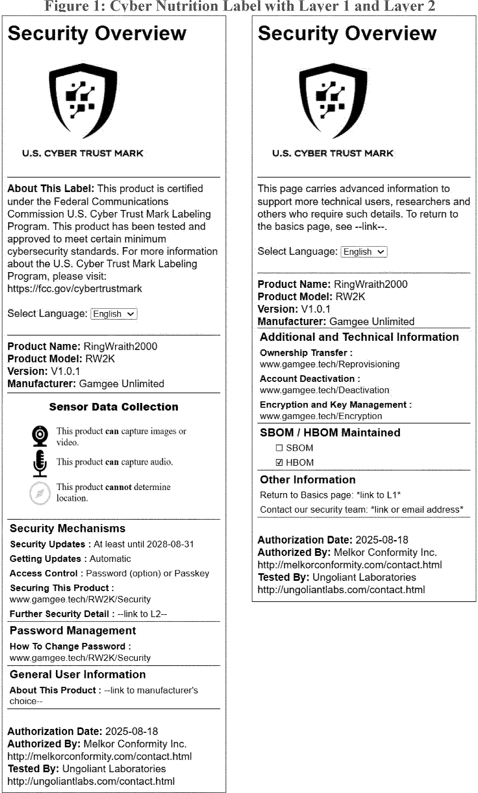

# Daily Digest — 2026-11-23

| | |
|---|---|
| **Digest date** | 2026-11-23 |
| **Data date range** | 2026-11-23 to 2026-11-23 |
| **Generated at** | 2026-11-24T05:02:23Z (UTC) |
| **Pipeline version** | f18c95c6 |
| **Inference** | model layers ran — cli/haiku, opus |
| **Source watermarks** | CREC: 2026-11-21T11:41:04Z · BILLS: 2026-11-23T20:52:33Z · FR: 2026-11-21T05:30:46Z · USCOURTS: 2026-11-23T22:10:19Z · PLAW: 2026-11-23T21:21:45Z |

[Full observed listing for this day](day/2026-11-23.html) — the items our collectors observed for this publication day, mechanical rules applied, frozen at end of day; releases their publishers date on other days are counted there, not listed. This digest is the canonical record.

All items below cite the govinfo package (and granule, where applicable) they
summarize. Selection is mechanical; each item states the rule that included
it. See the Coverage Statement at the end for a full accounting of what was
published, what was summarized, and what was excluded and why.

---

## Contents

- [Day in Review](#day-in-review)
- [1. Congressional Floor Activity](#1-congressional-floor-activity)
- [2. Legislation](#2-legislation)
- [3. Federal Register](#3-federal-register)
- [4. Enacted Laws](#4-enacted-laws)
- [5. Judicial Activity](#5-judicial-activity)
- [6. Agency Announcements](#6-agency-announcements)
- [7. Recorded Votes](#7-recorded-votes)
- [8. Bill Actions](#8-bill-actions)
- [9. Presidential Actions](#9-presidential-actions)
- [Terms Used Today](#terms-used-today)
- [Coverage Statement](#coverage-statement)
- [Methodology](#methodology)

---

## Day in Review

On the congressional side, the digest carries one bill introduced in the House and one measure agreed to in the Senate. No item summaries describing these measures or any recorded votes appear in this edition.

The executive and regulatory record includes five final rules, seven proposed rules, and 79 notices in the Federal Register, along with one presidential memorandum. The memorandum, dated November 23, 2026, and addressed to the Attorney General, is titled "Expeditious Enforcement of Capital Sentences and the Pursuit of Justice for Victims of Heinous Crimes." It directs the Attorney General, when appropriate and consistent with applicable law, to pursue Federal jurisdiction and seek the death penalty for additional federal capital crimes. Among the final rules, the Department of Labor rescinds its analysis for determining employee or independent contractor status under the Fair Labor Standards Act and replaces it with an analysis similar to its 2021 rule, with modifications. U.S. Customs and Border Protection extends import restrictions on certain archaeological and ethnological material from Egypt. The horse protection regulations' effective-date postponement is extended, and the FAA issues technical corrections and a Class E airspace amendment at Del Rio, Texas. The proposed rules include two FAA airworthiness directives for ATR42 and ATR72 airplanes and airspace changes at Lebanon, New Hampshire, and Columbus, Texas. They also include an FCC request for comment on the U.S. Cyber Trust Mark labeling program, an FCC vetting process for high-cost Universal Service Fund recipients, and Privacy Act revisions from the Occupational Safety and Health Review Commission. The digest also carries 217 agency press releases and two advisories.

*Composed from the summarized items below and the day's mechanical
counts; all specifics are cited in their sections.*

---

## 1. Congressional Floor Activity

No Congressional Record issue was observed on this day. The Record for a day's proceedings is typically published by govinfo the following morning; it appears in the digest for the day it is observed ([how our clocks work](faq.html#fapds-three-clocks)).

### 1.1 Senate

No Senate floor items met the selection thresholds. 0 floor granule(s) are accounted for in the Coverage Statement.

### 1.2 House of Representatives

No House floor items met the selection thresholds. 0 floor granule(s) are accounted for in the Coverage Statement.

### 1.3 Recorded Votes

No recorded votes were published in this issue of the Congressional Record.

---

## 2. Legislation

Source: Congressional Bills (BILLS), text versions published 2026-11-23 to 2026-11-23.

### 2.1 Counts by Stage

| Stage (bill text version) | Count |
|---|---|
| Introduced (ih/is) | 1 |
| Reported (rh/rs) | 0 |
| Engrossed (eh/es) | 0 |
| Enrolled (enr) | 0 |
| Other versions | 1 |
| **Total bill texts published** | **2** |

### 2.2 Bills Listed by Mechanical Rule

Bills below are listed because they matched at least one listing rule; the
matching rule is stated per item. All other bill texts are counted above and
accounted for in the Coverage Statement.

No bill texts published in this range matched a listing rule; all 2 are
accounted for in the Coverage Statement.

---

## 3. Federal Register

Source: Federal Register (FR), issue of 2026-11-23.

### 3.1 Counts by Document Type

| Document type | Count |
|---|---|
| Rules | 5 |
| Proposed rules | 7 |
| Notices | 79 |
| Presidential documents | 0 |
| **Total FR documents** | **91** |

### 3.2 Rules Published

Tags: department of commerce · department of transportation · executive · model keys: archaeological artifact imports · employee classification · horse protection

*In plain terms: 5 rules, led by a final rule replacing the FLSA independent contractor analysis; the rest cover Egyptian artifact import restrictions, a horse protection delay, FAA technical fixes, and Del Rio airspace.*

#### DEPARTMENT OF AGRICULTURE

- **Horse Protection Amendments; Extension of Postponement of Regulations** (2026-23818; 9 CFR Part 11) — On May 8, 2024, we published a final rule amending the horse protection regulations. The final rule was initially scheduled to go into effect on February 1, 2025, except for § 11.19, which was effective on June 7, 2024. On January 28, 2025, we published a postponement of the effective date of the remaining provisions from February 1, 2025, to April 2, 2025. On March 21, 2025, we published a further delay of the effective date to February 1, 2026, and a request for comment on whether the length of the postponement should be extended. On January 28, 2026, based on developments following the issuance of the March 21, 2025, delay of effective date, we published a document further delaying the effective date of the final rule to December 31, 2026. On November 13, 2026, we published a proposed rule to remove parts of the 2024 Horse Protection final rule that were vacated by Court order from the regulations, as well as proposing to withdraw the non-vacated parts and update the regulations. As a consequence, in this document, we are issuing an extension of the postponement of the effective date of the final rule to December 31, 2027. Action: Final rule; extension of postponement of regulations. Dates: The amendments to 9 CFR 11.1 through 11.18 effective February 1, 2025, (89 FR 39194), delayed until April 2, 2025, (90 FR 8253), further delayed until February 1, 2026 (90 FR 13273), and further delayed until December 31, 2026 (91 FR 3633), are further delayed until December 31, 2027.
  - *In plain terms:* The effective date of the May 8, 2024 Horse Protection final rule is postponed from December 31, 2026 to December 31, 2027, following a November 13, 2026 proposal to remove parts voided by court order.
  - Included because: FR-SEL-01 — document type: final rule (all listed)
  - Source: [FR-2026-11-23 / 2026-23818](https://www.govinfo.gov/app/details/FR-2026-11-23/2026-23818)

#### DEPARTMENT OF HOMELAND SECURITY

- **Extension of Import Restrictions Imposed on Archaeological and Ethnological Material of Egypt** (2026-23795; 19 CFR Part 12) — This document amends U.S. Customs and Border Protection (CBP) regulations to reflect the extension of import restrictions on certain categories of archaeological and ethnological material from the Arab Republic of Egypt (Egypt), which were originally published in CBP Decision (CBP Dec.) 16-23, and subsequently extended and amended in CBP Dec. 21-17. The CBP regulations are being amended to reflect this further extension through November 30, 2031. Action: Final rule. Dates: Effective on November 30, 2026.
  - *In plain terms:* U.S. Customs and Border Protection amends its regulations to reflect a further extension of import restrictions on certain archaeological and ethnological material from Egypt, now through November 30, 2031.
  - Included because: FR-SEL-01 — document type: final rule (all listed)
  - Source: [FR-2026-11-23 / 2026-23795](https://www.govinfo.gov/app/details/FR-2026-11-23/2026-23795)

#### DEPARTMENT OF LABOR

- **Employee or Independent Contractor Status Under the Fair Labor Standards Act, Family and Medical Leave Act, and Migrant and Seasonal Agricultural Worker Protection Act** (2026-23777; 29 CFR Parts 500, 795, and 825) — This final rule rescinds the analysis for determining employee or independent contractor status under the Fair Labor Standards Act (FLSA or Act) set forth in the Department of Labor's (Department) regulations and replaces it with an analysis similar to what it published in a final rule promulgated in 2021, with several modifications and enhancements. In addition, this final rule amends provisions in the Department's regulations implementing the Family and Medical Leave Act (FMLA) and Migrant and Seasonal Agricultural Worker Protection Act (MSPA) to provide that employee or independent contractor status under those laws should be determined using the Department's FLSA analysis, as the FMLA and MSPA both incorporate the FLSA's scope of employment. Action: Final rule. Dates: This final rule is effective on January 22, 2027.
  - *In plain terms:* A Labor Department final rule replaces its Fair Labor Standards Act test for employee-or-contractor status with a 2021-style analysis and applies that test to the Family and Medical Leave Act and Migrant and Seasonal Agricultural Worker Protection Act.
  - Included because: FR-SEL-01 — document type: final rule (all listed)
  - Source: [FR-2026-11-23 / 2026-23777](https://www.govinfo.gov/app/details/FR-2026-11-23/2026-23777)

#### DEPARTMENT OF TRANSPORTATION

- **Miscellaneous Technical Amendments; Technical Amendment** (2026-23786; 14 CFR Parts 1, 5, 13, 15, 16, 17, 21, 23, 25, 26, 27, 29, 31, 33, 34, 35, 38, 39, 43, 48, 61, 63, 65, 67, 71, 73, 77, 91, 95, 97, 99, 101, 103, 105, 110, 117, 120, 125, 133, 137, 150, 151, 152, 153, 155, 156, 157, 158, 161, 169, 170, 171, 183, 185, 187, 189, 193, 198, and 450) — This technical amendment contains non-substantive corrections to address typographical errors, editorial errors, and outdated or incorrect references in various parts of FAA regulations. Action: Final rule; technical amendment. Dates: Effective November 23, 2026.
  - *In plain terms:* This technical amendment makes non-substantive corrections for typographical and editorial errors and for outdated or incorrect references in various parts of FAA regulations.
  - Included because: FR-SEL-01 — document type: final rule (all listed)
  - Source: [FR-2026-11-23 / 2026-23786](https://www.govinfo.gov/app/details/FR-2026-11-23/2026-23786)
- **Amendment of Class E Airspace; Del Rio, TX** (2026-23836; 14 CFR Part 71) — This action amends the Class E airspace at Del Rio, TX. This action is the result of a biennial review of the airspace associated with Laughlin Air Force Base (AFB), Del Rio, TX. This proposal also updates the name and geographic coordinates of Laughlin AFB to coincide with the FAA's aeronautical database. This action brings the airspace into compliance with FAA orders and supports instrument flight rule (IFR) procedures and operations. Action: Final rule. Dates: Effective 0901 UTC, February 18, 2027. The Director of the Federal Register approves this incorporation by reference action under 1 CFR part 51, subject to the annual revision of FAA Order JO 7400.11 and publication of conforming amendments.
  - *In plain terms:* The FAA amends Class E airspace at Del Rio, TX after its every-two-years review of Laughlin Air Force Base airspace, updating the base's name and coordinates to match the FAA aeronautical database.
  - Included because: FR-SEL-01 — document type: final rule (all listed)
  - Source: [FR-2026-11-23 / 2026-23836](https://www.govinfo.gov/app/details/FR-2026-11-23/2026-23836)

### 3.3 Proposed Rules Published

Tags: department of commerce · department of transportation · executive · model keys: airspace · airworthiness directives · iot cybersecurity

*In plain terms: 7 proposals, led by two FAA directives for ATR airplanes and an FCC voluntary IoT cybersecurity label; the rest cover airspace, Universal Service Fund, and Privacy Act changes.*

#### DEPARTMENT OF TRANSPORTATION

- **Airworthiness Directives; ATR-GIE Avions de Transport Régional Airplanes** (2026-23749; 14 CFR Part 39) — The FAA proposes to adopt a new airworthiness directive (AD) for all ATR-GIE Avions de Transport Régional Model ATR42-500 and ATR72-212A airplanes. This proposed AD was prompted by reports of two in-service events during takeoff where an internal failure of the integrated air system control (IASC) software analog-to-digital converter generated erroneous pressure digital values, leading to uncommanded full-speed closure of the outflow valve and a high negative cabin altitude rate. This proposed AD would require installing improved IASC software. This proposed AD would also prohibit the installation of affected software under certain conditions. The FAA is proposing this AD to address the unsafe condition on these products. Action: Notice of proposed rulemaking (NPRM). Dates: The FAA must receive comments on this proposed AD by January 7, 2027.
  - *In plain terms:* The FAA proposes a new airworthiness directive, a mandatory safety requirement, for ATR42-500 and ATR72-212A airplanes that would require improved control software and prohibit installing certain affected software under some conditions.
  - Included because: FR-SEL-02 — document type: proposed rule (all listed)
  - Source: [FR-2026-11-23 / 2026-23749](https://www.govinfo.gov/app/details/FR-2026-11-23/2026-23749)
- **Airworthiness Directives; ATR-GIE Avions de Transport Régional Airplanes** (2026-23752; 14 CFR Part 39) — The FAA proposes to adopt a new airworthiness directive (AD) for all ATR-GIE Avions de Transport Régional Model ATR42 and ATR72 airplanes. This proposed AD was prompted by a review of mooring loads that revealed that winds within the currently defined wind profiles could lead to loads exceeding the certification limits on the nose landing gear (NLG) and main landing gear (MLG) while the airplane is moored. This proposed AD would require revising the existing maintenance or inspection program, as applicable, to incorporate a revised maintenance procedure (MP) for mooring the airplane. The FAA is proposing this AD to address the unsafe condition on these products. Action: Notice of proposed rulemaking (NPRM). Dates: The FAA must receive comments on this proposed AD by January 7, 2027.
  - *In plain terms:* The FAA proposes an airworthiness directive for ATR42 and ATR72 airplanes requiring a revised maintenance procedure for mooring the airplane, after a review found that winds within current wind profiles could push nose and main landing gear loads past certification limits.
  - Included because: FR-SEL-02 — document type: proposed rule (all listed)
  - Source: [FR-2026-11-23 / 2026-23752](https://www.govinfo.gov/app/details/FR-2026-11-23/2026-23752)
- **Amendment of Class D and E Airspace and Removal of Class E Airspace Over Lebanon, NH** (2026-23824; 14 CFR Part 71) — This action proposes to amend Class D and Class E airspace over Lebanon, NH. This action would increase the lateral dimensions of the Lebanon, NH, Class D airspace to appropriately contain Instrument Flight Rules (IFR) operations at the Lebanon Municipal Airport. This action would also update verbiage in the Class D airspace legal description to comply with current FAA guidance. This action would also update the geographic coordinates for the airport in both the Class D and Class E5 airspace legal descriptions. This action would also remove the exclusions for adjacent Class E5 airspace from the Lebanon, NH, Class E5 airspace legal description. This action would also remove the Lebanon, NH, Class E4 airspace, which is no longer necessary for IFR operations at the airport. Action: Notice of proposed rulemaking (NPRM). Dates: Comments must be received on or before January 7, 2027.
  - *In plain terms:* The FAA proposes to amend Class D and Class E airspace over Lebanon, NH by enlarging the Class D area, updating descriptions and airport coordinates, removing Class E5 exclusions, and removing Class E4 airspace.
  - Included because: FR-SEL-02 — document type: proposed rule (all listed)
  - Source: [FR-2026-11-23 / 2026-23824](https://www.govinfo.gov/app/details/FR-2026-11-23/2026-23824)
- **Establishment of Class E Airspace; Columbus, TX** (2026-23838; 14 CFR Part 71) — This action proposes to establish Class E airspace at Columbus Community Hospital Heliport, Columbus, TX. The FAA is proposing this action to support new instrument procedures and instrument flight rule (IFR) operations. Action: Notice of proposed rulemaking (NPRM). Dates: Comments must be received on or before January 7, 2027.
  - *In plain terms:* The FAA proposes to establish Class E airspace at Columbus Community Hospital Heliport in Columbus, TX to support new instrument procedures and instrument flight rule operations.
  - Included because: FR-SEL-02 — document type: proposed rule (all listed)
  - Source: [FR-2026-11-23 / 2026-23838](https://www.govinfo.gov/app/details/FR-2026-11-23/2026-23838)

#### FEDERAL COMMUNICATIONS COMMISSION

- **Cybersecurity Labeling for Internet of Things** (2026-23812; 47 CFR Part 8) — In this document, the Public Safety and Homeland Security Bureau (Bureau) of the Federal Communications Commission (Commission or FCC) seeks comment on recommendations for the U.S. Cyber Trust Mark (USCTM) program, a voluntary cybersecurity labeling program for wireless consumer Internet of Things (IoT) products. The Bureau seeks comment on the design and placement of the FCC IoT Label, display of product registry information, certification renewal, post-market surveillance, and procedures for complaints, noncompliant products, and program administrators that withdraw or whose authority is terminated. These actions would support the establishment and effective administration of the USCTM program and provide consumers with accessible cybersecurity information about certified IoT products. Action: Proposed rule. Dates: Comments are due on or before December 23, 2026; reply comments are due on or before January 7, 2027.
  - *In plain terms:* The FCC's Public Safety and Homeland Security Bureau seeks comment on recommendations for the voluntary U.S. Cyber Trust Mark, a cybersecurity labeling program for wireless consumer Internet of Things products.
  - Included because: FR-SEL-02 — document type: proposed rule (all listed)
  - Source: [FR-2026-11-23 / 2026-23812](https://www.govinfo.gov/app/details/FR-2026-11-23/2026-23812)
  -  *Source graphic 1 of 1 from 2026-23812.*
- **Connect America Fund; A National Broadband Plan for Our Future High-Cost Universal Support, Reforming the High-Cost Program for an All-IP Future, Safeguarding Universal Service Funding Through Effective Applicant Vetting** (2026-23830; 47 CFR Part 54) — In this document, the Federal Communications Commission (FCC or Commission) initiates a rulemaking to establish a vetting process for applicants for, and other recipients of, certain new funding awards of high-cost Universal Service Fund (USF) support. Action: Proposed rule. Dates: Comments are due on or before December 23, 2026 and reply comments are due on or before January 22, 2027. If you anticipate that you will be submitting comments but find it difficult to do so within the period of time allowed by this document, you should advise the contact listed in the following as soon as possible.
  - *In plain terms:* The FCC begins a rulemaking to set up a vetting process for applicants for, and recipients of, certain new high-cost Universal Service Fund awards.
  - Included because: FR-SEL-02 — document type: proposed rule (all listed)
  - Source: [FR-2026-11-23 / 2026-23830](https://www.govinfo.gov/app/details/FR-2026-11-23/2026-23830)

#### OCCUPATIONAL SAFETY AND HEALTH REVIEW COMMISSION

- **Regulations Implementing the Privacy Act** (2026-23762; 29 CFR Part 2400) — The Occupational Safety and Health Review Commission (OSHRC) is proposing revisions to its regulations implementing the Privacy Act of 1974. The proposed amendments to the Privacy Act regulations provide additional information on how to submit a Privacy Act request and revise the requirements for verifying a requester's identity. Action: Notice of proposed rulemaking. Dates: Comments must be received by OSHRC on or before December 23, 2026.
  - *In plain terms:* The Occupational Safety and Health Review Commission proposes revising its Privacy Act regulations to add information on how to submit a Privacy Act request and to change the rules for verifying a requester's identity.
  - Included because: FR-SEL-02 — document type: proposed rule (all listed)
  - Source: [FR-2026-11-23 / 2026-23762](https://www.govinfo.gov/app/details/FR-2026-11-23/2026-23762)

### 3.4 Notices and Presidential Documents

Notices are summarized only when they match a listing rule; all are counted
in 3.1 and in the Coverage Statement. Presidential documents in the FR are
always listed.

No notices or presidential documents matched a listing rule.

---

## 4. Enacted Laws

Source: Public and Private Laws (PLAW) published 2026-11-23.

No laws were published in this range.

---

## 5. Judicial Activity

Source: United States Courts Opinions (USCOURTS): opinions observed 2026-11-23
by our collector; each opinion states its own issue date beside its
listing ([how our clocks work](faq.html#fapds-three-clocks)).

Completeness disclosure (standing): USCOURTS carries opinions from
approximately 140 participating appellate, district, bankruptcy, and
national federal courts. Unlike the Congressional Record and the Federal
Register, which are the complete official record of their branches,
USCOURTS is participation-based and is NOT the complete federal judicial
record. Courts post opinions with delay — typically over several days —
so a day's digest carries the opinions that became available that day,
whatever date each was issued.

### 5.1 Appellate and National Court Opinions

Appellate and national court opinions are summarized; district and
bankruptcy opinions are counted in 5.2 and in the Coverage Statement.

No appellate or national court opinions matched a listing rule for this
date; all opinions are counted in 5.2 and accounted for in the Coverage
Statement.

### 5.2 Counts by Court Category

| Court category | Opinions |
|---|---|
| Appellate | 0 |
| District | 32 |
| Bankruptcy | 0 |
| National | 0 |
| **Total opinions extracted** | **32** |

Archive-window disclosure (rule USCOURTS-FETCH-01): 34223 USCOURTS package(s) have been listed in delta syncs but fell outside the 7-day archive window and were not fetched (global running count across all syncs, not limited to this date).

---

## 6. Agency Announcements

Official press releases and statements the agencies themselves date
on 2026-11-23 (sources listed in the source guide). These are the
agencies' own announcements — official advocacy, quoted and
attributed, not findings of this digest. Agency web content can be
edited or removed without notice; captures and hashes are preserved
per the provenance policy.

#### Animal and Plant Health Inspection Service (email)

- **APHIS Extends Comment Period for Revised Chronic Wasting Disease Herd Certification Program Standards** — dated 2026-11-23 by the agency
  - Included because: AGENCYPR-SEL-01 — official agency release dated this day by the agency (all such releases from active sources are listed; titles only in the pilot)
  - Source: agency email bulletin to this project's subscription, captured and DKIM-verified (the bulletin named no canonical page)

#### ATF News (email)

- **eATF Web Updates Newsletter: November 2026** — dated 2026-11-23 by the agency
  - Included because: AGENCYPR-SEL-01 — official agency release dated this day by the agency (all such releases from active sources are listed; titles only in the pilot)
  - Source: agency email bulletin to this project's subscription, captured and DKIM-verified (the bulletin named no canonical page)

#### Census Bureau (email)

- **💻 Tuesday: Smarter Searching with Filters on data.census.gov** — dated 2026-11-23 by the agency
  - Included because: AGENCYPR-SEL-01 — official agency release dated this day by the agency (all such releases from active sources are listed; titles only in the pilot)
  - Source: agency email bulletin to this project's subscription, captured and DKIM-verified (the bulletin named no canonical page)
- **📅 This Week: Happy Thanksgiving! 🍂** — dated 2026-11-23 by the agency
  - Included because: AGENCYPR-SEL-01 — official agency release dated this day by the agency (all such releases from active sources are listed; titles only in the pilot)
  - Source: agency email bulletin to this project's subscription, captured and DKIM-verified (the bulletin named no canonical page)

#### CFTC Press Releases

- **[CFTC Grants over $11M in Whistleblower Awards](https://www.cftc.gov/PressRoom/PressReleases/9329-26)** — dated 2026-11-23 by the agency
  - Included because: AGENCYPR-SEL-01 — official agency release dated this day by the agency (all such releases from active sources are listed; titles only in the pilot)
- **[CFTC Publishes Final Rule Concerning Data Reporting Requirements for Certain Event Contracts](https://www.cftc.gov/PressRoom/PressReleases/9330-26)** — dated 2026-11-23 by the agency
  - Included because: AGENCYPR-SEL-01 — official agency release dated this day by the agency (all such releases from active sources are listed; titles only in the pilot)
- **[CFTC Staff Issues Advisory Concerning the Use of Crypto Assets to Satisfy Financial Resources Requirements](https://www.cftc.gov/PressRoom/PressReleases/9331-26)** — dated 2026-11-23 by the agency
  - Included because: AGENCYPR-SEL-01 — official agency release dated this day by the agency (all such releases from active sources are listed; titles only in the pilot)

#### CISA Cybersecurity Advisories

- **[CISA Adds Two Known Exploited Vulnerabilities to Catalog](https://www.cisa.gov/news-events/alerts/2026/11/23/cisa-adds-two-known-exploited-vulnerabilities-catalog)** — dated 2026-11-23 by the agency
  - Included because: AGENCYPR-SEL-01 — official agency release dated this day by the agency (all such releases from active sources are listed; titles only in the pilot)

#### Defense News Releases

- **[DOW Launches Automated SI Solution for Classification Management](https://www.war.gov/News/News-Stories/Article/Article/4658620/dow-launches-automated-si-solution-for-classification-management/)** — dated 2026-11-23 by the agency
  - Included because: AGENCYPR-SEL-01 — official agency release dated this day by the agency (all such releases from active sources are listed; titles only in the pilot)
- **[Florida National Guard Help Protect Hospital, Community Members During Severe Flooding](https://www.war.gov/News/News-Stories/Article/Article/4658207/florida-national-guard-help-protect-hospital-community-members-during-severe-fl/)** — dated 2026-11-23 by the agency
  - Included because: AGENCYPR-SEL-01 — official agency release dated this day by the agency (all such releases from active sources are listed; titles only in the pilot)
- **[Navy Family Takes Oath of Enlistment Together](https://www.war.gov/News/News-Stories/Article/Article/4658236/navy-family-takes-oath-of-enlistment-together/)** — dated 2026-11-23 by the agency
  - Included because: AGENCYPR-SEL-01 — official agency release dated this day by the agency (all such releases from active sources are listed; titles only in the pilot)

#### DHS News Releases

- **[HSTF Investigation Leads to Venezuelan National and Alleged Tren de Aragua Gang Member Pleading Guilty to New England “Jackpotting” Scheme](https://www.dhs.gov/news/2026/11/23/hstf-investigation-leads-venezuelan-national-and-alleged-tren-de-aragua-gang-member)** — dated 2026-11-23 by the agency
  - Included because: AGENCYPR-SEL-01 — official agency release dated this day by the agency (all such releases from active sources are listed; titles only in the pilot)
- **[ICE Arrests Illegal Alien MS-13 Member in California Whose Criminal History Includes Cruelty Toward Child and DUI](https://www.dhs.gov/news/2026/11/23/ice-arrests-illegal-alien-ms-13-member-california-whose-criminal-history-includes)** — dated 2026-11-23 by the agency
  - Included because: AGENCYPR-SEL-01 — official agency release dated this day by the agency (all such releases from active sources are listed; titles only in the pilot)
- **[ICE Arrests Illegal Alien from Venezuela Linked to Threats to Assassinate President Trump](https://www.dhs.gov/news/2026/11/23/ice-arrests-illegal-alien-venezuela-linked-threats-assassinate-president-trump)** — dated 2026-11-23 by the agency
  - Included because: AGENCYPR-SEL-01 — official agency release dated this day by the agency (all such releases from active sources are listed; titles only in the pilot)
- **[ICE Lodges Detainer Asking Virginia Sanctuary Politicians to Not Release Illegal Alien Arrested for Raping 12-Year-Old Girl](https://www.dhs.gov/news/2026/11/23/ice-lodges-detainer-asking-virginia-sanctuary-politicians-not-release-illegal-alien)** — dated 2026-11-23 by the agency
  - Included because: AGENCYPR-SEL-01 — official agency release dated this day by the agency (all such releases from active sources are listed; titles only in the pilot)
- **[WORST OF THE WORST: ICE Arrests Pedophiles, Sexual Predators, and Domestic Abusers Over the Weekend](https://www.dhs.gov/news/2026/11/23/worst-worst-ice-arrests-pedophiles-sexual-predators-and-domestic-abusers-over)** — dated 2026-11-23 by the agency
  - Included because: AGENCYPR-SEL-01 — official agency release dated this day by the agency (all such releases from active sources are listed; titles only in the pilot)

#### DOE Office of Indian Energy (email)

- **Office of Indian Energy Names Thomas Jones as External Affairs Manager** — dated 2026-11-23 by the agency
  - Included because: AGENCYPR-SEL-01 — official agency release dated this day by the agency (all such releases from active sources are listed; titles only in the pilot)
  - Source: agency email bulletin to this project's subscription, captured and DKIM-verified (the bulletin named no canonical page)

#### FAA Updates (email)

- **FAA Orders & Notices Update Notification** — dated 2026-11-23 by the agency
  - Included because: AGENCYPR-SEL-01 — official agency release dated this day by the agency (all such releases from active sources are listed; titles only in the pilot)
  - Source: agency email bulletin to this project's subscription, captured and DKIM-verified (the bulletin named no canonical page)
- **FAA Orders & Notices Update Notification** — dated 2026-11-23 by the agency
  - Included because: AGENCYPR-SEL-01 — official agency release dated this day by the agency (all such releases from active sources are listed; titles only in the pilot)
  - Source: agency email bulletin to this project's subscription, captured and DKIM-verified (the bulletin named no canonical page)
- **FAA Orders & Notices Update Notification** — dated 2026-11-23 by the agency
  - Included because: AGENCYPR-SEL-01 — official agency release dated this day by the agency (all such releases from active sources are listed; titles only in the pilot)
  - Source: agency email bulletin to this project's subscription, captured and DKIM-verified (the bulletin named no canonical page)
- **FAA Orders & Notices Update Notification** — dated 2026-11-23 by the agency
  - Included because: AGENCYPR-SEL-01 — official agency release dated this day by the agency (all such releases from active sources are listed; titles only in the pilot)
  - Source: agency email bulletin to this project's subscription, captured and DKIM-verified (the bulletin named no canonical page)
- **FAA Orders & Notices Update Notification** — dated 2026-11-23 by the agency
  - Included because: AGENCYPR-SEL-01 — official agency release dated this day by the agency (all such releases from active sources are listed; titles only in the pilot)
  - Source: agency email bulletin to this project's subscription, captured and DKIM-verified (the bulletin named no canonical page)
- **FAA Orders & Notices Update Notification** — dated 2026-11-23 by the agency
  - Included because: AGENCYPR-SEL-01 — official agency release dated this day by the agency (all such releases from active sources are listed; titles only in the pilot)
  - Source: agency email bulletin to this project's subscription, captured and DKIM-verified (the bulletin named no canonical page)
- **FAA Orders & Notices Update Notification** — dated 2026-11-23 by the agency
  - Included because: AGENCYPR-SEL-01 — official agency release dated this day by the agency (all such releases from active sources are listed; titles only in the pilot)
  - Source: agency email bulletin to this project's subscription, captured and DKIM-verified (the bulletin named no canonical page)
- **FAA Orders & Notices Update Notification** — dated 2026-11-23 by the agency
  - Included because: AGENCYPR-SEL-01 — official agency release dated this day by the agency (all such releases from active sources are listed; titles only in the pilot)
  - Source: agency email bulletin to this project's subscription, captured and DKIM-verified (the bulletin named no canonical page)

#### FDA Email Updates (email)

- **[Breckenridge Pharmaceutical, Inc. Issues Voluntary Nationwide Consumer-Level Recall of One Lot of Propranolol Hydrochloride Extended-Release Capsules, USP, 60 mg, Due to Potential Metal Contamination](https://www.fda.gov/safety/recalls-market-withdrawals-safety-alerts/breckenridge-pharmaceutical-inc-issues-voluntary-nationwide-consumer-level-recall-one-lot?utm_medium=email&utm_source=govdelivery)** — dated 2026-11-23 by the agency
  - Included because: AGENCYPR-SEL-01 — official agency release dated this day by the agency (all such releases from active sources are listed; titles only in the pilot)
  - Source: agency email bulletin to this project's subscription, captured and DKIM-verified
- **FDA Approves First New Hormone Therapy for Early-Stage Breast Cancer in More Than 20 Years** — dated 2026-11-23 by the agency
  - Included because: AGENCYPR-SEL-01 — official agency release dated this day by the agency (all such releases from active sources are listed; titles only in the pilot)
  - Source: agency email bulletin to this project's subscription, captured and DKIM-verified (the bulletin named no canonical page)
- **FDA Approves First Treatment for Limb-Girdle Muscular Dystrophy Type 2I/R9** — dated 2026-11-23 by the agency
  - Included because: AGENCYPR-SEL-01 — official agency release dated this day by the agency (all such releases from active sources are listed; titles only in the pilot)
  - Source: agency email bulletin to this project's subscription, captured and DKIM-verified (the bulletin named no canonical page)
- **FDA MedWatch - Compounded Sterile Products by Greenwich Rx** — dated 2026-11-23 by the agency
  - Included because: AGENCYPR-SEL-01 — official agency release dated this day by the agency (all such releases from active sources are listed; titles only in the pilot)
  - Source: agency email bulletin to this project's subscription, captured and DKIM-verified (the bulletin named no canonical page)
- **[Greenwich Rx Issues Voluntary Nationwide Recall of Compounded Sterile Products Due to Lack of Sterility Assurance](https://www.fda.gov/safety/recalls-market-withdrawals-safety-alerts/greenwich-rx-issues-voluntary-nationwide-recall-compounded-sterile-products-due-lack-sterility?utm_medium=email&utm_source=govdelivery)** — dated 2026-11-23 by the agency
  - Included because: AGENCYPR-SEL-01 — official agency release dated this day by the agency (all such releases from active sources are listed; titles only in the pilot)
  - Source: agency email bulletin to this project's subscription, captured and DKIM-verified
- **[Ridley Block Operations Recalls a Batch of Crystalyx®HE-20% for Beef Cattle and Bison Due to Excess Levels of Non-Protein Nitrogen (NPN)](https://www.fda.gov/safety/recalls-market-withdrawals-safety-alerts/ridley-block-operations-recalls-batch-crystalyxrhe-20-beef-cattle-and-bison-due-excess-levels-non?utm_medium=email&utm_source=govdelivery)** — dated 2026-11-23 by the agency
  - Included because: AGENCYPR-SEL-01 — official agency release dated this day by the agency (all such releases from active sources are listed; titles only in the pilot)
  - Source: agency email bulletin to this project's subscription, captured and DKIM-verified
- **[Shanghai San Niu Food Co., LTD. Is Recalling Sanniu Evergeen Biscuits Due to Undeclared Milk and Sanniu Salt and Pepper Soda Biscuits Due to Undeclared Milk and Shrimp](https://www.fda.gov/safety/recalls-market-withdrawals-safety-alerts/shanghai-san-niu-food-co-ltd-recalling-sanniu-evergeen-biscuits-due-undeclared-milk-and-sanniu-salt?utm_medium=email&utm_source=govdelivery)** — dated 2026-11-23 by the agency
  - Included because: AGENCYPR-SEL-01 — official agency release dated this day by the agency (all such releases from active sources are listed; titles only in the pilot)
  - Source: agency email bulletin to this project's subscription, captured and DKIM-verified

#### FDA Press Announcements

- **[FDA Approves First New Hormone Therapy for Early-Stage Breast Cancer in More Than 20 Years](http://www.fda.gov/news-events/press-announcements/fda-approves-first-new-hormone-therapy-early-stage-breast-cancer-more-20-years)** — dated 2026-11-23 by the agency
  - Included because: AGENCYPR-SEL-01 — official agency release dated this day by the agency (all such releases from active sources are listed; titles only in the pilot)
- **[FDA Approves First Treatment for Limb-Girdle Muscular Dystrophy Type 2I/R9](http://www.fda.gov/news-events/press-announcements/fda-approves-first-treatment-limb-girdle-muscular-dystrophy-type-2ir9)** — dated 2026-11-23 by the agency
  - Included because: AGENCYPR-SEL-01 — official agency release dated this day by the agency (all such releases from active sources are listed; titles only in the pilot)

#### FEC Press Releases

- **[Terminating a committee](https://www.fec.gov/updates/terminating-a-committee-2026/)** — dated 2026-11-23 by the agency
  - Included because: AGENCYPR-SEL-01 — official agency release dated this day by the agency (all such releases from active sources are listed; titles only in the pilot)

#### FEMA Press Releases

- **[FEMA Announces More Than $38 Million to Kentucky](https://www.fema.gov/press-release/20261123/fema-announces-more-38-million-kentucky)** — dated 2026-11-23 by the agency
  - Included because: AGENCYPR-SEL-01 — official agency release dated this day by the agency (all such releases from active sources are listed; titles only in the pilot)
- **[FEMA Approves More Than $1.4 Billion in Funding Across the Nation to Help Communities Recover from Recent Disasters and Strengthen Resilience Against Future Disasters](https://www.fema.gov/press-release/20261123/fema-approves-more-14-billion-funding-across-nation-help-communities-recover)** — dated 2026-11-23 by the agency
  - Included because: AGENCYPR-SEL-01 — official agency release dated this day by the agency (all such releases from active sources are listed; titles only in the pilot)
- **[FEMA Approves More Than $19 Million to Help Communities in Alaska, Idaho, Oregon and Washington Rebuild, Become More Resilient](https://www.fema.gov/press-release/20261123/fema-approves-more-19-million-help-communities-alaska-idaho-oregon-and)** — dated 2026-11-23 by the agency
  - Included because: AGENCYPR-SEL-01 — official agency release dated this day by the agency (all such releases from active sources are listed; titles only in the pilot)
- **[FEMA Approves More Than $42 Million in Funding to Help Communities Recover from Recent Disasters and Strengthen Their Resilience Against Future Disasters in New Jersey and New York](https://www.fema.gov/press-release/20261123/fema-approves-more-42-million-funding-help-communities-recover-recent)** — dated 2026-11-23 by the agency
  - Included because: AGENCYPR-SEL-01 — official agency release dated this day by the agency (all such releases from active sources are listed; titles only in the pilot)
- **[FEMA Approves More than $162 Million in Funding to Help Communities Recover from Recent Disasters and Strengthen Their Resilience Against Future Disasters in Arizona, California, Hawai‘i, Nevada, and the Northern Mariana Islands](https://www.fema.gov/press-release/20261123/fema-approves-more-162-million-funding-help-communities-recover-recent)** — dated 2026-11-23 by the agency
  - Included because: AGENCYPR-SEL-01 — official agency release dated this day by the agency (all such releases from active sources are listed; titles only in the pilot)
- **[FEMA Approves Nearly $25 Million in Funding to Help Communities Recover from Recent Disasters and Strengthen Their Resilience Against Future Disasters in the Mid-Atlantic](https://www.fema.gov/press-release/20261123/fema-approves-nearly-25-million-funding-help-communities-recover-recent)** — dated 2026-11-23 by the agency
  - Included because: AGENCYPR-SEL-01 — official agency release dated this day by the agency (all such releases from active sources are listed; titles only in the pilot)
- **[FEMA Approves Nearly $9.3 Million in Funding to Help Communities Recover from Recent Disasters and Strengthen Their Resilience Against Future Disasters in Vermont](https://www.fema.gov/press-release/20261123/fema-approves-nearly-9-3-million-funding-help-communities-recover-recent)** — dated 2026-11-23 by the agency
  - Included because: AGENCYPR-SEL-01 — official agency release dated this day by the agency (all such releases from active sources are listed; titles only in the pilot)

#### FinCEN Updates (email)

- **[FinCEN Updates: Treasury Identifies Nearly $15 Billion in Potential Iranian Shadow Banking](https://www.fincen.gov/sites/default/files/100/FTA-Iran-Shadow-Banking.pdf)** — dated 2026-11-23 by the agency
  - Included because: AGENCYPR-SEL-01 — official agency release dated this day by the agency (all such releases from active sources are listed; titles only in the pilot)
  - Source: agency email bulletin to this project's subscription, captured and DKIM-verified

#### FMC Press Releases

- **[Cameron Brown Named Managing Director](https://www.fmc.gov/articles/cameron-brown-named-managing-director/)** — dated 2026-11-23 by the agency
  - Included because: AGENCYPR-SEL-01 — official agency release dated this day by the agency (all such releases from active sources are listed; titles only in the pilot)

#### FSIS Recalls and Public Health Alerts (email)

- **[Constituent Update - November 23, 2026](https://www.fsis.usda.gov/news-events/news-press-releases/constituent-update-october-9-2026)** — dated 2026-11-23 by the agency
  - Included because: AGENCYPR-SEL-01 — official agency release dated this day by the agency (all such releases from active sources are listed; titles only in the pilot)
  - Source: agency email bulletin to this project's subscription, captured and DKIM-verified

#### GAO Reports & Testimonies

- **[Medicare: Out-of-Pocket Costs and Other Factors Can Affect Use of Services for Cardiovascular Disease Prevention](https://www.gao.gov/products/gao-27-108423)** — dated 2026-11-23 by the agency
  - Included because: AGENCYPR-SEL-01 — official agency release dated this day by the agency (all such releases from active sources are listed; titles only in the pilot)
- **[Retirement Plans: Identifying Ways to Help Mitigate Employer Risks Is Key to Continuing Defined Benefit Plans](https://www.gao.gov/products/gao-27-107628)** — dated 2026-11-23 by the agency
  - Included because: AGENCYPR-SEL-01 — official agency release dated this day by the agency (all such releases from active sources are listed; titles only in the pilot)

#### Justice Department News (email)

- **Antitrust Division Employment Page Update** — dated 2026-11-23 by the agency
  - Included because: AGENCYPR-SEL-01 — official agency release dated this day by the agency (all such releases from active sources are listed; titles only in the pilot)
  - Source: agency email bulletin to this project's subscription, captured and DKIM-verified (the bulletin named no canonical page)
- **Correction: EOIR BIA Decision - Nov. 23, 2026** — dated 2026-11-23 by the agency
  - Included because: AGENCYPR-SEL-01 — official agency release dated this day by the agency (all such releases from active sources are listed; titles only in the pilot)
  - Source: agency email bulletin to this project's subscription, captured and DKIM-verified (the bulletin named no canonical page)
- **[DOJ OIG Releases Semiannual Report to Congress, April 1, 2026–September 30, 2026](https://oig.justice.gov/semiannual-report-congress-april-1-2026-september-30-2026)** — dated 2026-11-23 by the agency
  - Included because: AGENCYPR-SEL-01 — official agency release dated this day by the agency (all such releases from active sources are listed; titles only in the pilot)
  - Source: agency email bulletin to this project's subscription, captured and DKIM-verified
- **EOIR BIA Decision - Nov. 23, 2026** — dated 2026-11-23 by the agency
  - Included because: AGENCYPR-SEL-01 — official agency release dated this day by the agency (all such releases from active sources are listed; titles only in the pilot)
  - Source: agency email bulletin to this project's subscription, captured and DKIM-verified (the bulletin named no canonical page)

#### Justice Press Releases

- **[Adult Day Care Owner Sentenced to 15 Months in Prison for Medicare Fraud](https://www.justice.gov/opa/pr/adult-day-care-owner-sentenced-15-months-prison-medicare-fraud)** — dated 2026-11-23 by the agency
  - Included because: AGENCYPR-SEL-01 — official agency release dated this day by the agency (all such releases from active sources are listed; titles only in the pilot)
  - Corroborated: the same release (same canonical URL) also arrived via the agency's email bulletin to this project's subscription, DKIM-verified — one document received through two ingestion channels; listed once, both captures preserved.
- **[Artifact Spotlight: A Morning Suit That Made History](https://www.justice.gov/history/blog/artifact-spotlight-morning-suit-made-history)** — dated 2026-11-23 by the agency
  - Included because: AGENCYPR-SEL-01 — official agency release dated this day by the agency (all such releases from active sources are listed; titles only in the pilot)
  - Corroborated: the same release (same canonical URL) also arrived via the agency's email bulletin to this project's subscription, DKIM-verified — one document received through two ingestion channels; listed once, both captures preserved.
- **[Federal Court Dismisses Second and Third Challenges to National Security Exemption for Energy Development in Gulf of America](https://www.justice.gov/opa/pr/federal-court-dismisses-second-and-third-challenges-national-security-exemption-energy)** — dated 2026-11-23 by the agency
  - Included because: AGENCYPR-SEL-01 — official agency release dated this day by the agency (all such releases from active sources are listed; titles only in the pilot)
  - Corroborated: the same release (same canonical URL) also arrived via the agency's email bulletin to this project's subscription, DKIM-verified — one document received through two ingestion channels; listed once, both captures preserved.
- **[ISIS Supporter Sentenced to 15 Years in Prison for Concealing His Role in Creating and Disseminating Terrorist Propaganda Via Social Media](https://www.justice.gov/opa/pr/isis-supporter-sentenced-15-years-prison-concealing-his-role-creating-and-disseminating-0)** — dated 2026-11-23 by the agency
  - Included because: AGENCYPR-SEL-01 — official agency release dated this day by the agency (all such releases from active sources are listed; titles only in the pilot)
  - Corroborated: the same release (same canonical URL) also arrived via the agency's email bulletin to this project's subscription, DKIM-verified — one document received through two ingestion channels; listed once, both captures preserved.
- **[9 Illegal Aliens from Venezuela Sentenced for Roles in Nashville Sex Trafficking Organization as Part of Homeland Security Task Force Initiative](https://www.justice.gov/opa/pr/9-illegal-aliens-venezuela-sentenced-roles-nashville-sex-trafficking-organization-part)** — dated 2026-11-23 by the agency
  - Included because: AGENCYPR-SEL-01 — official agency release dated this day by the agency (all such releases from active sources are listed; titles only in the pilot)
- **[Active-Duty U.S. Army Sergeant Pleads Guilty in Conspiracy to Gather and Transfer National Defense Information](https://www.justice.gov/usao-or/pr/active-duty-us-army-sergeant-pleads-guilty-conspiracy-gather-and-transfer-national)** — dated 2026-11-23 by the agency
  - Included because: AGENCYPR-SEL-01 — official agency release dated this day by the agency (all such releases from active sources are listed; titles only in the pilot)
  - Corroborated: the same release (same canonical URL) also arrived via the agency's email bulletin to this project's subscription, DKIM-verified — one document received through two ingestion channels; listed once, both captures preserved.
- **[Baltimore Man Pleads Guilty to Firearms Charges Connected to Altercation With Ex-Girlfriend](https://www.justice.gov/usao-md/pr/baltimore-man-pleads-guilty-firearms-charges-connected-altercation-ex-girlfriend)** — dated 2026-11-23 by the agency
  - Included because: AGENCYPR-SEL-01 — official agency release dated this day by the agency (all such releases from active sources are listed; titles only in the pilot)
- **[Baltimore Recidivist Sex Offender Pleads Guilty to Child Sexual Abuse Material Possession](https://www.justice.gov/usao-md/pr/baltimore-recidivist-sex-offender-pleads-guilty-child-sexual-abuse-material-possession)** — dated 2026-11-23 by the agency
  - Included because: AGENCYPR-SEL-01 — official agency release dated this day by the agency (all such releases from active sources are listed; titles only in the pilot)
- **[Bangor Woman Sentenced for Bank Fraud Conspiracy](https://www.justice.gov/usao-me/pr/bangor-woman-sentenced-bank-fraud-conspiracy)** — dated 2026-11-23 by the agency
  - Included because: AGENCYPR-SEL-01 — official agency release dated this day by the agency (all such releases from active sources are listed; titles only in the pilot)
- **[Bourbon County Man Sentenced for Fentanyl and Methamphetamine Trafficking](https://www.justice.gov/usao-edky/pr/bourbon-county-man-sentenced-fentanyl-and-methamphetamine-trafficking)** — dated 2026-11-23 by the agency
  - Included because: AGENCYPR-SEL-01 — official agency release dated this day by the agency (all such releases from active sources are listed; titles only in the pilot)
- **[Bradenton Man Pleads Guilty to Defrauding Home Depot in Refund Fraud Scheme](https://www.justice.gov/usao-mdfl/pr/bradenton-man-pleads-guilty-defrauding-home-depot-refund-fraud-scheme)** — dated 2026-11-23 by the agency
  - Included because: AGENCYPR-SEL-01 — official agency release dated this day by the agency (all such releases from active sources are listed; titles only in the pilot)
- **[Buffalo man pleads guilty to distributing fentanyl that caused the death of another individual](https://www.justice.gov/usao-wdny/pr/buffalo-man-pleads-guilty-distributing-fentanyl-caused-death-another-individual)** — dated 2026-11-23 by the agency
  - Included because: AGENCYPR-SEL-01 — official agency release dated this day by the agency (all such releases from active sources are listed; titles only in the pilot)
- **[Career Offender Sentenced to Over Fifteen Years in Prison for Trafficking Fentanyl and Methamphetamine](https://www.justice.gov/usao-ndal/pr/career-offender-sentenced-over-fifteen-years-prison-trafficking-fentanyl-and)** — dated 2026-11-23 by the agency
  - Included because: AGENCYPR-SEL-01 — official agency release dated this day by the agency (all such releases from active sources are listed; titles only in the pilot)
  - Corroborated: the same release (same canonical URL) also arrived via the agency's email bulletin to this project's subscription, DKIM-verified — one document received through two ingestion channels; listed once, both captures preserved.
- **[Clark County Man Sentenced for Methamphetamine Trafficking](https://www.justice.gov/usao-edky/pr/clark-county-man-sentenced-methamphetamine-trafficking)** — dated 2026-11-23 by the agency
  - Included because: AGENCYPR-SEL-01 — official agency release dated this day by the agency (all such releases from active sources are listed; titles only in the pilot)
- **[Continued border enforcement actions result in 216 new cases filed in Southern District](https://www.justice.gov/usao-sdtx/pr/continued-border-enforcement-actions-result-216-new-cases-filed-southern-district)** — dated 2026-11-23 by the agency
  - Included because: AGENCYPR-SEL-01 — official agency release dated this day by the agency (all such releases from active sources are listed; titles only in the pilot)
  - Corroborated: the same release (same canonical URL) also arrived via the agency's email bulletin to this project's subscription, DKIM-verified — one document received through two ingestion channels; listed once, both captures preserved.
- **[Convicted Felon Sentenced for Selling Guns to Would-Be Killer](https://www.justice.gov/usao-de/pr/convicted-felon-sentenced-selling-guns-would-be-killer)** — dated 2026-11-23 by the agency
  - Included because: AGENCYPR-SEL-01 — official agency release dated this day by the agency (all such releases from active sources are listed; titles only in the pilot)
- **[Corinth Man Sentenced to 20 Months in Wire Fraud Case](https://www.justice.gov/usao-vt/pr/corinth-man-sentenced-20-months-wire-fraud-case)** — dated 2026-11-23 by the agency
  - Included because: AGENCYPR-SEL-01 — official agency release dated this day by the agency (all such releases from active sources are listed; titles only in the pilot)
- **[Department of Justice Announces Nearly $150 Million to Hire Over 1,000 Law Enforcement Officers and Deputies](https://www.justice.gov/opa/pr/department-justice-announces-nearly-150-million-hire-over-1000-law-enforcement-officers-and)** — dated 2026-11-23 by the agency
  - Included because: AGENCYPR-SEL-01 — official agency release dated this day by the agency (all such releases from active sources are listed; titles only in the pilot)
- **[East Canton Man Sentenced to Prison for Stealing Nearly $500K in Equipment from Med Spa](https://www.justice.gov/usao-ndoh/pr/east-canton-man-sentenced-prison-stealing-nearly-500k-equipment-med-spa)** — dated 2026-11-23 by the agency
  - Included because: AGENCYPR-SEL-01 — official agency release dated this day by the agency (all such releases from active sources are listed; titles only in the pilot)
- **[FORMER USAF AIR NATIONAL GUARD SENTENCED TO 10 YEARS IN PRISON FOR ATTEMPTED COERCION AND ENTICEMENT OF MINOR](https://www.justice.gov/usao-sdms/pr/former-usaf-air-national-guard-sentenced-10-years-prison-attempted-coercion-and)** — dated 2026-11-23 by the agency
  - Included because: AGENCYPR-SEL-01 — official agency release dated this day by the agency (all such releases from active sources are listed; titles only in the pilot)
  - Corroborated: the same release (same canonical URL) also arrived via the agency's email bulletin to this project's subscription, DKIM-verified — one document received through two ingestion channels; listed once, both captures preserved.
- **[Federal Jury Convicts Chicago Man of Covid-Relief Fraud](https://www.justice.gov/usao-ndil/pr/federal-jury-convicts-chicago-man-covid-relief-fraud)** — dated 2026-11-23 by the agency
  - Included because: AGENCYPR-SEL-01 — official agency release dated this day by the agency (all such releases from active sources are listed; titles only in the pilot)
- **[Federal Jury Convicts Francis Creek Man of Decades’ Old Child Sex Offenses and Attempted Child Enticement](https://www.justice.gov/usao-edwi/pr/federal-jury-convicts-francis-creek-man-decades-old-child-sex-offenses-and-attempted)** — dated 2026-11-23 by the agency
  - Included because: AGENCYPR-SEL-01 — official agency release dated this day by the agency (all such releases from active sources are listed; titles only in the pilot)
- **[Felon Who Shot Man in 2018 Sentenced in D.C. After Fleeing Police With Loaded, High-Capacity Pistol](https://www.justice.gov/usao-dc/pr/felon-who-shot-man-2018-sentenced-dc-after-fleeing-police-loaded-high-capacity-pistol)** — dated 2026-11-23 by the agency
  - Included because: AGENCYPR-SEL-01 — official agency release dated this day by the agency (all such releases from active sources are listed; titles only in the pilot)
  - Corroborated: the same release (same canonical URL) also arrived via the agency's email bulletin to this project's subscription, DKIM-verified — one document received through two ingestion channels; listed once, both captures preserved.
- **[Financial advisor suspected of embezzlement makes initial appearance in federal court](https://www.justice.gov/usao-mt/pr/financial-advisor-suspected-embezzlement-makes-initial-appearance-federal-court)** — dated 2026-11-23 by the agency
  - Included because: AGENCYPR-SEL-01 — official agency release dated this day by the agency (all such releases from active sources are listed; titles only in the pilot)
- **[Florida Doctor and Medical Research Employees Convicted of Falsifying Data in Clinical Trials of New Drug Treatments](https://www.justice.gov/opa/pr/florida-doctor-and-medical-research-employees-convicted-falsifying-data-clinical-trials-new)** — dated 2026-11-23 by the agency
  - Included because: AGENCYPR-SEL-01 — official agency release dated this day by the agency (all such releases from active sources are listed; titles only in the pilot)
- **[Florida Man Pleads Guilty to Conspiracy to Distribute Oxycodone in Prescription Drug Diversion Scheme](https://www.justice.gov/usao-edny/pr/florida-man-pleads-guilty-conspiracy-distribute-oxycodone-prescription-drug-diversion)** — dated 2026-11-23 by the agency
  - Included because: AGENCYPR-SEL-01 — official agency release dated this day by the agency (all such releases from active sources are listed; titles only in the pilot)
- **[Former Motocross coach convicted at trial of enticing and coercing minors to produce sexually explicit content](https://www.justice.gov/usao-wdwa/pr/former-motocross-coach-convicted-trial-enticing-and-coercing-minors-produce-sexually)** — dated 2026-11-23 by the agency
  - Included because: AGENCYPR-SEL-01 — official agency release dated this day by the agency (all such releases from active sources are listed; titles only in the pilot)
  - Corroborated: the same release (same canonical URL) also arrived via the agency's email bulletin to this project's subscription, DKIM-verified — one document received through two ingestion channels; listed once, both captures preserved.
- **[Former Supervisor Pleads Guilty to Defrauding a North Dakota Credit Union](https://www.justice.gov/usao-nd/pr/former-supervisor-pleads-guilty-defrauding-north-dakota-credit-union)** — dated 2026-11-23 by the agency
  - Included because: AGENCYPR-SEL-01 — official agency release dated this day by the agency (all such releases from active sources are listed; titles only in the pilot)
  - Corroborated: the same release (same canonical URL) also arrived via the agency's email bulletin to this project's subscription, DKIM-verified — one document received through two ingestion channels; listed once, both captures preserved.
- **[Former Union Board Members Plead Guilty to Embezzling Funds](https://www.justice.gov/usao-ndoh/pr/former-union-board-members-plead-guilty-embezzling-funds)** — dated 2026-11-23 by the agency
  - Included because: AGENCYPR-SEL-01 — official agency release dated this day by the agency (all such releases from active sources are listed; titles only in the pilot)
  - Corroborated: the same release (same canonical URL) also arrived via the agency's email bulletin to this project's subscription, DKIM-verified — one document received through two ingestion channels; listed once, both captures preserved.
- **[Former school district financial officer admits to $1M fraud scheme](https://www.justice.gov/usao-sdtx/pr/former-school-district-financial-officer-admits-1m-fraud-scheme)** — dated 2026-11-23 by the agency
  - Included because: AGENCYPR-SEL-01 — official agency release dated this day by the agency (all such releases from active sources are listed; titles only in the pilot)
  - Corroborated: the same release (same canonical URL) also arrived via the agency's email bulletin to this project's subscription, DKIM-verified — one document received through two ingestion channels; listed once, both captures preserved.
- **[Four Deuce Oakland Crip Gang Member Sentenced on Drug and Firearms Charges](https://www.justice.gov/usao-ndtx/pr/four-deuce-oakland-crip-gang-member-sentenced-drug-and-firearms-charges)** — dated 2026-11-23 by the agency
  - Included because: AGENCYPR-SEL-01 — official agency release dated this day by the agency (all such releases from active sources are listed; titles only in the pilot)
- **[Gibsonton Man Arrested for Threatening to Kill Multiple Members of the U.S. House of Representatives and a New York City Official](https://www.justice.gov/usao-mdfl/pr/gibsonton-man-arrested-threatening-kill-multiple-members-us-house-representatives-and)** — dated 2026-11-23 by the agency
  - Included because: AGENCYPR-SEL-01 — official agency release dated this day by the agency (all such releases from active sources are listed; titles only in the pilot)
- **[Grove City man sentenced to more than 37 years in prison for sexually exploiting multiple minor victims online](https://www.justice.gov/usao-sdoh/pr/grove-city-man-sentenced-more-37-years-prison-sexually-exploiting-multiple-minor)** — dated 2026-11-23 by the agency
  - Included because: AGENCYPR-SEL-01 — official agency release dated this day by the agency (all such releases from active sources are listed; titles only in the pilot)
- **[Hacienda Heights Man Arrested on Federal Complaint Charging Him with Threatening Violence Against ICE Officers](https://www.justice.gov/usao-cdca/pr/hacienda-heights-man-arrested-federal-complaint-charging-him-threatening-violence)** — dated 2026-11-23 by the agency
  - Included because: AGENCYPR-SEL-01 — official agency release dated this day by the agency (all such releases from active sources are listed; titles only in the pilot)
  - Corroborated: the same release (same canonical URL) also arrived via the agency's email bulletin to this project's subscription, DKIM-verified — one document received through two ingestion channels; listed once, both captures preserved.
- **[Homeland Security Task Force Investigation leads to 20-year federal prison sentence for third member of Dallas-based drug trafficking cell](https://www.justice.gov/usao-ndtx/pr/homeland-security-task-force-investigation-leads-20-year-federal-prison-sentence-third)** — dated 2026-11-23 by the agency
  - Included because: AGENCYPR-SEL-01 — official agency release dated this day by the agency (all such releases from active sources are listed; titles only in the pilot)
- **[Honduran Citizen and Convicted Felon Indicted for Illegal Re-entry](https://www.justice.gov/usao-edla/pr/honduran-citizen-and-convicted-felon-indicted-illegal-re-entry)** — dated 2026-11-23 by the agency
  - Included because: AGENCYPR-SEL-01 — official agency release dated this day by the agency (all such releases from active sources are listed; titles only in the pilot)
  - Corroborated: the same release (same canonical URL) also arrived via the agency's email bulletin to this project's subscription, DKIM-verified — one document received through two ingestion channels; listed once, both captures preserved.
- **[Human smuggler sentenced after attempting to grab law enforcement firearm](https://www.justice.gov/usao-sdtx/pr/human-smuggler-sentenced-after-attempting-grab-law-enforcement-firearm)** — dated 2026-11-23 by the agency
  - Included because: AGENCYPR-SEL-01 — official agency release dated this day by the agency (all such releases from active sources are listed; titles only in the pilot)
  - Corroborated: the same release (same canonical URL) also arrived via the agency's email bulletin to this project's subscription, DKIM-verified — one document received through two ingestion channels; listed once, both captures preserved.
- **[Huntington Man Pleads Guilty to Escape After Absconding from Reentry Facility](https://www.justice.gov/usao-sdwv/pr/huntington-man-pleads-guilty-escape-after-absconding-reentry-facility)** — dated 2026-11-23 by the agency
  - Included because: AGENCYPR-SEL-01 — official agency release dated this day by the agency (all such releases from active sources are listed; titles only in the pilot)
- **[Huntington Man Pleads Guilty to Federal Drug Crime](https://www.justice.gov/usao-sdwv/pr/huntington-man-pleads-guilty-federal-drug-crime-38)** — dated 2026-11-23 by the agency
  - Included because: AGENCYPR-SEL-01 — official agency release dated this day by the agency (all such releases from active sources are listed; titles only in the pilot)
- **[ISIS supporter gets max after concealing his role in creating and disseminating terrorist propaganda via social media](https://www.justice.gov/usao-sdtx/pr/isis-supporter-gets-max-after-concealing-his-role-creating-and-disseminating-terrorist)** — dated 2026-11-23 by the agency
  - Included because: AGENCYPR-SEL-01 — official agency release dated this day by the agency (all such releases from active sources are listed; titles only in the pilot)
- **[Illegal Alien Sentenced for Illegal Re-Entry](https://www.justice.gov/usao-edky/pr/illegal-alien-sentenced-illegal-re-entry)** — dated 2026-11-23 by the agency
  - Included because: AGENCYPR-SEL-01 — official agency release dated this day by the agency (all such releases from active sources are listed; titles only in the pilot)
- **[Illegal Aliens Sentenced for Immigration Offenses](https://www.justice.gov/usao-ndoh/pr/illegal-aliens-sentenced-immigration-offenses)** — dated 2026-11-23 by the agency
  - Included because: AGENCYPR-SEL-01 — official agency release dated this day by the agency (all such releases from active sources are listed; titles only in the pilot)
- **[Illegal alien stash house operator sentenced for harboring 32 illegal aliens in deadly smuggling scheme](https://www.justice.gov/usao-sdtx/pr/illegal-alien-stash-house-operator-sentenced-harboring-32-illegal-aliens-deadly)** — dated 2026-11-23 by the agency
  - Included because: AGENCYPR-SEL-01 — official agency release dated this day by the agency (all such releases from active sources are listed; titles only in the pilot)
- **[Justice Department Announces Recipients of Honor the Honorable: The Attorney General’s Award for Distinguished Service in Policing](https://www.justice.gov/usao-mdfl/pr/justice-department-announces-recipients-honor-honorable-attorney-generals-award)** — dated 2026-11-23 by the agency
  - Included because: AGENCYPR-SEL-01 — official agency release dated this day by the agency (all such releases from active sources are listed; titles only in the pilot)
- **[Kanawha County Man Pleads Guilty to Role in Kanawha County Drug Trafficking Organization](https://www.justice.gov/usao-sdwv/pr/kanawha-county-man-pleads-guilty-role-kanawha-county-drug-trafficking-organization)** — dated 2026-11-23 by the agency
  - Included because: AGENCYPR-SEL-01 — official agency release dated this day by the agency (all such releases from active sources are listed; titles only in the pilot)
- **[Kosovo Man Extradited to the United States to Face Charges Related to Selling Stolen Credit Card and Personal Information on the Internet](https://www.justice.gov/usao-edwi/pr/kosovo-man-extradited-united-states-face-charges-related-selling-stolen-credit-card)** — dated 2026-11-23 by the agency
  - Included because: AGENCYPR-SEL-01 — official agency release dated this day by the agency (all such releases from active sources are listed; titles only in the pilot)
  - Corroborated: the same release (same canonical URL) also arrived via the agency's email bulletin to this project's subscription, DKIM-verified — one document received through two ingestion channels; listed once, both captures preserved.
- **[Lewiston Man Pleads Guilty to Drug and Firearms Charges](https://www.justice.gov/usao-me/pr/lewiston-man-pleads-guilty-drug-and-firearms-charges)** — dated 2026-11-23 by the agency
  - Included because: AGENCYPR-SEL-01 — official agency release dated this day by the agency (all such releases from active sources are listed; titles only in the pilot)
- **[Licensed Mortgage Loan Officer Pleads Guilty in Bank Fraud Conspiracy](https://www.justice.gov/usao-mdfl/pr/licensed-mortgage-loan-officer-pleads-guilty-bank-fraud-conspiracy)** — dated 2026-11-23 by the agency
  - Included because: AGENCYPR-SEL-01 — official agency release dated this day by the agency (all such releases from active sources are listed; titles only in the pilot)
- **[Little Rock Man Will Return for a Second Time to Federal Prison After Being Sentenced to 17.5 Years in Federal Prison for Trafficking Methamphetamine](https://www.justice.gov/usao-edar/pr/little-rock-man-will-return-second-time-federal-prison-after-being-sentenced-175-years)** — dated 2026-11-23 by the agency
  - Included because: AGENCYPR-SEL-01 — official agency release dated this day by the agency (all such releases from active sources are listed; titles only in the pilot)
  - Corroborated: the same release (same canonical URL) also arrived via the agency's email bulletin to this project's subscription, DKIM-verified — one document received through two ingestion channels; listed once, both captures preserved.
- **[Madison Man Sentenced to 15 Years in Federal Prison for Armed Drug Trafficking](https://www.justice.gov/usao-ndfl/pr/madison-man-sentenced-15-years-federal-prison-armed-drug-trafficking)** — dated 2026-11-23 by the agency
  - Included because: AGENCYPR-SEL-01 — official agency release dated this day by the agency (all such releases from active sources are listed; titles only in the pilot)
- **[Manchester Man Pleads Guilty to Ordering Methamphetamine through Dark Web Sources with Intent to Distribute](https://www.justice.gov/usao-nh/pr/manchester-man-pleads-guilty-ordering-methamphetamine-through-dark-web-sources-intent)** — dated 2026-11-23 by the agency
  - Included because: AGENCYPR-SEL-01 — official agency release dated this day by the agency (all such releases from active sources are listed; titles only in the pilot)
- **[Milwaukee Man Sentenced to 16 ½ Years in Prison for Assisting in the Murder of Letter Carrier](https://www.justice.gov/usao-edwi/pr/milwaukee-man-sentenced-16-12-years-prison-assisting-murder-letter-carrier)** — dated 2026-11-23 by the agency
  - Included because: AGENCYPR-SEL-01 — official agency release dated this day by the agency (all such releases from active sources are listed; titles only in the pilot)
- **[North Carolina Man Indicted, Accused of Online Marketplace Scam](https://www.justice.gov/usao-edmo/pr/north-carolina-man-indicted-accused-online-marketplace-scam)** — dated 2026-11-23 by the agency
  - Included because: AGENCYPR-SEL-01 — official agency release dated this day by the agency (all such releases from active sources are listed; titles only in the pilot)
  - Corroborated: the same release (same canonical URL) also arrived via the agency's email bulletin to this project's subscription, DKIM-verified — one document received through two ingestion channels; listed once, both captures preserved.
- **[North Carolina Return Preparers Sentenced to Prison in Pandemic-Relief Fraud Scheme](https://www.justice.gov/opa/pr/north-carolina-return-preparers-sentenced-prison-pandemic-relief-fraud-scheme)** — dated 2026-11-23 by the agency
  - Included because: AGENCYPR-SEL-01 — official agency release dated this day by the agency (all such releases from active sources are listed; titles only in the pilot)
- **[Norwalk Man Admits Role in Success Village Apartments Embezzlement Conspiracy](https://www.justice.gov/usao-ct/pr/norwalk-man-admits-role-success-village-apartments-embezzlement-conspiracy)** — dated 2026-11-23 by the agency
  - Included because: AGENCYPR-SEL-01 — official agency release dated this day by the agency (all such releases from active sources are listed; titles only in the pilot)
- **[Ohio Man Sentenced to Prison After Orchestrating $3.3M Embezzlement Scheme](https://www.justice.gov/usao-ndoh/pr/ohio-man-sentenced-prison-after-orchestrating-33m-embezzlement-scheme)** — dated 2026-11-23 by the agency
  - Included because: AGENCYPR-SEL-01 — official agency release dated this day by the agency (all such releases from active sources are listed; titles only in the pilot)
- **[Orange County man sentenced to 15 years in federal prison for armed carjacking](https://www.justice.gov/usao-edtx/pr/orange-county-man-sentenced-15-years-federal-prison-armed-carjacking)** — dated 2026-11-23 by the agency
  - Included because: AGENCYPR-SEL-01 — official agency release dated this day by the agency (all such releases from active sources are listed; titles only in the pilot)
- **[Previously Convicted Alexandria-Area Drug Dealer Sentenced to a Decade in Federal Prison for Fentanyl Trafficking](https://www.justice.gov/usao-wdla/pr/previously-convicted-alexandria-area-drug-dealer-sentenced-decade-federal-prison)** — dated 2026-11-23 by the agency
  - Included because: AGENCYPR-SEL-01 — official agency release dated this day by the agency (all such releases from active sources are listed; titles only in the pilot)
- **[Previously Removed Illegal Aliens Charged After Returning to U.S., Including Individuals Accused of Murder and Sex Crimes](https://www.justice.gov/usao-md/pr/previously-removed-illegal-aliens-charged-after-returning-us-including-individuals)** — dated 2026-11-23 by the agency
  - Included because: AGENCYPR-SEL-01 — official agency release dated this day by the agency (all such releases from active sources are listed; titles only in the pilot)
- **[Prolific Child Molester and Self-Proclaimed “Elite Ranked Pedophile” Sentenced to 310 Years in Federal Prison](https://www.justice.gov/usao-mdfl/pr/prolific-child-molester-and-self-proclaimed-elite-ranked-pedophile-sentenced-310-years)** — dated 2026-11-23 by the agency
  - Included because: AGENCYPR-SEL-01 — official agency release dated this day by the agency (all such releases from active sources are listed; titles only in the pilot)
- **[St. Louis County Man Admits Producing Child Sexual Abuse Material](https://www.justice.gov/usao-edmo/pr/st-louis-county-man-admits-producing-child-sexual-abuse-material)** — dated 2026-11-23 by the agency
  - Included because: AGENCYPR-SEL-01 — official agency release dated this day by the agency (all such releases from active sources are listed; titles only in the pilot)
- **[Tallahassee Federal Jury Convicts Armed Drug Trafficker](https://www.justice.gov/usao-ndfl/pr/tallahassee-federal-jury-convicts-armed-drug-trafficker)** — dated 2026-11-23 by the agency
  - Included because: AGENCYPR-SEL-01 — official agency release dated this day by the agency (all such releases from active sources are listed; titles only in the pilot)
- **[Tampa Man Indicted for Fentanyl Trafficking Conspiracy](https://www.justice.gov/usao-mdfl/pr/tampa-man-indicted-fentanyl-trafficking-conspiracy)** — dated 2026-11-23 by the agency
  - Included because: AGENCYPR-SEL-01 — official agency release dated this day by the agency (all such releases from active sources are listed; titles only in the pilot)
- **[Tampa Man Sentenced to Over Twelve Years for Robbing Gas Station and Discharging Firearm](https://www.justice.gov/usao-mdfl/pr/tampa-man-sentenced-over-twelve-years-robbing-gas-station-and-discharging-firearm)** — dated 2026-11-23 by the agency
  - Included because: AGENCYPR-SEL-01 — official agency release dated this day by the agency (all such releases from active sources are listed; titles only in the pilot)
  - Corroborated: the same release (same canonical URL) also arrived via the agency's email bulletin to this project's subscription, DKIM-verified — one document received through two ingestion channels; listed once, both captures preserved.
- **[Tax preparer admits to scheme involving deductions for workers unauthorized to work in US](https://www.justice.gov/usao-sdtx/pr/tax-preparer-admits-scheme-involving-deductions-workers-unauthorized-work-us)** — dated 2026-11-23 by the agency
  - Included because: AGENCYPR-SEL-01 — official agency release dated this day by the agency (all such releases from active sources are listed; titles only in the pilot)
- **[The United States Attorney Partners with State District Attorneys to Combat Violent Crime Through Project Safe Neighborhoods](https://www.justice.gov/usao-sdms/pr/united-states-attorney-partners-state-district-attorneys-combat-violent-crime-through)** — dated 2026-11-23 by the agency
  - Included because: AGENCYPR-SEL-01 — official agency release dated this day by the agency (all such releases from active sources are listed; titles only in the pilot)
- **[Three Charged in Murder-for-Hire Plot to Kill Henry County Man](https://www.justice.gov/usao-wdva/pr/three-charged-murder-hire-plot-kill-henry-county-man)** — dated 2026-11-23 by the agency
  - Included because: AGENCYPR-SEL-01 — official agency release dated this day by the agency (all such releases from active sources are listed; titles only in the pilot)
- **[U.S. ATTORNEY FOR THE MIDDLE DISTRICT OF LOUISIANA ANNOUNCES CONTRIBUTION TO LARGEST ENFORCEMENT SURGE AGAINST CYBER-ENABLED SCAMS IN HISTORY](https://www.justice.gov/usao-mdla/pr/us-attorney-middle-district-louisiana-announces-contribution-largest-enforcement-surge)** — dated 2026-11-23 by the agency
  - Included because: AGENCYPR-SEL-01 — official agency release dated this day by the agency (all such releases from active sources are listed; titles only in the pilot)
  - Corroborated: the same release (same canonical URL) also arrived via the agency's email bulletin to this project's subscription, DKIM-verified — one document received through two ingestion channels; listed once, both captures preserved.
- **[U.S. Attorney’s Office Announces Death-Resulting Charges Filed Against a Utah County Man](https://www.justice.gov/usao-ut/pr/us-attorneys-office-announces-death-resulting-charges-filed-against-utah-county-man)** — dated 2026-11-23 by the agency
  - Included because: AGENCYPR-SEL-01 — official agency release dated this day by the agency (all such releases from active sources are listed; titles only in the pilot)
  - Corroborated: the same release (same canonical URL) also arrived via the agency's email bulletin to this project's subscription, DKIM-verified — one document received through two ingestion channels; listed once, both captures preserved.
- **[United States Files Action to Recover More Than $1 Billion in Cryptocurrency Assets Related to North Korean Cyber Actors in Binance Hack](https://www.justice.gov/usao-dc/pr/united-states-files-action-recover-more-1-billion-cryptocurrency-assets-related-north)** — dated 2026-11-23 by the agency
  - Included because: AGENCYPR-SEL-01 — official agency release dated this day by the agency (all such releases from active sources are listed; titles only in the pilot)
- **[United States Files Action to Recover More Than $1 Billion in Cryptocurrency Assets Stolen by North Korean Cyber Actors in Binance Hack](https://www.justice.gov/opa/pr/united-states-files-action-recover-more-1-billion-cryptocurrency-assets-stolen-north-korean)** — dated 2026-11-23 by the agency
  - Included because: AGENCYPR-SEL-01 — official agency release dated this day by the agency (all such releases from active sources are listed; titles only in the pilot)
- **[Wall Resident Sentenced to 20 Years in Prison for Production of Child Sexual Abuse Material](https://www.justice.gov/usao-wdpa/pr/wall-resident-sentenced-20-years-prison-production-child-sexual-abuse-material)** — dated 2026-11-23 by the agency
  - Included because: AGENCYPR-SEL-01 — official agency release dated this day by the agency (all such releases from active sources are listed; titles only in the pilot)
  - Corroborated: the same release (same canonical URL) also arrived via the agency's email bulletin to this project's subscription, DKIM-verified — one document received through two ingestion channels; listed once, both captures preserved.
- **[Woman charged for fatal fentanyl distribution following Homeland Security Task Force investigation](https://www.justice.gov/usao-sdtx/pr/woman-charged-fatal-fentanyl-distribution-following-homeland-security-task-force)** — dated 2026-11-23 by the agency
  - Included because: AGENCYPR-SEL-01 — official agency release dated this day by the agency (all such releases from active sources are listed; titles only in the pilot)
  - Corroborated: the same release (same canonical URL) also arrived via the agency's email bulletin to this project's subscription, DKIM-verified — one document received through two ingestion channels; listed once, both captures preserved.
- **[Woodland Hills Accountant Sentenced to Nearly 3½ Years in Federal Prison for Embezzling More Than $1.7 Million from Indie Films that Employed Him](https://www.justice.gov/usao-cdca/pr/woodland-hills-accountant-sentenced-nearly-3-12-years-federal-prison-embezzling-more)** — dated 2026-11-23 by the agency
  - Included because: AGENCYPR-SEL-01 — official agency release dated this day by the agency (all such releases from active sources are listed; titles only in the pilot)
- **[Yarmouth Man Sentenced for Trafficking Fentanyl and Crack Cocaine](https://www.justice.gov/usao-me/pr/yarmouth-man-sentenced-trafficking-fentanyl-and-crack-cocaine)** — dated 2026-11-23 by the agency
  - Included because: AGENCYPR-SEL-01 — official agency release dated this day by the agency (all such releases from active sources are listed; titles only in the pilot)

#### Labor News Releases

- **[US Department of Labor proposes to update fiduciary rule to affirm Employee Retirement Income Security Act’s exclusive purpose rule](http://www.dol.gov/newsroom/releases/ebsa/ebsa20261123)** — dated 2026-11-23 by the agency
  - Included because: AGENCYPR-SEL-01 — official agency release dated this day by the agency (all such releases from active sources are listed; titles only in the pilot)

#### Library of Congress (email)

- **[Voices of the Early Americas, Now on Exhibit](https://blogs.loc.gov/loc/2026/11/voices-of-the-early-americas-now-on-exhibit/?loclr=ealocb)** — dated 2026-11-23 by the agency
  - Included because: AGENCYPR-SEL-01 — official agency release dated this day by the agency (all such releases from active sources are listed; titles only in the pilot)
  - Source: agency email bulletin to this project's subscription, captured and DKIM-verified

#### NASA News Releases

- **[APOD: 2026 November 23 – The Emergence of Dark Nebula Lynds 1251](https://science.nasa.gov/image-article/apod-2026-november-23-the-emergence-of-dark-nebula-lynds-1251/)** — dated 2026-11-23 by the agency
  - Included because: AGENCYPR-SEL-01 — official agency release dated this day by the agency (all such releases from active sources are listed; titles only in the pilot)
- **[Laser Focus at the Top of the World](https://science.nasa.gov/earth/earth-observatory/laser-focus-at-the-top-of-the-world/)** — dated 2026-11-23 by the agency
  - Included because: AGENCYPR-SEL-01 — official agency release dated this day by the agency (all such releases from active sources are listed; titles only in the pilot)
- **[NASA Awards Contract for NOAA’s Near Earth Orbit Network Program](https://www.nasa.gov/news-release/nasa-awards-contract-for-noaas-near-earth-orbit-network-program/)** — dated 2026-11-23 by the agency
  - Included because: AGENCYPR-SEL-01 — official agency release dated this day by the agency (all such releases from active sources are listed; titles only in the pilot)
- **[NASA Seeks Partners to Design First Nuclear Reactor for the Moon](https://www.nasa.gov/directorates/rtmd/nasa-seeks-partners-to-design-first-nuclear-reactor-for-the-moon/)** — dated 2026-11-23 by the agency
  - Included because: AGENCYPR-SEL-01 — official agency release dated this day by the agency (all such releases from active sources are listed; titles only in the pilot)
- **[NASA+ Documentary Captures Europa Clipper’s Journey Into Deep Space](https://www.nasa.gov/missions/europa-clipper/nasa-documentary-captures-europa-clippers-journey-into-deep-space/)** — dated 2026-11-23 by the agency
  - Included because: AGENCYPR-SEL-01 — official agency release dated this day by the agency (all such releases from active sources are listed; titles only in the pilot)
- **[NASA’s Webb Shows How Supernova Dust Chronicles Star Evolution](https://science.nasa.gov/missions/webb/nasas-webb-shows-how-supernova-dust-chronicles-star-evolution/)** — dated 2026-11-23 by the agency
  - Included because: AGENCYPR-SEL-01 — official agency release dated this day by the agency (all such releases from active sources are listed; titles only in the pilot)
- **[Studying Cancer Cells in Microgravity](https://www.nasa.gov/image-article/studying-cancer-cells-in-microgravity/)** — dated 2026-11-23 by the agency
  - Included because: AGENCYPR-SEL-01 — official agency release dated this day by the agency (all such releases from active sources are listed; titles only in the pilot)

#### NHTSA (email)

- **Happening Now | Thanksgiving Traffic Safety Campaign Material** — dated 2026-11-23 by the agency
  - Included because: AGENCYPR-SEL-01 — official agency release dated this day by the agency (all such releases from active sources are listed; titles only in the pilot)
  - Source: agency email bulletin to this project's subscription, captured and DKIM-verified (the bulletin named no canonical page)

#### NLRB News Releases

- **[Stephanie Cahn Named Regional Director of Region 21-(Downtown) Los Angeles and San Diego, CA](https://www.nlrb.gov/news-outreach/news-story/stephanie-cahn-named-regional-director-of-region-21-downtown-los-angeles)** — dated 2026-11-23 by the agency
  - Included because: AGENCYPR-SEL-01 — official agency release dated this day by the agency (all such releases from active sources are listed; titles only in the pilot)

#### NOAA News Releases

- **[Move over, turkey: Add some seafood dishes to your Thanksgiving table](https://www.noaa.gov/stories/move-over-turkey-weve-got-seafood-dishes-to-add-to-your-thanksgiving-table)** — dated 2026-11-23 by the agency
  - Included because: AGENCYPR-SEL-01 — official agency release dated this day by the agency (all such releases from active sources are listed; titles only in the pilot)
- **[ProTechnology Innovation Showcase: From the surface of the sun to the depths of the ocean" – Use Cases in the Display and Communication of Complex NOAA Scientific Data](https://www.noaa.gov/acquisition-grants/protech/news/protechnology-innovation-showcase-from-surface-of-sun-to-depths-of-ocean-use-cases-in-display-and)** — dated 2026-11-23 by the agency
  - Included because: AGENCYPR-SEL-01 — official agency release dated this day by the agency (all such releases from active sources are listed; titles only in the pilot)

#### NSF News

- **[Podcast: Helping doctors save lives before it's too late](https://www.nsf.gov/news/podcast-helping-doctors-save-lives-its-too-late)** — dated 2026-11-23 by the agency
  - Included because: AGENCYPR-SEL-01 — official agency release dated this day by the agency (all such releases from active sources are listed; titles only in the pilot)
- **[Podcast: Tiny robots could revolutionize medicine](https://www.nsf.gov/news/podcast-tiny-robots-could-revolutionize-medicine)** — dated 2026-11-23 by the agency
  - Included because: AGENCYPR-SEL-01 — official agency release dated this day by the agency (all such releases from active sources are listed; titles only in the pilot)

#### OFAC Recent Actions

- **[Iran-related Designations](https://ofac.treasury.gov/recent-actions/20261123)** — dated 2026-11-23 by the agency
  - Included because: AGENCYPR-SEL-01 — official agency release dated this day by the agency (all such releases from active sources are listed; titles only in the pilot)

#### SSA Press Releases (email)

- **[Alabama | Social Security Administration Closings/Delays](https://govlinks.ssa.gov/CL0/https:%2F%2Fwww.ssa.gov%2Fnumber-card%3Futm_campaign=%26utm_content=%26utm_id=70501729%26utm_medium=govdelemail%26utm_source=usssa%26utm_term=/1/010001a20860259b-2b57c568-0901-4002-8efa-c89a0ccde402-000000/kNxTwrc3NCE0vQTK1MKJRf8KplmQXQuqBcqOmxv6gmE=452)** — dated 2026-11-23 by the agency
  - Included because: AGENCYPR-SEL-01 — official agency release dated this day by the agency (all such releases from active sources are listed; titles only in the pilot)
  - Source: agency email bulletin to this project's subscription, captured and DKIM-verified
- **[Colorado | Social Security Administration Closings/Delays](https://govlinks.ssa.gov/CL0/https:%2F%2Fwww.ssa.gov%2Fnumber-card%3Futm_campaign=%26utm_content=%26utm_id=70508436%26utm_medium=govdelemail%26utm_source=usssa%26utm_term=/1/010001a20a949a2a-329c6a07-0c5f-4642-8e94-d13b8897fb61-000000/xQqTn8JnKAf6Us5-2-qSMlRVyn3qLlwUQRDijDxc2Mg=452)** — dated 2026-11-23 by the agency
  - Included because: AGENCYPR-SEL-01 — official agency release dated this day by the agency (all such releases from active sources are listed; titles only in the pilot)
  - Source: agency email bulletin to this project's subscription, captured and DKIM-verified
- **[Florida | Social Security Administration Closings/Delays](https://govlinks.ssa.gov/CL0/https:%2F%2Fwww.ssa.gov%2Fnumber-card%3Futm_campaign=%26utm_content=%26utm_id=70508266%26utm_medium=govdelemail%26utm_source=usssa%26utm_term=/1/010001a20a7d60ef-50d7f952-9462-4ddd-8196-60826b43af7e-000000/hVLdZ_mQ7BykvxmKp_SgXijxAc-KgyRk2bUKxf_3Yws=452)** — dated 2026-11-23 by the agency
  - Included because: AGENCYPR-SEL-01 — official agency release dated this day by the agency (all such releases from active sources are listed; titles only in the pilot)
  - Source: agency email bulletin to this project's subscription, captured and DKIM-verified
- **[Florida | Social Security Administration Closings/Delays](https://govlinks.ssa.gov/CL0/https:%2F%2Fwww.ssa.gov%2Fnumber-card%3Futm_campaign=%26utm_content=%26utm_id=70502289%26utm_medium=govdelemail%26utm_source=usssa%26utm_term=/1/010001a208bbf6fd-fd7bdee3-c0af-49a9-b5b6-15e0ba3f9bd9-000000/tAqhbxunh18N9dCOybVCNfj4pZ-UNnU_U6YD9N9vNVw=452)** — dated 2026-11-23 by the agency
  - Included because: AGENCYPR-SEL-01 — official agency release dated this day by the agency (all such releases from active sources are listed; titles only in the pilot)
  - Source: agency email bulletin to this project's subscription, captured and DKIM-verified
- **[Florida | Social Security Administration Closings/Delays](https://govlinks.ssa.gov/CL0/https:%2F%2Fwww.ssa.gov%2Fnumber-card%3Futm_campaign=%26utm_content=%26utm_id=70501923%26utm_medium=govdelemail%26utm_source=usssa%26utm_term=/1/010001a20865ecd1-56827fe8-2bc7-4d0b-8138-12c3232cfcf7-000000/lGwL5c1_y6-Ut0Szf0zRxZFql959O0eDsRR2-T1zF_Y=452)** — dated 2026-11-23 by the agency
  - Included because: AGENCYPR-SEL-01 — official agency release dated this day by the agency (all such releases from active sources are listed; titles only in the pilot)
  - Source: agency email bulletin to this project's subscription, captured and DKIM-verified
- **[Georgia | Social Security Administration Closings/Delays](https://govlinks.ssa.gov/CL0/https:%2F%2Fwww.ssa.gov%2Fnumber-card%3Futm_campaign=%26utm_content=%26utm_id=70502347%26utm_medium=govdelemail%26utm_source=usssa%26utm_term=/1/010001a208aef7f4-2c2794a3-6258-4522-a1c2-d255505a689d-000000/qtKTLTfQJ8EHHLNnnmG9VFKQuah707H6MHi1dASHSUE=452)** — dated 2026-11-23 by the agency
  - Included because: AGENCYPR-SEL-01 — official agency release dated this day by the agency (all such releases from active sources are listed; titles only in the pilot)
  - Source: agency email bulletin to this project's subscription, captured and DKIM-verified
- **[Iowa | Social Security Administration Closings/Delays](https://govlinks.ssa.gov/CL0/https:%2F%2Fwww.ssa.gov%2Fnumber-card%3Futm_campaign=%26utm_content=%26utm_id=70501728%26utm_medium=govdelemail%26utm_source=usssa%26utm_term=/1/010001a20860a6ef-790093e2-7a34-478e-975c-2a5a27f6317c-000000/MgJSAEv-zdPK86WdfQrj5xtbIjc7LBGbjxERqXgYAsM=452)** — dated 2026-11-23 by the agency
  - Included because: AGENCYPR-SEL-01 — official agency release dated this day by the agency (all such releases from active sources are listed; titles only in the pilot)
  - Source: agency email bulletin to this project's subscription, captured and DKIM-verified
- **[Louisiana | Social Security Administration Closings/Delays](https://govlinks.ssa.gov/CL0/https:%2F%2Fwww.ssa.gov%2Fnumber-card%3Futm_campaign=%26utm_content=%26utm_id=70501730%26utm_medium=govdelemail%26utm_source=usssa%26utm_term=/1/010001a20860be49-32078aed-28ca-42fc-983f-d7399f57614d-000000/Bt2-j0lyNSJnum792gH6IjLmD_W9yDAOQ_e2Oo9ekfQ=452)** — dated 2026-11-23 by the agency
  - Included because: AGENCYPR-SEL-01 — official agency release dated this day by the agency (all such releases from active sources are listed; titles only in the pilot)
  - Source: agency email bulletin to this project's subscription, captured and DKIM-verified
- **[Massachusetts | Social Security Administration Closings/Delays](https://govlinks.ssa.gov/CL0/https:%2F%2Fwww.ssa.gov%2Fnumber-card%3Futm_campaign=%26utm_content=%26utm_id=70505833%26utm_medium=govdelemail%26utm_source=usssa%26utm_term=/1/010001a209c117c0-c1eb64ff-3f0c-4684-8126-cd6bd0e75988-000000/gjUIo-4OWNCeKia0M9lvDIc2SfFChleKaO3YBzbS_Jo=452)** — dated 2026-11-23 by the agency
  - Included because: AGENCYPR-SEL-01 — official agency release dated this day by the agency (all such releases from active sources are listed; titles only in the pilot)
  - Source: agency email bulletin to this project's subscription, captured and DKIM-verified
- **More Moments to Be Thankful For** — dated 2026-11-23 by the agency
  - Included because: AGENCYPR-SEL-01 — official agency release dated this day by the agency (all such releases from active sources are listed; titles only in the pilot)
  - Source: agency email bulletin to this project's subscription, captured and DKIM-verified (the bulletin named no canonical page)
- **[New York | Social Security Administration Closings/Delays](https://govlinks.ssa.gov/CL0/https:%2F%2Fwww.ssa.gov%2Fnumber-card%3Futm_campaign=%26utm_content=%26utm_id=70501926%26utm_medium=govdelemail%26utm_source=usssa%26utm_term=/1/010001a20864d49e-5d9e20c8-bd0b-4016-b0be-7cad0743e3e8-000000/Md7jClqy29XQM-NHVs3LiAh0VossXwi0CtYpAv9mNCA=452)** — dated 2026-11-23 by the agency
  - Included because: AGENCYPR-SEL-01 — official agency release dated this day by the agency (all such releases from active sources are listed; titles only in the pilot)
  - Source: agency email bulletin to this project's subscription, captured and DKIM-verified
- **[Rhode Island | Social Security Administration Closings/Delays](https://govlinks.ssa.gov/CL0/https:%2F%2Fwww.ssa.gov%2Fnumber-card%3Futm_campaign=%26utm_content=%26utm_id=70505807%26utm_medium=govdelemail%26utm_source=usssa%26utm_term=/1/010001a209bc5e5d-25b69837-9a14-4786-b6bc-e790f4cbc5df-000000/BPlLZETtjkxKn7iRSrf6DgrrsfdB3Ot5haxIlYw9qsg=452)** — dated 2026-11-23 by the agency
  - Included because: AGENCYPR-SEL-01 — official agency release dated this day by the agency (all such releases from active sources are listed; titles only in the pilot)
  - Source: agency email bulletin to this project's subscription, captured and DKIM-verified
- **[Rhode Island | Social Security Administration Closings/Delays](https://govlinks.ssa.gov/CL0/https:%2F%2Fwww.ssa.gov%2Fnumber-card%3Futm_campaign=%26utm_content=%26utm_id=70505832%26utm_medium=govdelemail%26utm_source=usssa%26utm_term=/1/010001a209c05d51-96e7e37c-bf90-4848-9b12-b2433634705d-000000/unAPag137mG1MXdVzL_GyRGasaIwkkBIpPFFkDGz80A=452)** — dated 2026-11-23 by the agency
  - Included because: AGENCYPR-SEL-01 — official agency release dated this day by the agency (all such releases from active sources are listed; titles only in the pilot)
  - Source: agency email bulletin to this project's subscription, captured and DKIM-verified
- **[Texas | Social Security Administration Closings/Delays](https://govlinks.ssa.gov/CL0/https:%2F%2Fwww.ssa.gov%2Fnumber-card%3Futm_campaign=%26utm_content=%26utm_id=70506313%26utm_medium=govdelemail%26utm_source=usssa%26utm_term=/1/010001a209ce64c0-8af98c98-9bae-42ce-942d-8d63d212c4f7-000000/vTh48vzEygM--397NrU_AEL4sqNeQvSzNWOeNO6Ykvc=452)** — dated 2026-11-23 by the agency
  - Included because: AGENCYPR-SEL-01 — official agency release dated this day by the agency (all such releases from active sources are listed; titles only in the pilot)
  - Source: agency email bulletin to this project's subscription, captured and DKIM-verified
- **[Wyoming | Social Security Administration Closings/Delays](https://govlinks.ssa.gov/CL0/https:%2F%2Fwww.ssa.gov%2Fnumber-card%3Futm_campaign=%26utm_content=%26utm_id=70508615%26utm_medium=govdelemail%26utm_source=usssa%26utm_term=/1/010001a20aa141a0-b918c6c2-7246-4c93-8028-df5023a490db-000000/Q1mvmSaySloAG7gBJBupuGrQLuzZ_FCoSt9L54ziUDA=452)** — dated 2026-11-23 by the agency
  - Included because: AGENCYPR-SEL-01 — official agency release dated this day by the agency (all such releases from active sources are listed; titles only in the pilot)
  - Source: agency email bulletin to this project's subscription, captured and DKIM-verified

#### State Travel Advisories

- **[Denmark - Level 2: Exercise Increased Caution](https://travel.state.gov/content/tsg_aem/us/en/home/international-travel/travel-advisories/destination.dnk.html)** — dated 2026-11-23 by the agency
  - Included because: AGENCYPR-SEL-01 — official agency release dated this day by the agency (all such releases from active sources are listed; titles only in the pilot)
- **[Greenland - Level 2: Exercise Increased Caution](https://travel.state.gov/content/tsg_aem/us/en/home/international-travel/travel-advisories/destination.grl.html)** — dated 2026-11-23 by the agency
  - Included because: AGENCYPR-SEL-01 — official agency release dated this day by the agency (all such releases from active sources are listed; titles only in the pilot)

#### Treasury Press Releases (email)

- **OFAC SDN List Update: Iran-related Designations** — dated 2026-11-23 by the agency
  - Included because: AGENCYPR-SEL-01 — official agency release dated this day by the agency (all such releases from active sources are listed; titles only in the pilot)
  - Source: agency email bulletin to this project's subscription, captured and DKIM-verified (the bulletin named no canonical page)
- **Office of Tribal and Native Affairs Broadcast - November 23, 2026** — dated 2026-11-23 by the agency
  - Included because: AGENCYPR-SEL-01 — official agency release dated this day by the agency (all such releases from active sources are listed; titles only in the pilot)
  - Source: agency email bulletin to this project's subscription, captured and DKIM-verified (the bulletin named no canonical page)
- **Operation Economic Outcast Disrupts Iran’s Global Shadow Banking Networks** — dated 2026-11-23 by the agency
  - Included because: AGENCYPR-SEL-01 — official agency release dated this day by the agency (all such releases from active sources are listed; titles only in the pilot)
  - Source: agency email bulletin to this project's subscription, captured and DKIM-verified (the bulletin named no canonical page)
- **[Treasury Identifies Nearly $15 Billion in Potential Iranian Shadow Banking](https://www.fincen.gov/system/files/FinCEN-Advisory-Illicit-Oil-Smuggling-508.pdf)** — dated 2026-11-23 by the agency
  - Included because: AGENCYPR-SEL-01 — official agency release dated this day by the agency (all such releases from active sources are listed; titles only in the pilot)
  - Source: agency email bulletin to this project's subscription, captured and DKIM-verified
- **U.S. Department of the Treasury Daily Treasury Bill Rates Update** — dated 2026-11-23 by the agency
  - Included because: AGENCYPR-SEL-01 — official agency release dated this day by the agency (all such releases from active sources are listed; titles only in the pilot)
  - Source: agency email bulletin to this project's subscription, captured and DKIM-verified (the bulletin named no canonical page)
- **U.S. Department of the Treasury Daily Treasury Long-Term Rates Update** — dated 2026-11-23 by the agency
  - Included because: AGENCYPR-SEL-01 — official agency release dated this day by the agency (all such releases from active sources are listed; titles only in the pilot)
  - Source: agency email bulletin to this project's subscription, captured and DKIM-verified (the bulletin named no canonical page)
- **U.S. Department of the Treasury Daily Treasury Real Long-Term Rates Update** — dated 2026-11-23 by the agency
  - Included because: AGENCYPR-SEL-01 — official agency release dated this day by the agency (all such releases from active sources are listed; titles only in the pilot)
  - Source: agency email bulletin to this project's subscription, captured and DKIM-verified (the bulletin named no canonical page)
- **U.S. Department of the Treasury Daily Treasury Real Yield Curve Rates Update** — dated 2026-11-23 by the agency
  - Included because: AGENCYPR-SEL-01 — official agency release dated this day by the agency (all such releases from active sources are listed; titles only in the pilot)
  - Source: agency email bulletin to this project's subscription, captured and DKIM-verified (the bulletin named no canonical page)
- **U.S. Department of the Treasury Daily Treasury Yield Curve Rates Update** — dated 2026-11-23 by the agency
  - Included because: AGENCYPR-SEL-01 — official agency release dated this day by the agency (all such releases from active sources are listed; titles only in the pilot)
  - Source: agency email bulletin to this project's subscription, captured and DKIM-verified (the bulletin named no canonical page)

#### U.S. Attorneys News (email)

- **[St. Louis Pair Admit Possessing Guns Used in Shootings](https://www.justice.gov/usao-edmo/pr/st-louis-pair-admit-possessing-guns-used-shootings)** — dated 2026-11-23 by the agency
  - Included because: AGENCYPR-SEL-01 — official agency release dated this day by the agency (all such releases from active sources are listed; titles only in the pilot)
  - Source: agency email bulletin to this project's subscription, captured and DKIM-verified

#### USCIS Newsroom

- **[Oakdale Visa Fraud Scheme Ringleader Sentenced to 10 Years in Federal Prison; Four Co-Conspirators Also Sentenced to Five Years Each](https://www.uscis.gov/newsroom/news-releases/oakdale-visa-fraud-scheme-ringleader-sentenced-to-10-years-in-federal-prison-four-co-conspirators)** — dated 2026-11-23 by the agency
  - Included because: AGENCYPR-SEL-01 — official agency release dated this day by the agency (all such releases from active sources are listed; titles only in the pilot)

#### USDA News (email)

- **USDA Daily Radio Newsline - 11/23/2026** — dated 2026-11-23 by the agency
  - Included because: AGENCYPR-SEL-01 — official agency release dated this day by the agency (all such releases from active sources are listed; titles only in the pilot)
  - Source: agency email bulletin to this project's subscription, captured and DKIM-verified (the bulletin named no canonical page)

#### USPS Inspector General (email)

- **[Student Cooperative for the Research and Insights Solution Center (RISC) (PAID)](https://www.uspsoig.gov/work-for-us/student-cooperative-research-and-insights-solution-center-risc-paid-3)** — dated 2026-11-23 by the agency
  - Included because: AGENCYPR-SEL-01 — official agency release dated this day by the agency (all such releases from active sources are listed; titles only in the pilot)
  - Source: agency email bulletin to this project's subscription, captured and DKIM-verified
- **[User Experience Manager (External)](https://www.uspsoig.gov/work-for-us/user-experience-manager-external)** — dated 2026-11-23 by the agency
  - Included because: AGENCYPR-SEL-01 — official agency release dated this day by the agency (all such releases from active sources are listed; titles only in the pilot)
  - Source: agency email bulletin to this project's subscription, captured and DKIM-verified
- **[User Experience Manager (Internal)](https://www.uspsoig.gov/work-for-us/user-experience-manager-internal)** — dated 2026-11-23 by the agency
  - Included because: AGENCYPR-SEL-01 — official agency release dated this day by the agency (all such releases from active sources are listed; titles only in the pilot)
  - Source: agency email bulletin to this project's subscription, captured and DKIM-verified

#### VA News Releases

- **[Hiring Veterans: Jobs of the week for Nov. 23, 2026](https://news.va.gov/151242/hiring-veterans-jobs-week-nov-23-2026/)** — dated 2026-11-23 by the agency
  - Included because: AGENCYPR-SEL-01 — official agency release dated this day by the agency (all such releases from active sources are listed; titles only in the pilot)
- **[Live Whole Health #344: Gratitude, and the path to peace](https://news.va.gov/151253/live-whole-health-344-gratitude-and-the-path-to-peace/)** — dated 2026-11-23 by the agency
  - Included because: AGENCYPR-SEL-01 — official agency release dated this day by the agency (all such releases from active sources are listed; titles only in the pilot)
- **[There’s a steadier way through a hard holiday season](https://news.va.gov/151206/theres-steadier-way-through-hard-holiday-season/)** — dated 2026-11-23 by the agency
  - Included because: AGENCYPR-SEL-01 — official agency release dated this day by the agency (all such releases from active sources are listed; titles only in the pilot)
- **[VA connects Veterans with benefits at AUSA Annual Meeting](https://news.va.gov/151201/connects-veterans-benefits-ausa-annual-meeting/)** — dated 2026-11-23 by the agency
  - Included because: AGENCYPR-SEL-01 — official agency release dated this day by the agency (all such releases from active sources are listed; titles only in the pilot)

#### White House Briefing Room

- **[Congressional Bills H.R. 1550, H.R. 4930, and H.R. 8552 Signed into Law](https://www.whitehouse.gov/briefings-statements/2026/11/congressional-bills-h-r-1550-h-r-4930-and-h-r-8552-signed-into-law/)** — dated 2026-11-23 by the agency
  - Included because: AGENCYPR-SEL-01 — official agency release dated this day by the agency (all such releases from active sources are listed; titles only in the pilot)
- **[Fact Sheet: President Donald J. Trump Ensures Expeditious Enforcements of Capital Sentences and the Pursuit of Justice for Victims of Heinous Crimes](https://www.whitehouse.gov/fact-sheets/2026/11/fact-sheet-president-donald-j-trump-ensures-expeditious-enforcements-of-capital-sentences-and-the-pursuit-of-justice-for-victims-of-heinous-crimes/)** — dated 2026-11-23 by the agency
  - Included because: AGENCYPR-SEL-01 — official agency release dated this day by the agency (all such releases from active sources are listed; titles only in the pilot)
- **[First Lady Melania Trump Hails America’s Armed Forces](https://www.whitehouse.gov/briefings-statements/2026/11/first-lady-melania-trump-hails-americas-armed-forces/)** — dated 2026-11-23 by the agency
  - Included because: AGENCYPR-SEL-01 — official agency release dated this day by the agency (all such releases from active sources are listed; titles only in the pilot)
- **[ICYMI: “White House Convenes Elite Team To Prevent Air Traffic Outages Ahead Of Thanksgiving”](https://www.whitehouse.gov/releases/2026/11/icymi-white-house-convenes-elite-team-to-prevent-air-traffic-outages-ahead-of-thanksgiving/)** — dated 2026-11-23 by the agency
  - Included because: AGENCYPR-SEL-01 — official agency release dated this day by the agency (all such releases from active sources are listed; titles only in the pilot)
- **[President Trump Stands with Victims’ Families as Newsom Grants Mass Clemency to Depraved Killers](https://www.whitehouse.gov/releases/2026/11/president-trump-stands-with-victims-families-as-newsom-grants-mass-clemency-to-depraved-killers/)** — dated 2026-11-23 by the agency
  - Included because: AGENCYPR-SEL-01 — official agency release dated this day by the agency (all such releases from active sources are listed; titles only in the pilot)
- **[Voting Begins for the 2026 National Thanksgiving Turkey Pardon Ceremony](https://www.whitehouse.gov/releases/2026/11/voting-begins-for-the-2026-national-thanksgiving-turkey-pardon-ceremony/)** — dated 2026-11-23 by the agency
  - Included because: AGENCYPR-SEL-01 — official agency release dated this day by the agency (all such releases from active sources are listed; titles only in the pilot)

24 release(s) above arrived through more than one ingestion channel and are each listed once, marked "Corroborated" in place. Every arrival is captured, hashed, and counted in the Coverage Statement — the merge is presentation, not omission.

Also observed this day, not listed above: 11 release(s) the agencies date on other days (feed backfill from newly activated sources). Excluded under AGENCYPR-EX-01; counted in the Coverage Statement; captures preserved.

---

## 7. Recorded Votes

Roll-call votes the chambers themselves record on 2026-11-23, in
vote-number order. Every recorded vote in the window is listed:
selection is by existence, not by importance, and no rule here
prefers one question over another. Tallies and member positions
come from the chamber's own published vote record, captured and
hashed like every other source. This is the chambers' vote record
itself; section 1.3 lists the Congressional Record granules in
which votes were printed.

Coverage note: House roll-call votes are not yet ingested here, so this section lists Senate votes only. House votes printed in the Congressional Record appear in section 1.3.

No recorded votes dated this day were observed.

---

## 8. Bill Actions

What the chambers did with individual measures on 2026-11-23, as the
Library of Congress's own bill-status record states it. Every action
in the ingestion window is listed, in bill-designation order:
selection is by existence, not by importance, and no rule here
prefers one measure over another. Section 2 lists the text of bills
published this day; this section lists what happened to them.

Publication lag: the record dates an action by the day the chamber took it and publishes it the following morning, so this section fills in after the day it describes has ended — the same lag the judicial section carries, and it is restated under Known gaps.

No bill actions dated this day were observed.

---

## 9. Presidential Actions

Source: the Executive Office of the President, as published on
whitehouse.gov and observed 2026-11-23. These are the President's own
instruments — executive orders, proclamations, memoranda — carried
here as the White House published them, days before the Federal
Register compiles them into section 3.

Register (GUIDE §2): titles are the publisher's words and appear verbatim; any prose of ours about them is attributed, exactly as it is for agency releases. This section states what the White House published, never whether it was significant.

### 9.1 Executive Orders

No executive orders were observed this day.

### 9.2 Proclamations

No proclamations were observed this day.

### 9.3 Presidential Memoranda

- **[Expeditious Enforcement of Capital Sentences and the Pursuit of Justice for Victims of Heinous Crimes](https://www.whitehouse.gov/presidential-actions/2026/11/expeditious-enforcement-of-capital-sentences-and-the-pursuit-of-justice-for-victims-of-heinous-crimes/)** — A Presidential memorandum dated November 23, 2026, addressed to the Attorney General, is titled "Expeditious Enforcement of Capital Sentences and the Pursuit of Justice for Victims of Heinous Crimes." It directs the Attorney General, when appropriate and consistent with applicable law, to pursue Federal jurisdiction and seek the death penalty for additional federal capital crimes, including murder in the first degree of a minor and murder committed in the course of rape, sexual abuse, sexual exploitation of a child, sex trafficking, kidnapping, or human trafficking. It also directs measures to carry out federally imposed death sentences as expeditiously as possible, including prioritizing appeals and post-conviction proceedings, opposing dilatory litigation tactics, and eliminating unnecessary administrative delays, and states that it creates no enforceable rights and is implemented consistent with applicable law and available appropriations.
  - *In plain terms:* A November 23, 2026 presidential memorandum directs the Attorney General to seek federal jurisdiction and the death penalty for more federal capital crimes where appropriate and lawful, and to speed up federally imposed death sentences.
  - Published by the White House 2026-11-23
  - Included because: PRESACT-SEL-03 — presidential memorandum or determination published by the White House (all listed)

### 9.4 Other Presidential Actions

No other presidential actions were observed this day.

### 9.5 Nominations and Appointments

No nominations and appointments were observed this day.

---

## Terms Used Today

- *engrossed* — the official text of a bill as passed by one chamber
- *enrolled* — the final text of a bill passed by both chambers, sent to the President
- *incorporation by reference* — making an outside document legally part of a rule without reprinting it
- *notice of proposed rulemaking* — the formal announcement of a draft regulation
- *proposed rule* — a draft regulation published for public comment before adoption

---

## Coverage Statement

*This section is mandatory and appears in every digest, including days with
no publications. It accounts for every package observed on this digest day
(GUIDE §3, observation-day filing); each package's own date may differ
and is stated where it does. "Excluded" always names the mechanical rule;
there are no unexplained omissions.*

**Sync summary:** BILLS: completed 2026-11-24T05:00:10Z · CREC: completed 2026-11-24T05:00:09Z · FR: completed 2026-11-24T05:00:11Z · PLAW: completed 2026-11-24T05:00:13Z · USCOURTS: completed 2026-11-24T05:00:12Z; last watermarks as listed in the header.

| Collection | Packages observed | Granules/documents | Summarized | Counted only | Excluded by rule |
|---|---|---|---|---|---|
| CREC | 0 | 0 | 0 | 0 | 0 |
| BILLS | 2 | — | 0 | 2 | 0 |
| FR | 1 | 91 | 12 | 79 | 0 |
| USCOURTS | 19 | 32 | 0 | 32 | 0 |
| PLAW | 0 | 0 | 0 | 0 | 0 |
| AGENCYPR | 219 | 219 | 0 | 208 | 11 |
| VOTES | 0 | 0 | 0 | 0 | 0 |
| BILLACTIONS | 0 | 0 | 0 | 0 | 0 |
| PRESACT | 1 | 1 | 1 | 0 | 0 |

**Exclusion rules applied today:**

- FR-EX-01: notices counted, not individually summarized — 79 item(s)
- USCOURTS-EX-01: district court opinions counted, not individually summarized — 32 item(s)
- AGENCYPR-EX-01: release dated outside this day by the agency (feed backfill / newly activated source) — counted, not listed — 11 item(s)

**Source graphics:** 9 graphic(s) flagged across today's documents: 9 content graphic(s) (equations, forms, maps, annex pages) and 0 boilerplate (signatures/seals, excluded by rule FR-GPH-01). Of the content graphics, 0 were analyzed via vision pass (vision pass not yet implemented) and 1 embedded above; the remainder are viewable in the cited source PDFs.

**Known gaps:** courts post opinions with delay; opinions filed on this date may appear in later syncs.

*Verification: any item above can be checked against its source in one click
via its govinfo link. Totals in this table are reproducible from the stored
extraction records for 2026-11-23.*

---

## Methodology

Selection rules, summarization prompts, and thresholds are versioned in this
repository and identified by the pipeline version in the header (f18c95c6).
Editorial principles — primary sources only, opinion-agnostic prose, mechanical
party-blind selection, full coverage accounting — are defined in
[GUIDE.md](../GUIDE.md) §2. Ruleset in effect: prompt version 2; plain-language version 2. To reproduce this digest: re-run the
report stage against the extracted records for 2026-11-23; no upstream re-fetch
is required (GUIDE.md §5).

*Inference (GUIDE §6 r15, standing): The pipeline finalizes every
publication day with or without an inference provider. Model layers
are additive. When no inference was available for a day, the digest
states that fact in its own prose and nothing more; the cause is
operational detail recorded in the day's provenance and operations
report, not in the published digest. The Coverage Statement's
arithmetic reconciles regardless. Items are listed with their
citations whether or not they were summarized. A day finalized
without model layers is frozen like any other day; prose is not
backfilled into a frozen digest.*

*Filing note (2026-08-06, standing): digests from 2026-08-06 file
govinfo packages under their day of first observation — FAPD's three
clocks are explained in the [FAQ](faq.html#fapds-three-clocks). The
Federal Register files under its cover date, on which it is legally
published. Digests before 2026-08-06 filed by each document's own
date; the two Congressional Record issues observed 2026-08-04/05
(proceedings of 08-03/08-04) fell between the freeze and this change
and appear in no digest — disclosed here, not backfilled.*

*"In plain terms" lines are model-generated restatements of the stored
summaries, derived only from the summary text shown beside them; items
without one had no usable restatement. ALL-CAPS source headings are
case-normalized for display; original casing is preserved at the source
link. Source titles and model-generated prose are shown as text: list,
heading or link markup inside them is displayed as plain paragraphs and
characters, never as digest structure. Term definitions above are
static, repo-versioned prose.*

License: this digest's compilation and prose are
[CC BY 4.0](https://creativecommons.org/licenses/by/4.0/) (credit
"FAPD — Free Agentic Publication Digester"); quoted official
government text is public domain (17 U.S.C. § 105).
