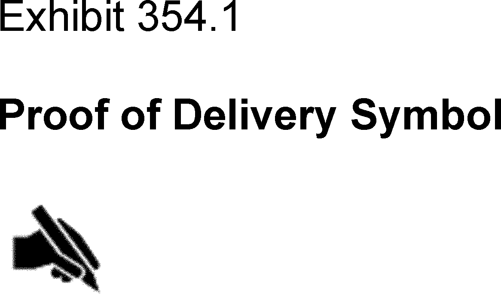
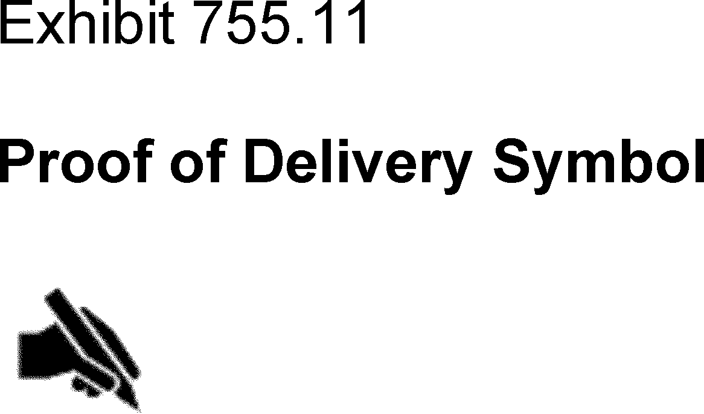
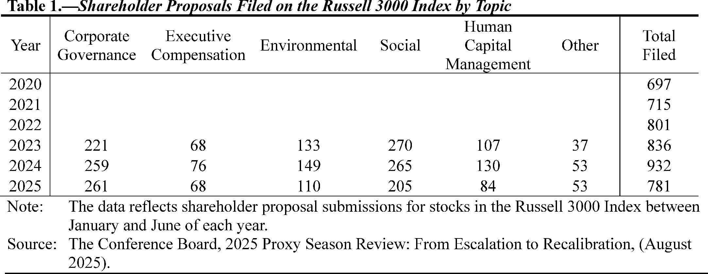
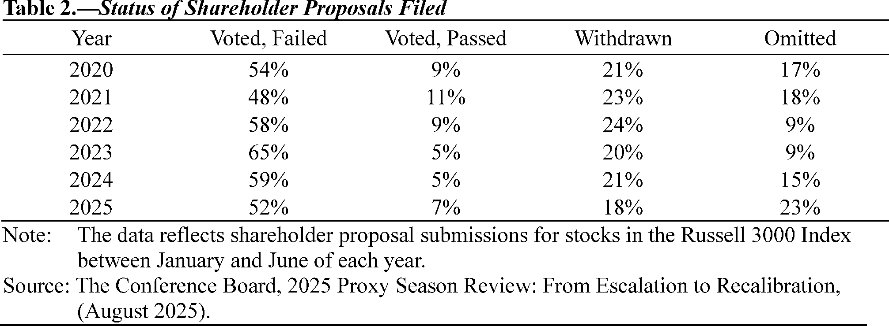
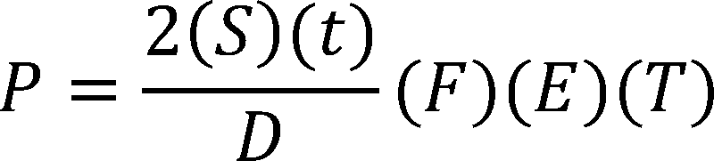
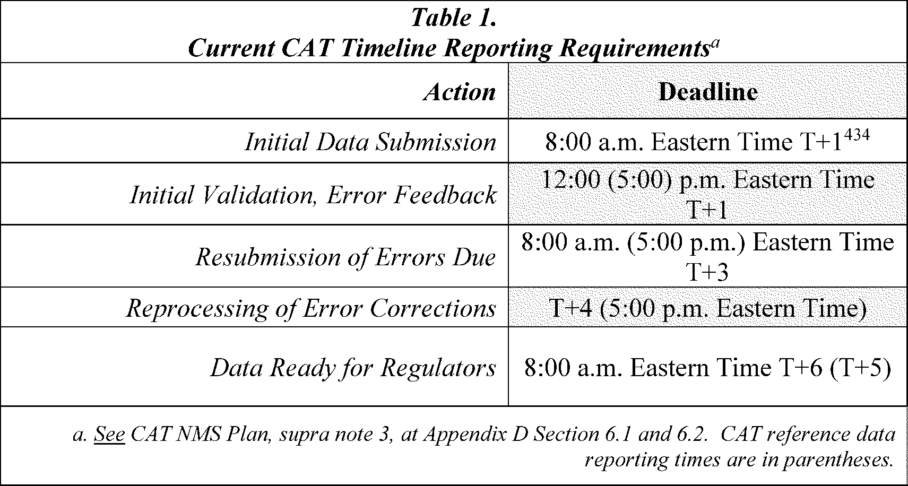
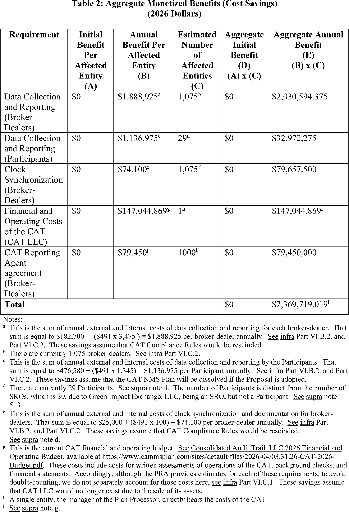

# Daily Digest — 2026-11-24

| | |
|---|---|
| **Digest date** | 2026-11-24 |
| **Data date range** | 2026-11-24 to 2026-11-24 |
| **Generated at** | 2026-11-25T05:06:54Z (UTC) |
| **Pipeline version** | 73366aa1 |
| **Inference** | model layers ran — gemini/gemini-2.5-flash |
| **Source watermarks** | CREC: 2026-11-21T11:41:04Z · BILLS: 2026-11-24T17:52:03Z · FR: 2026-11-24T20:17:10Z · USCOURTS: 2026-11-24T23:27:11Z · PLAW: 2026-11-24T16:37:02Z |

[Full observed listing for this day](day/2026-11-24.html) — the items our collectors observed for this publication day, mechanical rules applied, frozen at end of day; releases their publishers date on other days are counted there, not listed. This digest is the canonical record.

All items below cite the govinfo package (and granule, where applicable) they
summarize. Selection is mechanical; each item states the rule that included
it. See the Coverage Statement at the end for a full accounting of what was
published, what was summarized, and what was excluded and why.

---

## Contents

- [Day in Review](#day-in-review)
- [1. Congressional Floor Activity](#1-congressional-floor-activity)
- [2. Legislation](#2-legislation)
- [3. Federal Register](#3-federal-register)
- [4. Enacted Laws](#4-enacted-laws)
- [5. Judicial Activity](#5-judicial-activity)
- [6. Agency Announcements](#6-agency-announcements)
- [7. Recorded Votes](#7-recorded-votes)
- [8. Bill Actions](#8-bill-actions)
- [9. Presidential Actions](#9-presidential-actions)
- [Terms Used Today](#terms-used-today)
- [Coverage Statement](#coverage-statement)
- [Methodology](#methodology)

---

## Day in Review

The digest carries 2 enrolled bills, HR 2478 and HR 973, concerning financial exploitation prevention and lithium-ion battery safety standards. In the Senate, 4 bills were agreed to, and 12 bills were reported, including S. 5718, the Trucker Bathroom Access Act. The House introduced 31 bills and the Senate introduced 12 bills. The Senate also placed 1 bill on its calendar, received 1, and referred 2.

The executive branch published 13 final rules and 6 proposed rules in the Federal Register. Final rules include inflation adjustments for civil money penalties and revised regulations for rehearing request denials. Proposed rules address offshore operations industry standards, ERISA fiduciary duty, and SEC control of the Consolidated Audit Trail. The digest also carries 103 Federal Register notices and 183 agency press and advisory releases.

The digest carries 86 appellate court opinions, 2 bankruptcy court opinions, and 869 district court opinions. The Tenth Circuit Court of Appeals reversed a dismissal for lack of personal jurisdiction. The Federal Circuit Court of Appeals reversed a dismissal regarding federal contractor COVID-19 safety protocols. The Fifth Circuit Court of Appeals vacated a summary judgment for reconsideration. The Seventh Circuit Court of Appeals vacated summary judgments in tort suits for lack of federal subject-matter jurisdiction. The Eighth Circuit Court of Appeals issued notices of opinions.

*Composed from the summarized items below and the day's mechanical
counts; all specifics are cited in their sections.*

---

## 1. Congressional Floor Activity

No Congressional Record issue was observed on this day. The Record for a day's proceedings is typically published by govinfo the following morning; it appears in the digest for the day it is observed ([how our clocks work](faq.html#fapds-three-clocks)).

### 1.1 Senate

No Senate floor items met the selection thresholds. 0 floor granule(s) are accounted for in the Coverage Statement.

### 1.2 House of Representatives

No House floor items met the selection thresholds. 0 floor granule(s) are accounted for in the Coverage Statement.

### 1.3 Recorded Votes

No recorded votes were published in this issue of the Congressional Record.

---

## 2. Legislation

Source: Congressional Bills (BILLS), text versions published 2026-11-24 to 2026-11-24.

### 2.1 Counts by Stage

| Stage (bill text version) | Count |
|---|---|
| Introduced (ih/is) | 43 |
| Reported (rh/rs) | 12 |
| Engrossed (eh/es) | 0 |
| Enrolled (enr) | 2 |
| Other versions | 8 |
| **Total bill texts published** | **65** |

### 2.2 Bills Listed by Mechanical Rule

Tags: legislative · model keys: consumer standards · legislation · resource management

*In plain terms: Today's 15 legislative items detail measures like the Financial Exploitation Prevention Act and lithium-ion battery consumer standards, with other bills addressing Earth mapping, marine aquaculture, and biosecurity.*

Bills below are listed because they matched at least one listing rule; the
matching rule is stated per item. All other bill texts are counted above and
accounted for in the Coverage Statement.

- **H. R. 2478 (enr) — HR 2478 ENR: Financial Exploitation Prevention Act of 2025** — H.R. 2478, the Financial Exploitation Prevention Act of 2025, amends Section 22 of the Investment Company Act of 1940. Registered open-end investment companies and transfer agents that elect to comply may request contact information for an adult individual for non-institutional direct at-fund accounts, and may postpone redemption payments for more than seven days for up to 15 business days, extendable by 10 business days, when they reasonably believe financial exploitation of a specified adult has occurred, is occurring, or was attempted. The Act also directs the Securities and Exchange Commission to submit a report with regulatory and legislative recommendations to Congress within one year of enactment.
  - *In plain terms:* Funds and transfer agents opting in may request an adult's contact details and delay redemptions over seven days, up to 15 business days (extendable by 10), when they believe financial exploitation occurred, is occurring, or was attempted.
  - Included because: BILLS-SEL-01 — reached stage: reported/enrolled/calendar
  - Source: [BILLS-119hr2478enr](https://www.govinfo.gov/app/details/BILLS-119hr2478enr)
- **H. R. 9640 (pcs) — 119 HR 9640 PCS: Earth MRI Reauthorization Act of 2026** — H.R. 9640, the Earth MRI Reauthorization Act of 2026, amends Section 40201 of the Infrastructure Investment and Jobs Act to add modern sensing and data-driven methods to the Earth Mapping Resources Initiative and to include the U.S. Geological Survey's 3D Hydrography Program among integrated data sources. The bill authorizes $84,000,000 for fiscal years 2027 through 2031 and directs the USGS Director to give preference, to the extent practicable, to United States-owned and United States-controlled contractors. It also requires entities contracting with the USGS under the Initiative to disclose the ownership of the primary contractor and each subcontractor. The bill passed the House on November 18, 2026, and was placed on the Senate calendar on November 19, 2026.
  - *In plain terms:* The Earth MRI Reauthorization Act would add modern sensing methods to the Earth Mapping program and authorize $84,000,000 for fiscal years 2027 through 2031; it passed the House on November 18, 2026.
  - Included because: BILLS-SEL-01 — reached stage: reported/enrolled/calendar (document dated 2026-11-19)
  - Source: [BILLS-119hr9640pcs](https://www.govinfo.gov/app/details/BILLS-119hr9640pcs)
- **H. R. 973 (enr) — HR 973 ENR: Setting Consumer Standards for Lithium-Ion Batteries Act** — H.R. 973, the Setting Consumer Standards for Lithium-Ion Batteries Act, directs the Consumer Product Safety Commission to promulgate, within 180 days of enactment, ANSI/CAN/UL 2271, ANSI/CAN/UL 2849, and ANSI/CAN/UL 2272 as consumer product safety standards, limited to consumer products as defined in the Consumer Product Safety Act. The Act treats revisions to these voluntary standards as Commission standards effective 180 days after the standards organization notifies the Commission, unless the Commission determines within 90 days that the revision does not improve safety. The Commission must also report to Congress within five years of enactment on fires, explosions, and other hazards involving lithium-ion batteries in micromobility products.
  - *In plain terms:* Within 180 days of enactment, the Consumer Product Safety Commission must issue three lithium-ion battery safety standards (ANSI/CAN/UL 2271, 2849, and 2272) as consumer product safety standards.
  - Included because: BILLS-SEL-01 — reached stage: reported/enrolled/calendar
  - Source: [BILLS-119hr973enr](https://www.govinfo.gov/app/details/BILLS-119hr973enr)
- **S. 2586 (rs) — 117 S2586 RS: Marine Aquaculture Research for America Act of 2025** — S. 2586, the Marine Aquaculture Research for America Act of 2025, was introduced by Senator Wicker and reported by Senator Cruz with an amendment on November 20, 2026. As reflected in the visible portion of the text, the bill directs the National Oceanic and Atmospheric Administration to establish an assessment program for commercial-scale offshore aquaculture through demonstration projects, establishes an Office of Aquaculture within the National Marine Fisheries Service, and addresses permits, Aquaculture Centers of Excellence, workforce development, and working waterfronts. The table of contents also lists Title IV studies by the National Academies of Sciences, Engineering, and Medicine and a Government Accountability Office report; the full text was truncated in the source provided, so later provisions are not summarized here.
  - *In plain terms:* Reported by Senator Cruz with an amendment on November 20, 2026, this bill directs NOAA to establish an assessment program for commercial-scale offshore aquaculture through demonstration projects; the text provided was cut short.
  - Included because: BILLS-SEL-01 — reached stage: reported/enrolled/calendar (document dated 2026-11-20)
  - Source: [BILLS-119s2586rs](https://www.govinfo.gov/app/details/BILLS-119s2586rs)
- **S. 2883 (rs) — 119 S2883 RS: QUAHOGS Act of 2025** — S. 2883, the Quantifying Uncertainty and Action to Help Optimize Growth of Shellfish Act of 2025 or QUAHOGS Act of 2025, was introduced by Senator Whitehouse and reported by Senator Cruz with an amendment on November 20, 2026. The bill directs the Secretary of Commerce to convene an East Coast Bivalve Research Task Force of 16 to 21 members within 90 days of enactment to review bivalve research, identify applied research needs for quahogs (hard clams) and other bivalves, and support sustainable fisheries and aquaculture. The Task Force must submit an interim progress report within one year and a final report within two years, and it is required to establish work groups, including one on quahog research needs in Rhode Island and across the East Coast and one on climate change impacts. The source text was truncated, so the remaining provisions are not summarized here.
  - *In plain terms:* Reported by Senator Cruz with an amendment on November 20, 2026, the bill directs the Commerce Secretary to convene a 16-to-21-member East Coast Bivalve Research Task Force to identify quahog research needs.
  - Included because: BILLS-SEL-01 — reached stage: reported/enrolled/calendar (document dated 2026-11-20)
  - Source: [BILLS-119s2883rs](https://www.govinfo.gov/app/details/BILLS-119s2883rs)
- **S. 3301 (rs) — 119 S3301 RS: Chip EQUIP Act** — S. 3301, the Chip Equipment Quality, Usefulness, and Integrity Protection Act of 2025 or Chip EQUIP Act, was introduced by Senator Kelly and reported by Senator Cruz with an amendment and an amendment to the title on November 20, 2026. The bill adds definitions to Section 9901 of the William M. (Mac) Thornberry National Defense Authorization Act for Fiscal Year 2021 for completed, fully assembled semiconductor manufacturing equipment and ineligible semiconductor manufacturing equipment made, assembled, or refurbished by foreign entities of concern or their subsidiaries or affiliates. It requires Section 9909 funding agreements to prohibit procurement, installation, or use of such equipment for 10 years, subject to waivers and to exceptions for equipment installed or covered by agreements entered before enactment. The amended title reads: A bill to prohibit purchases of certain semiconductor manufacturing equipment from foreign entities of concern or subsidiaries or affiliates of foreign entities of concern, and for other purposes.
  - *In plain terms:* The Chip EQUIP Act would bar, for 10 years, procurement, installation, or use of certain semiconductor manufacturing equipment made or refurbished by foreign entities of concern or their affiliates, subject to waivers and certain exceptions.
  - Included because: BILLS-SEL-01 — reached stage: reported/enrolled/calendar (document dated 2026-11-20)
  - Source: [BILLS-119s3301rs](https://www.govinfo.gov/app/details/BILLS-119s3301rs)
- **S. 3741 (rs) — 119 S3741 RS: Biosecurity Modernization and Innovation Act of 2026** — S. 3741, the Biosecurity Modernization and Innovation Act of 2026, as reported with an amendment by the Senate Committee on Commerce, Science, and Transportation, would direct the Secretary of Commerce to issue regulations within one year of enactment requiring covered providers of synthetic nucleic acids and nucleic acid synthesis equipment to implement sequence-of-concern and customer screening protocols. The regulations would establish a conformity assessment system with audits, a process for revoking conformity status, and civil enforcement by the Attorney General with statutory damages of up to $500,000 for individuals and $750,000 for other persons. The text as provided is truncated, so provisions after the biotechnology governance sandbox section are not reflected in this summary.
  - *In plain terms:* The bill would require the Commerce Secretary to issue rules within one year for synthetic nucleic acid providers to screen sequences and customers, enforced by the Attorney General with damages up to $500,000 for individuals.
  - Included because: BILLS-SEL-01 — reached stage: reported/enrolled/calendar (document dated 2026-11-20)
  - Source: [BILLS-119s3741rs](https://www.govinfo.gov/app/details/BILLS-119s3741rs)
- **S. 3954 (rs) — 119 S3954 RS: No Lifeline for Dead People Act** — S. 3954, the No Lifeline for Dead People Act, as reported with an amendment by the Senate Committee on Commerce, Science, and Transportation, would prohibit an eligible telecommunications carrier from providing Lifeline service to a consumer unless the National Verifier has been used to verify the consumer's eligibility and the carrier has used the National Lifeline Accountability Database to determine that the service would not violate restrictions on duplicative support. The bill directs the Federal Communications Commission to coordinate with the Treasury Department on the Do Not Pay Initiative to help prevent Lifeline enrollments of deceased individuals and duplicative support. It also requires a Government Accountability Office study within 18 months of enactment on Lifeline program integrity and enrollment barriers, and an annual FCC report to Congress on eligible, enrolled, denied, abandoned, and disenrolled households.
  - *In plain terms:* The bill bars carriers from providing Lifeline service unless eligibility is verified through the National Verifier and checked in the National Lifeline Accountability Database for duplicate support, and requires FCC coordination with Treasury's Do Not Pay Initiative.
  - Included because: BILLS-SEL-01 — reached stage: reported/enrolled/calendar (document dated 2026-11-20)
  - Source: [BILLS-119s3954rs](https://www.govinfo.gov/app/details/BILLS-119s3954rs)
- **S. 4256 (rs) — 119 S4256 RS: Airmen Certificate Accessibility Act** — S. 4256, the Airmen Certificate Accessibility Act, as reported with an amendment by the Senate Committee on Commerce, Science, and Transportation, would add subsection (m) to 49 U.S.C. 44703 allowing an individual holding an airman certificate, including a medical certificate, to present it to the FAA Administrator or a designee as a physical certificate or as a digital certificate stored on an electronic device or in a cloud-based system. Digital certificates would be presented under authentication and verification requirements established by the Administrator. The bill directs the FAA Administrator to issue a final rule by November 30, 2028, updating parts 61, 63, 65, 67, and 107 of title 14, Code of Federal Regulations, to implement the amendment.
  - *In plain terms:* The bill lets airmen present airman certificates to the FAA in physical or digital form and directs the FAA to issue a final rule by November 30, 2028.
  - Included because: BILLS-SEL-01 — reached stage: reported/enrolled/calendar (document dated 2026-11-20)
  - Source: [BILLS-119s4256rs](https://www.govinfo.gov/app/details/BILLS-119s4256rs)
- **S. 4802 (rs) — 117 S4802 RS: Hurricane Hunter Aircraft Recapitalization Act** — S. 4802, the Hurricane Hunter Aircraft Recapitalization Act, as reported with an amendment by the Senate Committee on Commerce, Science, and Transportation (Report No. 119–167), would amend section 11708 of the Don Young Coast Guard Authorization Act of 2022 to direct NOAA to acquire and maintain manned aircraft for hurricane and atmospheric reconnaissance and research missions, in a number of not fewer than 6 and not more than 9. The bill authorizes multiyear contracts for the aircraft, with terms that may exceed five years, increases the authorized acquisition appropriation to $2,500,000,000 for fiscal years 2027 through 2031, and authorizes $45,000,000 for each of those years for Office of Marine and Aviation Operations aviation operations. It also repeals section 413 of the Weather Research and Forecasting Innovation Act of 2017 and transfers the amended section 11708 into that Act as section 413.
  - *In plain terms:* The bill directs NOAA to acquire and maintain 6 to 9 manned aircraft for hurricane reconnaissance, raises the acquisition authorization to $2,500,000,000 for fiscal years 2027 through 2031, and authorizes $45,000,000 yearly for aviation operations.
  - Included because: BILLS-SEL-01 — reached stage: reported/enrolled/calendar (document dated 2026-11-20)
  - Source: [BILLS-119s4802rs](https://www.govinfo.gov/app/details/BILLS-119s4802rs)
- **S. 5251 (rs) — 119 S5251 RS: ACPAC Modernization Act** — S. 5251, the ACPAC Modernization Act, reported without amendment by the Senate Committee on Commerce, Science, and Transportation, would amend section 411 of the FAA Modernization and Reform Act of 2012 by adding ticket agents as a category in the membership list of subsection (b) of the aviation consumer protection advisory committee provision. The bill also strikes the phrase 'ticket agents,' from subsection (i) of that section and makes conforming punctuation changes to subsection (b).
  - *In plain terms:* The bill would add ticket agents to the membership list of aviation consumer protection advisory committee in section 411 of the FAA Modernization and Reform Act of 2012 and removes 'ticket agents' from subsection (i).
  - Included because: BILLS-SEL-01 — reached stage: reported/enrolled/calendar (document dated 2026-11-20)
  - Source: [BILLS-119s5251rs](https://www.govinfo.gov/app/details/BILLS-119s5251rs)
- **S. 5332 (rs) — 108 S5332 RS: Cooperative Institute Act of 2026** — S. 5332, the Cooperative Institute Act of 2026, as reported with an amendment by the Senate Committee on Commerce, Science, and Transportation, would direct the NOAA Under Secretary of Commerce for Oceans and Atmosphere to maintain a Cooperative Institute program linking NOAA with eligible non-Federal academic or nonprofit research institutions. The text authorizes cooperative agreements with a 5-year Federal financial assistance award, a possible second 5-year award following a renewal review, and a requirement that the appropriate congressional committees receive notice at least 60 days before any termination or non-renewal. It also requires a Cooperative Institute Handbook, a biennial assessment of emerging research needs, and maintenance of existing Cooperative Institutes unless terminated under the bill. The text as provided is truncated, so provisions after the establishment section of the second version are not reflected in this summary.
  - *In plain terms:* Directs NOAA to maintain a Cooperative Institute program with non-Federal academic and nonprofit research institutions, using 5-year awards that may be renewed once for 5 more years, with 60 days' notice to committees before termination.
  - Included because: BILLS-SEL-01 — reached stage: reported/enrolled/calendar (document dated 2026-11-20)
  - Source: [BILLS-119s5332rs](https://www.govinfo.gov/app/details/BILLS-119s5332rs)
- **S. 5663 (rs) — 119 S5663 RS: Promoting Reproducibility and Oversight of Federal Research Act** — S. 5663, the Promoting Reproducibility and Oversight of Federal Research Act (PROOF Act), was introduced by Sen. Lummis on September 30, 2026, and reported by Sen. Cruz with an amendment from the Senate Committee on Commerce, Science, and Transportation on November 20, 2026. The bill directs the National Science Foundation Director to make competitive, merit-review awards to institutions of higher education to replicate federally funded research, and specifies the application contents, review criteria, and permitted uses of funds, including stipends for eligible STEM master's students. It requires the Director to submit reports to the Senate Commerce Committee and the House Science, Space, and Technology Committee beginning 18 months after the first award and annually thereafter.
  - *In plain terms:* The PROOF Act directs the NSF Director to make competitive awards to colleges and universities to replicate federally funded research, with reports to two congressional committees starting 18 months after the first award.
  - Included because: BILLS-SEL-01 — reached stage: reported/enrolled/calendar (document dated 2026-11-20)
  - Source: [BILLS-119s5663rs](https://www.govinfo.gov/app/details/BILLS-119s5663rs)
- **S. 5718 (rs) — 119 S5718 RS: Trucker Bathroom Access Act** — S. 5718, the Trucker Bathroom Access Act, was introduced by Sen. Fischer, for Rep. Blunt Rochester and Sen. Fischer, and reported with an amendment from the Senate Committee on Commerce, Science, and Transportation on November 20, 2026. The reported text adds section 14105 to title 49, United States Code, requiring covered establishments to grant covered drivers access to qualifying restrooms when delivering goods or waiting to be loaded, and provides that the section does not require physical restroom changes. Section 3 requires terminal operators at ports and intermodal rail yards to provide sufficient covered restrooms and parking for drayage truck operators, and the Attorney General is designated to enforce the section under section 14703 of title 49.
  - *In plain terms:* The bill requires covered establishments to let covered drivers use qualifying restrooms during deliveries or loading waits, and requires port and rail-yard terminal operators to provide restrooms for drayage truck operators.
  - Included because: BILLS-SEL-01 — reached stage: reported/enrolled/calendar (document dated 2026-11-20)
  - Source: [BILLS-119s5718rs](https://www.govinfo.gov/app/details/BILLS-119s5718rs)
- **S. 69 (rs) — 119 S69 RS: Curtailing Online Limitations that Lead Unconstitutionally to Democracy's Erosion Act** — S. 69, the "Curtailing Online Limitations that Lead Unconstitutionally to Democracy's Erosion Act" or "COLLUDE Act," was introduced by Mr. Schmitt on January 9, 2025, referred to the Committee on Commerce, Science, and Transportation, and reported by Mr. Cruz on November 20, 2026, with an amendment striking all after the enacting clause. The bill amends Section 230 of the Communications Act of 1934 (47 U.S.C. 230) to add a burden-of-proof provision for certain actions, to deny Section 230(c) protection to providers that restrict legitimate political speech as a result of certain governmental communications, and to define related terms, with exceptions for legitimate law enforcement and national security purposes. The text also defines "covered provider" as a social media platform with at least $250,000,000 in revenue in the preceding 12 months or at least 10,000,000 global monthly active users for three of the preceding 12 months, makes a "prohibited content action" by such a provider unlawful, and authorizes civil actions by affected information content providers with statutory damages, including the greater of $1,000,000 or three times compensatory damages in specified cases.
  - *In plain terms:* The COLLUDE Act amends Section 230 of the Communications Act to deny protection to providers that restrict legitimate political speech due to certain governmental communications and allows civil actions with statutory damages.
  - Included because: BILLS-SEL-01 — reached stage: reported/enrolled/calendar (document dated 2026-11-20)
  - Source: [BILLS-119s69rs](https://www.govinfo.gov/app/details/BILLS-119s69rs)

---

## 3. Federal Register

Source: Federal Register (FR), issue of 2026-11-24.

### 3.1 Counts by Document Type

| Document type | Count |
|---|---|
| Rules | 13 |
| Proposed rules | 6 |
| Notices | 103 |
| Presidential documents | 0 |
| **Total FR documents** | **122** |

### 3.2 Rules Published

Tags: department of transportation · executive · securities and exchange commission · model keys: airworthiness directives · procedural updates · rules

*In plain terms: Today's 13 new rules detail inflation adjustments for civil money penalties and International Proof of Delivery, with others covering airworthiness directives, airspace changes, and procedural updates.*

#### DEPARTMENT OF ENERGY

- **Denial of Rehearing Requests by Operation of Law Under the Commission's Rules of Practice and Procedure** (2026-23884; 18 CFR Part 385) — The Federal Energy Regulatory Commission (Commission) is revising its regulations addressing the circumstances under which a request for rehearing is denied absent Commission action within a particular time frame. Currently, the Commission's regulations provide that unless the Commission acts upon a request for rehearing within 30 days after the request is filed, the request is denied. As revised in this final rule, the regulation will apply only to matters subject to the rehearing and judicial review provisions in the Federal Power Act (FPA) and Natural Gas Act (NGA). Action: Final rule. Dates: This rule is effective December 24, 2026.
  - *In plain terms:* The Federal Energy Regulatory Commission revises its rules on rehearing requests that are denied automatically when it does not act within 30 days of filing, so the rule applies only to matters under the Federal Power Act and Natural Gas Act.
  - Included because: FR-SEL-01 — document type: final rule (all listed)
  - Source: [FR-2026-11-24 / 2026-23884](https://www.govinfo.gov/app/details/FR-2026-11-24/2026-23884)

#### DEPARTMENT OF HOMELAND SECURITY

- **Safety Zone; Pasquotank River Harbor, Elizabeth City, NC** (2026-23953; 33 CFR Part 165) — The Coast Guard is establishing a temporary safety zone for certain navigable waters on the Pasquotank River, at Elizabeth City, NC. The safety zone is needed to protect personnel, vessels, and the marine environment from potential hazards associated with an over-the-water drone display. The entry of vessels or persons into this zone is prohibited unless specifically authorized by the Captain of the Port, Sector North Carolina, or their designated representative. Action: Temporary final rule. Dates: This rule is effective from 7 p.m. to 8 p.m. on November 27, 2026.
  - *In plain terms:* The Coast Guard establishes a temporary safety zone on the Pasquotank River at Elizabeth City, NC, for an over-the-water drone display, prohibiting entry unless authorized by the Captain of the Port, Sector North Carolina, or a designated representative.
  - Included because: FR-SEL-01 — document type: final rule (all listed)
  - Source: [FR-2026-11-24 / 2026-23953](https://www.govinfo.gov/app/details/FR-2026-11-24/2026-23953)

#### DEPARTMENT OF THE TREASURY

- **Notification of Inflation Adjustments for Civil Money Penalties** (2026-23851; 12 CFR Part 19) — This document announces the Office of the Comptroller of the Currency's (OCC) maximum civil money penalties for 2026 as adjusted for inflation. The inflation adjustments are required to implement the Federal Civil Penalties Inflation Adjustment Act of 1990, as amended by the Federal Civil Penalties Inflation Adjustment Act Improvements Act of 2015. Action: Notification of monetary penalties 2026. Dates: The adjusted maximum amount of civil money penalties in this document are applicable to penalties assessed on or after January 10, 2025, for conduct occurring on or after November 2, 2015.
  - *In plain terms:* The Office of the Comptroller of the Currency announces its maximum civil money penalties for 2026, adjusted for inflation as required by the Federal Civil Penalties Inflation Adjustment Act of 1990 and its 2015 amendments.
  - Included because: FR-SEL-01 — document type: final rule (all listed)
  - Source: [FR-2026-11-24 / 2026-23851](https://www.govinfo.gov/app/details/FR-2026-11-24/2026-23851)

#### DEPARTMENT OF TRANSPORTATION

- **Airworthiness Directives; CFM International, S.A. Engines** (2026-23860; 14 CFR Part 39) — The FAA is superseding Airworthiness Directive (AD) 2018-26-01 for all CFM International, S.A. (CFM) Model CFM56-7B engines. AD 2018-26-01 required initial and repetitive ultrasonic inspections or eddy current inspections of certain fan blades for crack indications and, depending on the results of the inspections, replacement with parts eligible for installation. Since the FAA issued AD 2018-26-01, CFM issued updated service material providing improvements to the ultrasonic inspection procedures and expanding the inspection area. This AD requires initial and repetitive ultrasonic inspections or eddy current inspections of certain fan blades for crack indications and, depending on the results of the inspections, replacement with parts eligible for installation. The FAA is issuing this AD to address the unsafe condition on these products. Action: Final rule. Dates: This AD is effective December 29, 2026. The Director of the Federal Register approved the incorporation by reference of certain publications listed in this AD as of December 29, 2026.
  - *In plain terms:* The FAA replaces Airworthiness Directive 2018-26-01 for CFM56-7B engines, keeping required ultrasonic or eddy current inspections of certain fan blades for cracks, with replacement depending on results, and reflecting updated CFM service material.
  - Included because: FR-SEL-01 — document type: final rule (all listed)
  - Source: [FR-2026-11-24 / 2026-23860](https://www.govinfo.gov/app/details/FR-2026-11-24/2026-23860)
- **Establishment of Class E Airspace Over Hardy, VA** (2026-23870; 14 CFR Part 71) — This action establishes new Class E airspace over Hardy, VA. This airspace is necessary to support Instrument Flight Rules (IFR) operations, utilizing new Special Instrument Approach Procedures (SIAPs) serving Carilion Westlake Center Heliport. Action: Final rule. Dates: Effective 0901 UTC, February 18, 2027. The Director of the Federal Register approves this incorporation by reference action under 1 CFR part 51, subject to the annual revision of FAA Order JO 7400.11 and publication of conforming amendments.
  - *In plain terms:* The FAA establishes new Class E airspace over Hardy, VA, to support instrument flight rule (IFR) operations using new instrument approach procedures serving the Carilion Westlake Center Heliport.
  - Included because: FR-SEL-01 — document type: final rule (all listed)
  - Source: [FR-2026-11-24 / 2026-23870](https://www.govinfo.gov/app/details/FR-2026-11-24/2026-23870)
- **Airworthiness Directives; Airbus Helicopters** (2026-23873; 14 CFR Part 39) — The FAA is adopting a new airworthiness directive (AD) for certain Airbus Helicopters Model H160-B helicopters. This AD was prompted by a determination that a gap without fire-resistant sealant (sealant) may be present in the cargo bay near the fuel segregation box. This AD requires inspecting for any missing sealant and, depending on findings, corrective action. The FAA is issuing this AD to address the unsafe condition on these products. Action: Final rule. Dates: This AD is effective December 29, 2026. The Director of the Federal Register approved the incorporation by reference of a certain publication listed in this AD as of December 29, 2026.
  - *In plain terms:* The FAA adopts a new airworthiness directive for certain Airbus H160-B helicopters, requiring inspection for missing fire-resistant sealant in the cargo bay near the fuel segregation box and corrective action depending on findings.
  - Included because: FR-SEL-01 — document type: final rule (all listed)
  - Source: [FR-2026-11-24 / 2026-23873](https://www.govinfo.gov/app/details/FR-2026-11-24/2026-23873)
- **Airworthiness Directives; Bell Textron Canada Limited Helicopters** (2026-23877; 14 CFR Part 39) — The FAA is adopting a new airworthiness directive (AD) for certain Bell Textron Canada Limited (Bell) Model 429 helicopters. This AD was prompted by reports of premature wear-out of certain spherical bearings due to a quality escape of the spherical bearing monoballs not receiving the required hard coating. This AD requires repetitively inspecting the tail rotor (TR) pitch link assemblies and their bearings for cracks, wear, and mechanical or corrosion damage and, depending on the results, replacing any affected TR pitch link assembly. This AD also allows an affected part to be installed in a helicopter if certain requirements are met. The FAA is issuing this AD to address the unsafe condition on these products. Action: Final rule; request for comments. Dates: This AD is effective December 9, 2026. The Director of the Federal Register approved the incorporation by reference of a certain publication listed in this AD as of December 9, 2026. The FAA must receive comments on this AD by January 8, 2027.
  - *In plain terms:* The FAA adopts a new airworthiness directive for certain Bell Model 429 helicopters after reports of premature wear-out of spherical bearings, requiring repetitive inspections of tail rotor pitch link assemblies and replacement of affected assemblies depending on results.
  - Included because: FR-SEL-01 — document type: final rule (all listed)
  - Source: [FR-2026-11-24 / 2026-23877](https://www.govinfo.gov/app/details/FR-2026-11-24/2026-23877)
- **Airworthiness Directives; Airbus Helicopters** (2026-23879; 14 CFR Part 39) — The FAA is superseding Airworthiness Directive (AD) 2025-08-06 which applied to certain Airbus Helicopters Model SA330J helicopters. AD 2025-08-06 required repetitively inspecting for a gap between the main gearbox (MGB) oil cooling fan assembly rotor blade and the upper section of the guide vane bearing housing, replacing the MGB fan rotor bearings with serviceable bearings if necessary, and at a later compliance time replacing the MGB fan rotor bearing assembly with an improved MGB fan rotor bearing assembly, which constitutes terminating action for the repetitive inspections. Since AD 2025-08-06 was issued, the FAA determined that the compliance time for installing the improved MGB fan rotor bearing assembly should be extended. This AD continues to require the actions in AD 2025-08-06 and increases the compliance time for installing the improved MGB fan rotor bearing assembly. This AD also prohibits installing any MGB fan rotor bearings and any MGB fan rotor bearing assembly, unless certain requirements are met. The FAA is issuing this AD to address the unsafe condition on these products. Action: Final rule. Dates: This AD is effective December 29, 2026. The Director of the Federal Register approved the incorporation by reference of a certain publication listed in this AD as of December 29, 2026.
  - *In plain terms:* The FAA replaces Airworthiness Directive 2025-08-06 for certain Airbus SA330J helicopters, keeping its existing requirements, extending the compliance time for installing an improved main gearbox fan rotor bearing assembly, and prohibiting installation of affected bearings unless conditions are met.
  - Included because: FR-SEL-01 — document type: final rule (all listed)
  - Source: [FR-2026-11-24 / 2026-23879](https://www.govinfo.gov/app/details/FR-2026-11-24/2026-23879)
- **IFR Altitudes; Miscellaneous Amendments** (2026-23900; 14 CFR Part 95) — This amendment adopts miscellaneous amendments to the required IFR (instrument flight rules) altitudes and changeover points for certain Federal airways, jet routes, or direct routes for which a minimum or maximum en-route authorized IFR altitude is prescribed. This regulatory action is needed because of changes occurring in the National Airspace System. These changes are designed to provide for the safe and efficient use of the navigable airspace under instrument conditions in the affected areas. Action: Final rule. Dates: Effective 0901 UTC, December 24, 2026.
  - *In plain terms:* The FAA adopts miscellaneous amendments to required IFR altitudes and changeover points for certain Federal airways, jet routes, and direct routes, because of changes in the National Airspace System.
  - Included because: FR-SEL-01 — document type: final rule (all listed)
  - Source: [FR-2026-11-24 / 2026-23900](https://www.govinfo.gov/app/details/FR-2026-11-24/2026-23900)
- **Airworthiness Directives; The Boeing Company Airplanes** (2026-23926; 14 CFR Part 39) — The FAA is superseding Airworthiness Directive (AD) 2026-21-08, which applied to certain The Boeing Company Model 737-700, -700C, -800, and -900ER series airplanes. AD 2026-21-08 required a detailed inspection of the left- and right-side form-in-place (FiP) gasket at the engine fuel shutoff valve access panel for correct sealant installation, a fluid leak test of the engine fuel shutoff valve access panels for any leak, and applicable on-condition actions. Since the FAA issued AD 2026-21-08, the FAA has determined that the compliance time exception specified in paragraph (h) of AD 2026-21-08 omits reference to a certain date. This AD retains all of the requirements of AD 2026-21-08 and adds the omitted reference to the compliance time exception specified in paragraph (h) of this AD. The FAA is issuing this AD to address the unsafe condition on these products. Action: Final rule; request for comments. Dates: This AD is effective December 1, 2026. The Director of the Federal Register approved the incorporation by reference of a certain publication listed in this AD as of December 1, 2026 (91 FR 67448, October 27, 2026). The FAA must receive comments on this AD by December 24, 2026.
  - *In plain terms:* The FAA replaces Airworthiness Directive 2026-21-08 for certain Boeing 737-700, -700C, -800, and -900ER airplanes, keeping all its requirements and adding a date reference omitted from the compliance time exception in paragraph (h).
  - Included because: FR-SEL-01 — document type: final rule (all listed)
  - Source: [FR-2026-11-24 / 2026-23926](https://www.govinfo.gov/app/details/FR-2026-11-24/2026-23926)
- **Amendment of Class D Airspace and Class E Airspace Over Tri-Cities, TN** (2026-23948; 14 CFR Part 71) — This action amends Class D and Class E airspace over Tri-Cities, TN. Specifically, this action modifies the Tri-Cities Class D and Class E surface area airspace by expanding the radius and lateral boundaries to the northeast and removing the Tri-Cities Class E surface area extension airspace to the northeast. Additionally, this action modifies the Tri-Cities Class E transitional airspace beginning at 700 feet above the surface by expanding the lateral boundaries of the western portion of the airspace. Lastly, this action updates the airport name within the Class D and E legal descriptions and other outdated verbiage. Action: Final rule. Dates: Effective date 0901 UTC, February 18, 2027. The Director of the Federal Register approves this incorporation by reference action under 1 CFR part 51, subject to the annual revision of FAA Order JO 7400.11 and publication of conforming amendments.
  - *In plain terms:* The FAA amends Class D and Class E airspace over Tri-Cities, TN, expanding the surface area radius and boundaries to the northeast, removing the northeast Class E extension, expanding western transitional airspace starting at 700 feet, and updating the airport name.
  - Included because: FR-SEL-01 — document type: final rule (all listed)
  - Source: [FR-2026-11-24 / 2026-23948](https://www.govinfo.gov/app/details/FR-2026-11-24/2026-23948)

#### GOVERNMENT ACCOUNTABILITY OFFICE

- **Personnel Appeals Board; Procedural Rules** (2026-23866; 4 CFR Part 28) — The Government Accountability Office Personnel Appeals Board (PAB or Board) is amending several significant changes to its existing regulations to streamline and modernize case processing before the Board. The General Accounting Office Personnel Act of 1980 provides authority to make these changes. Action: Final rule. Dates: This rule is effective as of December 24, 2026.
  - *In plain terms:* The Government Accountability Office Personnel Appeals Board is amending its regulations to streamline and modernize case processing, under authority granted by the General Accounting Office Personnel Act of 1980.
  - Included because: FR-SEL-01 — document type: final rule (all listed)
  - Source: [FR-2026-11-24 / 2026-23866](https://www.govinfo.gov/app/details/FR-2026-11-24/2026-23866)

#### POSTAL SERVICE

- **International Proof of Delivery Service** (2026-23917; 39 CFR Part 20) — The Postal Service is revising Mailing Standards of the United States Postal Service, International Mail Manual (IMM®), to reflect changes to product features for Priority Mail International® (PMI) and to introduce International Proof of Delivery as a new international extra service that will be available for PMI mailpieces to select destinations. Action: Final rule. Dates: Effective: January 17, 2027.
  - *In plain terms:* The Postal Service revises its International Mail Manual to reflect changed Priority Mail International features and adds International Proof of Delivery as a new extra service for select destinations.
  - Included because: FR-SEL-01 — document type: final rule (all listed)
  - Source: [FR-2026-11-24 / 2026-23917](https://www.govinfo.gov/app/details/FR-2026-11-24/2026-23917)
  -  *Source graphic 1 of 2 from 2026-23917.*
  -  *Source graphic 2 of 2 from 2026-23917.*

### 3.3 Proposed Rules Published

Tags: department of transportation · executive · securities and exchange commission · model keys: airworthiness directives · fiduciary duties · proposed rules

*In plain terms: Today's 6 proposed rules address incorporating industry standards for offshore oil/gas operations and clarifying ERISA fiduciary duties, with others covering airworthiness directives and the Consolidated Audit Trail.*

#### DEPARTMENT OF LABOR

- **Loyalty and the Exclusive Purpose Rule in Selecting Plan Investments and Exercising Shareholder Rights** (2026-23936; 29 CFR Part 2550) — In this proposed rule, the Department of Labor (Department) clarifies the fiduciary duty of loyalty under the Employee Retirement Income Security Act of 1974 (ERISA). The proposed rule affirms that ERISA's duty of loyalty requires fiduciaries to act with the exclusive purpose of ensuring retirement security and providing promised benefits to plan participants and their beneficiaries. The amendments clarify the neutral application of ERISA's fiduciary duties of prudence and loyalty to selecting investments and investment courses of action, and to exercising shareholder rights, including proxy voting, the use of written proxy voting policies and guidelines, and shareholder engagement activities. The amendments would enhance the regulation by adding an affirmative expression of the duty of loyalty that is more consistent with the statute, and removing the tiebreaker test and participant preference provisions, which do not comport with the best reading of the statute and are susceptible to abuse, including use by a fiduciary as pretext to employ plan assets to pursue personal preferences or objectives unrelated to financial benefits under the plan. \[official summary truncated; see source\] Action: Proposed rule. Dates: Comments on the proposal must be submitted on or before January 25, 2027.
  - *In plain terms:* The Department of Labor proposes clarifying that ERISA's duty of loyalty requires fiduciaries to act for the exclusive purpose of ensuring retirement security and providing promised benefits, and proposes removing the tiebreaker test and participant preference provisions.
  - Included because: FR-SEL-02 — document type: proposed rule (all listed)
  - Source: [FR-2026-11-24 / 2026-23936](https://www.govinfo.gov/app/details/FR-2026-11-24/2026-23936)
  -  *Source graphic 1 of 20 from 2026-23936.*
  -  *Source graphic 2 of 20 from 2026-23936.*
  - *Graphics not rendered here: 18 of 20 — see the [source PDF](https://www.govinfo.gov/content/pkg/FR-2026-11-24/pdf/FR-2026-11-24.pdf).*

#### DEPARTMENT OF THE INTERIOR

- **Oil and Gas and Sulfur Operations in the Outer Continental Shelf—Documents Incorporated by Reference** (2026-23859; 30 CFR Part 250) — The Department of the Interior (DOI or Department), through Marine Minerals Administration (MMA), is incorporating by reference a collection of production measurement industry standards and safety industry standards into its regulations governing oil, gas, and sulfur operations on the Outer Continental Shelf (OCS). Incorporation of these documents by reference will provide industry with up-to-date, minimum requirements for measuring oil and gas production volumes and enhancing safety. Compliance with these standards will reduce uncertainty in the measurement of oil and gas production and update the minimum standards in the safety regulations. Action: Proposed rule. Dates: Submit comments by December 24, 2026. MMA may not fully consider comments received after this date. You may submit comments to the Office of Management and Budget (OMB) on the information collection burden in this proposed rule by “December 24, 2026”. The deadline for comments on the information collection burden does not affect the deadline for the public to comment to MMA on the proposed regulations.
  - *In plain terms:* The Department of the Interior, through the Marine Minerals Administration, proposes incorporating industry standards for measuring oil and gas production and for safety into its rules for offshore oil, gas, and sulfur operations.
  - Included because: FR-SEL-02 — document type: proposed rule (all listed)
  - Source: [FR-2026-11-24 / 2026-23859](https://www.govinfo.gov/app/details/FR-2026-11-24/2026-23859)
  -  *Source graphic 1 of 1 from 2026-23859.*

#### DEPARTMENT OF TRANSPORTATION

- **Airworthiness Directives; Airbus Helicopters Deutschland GmbH (AHD) Helicopters** (2026-23874; 14 CFR Part 39) — The FAA proposes to supersede Airworthiness Directive (AD) 2026-08-51, which applies to all Airbus Helicopters Deutschland GmbH (AHD) Model MBB-BK 117 D-3 helicopters. AD 2026-08-51 requires inspecting the rotor hub-shaft for cracks, replacing any rotor hub-shaft that has any crack, and reporting information after accomplishment of the replacement. AD 2026-08-51 also prohibits installing any affected rotor hub-shaft on any helicopter, unless certain requirements are met. Since the FAA issued AD 2026-08-51, it was determined that additional repetitive inspections (including eddy current inspections) are necessary, and that revising the compliance time to account for hoist operations is necessary. This proposed AD would retain the actions of AD 2026-08-51 and would require additional repetitive inspections. The FAA is proposing this AD to address the unsafe condition on these products. Action: Notice of proposed rulemaking (NPRM). Dates: The FAA must receive comments on this NPRM by January 8, 2027.
  - *In plain terms:* The FAA proposes replacing Airworthiness Directive 2026-08-51 for certain Airbus Helicopters Deutschland MBB-BK 117 D-3 helicopters, keeping its rotor hub-shaft crack inspection and replacement requirements and adding repetitive inspections, including eddy current inspections.
  - Included because: FR-SEL-02 — document type: proposed rule (all listed)
  - Source: [FR-2026-11-24 / 2026-23874](https://www.govinfo.gov/app/details/FR-2026-11-24/2026-23874)
- **Airworthiness Directives; Airbus Helicopters** (2026-23880; 14 CFR Part 39) — The FAA proposes to supersede Airworthiness Directive (AD) 2024-10-10, which applies to all Airbus Helicopters Model SA 365 N, SA 365 N1, AS 365 N2, and AS 365 N3 helicopters. AD 2024-10-10 requires a one-time inspection for proper positioning of the tail rotor (TR) actuator harness and cable tie installation and, depending on the results, corrective action. Since the FAA issued AD 2024-10-10, the manufacturer developed a modification to reroute the yaw harness that would apply to certain model helicopters. This proposed AD would retain some of the actions of AD 2024-10-10 and would also require, for certain model helicopters, modifying the helicopter. The FAA is proposing this AD to address the unsafe condition on these products. Action: Notice of proposed rulemaking (NPRM). Dates: The FAA must receive comments on this NPRM by January 8, 2027.
  - *In plain terms:* The FAA proposes replacing Airworthiness Directive 2024-10-10 for certain Airbus SA 365 N, SA 365 N1, AS 365 N2, and AS 365 N3 helicopters, retaining some of its actions and requiring modification of certain models to reroute the yaw harness.
  - Included because: FR-SEL-02 — document type: proposed rule (all listed)
  - Source: [FR-2026-11-24 / 2026-23880](https://www.govinfo.gov/app/details/FR-2026-11-24/2026-23880)

#### DEPARTMENT OF VETERANS AFFAIRS

- **Streamlining the Application Process for Grants for Adaptive Sports Programs for Disabled Veterans and Disabled Members of the Armed Forces** (2026-23886; 38 CFR Part 77) — This proposed rule would amend the Department of Veterans Affairs (VA) regulations that govern grants for adaptive sports programs for disabled veterans and disabled members of the armed forces to allow for a more efficient review and selection of applicants for the grant. This rule would ensure that the grant aligns with the Uniform Administrative Requirements, Cost Principles, and Audit Requirements for Federal Awards by requiring applicants to submit an application within the VA established deadline for submission; requiring that all adaptive sports grants be openly competed; and adding a new section on appropriate actions VA may take to enforce this part. The changes proposed by this rulemaking will improve program administration without negatively impacting the veteran athletes supported by these grants. Action: Proposed rule. Dates: Comments must be received on or before January 25, 2027.
  - *In plain terms:* The Department of Veterans Affairs proposes amending its adaptive sports grant rules to require applications by its set deadline and open competition for all grants, and to add a section on enforcement actions it may take.
  - Included because: FR-SEL-02 — document type: proposed rule (all listed)
  - Source: [FR-2026-11-24 / 2026-23886](https://www.govinfo.gov/app/details/FR-2026-11-24/2026-23886)

#### SECURITIES AND EXCHANGE COMMISSION

- **Restructuring the Governance and Funding Model of the Consolidated Audit Trail** (2026-23951; 17 CFR Parts 240 and 242) — Although the consolidated audit trail (the “CAT”) continues to be a necessary regulatory tool, its decentralized governance has presented certain challenges to administering the CAT. To address those shortcomings, the Securities and Exchange Commission (the “Commission” or the “SEC”) proposes to assume direct control of the CAT. Specifically, the Commission is proposing amendments to Regulation NMS under the Securities Exchange Act of 1934 (“Exchange Act”) that would rescind Rule 613, which obligates the national securities exchanges and national securities associations (collectively, the “SROs”) to act jointly to develop a national market system plan to develop, implement, and maintain the CAT (the “CAT NMS Plan”). The Commission is simultaneously proposing new Rule 17a-26, which would require the SROs and broker-dealers to record and electronically report to a central repository substantially the same information that was previously required to be recorded and reported pursuant to Rule 613, the CAT NMS Plan, related SRO compliance rules, and related exemptive relief previously issued by the Commission. Action: Proposed rule. Dates: This release was published in the Federal Register on November 24, 2026. Comments should be received on or before January 25, 2027.
  - *In plain terms:* The SEC proposes taking direct control of the Consolidated Audit Trail by rescinding Rule 613 and proposing new Rule 17a-26, which would require SROs and broker-dealers to report substantially the same information to a central repository.
  - Included because: FR-SEL-02 — document type: proposed rule (all listed)
  - Source: [FR-2026-11-24 / 2026-23951](https://www.govinfo.gov/app/details/FR-2026-11-24/2026-23951)
  -  *Source graphic 1 of 14 from 2026-23951.*
  -  *Source graphic 2 of 14 from 2026-23951.*
  - *Graphics not rendered here: 12 of 14 — see the [source PDF](https://www.govinfo.gov/content/pkg/FR-2026-11-24/pdf/FR-2026-11-24.pdf).*

### 3.4 Notices and Presidential Documents

Notices are summarized only when they match a listing rule; all are counted
in 3.1 and in the Coverage Statement. Presidential documents in the FR are
always listed.

No notices or presidential documents matched a listing rule.

---

## 4. Enacted Laws

Source: Public and Private Laws (PLAW) published 2026-11-24.

No laws were published in this range.

---

## 5. Judicial Activity

Source: United States Courts Opinions (USCOURTS): opinions observed 2026-11-24
by our collector; each opinion states its own issue date beside its
listing ([how our clocks work](faq.html#fapds-three-clocks)).

Completeness disclosure (standing): USCOURTS carries opinions from
approximately 140 participating appellate, district, bankruptcy, and
national federal courts. Unlike the Congressional Record and the Federal
Register, which are the complete official record of their branches,
USCOURTS is participation-based and is NOT the complete federal judicial
record. Courts post opinions with delay — typically over several days —
so a day's digest carries the opinions that became available that day,
whatever date each was issued.

### 5.1 Appellate and National Court Opinions

Tags: judicial · model keys: court appeals · judicial decisions · jurisdiction

*In plain terms: Today's 86 judicial decisions include a Tenth Circuit reversal for lack of jurisdiction and numerous Fourth Circuit civil rights complaint dismissals, with other appeals heard across circuits.*

Appellate and national court opinions are summarized; district and
bankruptcy opinions are counted in 5.2 and in the Coverage Statement.

#### United States Court of Appeals for the Eighth Circuit

- **United States v. Mark Moss** (No. 25-03252; filed 2026-11-23) — The United States Court of Appeals for the Eighth Circuit issued a notice to counsel in the case of United States v. Mark Moss. The notice states that the court has issued an opinion and entered judgment in the case. It also provides information regarding post-submission procedures, including requirements and deadlines for filing petitions for rehearing.
  - *In plain terms:* The Eighth Circuit Court of Appeals issued a notice to counsel in *United States v. Mark Moss*, stating it released an opinion and judgment, and detailing post-submission procedures and deadlines for rehearing petitions.
  - Included because: USCOURTS-SEL-01 — appellate court opinion (all listed) (document dated 2026-11-23)
  - Source: [USCOURTS-ca8-25-03252 / USCOURTS-ca8-25-03252-0](https://www.govinfo.gov/app/details/USCOURTS-ca8-25-03252/USCOURTS-ca8-25-03252-0)
- **Iowa Environmental Council, et al v. EPA, et al** (No. 26-03374; filed 2026-11-23) — The United States Court of Appeals for the Eighth Circuit issued a notice to counsel in the case of Iowa Environmental Council, et al v. EPA, et al. The notice states that the court today issued an opinion in this case.
  - *In plain terms:* The Eighth Circuit Court of Appeals issued a notice to counsel in *Iowa Environmental Council, et al v. EPA, et al*, stating it released an opinion in the case today.
  - Included because: USCOURTS-SEL-01 — appellate court opinion (all listed) (document dated 2026-11-23)
  - Source: [USCOURTS-ca8-26-03374 / USCOURTS-ca8-26-03374-0](https://www.govinfo.gov/app/details/USCOURTS-ca8-26-03374/USCOURTS-ca8-26-03374-0)

#### United States Court of Appeals for the Eleventh Circuit

- **USA v. Rodney Taylor** (No. 24-11902; filed 2026-11-23) — The Eleventh Circuit Court of Appeals reviewed a district court's decision to reduce Rodney Taylor's life sentence, which was initially imposed for possessing a firearm as a felon and enhanced under the Armed Career Criminal Act. Taylor had sought the reduction under 18 U.S.C. § 3582(c)(1)(A)(i) based on a change in law concerning predicate convictions. The Court determined that the district court erred in reducing Taylor's sentence and asserted its jurisdiction over the appeal.
  - *In plain terms:* The Eleventh Circuit Court of Appeals found the district court wrongly reduced Rodney Taylor's life sentence, imposed for a firearm offense and increased due to prior convictions.
  - Included because: USCOURTS-SEL-01 — appellate court opinion (all listed) (document dated 2026-11-23)
  - Source: [USCOURTS-ca11-24-11902 / USCOURTS-ca11-24-11902-0](https://www.govinfo.gov/app/details/USCOURTS-ca11-24-11902/USCOURTS-ca11-24-11902-0)
- **Husam Mathews v. Walmart, Inc.** (No. 24-12772; filed 2026-11-23) — The Eleventh Circuit Court of Appeals reviewed a district court's grant of summary judgment in favor of Walmart, Inc., in a case brought by former employee Husam Aldim Mathews. Mathews alleged race and gender discrimination and retaliation under Title VII of the Civil Rights Act of 1964. The appellate court affirmed the district court's ruling, finding no error in its application of local rules or its decision to grant summary judgment.
  - *In plain terms:* The Eleventh Circuit Court of Appeals upheld a district court's decision made without a full trial for Walmart, Inc., regarding a former employee's claims of race, gender discrimination, and retaliation.
  - Included because: USCOURTS-SEL-01 — appellate court opinion (all listed) (document dated 2026-11-23)
  - Source: [USCOURTS-ca11-24-12772 / USCOURTS-ca11-24-12772-0](https://www.govinfo.gov/app/details/USCOURTS-ca11-24-12772/USCOURTS-ca11-24-12772-0)
- **Joy Laskar v. Phillip Hurd, et al** (No. 25-11296; filed 2026-11-23) — The Eleventh Circuit Court of Appeals affirmed a district court's summary judgment in favor of two university officials, Phillip Hurd and Patrick Jenkins, in a Fourth Amendment claim brought by former professor Dr. Joy Laskar. Laskar alleged an unlawful seizure following his arrest for racketeering, which originated from the officials' report of suspected misconduct. The court determined that the affidavit supporting Laskar's arrest warrant was based entirely on an independent investigation by law enforcement, rather than the officials' actions.
  - *In plain terms:* The Eleventh Circuit Court of Appeals upheld a decision made without a full trial for two university officials, finding an arrest warrant for a former professor's alleged racketeering was based on an independent investigation.
  - Included because: USCOURTS-SEL-01 — appellate court opinion (all listed) (document dated 2026-11-23)
  - Source: [USCOURTS-ca11-25-11296 / USCOURTS-ca11-25-11296-0](https://www.govinfo.gov/app/details/USCOURTS-ca11-25-11296/USCOURTS-ca11-25-11296-0)
- **USA v. Lino Gutierrez** (No. 25-12614; filed 2026-11-23) — The Eleventh Circuit Court of Appeals affirmed the convictions and sentence of Lino Gutierrez, who was found guilty of conspiracy to commit healthcare fraud, substantive healthcare fraud, and violations of the Anti-Kickback Statute. Gutierrez had challenged the sufficiency of the evidence for his convictions and the district court's calculation of the loss amount and application of an obstruction of justice enhancement. The court concluded that the evidence was sufficient to support the convictions and upheld the sentence as reasonable.
  - *In plain terms:* The Eleventh Circuit Court of Appeals upheld Lino Gutierrez's convictions and sentence for healthcare fraud and Anti-Kickback Statute violations, finding sufficient evidence and a reasonable sentence.
  - Included because: USCOURTS-SEL-01 — appellate court opinion (all listed) (document dated 2026-11-23)
  - Source: [USCOURTS-ca11-25-12614 / USCOURTS-ca11-25-12614-0](https://www.govinfo.gov/app/details/USCOURTS-ca11-25-12614/USCOURTS-ca11-25-12614-0)
- **USA v. James Austin, Jr.** (No. 25-14460; filed 2026-11-23) — The United States Court of Appeals for the Eleventh Circuit affirmed the sentence of James Frank Austin, Jr., which included 63 months' imprisonment and five years of supervised release. Austin had been convicted of bank fraud, conspiracy to commit wire fraud, and money laundering. The court determined the district court did not err in applying a two-level enhancement for fraud involving sophisticated means and that the sentence was substantively reasonable.
  - *In plain terms:* The Eleventh Circuit Court of Appeals upheld James Frank Austin, Jr.'s 63-month sentence for bank fraud, wire fraud, and money laundering, finding no error in the increased penalty for complex fraud.
  - Included because: USCOURTS-SEL-01 — appellate court opinion (all listed) (document dated 2026-11-23)
  - Source: [USCOURTS-ca11-25-14460 / USCOURTS-ca11-25-14460-0](https://www.govinfo.gov/app/details/USCOURTS-ca11-25-14460/USCOURTS-ca11-25-14460-0)
- **Samuel Smith, Jr. v. Miami-Dade County, et al** (No. 26-12007; filed 2026-11-23) — The Eleventh Circuit Court of Appeals dismissed the appeal filed by Samuel Lee Smith, Jr., for lack of jurisdiction. Smith had appealed a district court's order allowing his former counsel to withdraw. The appellate court determined that this order was not a final or otherwise appealable decision under 28 U.S.C. § 1291.
  - *In plain terms:* The Eleventh Circuit Court of Appeals dismissed Samuel Lee Smith, Jr.'s appeal for lack of legal authority, finding the order allowing his lawyer to withdraw was not a complete judgment that could be appealed.
  - Included because: USCOURTS-SEL-01 — appellate court opinion (all listed) (document dated 2026-11-23)
  - Source: [USCOURTS-ca11-26-12007 / USCOURTS-ca11-26-12007-0](https://www.govinfo.gov/app/details/USCOURTS-ca11-26-12007/USCOURTS-ca11-26-12007-0)

#### United States Court of Appeals for the Federal Circuit

- **DS Advanced Enterprises, Ltd. v. Lowe's Home Centers, LLC** (No. 25-01072; filed 2026-11-23) — The United States Court of Appeals for the Federal Circuit affirmed the district court's judgment in a patent infringement case between DS Advanced Enterprises, Ltd. and Lowe's Home Centers, LLC. The court upheld the summary judgment of non-infringement, finding the accused product lacked a "metal housing" as claimed in U.S. Patent No. 11,054,118. It also affirmed the denial of DS Advanced's motion to alter the judgment, the sanctions against DS Advanced's attorney for violating a protective order, and the denial of Lowe's motion for attorneys' fees.
  - *In plain terms:* The Federal Circuit Court upheld a decision that no patent was infringed, finding the product lacked a "metal housing"; it also affirmed penalties against the plaintiff's attorney.
  - Included because: USCOURTS-SEL-01 — appellate court opinion (all listed) (document dated 2026-11-23)
  - Source: [USCOURTS-ca13-25-01072 / USCOURTS-ca13-25-01072-0](https://www.govinfo.gov/app/details/USCOURTS-ca13-25-01072/USCOURTS-ca13-25-01072-0)
- **DS Advanced Enterprises, Ltd. v. Lowe's Home Centers, LLC** (No. 25-01581; filed 2026-11-23) — The United States Court of Appeals for the Federal Circuit affirmed the district court's judgment in a patent infringement case between DS Advanced Enterprises, Ltd. and Lowe's Home Centers, LLC. The court upheld the summary judgment of non-infringement, finding the accused product lacked a "metal housing" as claimed in U.S. Patent No. 11,054,118. It also affirmed the denial of DS Advanced's motion to alter the judgment, the sanctions against DS Advanced's attorney for violating a protective order, and the denial of Lowe's motion for attorneys' fees.
  - *In plain terms:* The Federal Circuit Court upheld a decision that no patent was infringed, finding the product lacked a "metal housing"; it also affirmed penalties against the plaintiff's attorney.
  - Included because: USCOURTS-SEL-01 — appellate court opinion (all listed) (document dated 2026-11-23)
  - Source: [USCOURTS-ca13-25-01581 / USCOURTS-ca13-25-01581-0](https://www.govinfo.gov/app/details/USCOURTS-ca13-25-01581/USCOURTS-ca13-25-01581-0)
- **Walsh Turner Joint Venture II v. Secretary of the Army** (No. 25-02024; filed 2026-11-23) — The United States Court of Appeals for the Federal Circuit reversed the Armed Services Board of Contract Appeals' dismissal of a complaint filed by Walsh Turner Joint Venture II against the Secretary of the Army. Walsh alleged increased costs from government actions related to Executive Order 14042, which had mandated COVID-19 safety protocols for federal contractors. The court found Walsh's complaint sufficiently alleged a constructive change to its contract and remanded the case for further proceedings, including analysis of the government’s sovereign-acts-doctrine defense.
  - *In plain terms:* The Federal Circuit Court overturned a dismissal, finding Walsh Turner Joint Venture II alleged its contract was altered by government-required COVID-19 protocols, and sent the case back for more proceedings.
  - Included because: USCOURTS-SEL-01 — appellate court opinion (all listed) (document dated 2026-11-23)
  - Source: [USCOURTS-ca13-25-02024 / USCOURTS-ca13-25-02024-0](https://www.govinfo.gov/app/details/USCOURTS-ca13-25-02024/USCOURTS-ca13-25-02024-0)

#### United States Court of Appeals for the Fifth Circuit

- **Lyons v. Taylor** (No. 25-30455; filed 2026-11-23) — The Fifth Circuit Court of Appeals affirmed the denial of James Anthony Lyons's motion for reconsideration. Lyons, proceeding without legal representation, appealed the district court's ruling. The appeals court concluded that Lyons had abandoned his challenge by not addressing any errors in the district court's denial.
  - *In plain terms:* The Fifth Circuit upheld the rejection of James Anthony Lyons's request to re-examine a decision, finding he gave up his argument by not addressing errors in the lower court's denial.
  - Included because: USCOURTS-SEL-01 — appellate court opinion (all listed) (document dated 2026-11-23)
  - Source: [USCOURTS-ca5-25-30455 / USCOURTS-ca5-25-30455-0](https://www.govinfo.gov/app/details/USCOURTS-ca5-25-30455/USCOURTS-ca5-25-30455-0)
- **USA v. Love** (No. 25-30539; filed 2026-11-23) — The Fifth Circuit Court of Appeals affirmed Kevin Love's convictions for drug-related offenses. Love had challenged the district court’s denial of his motion for a judgment of acquittal, contending there was insufficient evidence. The appeals court determined that a reasonable jury could have found Love guilty beyond a reasonable doubt based on the evidence presented.
  - *In plain terms:* The Fifth Circuit upheld Kevin Love's drug-related guilty verdicts, finding enough evidence existed for a reasonable jury to determine his guilt beyond a reasonable doubt.
  - Included because: USCOURTS-SEL-01 — appellate court opinion (all listed) (document dated 2026-11-23)
  - Source: [USCOURTS-ca5-25-30539 / USCOURTS-ca5-25-30539-0](https://www.govinfo.gov/app/details/USCOURTS-ca5-25-30539/USCOURTS-ca5-25-30539-0)
- **USA v. Rodriguez** (No. 25-40829; filed 2026-11-23) — The Fifth Circuit Court of Appeals affirmed the conviction and sentence of James Lee Rodriguez. Rodriguez had appealed his conviction for possession of a firearm by a felon, asserting the statute violated the Second Amendment. The court granted summary affirmance, finding Rodriguez's arguments were foreclosed by prior precedent.
  - *In plain terms:* The Fifth Circuit upheld James Lee Rodriguez's conviction and sentence for firearm possession, quickly ruling his arguments against the statute were settled by previous court decisions.
  - Included because: USCOURTS-SEL-01 — appellate court opinion (all listed) (document dated 2026-11-23)
  - Source: [USCOURTS-ca5-25-40829 / USCOURTS-ca5-25-40829-0](https://www.govinfo.gov/app/details/USCOURTS-ca5-25-40829/USCOURTS-ca5-25-40829-0)
- **USA v. McKenzie** (No. 25-50281; filed 2026-11-23) — The Fifth Circuit Court of Appeals affirmed Oland Maurice McKenzie's sentence for conspiracy to transport and transporting illegal aliens. McKenzie had appealed his sentence, arguing it was substantively unreasonable due to an upward variance from advisory guidelines. The court remanded the case solely to correct clerical errors in the judgment and presentence report.
  - *In plain terms:* The Fifth Circuit upheld Oland Maurice McKenzie's sentence for transporting illegal aliens, but sent the case back only to fix minor writing mistakes in the judgment and report.
  - Included because: USCOURTS-SEL-01 — appellate court opinion (all listed) (document dated 2026-11-23)
  - Source: [USCOURTS-ca5-25-50281 / USCOURTS-ca5-25-50281-0](https://www.govinfo.gov/app/details/USCOURTS-ca5-25-50281/USCOURTS-ca5-25-50281-0)
- **USA v. Perez-Herrera** (No. 25-50676; filed 2026-11-23) — The Fifth Circuit Court of Appeals affirmed Huver Perez-Herrera's 42-month sentence for illegal reentry into the United States. Perez-Herrera appealed, contending that his sentence, which involved an upward variance, was substantively unreasonable. The appeals court concluded that the record supported the district court's rationale for the sentence.
  - *In plain terms:* The Fifth Circuit upheld Huver Perez-Herrera's 42-month sentence for illegal reentry, finding the record supported the district court's reasoning for the higher-than-recommended sentence.
  - Included because: USCOURTS-SEL-01 — appellate court opinion (all listed) (document dated 2026-11-23)
  - Source: [USCOURTS-ca5-25-50676 / USCOURTS-ca5-25-50676-0](https://www.govinfo.gov/app/details/USCOURTS-ca5-25-50676/USCOURTS-ca5-25-50676-0)
- **Reyna v. Davita** (No. 25-50875; filed 2026-11-23) — The United States Court of Appeals for the Fifth Circuit affirmed the district court's jurisdictional dismissal of a pro se complaint filed by Joseph Anthony Reyna against Davita, Incorporated. Reyna had sought injunctive relief and damages under federal statutes concerning dialysis services provided to his father. The district court had found the suit frivolous and lacking federal subject-matter jurisdiction, a finding the appellate court upheld after finding no legal or factual basis for the claims.
  - *In plain terms:* The Fifth Circuit upheld the ending of Joseph Anthony Reyna's lawsuit, filed without a lawyer, against Davita, finding the lower court correctly ruled it pointless and beyond its power to hear.
  - Included because: USCOURTS-SEL-01 — appellate court opinion (all listed) (document dated 2026-11-23)
  - Source: [USCOURTS-ca5-25-50875 / USCOURTS-ca5-25-50875-0](https://www.govinfo.gov/app/details/USCOURTS-ca5-25-50875/USCOURTS-ca5-25-50875-0)
- **USA v. Lira** (No. 26-10038; filed 2026-11-23) — The United States Court of Appeals for the Fifth Circuit affirmed Cirilo Lira's conviction and sentence for possession of a firearm by a felon. Lira argued that his prior Texas burglary convictions were not violent felonies under the Armed Career Criminal Act (ACCA) and that the district court erred by considering old convictions for ACCA sentencing. The appellate court concluded that both arguments were foreclosed by established precedent, leading to summary affirmance.
  - *In plain terms:* The Fifth Circuit upheld Cirilo Lira's conviction and sentence for firearm possession, quickly ruling his arguments about prior convictions and sentencing were already decided by previous court rulings.
  - Included because: USCOURTS-SEL-01 — appellate court opinion (all listed) (document dated 2026-11-23)
  - Source: [USCOURTS-ca5-26-10038 / USCOURTS-ca5-26-10038-0](https://www.govinfo.gov/app/details/USCOURTS-ca5-26-10038/USCOURTS-ca5-26-10038-0)
- **Turner v. NewRez** (No. 26-10246; filed 2026-11-23) — The United States Court of Appeals for the Fifth Circuit affirmed the district court's dismissal of Charla Turner's pro se claims, which included wrongful foreclosure, due process, and quiet title. The appellate court found that Turner's brief did not comply with Federal Rule of Appellate Procedure 28(a)(8) by failing to provide citations to the record or legal authority. Furthermore, the court declined to consider new factual allegations or theories of relief presented for the first time on appeal, as they were not part of the district court record.
  - *In plain terms:* The Fifth Circuit upheld the ending of Charla Turner's lawsuit, filed without a lawyer, because her appeal brief did not follow court rules by lacking references to case documents or laws.
  - Included because: USCOURTS-SEL-01 — appellate court opinion (all listed) (document dated 2026-11-23)
  - Source: [USCOURTS-ca5-26-10246 / USCOURTS-ca5-26-10246-0](https://www.govinfo.gov/app/details/USCOURTS-ca5-26-10246/USCOURTS-ca5-26-10246-0)
- **USA v. Arguijo** (No. 26-10257; filed 2026-11-23) — The United States Court of Appeals for the Fifth Circuit granted appointed counsel's motion to withdraw and dismissed Jeremiah Christopher Arguijo's appeal. Counsel had filed an Anders brief, indicating no nonfrivolous issues for review. The court concurred with this assessment and declined to evaluate a claim of ineffective assistance of counsel due to an undeveloped record, reserving it for potential collateral review.
  - *In plain terms:* The Fifth Circuit allowed Jeremiah Christopher Arguijo's lawyer to withdraw and ended his appeal, agreeing there were no valid grounds; a claim of poor legal representation can be raised later.
  - Included because: USCOURTS-SEL-01 — appellate court opinion (all listed) (document dated 2026-11-23)
  - Source: [USCOURTS-ca5-26-10257 / USCOURTS-ca5-26-10257-0](https://www.govinfo.gov/app/details/USCOURTS-ca5-26-10257/USCOURTS-ca5-26-10257-0)
- **USA v. Zaragoza-Romero** (No. 26-10404; filed 2026-11-23) — The United States Court of Appeals for the Fifth Circuit affirmed Jose Antonio Zaragoza-Romero's conviction and sentence for illegal reentry after deportation. Zaragoza-Romero challenged the constitutionality of the recidivism enhancement under 8 U.S.C. § 1326(b). The court granted the Government's motion for summary affirmance, concluding that Zaragoza-Romero's argument was foreclosed by the Supreme Court's decision in Almendarez-Torres v. United States.
  - *In plain terms:* The Fifth Circuit upheld Jose Antonio Zaragoza-Romero's conviction and sentence for illegal reentry, quickly ruling his argument against a tougher penalty for repeat offenses was already decided by the Supreme Court.
  - Included because: USCOURTS-SEL-01 — appellate court opinion (all listed) (document dated 2026-11-23)
  - Source: [USCOURTS-ca5-26-10404 / USCOURTS-ca5-26-10404-0](https://www.govinfo.gov/app/details/USCOURTS-ca5-26-10404/USCOURTS-ca5-26-10404-0)
- **Sellers v. Houston Area Women's Ctr** (No. 26-20275; filed 2026-11-23) — The United States Court of Appeals for the Fifth Circuit affirmed the district court's dismissal of McKinsey Sellers' employment-discrimination claims and the denial of his request for leave to amend his complaint. Sellers had brought claims of race, age, and national-origin discrimination, along with retaliation, against the Houston Area Women's Center. The appellate court found the district court appropriately determined there was no good cause to permit a late amendment and correctly dismissed the operative complaint, noting the age discrimination claim was unexhausted and the retaliation claim lacked protected opposition.
  - *In plain terms:* The Fifth Circuit upheld the ending of McKinsey Sellers' employment discrimination claims and rejected his request to change his lawsuit, finding no good reason for a late amendment and issues with specific claims.
  - Included because: USCOURTS-SEL-01 — appellate court opinion (all listed) (document dated 2026-11-23)
  - Source: [USCOURTS-ca5-26-20275 / USCOURTS-ca5-26-20275-0](https://www.govinfo.gov/app/details/USCOURTS-ca5-26-20275/USCOURTS-ca5-26-20275-0)
- **Legan v. Hargrave** (No. 26-30172; filed 2026-11-23) — The Fifth Circuit Court of Appeals vacated a magistrate judge's order granting summary judgment in Legan v. Hargrave. The magistrate judge had applied a Fifth Circuit precedent regarding judicial estoppel that the Supreme Court later overruled. The appeals court remanded the case for reconsideration under the Supreme Court's revised standard.
  - *In plain terms:* The Fifth Circuit canceled a lower court judge's order ending the case without a trial, because it used a legal principle the Supreme Court later rejected, sending the case back for re-evaluation.
  - Included because: USCOURTS-SEL-01 — appellate court opinion (all listed) (document dated 2026-11-23)
  - Source: [USCOURTS-ca5-26-30172 / USCOURTS-ca5-26-30172-0](https://www.govinfo.gov/app/details/USCOURTS-ca5-26-30172/USCOURTS-ca5-26-30172-0)
- **USA v. Deeb** (No. 26-30193; filed 2026-11-23) — The Fifth Circuit Court of Appeals affirmed Adham Deeb's sentence for conspiracy to distribute marijuana. Deeb had appealed the district court's findings on the quantity of marijuana involved in the offense and additional amounts as relevant conduct. The court found no clear error in the district court's determination of distributed marijuana and considered any error regarding relevant conduct to be harmless.
  - *In plain terms:* The Fifth Circuit upheld Adham Deeb's sentence for agreeing to sell marijuana, finding no obvious mistake in the lower court's quantity determination, and any other error was harmless.
  - Included because: USCOURTS-SEL-01 — appellate court opinion (all listed) (document dated 2026-11-23)
  - Source: [USCOURTS-ca5-26-30193 / USCOURTS-ca5-26-30193-0](https://www.govinfo.gov/app/details/USCOURTS-ca5-26-30193/USCOURTS-ca5-26-30193-0)
- **Pete v. DOJ** (No. 26-40024; filed 2026-11-23) — The Fifth Circuit Court of Appeals affirmed a district court's judgment denying in forma pauperis status to David R. Pete. Pete had sued federal defendants, seeking $300 billion, alleging issues with Executive Order 14160 concerning birthright citizenship. The district court had characterized Pete's complaint as "fanciful" or "delusional."
  - *In plain terms:* The Fifth Circuit upheld the denial of David R. Pete's request to sue federal defendants without paying fees, finding his complaint about birthright citizenship "fanciful" or "delusional."
  - Included because: USCOURTS-SEL-01 — appellate court opinion (all listed) (document dated 2026-11-23)
  - Source: [USCOURTS-ca5-26-40024 / USCOURTS-ca5-26-40024-0](https://www.govinfo.gov/app/details/USCOURTS-ca5-26-40024/USCOURTS-ca5-26-40024-0)
- **Pete v. Blue Cross and Blue Shield** (No. 26-40358; filed 2026-11-23) — The Fifth Circuit Court of Appeals affirmed the dismissal of a lawsuit filed by David R. Pete against Blue Cross and Blue Shield. The district court had dismissed the action for lack of subject matter jurisdiction, as Pete failed to cite any federal law providing a basis for his claims. Pete also did not identify a federal law on appeal.
  - *In plain terms:* The Fifth Circuit upheld the ending of David R. Pete's lawsuit against Blue Cross and Blue Shield, because the lower court lacked the power to hear it as he failed to name any supporting federal law.
  - Included because: USCOURTS-SEL-01 — appellate court opinion (all listed) (document dated 2026-11-23)
  - Source: [USCOURTS-ca5-26-40358 / USCOURTS-ca5-26-40358-0](https://www.govinfo.gov/app/details/USCOURTS-ca5-26-40358/USCOURTS-ca5-26-40358-0)
- **Hernandez v. GMH of El Paso** (No. 26-50003; filed 2026-11-23) — The Fifth Circuit Court of Appeals affirmed the district court's denial of Alejandro Hernandez, Jr.'s Rule 60(b) motion. Hernandez had sought to reconsider the district court's dismissal of his bankruptcy appeal for failure to prosecute. The court concluded that Hernandez did not establish "unusual or unique circumstances" or excusable neglect to warrant relief under Rule 60(b)(1).
  - *In plain terms:* The Fifth Circuit upheld the rejection of Alejandro Hernandez, Jr.'s request for relief from judgment, finding he did not show unusual circumstances or a valid reason for his bankruptcy appeal ending due to inaction.
  - Included because: USCOURTS-SEL-01 — appellate court opinion (all listed) (document dated 2026-11-23)
  - Source: [USCOURTS-ca5-26-50003 / USCOURTS-ca5-26-50003-0](https://www.govinfo.gov/app/details/USCOURTS-ca5-26-50003/USCOURTS-ca5-26-50003-0)
- **USA v. Robledo-Mejia** (No. 26-50055; filed 2026-11-23) — The Fifth Circuit Court of Appeals affirmed the 60-month sentence for Carlos Naun Robledo-Mejia, who pleaded guilty to illegal reentry after removal. Robledo-Mejia appealed his sentence, arguing it was substantively unreasonable because it was above the advisory guidelines range. The appeals court noted the district court based the sentence on Robledo-Mejia’s extensive criminal history.
  - *In plain terms:* The Fifth Circuit Court of Appeals upheld Carlos Naun Robledo-Mejia's 60-month sentence for illegal reentry after removal, noting the district court based it on his extensive criminal history.
  - Included because: USCOURTS-SEL-01 — appellate court opinion (all listed) (document dated 2026-11-23)
  - Source: [USCOURTS-ca5-26-50055 / USCOURTS-ca5-26-50055-0](https://www.govinfo.gov/app/details/USCOURTS-ca5-26-50055/USCOURTS-ca5-26-50055-0)
- **USA v. Lopez-Alvarado** (No. 26-50100; filed 2026-11-23) — The Fifth Circuit Court of Appeals affirmed the conviction and sentence of Simon Lopez-Alvarado for illegal reentry into the United States after deportation. Lopez-Alvarado had challenged the constitutionality of the recidivism enhancement in 8 U.S.C. § 1326(b). The court determined that existing Supreme Court precedent foreclosed his argument.
  - *In plain terms:* The Fifth Circuit Court of Appeals upheld Simon Lopez-Alvarado's conviction and sentence for illegal reentry, stating Supreme Court precedent prevented his challenge to a recidivism enhancement.
  - Included because: USCOURTS-SEL-01 — appellate court opinion (all listed) (document dated 2026-11-23)
  - Source: [USCOURTS-ca5-26-50100 / USCOURTS-ca5-26-50100-0](https://www.govinfo.gov/app/details/USCOURTS-ca5-26-50100/USCOURTS-ca5-26-50100-0)

#### United States Court of Appeals for the Fourth Circuit

- **Jose Polanco-Maderos v. Todd Blanche** (No. 21-01509; filed 2026-11-23) — The Fourth Circuit Court of Appeals granted Jose Ubaldino Polanco-Maderos's petition for review. The court vacated the portion of the Board of Immigration Appeals' (BIA) judgment holding that political opinion motivated the harm committed against guerillas. The case was remanded for the immigration judge to consider whether the harm was on account of political opinion.
  - *In plain terms:* The Fourth Circuit Court of Appeals granted a review request, canceled part of an immigration board's decision, and sent the case back for an immigration judge to reconsider a political opinion claim.
  - Included because: USCOURTS-SEL-01 — appellate court opinion (all listed) (document dated 2026-11-23)
  - Source: [USCOURTS-ca4-21-01509 / USCOURTS-ca4-21-01509-0](https://www.govinfo.gov/app/details/USCOURTS-ca4-21-01509/USCOURTS-ca4-21-01509-0)
- **Hugo Dubon v. Todd Blanche** (No. 25-01283; filed 2026-11-23) — The Fourth Circuit Court of Appeals denied Hugo Adalberto Dubon's petition for review of an order from the Board of Immigration Appeals. The Board had affirmed the immigration judge's denial of Dubon's application for cancellation of removal, finding he failed to show exceptional and extremely unusual hardship. The court found no error in the agency's hardship analysis and concluded that the claim regarding the immigration judge's failure to develop the record lacked merit.
  - *In plain terms:* The Fourth Circuit Court of Appeals denied Hugo Adalberto Dubon's request to review an immigration order, upholding the denial of his relief from deportation for failing to show exceptional hardship.
  - Included because: USCOURTS-SEL-01 — appellate court opinion (all listed) (document dated 2026-11-23)
  - Source: [USCOURTS-ca4-25-01283 / USCOURTS-ca4-25-01283-0](https://www.govinfo.gov/app/details/USCOURTS-ca4-25-01283/USCOURTS-ca4-25-01283-0)
- **Julia Canales-Cruz v. Todd Blanche** (No. 25-01901; filed 2026-11-23) — The Fourth Circuit Court of Appeals denied Julia Del Carmen Canales-Cruz's petition for review. The Board of Immigration Appeals (Board) affirmed the immigration judge's denial of her applications for asylum, withholding of removal, and protection under the Convention Against Torture. The court agreed that Canales-Cruz forfeited appellate review for her asylum and withholding of removal claims and concluded that substantial evidence supported the denial of Convention Against Torture protection.
  - *In plain terms:* The Fourth Circuit Court of Appeals denied a review request, finding the petitioner lost her right to appeal asylum claims and that denying torture protection was supported by enough convincing proof.
  - Included because: USCOURTS-SEL-01 — appellate court opinion (all listed) (document dated 2026-11-23)
  - Source: [USCOURTS-ca4-25-01901 / USCOURTS-ca4-25-01901-0](https://www.govinfo.gov/app/details/USCOURTS-ca4-25-01901/USCOURTS-ca4-25-01901-0)
- **Terry Reese, Sr. v. DOWCP** (No. 25-02052; filed 2026-11-23) — The Fourth Circuit Court of Appeals denied Terry D. Reese, Sr.'s petition for review of the Benefits Review Board's (BRB) decision and order. The BRB had affirmed the administrative law judge's dismissal of Reese's second attempt to vacate settlement agreements for his claims under the Longshore and Harbor Workers' Compensation Act. The court concluded that Reese's arguments were barred by res judicata principles because they were, or could have been, raised in his prior challenge.
  - *In plain terms:* The Fourth Circuit Court of Appeals denied Terry D. Reese, Sr.'s request to review a decision, finding his arguments to cancel settlement agreements were legally barred because they were raised in a prior challenge.
  - Included because: USCOURTS-SEL-01 — appellate court opinion (all listed) (document dated 2026-11-23)
  - Source: [USCOURTS-ca4-25-02052 / USCOURTS-ca4-25-02052-0](https://www.govinfo.gov/app/details/USCOURTS-ca4-25-02052/USCOURTS-ca4-25-02052-0)
- **Pennsylvania National Mutual Casualty Insurance Co v. Generali-US Branch** (No. 25-02144; filed 2026-11-23) — The Fourth Circuit Court of Appeals affirmed the district court's judgment awarding summary judgment to Generali U.S. Branch in an insurance coverage dispute. The dispute concerned the scope of Pennsylvania National Mutual Casualty Insurance Company (Penn National) and Generali's coverage responsibilities for legal defense in an underlying personal injury action. The court upheld the district court's rulings that the policies were co-primary as to T&R, the Taylor/Refoscos were not insureds under Generali's policy, and Penn National could not recover defense costs from Generali under subrogation.
  - *In plain terms:* The Fourth Circuit Court of Appeals upheld the district court's decision, finding Generali-US Branch was not liable for defense costs in an insurance dispute, as the policies were co-primary and others were not Generali insureds.
  - Included because: USCOURTS-SEL-01 — appellate court opinion (all listed) (document dated 2026-11-23)
  - Source: [USCOURTS-ca4-25-02144 / USCOURTS-ca4-25-02144-0](https://www.govinfo.gov/app/details/USCOURTS-ca4-25-02144/USCOURTS-ca4-25-02144-0)
- **Joelle Angel v. Beverly O' Quinn** (No. 25-02151; filed 2026-11-23) — The Fourth Circuit Court of Appeals affirmed the district court's order granting appellees' motions to dismiss the appellants' civil complaint. The district court had also denied the appellants' motion to amend. The appellate court reviewed the record and found no reversible error.
  - *In plain terms:* The Fourth Circuit Court of Appeals upheld the district court's decision to dismiss the civil complaint and deny a request to change it, finding no error.
  - Included because: USCOURTS-SEL-01 — appellate court opinion (all listed) (document dated 2026-11-23)
  - Source: [USCOURTS-ca4-25-02151 / USCOURTS-ca4-25-02151-0](https://www.govinfo.gov/app/details/USCOURTS-ca4-25-02151/USCOURTS-ca4-25-02151-0)
- **Daniel Salley v. Jared Brandeberry** (No. 25-02270; filed 2026-11-23) — The United States Court of Appeals for the Fourth Circuit affirmed a district court's order dismissing Daniel M. Salley's amended complaint. Salley had raised various federal claims and state law tort claims. The appellate court reviewed the record and found no reversible error.
  - *In plain terms:* The Fourth Circuit Court of Appeals upheld the district court's decision to dismiss Daniel M. Salley's changed complaint, which included federal and state claims, finding no error.
  - Included because: USCOURTS-SEL-01 — appellate court opinion (all listed) (document dated 2026-11-23)
  - Source: [USCOURTS-ca4-25-02270 / USCOURTS-ca4-25-02270-0](https://www.govinfo.gov/app/details/USCOURTS-ca4-25-02270/USCOURTS-ca4-25-02270-0)
- **Ema Pichardo-Bustamante v. Todd Blanche** (No. 25-02308; filed 2026-11-23) — The United States Court of Appeals for the Fourth Circuit denied Ema Pichardo-Bustamante's petition for review of an order from the Board of Immigration Appeals. The Board had dismissed her appeal from an immigration judge’s denial of cancellation of removal. The appellate court found no error in the agency's hardship analysis concerning her United States citizen children.
  - *In plain terms:* The Fourth Circuit denied Ema Pichardo-Bustamante's request to reconsider the denial of her deportation cancellation, finding no error in the agency's review of hardship to her U.S. citizen children.
  - Included because: USCOURTS-SEL-01 — appellate court opinion (all listed) (document dated 2026-11-23)
  - Source: [USCOURTS-ca4-25-02308 / USCOURTS-ca4-25-02308-0](https://www.govinfo.gov/app/details/USCOURTS-ca4-25-02308/USCOURTS-ca4-25-02308-0)
- **US v. Selah Street** (No. 25-04051; filed 2026-11-23) — The United States Court of Appeals for the Fourth Circuit affirmed the district court's application of a two-point sentencing enhancement for Selah Jalen Street. The enhancement, under U.S.S.G. § 3C1.2, was applied for reckless endangerment during flight from law enforcement. The appellate court concluded that the record supported the finding that Street's conduct recklessly created a substantial risk of death or serious bodily injury to another person.
  - *In plain terms:* The Fourth Circuit Court of Appeals upheld a two-point increase in Selah Jalen Street's sentence for reckless endangerment during flight from law enforcement, finding the record supported the finding of risk.
  - Included because: USCOURTS-SEL-01 — appellate court opinion (all listed) (document dated 2026-11-23)
  - Source: [USCOURTS-ca4-25-04051 / USCOURTS-ca4-25-04051-0](https://www.govinfo.gov/app/details/USCOURTS-ca4-25-04051/USCOURTS-ca4-25-04051-0)
- **US v. Yusef Reynolds** (No. 25-04439; filed 2026-11-23) — The United States Court of Appeals for the Fourth Circuit affirmed Yusef Reynolds's 324-month sentence for sex trafficking of a minor. Reynolds's counsel questioned the procedural reasonableness of the sentence, specifically regarding the district court's explanation for rejecting a downward variance. The appellate court found the sentence both procedurally and substantively reasonable, concluding the district court adequately justified its decision.
  - *In plain terms:* The Fourth Circuit Court of Appeals upheld Yusef Reynolds's 324-month sentence for sex trafficking of a minor, finding the district court's decision and justification for not imposing a lighter sentence were appropriate.
  - Included because: USCOURTS-SEL-01 — appellate court opinion (all listed) (document dated 2026-11-23)
  - Source: [USCOURTS-ca4-25-04439 / USCOURTS-ca4-25-04439-0](https://www.govinfo.gov/app/details/USCOURTS-ca4-25-04439/USCOURTS-ca4-25-04439-0)
- **Jerry Franklin v. John Palmer** (No. 25-06552; filed 2026-11-23) — The United States Court of Appeals for the Fourth Circuit dismissed Jerry L. Franklin, Jr.'s appeal of a district court order. The district court had dismissed Franklin's 28 U.S.C. § 2254 petition as an unauthorized, successive petition. The Fourth Circuit denied a certificate of appealability, finding that Franklin had not made the required showing that the procedural ruling and the underlying constitutional claim were debatable.
  - *In plain terms:* The Fourth Circuit dismissed Jerry L. Franklin, Jr.'s appeal of his rejected petition challenging a state conviction, denying permission to appeal as he did not show the ruling or claim were debatable.
  - Included because: USCOURTS-SEL-01 — appellate court opinion (all listed) (document dated 2026-11-23)
  - Source: [USCOURTS-ca4-25-06552 / USCOURTS-ca4-25-06552-0](https://www.govinfo.gov/app/details/USCOURTS-ca4-25-06552/USCOURTS-ca4-25-06552-0)
- **US v. Monta Jordan** (No. 25-06557; filed 2026-11-23) — The United States Court of Appeals for the Fourth Circuit dismissed Monta Orlando Jordan's appeal of a district court order denying his 28 U.S.C. § 2255 motion. The appeal required a certificate of appealability, which is issued upon a substantial showing of the denial of a constitutional right. The court determined that Jordan had not made the necessary showing, thus denying the certificate and dismissing the appeal.
  - *In plain terms:* The Fourth Circuit dismissed Monta Orlando Jordan's appeal of a denied request to vacate his federal sentence, as he failed to prove a significant violation of a constitutional right for permission to appeal.
  - Included because: USCOURTS-SEL-01 — appellate court opinion (all listed) (document dated 2026-11-23)
  - Source: [USCOURTS-ca4-25-06557 / USCOURTS-ca4-25-06557-0](https://www.govinfo.gov/app/details/USCOURTS-ca4-25-06557/USCOURTS-ca4-25-06557-0)
- **Jamal Knowles v. Commonwealth of Virginia** (No. 25-06737; filed 2026-11-23) — The Fourth Circuit Court of Appeals dismissed appeals from Jamal Antwon Knowles, who sought to challenge the district court’s denial of his habeas corpus petition and subsequent motions. The court denied a certificate of appealability, finding that Knowles had not demonstrated the required showing for such a certificate.
  - *In plain terms:* The Fourth Circuit dismissed Jamal Antwon Knowles's appeals challenging the denial of his petition to challenge his detention, as he did not show what was required to get permission to appeal.
  - Included because: USCOURTS-SEL-01 — appellate court opinion (all listed) (document dated 2026-11-23)
  - Source: [USCOURTS-ca4-25-06737 / USCOURTS-ca4-25-06737-0](https://www.govinfo.gov/app/details/USCOURTS-ca4-25-06737/USCOURTS-ca4-25-06737-0)
- **Darian Coleman v. Sgt. Crowley** (No. 25-06834; filed 2026-11-23) — The Fourth Circuit Court of Appeals affirmed the district court’s order in the case of Darian Antonio Coleman v. Sgt. Crowley. The district court had granted summary judgment to the defendants and denied relief on Coleman’s civil rights complaint, and the appellate court found no reversible error.
  - *In plain terms:* The Fourth Circuit Court of Appeals upheld the district court's decision, which granted a judgment for the defendants and denied relief on Darian Antonio Coleman's civil rights complaint, finding no error.
  - Included because: USCOURTS-SEL-01 — appellate court opinion (all listed) (document dated 2026-11-23)
  - Source: [USCOURTS-ca4-25-06834 / USCOURTS-ca4-25-06834-0](https://www.govinfo.gov/app/details/USCOURTS-ca4-25-06834/USCOURTS-ca4-25-06834-0)
- **US v. Demario Covington** (No. 25-06857; filed 2026-11-23) — The Fourth Circuit Court of Appeals affirmed a district court order denying Demario Covington's second motion for compassionate release. The court concluded that the district court did not abuse its discretion by determining that sentencing factors weighed against a sentence reduction.
  - *In plain terms:* The Fourth Circuit Court of Appeals upheld the district court's denial of Demario Covington's second request for early release, finding the court reasonably determined that sentencing factors opposed reducing his sentence.
  - Included because: USCOURTS-SEL-01 — appellate court opinion (all listed) (document dated 2026-11-23)
  - Source: [USCOURTS-ca4-25-06857 / USCOURTS-ca4-25-06857-0](https://www.govinfo.gov/app/details/USCOURTS-ca4-25-06857/USCOURTS-ca4-25-06857-0)
- **Nijel Lee v. Sergeant Cowan** (No. 25-06984; filed 2026-11-23) — The Fourth Circuit Court of Appeals affirmed the district court's judgment granting summary judgment to the defendants in Nijel Ramsey Lee's civil complaint. The district court had dismissed Lee's complaint without prejudice for failure to exhaust administrative remedies. The appellate court reviewed the record and found no reversible error.
  - *In plain terms:* The Fourth Circuit Court of Appeals upheld the district court's decision to dismiss Nijel Ramsey Lee's civil complaint for not using all internal complaint procedures first, finding no error.
  - Included because: USCOURTS-SEL-01 — appellate court opinion (all listed) (document dated 2026-11-23)
  - Source: [USCOURTS-ca4-25-06984 / USCOURTS-ca4-25-06984-0](https://www.govinfo.gov/app/details/USCOURTS-ca4-25-06984/USCOURTS-ca4-25-06984-0)
- **Najia Rahmani v. Jeff Certosimo** (No. 26-01184; filed 2026-11-23) — The Fourth Circuit Court of Appeals affirmed the district court’s orders in the case of Najia Rahmani v. Jeff J. Certosimo. The district court had dismissed Rahmani's civil complaint for lack of subject matter jurisdiction and denied her subsequent motions, and the appellate court concluded Rahmani forfeited review by not challenging the basis of these rulings.
  - *In plain terms:* The Fourth Circuit upheld the dismissal of Najia Rahmani's civil complaint, as the court lacked authority to hear the case, and Rahmani forfeited her right to appeal the rulings' basis.
  - Included because: USCOURTS-SEL-01 — appellate court opinion (all listed) (document dated 2026-11-23)
  - Source: [USCOURTS-ca4-26-01184 / USCOURTS-ca4-26-01184-0](https://www.govinfo.gov/app/details/USCOURTS-ca4-26-01184/USCOURTS-ca4-26-01184-0)
- **Najia Rahmani v. SSA** (No. 26-01185; filed 2026-11-23) — The Fourth Circuit Court of Appeals affirmed the district court’s orders in the case of Najia Rahmani v. Social Security Administration. The district court had dismissed Rahmani's civil complaint as frivolous for lack of subject matter jurisdiction and overruled her objection, and the appellate court concluded Rahmani forfeited review by not challenging the basis of these rulings.
  - *In plain terms:* The Fourth Circuit upheld the dismissal of Najia Rahmani's civil complaint, as it lacked legal merit and court authority, and Rahmani forfeited her right to appeal the rulings' basis.
  - Included because: USCOURTS-SEL-01 — appellate court opinion (all listed) (document dated 2026-11-23)
  - Source: [USCOURTS-ca4-26-01185 / USCOURTS-ca4-26-01185-0](https://www.govinfo.gov/app/details/USCOURTS-ca4-26-01185/USCOURTS-ca4-26-01185-0)
- **Jesse Pellow v. Peter Weeks** (No. 26-01712; filed 2026-11-23) — The Fourth Circuit Court of Appeals affirmed the district court's order dismissing Jesse D. Pellow's civil action. After reviewing the record, the appellate court found no reversible error in the lower court's decision.
  - *In plain terms:* The Fourth Circuit Court of Appeals upheld the district court's decision to dismiss Jesse D. Pellow's civil case, finding no error after reviewing the record.
  - Included because: USCOURTS-SEL-01 — appellate court opinion (all listed) (document dated 2026-11-23)
  - Source: [USCOURTS-ca4-26-01712 / USCOURTS-ca4-26-01712-0](https://www.govinfo.gov/app/details/USCOURTS-ca4-26-01712/USCOURTS-ca4-26-01712-0)
- **Shan Hua Lu v. HUD** (No. 26-01800; filed 2026-11-23) — The Fourth Circuit Court of Appeals dismissed in part and affirmed in part an appeal from Shan Hua Lu regarding the dismissal of her civil complaint and the denial of reconsideration. The court dismissed the appeal concerning the dismissal of the complaint, determining that the notice of appeal was not timely filed. The court affirmed the district court's denial of Lu's motion for reconsideration and her request for an extension of the appeal period.
  - *In plain terms:* The Fourth Circuit dismissed part of Shan Hua Lu's appeal because her notice of appeal was filed late, but upheld the denial of her request to re-examine a decision or extend the appeal period.
  - Included because: USCOURTS-SEL-01 — appellate court opinion (all listed) (document dated 2026-11-23)
  - Source: [USCOURTS-ca4-26-01800 / USCOURTS-ca4-26-01800-0](https://www.govinfo.gov/app/details/USCOURTS-ca4-26-01800/USCOURTS-ca4-26-01800-0)
- **Cedric Greene v. Hope the Mission** (No. 26-01812; filed 2026-11-23) — The Fourth Circuit Court of Appeals affirmed the district court's orders in Cedric Greene v. Hope the Mission. The appellant had appealed the dismissal of his civil complaint and the denial of his motion for reconsideration. The appellate court found no reversible error after reviewing the record.
  - *In plain terms:* The Fourth Circuit Court of Appeals upheld the district court's dismissal of Cedric Greene's civil complaint and denial of his request to re-examine the decision, finding no error.
  - Included because: USCOURTS-SEL-01 — appellate court opinion (all listed) (document dated 2026-11-23)
  - Source: [USCOURTS-ca4-26-01812 / USCOURTS-ca4-26-01812-0](https://www.govinfo.gov/app/details/USCOURTS-ca4-26-01812/USCOURTS-ca4-26-01812-0)
- **US v. Commonwealth of Virginia** (No. 26-01874; filed 2026-11-23) — The Fourth Circuit Court of Appeals issued a published opinion regarding two appeals concerning preliminary injunctions against Virginia laws. The court affirmed a preliminary injunction preventing Virginia from enforcing its Mask/Identity Law against federal officers, determining that the state law regulating federal employees' conduct violated the intergovernmental immunity doctrine. Conversely, the court vacated a preliminary injunction against Virginia's 287(g) Law, which addresses agreements between state agencies and federal immigration officers, finding no violation of intergovernmental immunity or the Contracts Clause.
  - *In plain terms:* The Fourth Circuit upheld a temporary order stopping Virginia from enforcing its Mask/Identity Law against federal officers but overturned a temporary order against Virginia's 287(g) Law, finding no constitutional violations.
  - Included because: USCOURTS-SEL-01 — appellate court opinion (all listed) (document dated 2026-11-23)
  - Source: [USCOURTS-ca4-26-01874 / USCOURTS-ca4-26-01874-0](https://www.govinfo.gov/app/details/USCOURTS-ca4-26-01874/USCOURTS-ca4-26-01874-0)
- **Travis McCrae v. Truist Financial Corporation** (No. 26-01961; filed 2026-11-23) — The Fourth Circuit Court of Appeals dismissed several consolidated appeals filed by Travis Sintell McCrae. The appellant sought to appeal district court orders dismissing his civil complaints. The court dismissed the appeals for lack of jurisdiction because the notices of appeal were not timely filed within the 30-day statutory period.
  - *In plain terms:* The Fourth Circuit dismissed Travis Sintell McCrae's combined appeals because his notices of appeal were not filed within the 30-day legal time limit, meaning the court lacked authority to hear them.
  - Included because: USCOURTS-SEL-01 — appellate court opinion (all listed) (document dated 2026-11-23)
  - Source: [USCOURTS-ca4-26-01961 / USCOURTS-ca4-26-01961-0](https://www.govinfo.gov/app/details/USCOURTS-ca4-26-01961/USCOURTS-ca4-26-01961-0)
- **Travis McCrae v. Trans Union LLC** (No. 26-01972; filed 2026-11-23) — The Fourth Circuit Court of Appeals dismissed appeals filed by Travis Sintell McCrae for lack of jurisdiction in consolidated cases. McCrae had sought to appeal district court orders that dismissed his civil complaints without prejudice. The appellate court determined that the notices of appeal were not timely filed.
  - *In plain terms:* The Fourth Circuit dismissed Travis Sintell McCrae's combined appeals of dismissed civil complaints because his notices of appeal were not filed within the legal time limit, so the court lacked authority to hear them.
  - Included because: USCOURTS-SEL-01 — appellate court opinion (all listed) (document dated 2026-11-23)
  - Source: [USCOURTS-ca4-26-01972 / USCOURTS-ca4-26-01972-0](https://www.govinfo.gov/app/details/USCOURTS-ca4-26-01972/USCOURTS-ca4-26-01972-0)
- **Travis McCrae v. Dr. Griffin** (No. 26-01973; filed 2026-11-23) — The Fourth Circuit Court of Appeals dismissed appeals filed by Travis Sintell McCrae for lack of jurisdiction in consolidated cases. McCrae had sought to appeal district court orders that dismissed his civil complaints without prejudice. The appellate court determined that the notices of appeal were not timely filed.
  - *In plain terms:* The Fourth Circuit dismissed Travis Sintell McCrae's combined appeals of dismissed civil complaints because his notices of appeal were not filed within the legal time limit, so the court lacked authority to hear them.
  - Included because: USCOURTS-SEL-01 — appellate court opinion (all listed) (document dated 2026-11-23)
  - Source: [USCOURTS-ca4-26-01973 / USCOURTS-ca4-26-01973-0](https://www.govinfo.gov/app/details/USCOURTS-ca4-26-01973/USCOURTS-ca4-26-01973-0)
- **Travis McCrae v. Palmetto First Federal Credit Union** (No. 26-01984; filed 2026-11-23) — The Fourth Circuit Court of Appeals dismissed consolidated appeals filed by Travis Sintell McCrae for lack of jurisdiction. The court determined that the notices of appeal were not timely filed, as they were submitted after the statutory period following the district court's orders.
  - *In plain terms:* The Fourth Circuit dismissed Travis Sintell McCrae's combined appeals because his notices of appeal were not filed within the legal time limit after the district court's orders, so the court lacked authority.
  - Included because: USCOURTS-SEL-01 — appellate court opinion (all listed) (document dated 2026-11-23)
  - Source: [USCOURTS-ca4-26-01984 / USCOURTS-ca4-26-01984-0](https://www.govinfo.gov/app/details/USCOURTS-ca4-26-01984/USCOURTS-ca4-26-01984-0)
- **Travis McCrae v. Kevin Schwedo** (No. 26-01986; filed 2026-11-23) — The Fourth Circuit Court of Appeals dismissed consolidated appeals filed by Travis Sintell McCrae for lack of jurisdiction. The court determined that the notices of appeal were not timely filed, as they were submitted after the statutory period following the district court's orders.
  - *In plain terms:* The Fourth Circuit dismissed Travis Sintell McCrae's combined appeals because his notices of appeal were not filed within the legal time limit after the district court's orders, so the court lacked authority.
  - Included because: USCOURTS-SEL-01 — appellate court opinion (all listed) (document dated 2026-11-23)
  - Source: [USCOURTS-ca4-26-01986 / USCOURTS-ca4-26-01986-0](https://www.govinfo.gov/app/details/USCOURTS-ca4-26-01986/USCOURTS-ca4-26-01986-0)
- **Andrew Chien v. Commonwealth of VA** (No. 26-01988; filed 2026-11-23) — The Fourth Circuit Court of Appeals affirmed the district court's order in Andrew Chien v. Commonwealth of VA. Andrew Chien had appealed the denial of his Rule 60(d)(3) motion to reopen a civil rights action, which was based on alleged fraud on the court. The court also denied his motion for a default judgment, and the appellate court found no error in the district court's reasoning.
  - *In plain terms:* The Fourth Circuit upheld the district court's denial of Andrew Chien's request to reopen his civil rights case due to alleged fraud and his request for a default judgment, finding no error.
  - Included because: USCOURTS-SEL-01 — appellate court opinion (all listed) (document dated 2026-11-23)
  - Source: [USCOURTS-ca4-26-01988 / USCOURTS-ca4-26-01988-0](https://www.govinfo.gov/app/details/USCOURTS-ca4-26-01988/USCOURTS-ca4-26-01988-0)
- **Mildred Diamond v. CL Construction LLC** (No. 26-02009; filed 2026-11-23) — The Fourth Circuit affirmed the district court's order dismissing Mildred Gail Diamond's civil complaint. The district court had dismissed the complaint for lack of subject matter jurisdiction. The appeals court found no reversible error in the lower court's decision.
  - *In plain terms:* The Fourth Circuit Court of Appeals upheld the district court's dismissal of Mildred Gail Diamond's civil complaint because the court lacked authority to hear the type of case, finding no error.
  - Included because: USCOURTS-SEL-01 — appellate court opinion (all listed) (document dated 2026-11-23)
  - Source: [USCOURTS-ca4-26-02009 / USCOURTS-ca4-26-02009-0](https://www.govinfo.gov/app/details/USCOURTS-ca4-26-02009/USCOURTS-ca4-26-02009-0)
- **In re: Joshua Drummond** (No. 26-02086; filed 2026-11-23) — The Fourth Circuit denied Joshua Drummond's petition for a writ of mandamus. Drummond had sought an order directing the appointment of counsel in his 42 U.S.C. § 1983 action. The court determined that mandamus relief was not appropriate in this situation.
  - *In plain terms:* The Fourth Circuit rejected Joshua Drummond's request for a court order to appoint a lawyer in his civil rights case, finding this type of order was not suitable.
  - Included because: USCOURTS-SEL-01 — appellate court opinion (all listed) (document dated 2026-11-23)
  - Source: [USCOURTS-ca4-26-02086 / USCOURTS-ca4-26-02086-0](https://www.govinfo.gov/app/details/USCOURTS-ca4-26-02086/USCOURTS-ca4-26-02086-0)
- **Paul Schultz v. Kevin McCarthy** (No. 26-02103; filed 2026-11-23) — The Fourth Circuit dismissed Paul Schultz's appeal for lack of jurisdiction. Schultz had sought to appeal a district court order affirming a bankruptcy court order denying his motions to transfer venue. The appeals court determined that the underlying bankruptcy court order was not a final order, thus precluding appellate jurisdiction.
  - *In plain terms:* The Fourth Circuit ended Paul Schultz's appeal because it lacked the authority, as the bankruptcy court's order upholding the denial of his venue transfer requests was not a complete decision.
  - Included because: USCOURTS-SEL-01 — appellate court opinion (all listed) (document dated 2026-11-23)
  - Source: [USCOURTS-ca4-26-02103 / USCOURTS-ca4-26-02103-0](https://www.govinfo.gov/app/details/USCOURTS-ca4-26-02103/USCOURTS-ca4-26-02103-0)
- **Paul Schultz v. Kevin McCarthy** (No. 26-02104; filed 2026-11-23) — The Fourth Circuit dismissed Paul Schultz's appeal due to a lack of jurisdiction. Schultz appealed the district court's affirmation of a bankruptcy court order denying his motion to recuse the bankruptcy judge. The appellate court found the bankruptcy court's order was not a final order, which is required for appellate jurisdiction.
  - *In plain terms:* The Fourth Circuit ended Paul Schultz's appeal because it lacked the authority, finding the bankruptcy court's order denying his request to remove the judge was not a complete decision.
  - Included because: USCOURTS-SEL-01 — appellate court opinion (all listed) (document dated 2026-11-23)
  - Source: [USCOURTS-ca4-26-02104 / USCOURTS-ca4-26-02104-0](https://www.govinfo.gov/app/details/USCOURTS-ca4-26-02104/USCOURTS-ca4-26-02104-0)
- **Andrew Smith v. Theodore Mermigos** (No. 26-02154; filed 2026-11-23) — The Fourth Circuit affirmed, as modified, the district court's order dismissing Andrew R. Smith's civil complaint. The district court had dismissed the complaint for lack of subject matter jurisdiction under the Rooker-Feldman doctrine. The appeals court modified the dismissal to be "without prejudice" to reflect the jurisdictional basis.
  - *In plain terms:* The Fourth Circuit upheld, with changes, the dismissal of Andrew R. Smith's civil complaint because the court lacked the power to hear it, changing the dismissal to allow a new filing.
  - Included because: USCOURTS-SEL-01 — appellate court opinion (all listed) (document dated 2026-11-23)
  - Source: [USCOURTS-ca4-26-02154 / USCOURTS-ca4-26-02154-0](https://www.govinfo.gov/app/details/USCOURTS-ca4-26-02154/USCOURTS-ca4-26-02154-0)
- **Andrew Chien v. Patricia Giles** (No. 26-02156; filed 2026-11-23) — The Fourth Circuit Court of Appeals affirmed the district court's orders in the case of Andrew Chien v. Patricia Giles. The district court had dismissed Chien's civil action with prejudice and denied his motion for reconsideration. The dismissal was based on Chien's failure to obtain authorization to file the complaint, as mandated by a prefiling injunction.
  - *In plain terms:* The Fourth Circuit upheld orders that permanently ended Andrew Chien's civil case and rejected his reconsideration request, because he failed to get court authorization to file, as a court order required.
  - Included because: USCOURTS-SEL-01 — appellate court opinion (all listed) (document dated 2026-11-23)
  - Source: [USCOURTS-ca4-26-02156 / USCOURTS-ca4-26-02156-0](https://www.govinfo.gov/app/details/USCOURTS-ca4-26-02156/USCOURTS-ca4-26-02156-0)
- **US v. Commonwealth of Virginia** (No. 26-02258; filed 2026-11-23) — The Fourth Circuit issued a published opinion concerning two state laws from the Commonwealth of Virginia. The court vacated a preliminary injunction that had prevented Virginia from enforcing its law impacting agreements for federal immigration officer functions, finding no violation of intergovernmental immunity or the Contracts Clause. Separately, the court affirmed a preliminary injunction that prohibited enforcement of a state law regulating facial coverings and identification display by federal employees, concluding this law violated the intergovernmental immunity doctrine.
  - *In plain terms:* The Fourth Circuit removed a temporary order against Virginia's law on federal immigration agreements but upheld a temporary order against its law on federal employees' facial coverings and ID display, citing federal protection.
  - Included because: USCOURTS-SEL-01 — appellate court opinion (all listed) (document dated 2026-11-23)
  - Source: [USCOURTS-ca4-26-02258 / USCOURTS-ca4-26-02258-0](https://www.govinfo.gov/app/details/USCOURTS-ca4-26-02258/USCOURTS-ca4-26-02258-0)
- **US v. Jeffrey Shields** (No. 26-04205; filed 2026-11-23) — The Fourth Circuit Court of Appeals affirmed a district court's judgment revoking Jeffrey Charles Shields's supervised release. Shields had appealed, arguing that the district court plainly erred in finding he committed a Grade B violation. The appeals court determined that the district court did not plainly err in its finding.
  - *In plain terms:* The Fourth Circuit upheld the district court's decision to end Jeffrey Charles Shields's supervision, finding the lower court did not make an obvious mistake about his Grade B violation.
  - Included because: USCOURTS-SEL-01 — appellate court opinion (all listed) (document dated 2026-11-23)
  - Source: [USCOURTS-ca4-26-04205 / USCOURTS-ca4-26-04205-0](https://www.govinfo.gov/app/details/USCOURTS-ca4-26-04205/USCOURTS-ca4-26-04205-0)
- **US v. David Turner** (No. 26-04475; filed 2026-11-23) — The Fourth Circuit Court of Appeals dismissed David Turner's appeal for lack of jurisdiction. Turner sought to appeal a district court order granting the government's motion to exclude time under the Speedy Trial Act. The court determined that this order was not a final order or an appealable interlocutory or collateral order.
  - *In plain terms:* The Fourth Circuit ended David Turner's appeal because it lacked the authority, finding the order to pause his trial time was not a complete or immediately reviewable decision.
  - Included because: USCOURTS-SEL-01 — appellate court opinion (all listed) (document dated 2026-11-23)
  - Source: [USCOURTS-ca4-26-04475 / USCOURTS-ca4-26-04475-0](https://www.govinfo.gov/app/details/USCOURTS-ca4-26-04475/USCOURTS-ca4-26-04475-0)
- **Jamal Knowles v. Commonwealth of Virginia** (No. 26-06794; filed 2026-11-23) — The Fourth Circuit Court of Appeals denied a certificate of appealability and dismissed consolidated appeals filed by Jamal Antwon Knowles. Knowles had sought to appeal district court orders that denied relief on his 28 U.S.C. § 2254 petition and denied his postjudgment motions. The court determined that Knowles did not make the showing required for a certificate of appealability.
  - *In plain terms:* The Fourth Circuit rejected permission for Jamal Antwon Knowles to appeal and ended his combined appeals, finding he did not provide enough reason to challenge the denial of his postjudgment requests.
  - Included because: USCOURTS-SEL-01 — appellate court opinion (all listed) (document dated 2026-11-23)
  - Source: [USCOURTS-ca4-26-06794 / USCOURTS-ca4-26-06794-0](https://www.govinfo.gov/app/details/USCOURTS-ca4-26-06794/USCOURTS-ca4-26-06794-0)

#### United States Court of Appeals for the Seventh Circuit

- **Daniel Miles v. Kwame Raoul, et al** (No. 25-02103; filed 2026-11-23) — The Seventh Circuit Court of Appeals affirmed the dismissal of an employment discrimination suit brought by Daniel L. Miles against the Illinois Attorney General's Office and EEOC employees. Miles, a Black man, alleged race and sex discrimination, involuntary servitude, and forced labor after his termination as a programmer analyst. The appellate court concluded that Miles's voluntary paid employment did not support an involuntary servitude claim and that the district court properly denied class representation for a pro se litigant and judicial recusal.
  - *In plain terms:* The Seventh Circuit Court of Appeals upheld the dismissal of Daniel L. Miles's employment discrimination suit, finding his paid job was not involuntary servitude and properly denying class representation and judicial recusal.
  - Included because: USCOURTS-SEL-01 — appellate court opinion (all listed) (document dated 2026-11-23)
  - Source: [USCOURTS-ca7-25-02103 / USCOURTS-ca7-25-02103-0](https://www.govinfo.gov/app/details/USCOURTS-ca7-25-02103/USCOURTS-ca7-25-02103-0)
- **Christopher Cannon-Bey v. City of Chicago, et al** (No. 25-02436; filed 2026-11-23) — The Seventh Circuit Court of Appeals affirmed the dismissal of Christopher H. Cannon-Bey's suit against the City of Chicago and police officers, which arose from two traffic stops and arrests. The court found that presenting identification from the "United States of America Republic" provided probable cause for officers to believe a crime had occurred, thus dismissing the Fourth Amendment claim. The appellate court also upheld the denial of leave to amend Cannon-Bey's Religious Freedom Restoration Act claim, noting previous amendment opportunities and the lack of a plausible religious burden.
  - *In plain terms:* The Seventh Circuit Court of Appeals upheld the dismissal of Christopher H. Cannon-Bey's suit, finding his "United States of America Republic" identification gave police probable cause for arrest and denying his religious freedom claim.
  - Included because: USCOURTS-SEL-01 — appellate court opinion (all listed) (document dated 2026-11-23)
  - Source: [USCOURTS-ca7-25-02436 / USCOURTS-ca7-25-02436-0](https://www.govinfo.gov/app/details/USCOURTS-ca7-25-02436/USCOURTS-ca7-25-02436-0)
- **Kimberley Millirons v. Illinois Department of Human Services** (No. 25-02543; filed 2026-11-23) — The Seventh Circuit Court of Appeals affirmed the judgment in favor of the Illinois Department of Human Services in Kimberley Millirons's suit alleging employment discrimination, retaliation, constructive discharge, and hostile work environment. The court confirmed that Millirons failed to exhaust administrative remedies for some claims and that the Department, a state agency, is not subject to liability under 42 U.S.C. § 1983. Additionally, the court found no evidence that Millirons experienced discrimination or a hostile work environment due to her race, sex, or age.
  - *In plain terms:* The Seventh Circuit Court of Appeals upheld the judgment for the Illinois Department of Human Services, finding Kimberley Millirons failed to exhaust remedies, the agency is not liable under § 1983, and no discrimination occurred.
  - Included because: USCOURTS-SEL-01 — appellate court opinion (all listed) (document dated 2026-11-23)
  - Source: [USCOURTS-ca7-25-02543 / USCOURTS-ca7-25-02543-0](https://www.govinfo.gov/app/details/USCOURTS-ca7-25-02543/USCOURTS-ca7-25-02543-0)
- **Matthew L. Stewart v. Nissan North America, Inc., et al** (No. 25-02790; filed 2026-11-23) — The United States Court of Appeals for the Seventh Circuit affirmed a district court's grant of summary judgment in favor of Nissan North America, Inc., and Nissan Motor Acceptance Corporation. Plaintiff Matthew Stewart had alleged age discrimination under the Age Discrimination in Employment Act regarding his unsuccessful application for a new position (P5) after a company reorganization. The appellate court found insufficient evidence to establish that the P5 hiring decision was based on age discrimination, concluding that the hiring managers' belief in another candidate's qualifications was a legitimate reason.
  - *In plain terms:* The Seventh Circuit Court of Appeals upheld summary judgment for Nissan, finding Matthew Stewart lacked sufficient evidence that his unsuccessful job application was due to age discrimination, as other candidates were deemed more qualified.
  - Included because: USCOURTS-SEL-01 — appellate court opinion (all listed) (document dated 2026-11-23)
  - Source: [USCOURTS-ca7-25-02790 / USCOURTS-ca7-25-02790-0](https://www.govinfo.gov/app/details/USCOURTS-ca7-25-02790/USCOURTS-ca7-25-02790-0)
- **Sean McNamara v. Marcus King, et al** (No. 26-01111; filed 2026-11-23) — The Seventh Circuit Court of Appeals affirmed the dismissal of a Wisconsin prisoner's complaint alleging correctional officers used excessive force in violation of the Eighth Amendment during a self-harm incident. The court determined that the officers' use of pepper spray was a good-faith intervention to restore order and prevent further self-harm, as detailed in the prisoner's own account. It also upheld the denial of leave to amend, as the prisoner did not indicate how new allegations would support an Eighth Amendment claim.
  - *In plain terms:* The Seventh Circuit Court of Appeals upheld the dismissal of a prisoner's complaint, finding officers' use of pepper spray during a self-harm incident was a good-faith intervention to restore order.
  - Included because: USCOURTS-SEL-01 — appellate court opinion (all listed) (document dated 2026-11-23)
  - Source: [USCOURTS-ca7-26-01111 / USCOURTS-ca7-26-01111-0](https://www.govinfo.gov/app/details/USCOURTS-ca7-26-01111/USCOURTS-ca7-26-01111-0)
- **Hangxiao Che, et al v. Daimler Truck North America LLC, et al** (No. 26-01795; filed 2026-11-23) — The Seventh Circuit Court of Appeals vacated summary judgments and determined that two consolidated tort suits lacked federal subject-matter jurisdiction. The court found that diversity jurisdiction under 28 U.S.C. §1332(a)(2) does not permit suits between foreign nationals on one side and a mixture of state citizens and foreign nationals on the other. Consequently, the case originally filed in federal court was dismissed, and the case removed from state court was remanded without addressing personal jurisdiction, as the court rejected a "futility exception" to the statutory mandate for remand.
  - *In plain terms:* The Seventh Circuit Court of Appeals vacated summary judgments for two tort suits, ruling they lacked federal jurisdiction because diversity jurisdiction does not cover foreign nationals mixed with state citizens.
  - Included because: USCOURTS-SEL-01 — appellate court opinion (all listed) (document dated 2026-11-23)
  - Source: [USCOURTS-ca7-26-01795 / USCOURTS-ca7-26-01795-0](https://www.govinfo.gov/app/details/USCOURTS-ca7-26-01795/USCOURTS-ca7-26-01795-0)
- **Zinguang Yao, et al v. Daimler Truck North America LLC, et al** (No. 26-01796; filed 2026-11-23) — The Seventh Circuit Court of Appeals vacated summary judgments and determined that two consolidated tort suits lacked federal subject-matter jurisdiction. The court found that diversity jurisdiction under 28 U.S.C. §1332(a)(2) does not permit suits between foreign nationals on one side and a mixture of state citizens and foreign nationals on the other. Consequently, the case originally filed in federal court was dismissed, and the case removed from state court was remanded without addressing personal jurisdiction, as the court rejected a "futility exception" to the statutory mandate for remand.
  - *In plain terms:* The Seventh Circuit Court of Appeals vacated summary judgments for two tort suits, ruling they lacked federal jurisdiction because diversity jurisdiction does not cover foreign nationals mixed with state citizens.
  - Included because: USCOURTS-SEL-01 — appellate court opinion (all listed) (document dated 2026-11-23)
  - Source: [USCOURTS-ca7-26-01796 / USCOURTS-ca7-26-01796-0](https://www.govinfo.gov/app/details/USCOURTS-ca7-26-01796/USCOURTS-ca7-26-01796-0)

#### United States Court of Appeals for the Tenth Circuit

- **La Biela, LLC v. Callahan, et al** (No. 25-01313; filed 2026-11-23) — The Tenth Circuit Court of Appeals reversed a district court's dismissal of a case for lack of personal jurisdiction. The plaintiff, La Biela, LLC, alleged that the defendants fabricated a sale of interests in companies owning Colorado real estate to conceal embezzlement and breached fiduciary duties. The appeals court determined that the defendants had sufficient minimum contacts with Colorado due to the nature of the alleged transactions and the acceptance of a position governed by Colorado law.
  - *In plain terms:* The Tenth Circuit Court of Appeals reversed a dismissal, finding defendants had sufficient connection to Colorado for the court to have legal authority in a case alleging embezzlement and breached duties.
  - Included because: USCOURTS-SEL-01 — appellate court opinion (all listed) (document dated 2026-11-23)
  - Source: [USCOURTS-ca10-25-01313 / USCOURTS-ca10-25-01313-0](https://www.govinfo.gov/app/details/USCOURTS-ca10-25-01313/USCOURTS-ca10-25-01313-0)
- **Wiley v. U.S. Dept of the Treasury, et al** (No. 26-01442; filed 2026-11-23) — The Tenth Circuit Court of Appeals dismissed Sherry Ann Wiley's appeal for lack of jurisdiction. The court determined there was no final decision because the district court had not yet addressed or adopted the magistrate judge's report and recommendation. The court also noted that allegations of judicial bias are not immediately appealable.
  - *In plain terms:* The Tenth Circuit Court of Appeals dismissed Sherry Ann Wiley's appeal for lack of legal authority, finding no complete judgment because the district court had not yet addressed a magistrate judge's recommendation.
  - Included because: USCOURTS-SEL-01 — appellate court opinion (all listed) (document dated 2026-11-23)
  - Source: [USCOURTS-ca10-26-01442 / USCOURTS-ca10-26-01442-0](https://www.govinfo.gov/app/details/USCOURTS-ca10-26-01442/USCOURTS-ca10-26-01442-0)
- **In re: Hoid** (No. 26-01458; filed 2026-11-23) — The Tenth Circuit Court of Appeals summarily dismissed Edward Hoid’s Petition for Writ of Mandamus as frivolous. This petition requested similar relief to three prior mandamus petitions filed by Mr. Hoid, which were previously denied or dismissed. The court also amended an earlier directive to summarily deny any future motions to proceed without prepayment of costs or fees filed with such petitions.
  - *In plain terms:* The Tenth Circuit Court of Appeals dismissed Edward Hoid's request for a court order as without merit and amended a directive to deny future fee waiver requests filed with similar petitions.
  - Included because: USCOURTS-SEL-01 — appellate court opinion (all listed) (document dated 2026-11-23)
  - Source: [USCOURTS-ca10-26-01458 / USCOURTS-ca10-26-01458-0](https://www.govinfo.gov/app/details/USCOURTS-ca10-26-01458/USCOURTS-ca10-26-01458-0)
- **Izquierdo v. Ortiz, et al** (No. 26-02136; filed 2026-11-23) — The Tenth Circuit Court of Appeals granted the appellees’ Unopposed Motion for Summary Disposition and Remand. The court vacated the district court’s judgment of dismissal and the underlying orders in the case. The matter was remanded with instructions for the district court to enter a judgment dismissing the matter without prejudice.
  - *In plain terms:* The Tenth Circuit Court of Appeals canceled the district court's dismissal judgment and sent the case back with instructions to dismiss it again, but allowing it to be refiled later.
  - Included because: USCOURTS-SEL-01 — appellate court opinion (all listed) (document dated 2026-11-23)
  - Source: [USCOURTS-ca10-26-02136 / USCOURTS-ca10-26-02136-0](https://www.govinfo.gov/app/details/USCOURTS-ca10-26-02136/USCOURTS-ca10-26-02136-0)
- **Fountain v. Cerreto, et al** (No. 26-03074; filed 2026-11-23) — The Tenth Circuit Court of Appeals affirmed a district court's judgment dismissing Christopher Fountain's complaint. The complaint alleged claims under the Americans with Disabilities Act and Title VII of the Civil Rights Act, including failure to accommodate and retaliation. The appeals court concluded that the plaintiff's failure to establish administrative exhaustion with the Equal Employment Opportunity Commission, among other reasons, warranted the dismissal.
  - *In plain terms:* The Tenth Circuit Court of Appeals upheld a dismissal of Christopher Fountain's complaint, partly because he did not complete required steps with the Equal Employment Opportunity Commission for his claims.
  - Included because: USCOURTS-SEL-01 — appellate court opinion (all listed) (document dated 2026-11-23)
  - Source: [USCOURTS-ca10-26-03074 / USCOURTS-ca10-26-03074-0](https://www.govinfo.gov/app/details/USCOURTS-ca10-26-03074/USCOURTS-ca10-26-03074-0)
- **United States v. Escobedo** (No. 26-03094; filed 2026-11-23) — The Tenth Circuit Court of Appeals granted the government's motion to enforce an appeal waiver and dismissed Gonzolo Escobedo's appeal. Mr. Escobedo had pleaded guilty to conspiracy to distribute methamphetamine and was sentenced to 240 months in prison. The court determined that the appeal fell within the scope of the knowing and voluntary waiver of appellate rights contained in his plea agreement.
  - *In plain terms:* The Tenth Circuit Court of Appeals dismissed Gonzolo Escobedo's appeal, enforcing his agreement to give up appeal rights after pleading guilty to drug conspiracy and receiving a 240-month prison sentence.
  - Included because: USCOURTS-SEL-01 — appellate court opinion (all listed) (document dated 2026-11-23)
  - Source: [USCOURTS-ca10-26-03094 / USCOURTS-ca10-26-03094-0](https://www.govinfo.gov/app/details/USCOURTS-ca10-26-03094/USCOURTS-ca10-26-03094-0)
- **In re: Sergei** (No. 26-06143; filed 2026-11-23) — The United States Court of Appeals for the Tenth Circuit dismissed a petition for writ of mandamus filed by Dmitriev Sergei. The dismissal was for lack of prosecution.
  - *In plain terms:* The Tenth Circuit Court of Appeals dismissed Dmitriev Sergei's request for a court order because he failed to pursue his case.
  - Included because: USCOURTS-SEL-01 — appellate court opinion (all listed) (document dated 2026-11-23)
  - Source: [USCOURTS-ca10-26-06143 / USCOURTS-ca10-26-06143-0](https://www.govinfo.gov/app/details/USCOURTS-ca10-26-06143/USCOURTS-ca10-26-06143-0)
- **In re: Quintana** (No. 26-07055; filed 2026-11-23) — The United States Court of Appeals for the Tenth Circuit denied Dr. Elias Quintana's amended petition for a writ of mandamus. Quintana sought to vacate a district court order denying post-judgment relief, but the court stated that mandamus relief is not a substitute for an appeal. The court also denied Quintana's motion to proceed without prepayment of costs or fees, and granted his motion for leave to file a supplemental memorandum.
  - *In plain terms:* The Tenth Circuit Court of Appeals denied Dr. Elias Quintana's request for a court order to cancel a district court decision, stating such a request is not a substitute for an appeal.
  - Included because: USCOURTS-SEL-01 — appellate court opinion (all listed) (document dated 2026-11-23)
  - Source: [USCOURTS-ca10-26-07055 / USCOURTS-ca10-26-07055-0](https://www.govinfo.gov/app/details/USCOURTS-ca10-26-07055/USCOURTS-ca10-26-07055-0)

#### United States Court of Appeals for the Third Circuit

- **John Rodriguez Lage v. Attorney General United States of America** (No. 25-03361; filed 2026-11-23) — The Third Circuit Court of Appeals denied John Diego Rodriguez-Lage's petition for review of a final order of removal. The court affirmed the Board of Immigration Appeals' finding that the petitioner did not establish the statutory criteria for severe spousal mistreatment required for VAWA cancellation and dismissed other claims as unreviewable. The court further confirmed its jurisdiction to review agency applications of the statutory severe mistreatment standard, abrogating prior circuit precedent on that point.
  - *In plain terms:* The Third Circuit Court of Appeals denied a request to review a deportation order, upholding the finding that John Diego Rodriguez-Lage did not meet legal requirements for spousal mistreatment under VAWA.
  - Included because: USCOURTS-SEL-01 — appellate court opinion (all listed) (document dated 2026-11-23)
  - Source: [USCOURTS-ca3-25-03361 / USCOURTS-ca3-25-03361-0](https://www.govinfo.gov/app/details/USCOURTS-ca3-25-03361/USCOURTS-ca3-25-03361-0)
- **Keidy Posada-Arriola, et al v. Attorney General United States of America** (No. 26-01095; filed 2026-11-23) — The Third Circuit Court of Appeals dismissed in part and denied in part a petition for review filed by Keidy Dallana Posada-Arriola and her children, seeking to reopen removal proceedings. The court affirmed the Board of Immigration Appeals' denial of the motion, finding it lacked jurisdiction to review the denial of sua sponte reopening as no incorrect legal premise or arbitrary departure from settled adjudication was present. The court also rejected the petitioners' due process claims.
  - *In plain terms:* The Third Circuit Court of Appeals dismissed part and denied part of a request to reopen deportation hearings, upholding the agency's denial due to lack of legal authority and rejecting claims of unfair procedures.
  - Included because: USCOURTS-SEL-01 — appellate court opinion (all listed) (document dated 2026-11-23)
  - Source: [USCOURTS-ca3-26-01095 / USCOURTS-ca3-26-01095-0](https://www.govinfo.gov/app/details/USCOURTS-ca3-26-01095/USCOURTS-ca3-26-01095-0)
- **Ronald Emrit v. Sabrina Carpenter, et al** (No. 26-02718; filed 2026-11-23) — The Third Circuit Court of Appeals affirmed the District Court's dismissal of Ronald Emrit's complaint against Sabrina Carpenter and others. The District Court had dismissed the case for lack of subject matter jurisdiction due to the plaintiff's failure to establish standing. The appellate court agreed that Emrit did not allege a personal and particularized injury.
  - *In plain terms:* The Third Circuit Court of Appeals upheld the dismissal of Ronald Emrit's complaint, agreeing he lacked the legal right to sue because he did not allege a specific harm to himself.
  - Included because: USCOURTS-SEL-01 — appellate court opinion (all listed) (document dated 2026-11-23)
  - Source: [USCOURTS-ca3-26-02718 / USCOURTS-ca3-26-02718-0](https://www.govinfo.gov/app/details/USCOURTS-ca3-26-02718/USCOURTS-ca3-26-02718-0)
- **Antonio Witherspoon v. Dorothy Incarvito-Garrabrant** (No. 26-02777; filed 2026-11-23) — The Third Circuit Court of Appeals affirmed the District Court's dismissal of Antonio K. Witherspoon's civil rights complaint against a New Jersey State Judge. The complaint alleged the judge violated his constitutional rights by denying a suppression motion in a state court case. The court found the judge was entitled to absolute judicial immunity for the described judicial acts and that the criminal statutes invoked did not provide a private right of action.
  - *In plain terms:* The Third Circuit Court of Appeals upheld the dismissal of Antonio K. Witherspoon's civil rights complaint against a New Jersey judge, finding the judge had complete protection from lawsuits for her official actions.
  - Included because: USCOURTS-SEL-01 — appellate court opinion (all listed) (document dated 2026-11-23)
  - Source: [USCOURTS-ca3-26-02777 / USCOURTS-ca3-26-02777-0](https://www.govinfo.gov/app/details/USCOURTS-ca3-26-02777/USCOURTS-ca3-26-02777-0)

### 5.2 Counts by Court Category

| Court category | Opinions |
|---|---|
| Appellate | 86 |
| District | 869 |
| Bankruptcy | 2 |
| National | 0 |
| **Total opinions extracted** | **957** |

Archive-window disclosure (rule USCOURTS-FETCH-01): 34201 USCOURTS package(s) have been listed in delta syncs but fell outside the 7-day archive window and were not fetched (global running count across all syncs, not limited to this date).

---

## 6. Agency Announcements

Official press releases and statements the agencies themselves date
on 2026-11-24 (sources listed in the source guide). These are the
agencies' own announcements — official advocacy, quoted and
attributed, not findings of this digest. Agency web content can be
edited or removed without notice; captures and hashes are preserved
per the provenance policy.

#### Census Bureau (email)

- **A Data-Rich Portrait of Businesses Across the Nation** — dated 2026-11-24 by the agency
  - Included because: AGENCYPR-SEL-01 — official agency release dated this day by the agency (all such releases from active sources are listed; titles only in the pilot)
  - Source: agency email bulletin to this project's subscription, captured and DKIM-verified (the bulletin named no canonical page)
- **Webinar on Methodology Updates for Vintage 2026 Population Estimates** — dated 2026-11-24 by the agency
  - Included because: AGENCYPR-SEL-01 — official agency release dated this day by the agency (all such releases from active sources are listed; titles only in the pilot)
  - Source: agency email bulletin to this project's subscription, captured and DKIM-verified (the bulletin named no canonical page)
- **▶️ Data Gem: Navigate the U.S. Economy with the 2024 AIES Interactive Tool** — dated 2026-11-24 by the agency
  - Included because: AGENCYPR-SEL-01 — official agency release dated this day by the agency (all such releases from active sources are listed; titles only in the pilot)
  - Source: agency email bulletin to this project's subscription, captured and DKIM-verified (the bulletin named no canonical page)

#### CFPB Newsroom

- **[CFPB Joins Department of Justice and Other Federal Partners in Anti-Scam Efforts](https://www.consumerfinance.gov/about-us/newsroom/cfpb-joins-department-of-justice-and-other-federal-partners-in-anti-scam-efforts/)** — dated 2026-11-24 by the agency
  - Included because: AGENCYPR-SEL-01 — official agency release dated this day by the agency (all such releases from active sources are listed; titles only in the pilot)

#### Children's Bureau — News From CB (email)

- **[Measuring Progress With A Home for Every Child: How to Use the A Home for Every Child Scorecard](https://acf.gov/press/news/how-to-use-a-home-every-child-scorecard?utm_content=ahfecscorecardbrief112426&utm_medium=email&utm_source=newsfromcb)** — dated 2026-11-24 by the agency
  - Included because: AGENCYPR-SEL-01 — official agency release dated this day by the agency (all such releases from active sources are listed; titles only in the pilot)
  - Source: agency email bulletin to this project's subscription, captured and DKIM-verified

#### CISA Cybersecurity Advisories

- **[AutomationDirect C-More EA9 Programming Software](https://www.cisa.gov/news-events/ics-advisories/icsa-26-328-01)** — dated 2026-11-24 by the agency
  - Included because: AGENCYPR-SEL-01 — official agency release dated this day by the agency (all such releases from active sources are listed; titles only in the pilot)
- **[CISA Adds Three Known Exploited Vulnerabilities to Catalog](https://www.cisa.gov/news-events/alerts/2026/11/24/cisa-adds-three-known-exploited-vulnerabilities-catalog)** — dated 2026-11-24 by the agency
  - Included because: AGENCYPR-SEL-01 — official agency release dated this day by the agency (all such releases from active sources are listed; titles only in the pilot)
- **[Danfoss AK-SM 8xxA Series](https://www.cisa.gov/news-events/ics-advisories/icsa-26-328-03)** — dated 2026-11-24 by the agency
  - Included because: AGENCYPR-SEL-01 — official agency release dated this day by the agency (all such releases from active sources are listed; titles only in the pilot)
- **[Schneider Electric EcoStruxure Power Build Rapsody software](https://www.cisa.gov/news-events/ics-advisories/icsa-26-328-02)** — dated 2026-11-24 by the agency
  - Included because: AGENCYPR-SEL-01 — official agency release dated this day by the agency (all such releases from active sources are listed; titles only in the pilot)

#### Defense News Releases

- **[Corps of Engineers Navigates Historic Archaeological Discoveries in Hungary](https://www.war.gov/News/News-Stories/Article/Article/4659247/corps-of-engineers-navigates-historic-archaeological-discoveries-in-hungary/)** — dated 2026-11-24 by the agency
  - Included because: AGENCYPR-SEL-01 — official agency release dated this day by the agency (all such releases from active sources are listed; titles only in the pilot)
- **[Kearsarge Conducts Surface Warfare Advanced Tactical Training](https://www.war.gov/News/News-Stories/Article/Article/4659197/kearsarge-conducts-surface-warfare-advanced-tactical-training/)** — dated 2026-11-24 by the agency
  - Included because: AGENCYPR-SEL-01 — official agency release dated this day by the agency (all such releases from active sources are listed; titles only in the pilot)

#### DHS News Releases

- **[Human Trafficker, Wife Beater, and MS-13 Gang Member Kilmar Garcia Self-Deports from the United States](https://www.dhs.gov/news/2026/11/24/human-trafficker-wife-beater-and-ms-13-gang-member-kilmar-garcia-self-deports)** — dated 2026-11-24 by the agency
  - Included because: AGENCYPR-SEL-01 — official agency release dated this day by the agency (all such releases from active sources are listed; titles only in the pilot)
- **[SANCTUARY CALAMITY: DHS Calls on New York Sanctuary Politicians to Not Release Criminal Illegal Alien Charged with Murdering, Strangling, and Sexually Assaulting a 62-Year-Old Woman](https://www.dhs.gov/news/2026/11/24/sanctuary-calamity-dhs-calls-new-york-sanctuary-politicians-not-release-criminal)** — dated 2026-11-24 by the agency
  - Included because: AGENCYPR-SEL-01 — official agency release dated this day by the agency (all such releases from active sources are listed; titles only in the pilot)
- **[TSA Is Ready for Thanksgiving Passenger Volumes, Urges Travelers to Plan Ahead](https://www.dhs.gov/news/2026/11/24/tsa-ready-thanksgiving-passenger-volumes-urges-travelers-plan-ahead)** — dated 2026-11-24 by the agency
  - Included because: AGENCYPR-SEL-01 — official agency release dated this day by the agency (all such releases from active sources are listed; titles only in the pilot)
- **[WORST OF THE WORST: ICE Arrests Murderers, Pedophiles, and Domestic Assailants](https://www.dhs.gov/news/2026/11/24/worst-worst-ice-arrests-murderers-pedophiles-and-domestic-assailants)** — dated 2026-11-24 by the agency
  - Included because: AGENCYPR-SEL-01 — official agency release dated this day by the agency (all such releases from active sources are listed; titles only in the pilot)

#### DOE Office of Indian Energy (email)

- **[IE Staff Out and About: Connecting with Tribes in Alaska](https://www.energy.gov/indianenergy/articles/ie-staff-out-and-about-connecting-tribes-alaska?auHash=a4TwYJru3-C42nUwpy3ECTxEmnGeZqjedsxl0lgiwBE)** — dated 2026-11-24 by the agency
  - Included because: AGENCYPR-SEL-01 — official agency release dated this day by the agency (all such releases from active sources are listed; titles only in the pilot)
  - Source: agency email bulletin to this project's subscription, captured and DKIM-verified

#### EEOC Newsroom

- **[Elderwood to Pay $450,000 to Settle EEOC Race Harassment Lawsuit, Avoiding Trial](https://www.eeoc.gov/newsroom/elderwood-pay-450000-settle-eeoc-race-harassment-lawsuit-avoiding-trial)** — dated 2026-11-24 by the agency
  - Included because: AGENCYPR-SEL-01 — official agency release dated this day by the agency (all such releases from active sources are listed; titles only in the pilot)

#### EPA News Releases (email)

- **EPA, Army and Other Federal Partners Provide Public Update on Iowa Army Ammunition Plant, Detailing Robust Interagency Effort to Keep Communities Safe and Protect the Environment** — dated 2026-11-24 by the agency
  - Included because: AGENCYPR-SEL-01 — official agency release dated this day by the agency (all such releases from active sources are listed; titles only in the pilot)
  - Source: agency email bulletin to this project's subscription, captured and DKIM-verified (the bulletin named no canonical page)

#### FAA Updates (email)

- **FAA Orders & Notices Update Notification** — dated 2026-11-24 by the agency
  - Included because: AGENCYPR-SEL-01 — official agency release dated this day by the agency (all such releases from active sources are listed; titles only in the pilot)
  - Source: agency email bulletin to this project's subscription, captured and DKIM-verified (the bulletin named no canonical page)
- **FAA Orders & Notices Update Notification** — dated 2026-11-24 by the agency
  - Included because: AGENCYPR-SEL-01 — official agency release dated this day by the agency (all such releases from active sources are listed; titles only in the pilot)
  - Source: agency email bulletin to this project's subscription, captured and DKIM-verified (the bulletin named no canonical page)
- **FAA Orders & Notices Update Notification** — dated 2026-11-24 by the agency
  - Included because: AGENCYPR-SEL-01 — official agency release dated this day by the agency (all such releases from active sources are listed; titles only in the pilot)
  - Source: agency email bulletin to this project's subscription, captured and DKIM-verified (the bulletin named no canonical page)
- **FAA Orders & Notices Update Notification** — dated 2026-11-24 by the agency
  - Included because: AGENCYPR-SEL-01 — official agency release dated this day by the agency (all such releases from active sources are listed; titles only in the pilot)
  - Source: agency email bulletin to this project's subscription, captured and DKIM-verified (the bulletin named no canonical page)
- **FAA Orders & Notices Update Notification** — dated 2026-11-24 by the agency
  - Included because: AGENCYPR-SEL-01 — official agency release dated this day by the agency (all such releases from active sources are listed; titles only in the pilot)
  - Source: agency email bulletin to this project's subscription, captured and DKIM-verified (the bulletin named no canonical page)
- **FAA Orders & Notices Update Notification** — dated 2026-11-24 by the agency
  - Included because: AGENCYPR-SEL-01 — official agency release dated this day by the agency (all such releases from active sources are listed; titles only in the pilot)
  - Source: agency email bulletin to this project's subscription, captured and DKIM-verified (the bulletin named no canonical page)
- **FAA Orders & Notices Update Notification** — dated 2026-11-24 by the agency
  - Included because: AGENCYPR-SEL-01 — official agency release dated this day by the agency (all such releases from active sources are listed; titles only in the pilot)
  - Source: agency email bulletin to this project's subscription, captured and DKIM-verified (the bulletin named no canonical page)
- **MMEL Update for HA-420, Rev. 4, Date -- 11/24/2026** — dated 2026-11-24 by the agency
  - Included because: AGENCYPR-SEL-01 — official agency release dated this day by the agency (all such releases from active sources are listed; titles only in the pilot)
  - Source: agency email bulletin to this project's subscription, captured and DKIM-verified (the bulletin named no canonical page)

#### FDA Email Updates (email)

- **FDA MedWatch - Certain Lots of Six Injectable Drug by Par Health** — dated 2026-11-24 by the agency
  - Included because: AGENCYPR-SEL-01 — official agency release dated this day by the agency (all such releases from active sources are listed; titles only in the pilot)
  - Source: agency email bulletin to this project's subscription, captured and DKIM-verified (the bulletin named no canonical page)
- **FDA MedWatch - Ibuprofen 800mg Tablets by Golden State Medical Supply** — dated 2026-11-24 by the agency
  - Included because: AGENCYPR-SEL-01 — official agency release dated this day by the agency (all such releases from active sources are listed; titles only in the pilot)
  - Source: agency email bulletin to this project's subscription, captured and DKIM-verified (the bulletin named no canonical page)

#### FDIC Press Releases

- **[FDIC and CSBS Announce Support for Third-Party Assessments and Standards C…](https://www.fdic.gov/news/press-releases/2026/fdic-and-csbs-announce-support-third-party-assessments-and-standards)** — dated 2026-11-24 by the agency
  - Included because: AGENCYPR-SEL-01 — official agency release dated this day by the agency (all such releases from active sources are listed; titles only in the pilot)
- **[FDIC-Insured Institutions Reported Return on Assets of 1.28 Percent and Net Inc…](https://www.fdic.gov/quarterly-banking-profile/quarterly-banking-profile-q3-2026)** — dated 2026-11-24 by the agency
  - Included because: AGENCYPR-SEL-01 — official agency release dated this day by the agency (all such releases from active sources are listed; titles only in the pilot)
- **[FDIC-Insured Institutions Reported Return on Assets of 1.28 Percent and Ne…](https://www.fdic.gov/news/press-releases/2026/fdic-insured-institutions-reported-return-assets-128-percent-and-net)** — dated 2026-11-24 by the agency
  - Included because: AGENCYPR-SEL-01 — official agency release dated this day by the agency (all such releases from active sources are listed; titles only in the pilot)

#### FDIC Press Releases (email)

- **Press Release: FDIC and CSBS Announce Support for Third-Party Assessments and Standards Council** — dated 2026-11-24 by the agency
  - Included because: AGENCYPR-SEL-01 — official agency release dated this day by the agency (all such releases from active sources are listed; titles only in the pilot)
  - Source: agency email bulletin to this project's subscription, captured and DKIM-verified (the bulletin named no canonical page)
- **Press Release: FDIC-Insured Institutions Reported Return on Assets of 1.28 Percent and Net Income of $84.8 Billion in Third Quarter 2026** — dated 2026-11-24 by the agency
  - Included because: AGENCYPR-SEL-01 — official agency release dated this day by the agency (all such releases from active sources are listed; titles only in the pilot)
  - Source: agency email bulletin to this project's subscription, captured and DKIM-verified (the bulletin named no canonical page)

#### Federal Reserve Press Releases

- **[Minutes of the Board's discount rate meetings on October 19 and October 28, 2026](https://www.federalreserve.gov/newsevents/pressreleases/monetary20261124a.htm)** — dated 2026-11-24 by the agency
  - Included because: AGENCYPR-SEL-01 — official agency release dated this day by the agency (all such releases from active sources are listed; titles only in the pilot)

#### FEMA Press Releases

- **[FEMA Announces $109 Million for Florida Recovery](https://www.fema.gov/press-release/20261124/fema-announces-109-million-florida-recovery)** — dated 2026-11-24 by the agency
  - Included because: AGENCYPR-SEL-01 — official agency release dated this day by the agency (all such releases from active sources are listed; titles only in the pilot)
- **[FEMA Approves More Than $2.1 Million in Funding to Help Montana Communities Recover from Recent Disasters and Strengthen Their Resilience Against Future Disasters](https://www.fema.gov/press-release/20261124/fema-approves-more-21-million-funding-help-montana-communities-recover)** — dated 2026-11-24 by the agency
  - Included because: AGENCYPR-SEL-01 — official agency release dated this day by the agency (all such releases from active sources are listed; titles only in the pilot)
- **[FEMA Approves More than $140 Million to Help Communities in Arkansas, Louisiana, Muscogee Nation, New Mexico, Oklahoma, Otoe-Missouria Tribe and Texas](https://www.fema.gov/press-release/20261124/fema-approves-more-140-million-help-communities-arkansas-louisiana-muscogee)** — dated 2026-11-24 by the agency
  - Included because: AGENCYPR-SEL-01 — official agency release dated this day by the agency (all such releases from active sources are listed; titles only in the pilot)
- **[FEMA Approves Nearly $1.7 Million in Funding to Help Colorado Communities Recover from Recent Disasters and Strengthen Their Resilience Against Future Disasters](https://www.fema.gov/press-release/20261124/fema-approves-nearly-17-million-funding-help-colorado-communities-recover)** — dated 2026-11-24 by the agency
  - Included because: AGENCYPR-SEL-01 — official agency release dated this day by the agency (all such releases from active sources are listed; titles only in the pilot)
- **[FEMA Approves Nearly $1.7 Million in Funding to Help Utah Communities Recover from Recent Disasters and Strengthen Their Resilience Against Future Disasters](https://www.fema.gov/press-release/20261124/fema-approves-nearly-17-million-funding-help-utah-communities-recover-recent)** — dated 2026-11-24 by the agency
  - Included because: AGENCYPR-SEL-01 — official agency release dated this day by the agency (all such releases from active sources are listed; titles only in the pilot)
- **[FEMA Approves Nearly $142,000 in Funding to Help the Oglala Sioux Tribe Strengthen its Resilience Against Future Disasters](https://www.fema.gov/press-release/20261124/fema-approves-nearly-142000-funding-help-oglala-sioux-tribe-strengthen-its)** — dated 2026-11-24 by the agency
  - Included because: AGENCYPR-SEL-01 — official agency release dated this day by the agency (all such releases from active sources are listed; titles only in the pilot)
- **[FEMA Updates Flood Maps in San Benito County](https://www.fema.gov/press-release/20261124/fema-updates-flood-maps-san-benito-county)** — dated 2026-11-24 by the agency
  - Included because: AGENCYPR-SEL-01 — official agency release dated this day by the agency (all such releases from active sources are listed; titles only in the pilot)

#### FTC Press Releases

- **[SHEIN to Pay $100 Million Over Allegations of Deceptive and Unfair Practices](https://www.ftc.gov/news-events/news/press-releases/2026/11/shein-pay-100-million-over-allegations-deceptive-unfair-practices)** — dated 2026-11-24 by the agency
  - Included because: AGENCYPR-SEL-01 — official agency release dated this day by the agency (all such releases from active sources are listed; titles only in the pilot)

#### ICE Newsroom

- **[ICE HSI investigation leads to forfeiture of illicit foreign antiquities from Florida resident](https://www.ice.gov/news/releases/ice-hsi-investigation-leads-forfeiture-illicit-foreign-antiquities-florida-resident)** — dated 2026-11-24 by the agency
  - Included because: AGENCYPR-SEL-01 — official agency release dated this day by the agency (all such releases from active sources are listed; titles only in the pilot)
- **[ICE cracks down on criminal illegal aliens in Indiana, arrests 115 over several weeks](https://www.ice.gov/news/releases/ice-cracks-down-criminal-illegal-aliens-indiana-arrests-115-over-several-weeks)** — dated 2026-11-24 by the agency
  - Included because: AGENCYPR-SEL-01 — official agency release dated this day by the agency (all such releases from active sources are listed; titles only in the pilot)

#### IRS Newsroom

- **[Interest rates increase for the first quarter of 2027](https://www.irs.gov/newsroom/interest-rates-increase-for-the-first-quarter-of-2027)** — dated 2026-11-24 by the agency
  - Included because: AGENCYPR-SEL-01 — official agency release dated this day by the agency (all such releases from active sources are listed; titles only in the pilot)

#### IRS Newswire (email)

- **IR-2026-144: Interest rates increase for the first quarter of 2027.** — dated 2026-11-24 by the agency
  - Included because: AGENCYPR-SEL-01 — official agency release dated this day by the agency (all such releases from active sources are listed; titles only in the pilot)
  - Source: agency email bulletin to this project's subscription, captured and DKIM-verified (the bulletin named no canonical page)
- **[Revenue ruling 2026-25, Interest rates for the first quarter of 2027.](https://www.irs.gov/pub/irs-drop/rr-26-25.pdf)** — dated 2026-11-24 by the agency
  - Included because: AGENCYPR-SEL-01 — official agency release dated this day by the agency (all such releases from active sources are listed; titles only in the pilot)
  - Source: agency email bulletin to this project's subscription, captured and DKIM-verified
- **UPDATED: IR-2026-144: Interest rates increase for the first quarter of 2027.** — dated 2026-11-24 by the agency
  - Included because: AGENCYPR-SEL-01 — official agency release dated this day by the agency (all such releases from active sources are listed; titles only in the pilot)
  - Source: agency email bulletin to this project's subscription, captured and DKIM-verified (the bulletin named no canonical page)

#### Justice Department News (email)

- **[DOJ OIG Releases Report on Grant to the West Virginia Foundation for Rape Information and Services, Inc., in Fairmont, West Virginia](https://oig.justice.gov/reports/audit-office-violence-against-women-grant-awarded-west-virginia-foundation-rape-information)** — dated 2026-11-24 by the agency
  - Included because: AGENCYPR-SEL-01 — official agency release dated this day by the agency (all such releases from active sources are listed; titles only in the pilot)
  - Source: agency email bulletin to this project's subscription, captured and DKIM-verified
- **EOIR BIA Decision - Nov. 24, 2026** — dated 2026-11-24 by the agency
  - Included because: AGENCYPR-SEL-01 — official agency release dated this day by the agency (all such releases from active sources are listed; titles only in the pilot)
  - Source: agency email bulletin to this project's subscription, captured and DKIM-verified (the bulletin named no canonical page)
- **EOIR OCAHO Decisions - Nov. 24, 2026** — dated 2026-11-24 by the agency
  - Included because: AGENCYPR-SEL-01 — official agency release dated this day by the agency (all such releases from active sources are listed; titles only in the pilot)
  - Source: agency email bulletin to this project's subscription, captured and DKIM-verified (the bulletin named no canonical page)
- **[Four Family Members, Including Two Chinese Nationals, Charged in $55M Medicare and Medicaid Pharmacy Fraud Scheme](https://www.justice.gov/opa/pr/four-family-members-including-two-chinese-nationals-charged-55m-medicare-and-medicaid)** — dated 2026-11-24 by the agency
  - Included because: AGENCYPR-SEL-01 — official agency release dated this day by the agency (all such releases from active sources are listed; titles only in the pilot)
  - Source: agency email bulletin to this project's subscription, captured and DKIM-verified
- **OIG Reports - Federal Bureau of Prisons (BOP) Update** — dated 2026-11-24 by the agency
  - Included because: AGENCYPR-SEL-01 — official agency release dated this day by the agency (all such releases from active sources are listed; titles only in the pilot)
  - Source: agency email bulletin to this project's subscription, captured and DKIM-verified (the bulletin named no canonical page)
- **OIG Reports – Other DOJ Components Update** — dated 2026-11-24 by the agency
  - Included because: AGENCYPR-SEL-01 — official agency release dated this day by the agency (all such releases from active sources are listed; titles only in the pilot)
  - Source: agency email bulletin to this project's subscription, captured and DKIM-verified (the bulletin named no canonical page)

#### Justice Press Releases

- **[Active-Duty U.S. Army Sergeant Pleads Guilty in Conspiracy to Gather and Transfer National Defense Information](https://www.justice.gov/opa/pr/active-duty-us-army-sergeant-pleads-guilty-conspiracy-gather-and-transfer-national-defense)** — dated 2026-11-24 by the agency
  - Included because: AGENCYPR-SEL-01 — official agency release dated this day by the agency (all such releases from active sources are listed; titles only in the pilot)
  - Corroborated: the same release (same canonical URL) also arrived via the agency's email bulletin to this project's subscription, DKIM-verified — one document received through two ingestion channels; listed once, both captures preserved.
- **[Federal Grand Jury Returns Indictment Against Greensburg Man for Crop Insurance Fraud](https://www.justice.gov/opa/pr/federal-grand-jury-returns-indictment-against-greensburg-man-crop-insurance-fraud)** — dated 2026-11-24 by the agency
  - Included because: AGENCYPR-SEL-01 — official agency release dated this day by the agency (all such releases from active sources are listed; titles only in the pilot)
  - Corroborated: the same release (same canonical URL) also arrived via the agency's email bulletin to this project's subscription, DKIM-verified — one document received through two ingestion channels; listed once, both captures preserved.
- **[Jacksonville Mortgage Broker Pleads Guilty to Mortgage Fraud](https://www.justice.gov/usao-mdfl/pr/jacksonville-mortgage-broker-pleads-guilty-mortgage-fraud)** — dated 2026-11-24 by the agency
  - Included because: AGENCYPR-SEL-01 — official agency release dated this day by the agency (all such releases from active sources are listed; titles only in the pilot)
  - Corroborated: the same release (same canonical URL) also arrived via the agency's email bulletin to this project's subscription, DKIM-verified — one document received through two ingestion channels; listed once, both captures preserved.
- **[Justice Department Announces Largest-Ever Crackdown on Scammers, Targeting Over 800 Defendants to Protect Americans from Fraud](https://www.justice.gov/opa/pr/justice-department-announces-largest-ever-crackdown-scammers-targeting-over-800-defendants)** — dated 2026-11-24 by the agency
  - Included because: AGENCYPR-SEL-01 — official agency release dated this day by the agency (all such releases from active sources are listed; titles only in the pilot)
  - Corroborated: the same release (same canonical URL) also arrived via the agency's email bulletin to this project's subscription, DKIM-verified — one document received through two ingestion channels; listed once, both captures preserved.
- **[Peruvian National Extradited for Overseeing a Transnational Scheme to Impersonate Government Officials and Defraud U.S. Consumers](https://www.justice.gov/opa/pr/peruvian-national-extradited-overseeing-transnational-scheme-impersonate-government)** — dated 2026-11-24 by the agency
  - Included because: AGENCYPR-SEL-01 — official agency release dated this day by the agency (all such releases from active sources are listed; titles only in the pilot)
  - Corroborated: the same release (same canonical URL) also arrived via the agency's email bulletin to this project's subscription, DKIM-verified — one document received through two ingestion channels; listed once, both captures preserved.
- **[Russian National Pleads Guilty to Evading Economic Sanctions on Russia](https://www.justice.gov/opa/pr/russian-national-pleads-guilty-evading-economic-sanctions-russia)** — dated 2026-11-24 by the agency
  - Included because: AGENCYPR-SEL-01 — official agency release dated this day by the agency (all such releases from active sources are listed; titles only in the pilot)
  - Corroborated: the same release (same canonical URL) also arrived via the agency's email bulletin to this project's subscription, DKIM-verified — one document received through two ingestion channels; listed once, both captures preserved.
- **[U.S. Attorney Andrew S. Boutros Announces Local Contribution to Protecting Americans From Fraud in DOJ’s Largest-Ever Crackdown on Scammers](https://www.justice.gov/usao-ndil/pr/us-attorney-andrew-s-boutros-announces-local-contribution-protecting-americans-fraud)** — dated 2026-11-24 by the agency
  - Included because: AGENCYPR-SEL-01 — official agency release dated this day by the agency (all such releases from active sources are listed; titles only in the pilot)
  - Corroborated: the same release (same canonical URL) also arrived via the agency's email bulletin to this project's subscription, DKIM-verified — one document received through two ingestion channels; listed once, both captures preserved.
- **[Armed meth supplier from Sandston sentenced to 15 years in prison](https://www.justice.gov/usao-edva/pr/armed-meth-supplier-sandston-sentenced-15-years-prison)** — dated 2026-11-24 by the agency
  - Included because: AGENCYPR-SEL-01 — official agency release dated this day by the agency (all such releases from active sources are listed; titles only in the pilot)
  - Corroborated: the same release (same canonical URL) also arrived via the agency's email bulletin to this project's subscription, DKIM-verified — one document received through two ingestion channels; listed once, both captures preserved.
- **[Defendant Who Tried to Flee to Mexico Pleads Guilty to Role in International Gun Trafficking Conspiracy](https://www.justice.gov/usao-nh/pr/defendant-who-tried-flee-mexico-pleads-guilty-role-international-gun-trafficking)** — dated 2026-11-24 by the agency
  - Included because: AGENCYPR-SEL-01 — official agency release dated this day by the agency (all such releases from active sources are listed; titles only in the pilot)
  - Corroborated: the same release (same canonical URL) also arrived via the agency's email bulletin to this project's subscription, DKIM-verified — one document received through two ingestion channels; listed once, both captures preserved.
- **[Department of Justice Announces Nearly $150 Million to Hire Over 1,000 Law Enforcement Officers and Deputies](https://www.justice.gov/usao-sdin/pr/department-justice-announces-nearly-150-million-hire-over-1000-law-enforcement)** — dated 2026-11-24 by the agency
  - Included because: AGENCYPR-SEL-01 — official agency release dated this day by the agency (all such releases from active sources are listed; titles only in the pilot)
  - Corroborated: the same release (same canonical URL) also arrived via the agency's email bulletin to this project's subscription, DKIM-verified — one document received through two ingestion channels; listed once, both captures preserved.
- **[Department of Justice Announces Nearly $150 Million to Hire Over 1,000 Law Enforcement Officers and Deputies, including $1 Million in Western Arkansas](https://www.justice.gov/usao-wdar/pr/department-justice-announces-nearly-150-million-hire-over-1000-law-enforcement)** — dated 2026-11-24 by the agency
  - Included because: AGENCYPR-SEL-01 — official agency release dated this day by the agency (all such releases from active sources are listed; titles only in the pilot)
  - Corroborated: the same release (same canonical URL) also arrived via the agency's email bulletin to this project's subscription, DKIM-verified — one document received through two ingestion channels; listed once, both captures preserved.
- **[Former Inland Empire Resident Sentenced to More Than 24 Years in Federal Prison for Sex Trafficking Victim on L.A.’s Figueroa Corridor](https://www.justice.gov/usao-cdca/pr/former-inland-empire-resident-sentenced-more-24-years-federal-prison-sex-trafficking)** — dated 2026-11-24 by the agency
  - Included because: AGENCYPR-SEL-01 — official agency release dated this day by the agency (all such releases from active sources are listed; titles only in the pilot)
  - Corroborated: the same release (same canonical URL) also arrived via the agency's email bulletin to this project's subscription, DKIM-verified — one document received through two ingestion channels; listed once, both captures preserved.
- **[Guatemalan National Pleads Guilty to Immigration-Related Charges](https://www.justice.gov/usao-wdmo/pr/guatemalan-national-pleads-guilty-immigration-related-charges)** — dated 2026-11-24 by the agency
  - Included because: AGENCYPR-SEL-01 — official agency release dated this day by the agency (all such releases from active sources are listed; titles only in the pilot)
  - Corroborated: the same release (same canonical URL) also arrived via the agency's email bulletin to this project's subscription, DKIM-verified — one document received through two ingestion channels; listed once, both captures preserved.
- **[Homeland Security Task Force: Wethersfield Man Charged with Heroin Trafficking Offense](https://www.justice.gov/usao-ct/pr/homeland-security-task-force-wethersfield-man-charged-heroin-trafficking-offense)** — dated 2026-11-24 by the agency
  - Included because: AGENCYPR-SEL-01 — official agency release dated this day by the agency (all such releases from active sources are listed; titles only in the pilot)
- **[Jury Finds D.C. Man Guilty of Stabbing Brother to Death](https://www.justice.gov/usao-dc/pr/jury-finds-dc-man-guilty-stabbing-brother-death)** — dated 2026-11-24 by the agency
  - Included because: AGENCYPR-SEL-01 — official agency release dated this day by the agency (all such releases from active sources are listed; titles only in the pilot)
  - Corroborated: the same release (same canonical URL) also arrived via the agency's email bulletin to this project's subscription, DKIM-verified — one document received through two ingestion channels; listed once, both captures preserved.
- **[Long Island Man Indicted for $36 Million Investment Scheme Targeting Orthodox Jewish Community](https://www.justice.gov/usao-edny/pr/long-island-man-indicted-36-million-investment-scheme-targeting-orthodox-jewish)** — dated 2026-11-24 by the agency
  - Included because: AGENCYPR-SEL-01 — official agency release dated this day by the agency (all such releases from active sources are listed; titles only in the pilot)
  - Corroborated: the same release (same canonical URL) also arrived via the agency's email bulletin to this project's subscription, DKIM-verified — one document received through two ingestion channels; listed once, both captures preserved.
- **[Man Sentenced to 136 Months in Prison for Possession of More Than 500 Grams of Methamphetamine](https://www.justice.gov/usao-mn/pr/man-sentenced-136-months-prison-possession-more-500-grams-methamphetamine)** — dated 2026-11-24 by the agency
  - Included because: AGENCYPR-SEL-01 — official agency release dated this day by the agency (all such releases from active sources are listed; titles only in the pilot)
  - Corroborated: the same release (same canonical URL) also arrived via the agency's email bulletin to this project's subscription, DKIM-verified — one document received through two ingestion channels; listed once, both captures preserved.
- **[Missouri Receives $5.1 Million to Hire Law Enforcement Officers](https://www.justice.gov/usao-edmo/pr/missouri-receives-51-million-hire-law-enforcement-officers)** — dated 2026-11-24 by the agency
  - Included because: AGENCYPR-SEL-01 — official agency release dated this day by the agency (all such releases from active sources are listed; titles only in the pilot)
  - Corroborated: the same release (same canonical URL) also arrived via the agency's email bulletin to this project's subscription, DKIM-verified — one document received through two ingestion channels; listed once, both captures preserved.
- **[Oklahoma Hospitals and Physician Group Pay $4.2 Million to Settle Allegations of Submitting False Claims to Medicare, Medicaid, TRICARE, and the Department of Veterans Affairs](https://www.justice.gov/usao-wdok/pr/oklahoma-hospitals-and-physician-group-pay-42-million-settle-allegations-submitting)** — dated 2026-11-24 by the agency
  - Included because: AGENCYPR-SEL-01 — official agency release dated this day by the agency (all such releases from active sources are listed; titles only in the pilot)
  - Corroborated: the same release (same canonical URL) also arrived via the agency's email bulletin to this project's subscription, DKIM-verified — one document received through two ingestion channels; listed once, both captures preserved.
- **[Port St. Lucie Man Sentenced to 47 Months in Prison for Using AI to Impersonate Popular Streamer in $260,000 in Cryptocurrency Fraud Scheme](https://www.justice.gov/usao-sdfl/pr/port-st-lucie-man-sentenced-47-months-prison-using-ai-impersonate-popular-streamer)** — dated 2026-11-24 by the agency
  - Included because: AGENCYPR-SEL-01 — official agency release dated this day by the agency (all such releases from active sources are listed; titles only in the pilot)
  - Corroborated: the same release (same canonical URL) also arrived via the agency's email bulletin to this project's subscription, DKIM-verified — one document received through two ingestion channels; listed once, both captures preserved.
- **[Portland Drug Trafficker Pleads Guilty to Possessing More Than Five Kilograms of Cocaine for Distribution](https://www.justice.gov/usao-or/pr/portland-drug-trafficker-pleads-guilty-possessing-more-five-kilograms-cocaine)** — dated 2026-11-24 by the agency
  - Included because: AGENCYPR-SEL-01 — official agency release dated this day by the agency (all such releases from active sources are listed; titles only in the pilot)
  - Corroborated: the same release (same canonical URL) also arrived via the agency's email bulletin to this project's subscription, DKIM-verified — one document received through two ingestion channels; listed once, both captures preserved.
- **[Roanoke Registered Sex Offender Sentenced to 56 Months for Witness Tampering After Sending Illicit Texts to Teen](https://www.justice.gov/usao-wdva/pr/roanoke-registered-sex-offender-sentenced-56-months-witness-tampering-after-sending)** — dated 2026-11-24 by the agency
  - Included because: AGENCYPR-SEL-01 — official agency release dated this day by the agency (all such releases from active sources are listed; titles only in the pilot)
  - Corroborated: the same release (same canonical URL) also arrived via the agency's email bulletin to this project's subscription, DKIM-verified — one document received through two ingestion channels; listed once, both captures preserved.
- **[Rochester Man Sentenced to 70 Months in Prison for Unlawful Possession of Ammunition](https://www.justice.gov/usao-ndin/pr/rochester-man-sentenced-70-months-prison-unlawful-possession-ammunition)** — dated 2026-11-24 by the agency
  - Included because: AGENCYPR-SEL-01 — official agency release dated this day by the agency (all such releases from active sources are listed; titles only in the pilot)
  - Corroborated: the same release (same canonical URL) also arrived via the agency's email bulletin to this project's subscription, DKIM-verified — one document received through two ingestion channels; listed once, both captures preserved.
- **[St. Albans, Vermont Man Charged with Hobbs Act Robbery](https://www.justice.gov/usao-vt/pr/st-albans-vermont-man-charged-hobbs-act-robbery)** — dated 2026-11-24 by the agency
  - Included because: AGENCYPR-SEL-01 — official agency release dated this day by the agency (all such releases from active sources are listed; titles only in the pilot)
  - Corroborated: the same release (same canonical URL) also arrived via the agency's email bulletin to this project's subscription, DKIM-verified — one document received through two ingestion channels; listed once, both captures preserved.
- **[U.S. Attorney Gerace announces $3.6 million to hire 29 Cincinnati police officers](https://www.justice.gov/usao-sdoh/pr/us-attorney-gerace-announces-36-million-hire-29-cincinnati-police-officers)** — dated 2026-11-24 by the agency
  - Included because: AGENCYPR-SEL-01 — official agency release dated this day by the agency (all such releases from active sources are listed; titles only in the pilot)
  - Corroborated: the same release (same canonical URL) also arrived via the agency's email bulletin to this project's subscription, DKIM-verified — one document received through two ingestion channels; listed once, both captures preserved.
- **[U.S. Attorney Pirro Announces Contribution to Largest Enforcement Surge Against Cyber-Enabled Scams in History](https://www.justice.gov/usao-dc/pr/us-attorney-pirro-announces-contribution-largest-enforcement-surge-against-cyber-enabled)** — dated 2026-11-24 by the agency
  - Included because: AGENCYPR-SEL-01 — official agency release dated this day by the agency (all such releases from active sources are listed; titles only in the pilot)
  - Corroborated: the same release (same canonical URL) also arrived via the agency's email bulletin to this project's subscription, DKIM-verified — one document received through two ingestion channels; listed once, both captures preserved.
- **[U.S. Attorney for the District of South Carolina Announces Contribution to Protecting Americans from Fraud in Largest-Ever Crackdown on Scammers](https://www.justice.gov/usao-sc/pr/us-attorney-district-south-carolina-announces-contribution-protecting-americans-fraud)** — dated 2026-11-24 by the agency
  - Included because: AGENCYPR-SEL-01 — official agency release dated this day by the agency (all such releases from active sources are listed; titles only in the pilot)
  - Corroborated: the same release (same canonical URL) also arrived via the agency's email bulletin to this project's subscription, DKIM-verified — one document received through two ingestion channels; listed once, both captures preserved.
- **[U.S. Attorney for the District of Utah Announces Contribution to Protecting Americans from Fraud in Largest-Ever Crackdown on Scammers](https://www.justice.gov/usao-ut/pr/us-attorney-district-utah-announces-contribution-protecting-americans-fraud-largest-ever)** — dated 2026-11-24 by the agency
  - Included because: AGENCYPR-SEL-01 — official agency release dated this day by the agency (all such releases from active sources are listed; titles only in the pilot)
- **[U.S. Attorney for the Middle District of Pennsylvania Announces Contribution to Protecting Americans from Fraud in Largest-Ever Crackdown on Scammers](https://www.justice.gov/usao-mdpa/pr/us-attorney-middle-district-pennsylvania-announces-contribution-protecting-americans)** — dated 2026-11-24 by the agency
  - Included because: AGENCYPR-SEL-01 — official agency release dated this day by the agency (all such releases from active sources are listed; titles only in the pilot)
  - Corroborated: the same release (same canonical URL) also arrived via the agency's email bulletin to this project's subscription, DKIM-verified — one document received through two ingestion channels; listed once, both captures preserved.
- **[U.S. Attorney for the Northern District of Texas announces contribution to protecting Americans from fraud in largest-ever crackdown on scammers](https://www.justice.gov/usao-ndtx/pr/us-attorney-northern-district-texas-announces-contribution-protecting-americans-fraud)** — dated 2026-11-24 by the agency
  - Included because: AGENCYPR-SEL-01 — official agency release dated this day by the agency (all such releases from active sources are listed; titles only in the pilot)
  - Corroborated: the same release (same canonical URL) also arrived via the agency's email bulletin to this project's subscription, DKIM-verified — one document received through two ingestion channels; listed once, both captures preserved.
- **[U.S. Attorney for the Southern District of Ohio announces contribution to protecting Americans from fraud in largest-ever crackdown on scammers](https://www.justice.gov/usao-sdoh/pr/us-attorney-southern-district-ohio-announces-contribution-protecting-americans-fraud)** — dated 2026-11-24 by the agency
  - Included because: AGENCYPR-SEL-01 — official agency release dated this day by the agency (all such releases from active sources are listed; titles only in the pilot)
  - Corroborated: the same release (same canonical URL) also arrived via the agency's email bulletin to this project's subscription, DKIM-verified — one document received through two ingestion channels; listed once, both captures preserved.
- **[U.S. Attorney for the Western District of Missouri Announces Contribution to Protecting Americans from Fraud in Largest-Ever Crackdown on Scammers](https://www.justice.gov/usao-wdmo/pr/us-attorney-western-district-missouri-announces-contribution-protecting-americans)** — dated 2026-11-24 by the agency
  - Included because: AGENCYPR-SEL-01 — official agency release dated this day by the agency (all such releases from active sources are listed; titles only in the pilot)
  - Corroborated: the same release (same canonical URL) also arrived via the agency's email bulletin to this project's subscription, DKIM-verified — one document received through two ingestion channels; listed once, both captures preserved.
- **[U.S. Attorney for the Western District of Tennessee Announces Contribution to Protecting Americans from Fraud in Largest-Ever Crackdown on Scammers](https://www.justice.gov/usao-wdtn/pr/us-attorney-western-district-tennessee-announces-contribution-protecting-americans)** — dated 2026-11-24 by the agency
  - Included because: AGENCYPR-SEL-01 — official agency release dated this day by the agency (all such releases from active sources are listed; titles only in the pilot)
  - Corroborated: the same release (same canonical URL) also arrived via the agency's email bulletin to this project's subscription, DKIM-verified — one document received through two ingestion channels; listed once, both captures preserved.
- **[U.S. Attorney’s Office for the Western District of Pennsylvania Contributes to Protecting Americans from Fraud Through Largest-Ever Crackdown on Scammers](https://www.justice.gov/usao-wdpa/pr/us-attorneys-office-western-district-pennsylvania-contributes-protecting-americans)** — dated 2026-11-24 by the agency
  - Included because: AGENCYPR-SEL-01 — official agency release dated this day by the agency (all such releases from active sources are listed; titles only in the pilot)

#### Library of Congress (email)

- **Upcoming Events: November 22 through December 5** — dated 2026-11-24 by the agency
  - Included because: AGENCYPR-SEL-01 — official agency release dated this day by the agency (all such releases from active sources are listed; titles only in the pilot)
  - Source: agency email bulletin to this project's subscription, captured and DKIM-verified (the bulletin named no canonical page)

#### Medicare (email)

- **Important: Review 2027 plans now** — dated 2026-11-24 by the agency
  - Included because: AGENCYPR-SEL-01 — official agency release dated this day by the agency (all such releases from active sources are listed; titles only in the pilot)
  - Source: agency email bulletin to this project's subscription, captured and DKIM-verified (the bulletin named no canonical page)

#### NASA News Releases

- **[AGU Hyperwall Schedule](https://science.nasa.gov/earth/agu-hyperwall-schedule/)** — dated 2026-11-24 by the agency
  - Included because: AGENCYPR-SEL-01 — official agency release dated this day by the agency (all such releases from active sources are listed; titles only in the pilot)
- **[APOD: 2026 November 24 – Galaxies Battle in the NGC 7771 Group](https://science.nasa.gov/image-article/apod-2026-november-24-galaxies-battle-in-the-ngc-7771-group/)** — dated 2026-11-24 by the agency
  - Included because: AGENCYPR-SEL-01 — official agency release dated this day by the agency (all such releases from active sources are listed; titles only in the pilot)
- **[Amateur Astronomer? Be a Kilonova Catcher!](https://science.nasa.gov/get-involved/citizen-science/amateur-astronomer-be-a-kilonova-catcher/)** — dated 2026-11-24 by the agency
  - Included because: AGENCYPR-SEL-01 — official agency release dated this day by the agency (all such releases from active sources are listed; titles only in the pilot)
- **[Eruption Extends Iwo Jima’s Beach](https://science.nasa.gov/earth/earth-observatory/eruption-extends-iwo-jimas-beach/)** — dated 2026-11-24 by the agency
  - Included because: AGENCYPR-SEL-01 — official agency release dated this day by the agency (all such releases from active sources are listed; titles only in the pilot)
- **[NASA Hubble’s New View of NGC 4394 Raises the Bar](https://science.nasa.gov/missions/hubble/nasa-hubbles-new-view-of-ngc-4394-raises-the-bar/)** — dated 2026-11-24 by the agency
  - Included because: AGENCYPR-SEL-01 — official agency release dated this day by the agency (all such releases from active sources are listed; titles only in the pilot)
- **[NASA+ Content Coming to Big Screen at Greenbelt, Maryland Cinema](https://www.nasa.gov/nasa/nasa-content-coming-to-big-screen-at-greenbelt-maryland-cinema/)** — dated 2026-11-24 by the agency
  - Included because: AGENCYPR-SEL-01 — official agency release dated this day by the agency (all such releases from active sources are listed; titles only in the pilot)
- **[NASA’s Northrop Grumman CRS-25 Mission Overview](https://www.nasa.gov/missions/station/nasas-northrop-grumman-crs-25-mission-overview/)** — dated 2026-11-24 by the agency
  - Included because: AGENCYPR-SEL-01 — official agency release dated this day by the agency (all such releases from active sources are listed; titles only in the pilot)
- **[NASA’s Titan-Bound Dragonfly Rotorcraft Gets Its Eyes](https://science.nasa.gov/missions/dragonfly/nasas-titan-bound-dragonfly-rotorcraft-gets-its-eyes/)** — dated 2026-11-24 by the agency
  - Included because: AGENCYPR-SEL-01 — official agency release dated this day by the agency (all such releases from active sources are listed; titles only in the pilot)
- **[Teams Lock in Mission Architecture for NASA’s SR-1 Freedom](https://www.nasa.gov/general/nasa-locks-in-sr1-freedom-mission-architecture/)** — dated 2026-11-24 by the agency
  - Included because: AGENCYPR-SEL-01 — official agency release dated this day by the agency (all such releases from active sources are listed; titles only in the pilot)
- **[Webb Reveals New Details in Supernova Remnant](https://www.nasa.gov/image-article/webb-reveals-new-details-in-supernova-remnant/)** — dated 2026-11-24 by the agency
  - Included because: AGENCYPR-SEL-01 — official agency release dated this day by the agency (all such releases from active sources are listed; titles only in the pilot)

#### NCUA Press Releases

- **[NCUA Announces Three Final Rules for Deregulation](https://ncua.gov/newsroom/press-release/2026/ncua-announces-three-final-rules-deregulation)** — dated 2026-11-24 by the agency
  - Included because: AGENCYPR-SEL-01 — official agency release dated this day by the agency (all such releases from active sources are listed; titles only in the pilot)

#### NIH News Releases

- **[NIH diagnostics accelerator enables first-ever FDA authorization for a point-of-care test for active syphilis](https://www.nih.gov/news-events/news-releases/nih-diagnostics-accelerator-enables-first-ever-fda-authorization-point-care-test-active-syphilis)** — dated 2026-11-24 by the agency
  - Included because: AGENCYPR-SEL-01 — official agency release dated this day by the agency (all such releases from active sources are listed; titles only in the pilot)

#### NOAA News Releases

- **[Hurricane season wrap-up: El Nino fueled record number of Pacific storms but calmed Atlantic](https://www.noaa.gov/news-release/hurricane-season-wrap-up-el-nino-fueled-record-number-of-pacific-storms-but-calmed-atlantic)** — dated 2026-11-24 by the agency
  - Included because: AGENCYPR-SEL-01 — official agency release dated this day by the agency (all such releases from active sources are listed; titles only in the pilot)
- **[Thanksgiving week weather: Potent coastal storms, rain and snow to impact travel](https://www.noaa.gov/news/thanksgiving-week-weather-potent-coastal-storms-rain-and-snow-to-impact-travel)** — dated 2026-11-24 by the agency
  - Included because: AGENCYPR-SEL-01 — official agency release dated this day by the agency (all such releases from active sources are listed; titles only in the pilot)

#### OCC News Releases

- **[OCC Announces Enforcement Actions for November 2026](https://www.occ.gov/news-issuances/news-releases/2026/nr-occ-2026-104.html)** — dated 2026-11-24 by the agency
  - Included because: AGENCYPR-SEL-01 — official agency release dated this day by the agency (all such releases from active sources are listed; titles only in the pilot)
- **[OCC Issues First and Second Quarter 2027 CRA Evaluation Schedule](https://www.occ.gov/news-issuances/news-releases/2026/nr-occ-2026-103.html)** — dated 2026-11-24 by the agency
  - Included because: AGENCYPR-SEL-01 — official agency release dated this day by the agency (all such releases from active sources are listed; titles only in the pilot)

#### PBGC Updates (email)

- **Updated Interest Rates** — dated 2026-11-24 by the agency
  - Included because: AGENCYPR-SEL-01 — official agency release dated this day by the agency (all such releases from active sources are listed; titles only in the pilot)
  - Source: agency email bulletin to this project's subscription, captured and DKIM-verified (the bulletin named no canonical page)

#### SSA Press Releases (email)

- **[Colorado | Social Security Administration Closings/Delays](https://govlinks.ssa.gov/CL0/https:%2F%2Fwww.ssa.gov%2Fnumber-card%3Futm_campaign=%26utm_content=%26utm_id=70511529%26utm_medium=govdelemail%26utm_source=usssa%26utm_term=/1/010001a20d83295f-f989190a-67ab-4abb-9082-4fd2ec60d753-000000/TZ16sgNhR5D7-IGyVwGFj3ilAe8vY1Gm9Fz1wa9i5vU=452)** — dated 2026-11-24 by the agency
  - Included because: AGENCYPR-SEL-01 — official agency release dated this day by the agency (all such releases from active sources are listed; titles only in the pilot)
  - Source: agency email bulletin to this project's subscription, captured and DKIM-verified
- **[Florida | Social Security Administration Closings/Delays](https://govlinks.ssa.gov/CL0/https:%2F%2Fwww.ssa.gov%2Fnumber-card%3Futm_campaign=%26utm_content=%26utm_id=70511344%26utm_medium=govdelemail%26utm_source=usssa%26utm_term=/1/010001a20d8322ac-0404d372-5b8a-45e5-a64d-d567363115cb-000000/Dijkoy8z8HU4MhRHVAkiho4iTlR_HmlZOZfyTzQ5TGA=452)** — dated 2026-11-24 by the agency
  - Included because: AGENCYPR-SEL-01 — official agency release dated this day by the agency (all such releases from active sources are listed; titles only in the pilot)
  - Source: agency email bulletin to this project's subscription, captured and DKIM-verified
- **[Georgia | Social Security Administration Closings/Delays](https://govlinks.ssa.gov/CL0/https:%2F%2Fwww.ssa.gov%2Fnumber-card%3Futm_campaign=%26utm_content=%26utm_id=70512593%26utm_medium=govdelemail%26utm_source=usssa%26utm_term=/1/010001a20e1514cd-9b9591a3-b3a7-4f9d-aa60-8dc95a28429e-000000/PcLFSFQ70BaLHhLaXRy77YhAXqePJVNDng-LYRyj1_0=452)** — dated 2026-11-24 by the agency
  - Included because: AGENCYPR-SEL-01 — official agency release dated this day by the agency (all such releases from active sources are listed; titles only in the pilot)
  - Source: agency email bulletin to this project's subscription, captured and DKIM-verified
- **[Georgia | Social Security Administration Closings/Delays](https://govlinks.ssa.gov/CL0/https:%2F%2Fwww.ssa.gov%2Fnumber-card%3Futm_campaign=%26utm_content=%26utm_id=70511534%26utm_medium=govdelemail%26utm_source=usssa%26utm_term=/1/010001a20d83264b-1f13fb42-4fe1-4b2e-b29b-edaaebfe92a0-000000/dnOQ9uLNRp5AejCV6qJrBFZ1kt-NAZM_aJypscFwYTg=452)** — dated 2026-11-24 by the agency
  - Included because: AGENCYPR-SEL-01 — official agency release dated this day by the agency (all such releases from active sources are listed; titles only in the pilot)
  - Source: agency email bulletin to this project's subscription, captured and DKIM-verified
- **[Louisiana | Social Security Administration Closings/Delays](https://govlinks.ssa.gov/CL0/https:%2F%2Fwww.ssa.gov%2Fnumber-card%3Futm_campaign=%26utm_content=%26utm_id=70517429%26utm_medium=govdelemail%26utm_source=usssa%26utm_term=/1/010001a20f629b3d-a4ce4294-ff4c-4fb4-82ca-e60e620ad498-000000/0jjg_PN2tQ4aBdbkNcpLCHjgFBLwM6am24Yk1_90y5c=452)** — dated 2026-11-24 by the agency
  - Included because: AGENCYPR-SEL-01 — official agency release dated this day by the agency (all such releases from active sources are listed; titles only in the pilot)
  - Source: agency email bulletin to this project's subscription, captured and DKIM-verified
- **[Massachusetts | Social Security Administration Closings/Delays](https://govlinks.ssa.gov/CL0/https:%2F%2Fwww.ssa.gov%2Fnumber-card%3Futm_campaign=%26utm_content=%26utm_id=70511343%26utm_medium=govdelemail%26utm_source=usssa%26utm_term=/1/010001a20d82a326-69a6e15e-ae0c-4a36-ad6e-1abc48bafee2-000000/xkQudwlq7Y3Q14Mjs7pE-i-mMfS7qs4Nz0FQnNJxv68=452)** — dated 2026-11-24 by the agency
  - Included because: AGENCYPR-SEL-01 — official agency release dated this day by the agency (all such releases from active sources are listed; titles only in the pilot)
  - Source: agency email bulletin to this project's subscription, captured and DKIM-verified
- **[Mississippi | Social Security Administration Closings/Delays](https://govlinks.ssa.gov/CL0/https:%2F%2Fwww.ssa.gov%2Fnumber-card%3Futm_campaign=%26utm_content=%26utm_id=70513852%26utm_medium=govdelemail%26utm_source=usssa%26utm_term=/1/010001a20e6b337a-a987a1b1-5a88-4bbf-9246-26a50cb269ee-000000/BGE-fmrCgiG6n2tsNXBgpsQarlyQgTnymiRvOyBOvw0=452)** — dated 2026-11-24 by the agency
  - Included because: AGENCYPR-SEL-01 — official agency release dated this day by the agency (all such releases from active sources are listed; titles only in the pilot)
  - Source: agency email bulletin to this project's subscription, captured and DKIM-verified
- **[New Jersey | Social Security Administration Closings/Delays](https://govlinks.ssa.gov/CL0/https:%2F%2Fwww.ssa.gov%2Fnumber-card%3Futm_campaign=%26utm_content=%26utm_id=70516041%26utm_medium=govdelemail%26utm_source=usssa%26utm_term=/1/010001a20f112ebc-7f8368ca-40d7-454a-b722-9eac13398447-000000/Q1bl7ssU_9LwW_rXOSHZeRLcmCRLYA3owcXGD8NY-L4=452)** — dated 2026-11-24 by the agency
  - Included because: AGENCYPR-SEL-01 — official agency release dated this day by the agency (all such releases from active sources are listed; titles only in the pilot)
  - Source: agency email bulletin to this project's subscription, captured and DKIM-verified
- **[Texas | Social Security Administration Closings/Delays](https://govlinks.ssa.gov/CL0/https:%2F%2Fwww.ssa.gov%2Fnumber-card%3Futm_campaign=%26utm_content=%26utm_id=70511533%26utm_medium=govdelemail%26utm_source=usssa%26utm_term=/1/010001a20d826709-6f104b64-423c-4481-8467-fe8dd4c9b72f-000000/cSrXLCt8VTuml1t_7oWo1bGiKfvB_JnkQECFHaM7PYI=452)** — dated 2026-11-24 by the agency
  - Included because: AGENCYPR-SEL-01 — official agency release dated this day by the agency (all such releases from active sources are listed; titles only in the pilot)
  - Source: agency email bulletin to this project's subscription, captured and DKIM-verified

#### State Travel Advisories

- **[Afghanistan - Level 4: Do Not Travel](https://travel.state.gov/content/tsg_aem/us/en/home/international-travel/travel-advisories/destination.afg.html)** — dated 2026-11-24 by the agency
  - Included because: AGENCYPR-SEL-01 — official agency release dated this day by the agency (all such releases from active sources are listed; titles only in the pilot)
- **[Egypt - Level 2: Exercise Increased Caution](https://travel.state.gov/content/tsg_aem/us/en/home/international-travel/travel-advisories/destination.egy.html)** — dated 2026-11-24 by the agency
  - Included because: AGENCYPR-SEL-01 — official agency release dated this day by the agency (all such releases from active sources are listed; titles only in the pilot)

#### Treasury Inspector General for Tax Administration (email)

- **How much did we accomplish in just six months?** — dated 2026-11-24 by the agency
  - Included because: AGENCYPR-SEL-01 — official agency release dated this day by the agency (all such releases from active sources are listed; titles only in the pilot)
  - Source: agency email bulletin to this project's subscription, captured and DKIM-verified (the bulletin named no canonical page)

#### Treasury Press Releases (email)

- **Friends and Family Contributions to Individual Trump Accounts Cross the $1 Billion Mark** — dated 2026-11-24 by the agency
  - Included because: AGENCYPR-SEL-01 — official agency release dated this day by the agency (all such releases from active sources are listed; titles only in the pilot)
  - Source: agency email bulletin to this project's subscription, captured and DKIM-verified (the bulletin named no canonical page)
- **IRS Auctions** — dated 2026-11-24 by the agency
  - Included because: AGENCYPR-SEL-01 — official agency release dated this day by the agency (all such releases from active sources are listed; titles only in the pilot)
  - Source: agency email bulletin to this project's subscription, captured and DKIM-verified (the bulletin named no canonical page)
- **U.S. Department of the Treasury Daily Treasury Bill Rates Update** — dated 2026-11-24 by the agency
  - Included because: AGENCYPR-SEL-01 — official agency release dated this day by the agency (all such releases from active sources are listed; titles only in the pilot)
  - Source: agency email bulletin to this project's subscription, captured and DKIM-verified (the bulletin named no canonical page)
- **U.S. Department of the Treasury Daily Treasury Long-Term Rates Update** — dated 2026-11-24 by the agency
  - Included because: AGENCYPR-SEL-01 — official agency release dated this day by the agency (all such releases from active sources are listed; titles only in the pilot)
  - Source: agency email bulletin to this project's subscription, captured and DKIM-verified (the bulletin named no canonical page)
- **U.S. Department of the Treasury Daily Treasury Real Long-Term Rates Update** — dated 2026-11-24 by the agency
  - Included because: AGENCYPR-SEL-01 — official agency release dated this day by the agency (all such releases from active sources are listed; titles only in the pilot)
  - Source: agency email bulletin to this project's subscription, captured and DKIM-verified (the bulletin named no canonical page)
- **U.S. Department of the Treasury Daily Treasury Real Yield Curve Rates Update** — dated 2026-11-24 by the agency
  - Included because: AGENCYPR-SEL-01 — official agency release dated this day by the agency (all such releases from active sources are listed; titles only in the pilot)
  - Source: agency email bulletin to this project's subscription, captured and DKIM-verified (the bulletin named no canonical page)
- **U.S. Department of the Treasury Daily Treasury Yield Curve Rates Update** — dated 2026-11-24 by the agency
  - Included because: AGENCYPR-SEL-01 — official agency release dated this day by the agency (all such releases from active sources are listed; titles only in the pilot)
  - Source: agency email bulletin to this project's subscription, captured and DKIM-verified (the bulletin named no canonical page)

#### U.S. Attorneys News (email)

- **[Fall River Man Sentenced to More Than Seven Years in Prison For Conspiracy to Straw Purchase Firearms](https://www.justice.gov/usao-ma/pr/fall-river-man-sentenced-more-seven-years-prison-conspiracy-straw-purchase-firearms)** — dated 2026-11-24 by the agency
  - Included because: AGENCYPR-SEL-01 — official agency release dated this day by the agency (all such releases from active sources are listed; titles only in the pilot)
  - Source: agency email bulletin to this project's subscription, captured and DKIM-verified
- **[Illegal Alien Pleads Guilty to Identity Theft Offense](https://www.justice.gov/usao-ma/pr/illegal-alien-pleads-guilty-identity-theft-offense)** — dated 2026-11-24 by the agency
  - Included because: AGENCYPR-SEL-01 — official agency release dated this day by the agency (all such releases from active sources are listed; titles only in the pilot)
  - Source: agency email bulletin to this project's subscription, captured and DKIM-verified
- **[In First Year, Gun Offenders of Lower Delaware (GOLD) Program Nearly Doubles the Number of Federal Firearm Prosecutions in Delaware](https://www.justice.gov/usao-de/pr/first-year-gun-offenders-lower-delaware-gold-program-nearly-doubles-number-federal)** — dated 2026-11-24 by the agency
  - Included because: AGENCYPR-SEL-01 — official agency release dated this day by the agency (all such releases from active sources are listed; titles only in the pilot)
  - Source: agency email bulletin to this project's subscription, captured and DKIM-verified
- **[Jury Convicts Pocatello Man for Covid-19 Fraud and Money Laundering](https://www.justice.gov/usao-id/pr/jury-convicts-pocatello-man-covid-19-fraud-and-money-laundering)** — dated 2026-11-24 by the agency
  - Included because: AGENCYPR-SEL-01 — official agency release dated this day by the agency (all such releases from active sources are listed; titles only in the pilot)
  - Source: agency email bulletin to this project's subscription, captured and DKIM-verified
- **[Kalispell man pleads guilty to producing child pornography](https://www.justice.gov/usao-mt/pr/kalispell-man-pleads-guilty-producing-child-pornography)** — dated 2026-11-24 by the agency
  - Included because: AGENCYPR-SEL-01 — official agency release dated this day by the agency (all such releases from active sources are listed; titles only in the pilot)
  - Source: agency email bulletin to this project's subscription, captured and DKIM-verified
- **[Member of Global Insider Trading Network Extradited to United States for Securities Fraud and Money Laundering Offenses](https://www.justice.gov/usao-ma/pr/member-global-insider-trading-network-extradited-united-states-securities-fraud-and)** — dated 2026-11-24 by the agency
  - Included because: AGENCYPR-SEL-01 — official agency release dated this day by the agency (all such releases from active sources are listed; titles only in the pilot)
  - Source: agency email bulletin to this project's subscription, captured and DKIM-verified
- **[New Castle Man Sentenced to Prison for Fentanyl and Cocaine Trafficking](https://www.justice.gov/usao-wdpa/pr/new-castle-man-sentenced-prison-fentanyl-and-cocaine-trafficking)** — dated 2026-11-24 by the agency
  - Included because: AGENCYPR-SEL-01 — official agency release dated this day by the agency (all such releases from active sources are listed; titles only in the pilot)
  - Source: agency email bulletin to this project's subscription, captured and DKIM-verified
- **[Rochester Man Sentenced to 70 Months in Prison for Unlawful Possession of Ammunition](https://www.justice.gov/usao-ndin/pr/rochester-man-sentenced-70-months-prison-unlawful-possession-ammunition-0)** — dated 2026-11-24 by the agency
  - Included because: AGENCYPR-SEL-01 — official agency release dated this day by the agency (all such releases from active sources are listed; titles only in the pilot)
  - Source: agency email bulletin to this project's subscription, captured and DKIM-verified
- **[Ronan man pleads guilty to stealing firearm from licensed dealer](https://www.justice.gov/usao-mt/pr/ronan-man-pleads-guilty-stealing-firearm-licensed-dealer)** — dated 2026-11-24 by the agency
  - Included because: AGENCYPR-SEL-01 — official agency release dated this day by the agency (all such releases from active sources are listed; titles only in the pilot)
  - Source: agency email bulletin to this project's subscription, captured and DKIM-verified

#### USDA News (email)

- **USDA Announces Vendor Lineup for the Great American Christmas Market** — dated 2026-11-24 by the agency
  - Included because: AGENCYPR-SEL-01 — official agency release dated this day by the agency (all such releases from active sources are listed; titles only in the pilot)
  - Source: agency email bulletin to this project's subscription, captured and DKIM-verified (the bulletin named no canonical page)
- **USDA Daily Radio Newsline - 11/24/2026** — dated 2026-11-24 by the agency
  - Included because: AGENCYPR-SEL-01 — official agency release dated this day by the agency (all such releases from active sources are listed; titles only in the pilot)
  - Source: agency email bulletin to this project's subscription, captured and DKIM-verified (the bulletin named no canonical page)
- **USDA Weekly Radio Features - 11/24/2026** — dated 2026-11-24 by the agency
  - Included because: AGENCYPR-SEL-01 — official agency release dated this day by the agency (all such releases from active sources are listed; titles only in the pilot)
  - Source: agency email bulletin to this project's subscription, captured and DKIM-verified (the bulletin named no canonical page)

#### USPS Inspector General (email)

- **[OIG Releases Interim Audits on USPS Delivery Operations in the Chicago Area](https://www.uspsoig.gov/reports/audit-reports/illinois-2-district-delivery-operations-chicago-il-area)** — dated 2026-11-24 by the agency
  - Included because: AGENCYPR-SEL-01 — official agency release dated this day by the agency (all such releases from active sources are listed; titles only in the pilot)
  - Source: agency email bulletin to this project's subscription, captured and DKIM-verified

#### USPS Newsroom

- **[USPS shares tips to avoid holiday scams](https://about.usps.com/newsroom/rssrequest.htm?nr=national-releases/2026/1124-postal-services-share-tips-to-avoid-holiday-scams.htm)** — dated 2026-11-24 by the agency
  - Included because: AGENCYPR-SEL-01 — official agency release dated this day by the agency (all such releases from active sources are listed; titles only in the pilot)

#### VA News Releases

- **[After decades, a POW/MIA bracelet finds its way home](https://news.va.gov/151216/after-decades-pow-mia-bracelet-finds-way-home/)** — dated 2026-11-24 by the agency
  - Included because: AGENCYPR-SEL-01 — official agency release dated this day by the agency (all such releases from active sources are listed; titles only in the pilot)
- **[Help keep Veterans comfortable as a VA anesthesiologist](https://news.va.gov/151165/keep-veterans-comfortable-va-anesthesiologist/)** — dated 2026-11-24 by the agency
  - Included because: AGENCYPR-SEL-01 — official agency release dated this day by the agency (all such releases from active sources are listed; titles only in the pilot)
- **[How VA diabetes programs help Veterans manage blood glucose](https://news.va.gov/151212/diabetes-programs-help-veterans-manage-glucose/)** — dated 2026-11-24 by the agency
  - Included because: AGENCYPR-SEL-01 — official agency release dated this day by the agency (all such releases from active sources are listed; titles only in the pilot)
- **[Scam alert: Beware of the funeral honor guard insurance scam!](https://news.va.gov/151254/scam-alert-honor-guard-insurance-scam/)** — dated 2026-11-24 by the agency
  - Included because: AGENCYPR-SEL-01 — official agency release dated this day by the agency (all such releases from active sources are listed; titles only in the pilot)

#### White House Briefing Room

- **[Gas Prices Plunge Ahead of Thanksgiving — Just as President Trump Predicted](https://www.whitehouse.gov/releases/2026/11/gas-prices-plunge-ahead-of-thanksgiving-just-as-president-trump-predicted/)** — dated 2026-11-24 by the agency
  - Included because: AGENCYPR-SEL-01 — official agency release dated this day by the agency (all such releases from active sources are listed; titles only in the pilot)

31 release(s) above arrived through more than one ingestion channel and are each listed once, marked "Corroborated" in place. Every arrival is captured, hashed, and counted in the Coverage Statement — the merge is presentation, not omission.

Also observed this day, not listed above: 7 release(s) the agencies date on other days (feed backfill from newly activated sources). Excluded under AGENCYPR-EX-01; counted in the Coverage Statement; captures preserved.

---

## 7. Recorded Votes

Roll-call votes the chambers themselves record on 2026-11-24, in
vote-number order. Every recorded vote in the window is listed:
selection is by existence, not by importance, and no rule here
prefers one question over another. Tallies and member positions
come from the chamber's own published vote record, captured and
hashed like every other source. This is the chambers' vote record
itself; section 1.3 lists the Congressional Record granules in
which votes were printed.

Coverage note: House roll-call votes are not yet ingested here, so this section lists Senate votes only. House votes printed in the Congressional Record appear in section 1.3.

No recorded votes dated this day were observed.

---

## 8. Bill Actions

What the chambers did with individual measures on 2026-11-24, as the
Library of Congress's own bill-status record states it. Every action
in the ingestion window is listed, in bill-designation order:
selection is by existence, not by importance, and no rule here
prefers one measure over another. Section 2 lists the text of bills
published this day; this section lists what happened to them.

Publication lag: the record dates an action by the day the chamber took it and publishes it the following morning, so this section fills in after the day it describes has ended — the same lag the judicial section carries, and it is restated under Known gaps.

No bill actions dated this day were observed.

---

## 9. Presidential Actions

Source: the Executive Office of the President, as published on
whitehouse.gov and observed 2026-11-24. These are the President's own
instruments — executive orders, proclamations, memoranda — carried
here as the White House published them, days before the Federal
Register compiles them into section 3.

Register (GUIDE §2): titles are the publisher's words and appear verbatim; any prose of ours about them is attributed, exactly as it is for agency releases. This section states what the White House published, never whether it was significant.

No presidential actions dated this day were observed. The White House publishes on its own schedule; an action taken today may appear in a later digest, and one dated earlier is counted under PRESACT-EX-01 rather than listed as today's news.

---

## Terms Used Today

- *discharge* — a motion to pull a measure out of committee for floor consideration
- *engrossed* — the official text of a bill as passed by one chamber
- *enrolled* — the final text of a bill passed by both chambers, sent to the President
- *incorporation by reference* — making an outside document legally part of a rule without reprinting it
- *motion to proceed* — a Senate vote on whether to start considering a bill
- *notice of proposed rulemaking* — the formal announcement of a draft regulation
- *proposed rule* — a draft regulation published for public comment before adoption
- *safety zone* — a temporary area of water that vessels may not enter without permission

---

## Coverage Statement

*This section is mandatory and appears in every digest, including days with
no publications. It accounts for every package observed on this digest day
(GUIDE §3, observation-day filing); each package's own date may differ
and is stated where it does. "Excluded" always names the mechanical rule;
there are no unexplained omissions.*

**Sync summary:** BILLS: completed 2026-11-25T05:00:05Z · CREC: completed 2026-11-25T05:00:04Z · FR: completed 2026-11-25T05:00:06Z · PLAW: completed 2026-11-25T05:00:11Z · USCOURTS: completed 2026-11-25T05:00:07Z; last watermarks as listed in the header.

| Collection | Packages observed | Granules/documents | Summarized | Counted only | Excluded by rule |
|---|---|---|---|---|---|
| CREC | 0 | 0 | 0 | 0 | 0 |
| BILLS | 65 | — | 15 | 50 | 0 |
| FR | 1 | 122 | 19 | 103 | 0 |
| USCOURTS | 636 | 957 | 86 | 871 | 0 |
| PLAW | 0 | 0 | 0 | 0 | 0 |
| AGENCYPR | 183 | 183 | 0 | 176 | 7 |
| VOTES | 0 | 0 | 0 | 0 | 0 |
| BILLACTIONS | 0 | 0 | 0 | 0 | 0 |
| PRESACT | 0 | 0 | 0 | 0 | 0 |

**Exclusion rules applied today:**

- FR-EX-01: notices counted, not individually summarized — 103 item(s)
- USCOURTS-EX-01: district court opinions counted, not individually summarized — 869 item(s)
- USCOURTS-EX-02: bankruptcy court opinions counted, not individually summarized — 2 item(s)
- AGENCYPR-EX-01: release dated outside this day by the agency (feed backfill / newly activated source) — counted, not listed — 7 item(s)

**Source graphics:** 39 graphic(s) flagged across today's documents: 39 content graphic(s) (equations, forms, maps, annex pages) and 0 boilerplate (signatures/seals, excluded by rule FR-GPH-01). Of the content graphics, 0 were analyzed via vision pass (vision pass not yet implemented) and 7 embedded above; the remainder are viewable in the cited source PDFs.

**Known gaps:** 20 package(s) were not fetched and are not covered above; courts post opinions with delay; opinions filed on this date may appear in later syncs.

*Verification: any item above can be checked against its source in one click
via its govinfo link. Totals in this table are reproducible from the stored
extraction records for 2026-11-24.*

---

## Methodology

Selection rules, summarization prompts, and thresholds are versioned in this
repository and identified by the pipeline version in the header (73366aa1).
Editorial principles — primary sources only, opinion-agnostic prose, mechanical
party-blind selection, full coverage accounting — are defined in
[GUIDE.md](../GUIDE.md) §2. Ruleset in effect: prompt version 2; plain-language version 2. To reproduce this digest: re-run the
report stage against the extracted records for 2026-11-24; no upstream re-fetch
is required (GUIDE.md §5).

*Inference (GUIDE §6 r15, standing): The pipeline finalizes every
publication day with or without an inference provider. Model layers
are additive. When no inference was available for a day, the digest
states that fact in its own prose and nothing more; the cause is
operational detail recorded in the day's provenance and operations
report, not in the published digest. The Coverage Statement's
arithmetic reconciles regardless. Items are listed with their
citations whether or not they were summarized. A day finalized
without model layers is frozen like any other day; prose is not
backfilled into a frozen digest.*

*Filing note (2026-08-06, standing): digests from 2026-08-06 file
govinfo packages under their day of first observation — FAPD's three
clocks are explained in the [FAQ](faq.html#fapds-three-clocks). The
Federal Register files under its cover date, on which it is legally
published. Digests before 2026-08-06 filed by each document's own
date; the two Congressional Record issues observed 2026-08-04/05
(proceedings of 08-03/08-04) fell between the freeze and this change
and appear in no digest — disclosed here, not backfilled.*

*"In plain terms" lines are model-generated restatements of the stored
summaries, derived only from the summary text shown beside them; items
without one had no usable restatement. ALL-CAPS source headings are
case-normalized for display; original casing is preserved at the source
link. Source titles and model-generated prose are shown as text: list,
heading or link markup inside them is displayed as plain paragraphs and
characters, never as digest structure. Term definitions above are
static, repo-versioned prose.*

License: this digest's compilation and prose are
[CC BY 4.0](https://creativecommons.org/licenses/by/4.0/) (credit
"FAPD — Free Agentic Publication Digester"); quoted official
government text is public domain (17 U.S.C. § 105).
